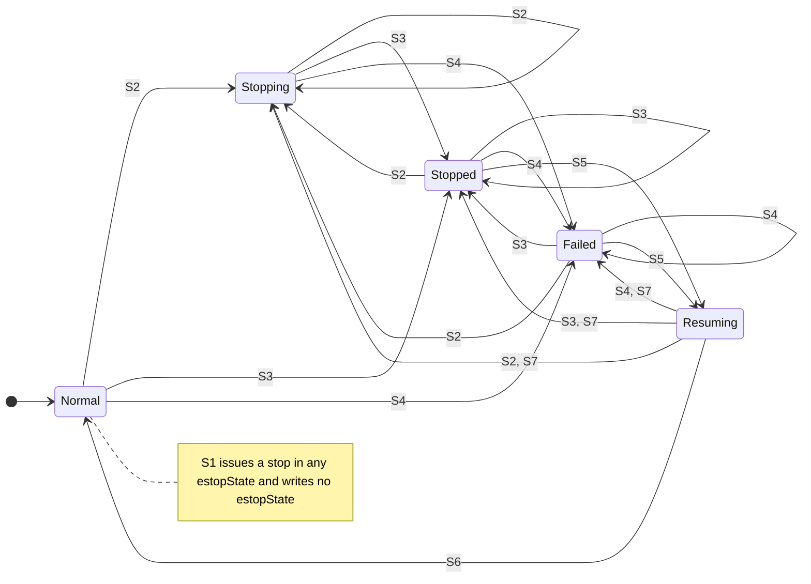
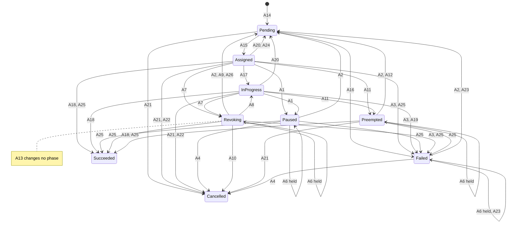
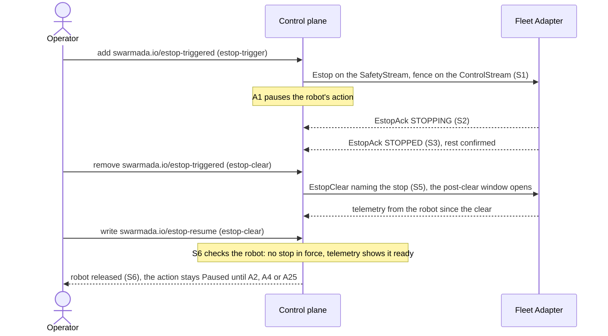
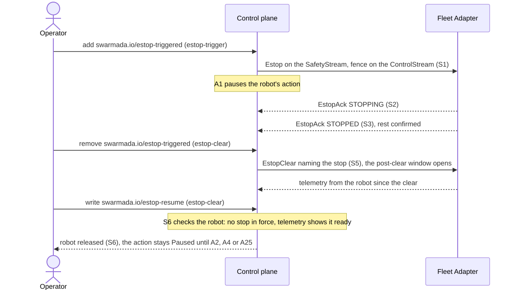
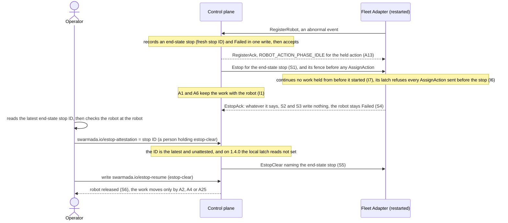
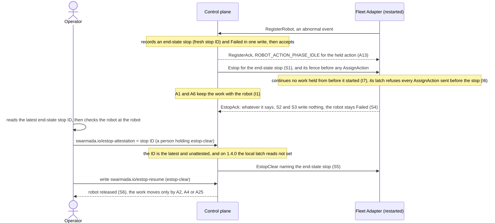

# RFC-0001: Swarmada Core Specification

<a id="abstract"></a>
## 1. Abstract

Swarmada is an open-source, cloud-native, vendor-neutral orchestration platform for fleets of mobile robots. This RFC defines the core API specification: eighteen Custom Resource Definitions (RobotClass, DiscoveredRobot, Robot, FleetAction, FleetTask, FleetZone, RobotProbe, FirmwareRollout, ModelRollout, ModelPolicy, ZoneMaintenance, SwarmadaConfig, FleetAdapter, EdgeNode, ComputeEndpoint, ComputeWorkloadTemplate, ResultSink, ArtifactStore), the Fleet Adapter gRPC protocol, the control plane architecture, and the safety and security models. The `swarmada.io/v1` API group also serves `SemanticEvent`, `SemanticEventSource` and `TaskTrigger`; this revision does not specify them, and an implementation of this specification is not obliged to serve them. They are specified by RFC-0003, which is their owner and which is a draft published alongside this specification for review and not part of this specification's release or contract. Swarmada enables operators to declare desired fleet state in YAML and have the system continuously reconcile actual fleet state toward it — coordinating heterogeneous mobile robots from multiple manufacturers under a single, standardized control plane. The spatial model (zones, positions, and traffic deconfliction) targets robots that move through a shared workspace; stationary manipulators are out of scope (see Non-Goals). Throughout this specification, unless explicitly qualified, "robot" means a mobile robot.

**How to read the assurance behind each part.** This document mixes two kinds of statement, and a reader
should know which is which. **Normative claims about the system** are mechanically checked against the
reference implementation by `scripts/specdiff.py` (`make spec-check` and `make spec-audit`), alongside a
check that this assembled document is in sync with its chapter sources. Both read the chapter sources under
`rfcs/rfc-0001-core-spec/`, so they can run only in a checkout that holds those sources. What that covers,
exactly:

- the CRD schemas in [§9.1](#crds) — schema paths, required-ness and defaults — **for every kind
  the `swarmada.io/v1` API group serves**, and the `enum`, `minimum`, `maximum`, `minLength`,
  `maxLength`, `minItems`,
  `maxItems`, `pattern` and `format` markers shown in those schema examples, diffed against the
  generated CRDs;
- the metric names and label *keys* in [§9.4.8](#control-plane-observability-prometheus-metrics-contract),
  and the absence from the implementation's registry of the metrics the checker holds in its own
  deferred-metric list. That list is maintained by hand in the checker and is **not** read from this
  document, so a marker added or removed here does not change what is checked;
- every cross-reference from the `.proto` into this document, verified to resolve; the Optional-command
  list in [§9.2.10](#fleet-adapter-protocol-fleet-adapter-compliance-checklist), diffed against the `Command`
  field comments in the `.proto`; and every identifier named in the conformance catalog, verified to
  exist in the `.proto` and to match the harness's check set in both directions;
- the Status column of the audit-event contract in [§9.7.5](#safety-safety-audit-log) — a row marked
  `emitted` must have a production writer in the reference implementation, and a row not so marked must
  not, checked both ways, with a writer that sits in a function nothing calls counted as absent;
- spec fields that no code outside `api/v1` reads, Kubernetes Event reasons and condition types this
  document names — each failing only where the gap is *undisclosed*, so a gap stated in the house
  vocabulary passes and an unstated one does not;
- every cross-reference inside this document, verified to resolve during assembly.

A disagreement on any of those fails the build. No schema path is excluded: every field this document
specifies is in the generated CRD.

**What that check does not cover, stated so it is not over-read.** Four gaps, enumerated in full so the
checked list above is not read as broader than it is.

1. **The protobuf blocks reproduced in [§9.2](#fleet-adapter-protocol) are not diffed against the
   `.proto`** — message, field, field-number and enum-value agreement rests on review. The three
   narrower proto checks listed above *are* mechanical.
2. **For metrics** the check compares the set of metric names and the set of label *keys*. It does not
   verify the metric type, histogram bucket boundaries, gauge zero-initialisation, the `Help` string, or
   the label *values* a metric actually emits. Where a table below enumerates the values a label takes —
   `scope`, `transition_type`, `reason`, `estop_state` — that enumeration is prose.
3. **Behavioural prose is not checked, with one exception.** No maturity label, no Known-gaps entry
   and no *specified, not implemented* marker is verified against the code, and no claim that a controller reads a given field
   is verified beyond the undisclosed-gap checks listed above. Those rest on review. The exception is
   the audit-event Status column listed among the checked items above.

4. **The Optional-command check reads annotations, not the command set.** The `Command` cross-check
   described above compares the optionality *annotation* on a `Command` oneof arm against the
   Optional-command list; an arm whose `.proto` line carries no `required`/`optional` comment is
   skipped. Seven of the eighteen arms carry no such comment, so the check cannot detect a `Command`
   this document classifies as neither Required nor Optional. That the two lists between them name
   every arm rests on review.

Read anything falling in those four categories as an assertion this specification makes, not as one the
build has verified.

**Rationale and analysis are editorial** — [§6](#design-details), [§7](#drawbacks) and
[§8](#alternatives) argue for the choices made and weigh their costs. They are reviewed but not
mechanically verified, because they assert judgement rather than fact.

**Disclosure vocabulary.** Where this specification runs ahead of the reference implementation, it says so
at the point of use. Three principal forms carry that disclosure; wording varies at the margins, but every variant states which of these three situations applies. They are not interchangeable: each tells a client a different
thing about what happens if it writes or reads the surface in question.

| Form | What it means for a client |
| :---- | :---- |
| *specified, not implemented at v0.4* | The field or behaviour exists in the API. A write is accepted and stored; no controller acts on it. |
| *schema-only — validated and defaulted, read by no controller* | As above, and the API server validates and defaults it, so a malformed value is rejected even though nothing consumes a well-formed one. |
| **Not met at v0.4** | The text is the contract and the reference implementation does not meet it. The note says what the reference does instead. A wire addition that a note names is in the reference `fleet_adapter.proto`; the note says what the reference does not do with it. |

Every field and message this document specifies exists in the generated CRDs and in `fleet_adapter.v1`.
That includes the wire additions of contract `1.4.0`, whose one list is *Current version* in
[§9.2.2](#fleet-adapter-protocol-package-and-versioning), and `status.stops`, the `Robot` record of the
control-plane stops issued to the robot ([§9.1.3](#robot)). Contract `1.4.0` is published with this draft
revision (v0.4). The `swarmada.io/estop-attestation` annotation,
an operator's attestation of the check at the robot, is read by nothing in the reference implementation,
and the notes that name it are marked **Not met at v0.4**. Any other surface that none of these
carries is not part of this contract, and adding one is outside this contract version ([§5.2](#resource-model)).

Those labels are deliberate: understating what ships is as much a defect as overclaiming, and a reader
planning against this specification needs to know which sentences the control plane will act on today.

---

<a id="motivation"></a>
## 2. Motivation

<a id="motivation-the-fleet-coordination-problem"></a>
### 2.1 The Fleet Coordination Problem

A facility running automation — a warehouse, a hospital logistics department, a manufacturing plant — often deploys robots from several manufacturers at once: picking autonomous mobile robots (AMRs) from one vendor, autonomous forklifts from another, inspection drones from a third. Each vendor ships its own proprietary fleet management system (FMS), its own fleet management API, and its own firmware update toolchain. A coordinator managing a mixed deployment must therefore monitor several separate vendor dashboards — more once the warehouse management system (WMS), charging and battery-management systems, and safety tooling are counted — with no unified health view; execute cross-vendor task assignments manually; and run vendor-specific tooling to update each robot family independently. Each of these systems also carries its own user and role management (role-based access control, RBAC), configured individually: onboarding or offboarding a technician means touching every system, least-privilege is inconsistent across them, and there is no unified audit trail. There is no single source of truth for fleet state.

As deployments grow and span multiple vendors, running each fleet as an independent silo — separate dashboards, separate traffic rules, and no coordination at shared intersections or zones — makes the manual alternative error-prone and operationally unsustainable: supervisors tracking individual robot states, ad-hoc cross-vendor task rebalancing, and no system-level awareness when a robot goes offline.

<a id="motivation-why-existing-approaches-are-insufficient"></a>
### 2.2 Why Existing Approaches Are Insufficient

**Manufacturer-native tools.** Every major AMR vendor ships fleet management software optimized for its own hardware. These tools are capable within their own ecosystem and actively maintained. They are not designed to interoperate. An operator running two vendors' robots cannot assign a task to whichever robot is closest regardless of vendor; they must decide which robot family handles which zone and manage the boundary conditions manually. The same fragmentation holds beyond the warehouse floor: aerial fleet operators run their own vendor-specific ground-control and fleet software, with no cross-vendor coordination layer either.

**Standardized robot protocols (VDA5050).** VDA5050, a communication standard from the German automotive (VDA) and material-handling (VDMA) associations, lets AMRs from different vendors speak to a common fleet manager [39]. It is complementary to — not a substitute for — a neutral orchestration standard: VDA5050 standardizes the robot-to-fleet-manager link (precisely the layer a Swarmada Fleet Adapter can consume), not the vendor-neutral control plane, task model, safety model, and open governance above it.

**Published robot-to-robot interoperability (MassRobotics AMR Interoperability Standard).** The MassRobotics AMR Interoperability Standard, version 1.0 (May 2021) [41], specifies how autonomous mobile robots from different vendors report identity and status to one another in a shared space. Its schema admits two message types, both uplink reports; it defines no order, task, or command message in either direction. Its publisher states that the standard is not a fleet management, vehicle navigation, or safety system, and that task management is not part of it. The standard is therefore evidence from a second, independent source that the coordination layer above the robot interface was left deliberately unspecified: two vehicles that both implement it can share a corridor safely and still have no common answer to which of them should carry the next pallet.

**In-flight interoperability standards (ISO 21423).** ISO 21423, "Robotics — Industrial mobile robots — Communications and interoperability" (ISO/TC 299), is not a published International Standard as of this revision. Its FDIS ballot closed on 2026-07-21 (stage 50.60) and the document advanced the same day to stage 60.00, "International Standard under publication"; ISO commits to no publication date at that stage [40]. Its scope as balloted specifies the communication requirements between industrial mobile robots, an industrial mobile robot fleet manager, and other machines, equipment and applications in the working environment — enterprise systems and building infrastructure among them — and states that the document is not safety-related. It names the fleet manager as a party that communicates; it does not specify how a fleet manager decides. ISO 21423 therefore stands in the same relation to this specification as VDA5050: an interoperability layer beneath orchestration, standardizing links a Swarmada Fleet Adapter can consume — including the link across which an assignment is conveyed to a robot — rather than the vendor-neutral control plane, task model, safety model, and open governance above it. That characterization rests on the scope clause as balloted at DIS stage and on the ISO catalogue record; if the published text specifies allocation behaviour rather than the interfaces across which assignments travel, this paragraph is wrong and will be revised.

**Commercial multi-fleet orchestrators.** Commercial orchestration products do coordinate mixed fleets across vendors, and several are capable at it. Licence is not the distinction: in February 2026 a commercial vendor announced a self-hostable fleet-management platform, derived from its production stack, to be published under a permissive open-source licence [43], so an open licence and a commercial origin are not mutually exclusive — nor would a comparison drawn on the expectation that such a release will not happen. What distinguishes these products from this specification is structure. Each is an implementation whose interface is defined by the code its vendor ships and whose direction is set by that vendor; an implementer inherits that roadmap and has, at most, whatever recourse a commercial relationship provides and none in governance, whether or not the source is published. This document is a specification — a versioned interface contract with a published conformance catalog that independent implementations can be measured against, structured so that the contract itself can be held by a neutral foundation rather than by any single vendor. That is a different arrangement, not a better product.

**Open-RMF.** Open-RMF (Robotics Middleware Framework) is a well-designed, technically capable open-source project with genuine adoption in logistics and healthcare facilities. It is licensed Apache-2.0, its intellectual property is held by the Open Source Robotics Foundation, and it has been managed by the Open Source Robotics Alliance under a published project charter since 2024 [29]. It is therefore a foundation-hosted project, and this specification does not argue otherwise. Two differences remain: architecturally it predates the cloud-native Kubernetes reconciliation model this specification is built on, and it specifies its fleet adapter as a software interface inside a reference implementation rather than as a versioned contract with a published conformance catalog. Both are examined in [§8](#alternatives).

**Cloud provider offerings.** Managed robotics services launched by cloud providers were cloud-vendor-specific, required data egress to a managed cloud environment, and produced no open interoperability standard. AWS discontinued RoboMaker on 2025-09-10 [30][31].

**Manual integration.** The default approach for most multi-vendor deployments today is custom integration code written per deployment: a bespoke middleware layer that translates between an upstream system's task formats (a WMS, a flight-ops system, a home-automation hub) and each vendor's API. This works once, for one facility configuration. It does not survive vendor software updates, does not generalize to a second facility, and creates a maintenance burden that grows with the number of robot families in the fleet.

<a id="motivation-why-now"></a>
### 2.3 Why Now

**Facility fleets increasingly span several vendors.** This specification's premise is that a single facility's fleet comes to include robots from more than one manufacturer, and that at that point coordination requires a dedicated orchestration layer rather than manual, per-vendor operation. It is stated as a premise rather than a sourced figure: the published forecasts [28] project growth in robot deployment overall, not the multi-vendor-per-facility share, and this document does not claim a number for it.

**The layer has no cloud-native specification and no conformance oracle.** Kubernetes has become a default infrastructure substrate for cloud-native workloads, and neutral foundations host projects across every major infrastructure layer — networking, storage, observability, security. The robot fleet orchestration layer has open, foundation-hosted software in it, but no declarative Kubernetes-native specification: fleet state is not expressible as API objects reconciled by controllers, and no protocol in the layer is versioned as a standalone contract an implementer can build against independently of any particular codebase. Nor does the layer have a conformance oracle. The interoperability standards below it publish schemas but operate no conformance scheme and recognise no certification body, and the one open project in the layer itself publishes no enumerated check catalog. A stable specification under community governance, versioned as a contract and accompanied by the catalog that measures conformance to it, is what would occupy this layer as an open standard rather than a proprietary one.

---

<a id="goals"></a>
## 3. Goals

1. Define a vendor-neutral, declarative Kubernetes-native API for describing and reconciling robot fleet state across heterogeneous hardware.
2. Define the Fleet Adapter gRPC protocol as an open standard that any robot manufacturer can implement to make their hardware Swarmada-compatible.
3. Define the control plane components — API Server (with the admission webhook server and the robot registrar), Scheduler, Zone Controller, Traffic Deconfliction Engine, OTA/Model Update Manager, Estop Coordinator, safety audit log writer, and the *Robot health and connectivity* responsibility grouping ([§5.1](#architecture)) realised across the Robot reconciler, the Probe Controller, the FleetAdapter controller and the telemetry pipeline — and the single responsibility of each.
4. Define a two-phase robot discovery model (`DiscoveredRobot` → `Robot` admission) — passive registration followed by active capability verification — modeled on the Kubernetes node admission pattern.
5. Define a hierarchical zone model in which Kubernetes namespaces provide administrative boundaries and `FleetZone` resources form a parent–child tree for spatial and policy inheritance.
6. Define capability health tracking that distinguishes hardware-native capabilities (present by construction), model-driven capabilities (present when a model is installed and healthy), and parametric hardware-native capabilities (hardware-native capabilities that additionally expose numeric constraints — such as payload capacity — sourced from hardware spec fields).
7. Define an AI model lifecycle framework — `ModelRollout`, staged deployment, rollback, and capability gating — so that a robot's advertised capabilities accurately reflect the models running on it.
8. Define a hardware component declaration schema that makes sensor, manipulator, load platform, and motion system specifications explicit, machine-readable, and linkable to runtime health conditions.
9. Define a `ZoneMaintenance` resource for planned maintenance pauses that is semantically distinct from emergency stop: maintenance is scheduled, reversible, and does not trigger safety escalation.
10. Define a `SwarmadaConfig` mechanism that triggers periodic capability re-scanning across the fleet (`spec.health.capabilityRescanIntervalSeconds`), without requiring per-robot operator intervention.
11. Define the safety and emergency stop protocol — propagation path, acknowledgement requirements, and the explicit boundary at which Swarmada's responsibility ends and the Robot OS's begins.
12. Define the security model: mutual TLS for all Fleet Adapter connections, Kubernetes RBAC for API access control, and a tamper-evident audit log for all state-changing operations.
13. Define a `RobotClass` resource that allows a single hardware, model, and capability declaration to be referenced by arbitrarily many robots of the same type, eliminating per-robot duplication in homogeneous fleets.
14. Be architecturally and governance-structurally proposable as a CNCF Sandbox project: no proprietary dependencies, pluggable extension points, and a neutral maintainer structure not controlled by any single vendor.

---

<a id="non-goals"></a>
## 4. Non-Goals

1. Issuing motion control commands or navigation waypoints to robots — path planning and real-time movement execution are the responsibility of the Robot OS and its onboard controllers, not Swarmada.
2. Physically placing or moving robots — Swarmada receives current position via Fleet Adapter telemetry but does not command relocation, whether within a zone, between zones, or anywhere else; that responsibility belongs to the operator or, where supported, the Robot OS. This is a permanent architectural boundary, not a future-RFC item: motion control operates at timing and certification requirements (100–1000 Hz control loops, ISO 10218/3691-4 safety certification of a fixed auditable stack) that a cloud-native control plane cannot and should not attempt to meet — see [§6.4](#design-details-why-is-motion-control-explicitly-out-of-scope) for the full rationale.
3. Providing Fleet Adapter implementations for specific manufacturers — adapters are community-maintained, one per robot family, and are out of scope for this specification.
4. Defining a scheduling algorithm — the Scheduler component interface is specified here, but the algorithm (nearest-robot, least-loaded, priority-weighted, etc.) is pluggable and not standardized by this RFC.
5. AI model training, fine-tuning, or evaluation — Swarmada manages the lifecycle of already-trained models deployed to robots; integration with training pipelines is out of scope.
6. AI inference orchestration at the execution level — GPU resource allocation, inference batching, and multi-model serving are the responsibility of the Robot OS and its inference runtime; Swarmada only manages which models are installed and whether they are healthy.
7. Automatically declaring new, previously-undeclared hardware components into `Robot.spec.hardware[]` — at v0.4, a component must first be declared by the operator (in `Robot` or `RobotClass`) before Swarmada will track or schedule against it; auto-populating undeclared components is not specified. This is narrower than "no automatic hardware awareness": `DiscoveredRobot` already reports a live hardware inventory from the Fleet Adapter at admission time ([§9.1.1.5](#robotclass-relationship-to-discoveredrobot)), and `SwarmadaConfig.spec.health.capabilityRescanIntervalSeconds` is specified to periodically re-verify the health of *already-declared* components against a fresh `CapabilitiesSnapshot` ([§9.1.12.5](#swarmadaconfig-the-scan-command-and-capabilityrescaninterval-in-practice)) — **that rescan is not implemented at v0.4**: nothing issues the `scan` Command, so at v0.4 only the admission-time inventory applies and re-verification depends on adapter-initiated telemetry. Neither of those adds a component nobody declared, which is what this item is about; the argument for keeping declaration explicit does not rest on the rescan being live. The reason declaration stays a deliberate, explicit operator step rather than fully automatic: there is no cross-vendor standard for hardware self-description (each manufacturer's onboard interface exposes hardware differently, and the Fleet Adapter — not the control plane — is the only component that understands a given vendor's specifics, per [§6](#design-details)'s translation-boundary design), and letting a component silently self-report into the scheduling-eligible capability set removes the operator's chance to catch a misconfigured or miscalibrated component before it is scheduled against, not only after (contrast the rescan mechanism, which only ever *demotes* health on an already-declared, already-reviewed component).
8. Multi-cluster or federated fleet management — each Swarmada deployment governs a single Kubernetes cluster; cross-cluster coordination is out of scope.
9. Cross-namespace robot task assignment — `FleetAction` resources are scoped to a single namespace; routing tasks across namespace boundaries is out of scope.
10. Natural language or LLM-driven task generation — Swarmada accepts structured `FleetAction` declarations; the question of how tasks are authored or generated upstream is out of scope for this RFC.
11. Hosted or managed-service offerings — any commercially operated, hosted version of Swarmada is a separate product and is not specified here; this RFC defines only the open standard.
12. Replacement of physical safety hardware — Swarmada's emergency stop protocol operates at the software layer; it does not replace and must never be treated as a substitute for light curtains, safety PLCs, or other IEC 62061 / ISO 13849-compliant physical safeguards.
13. Orchestration of stationary or fixed-base manipulators — Swarmada's spatial model (zones, positions, traffic deconfliction, and destination-based tasks) targets robots that move through a shared workspace. Fixed industrial arms and workcell/assembly-line sequencing are out of scope. Mobile manipulators (an arm on a mobile base) are in scope as mobile robots; a fixed arm may still use Swarmada's fleet-lifecycle features (health, firmware and model rollout) but is not the target of the task-orchestration model.
14. Peer-robot corroboration of a disconnected robot's task progress — if a robot goes unreachable mid-task, Swarmada does not ask other robots to observe, infer, or vouch for its progress. Reassignment under no stop waits for the row's own proof, and under a stop for the robot's end report or an operator's decision, per the "never infer, only confirm" safety discipline this specification uses throughout ([§9.7.3.5](#safety-assignment-lease-and-the-single-executor-guarantee)). Corroborated observation is not part of this RFC's disconnected-robot model.
15. Coordinated multi-robot start — synchronized simultaneous execution across robots. A single `FleetTask`'s actions are scheduled independently, with no cross-robot start-synchronization guarantee; the synchronized-start barrier, and the `FleetAction` start-gate primitive it rests on, are out of scope.
16. Deciding when a robot charges — `Robot.spec.charging` and `RobotClass.spec.defaultChargingConfig` declare a dock name and the battery thresholds at which a robot should begin and end charging, and `dockName` is validated at admission against the `ChargingDock` shared resources declared in the robot's zone or its ancestors ([§9.1.3.4](#robot-field-validation-rules)). The thresholds are a **declared surface with no control-plane behaviour at v0.4**: no component reads them to send a robot to a dock, to withhold it from scheduling as its charge falls, or to return it to service once charged. The `Charging` phase exists in the phase set and is never written at v0.4 ([§9.1.3](#robot)); it is not entered by any control-plane decision. A separate field, `RobotClass.spec.defaultConstraints.minBatteryPctForAction` (or the per-robot value on `Robot.spec.constraints`), lives on the **constraints** block, not the charging one, which carries only `minBatteryPctToCharge` and `targetBatteryPct`. It is not a charging threshold, and it is enforced: the Scheduler withholds new work from a robot whose battery is below the higher of that floor and the action's `FleetAction.spec.minBatteryPct` ([§9.4.2](#control-plane-scheduler), candidate filter 4). That filter and the battery-descending rank key are the only battery-driven scheduling behaviour at v0.4, and neither sends a robot to charge. Charging policy, idle disposition, and their interaction with the shared-resource reservation queue are deferred to RFC-0009 (Energy Management and Idle Disposition). A control plane or a Fleet Adapter MUST NOT treat the charging thresholds as a behavioural contract at this revision.
17. Commanding facility infrastructure that is not a robot — lifts, doors, chargers, conveyors, and barriers are not actuated by Swarmada. `FleetZone.spec.sharedResources[]` declares `ChargingDock`, `Corridor`, `Elevator`, `Entrance`, and `Custom` entries, and the Traffic Deconfliction Engine grants, queues, and releases reservations against their declared capacity ([§9.5.5](#tde-shared-resource-queue-management)). **A reservation is a capacity token and nothing more.** Holding an `Elevator` reservation entitles a robot to use that lift and imposes no obligation on the lift; the Fleet Adapter operates the device by whatever means the facility provides, exactly as it is already responsible for preventing the physical conflict the reservation is designed to avoid ([§9.1.6](#fleetzone)). The protocol carries no command that opens a door, calls a lift, or engages a charger, and a conformant implementation is not required to be able to. An actuation contract for non-robot infrastructure — a second device class with its own registration, health, and safety envelope — is deferred to RFC-0008 (Facility Infrastructure Actuation).
18. Teleoperation transport and operator consoles — video pipelines, input protocols, latency budgets, and operator UI are out of scope for this RFC and for the portfolio. A specification cannot state a teleoperation latency requirement for a network it does not define, and a requirement that cannot be tested weakens the requirements that can. The separable half — a per-robot custody state recording that control of a robot has been transferred to a person, and gating scheduling eligibility on it — is not specified at v0.4 and is deferred to RFC-0011 (Intervention and Custody). Until it exists, a robot under manual control remains schedulable; the consequence is stated in [§7](#drawbacks), item 13.
19. Versioning the facility model — `FleetZone.spec.waypoints[]` is a declarative vocabulary of named poses, and `spec.physicalBounds` a declarative geometry ([§9.1.6](#fleetzone)). Neither carries a revision, a map identity, or a checksum, and the control plane does not resolve a waypoint name: a `FleetAction`'s destination rides in its opaque `spec.payload` and is resolved by the Fleet Adapter against the robot's own map ([§9.1.4.7](#fleetaction-the-payload-field)). Two unversioned copies of the vocabulary therefore exist — the `FleetZone` declaration and the map onboard the robot — and no mechanism compares them or detects that they have diverged. A facility remap that moves the pose named `dock-07` silently changes what every task targeting `dock-07` means, and produces no event, no condition, and no scheduling change. Operators MUST treat waypoint renaming and remapping as a change requiring coordinated redeployment of both the `FleetZone` resources and the robots' maps. A versioned facility model, a map identity reported by the Fleet Adapter, and a scheduler filter that excludes a robot whose map does not match its zone are deferred to RFC-0010 (Facility Model and Map Versioning).
20. Defining a command-line client. `swarmctl` is a convenience client and is **not part of this specification's conformance surface** — no conformance requirement references it, and none can. Every operation this document shows with `swarmctl` is performed against the Kubernetes API and is equally available through `kubectl` or any API client, because the north surface *is* the Kubernetes API (ADR-0006). Authority depends on the client for some custom verbs. `estop-trigger`, `estop-clear`, `cancel`, `append` and `activate` are enforced server-side by SubjectAccessReview at admission, so a raw `kubectl` write is gated identically to the equivalent `swarmctl` invocation. `admit`, `reject`, `policy-reset` and `rollout-resume` are checked only by `swarmctl`, and `update` or `patch` on the resource is sufficient to perform them without it ([§9.6.3](#security-authorization-swarmada-rbac-roles)). Where this document shows a `swarmctl` invocation it is illustrating an operator workflow, never specifying an interface.

---

<a id="proposal"></a>
## 5. Proposal

<a id="architecture"></a>
### 5.1 Architecture Overview

RFC-0001 defines a two-plane architecture that separates fleet-wide coordination (the **control plane**) from per-robot execution (the **data plane**). All system state is expressed as Kubernetes custom resources; components never issue direct imperative commands but instead react to desired-state declarations through the controller-runtime reconciliation loop.

<a id="architecture-the-two-plane-model"></a>
#### 5.1.1 The Two-Plane Model

**Control Plane** *(cloud or on-premise Kubernetes cluster)*

| Component | Single Responsibility |
| :---- | :---- |
| **API Server** | Exposes Swarmada's control-plane surface: the Kubernetes apiserver serving every Swarmada CRD (REST) plus the `fleet_adapter.v1` gRPC contract ([§9.2](#fleet-adapter-protocol)); validates and persists all custom resource mutations. This surface is the general Swarmada API Server, not one specific to RFC-0001. The admission webhook server (schema, CEL and cross-field validation, and the custom-verb `SubjectAccessReview` gates in [§9.6.3](#security-authorization-swarmada-rbac-roles)) and the robot registrar that serves `discover`/`register` ([§9.1.2](#discoveredrobot)) are parts of this component, not separate ones. |
| **Scheduler** | Selects one robot for each pending action (`FleetAction`). A task (`FleetTask`) is not scheduled as a whole: each of its actions is scheduled on its own. It keeps only the `Idle` robots that pass the hard filters (capability, selector and zone constraints, readiness; [§9.4.2](#control-plane-scheduler)) and ranks them by the action's `spec.preferredRobot` when the namespace sets `honorPreferredRobot`, then by `spec.preferredManufacturer` when it sets `preferSameManufacturer`, then by battery level, highest first (`DefaultScheduler.SelectRobot`). It does not rank by proximity or by load: no distance is computed, and only an `Idle` robot is a candidate. |
| **Robot health and connectivity** | Aggregates heartbeat and telemetry streams from all Fleet Adapters and updates robot health, hardware and connectivity status. A responsibility grouping realised by the Robot reconciler, the Probe Controller, the FleetAdapter controller and the telemetry pipeline — not a single component ([§9.4.3](#control-plane-robot-health-and-connectivity)). |
| **Zone Controller** | Reconciles `FleetZone` resources and enforces zone-level capacity and access policies. |
| **Traffic Deconfliction Engine** | Synchronous blocking gate between the Scheduler and every action assignment. Enforces `FleetZone.spec.maxConcurrentRobots` and manages shared resource reservation queues. Calls `RequestReservation` before any assignment is committed; decides grants against its in-process state, and mirrors that state to `FleetZone.status.reservations[]` and `FleetZone.status.sharedResourceQueues[]`. See [§9.5](#tde). |
| **OTA/Model Update Manager** | Distributes firmware and model artifacts to Fleet Adapters according to `FirmwareRollout` and `ModelRollout` resources. **Verification is asymmetric across the two artifact classes, and the asymmetry is normative.** A **firmware** artifact is checked by the control plane itself, in-process, before any dispatch: the checksum's format, and the signature against `SwarmadaConfig.spec.signing` trust roots ([§9.6.5](#security-secrets-management)); the Fleet Adapter verifies the digest after download. While `spec.signing.requireSignatureVerification` is true or unset, a firmware artifact whose signature does not verify is never sent to a robot. While it is false, the control plane checks only the checksum's format (*Not met at v0.4 (signing off)*, [§9.1.8](#firmwarerollout)). A **model** artifact is not verified by the control plane at any point — the control plane never fetches or holds the model bytes, so verification is the Fleet Adapter's obligation on receipt ([§9.2](#fleet-adapter-protocol)), and the only control-plane record is the adapter's own attestation of the trust root it checked against, sealed into the audit chain when the adapter acknowledges the update. A model artifact that the adapter refuses is therefore never installed, but the refusal is the adapter's, not this component's. See [§9.1.9](#modelrollout) and [§9.1.8](#firmwarerollout). |
| **Estop Coordinator** | Delivers emergency stops over the `SafetyStream` and tracks each to a confirmed outcome ([§9.7.2](#safety-emergency-stop-protocol)). A zone- or namespace-scope estop is dispatched to every robot in scope **concurrently**, one dispatch per robot, and each robot's outcome is what rows S2 to S4 of [§9.7.2.4](#safety-robot-stop-table) record — never a falsely-confirmed stop. |
| **Safety audit log writer** | Appends the event types that [§9.7.5](#safety-safety-audit-log) and [§9.6.4](#security-audit-logging) list to the per-namespace tamper-evident hash chain. Coverage is partial at v0.4: some listed types have no writer, and those sections name them. |

**Data Plane** *(edge hardware and on-robot compute)*

| Component | Single Responsibility | Owned by |
| :---- | :---- | :---- |
| **Robot Agent** | The robot manufacturer's own onboard control software — executes assigned tasks on a single robot and reports state and telemetry through that manufacturer's native interface. Out of Swarmada's scope: Swarmada does not author, ship, or modify it. | The manufacturer |
| **Fleet Adapter** | Translates the RFC-0001 canonical task protocol into the manufacturer-specific command interface for one robot family, by calling the Robot Agent's native interface. The **only** data-plane component Swarmada owns (reference adapters) or defines a contract for (vendor/community adapters, [§9.2](#fleet-adapter-protocol)). May run on-robot or on nearby edge compute — see Deployment Topology below. | Swarmada (reference) or the vendor/community (`docs/adr/0005-reference-adapter-policy.md`) |
| **Zone Controller edge node** | Detects locally a robot that leaves the zone it is assigned to and stops it, so that guard holds during transient control-plane connectivity loss; it does not check entry into another zone. Acts as local emergency-stop authority for robots in its zone when the control plane is unreachable ([§9.7.2.9](#safety-edge-headless-emergency-stop)). Maintains a local fleet map from a direct per-tick position tee off each Fleet Adapter over the EdgeStream ([§9.2.12](#fleet-adapter-protocol-the-edge-stream)). | Swarmada (software) — deployed by the operator onto on-premise edge hardware the operator provides (a Jetson device, a Raspberry Pi 5, or similar always-on edge compute co-located with the zone). |

<a id="architecture-communication-patterns"></a>
#### 5.1.2 Communication Patterns

Three communication patterns are used consistently across the system:

**REST** — Operator tooling (`swarmctl`, dashboards, upstream-system integrations — WMS, flight-ops, home-automation, etc.) communicates with the API Server over HTTPS/REST. This interface is optimized for human-driven and low-frequency programmatic interactions.

**gRPC (bidirectional streaming)** — Fleet Adapters maintain persistent gRPC streams to the API Server. This enables low-latency task dispatch and continuous telemetry upload without polling overhead.

**Controller-runtime reconciliation** — All internal state transitions are driven by Kubernetes controller-runtime watch events, not direct calls between control-plane components. A component observes that the desired state of a resource differs from its actual state and acts to close that gap.

**Telemetry fast path** — High-frequency robot telemetry (position, battery, raw hardware metrics) flows from Fleet Adapters through the telemetry pipeline into the configured telemetry backend (TSDB sink). This path bypasses etcd entirely for raw values. Only derived state transitions (zone change, capability change, connectivity phase change, material battery crossing) propagate from the telemetry backend to etcd as `Robot.status` patches, subject to the write policy in `SwarmadaConfig.spec.telemetry` ([§9.1.12.8](#swarmadaconfig-telemetry-pipeline-and-status-projection)).

<a id="architecture-the-reconciliation-model"></a>
#### 5.1.3 The Reconciliation Model

Every RFC-0001 component follows the desired-state → observed-state pattern central to Kubernetes: an operator declares *what* should be true (e.g., `FleetAction` assigned to robot `amr-07`), and the relevant controller works continuously to make reality match that declaration.

This model is particularly valuable for robot fleets. If a robot loses connectivity mid-task, its `FleetAction` resource remains in a non-terminal state rather than being lost, and the controller re-evaluates it whenever its watch fires or on the next periodic resync. What happens next is governed by `SwarmadaConfig.spec.actionCancellation.onDisconnect`, and the shipped default is `Never` (the `+kubebuilder:default=Never` marker on `SwarmadaActionCancellationConfig.OnDisconnect`, `api/v1/swarmadaconfig_types.go`): rows A7 and A10 of [§9.7.2.5](#safety-action-table) apply: lease renewal stops (A7), and an operator cancels the action (A10) (the `actionRevoke` and `actionReassign` branches of `FleetActionReconciler.Reconcile`, whose `ActionCancellationNever` case holds the action; `internal/controller/fleetaction_controller.go`). **Reassignment is not automatic under the default policy.** That default is the conservative one — a non-idempotent action must not be handed to a second robot while the first may still be executing it ([§9.7.3.5](#safety-assignment-lease-and-the-single-executor-guarantee)) — and the automatic paths (`AfterTimeout`, `WhenActionExpired`) are opt-in per namespace. What the reconciliation model supplies unconditionally is that the action survives the disconnection as durable desired state and is re-evaluated on every reconcile; it does not supply operator-free recovery.

<a id="architecture-deployment-topology"></a>
#### 5.1.4 Deployment Topology

**Developer / Prototype** — All control-plane components run on a single `minikube` cluster. Fleet Adapters connect over `localhost`, and robots are simulated rather than physical. Swarmada is simulator-agnostic at the Fleet Adapter boundary: any simulator that can drive a Fleet Adapter over the same gRPC interface used in production is a valid choice, including NVIDIA Isaac Sim, Gazebo, and Swarmada's own in-tree reference simulation adapter (`adapters/simulation`) used by the conformance test harness. Intended for local development and CI pipelines.

**Single-site Production** — The control plane runs on an on-premise Kubernetes cluster. A Zone Controller edge node is deployed per physical zone, and Fleet Adapters run on Jetson hardware co-located with the robot charging infrastructure.

**Multi-site** — Each site is represented as a dedicated Kubernetes namespace with its own `FleetZone` set, all served by a **single** control-plane deployment: a Swarmada deployment governs one Kubernetes cluster and resolves each namespace's `SwarmadaConfig` at read time, rather than running a control plane per site ([§4](#non-goals) item 8). Multi-cluster and federated topologies, cross-site task routing, and cross-site resource sharing are all out of scope ([§4](#non-goals) items 8 and 9).

**One manager replica.** In every topology, the reference control plane runs as one manager replica while it serves the `ControlStream`. Only the leader-elected replica serves adapter streams: another replica refuses them with `Unavailable`, and a replica closes its streams when it loses leadership (`internal/controlstream/leadership.go`). `Command`s are pushed only to the streams the leader holds in process memory. Emergency stops are sent the same way: the safety dispatcher also holds its `SafetyStream` senders in process memory. Multi-replica command delivery is not implemented. The Helm chart refuses to render `replicaCount` greater than 1 with `controlStream.enabled`; the kustomize manifests set one replica and do not check for more. Leader election keeps one active reconciler across restarts and rollouts; it does not make a second replica safe.

<a id="architecture-architecture-diagram"></a>
#### 5.1.5 Architecture Diagram

```text
┌─────────────────────────────────────────────────────────────────────┐
│                          CONTROL PLANE                              │
│               (cloud or on-premise Kubernetes cluster)              │
│                                                                     │
│  ┌─────────────┐  REST/HTTPS  ┌──────────────────────────────────┐  │
│  │  Operator   │─────────────▶│           API Server             │  │
│  │  Tooling    │              └────────────────┬─────────────────┘  │
│  │ (swarmctl,  │                               │ controller-runtime │
│  │  dashboard, │              ┌────────────────▼─────────────────┐  │
│  │  upstream   │              │  Scheduler  │  Robot Ctrl        │  │
│  │  system:    │              │  Zone Ctrl  │  Deconfliction Eng │  │
│  │  WMS/flight-│              │  Probe Ctrl │  OTA/Model Mgr     │  │
│  │  ops/home)  │              │ Estop Coord │  Audit log writer  │  │
│  └─────────────┘              └─────────────────────────────┬────┘  │
│                                                             │       │
└─────────────────────────────────────────────────────────────┼───────┘
                                                              │
                              gRPC: ControlStream / SafetyStream / EdgeStream
                                                              │
┌─────────────────────────────────────────────────────────────▼───────┐
│                           DATA PLANE                                │
│   Ownership key: [S] Swarmada-owned  ·  [M] manufacturer-owned      │
│                  [O] operator-provided hardware                     │
│                                                                     │
│  ┌─────────────────────────────────────┐  ┌────────────────────────┐│
│  │ NEARBY EDGE COMPUTE  [O] hardware   │  │ ZONE EDGE HARDWARE [O] ││
│  │ (a Jetson/industrial PC — OR the    │  │ one per zone, not per  ││
│  │ Fleet Adapter runs on-robot below)  │  │ robot                  ││
│  │                                     │  │ ┌────────────────────┐ ││
│  │  ┌───────────────────────────────┐  │  │ │ Zone Controller    │ ││
│  │  │  Fleet Adapter  [S]           │◀─┼──┼─│ edge node  [S]     │ ││
│  │  │  (per manufacturer; the only  │  │  │ │ local estop        │ ││
│  │  │  data-plane component         │  │  │ │ authority, works   │ ││
│  │  │  Swarmada owns/defines)       │  │  │ │ offline(EdgeStream)│ ││
│  │  └───────────────┬───────────────┘  │  │ └────────────────────┘ ││
│  └──────────────────┼──────────────────┘  └────────────────────────┘│
│                     │ vendor-native protocol                        │
│  ┌──────────────────▼─────────────────────────────────────────────┐ │
│  │ ON-ROBOT COMPUTE  [M] manufacturer-owned hardware              │ │
│  │                                                                │ │
│  │  ┌───────────────────────────────┐                             │ │
│  │  │  Robot Agent  [M]             │──task execution+telemetry──▶│ │
│  │  │  (the manufacturer's own      │                             │ │
│  │  │  onboard control software;    │                             │ │
│  │  │  out of Swarmada's scope)     │                             │ │
│  │  └───────────────────────────────┘                             │ │
│  └────────────────────────────────────────────────────────────────┘ │
└─────────────────────────────────────────────────────────────────────┘
```

The Fleet Adapter is the only box that moves: it may run on nearby edge compute (shown above), directly on-robot alongside the Robot Agent, or in the same Kubernetes cluster as the control plane — all are valid deployments of the same component. The Fleet Adapter is a gRPC client of `ControlStream`/`SafetyStream`/`EdgeStream`; nothing in the protocol requires physical proximity to the robot, only that the operator accept the latency and availability trade-off of the network path chosen. In-cluster deployment suits robots with reliable direct connectivity and no local edge-hardware requirement (this is also how the developer/prototype topology runs, per [§5.1.4](#architecture-deployment-topology)); nearby edge compute or on-robot deployment suit sites where connectivity to the cluster is less reliable or where estop/safety latency budgets are tighter. The Zone Controller edge node is zone-level infrastructure serving every robot in its zone, never a per-robot component, and is unaffected by where the Fleet Adapter runs. See the Data Plane component table above for the full ownership breakdown.

---

<a id="architecture-telemetry-architecture"></a>
#### 5.1.6 Telemetry Architecture

See [§9.1.12.8](#swarmadaconfig-telemetry-pipeline-and-status-projection) for the full configuration surface. This section covers the architectural boundary.

**The telemetry/etcd boundary:**

| Data | Destination |
| :---- | :---- |
| Raw `x, y, yaw, floor` (per-tick) | TSDB sink only (never etcd) |
| Battery percentage (per-tick) | TSDB sink only |
| Hardware sensor raw values (per-tick) | TSDB sink only |
| `Robot.status.currentZone` | etcd on zone change only |
| `Robot.status.phase` | etcd on phase change |
| `Robot.status.capabilities[].status` | etcd on each status transition |
| `Robot.status.batteryPercent` (summary) | etcd on material threshold crossing |

The Zone Controller derives zone membership from the **live telemetry stream** at the Ingestor fan-out ([§9.4.7](#control-plane-telemetry-pipeline-and-the-two-data-plane-split)) — never from `Robot.status` in etcd, and never by reading the TSDB sink back. The sink is a write-only observability destination from the control plane's perspective: the query surface for humans and tooling, not a control-loop dependency. A `sink.type: Drop` or degraded sink therefore cannot blind zone derivation ([§9.4.7](#control-plane-telemetry-pipeline-and-the-two-data-plane-split) Invariant 2). etcd receives one write per **zone transition**, not per position update. This keeps the telemetry path off etcd at full cadence while preserving fleet-wide state visibility in `Robot.status`.

**Write-amplification reference:**

| Fleet size | Max etcd writes/s (telemetry path, steady state) |
| :---- | :---- |
| 25 robots | ~5–15 |
| 50 robots | ~5–20 |
| 200 robots | ~20–60 |
| 200 robots (full-cadence, 5s interval) | ~0.2 writes/s/robot (one write per 5s) = **40 writes/s fleet-wide** — sits mid-range within the ~20–60 zone-transition-only range on the row above, meaning full-cadence, every-frame projection alone produces write load on the same order as normal zone-transition traffic, on top of it; do not do this |

---

<a id="architecture-traffic-deconfliction-engine-summary"></a>
#### 5.1.7 Traffic Deconfliction Engine Summary

> **Maturity (v0.4):** stage: alpha · control-plane: partial · end-to-end: partial. **Named control-plane gaps,** detailed with others in [§9.5](#tde) — the four below, plus the TDE-8 residuals, no `cancel_action` to a zone-preemption victim at eviction (its robot is sent one afterwards, [§9.5.6](#tde-preemption-algorithm)), the in-process-mutex rather than compare-and-swap serialisation, and the absence of any TDE Kubernetes Event or Prometheus metric at v0.4 (the engine has **no observability surface**): (1) the `Manual` reservation policy behaves as `Priority`; (2) a `Granted` response confirms **zone capacity only** — shared resources named on the same request are granted or queued, never denied, so a granted action may still be waiting behind a full lift or corridor; (3) the Scheduler does not populate `ReservationRequest.Resources` at v0.4, so the queue disciplines in [§9.5.5](#tde-shared-resource-queue-management) are reachable only from the adapter-initiated `ReserveResource` path; (4) the reservation-expiry reconciler in [§9.5.8](#tde-reservation-expiry-reconciler) is **specified, not implemented** — an expired `Reserved` entry stops counting against capacity but is never removed from `FleetZone.status`, and no `SwarmadaConfig.spec.trafficDeconfliction.onReservationExpiry` behaviour runs. The TDE and the `FleetZone` capacity/reservation fields it depends on (`spec.maxConcurrentRobots`, `spec.sharedResources[]`, `status.reservations[]`, `status.sharedResourceQueues[]`) are defined: a blocking deconfliction gate runs before every action assignment that names a zone, with zone-capacity gating, shared-resource reservation and queueing, preemptor-band (Critical/High) preemption, and startup reservation recovery (see [§9.5](#tde)).

The TDE is a **synchronous blocking gate** called by the Scheduler before every action assignment. It enforces zone capacity (`FleetZone.spec.maxConcurrentRobots`) and shared resource reservations (`FleetZone.spec.sharedResources[]`). Reservation state is held authoritatively **in process**, in per-zone structures guarded by per-zone locks, and mirrored to `FleetZone.status` on each mutation (the `Engine` type and `Engine.mirror`, `internal/tde/engine.go`); the mirror is the durable, operator-visible record and the input to restart recovery, but it is not the copy a grant decision is evaluated against. See [§9.5.10](#tde-normative-invariants) TDE-6.

For any action naming a zone, the Scheduler MUST NOT write `FleetAction.status.assignedRobot` or take row A15 without a `Granted` or `PreemptedGranted` response from the TDE. That response confirms zone capacity; it does not confirm that every shared resource on the request is held (see the Maturity note above). An action with no `spec.zone` does not reach the gate at v0.4 — see [§9.5.10](#tde-normative-invariants) TDE-1.

Critical or High actions may preempt a lower-priority (Normal or Low) reservation, Reserved or Occupied, when a zone is at capacity; evicting an Occupied one causes a transient over-capacity of +1 while the evicted robot is still in the zone. At v0.4 no `cancel_action` is sent at eviction, and the evicted action's robot is sent one afterwards ([§9.5.6](#tde-preemption-algorithm)); rows A6, A12, A25, A2 and A21 of [§9.7.2.5](#safety-action-table) state what then holds or releases the action. When the TDE denies a reservation, row A15 is not taken, and the Scheduler retries with a `RetryAfter` hint.

On TDE restart, Reserved entries are released unconditionally (transit state cannot be safely reconstructed); Occupied entries are validated against `Robot.status.currentZone` (etcd-durable) and retained if the robot is still physically in the zone. If the Zone Controller is not ready within the wait timeout, the configured fallback applies: `ReleaseAll` releases every reservation, and `ReleaseReservedOnly` releases the Reserved entries and keeps the Occupied ones. The wait timeout and the fallback are set by `zoneControllerWaitTimeoutSeconds` and `conservativeRecoveryFallback` in the `SwarmadaConfig` of the manager's own namespace, which both the shipped manifest and the Helm chart pass to the manager as `POD_NAMESPACE`; unset, they are a 30-second wait and `ReleaseAll` ([§9.5.7](#tde-restart-recovery)). An adapter-initiated shared-resource hold or wait survives every recovery mode while its robot's `Robot` object exists, so a restart does not free a lift a robot still holds ([§9.5.10](#tde-normative-invariants) TDE-7).

Full TDE specification: [§9.5](#tde). Configuration: [§9.1.12.11](#swarmadaconfig-traffic-deconfliction-engine-configuration).

---

<a id="resource-model"></a>
### 5.2 Resource Model at a Glance

This specification defines eighteen namespace-scoped Custom Resource Definitions (CRDs). The `swarmada.io/v1` API group also serves `SemanticEvent`, `SemanticEventSource` and `TaskTrigger`, which this revision does not specify and which the maturity table below does not cover. They are outside this specification's contract. RFC-0003, a draft published alongside this specification for review and not part of this specification's release or contract, describes them. Their fields ship in the CRDs. Those this document names nowhere else are listed here so that they are not read as undocumented: `SemanticEvent` `spec.occurredAt` and `status.draftedTasks`; `SemanticEventSource` `spec.eventTypes`, `status.acceptedCount` and `status.rejectedCount`; `TaskTrigger` `spec.source.eventType`, `spec.source.semanticEventSource`, `spec.taskTemplate` (a `FleetTask` spec), `status.draftCount`, `status.lastEventName`, `status.lastFiredAt` and `status.pendingDrafts`. The eighteen are ordered here by admission lifecycle: the template first, then the discovery and robot objects, then the task and zone resources a robot operates within, then the health and update management resources that govern it over time, then the non-robot node a rollout may target, and last the compute configuration objects an external action refers to. The full normative schema for each is in [§9](#detailed-specification); this section is the map.

**Reading guidance by audience:**

- *Operator getting started:* begin at [§9.1.3](#robot) (Robot) after reviewing [§9.1.2](#discoveredrobot) (DiscoveredRobot) to understand the admission flow.
- *Fleet Adapter implementer:* begin at [§9.1.2](#discoveredrobot) (DiscoveredRobot) and [§9.1.3](#robot) (Robot), then [§9.2](#fleet-adapter-protocol) (Fleet Adapter Protocol) for the gRPC contract.
- *Upstream-system integration engineer:* begin at [§9.1.5](#fleettask) (FleetTask — the composite objective a work order maps to) and [§9.1.4](#fleetaction) (FleetAction — the atomic unit), then [§9.1.6](#fleetzone) (FleetZone).
- *Platform engineer:* begin at [§9.1.12](#swarmadaconfig) (SwarmadaConfig) for namespace defaults, then read all CRD status fields to understand what the control plane writes.

**Primary dependencies between CRDs:**

- `Robot` references `RobotClass` (optional) and `FleetZone` (required, terminal).
- `FleetAction` references `FleetZone` (for zone targeting).
- `FleetTask` composes one or more `FleetAction`s (via `ownerReferences`); each action may target a `FleetZone`.
- `RobotProbe` selects `Robot` resources via label selector.
- `FirmwareRollout` and `ModelRollout` select `Robot` resources via label selector.
- `ModelPolicy` auto-creates `ModelRollout` resources on quality gate pass.
- `ZoneMaintenance` references `FleetZone` by name.
- All CRDs inherit namespace defaults from `SwarmadaConfig`.

**Three version numbers, deliberately independent.** This document carries `swarmada-version: v0.4`. The number is below 1.0,
and the contract this revision states is not frozen: it is frozen when this specification reaches v1.0
(*The contract is frozen at RFC-0001 v1.0*, below). Two other version numbers appear throughout and move on their
own schedules:

| Version | What it covers | Current |
| :---- | :---- | :---- |
| RFC-0001 spec version | This document's revision. The contract is frozen when it reaches v1.0 | `v0.4` |
| Kubernetes API group | The CRD group/version every resource here is served under | `swarmada.io/v1` |
| Fleet-adapter contract | The semantic contract over the proto surface and the `SupportedAction` schema; the conformance-suite revision is recorded beside it, not part of it ([§9.2.2](#fleet-adapter-protocol-package-and-versioning)) | `1.4.0` |

**CRD versions follow Kubernetes API rules.** The CRDs are served as `swarmada.io/v1`. Within `v1` only
backward-compatible changes are made, such as a new optional field. An incompatible schema change introduces a new
API version (`v2`), served alongside `v1` for at least one revision, with conversion and a migration note.

A resource's `stage:` describes its maturity and semantics, not its schema compatibility. Every v0.4 CRD is `alpha`.
At RFC-0001 v1.0 the core resources are declared `stable` in `v1`. The core resources are the thirteen original kinds:
`Robot`, `RobotClass`, `DiscoveredRobot`, `FleetAction`, `FleetTask`, `FleetZone`, `FleetAdapter`, `RobotProbe`, `SwarmadaConfig`, `ModelPolicy`, `ModelRollout`, `FirmwareRollout` and `ZoneMaintenance`.

The fleet-adapter contract reaching `1.0.0` states that the *adapter wire contract* is
stable enough to negotiate against — it says nothing about the spec revision that describes it. An
implementer tracking compatibility should track the contract version; an operator reading resource semantics
should track this document's version.

**The contract is frozen at RFC-0001 v1.0.** The freeze covers the fleet-adapter wire contract version and the CRD
API versions published with RFC-0001 v1.0. It does not mean wire contract `1.0`. Until then, `0.x` revisions keep
refining the contract, and each keeps changes to existing contracts to a minimum.

**The contract-change process.** No revision changes the proto definitions, a CRD's rules and semantics, or the
normative text of this specification in place. A change to any of them is a new contract version, with release notes
and migration notes. An amendment or a new RFC specifies it (`rfcs/README.md`, *Amending an accepted RFC*).

**Which version number moves.** A change that does not touch the wire is a patch bump by default, and the supported
range stays where it is. A change that binds adapters is a minor bump, and the supported range moves by the N and N-1
rule ([§9.2.2](#fleet-adapter-protocol-package-and-versioning)).

**What binds adapters.** A change binds adapters if it adds, changes or removes an obligation for adapters. A conformance check that tests an obligation already stated moves the suite revision only. The contract version does not change. A change that binds adapters for safety, under a safety rule below, also raises the
lowest supported contract version to the new one. Any other binding change keeps the N and N-1 window. After a safety bump, robots cannot register until both the adapter and the control plane are upgraded; emergency stop is unaffected.

**What `stage:` allows until v1.0.** Each revision states which resources changed stage.

- `alpha`: a resource's rules and semantics change only through the contract-change process. For a CRD, `alpha` never permits an incompatible schema change within `v1`.
- `beta`: a resource changes only by addition. Any other change needs a deprecation announced at least one revision ahead.
- `stable`: a resource does not change before the next major revision.

**Safety rules, at every stage.** A change to a safety rule (stops, the action table, the robot stop table, the
invariants) goes through the contract-change process. The same version updates the conformance suite. A change that
weakens a guarantee says so first, and every unmet rule keeps its Not-met note.

**Normative text.** Normative text is
every sentence that carries an RFC 2119 keyword, wherever it stands (in a maturity note, a Known-gaps cell
or an editorial chapter as much as in the body), every schema block, every state table or rule table such a sentence cites,
and the RBAC matrix. The two amendments accepted for v0.4,
`rfcs/amendments/RFC-0001-zone-restrictions.md` and `rfcs/amendments/RFC-0001-zone-exclusions.md`, are
normative text on the same terms. They are published as separate files at v0.4, and the next revision folds them into the chapters. A requirement that binds an operator, a deployer or a reader is a deployment obligation: no conformance check grades it. Everything else is informative and can still change: the rest of maturity notes, paragraphs that
describe what holds "at v0.4", Known-gaps cells, examples, citations and errata. Annotation names and labels
are inside the contract, because scripts and operators depend on them. Event reasons, metrics, CLI flags,
printer columns, doc comments and message strings are outside it, and a change to one is recorded in
`CHANGELOG.md`. At v0.4:

- The fleet-adapter contract is `1.4.0`, and its supported range is `>=1.3.0 <1.5.0`.
  An adapter outside it moves to a version inside it; the window is not widened to admit it
  ([§9.2.2](#fleet-adapter-protocol-package-and-versioning)). Contract `1.4.0` is published with this draft revision (v0.4). It
  includes wire additions that this revision specifies, for the stop latch, and the v1 proto
  carries them. The
  one list of them is *Current version* in [§9.2.2](#fleet-adapter-protocol-package-and-versioning).
- Beside the two `Robot` status projections the zone-restrictions amendment states (`status.containingZones[]` and `status.honouredOperatingConstraints[]`), this revision also specifies one `Robot` status addition, `status.stops`, the record of the
  control-plane stops issued to the robot, which the generated `Robot` CRD carries ([§9.1.3](#robot)), and one `Robot` annotation,
  `swarmada.io/estop-attestation`, an operator's attestation of the check at the robot ([§9.7.2.4](#safety-robot-stop-table), *The attestation*), which the reference reads nowhere. Where the reference does not act on that annotation or on a `1.4.0` wire addition, a **Not met at v0.4** note says so; bringing the reference into line with such a note is code, not a change to the contract.
- A conformance check that tests an obligation this text already states can still be added. It moves the
  suite revision only, and the contract version does not change. A check that adds an obligation binds
  adapters, so it goes through the contract-change process.
- Code that brings the reference implementation into line with this text is implementation, not a change to
  the contract. A maturity note that records a gap can later record it closed.

**Maturity status (v0.4).**

The schemas in [§9.1](#crds) are the normative target. Maturity is reported on **three** axes, because a single label cannot distinguish a resource whose controller is finished from one whose behaviour has been exercised against a real robot.

- **`stage:`** — how far the resource's API has been proven in use. All v0.4 CRDs are `alpha`. Until v1.0 the stage governs what may change in a resource's rules and semantics, not its schema compatibility (*The contract is frozen at RFC-0001 v1.0*, above). The fleet-adapter wire contract is versioned by its own policy ([§9.2.2](#fleet-adapter-protocol-package-and-versioning)).
- **`control-plane:`** — how much of the resource's own behaviour the reference control plane delivers: `specified` or `none` (type, schema and admission rules only; no controller acts on the resource), `partial` (some controller behaviour, with the shortfall named), or `implemented` (the resource's own controller behaviour is complete).
- **`end-to-end:`** — whether the full vertical, from an operator surface through the control plane and a Fleet Adapter to a robot runtime, has been exercised: `verified` (exercised against a live robot runtime), `partial` (exercised in part, against simulated bindings), or `none` (not exercised).

**No resource in this specification is `end-to-end: verified`.** The thirteen original kinds are `end-to-end: partial`; the five added in this revision — `EdgeNode`, `ComputeEndpoint`, `ComputeWorkloadTemplate`, `ResultSink` and `ArtifactStore` — are `end-to-end: none`, because no vertical has been exercised for them at all. The reference adapters — ROS 2/Nav2, VDA5050 and MAVLink/PX4 — are exercised against the conformance harness using **simulated bindings**; none has been exercised against a live runtime (a sourced ROS 2/Nav2 workspace, an MQTT broker, PX4 SITL), and the VDA5050 adapter's target interface has not been exercised at all. The in-tree simulation adapter is test infrastructure, not a deployment target. A passing conformance report establishes that an adapter speaks the protocol correctly; it is not evidence that the vertical works, and this specification does not offer it as such. The per-adapter grades are in `adapters/REGISTRY.md`, which is the authoritative record — and all three carry `partial` there as of this revision. **The grade does not gate admission; no controller reads it.** `FleetAdapter.status.conformance` is `Passed` when the conformance report the adapter references verifies and records `conformant: true` — no MUST or MUST NOT check failed among the checks that ran — so a `partial` adapter whose only declines are optional commands can reach `Passed`, and the in-tree simulation adapter does. The admission gate in [§9.1.13.4](#fleetadapter-admission-gating) also requires that result to have been earned against a contract version inside the supported range, and that is the condition the three reference adapters do not meet at v0.4: each registry row records contract `1.0.0`, outside the `>=1.3.0 <1.5.0` range a `1.4.0` control plane accepts, so their robots are refused registration and admission ([§9.2.2](#fleet-adapter-protocol-package-and-versioning)) until each implements a contract version inside it and is re-qualified against that version. The range is not widened for them: each adapter moves to a version inside it in its own repository.

A `control-plane: implemented` row with an entry in **Known gaps** is therefore distinguishable from one with none, and neither is a claim about end-to-end support. Individual field-level deferrals in the per-CRD detail below the table remain the authoritative record.

The per-CRD detail beneath the table describes what each CRD does **now**. It is not a changelog: dated implementation history belongs in `docs/adr/` and the release notes, not in a normative specification, because a reader six months from now needs the current contract rather than the order in which it was reached. The fleet-adapter gRPC contract ([§9.2](#fleet-adapter-protocol)) and its proto are the most complete surface by implementation, though its stage remains `alpha` at v0.4. That contract carries its own semantic **contract version** — distinct from the `fleet_adapter.v1` package identity and from any adapter's build version — and a release advertises the range it implements; the negotiation, its N/N-1 skew, and the conformance result bound to it are specified in [§9.2.2](#fleet-adapter-protocol-package-and-versioning).

Seventeen rows cover the eighteen CRDs: `FirmwareRollout` and `ModelRollout` share one, because their stage and implementation state are the same and their behaviour is described together. Their remaining gaps are **not** the same; where the Known-gaps cell names a gap that applies to only one of the two, it says which.

| CRD | stage | control-plane | end-to-end | Known gaps |
| :---- | :---- | :---- | :---- | :---- |
| RobotClass | alpha | partial | partial | The class merge assigns `manufacturer` and `model` where the `Robot` omits them, and `constraints.*` and `charging.*` inherit per field, so a `Robot` that sets one sub-field keeps the rest of the class block. Admission builds the `Robot` spec afresh, so copying the three `defaultTelemetry` scalars from the class loses no `Robot`-set value; re-admission overwrites them ([§9.1.1.4](#robotclass-robotclass-update-behavior)). Note the consequence of per-field charging inheritance: a `Robot`-set `minBatteryPctToCharge` combined with a class-supplied `targetBatteryPct` can now fail the `RobotChargingConfig` CEL rule at admission, where the whole-block merge silently discarded the class value instead. `status.conditions[Ready]` with reason `ClassResolved` is specified and written by no v0.4 controller. |
| DiscoveredRobot | alpha | partial | partial | Eleven `HardwareComponent` attributes the wire does not carry (`maxGripForceN`, `strokeMm`, `reachMm`, `degreesOfFreedom`, `resolutionH`, `resolutionV`, `tempRangeMinC`, `tempRangeMaxC`, `channels`, `sampleRateHz`, `touchCapable`) — outside this contract version, not a controller gap. Three of the eight attributes that *are* carried (`frameRateFps`, `platformLengthMm`, `platformWidthMm`) are `double` on the wire and 32-bit integers on `Robot.spec.hardware[]`, so admission rounds them and drops a NaN or out-of-range reading to unset — the attribute vanishes rather than being admitted wrong. Six further behaviours are **specified, not implemented at v0.4**: the `dr-`-prefixed name sanitisation and collision hash (the registrar requires `robot_id` to already be a DNS-1123 subdomain and uses it verbatim as the object name); `status.lastAnnouncedAt` as the TTL anchor (never written — `connectedAt` is rewritten on every announce and the staleness window is computed from it); the Case 1b adapter-ownership conflict check (a same-`robot_id` announce from a **different** adapter overwrites the record and is accepted, rather than being refused `ALREADY_EXISTS`); `Register` validation steps 2–5 (the `adapter_version` major-mismatch rejection and the firmware/hardware diff events); and the `swarmada.io/manufacturer`, `swarmada.io/model` and `swarmada.io/adapter` labels, which no code applies to a `DiscoveredRobot`. The sixth is `DiscoverAck.ttl_seconds`, which is never populated, so an adapter reads `0`, treats the TTL as disabled and re-announces every 60 s regardless of `discoveredRobotTTLMinutes` — and setting that field to `0` restores the 30-minute default rather than disabling the TTL. |
| Robot | alpha | partial | partial | Capability derivation does not write `Failed` or `Unavailable`; a degraded-hardware/active-model capability resolves `Degraded` where the truth table specifies `Inactive`; model-granted capabilities are unioned in as `Active` without running the truth table. Four of the six `status.conditions` in [§9.1.3](#robot) are specified and written by no v0.4 controller — `HardwareHealthy`, `CapabilitiesFullyActive`, `InConfiguredZone`, `ChargingConfigured`; the shipped `Ready` condition is set on adapter liveness alone rather than on the phase-and-health predicate the chapter states, and an undocumented `ConnectivityCritical` condition is also written, as is `RobotIDConflict` on every `Robot` whose wire robot-id another `Robot` carries. Three status fields are specified and written by nothing: `status.position` (pose reaches the TSDB and the zone derivation only, never etcd), `status.connectivity.latencyMs`, and `status.hardware[].degradedMetrics` (on the probe and telemetry paths alike; `status.hardware[].degradationReason` and `lastHealthyAt` are written by the probe path only). Several `spec` fields are validated and inherited and acted on by nothing at v0.4: `constraints.maxPayloadKg`, `constraints.maxSpeedMs`, `charging.minBatteryPctToCharge`, `charging.targetBatteryPct`, `motionThresholdMeters`, `maxIdleIntervalSeconds`, `adapter.version`, and `installedModels[].requiredHardware` ([§9.1.3](#robot)). |
| FleetAction | alpha | partial | partial | `spec.timeoutSeconds` fails an action only by row A19, moves no `Paused` action, and sends held work no cancel (row A6), all of [§9.7.2.5](#safety-action-table). At v0.4 it sends held work that cancel after the release, and the `TimedOut` condition is never written. Of the condition types [§9.1.4](#fleetaction) documents in `status.conditions[]`, two are written at v0.4, `Superseded` and `AdapterDeclined`. `Superseded` is written only on an adapter report no in-tree adapter sends: the ActionStatus ingestor sets it `True` when an adapter reports `end_cause: SUPERSEDED`. `AdapterDeclined` is written too: assignment-time validation sets it `True`, naming the adapter, the robot and the reason, when a candidate's adapter declines the concrete action, on the transition only and with one Warning Event per new reason (`setAdapterDeclined`). Three types outside that list are written: `ZoneStopped`, while an action whose destination is under a stop is held `Pending`; `RenewalHeld`, on work a stop's clear or release finds bound to the robot, and on work a reconcile finds on a `Resuming` robot; and `ExternalDependenciesReady`, set `False` by the sensor-stream dependency gate while the action names a stream that is absent or not ready, and `True` once it is (`applySensorStreamRefusal`, `clearSensorStreamRefusal`). `status.phase` and the typed timestamp/reason fields carry the lifecycle signal. `spec.desiredState` is enacted: `Cancelled` routes into the same confirmed-cancel path as the `swarmada.io/cancel-requested` annotation, `Paused` enters the operator-gated hold through the same transitions the estop path uses, and `Returning` runs an adapter-confirmed recovery over the existing `cancel_action` path before holding in that same phase — so all three carry the single-executor guarantee. Writing `Running` back does not lift a hold: no row of [§9.7.2.5](#safety-action-table) leaves `Paused` on it (ADR-0045). `spec.robotSelector` bypasses the parametric-constraint filter as well as the zone and capability filters, so a pinned action can reach a robot whose declared payload capacity is below `spec.constraints.maxPayloadKg`. |
| FleetTask | alpha | partial | partial | No deletion finalizer: `delete` on a live composite is refused at admission rather than drained, so the guard is an admission check, not a confirmed-cancel drain. `dependsOn` acyclicity and existence are specified to be checked at admission and are checked at reconcile instead, so a cyclic or dangling graph is admitted and fails later. The FailFast, `desiredState: Cancelled` and Compensate paths all work by writing `Cancelled` onto each child's `spec.desiredState`, which the FleetAction controller now reads (see the FleetAction row), so the composite's cancellation semantics reach the robot through the confirmed-stop path. Per-child adapter validation is specified to run before any child is generated and in fact runs when each child is created. `status.conditions[Ready]` and `status.actions[].attempt` are specified and written by no v0.4 controller. This specification defines no `BarrierSatisfied` condition (Non-Goal 15), and no controller writes one. |
| FleetZone | alpha | partial | partial | `spec.sharedResources[].reservationPolicy: Manual` selects no queue discipline in the reference TDE — a Manual resource is granted, queued and backfilled exactly as `Priority`. Five spec fields are **specified, read by no controller at v0.4**: `spec.provisioningPolicy` (so a zone-level `TwoPhase` override does not suppress a namespace-wide auto-admit), `spec.sharedResources[].durationFallback`, `spec.physicalBounds.minAltitude` and `maxAltitude` (never transmitted, so no adapter or edge node can enforce the ceiling the chapter attributes to them), and `spec.edgeNode.tlsSecretRef`. `status.activeActions` is specified and written by nothing; it is not a print column. The `status.reservations` operator-edit rejection (TDE-4) is not enforced by the admission webhook. The Scheduler's zone filter reads `status.currentZone`, so a robot whose position matches no polygon, or that has sent no position frame into a zone with a site-aligned polygon, is withheld from every action that names a zone ([§9.1.6.11](#fleetzone-zone-controller-current-zone-derivation)). |
| RobotProbe | alpha | partial | partial | No unimplemented fields: every `spec` field is consumed. A probe-set `Degraded` on `Robot.status.hardware[]` holds until the probe clears it: the telemetry status sink does not lower it while the probe still reports on the robot, including across a control-plane restart; telemetry may worsen it to `Failed` ([§9.1.7](#robotprobe)). Two further documented limits on downstream propagation — scope boundaries rather than gaps — are set out in [§9.1.7](#robotprobe): degrading `Robot.status.hardware[]` applies to **hardware** probes only (a capability or model probe records its outcome in `status.robotResults[]` and touches `hardware[]` not at all, because neither names a component to degrade), and a hardware probe whose `targetComponent` is absent from `Robot.status.hardware[]` is a silent no-op. Three items are **specified, not implemented at v0.4**: the `SwarmadaConfig.spec.health.defaultHardwareProbeIntervalSeconds` / `defaultProbeTimeoutSeconds` inheritance is unreachable, because `spec.intervalSeconds` and `spec.timeoutSeconds` carry CRD-level defaults the API server always applies and the namespace fallback fires only on a non-positive value (the pointer-typed threshold fields resolve correctly); the `ProbeFailure` Kubernetes Event is not emitted, a `PROBE_FAILURE` audit seal being written instead; and the probe path does not write `Robot.status.hardware[].degradedMetrics`. The "exactly one target must be set" rule is not enforced, so a probe whose `probeType` and target field disagree is admitted and is a silent no-op. |
| FirmwareRollout / ModelRollout | alpha | partial | partial | The `Unavailable` capability status specified in [§9.4](#control-plane) and the `Robot` CRD schema for a capability suspended by a `ModelRollout` is **not implemented at v0.4** in the reference control plane, which writes `Inactive` instead; a capability granted only by a prior rollout is also not withdrawn during a re-rollout. Cosign **keyless**/Fulcio certificate-identity verification is not implemented (key-based verification, including the cosign multi-layer convention, is). Rekor inclusion-proof and signed-entry-timestamp verification IS implemented, but degrades silently to index-presence-only when `signing.rekorPublicKey` is unset — see [§9.1.12](#swarmadaconfig). (Firmware `newVersion` carrying no version pattern is by design, not a gap — see [§9.1.8](#firmwarerollout).) **FirmwareRollout only:** the success edge closes through the robot's own report — the install-state projection promotes `status.firmwareInstall.runningVersion` into `Robot.status.firmwareVersion` (and the version it replaces into `status.previousFirmwareVersion`) once the robot reports `Running`, which is what the updated-classifier compares against `spec.newVersion` ([§9.1.8](#firmwarerollout)). `spec.deliveryMechanism` and `spec.rollbackPolicy` are schema-only, and the `swarmada.io/pending-firmware-signature-ref` annotation is not written, so the Robot Agent cannot perform the signature check the pull path describes. **ModelRollout only:** `spec.maxDownloadTimeMinutes` and `spec.attestationRef` are schema-only; `status.robotsIneligible` counts robots refused as a **downgrade**, not robots missing required hardware (a hardware-short robot is counted in `robotsTotal` and appears in `robotsPending`). |
| ModelPolicy | alpha | partial | partial | A repository whose images are all epoch-pinned reproducible builds and versionlessly tagged cannot be ordered; the poller does nothing rather than guess. `spec.maxConcurrentRollouts` is **specified, not implemented at v0.4** — the controller admits one active rollout unconditionally, so any value behaves as `1`. `status.webhookEndpoint` is specified and written by nothing. A RegistryWatch trigger carries no signature reference, so where signing is enforced (the default) every `ModelRollout` the poller creates is refused at admission, with nothing surfaced on the policy. `spec.rolloutTemplate` cannot express `grantsCapabilities`, `revokesCapabilities` or `requiredHardware`, so a policy-created rollout grants, revokes and gates nothing. The webhook endpoint is **asynchronous** at v0.4: it verifies the HMAC, writes the `swarmada.io/model-trigger` annotation and returns `202 Accepted` with a plain-text body, rather than the synchronous Deploy/Reject decision document described in [§9.1.10](#modelpolicy); a suspended policy drops the trigger, recording only a `TriggerDroppedWhileSuspended` Warning Event, instead of returning `409 Conflict`. Three of the five documented `status.conditions` — `WebhookReady`, `QualityGateConfigured`, `RolloutActive` — are written by no v0.4 controller. |
| ZoneMaintenance | alpha | partial | partial | `status.activatedBy` is specified and written by nothing, so a maintenance window carries no operator attribution. All three documented `status.conditions` — `DrainComplete`, `AutoResumeScheduled`, `EstopInterference` — are **specified, not implemented at v0.4**; the controller writes two other conditions, `ResumeBlockedByEstop` and, for a composite scope only, `ScopeResolved`, both described in the [§9.1.11](#zonemaintenance) Maturity note. An operator who waits on `DrainComplete` before entering a zone waits indefinitely at v0.4, because nothing writes it. `SwarmadaConfig.spec.maintenance.defaultAutoResumeMinutes` is read by no controller (only the per-window `autoResumeAfterMinutes` is), phase `Cancelled` is never assigned, and the six print columns the chapter shows are four in the shipped CRD. Most consequentially, the `Command.pause` / `Command.resume` dispatch in [§9.2](#fleet-adapter-protocol) is **not issued at v0.4**: a paused robot is moved to `Robot.status.phase = Maintenance` in the control plane and is never told to stop, so no `PauseResult` is requested and no robot is physically halted by a maintenance window. |
| SwarmadaConfig | alpha | implemented | partial | The following are schema-only — validated and defaulted, read by no controller: `health.telemetryIntervalSeconds`; `provisioning.mode`; `estop.delivery.retryPolicy.*` and `estop.delivery.partialDeliveryBehavior`; `estop.requireExplicitClearAfterEstop` (the prohibition it names is nonetheless unconditionally enforced, because no auto-clear path exists — the field is inert, the rule is not); `trafficDeconfliction.tdeCallTimeoutMs` and `trafficDeconfliction.onReservationExpiry`; `health.capabilityRescanIntervalSeconds`; `health.defaultHardwareProbeIntervalSeconds` and `health.defaultProbeTimeoutSeconds` (unreachable behind the `RobotProbe` CRD defaults — see the RobotProbe row); and `maintenance.defaultAutoResumeMinutes`. `maintenance.requireEstopClearBeforeResume` is unreachable on the same terms as the two probe defaults, behind the `ZoneMaintenance` CRD default of `true`. `scheduling.actionRequeueBackoffSeconds` is read (`requeueBackoff`): it is the wait before a failed, previously assigned `FleetAction` with `onFailure: Requeue` is requeued (row A23 of [§9.7.2.5](#safety-action-table)), applied only to an action that sets no `spec.retryPolicy` — an action that sets one uses its own `backoffSeconds`. `signing.requireSignatureVerification` without `signing.trustRoots` is admitted with a warning, not rejected (ADR-0051). |
| FleetAdapter | alpha | partial | partial | `spec.tlsSecretRef` has no effect — adapter identity is resolved from the client certificate's SAN, not from the referenced Secret, so the field pins nothing. The `SpecFieldsIgnored` condition reports a set `tlsSecretRef` or a non-default `protocolVersion`. The `UnknownConformanceSuite` warning in [§9.1.13](#fleetadapter) is not emitted: an unrecognised `suiteVersion` is recorded and otherwise ignored. `status.observedGeneration` is written by no controller and the `Ready` condition never appears on a live object. Two phase-machine arcs are specified and not implemented: `Connected` does not require a verified conformance report, and a conformance failure never moves the phase to `Rejected`. `spec.protocolVersion` has no effect. |
| EdgeNode | alpha | none | none | No controller reconciles an `EdgeNode`, and nothing writes any field of `status`. There is no registration path: `status.phase` never leaves its zero value, and `registeredAt`, `roles[]`, `agentVersion`, `lastHeartbeatAt` and `zoneControlAvailable` are never written. No RBAC is granted for `edgenodes`. An `EdgeNode`-targeted `ModelRollout` is refused explicitly with a `TargetKindNotImplemented` Warning rather than silently mishandled. The shipped Zone Controller (`cmd/edge`) derives its zones from every `FleetZone` in the namespace, not from `spec.zones` — see [§9.1.14](#edgenode). |
| ComputeEndpoint | alpha | none | none | The type, its CRD and all three CEL admission rules are complete and enforced, and the G1 gate in the `FleetAction` webhook resolves `spec.executor.endpointRef` and checks `spec.results[]` against a named `ResultSink`. There is no dispatch path: nothing calls `ComputeRuntimeService`, resolves an endpoint address, or activates a run. `spec.provision`, `spec.parameters[]`, `spec.inputs[]`, `spec.probe` and `spec.streamPolicy` are declared and validated but consumed by no code. `spec.emitsEvents[]` is read at `FleetTask` admission only, to refuse an event binding that names a type the producing endpoint does not declare; nothing at runtime checks a raised event against it — see [§9.1.15](#computeendpoint). `FleetAction.spec.executor.completionMode` carries no default — see [§9.1.15](#computeendpoint). |
| ComputeWorkloadTemplate | alpha | none | none | The type, its CRD and its admission rules — five CEL rules and a validating webhook — are enforced and complete except for AppArmor, which a template cannot express and which is dropped rather than refused ([§9.1.16.2](#computeworkloadtemplate-admission-rules)). `compute.BuildWorkload` exists and its only callers are its own tests; `internal/compute` ships in the manager only through the webhook's pod-spec containment check (`compute.ValidatePodTemplate`), so no template is read at runtime and no RBAC is warranted. `provision.workload` is declarable on a `ComputeEndpoint` and inert. The generated CRD embeds a full `PodTemplateSpec` and exceeds the 256 KiB client-side apply limit, so it installs only with `kubectl apply --server-side` or `kubectl create`. |
| ResultSink | alpha | none | none | The type and its CRD are complete, and G1 resolves every name in `spec.executor.sinks[]` against the referenced `ComputeEndpoint`'s declared results. There is no egress path and no grant is ever issued: `spec.credentialRef` is read by no code, and `ActivateRequest` carries no field in which a sink grant could travel. `spec.kind`, `spec.endpoint` and `spec.retention` are declared and unread. `internal/egress` is in no shipped binary's build graph. |
| ArtifactStore | alpha | none | none | The type, its CRD and its three admission rules are complete and enforced. `scheduler.ArtifactStoreReachable` implements the locality rule of [§9.1.18.4](#artifactstore-reachability-the-rule-the-scheduler-applies) and its only callers are its own tests; no scheduling path invokes it, and the `ArtifactStoreNotReachable` reason constant is never written to any object. `spec.retention`, `spec.objectStore.credentialRef`, `spec.volumeClaim.claimName`, `spec.volumeClaim.subPath` and `spec.edgeLocal.path` are declared and validated but read by no code, and no RBAC is granted for `artifactstores`. |

**What each of the thirteen original CRDs does today.** The five kinds added in this revision —
`EdgeNode`, `ComputeEndpoint`, `ComputeWorkloadTemplate`, `ResultSink` and `ArtifactStore` — have
no entry here; the Known-gaps column of the table above is the record for those five.

***RobotClass.*** Carries the Gripper/Arm/Thermal/Microphone/Display hardware attribute fields. A mutating admission webhook merges the class onto each referencing `Robot`: union-by-name for hardware/models/capabilities, `manufacturer`/`model` fill where the Robot omits them, per-field fill for `constraints.*` and `charging.*` (each sub-field the Robot leaves unset takes the class value; `charging.dockName` is Robot-only), adapter name/version fallback, and the `defaultTelemetry` cadence scalars (`telemetryIntervalSeconds`/`motionThresholdMeters`/`maxIdleIntervalSeconds`) filled where the Robot left them unset. A status controller reports `status.referencingRobots` (Robots in-namespace naming this class) and `status.observedGeneration` (the merge revision robots inherit); it aggregates read-only and writes only `RobotClass.status`.

***DiscoveredRobot.*** The Discover/Register handler is served over the ControlStream. **Discover** validates `robot_id` as a DNS-1123 subdomain (empty/malformed → `DiscoverAck` with `RegistrationRejection = INVALID_ROBOT_ID`), rejects an already-admitted robot (`ALREADY_EXISTS` — reconnect via Register), and otherwise upserts a status-only `DiscoveredRobot` (idempotent re-announce refresh), populating `status.macAddress`, the identity/adapter fields, `reportedCapabilities`, defensively-mapped `reportedHardware`/`reportedModels` (identity/health — name, type, status, model, plus `customType` for an operator-defined subtype — and the numeric attribute fields `maxPayloadKg`, `resolutionMp`, `rangeM`, `horizontalFovDeg`, `depthCapable`, `frameRateFps`, `platformLengthMm`, `platformWidthMm`, carried from the wire with explicit presence so an attribute the adapter does not report stays unset rather than 0), and `ttlExpiresAt`. **Register** validates `robot_id` (`INVALID_ROBOT_ID`), returns `NOT_ADMITTED` when no `Robot` exists, else accepts with the binding hints (`telemetryIntervalSeconds`, `assignedZone`) and never writes `Robot.status`. Register also returns the full reconnect-state ([§9.2.8](#fleet-adapter-protocol-reconnect-action-state-reconciliation)) so an adapter resynchronises after a disconnect: `authoritative_action_state` (the assigned FleetAction's phase mapped to the wire `RobotActionPhase` plus the fencing token / lease generation = `assignmentGeneration`, so the adapter reconciles its work against it or self-stops per [§9.7.3.5](#safety-assignment-lease-and-the-single-executor-guarantee); under this revision every register accepted for the robot, the first after admission included, is an abnormal event, so the robot is held under its end-state stop and its work is not resumed (*Abnormal events and the end-state stop* of [§9.7.2.4](#safety-robot-stop-table), and row A13 of [§9.7.2.5](#safety-action-table)); no action → `IDLE`, a claimed-but-unrecorded action → `UNKNOWN`/halt), `active_capabilities`, and `edge_endpoints` (the robot's zone-chain `spec.edgeNode` addresses, leaf-first, [§9.2.12](#fleet-adapter-protocol-the-edge-stream)) — all read-only projections. A TTL/Stale sweeper marks an un-admitted DiscoveredRobot `Stale` in the last quarter of its `connectedAt→ttlExpiresAt` window and deletes it once `ttlExpiresAt` passes (admission/rejection deletes it first, so a survivor was never acted on), requeuing to the next event; it cooperates with the registrar without coordination — a re-announce rewrites `phase=Discovered` and a fresh `ttlExpiresAt`, so an actively-reconnecting robot is never reaped and `Stale` clears on reconnect.  Both hops preserve explicit presence for everything the wire carries — `status.reportedHardware` is populated from `fleet_adapter.v1 HardwareComponent` (identity/health plus the eight numeric attributes, an unreported attribute staying unset rather than 0) — though the second hop is not full-fidelity for three of the eight: `frameRateFps`, `platformLengthMm` and `platformWidthMm` are `double` on the wire and 32-bit integers on `Robot.spec.hardware[]`, so admission rounds them and drops a NaN or out-of-range reading to unset ([§9.1.2](#discoveredrobot)) — and `swarmctl admit` projects all twelve shared fields into `Robot.spec.hardware[]` (`status` is excluded as health, which `Robot.status.hardware[]` owns).

***Robot.*** The reconciler drives the [§6.10](#design-details-capability-type-system) capability truth table (hardware-native/model-driven/manual, `Degraded`/`Inactive`/`Paused`) — with the three derivation gaps named in the table above — and the structured `status` objects (`hardware[]`, `capabilities[]`, `installedModels[]`, `modelGrantedCapabilities[]`, `currentZone`, `connectivity`, `health`); the adapter binding is enforced by an admission-time RobotClass merge (mutating webhook) plus a validating gate that resolves the specific `spec.adapter.name` and requires it Connected/conformant. Dynamic capability-parameter resolution applies: a parametric capability's `sourceField: hardware[<name>].spec.<field>` is resolved from the robot's `spec.hardware[]` numeric attribute at each capability evaluation (not only at admission), so a post-admission hardware change is reflected without re-admission; an unresolvable path/component/field/unset-attribute is skipped, exactly as an invalid static value is.

***FleetAction.*** Drives the full phase machine: `Revoking` (lease single-executor guarantee), `Paused` (operator-gated on estop), and `Preempted`. Preemption is band-driven — both **Critical and High** priority displace a lower-band (Normal/Low) victim, in both the scheduler and the Traffic Deconfliction Engine zone-reservation path; the victim rule is Normal/Low only, so a preemptor never evicts another Critical/High. Queue order by priority **value** (Critical before High, FIFO within one value) is specified, not implemented at v0.4: the reference Scheduler does not order `Pending` actions against each other ([§9.1.4.3](#fleetaction-priority-semantics)). Over the adapter wire, after the authoritative commit the control plane pushes `assign_action` (delivering the action with the fencing token = `assignmentGeneration`) and, at each steady-state lease renewal, `renew_lease` (refreshing the robot's self-stop deadline, [§9.7.3.5](#safety-assignment-lease-and-the-single-executor-guarantee)). These pushes are best-effort and non-gating, bounded by a short timeout so a silent adapter never stalls reconciliation. An unreachable result is logged and evented and alters no lease, generation or phase state, which the server side alone holds; with ControlStream disabled the state machine is unchanged. Cancellation is a **confirmed cancel** ([§9.7.3.5](#safety-assignment-lease-and-the-single-executor-guarantee)): a `swarmada.io/cancel-requested` annotation (set by the `swarmctl cancel <fleetaction>` verb) cancels the action by row A21, A4 or A10 of [§9.7.2.5](#safety-action-table), on the proof each states. What the adapter's answer to the pushed `assign_action`, or the lack of one, does to the assignment is row A24 of [§9.7.2.5](#safety-action-table). `SwarmadaConfig.actionCancellation.onDisconnect` selects `Never` (the default), `AfterTimeout` or `WhenActionExpired` for a `Revoking` action ([§9.1.12.10](#swarmadaconfig-action-cancellation-on-disconnect)), failing safe to `Never` on a missing or unreadable config; rows A9 and A10 of [§9.7.2.5](#safety-action-table) state what each value does. All three dispositions are supported ([§9.1.12](#swarmadaconfig)). Assignment eligibility additionally requires the candidate robot's bound `FleetAdapter` to be `Connected`, with `conformance: Passed` earned against a contract version inside the range this control plane supports (`status.conformanceContractVersion`; a report naming none counts as unsupported), at dispatch time (ADR-0032's assignment gate), evaluated **fail-closed** — an unset `spec.adapter.name`, an absent adapter, or an unreadable one withholds the robot. The admission gate checks the same three conditions once, at admission; this re-check closes the window in which an adapter degrades, or its conformance flips to `Failed`, while its already-admitted robots keep drawing work. It filters the shared candidate set, so it governs the preemption search too, and a `FleetAdapter` watch re-evaluates affected actions on a readiness transition. The gate is on **work dispatch only**: telemetry, heartbeats and emergency stop are unaffected (ADR-0032 pins estop as state-invariant), and an action already `Assigned`/`InProgress` is never revoked by it. (`renew_lease` also pushes on re-adoption, row A8; a paused action is intentionally not renewed, row A1 — an estopped robot is stopped by the estop, not the lease.)

***FleetTask.*** Composite, upstream-facing objective composing one or more `FleetAction`s via `ownerReferences`: dependency graph (`dependsOn`/`startCondition`), `completionPolicy` (All/Any/Quorum), `failurePolicy` (FailFast/ContinueOthers/Compensate) with saga compensation, declarative `spec.desiredState`, and append-only plan growth under a scoped RBAC verb. The type and schema are normative; the composite controller is implemented. `spec.desiredState` fans out onto each child's `FleetAction.spec.desiredState`, which the FleetAction controller enacts ([§9.1.4](#fleetaction)) — so FailFast, `desiredState: Cancelled` and Compensate stop the robots through the confirmed-cancel path, and phase aggregation then sees the terminal phase it waits on. A task holding children under `Paused`/`Returning` reports `Running` until each held child is resolved through the per-child operator intake; `Paused` is not terminal, so the hold is a wait rather than a wedge ([§9.1.5](#fleettask)). Coordinated multi-robot start (the synchronized-start barrier) is out of scope ([§4](#non-goals) item 15). `delete` is guarded at admission: the validating webhook refuses to delete a FleetTask that is not settled — deletable only in an unset phase, `Draft`, `Pending`, or a terminal phase (`Succeeded`/`Failed`/`Cancelled`/`Compensated`); `Running` and `Compensating` are refused, because deleting a live composite would garbage-collect its owned FleetActions out from under their assignment leases (the operator cancels through the confirmed-cancel path first, then deletes the settled record). The permit-set is expressed positively, so a phase added later is refused by default.

***FleetZone.*** Full spec build-out (`physicalBounds`, `edgeNode`, `maxConcurrentRobots`, `sharedResources`, `estopPolicy`, `provisioningPolicy`), a Zone Controller deriving `status.currentZone` from live position (or, for a robot whose declared zone has no usable geometry, from `spec.zone`, FZ-G5) and `status.{isLeaf,childZones,robotCount}`, and the Traffic Deconfliction Engine ([§9.5](#tde)) reserving zone/shared-resource capacity before every action commit. The admission webhook enforces the cross-resource and geometric invariants: `parentZone` must exist in-namespace and not be self; the parent chain must be acyclic; `physicalBounds.polygon` must be a simple (non-self-intersecting) polygon; and a zone with child zones cannot be deleted. Zone-level emergency stop with hierarchical propagation is supported ([§9.7.2.1](#safety-estop-scopes)): a `swarmada.io/estop-triggered` FleetZone annotation (set by the `estop-trigger` verb) confirmed-estops every robot in the zone (an unconfirmed stop is never recorded as a stop: rows S3 and S4 of [§9.7.2.4](#safety-robot-stop-table)) and, per `estopPolicy.propagateToChildren` (default true), every robot in a descendant zone (bounded `parentZone` walk), and records the stop in each robot's `status.estopHeldBy`; when `estopPolicy.propagateToParent` (default false) it emits a `ChildEstopTriggered` event on the parent without auto-estopping it; records an `ESTOP_TRIGGERED` audit entry; and is idempotent via a `swarmada.io/estop-processed` marker (a new trigger value re-fires). The inverse clear/resume path — removing the `estop-triggered` annotation (the operator-authorized `estop-clear` verb) — applies row S5 of [§9.7.2.4](#safety-robot-stop-table) to each robot that records the zone's stop, wherever it is, and each robot in the zone's scope, unless another stop still holds the robot (its own `swarmada.io/estop-triggered` annotation, another zone's stop or its namespace's stop), which keeps its `estopState` until the clear of the last stop that holds it. The robot's way out of the post-clear window is rows S6 and S7 of [§9.7.2.4](#safety-robot-stop-table), and the actions it held follow row A6 ([§9.7.2.7](#safety-fleetaction-behaviour-during-estop)), removes the zone's entry from each robot's `status.estopHeldBy`, records `ESTOP_CLEARED`, and drops the processed marker. The estop custom verbs are enforced by SubjectAccessReview ([§9.6.3](#security-authorization-swarmada-rbac-roles)): the validating webhook watches the `swarmada.io/estop-triggered` annotation transition on update — added/re-valued ⇒ requires the `estop-trigger` verb, removed ⇒ requires the stricter `estop-clear` verb — and delegates to cluster RBAC via a `SubjectAccessReview` for the admission user. It fails closed: no authorizer, no admission request, a `SubjectAccessReview` error, or a denied review all deny, so an estop cannot be triggered or cleared at the API by a user lacking the verb, whether it arrives via `swarmctl` or a raw `kubectl annotate`; non-estop updates are unaffected. The adapter-side `zone_admission` accepting path is now implemented in the reference simulation adapter (`adapters/simulation/sim_adapter.py`): `admit=false` holds the robot — it stops the sim and records the held zone, and that hold also suppresses motion on a subsequent `assign_action` (the assignment is still ACCEPTED: a capacity hold is not a rejection, and a refusal would be row A24's refusal) — while `admit=true` clears the hold and lets the assigned action proceed; both return `ZoneAdmissionAck{acknowledged}` instead of declining via the optional-command rule. Releasing a hold is not a move command: an idle robot stays put. **Not met at v0.4:** without `--latch`, an `Estop` on an edge node's `EdgeStream` does not drop the action the simulation adapter holds, so an admit after that estop re-issues the interrupted move without an `AssignAction` (`_on_zone_admission`, `adapters/simulation/sim_adapter.py`). Without `--latch` too, an `AssignAction` after an estop on either path is accepted and started (`_on_assign`), against [§9.2.5](#fleet-adapter-protocol-the-stop-latch) (*Interrupted work*). An `Estop` on the control plane's `SafetyStream`, and the adapter's scenario drill, drop the action. With `--latch`, an edge estop drops it too, and the latch refuses the assignment. This matters because the control plane cannot physically prevent entry — enforcement *is* the adapter honouring the hold. Still declining under the optional-command rule ([§9.2.10](#fleet-adapter-protocol-fleet-adapter-compliance-checklist)) remains conformant, and the other reference adapter (`example-noop`) and the external adapters continue to decline it. `status.conditions` is written by the Zone Controller — a `ZoneReady`, a `CapacityAvailable` and a `GeometryAvailable` condition. The zone-level gaps that do remain are named in the table above.

***RobotProbe.*** The controller verifies robots via the `Verify*` RPCs and fail-safe binds the result to the proto `ProbeStatus` enum (RPC error/timeout/unsupported never optimistically `Healthy`). It pushes a `verify_hardware`/`verify_capability`/`verify_model` `Command` over each verified live ControlStream and correlates the returned `CommandResult` by `command_id`, so probes run live end-to-end (a missing stream, send failure, or timeout counts as unreachable, a `Failed` result; `unsupported` → `Unknown`; only a confirmed `HEALTHY` with thresholds met → `Healthy`). When ControlStream is disabled, probes report `Unknown`. This command-push path is the shared foundation the FleetAction lease wire ([§9.7.3.5](#safety-assignment-lease-and-the-single-executor-guarantee)) and the ModelRollout `model_update` push ([§9.4.6](#control-plane-ota-model-update-manager)) reuse. All three probe types execute: `probeType` selects the target (`targetComponent`/`targetCapability`/`targetModel`) and the matching `verify_hardware`/`verify_capability`/`verify_model` Command, with `syntheticInput` attached for model probes only (never on a hardware or capability probe). Every `spec` field is consumed by the controller; the caveats that remain are the unreachable namespace-level interval/timeout defaults, the un-emitted `ProbeFailure` Event and the un-written `degradedMetrics`, all named in the table above.  [§9.1.7.5](#robotprobe-probe-failure-effect-what-happens-downstream) propagation is implemented — crossing `failureThreshold` marks the matching `Robot.status.hardware[]` entry `Degraded` (with `degradationReason` and `lastHealthyAt`) and `recoveryThreshold` clears it, so the capability derivation ([§9.1.3.3](#robot-capability-derivation-truth-table)) reacts. The telemetry status sink does not lower a probe-set `Degraded` while the probe still reports on the robot, and may worsen it to `Failed` (see the RobotProbe row above). Written **transition-only**: the streaks are clamped at their thresholds, so only the crossing writes — a sustained failure does not write per probe tick (RA-1), and a sub-threshold flap writes nothing. Hardware probes only; degrading hardware from a capability probe would invert the derivation direction.

***FirmwareRollout / ModelRollout.*** Rollout controllers drive batch selection under safety constraints (`minBatteryPct`, `requireIdleState`, and `maintenanceWindowOnly` — a robot is eligible only while inside its recurring `spec.maintenanceWindow`, a wrap-safe weekly-UTC check that correctly spans midnight and the Sunday→Monday boundary; a window-only rollout skips a robot with no window configured); FirmwareRollout verifies artifact signature and checksum fail-closed before any dispatch. A non-inline `firmwareSignatureRef` that is an `https://` URL is fetched (https-only — `http`/`file`/other are rejected as an SSRF/`file://` guard — with a request timeout and a response-size cap) and verified against a configured trust root, preserving the trust boundary end-to-end: fetched bytes are trusted only after verification, so a hostile URL or redirect cannot inject a valid signature. Registry credentials are read from a conventional per-namespace Secret `swarmada-registry-credentials` (bearer `token` or `username`/`password`; absent → anonymous) and presented only to the hosts its `registries` key lists, over HTTPS; a Secret with no `registries` key presents them to no host, and a redirect to an unlisted host is followed without them ([§9.6.5.2](#security-model-and-firmware-registry-credentials)). Signature-reference resolution scheme-dispatches: inline `bundle:`, `https://` (fetched), and `oci://` — a digest-addressed `oci://<registry>/<repo>@sha256:<digest>` ref is fetched as a content-addressed blob and content-verified (`sha256(blob) == digest`, fail-closed on mismatch) before signature verification, the same trust boundary as https; a tag-addressed `oci://<registry>/<repo>:<tag>` ref resolves the tag's manifest, selects the cosign signature layer when the manifest carries one and otherwise requires exactly one layer, the signature blob (any other multi-layer manifest, and one with more than one cosign signature layer, fails closed with an explicit error), and content-verifies the fetched blob against the manifest's declared layer digest before verification. A Bearer token-auth handshake against the OCI registry (shared with the ModelPolicy poller) lets both the `oci://` signature fetch and RegistryWatch work against token-auth registries such as ghcr.io and Docker Hub. ModelRollout's adapter-side `model_update` push is **push-then-mark**: it pushes the `model_update` Command (model name, old and new version, uri) first and marks the model `Updating` (which suspends model-driven capabilities) only on an acknowledged ack; an unreachable/timed-out/declined push defers the robot — it does not enter the batch, consumes no `maxUnavailable` slot, and is retried on requeue, except for a decline on signature verification, which fails the robot in the rollout ([§9.1.9](#modelrollout)) — so capabilities are never suspended for an update that cannot be delivered; with ControlStream disabled the rollout falls back to observe-only. When `SwarmadaConfig.spec.signing.rekorUrl` is set, FirmwareRollout additionally requires the artifact checksum to appear in the Rekor transparency log (≥1 index entry) after the trust-root signature verifies — fail-closed (absent entry, query error, or non-https rekorUrl → the rollout Fails with no dispatch); unset skips the check. `Auto` model rollback ([§6.7](#design-details-why-is-modelrollout-rollback-manual-by-default)) pushes a rollback `model_update` (a proto `ModelUpdate.rollback` flag — the adapter reactivates the robot-retained previous model, no re-download) on a failed update, and a revert is an error for `pauseOnError` (default `true`), so under the default the rollout is `Paused` after the batch in which the revert happens; the revert target is captured at batch entry into `status.rollbackVersions` and carried forward, a reverted robot is recorded in `status.rolledBackRobots` and excluded from re-update (no revert→re-update loop), and `status.robotsRolledBack` surfaces the resulting fleet version fragmentation (the rollout completes `Succeeded` with reverted robots counted, not hidden). Rollback uses the same push-then-mark discipline (an undeliverable rollback leaves the robot failed and retries) and fails safe to `Manual` (no auto-revert) when the previous version is unknown. `Manual` (the default) is unchanged: failed robots stay in `failedRobots[]` and the rollout Pauses. `delete` is guarded at admission for both rollout kinds: only a terminal record (`Succeeded`/`Failed`) may be deleted, so a rollout that is still live cannot be stranded mid-update — for `ModelRollout` that would leave model-granted capabilities suspended (`Updating`) with no owner left to restore them. `Pending` and an unset phase are refused too (the permit-set is terminal-only per `docs/operations.md`, and the controller may already be selecting a batch); an operator waits for a live rollout to reach a terminal phase, then deletes the record. `capabilitiesSuspendedAt` is stamped at batch entry on the model path (ADR-0023): the shared batch builder records it for a new entrant when the model is marked `Updating`, and preserves it for a continuing entrant. Artifact verification is complete on both paths. Robot-side **body** re-verify is implemented in the in-tree adapter and, more importantly, **enforced** by conformance C7.2 and C7.3, which push a deliberately-wrong checksum and require refusal (an adapter that declines the command records a `skip`, never a pass). The fetcher supports the cosign `.sig`-tag/multi-layer convention, reading the signature from the layer annotation, verifying it over the simplesigning payload and **binding** that payload to the dispatched digest so a genuine signature for another artifact is refused. Rekor verification checks the RFC-6962 inclusion proof and the signed entry timestamp against an operator-pinned `signing.rekorPublicKey`, plus that the entry covers this artifact. `ModelRollout.spec` carries `modelChecksum`/`modelSignatureRef` and the controller populates the wire fields. **One caveat does remain, and it is a silent one:** when `signing.rekorPublicKey` is left unset, Rekor verification degrades to index-presence only — the inclusion proof and signed entry timestamp are not verified, the rollout dispatches, and the degradation is recorded nowhere an operator will see it (no condition, no event, no status field). See [§9.1.12](#swarmadaconfig). **Firmware success and failure are both recognised from the robot's own report.** The install-state projection (`projectFirmwareState`) writes `Robot.status.firmwareInstall` from an `UpdateProgress` outcome or a `CapabilitiesSnapshot`, and when that report says `Running` it promotes `runningVersion` into `Robot.status.firmwareVersion` (and the replaced version into `status.previousFirmwareVersion`), which is the field the FirmwareRollout controller compares against `spec.newVersion` to classify a robot as updated. An adapter that reports no install state leaves both fields unwritten, and its robots are never classified updated. Failures are detected from the same `status.firmwareInstall` report ([§9.1.8](#firmwarerollout)).

***ModelPolicy.*** The controller evaluates the quality gate and auto-creates a `ModelRollout` on pass. Consecutive-rejection auto-suspend ([§9.1.10.4](#modelpolicy-repeated-failure-handling)) is supported: `spec.consecutiveRejectionLimit` (default 5) and `status.consecutiveRejections` (reset to 0 on any Deploy) — after the limit consecutive gate rejections the controller sets a `FailedRepeatedly` condition and `PolicySuspended` event and suspends evaluation (no polling, and any further trigger is dropped with a `TriggerDroppedWhileSuspended` Warning Event) until an operator resets the policy; `0` disables suspension. A webhook HTTP endpoint (`POST /webhooks/v1/model-policy/{ns}/{name}`) verifies the `X-Swarmada-Signature-256` HMAC-SHA256 (constant-time) against the `hmac-secret` from `webhook.authSecretRef`, translates the Isaac Lab payload, and writes the `swarmada.io/model-trigger` annotation the reconciler consumes (the single evaluation path). A RegistryWatch OCI poller uses a dependency-free OCI Distribution API client to list a repository's tags and resolve the newest tag's manifest digest (the artifact checksum) and image-config `Labels`; it polls `RegistryWatch` policies at `pollIntervalSeconds` and, on a strictly-newer version-sorted tag (tracked in a `swarmada.io/registry-last-tag` annotation), parses the `metricsLabel` JSON and writes the same `swarmada.io/model-trigger` annotation, so the quality-gate evaluation runs unchanged. The trigger carries no signature reference, so where signing is enforced (the default) the `ModelRollout` admission webhook refuses every rollout a RegistryWatch policy creates, and the refusal is not surfaced on the policy ([§9.1.10](#modelpolicy)). Credentials may be anonymous, HTTP-basic, or bearer (the conventional `swarmada-registry-credentials` Secret), and are presented only to a registry host its `registries` key lists ([§9.6.5.2](#security-model-and-firmware-registry-credentials)); `http` is used for a `localhost` dev registry, `https` otherwise. A Bearer token-auth handshake — a `401` with a `WWW-Authenticate: Bearer realm=…,service=…,scope=…` challenge triggers a token exchange at the realm (basic creds when the realm's host is listed and serves HTTPS, anonymous otherwise, as for public repos; a realm that does not serve HTTPS, a loopback development registry excepted, is refused), retried with the bearer — lets the poller (and the FirmwareRollout `oci://` fetcher that shares this client) work against ghcr.io, Docker Hub, and basic-auth registries. A registry whose token server is on another host, as Docker Hub's is, needs both hosts listed for a private repository. Implemented: all three trigger modes, the quality gate, auto-deploy, consecutive-rejection suspend, and the poll→trigger→rollout path.  `swarmctl modelpolicy reset` clears a `FailedRepeatedly` suspension through the `policy-reset` custom verb — SelfSubjectAccessReview-gated fail-closed and scoped like `admit`/`reject` — writing an annotation the controller reconciles, so the CLI never edits `status`; it clears the condition and zeroes `consecutiveRejections`, and runs before the suspension early-return or it would be unreachable. The OCI client gained a per-scope bearer-token cache keyed on the challenge **and** a credential fingerprint (challenge alone leaked a token across callers), OAuth2 refresh grants, multi-arch index-manifest resolution that errors rather than guessing an architecture, and build-time ordering for versionless tags as a **tie-break** only (time-first would let a rebuilt old release downgrade robot firmware).

***ZoneMaintenance.*** The maintenance-window lifecycle controller drives `status.phase` `Scheduled → Active → Completed`; while Active it resolves the robots in scope (`scope.type: Namespace` → all robots; `scope.type: Zone` with `scope.zoneName` → robots whose assigned/current zone is the target or a descendant, via a bounded `parentZone` ancestor-walk) and pauses each Idle, unassigned robot into `Robot.status.phase = Maintenance` (recording `status.pausedRobots`), while an InProgress robot is tracked in `status.windingDownRobots` in either mode until it holds no action (a Graceful window lets it finish; an Immediate one requeues its action, below). Resume restores paused robots to `Idle` on the `autoResumeAfterMinutes` deadline, on an operator close (`spec.desiredState: Completed`), or on deletion (a `swarmada.io/zonemaintenance-resume` finalizer guarantees the “deleting it resumes all robots” contract), and is overlap-safe — a robot still covered by another Active ZoneMaintenance is not un-paused. As one of the four writers of `Robot.status.phase` ([§9.1.3](#robot)), it is coordinated with the existing seam: the Robot controller respects `Maintenance` (never clobbering it on a live heartbeat) and the scheduler only assigns to Idle robots, so the writers do not conflict. The Scheduler also withholds every robot an `Active` window names in `status.pausedRobots` or `status.windingDownRobots` from new work, on the preemption search as well as normal selection (candidate filter 8, [§9.4.2](#control-plane-scheduler)); phase writes are transition-driven, never per telemetry tick. Immediate-mode forcible requeue: an `Immediate` ZoneMaintenance on an in-progress robot that no stop covers, issued or recorded, sets a `swarmada.io/requeue-requested` annotation on its FleetAction, which then takes row A20 of [§9.7.2.5](#safety-action-table) (A3 on an unconfirmed stop); a Graceful window marks the action of a robot still winding down for the same requeue once the namespace drain timeout has elapsed since activation. The per-robot recurring `spec.maintenanceWindow` (a separate concept) is also wired for rollouts' `maintenanceWindowOnly`. `status.continuousCapabilities` records, for each paused robot, the non-pauseable capabilities still running — derived from the robot's `status.capabilities` (`Paused==false && Status != Inactive`, since only pauseable capabilities are paused), so operators can see which safety/monitoring capabilities stay live during maintenance; it is cleared on resume/completion. `requireEstopClearBeforeResume` is honoured (the ZoneMaintenance field, which the API server defaults to `true`, so the namespace `SwarmadaConfig.spec.maintenance` default is unreachable at v0.4) and `status.pausedRobotsCount` / `status.windingDownRobotsCount` are maintained alongside the robot lists. The gaps that remain — `status.activatedBy`, the three documented conditions, the namespace `defaultAutoResumeMinutes` fallback, and the un-issued `pause`/`resume` Command — are named in the table above.

***SwarmadaConfig.*** All ten spec blocks (`health`, `scheduling`, `provisioning`, `maintenance`, `telemetry`, `signing`, `estop` delivery, `actionCancellation`, `trafficDeconfliction`, `coordinateSystem`) present, plus the `status` subresource and auto-creation on the first `FleetZone` in a namespace. The cross-field admission webhook rejects a violation of five inter-block invariants ([§9.1.12](#swarmadaconfig)): `onDisconnect=AfterTimeout` ⇒ `disconnectTimeoutSeconds`; `disconnectedReservationTTLSeconds > disconnectTimeoutSeconds`; a real telemetry sink ⇒ `sink.endpoint`; `coordinateSystem.referenceFrame=Geodetic` ⇒ a `geodetic` block (mutually exclusive with the Local frame); and `connectivityCriticalThresholdSeconds` > `connectivityOfflineThresholdSeconds` (the two fields' CEL bounds overlap, so an inverted pair is individually legal and only a cross-field check catches it). A sixth, `requireSignatureVerification` ⇒ `signing.trustRoots`, is **warned about and admitted**, not rejected (ADR-0051): the auto-created config is born with verification on and no trust root, and until one is added every conformance-report and `FirmwareRollout` signature check in the namespace fails closed. The webhook also warns, without rejecting, when `estop.requireExplicitClearAfterEstop` is set `false`. Runtime consumption of the telemetry write-policy is built: `internal/telemetry.Router` resolves each namespace's `spec.telemetry` onto a TSDB sink and a projector write-policy (`statusWriteMinIntervalSeconds` / `maxStatusWritesPerMinutePerRobot` / `materialBatteryThresholds`), memoized per namespace and fail-safe to Drop. Three of the four remaining scalars are consumed, and the fourth is unreachable: `scheduling.maxPendingActionsPerZone` gates admission in the FleetAction webhook, `scheduling.preferSameManufacturer` ranks candidates in the FleetAction controller (defaulting true), `health.disableAllProbes` is the RobotProbe kill switch, and `maintenance.requireEstopClearBeforeResume` is read only for a `ZoneMaintenance` whose own field is unset, which the API server's default of `true` prevents, so it is unreachable at v0.4. `scheduling.actionRequeueBackoffSeconds` is consumed as the namespace default failure-requeue backoff for an action that sets no `spec.retryPolicy` (`requeueBackoff`). Sub-field caveats do remain, all schema-only: `health.telemetryIntervalSeconds`, `provisioning.mode`, the `estop.delivery` retry/partial-delivery fields, `estop.requireExplicitClearAfterEstop`, `trafficDeconfliction.tdeCallTimeoutMs` and `onReservationExpiry`, `health.capabilityRescanIntervalSeconds` and `maintenance.defaultAutoResumeMinutes`, with `health.defaultHardwareProbeIntervalSeconds` and `health.defaultProbeTimeoutSeconds` unreachable behind the `RobotProbe` CRD defaults — see the Maturity note in [§9.1.12](#swarmadaconfig) for what each would do once read.

***FleetAdapter.*** An admission-gating webhook plus a status controller drive `status.phase` from live connectivity and `status.conformance` from the conformance report. Per [§9.1.12](#swarmadaconfig) authenticity: on top of the digest/integrity check, when the namespace `SwarmadaConfig.spec.signing.requireSignatureVerification` is set the report's detached signature (a `bundle:<base64>` `signature` key in the report ConfigMap) is verified against the configured trust roots — fail-closed (`Failed`) on a missing, malformed, or non-verifying signature. `status.phase` includes a `Degraded` intermediate: as heartbeats lapse an adapter moves Connected → Degraded (missed ≥1 but < threshold intervals) → Disconnected, recovering to Connected on a fresh heartbeat; the admission gate still requires `Connected`, so a Degraded adapter does not onboard new robots. Contract-version negotiation (ADR-0032) resolves into the same phase: a handshake reporting a contract version outside the supported range — or none at all, which is treated as incompatible — lands the adapter in `Rejected` and records no `status.negotiatedContractVersion`, so an empty value always means "nothing compatible was agreed". `Rejected` is a negotiation verdict rather than a liveness one, so a heartbeat does not clear it; only a fresh, compatible handshake does. The refusal is scoped to work: the session stands, telemetry and heartbeats keep flowing, and estop is always delivered. `status.connectedRobots` is counted by the status controller from the Robots bound to this adapter through `spec.adapter.name` — the same binding [§9.5](#tde) anchors authority on, not `servesRobotClasses` — excluding `Offline`, written transition-only with the rest of the status patch and refreshed by a `Robot` watch.


**v0.1 implementation notes (spec-vs-code).** The fields below were specified ahead of `api/v1` at the initial v0.1 cut and have since landed; each is labeled inline where it appears:

- **FleetAction** — `spec.onFailure` (`Requeue`/`Alert`/`Abandon`) and its `retryPolicy` block are implemented in `api/v1` and the FleetAction controller.
- **FirmwareRollout / ModelRollout** — the per-robot `status.currentBatch[].updatePhase` is implemented: `api/v1` carries a structured `RolloutBatchRobot` (robotName, namespace, updateStartedAt, previousVersion, updatePhase), populated by the rollout controller (`previousVersion` on a `FirmwareRollout` only) and advanced by the adapter's advisory `UpdateProgress` over ControlStream.
- **ModelPolicy** — the `NotEqual` custom-metric operator is implemented in the `api/v1` `CustomMetricOperator` enum.

`SwarmadaConfig.spec.coordinateSystem` (including the `Geodetic` / WGS84 / AGL–MSL frame) is implemented in `api/v1`. Within it, `lengthUnit`, `angleUnit` and `groundFloor` are read by the Robot defaulter and `referenceFrame` by the cross-field webhook; `coordinateSystem.origin`, `geodetic.datum` and `geodetic.altitudeReference` are validated and stored but read by no controller ([§9.1.12](#swarmadaconfig)).

---
<a id="design-details"></a>
## 6. Design Details

Design Details explain the reasoning behind non-obvious architectural decisions. Each subsection frames the decision as the question a reviewer would ask, then provides a precise, honest answer. Implementers who disagree with a decision should open a discussion on the RFC, not work around it silently.

---

<a id="design-details-why-grpc-for-the-fleet-adapter-protocol-rather-than-rest"></a>
### 6.1 Why gRPC for the Fleet Adapter Protocol Rather Than REST?

The Fleet Adapter protocol uses gRPC over HTTP/2 bidirectional streaming. The choice over REST is not preference but requirement imposed by the communication pattern.

**The continuous telemetry problem.** Robot telemetry — battery level, position, hardware health, task progress — must flow continuously from each robot to the control plane. REST requires either polling or webhooks. Polling at 35 robots × 10-second interval = 210 requests per minute of pure overhead, none of which carries value unless state has changed. Delta-compressed polling (only request if ETag differs) reduces wasted bandwidth but not connection overhead. Webhooks require the Fleet Adapter to host an HTTPS server with a routable address — which is impractical on robots behind NAT or on Jetson-class compute that does not expose public IPs. gRPC client-streaming over a single persistent connection eliminates both problems: the Fleet Adapter streams telemetry when it has something to say, over a connection it initiated.

**The server-push problem.** Task assignment must reach the Fleet Adapter without delay. REST requires the Fleet Adapter to poll ("do I have a new task?"). gRPC bidirectional streaming allows the control plane to push `AssignAction` down the same connection the Fleet Adapter uses for telemetry upload. The round-trip latency for task assignment is the network RTT; there is no polling interval to wait through.

**The intermittent connectivity problem.** Connectivity is lossy wherever robots operate — warehouse and hospital Wi-Fi has dead zones, an aerial fleet loses its radio link at range or behind terrain, a home-automation hub's robot drops off a residential Wi-Fi network mid-task. gRPC over HTTP/2 uses keepalives and stream multiplexing; when a connection drops, the Fleet Adapter reconnects and the streams resume. The control plane detects connectivity loss via heartbeat timeout, not TCP connection state — which is the correct signal, since middleboxes often hold TCP connections open after the underlying link is gone. REST connections are stateless; every dropped connection loses in-flight data with no automatic recovery.

**The typing problem.** Protocol Buffers provide schema-enforced message types compiled from a single `.proto` source into every target language. A Java Fleet Adapter, a Python Fleet Adapter, and a C++ Fleet Adapter all share the same field names and types by construction; the proto schema is the contract. REST + JSON has no equivalent compile-time enforcement; a field name typo produces a runtime error, not a build error.

**Why REST is used for operator tooling.** `swarmctl` and the Kubernetes API use REST because operator interactions are request-response: create a FleetAction, get a list of robots, patch a RobotClass. These interactions are low-frequency, do not need server-push, and benefit from HTTP caching, OpenAPI documentation, and `kubectl` compatibility. REST is the right model for human-initiated, stateless operations. gRPC is the right model for machine-to-machine, stateful, streaming communication at fleet scale.

---

<a id="design-details-why-kubernetes-crds-rather-than-a-custom-api-server"></a>
### 6.2 Why Kubernetes CRDs Rather Than a Custom API Server?

Custom API servers (using the Kubernetes aggregation layer) allow operators to define arbitrary APIs that behave exactly like built-in Kubernetes APIs. Swarmada uses CRDs instead.

**The ecosystem argument.** CRDs are natively supported by every tool in the Kubernetes ecosystem: kubebuilder (controller scaffolding), controller-runtime (reconciliation framework), Helm (packaging and deployment), Prometheus (metrics via kube-state-metrics), RBAC (fine-grained access control per CRD), etcd (persistence and watch), and `kubectl` (inspection and debugging). Building on CRDs means Swarmada inherits all of these without writing or maintaining the integration code. A custom API server must re-implement whichever of these it needs.

**The reconciliation argument.** Kubernetes controller-runtime provides the reconciliation loop pattern (watch → compute diff → act → re-watch) out of the box. This pattern is why Swarmada can handle robot failures, connectivity loss, and maintenance windows with minimal operator intervention — reconciling each event without manual per-event action, while still surfacing the operator-gated decisions (admission, Manual-default rollback, and the cancel of a disconnected robot's action under the default `onDisconnect: Never`) that are deliberately kept in the loop: the controller re-reconciles whenever conditions change. Implementing this pattern correctly from scratch — with watch semantics, resync periods, rate limiting, and leader election — is a significant engineering effort. CRDs make it a library call.

**The kubectl compatibility argument.** `swarmctl` is a standalone command-line binary (`cmd/swarmctl`), not a kubectl plugin; it reads the same kubeconfig and contexts as `kubectl`, and every resource it manages is equally reachable with `kubectl`. Operators who know `kubectl get`, `kubectl describe`, `kubectl patch`, and `kubectl logs` can use Swarmada with minimal relearning. Fleet state is inspectable with standard tooling; RBAC is expressed in Kubernetes `RoleBinding` resources; Helm manages deployment. None of this is available to a custom API server without re-implementing it.

**Robots do not know about Kubernetes.** Only the Fleet Adapter connects to the Kubernetes API. The robot itself — its firmware, its navigation stack, its onboard inference runtime — is entirely unaware that Kubernetes exists. The Fleet Adapter is the bridge; it is a purpose-built gRPC client that happens to call a gRPC server running inside a Kubernetes cluster. This design means the Kubernetes dependency is limited to the control plane and does not impose any requirements on robot manufacturers.

---

<a id="design-details-why-are-namespaces-and-fleetzones-both-needed"></a>
### 6.3 Why Are Namespaces AND FleetZones Both Needed?

Swarmada has two spatial/administrative layering concepts: Kubernetes namespaces and `FleetZone` resources. A common reviewer question is whether one of them is redundant.

They solve different problems and cannot substitute for each other.

**Kubernetes namespaces provide administrative isolation.** Namespaces define RBAC boundaries, resource quota domains, and team separation. A warehouse that runs three shifts with three different operations teams can use three namespaces to ensure each team can only see and control their own robots; a drone operator separates its delivery fleet from its inspection fleet the same way; a smart-home platform isolates one household's robots from another's. A multi-tenant managed service provider can use namespaces to isolate customers from each other regardless of vertical. Namespaces have no physical meaning; they are purely administrative.

**FleetZones provide physical spatial hierarchy.** A FleetZone is a named polygon on a floor plan at a specific floor level. It carries capacity limits for robots, shared resource declarations (lifts, corridors), and estop propagation policies. FleetZones form a tree: zone-aisle-b3 is a child of zone-floor-1, which is a child of zone-warehouse-east. A FleetAction targeting zone-floor-1 is eligible for any robot whose `status.currentZone` is one of floor-1's descendant leaf zones: the Scheduler resolves the leaf set from the zone tree and matches the robot's current zone against it, not its declared `spec.zone` ([§9.4.2](#control-plane-scheduler), candidate filter 2). An estop on zone-floor-1 propagates to all descendant zones. None of this semantics can be expressed with Kubernetes namespaces.

**Using namespaces as physical zones would conflate boundaries.** Some Kubernetes projects use namespaces as physical regions (one namespace per building floor). This creates the wrong abstraction: changing the physical layout of a floor would require renaming or recreating a namespace, which disrupts RBAC bindings, resource quotas, and all CRD names. Conversely, a team restructuring (splitting one operations team into two) would require re-creating zone polygons. The two concerns evolve at different rates and for different reasons; they belong in different resources.

---

<a id="design-details-why-is-motion-control-explicitly-out-of-scope"></a>
### 6.4 Why Is Motion Control Explicitly Out of Scope?

The Non-Goals section ([§4](#non-goals)) lists motion control, navigation waypoint commands, and zone relocation as explicitly out of scope. This is a scope boundary, not an oversight.

**Hard real-time constraints.** Motion control loops for mobile robots operate at 100–1000 Hz (1–10 ms control-loop periods). At 100 Hz, the control loop has a 10ms budget for sensing, computation, and actuation. Kubernetes controller-runtime operates at seconds-to- tens-of-seconds. gRPC over Wi-Fi has variable latency of 1–50ms per round trip. Neither the control plane architecture nor the network transport can meet motion-control timing requirements. Attempting to add motion control to Swarmada would either require a separate real-time subsystem (making Swarmada more complex) or would produce unsafe robot motion under network load.

**Safety certification implications.** Motion control systems for mobile robots in human environments require certification under ISO 10218 and ISO 3691-4 [12]. Certifying a motion controller requires fixed, deterministic software stacks that can be audited and tested under defined operating conditions. A cloud-native platform running on Kubernetes — with rolling updates, autoscaling, and variable latency — cannot be certified under these standards in its current architecture. Adding motion control to Swarmada would either prevent Swarmada from being deployed alongside certified systems (because it would need to be part of the certification scope) or would require a separate certified embedded subsystem, eliminating any benefit of unifying the control.

**The Robot OS ecosystem already has this.** ROS 2 Nav2 (for AMRs), MoveIt (for manipulators), and vendor-specific navigation stacks are mature, widely deployed, and actively maintained. Rebuilding that capability is outside what this project scopes for itself, and outside what a cloud-native control plane is positioned to do (see the timing and certification argument below). Swarmada's value is at the task orchestration layer, not the navigation layer. The Fleet Adapter is explicitly designed to bridge between Swarmada's task model and whatever navigation stack the robot uses.

**Tractability.** A specification that covers task orchestration AND motion control AND safety certification would require a team of 20 and several years to write correctly. A specification that covers task orchestration, with a clean interface to the navigation layer, can be implemented by a small team and is structured to be proposable to a neutral foundation. Scope discipline is what makes this project achievable.

---

<a id="design-details-why-spec-hardware-vs-status-hardware-why-the-split"></a>
### 6.5 Why `spec.hardware` vs `status.hardware`? Why the Split?

`Robot.spec.hardware[]` declares the hardware inventory (what components are installed). `Robot.status.hardware[]` reports runtime health (what is working). They are separate fields for the same reason that any Kubernetes resource separates spec from status.

**Spec is operator intent; status is system-observed state.** This is the fundamental Kubernetes contract. `spec` is what the operator declares; the system works to make `status` reflect reality. In the Robot CRD: the operator declares that `camera-front` is an Intel RealSense D435 with 8.0 MP depth capability (`spec`). The control plane writes that `camera-front` is `Degraded` with a stalled depth pipeline (`status`) — from adapter telemetry, or from a `RobotProbe` outcome. These are different facts written by different actors.

**Conflating them would violate the contract.** If hardware health were in `spec`, either: (a) The operator must update `spec` every time a component changes health state (telemetry writes to `spec` — wrong; spec is the operator's domain), or (b) The controller updates `spec` on health changes, overwriting operator intent.

Both violate the Kubernetes convention. Option (a) would require operators to watch telemetry and update YAML manually. Option (b) would mean an operator who updates `spec.hardware[camera-front].model` could have their change overwritten by the next telemetry update. The split is the only clean design.

**It enables the RobotClass inheritance model.** `RobotClass.spec.hardware[]` is the class template; `Robot.spec.hardware[]` inherits from it and can override individual entries. Status fields are never inherited from a class; they are per-robot runtime data. If health were in spec, class inheritance would need to handle health state — an incoherent concept for a template.

---

<a id="design-details-why-a-two-phase-discovery-model-rather-than-auto-registration"></a>
### 6.6 Why a Two-Phase Discovery Model Rather Than Auto-Registration?

When a Fleet Adapter sends a `discover` message, the API Server creates a `DiscoveredRobot` staging resource and waits for an operator to run `swarmctl admit`. It does not immediately create a `Robot` CRD and make the robot schedulable.

**The security argument.** An auto-registered robot is immediately schedulable. A misconfigured robot with a wrong `spec.zone` would receive tasks for the wrong zone. A robot from a neighbouring facility that briefly connects to the wrong Wi-Fi network would appear in the fleet. A robot whose Fleet Adapter was incorrectly configured (wrong namespace, wrong credentials) would enter the production scheduler pool. The two-phase model requires explicit operator review before any robot can receive tasks.

**The K8s node analogy.** Kubernetes uses the same pattern for cluster nodes. When `kubelet` on a new node contacts the API server, a `Node` object appears with `status.conditions[Ready] = False`. The node is visible but not schedulable. An administrator uncordons it when they have verified it is the node they intended to add. Swarmada's `DiscoveredRobot → Robot` promotion mirrors this pattern exactly.

**The `DirectRegister` escape hatch — specified, not implemented at v0.4.** The design gives operators who want auto-registration — because they run environments with high robot turnover (rental fleets, test labs) where manual admission is impractical — `SwarmadaConfig.spec.provisioning.mode: DirectRegister`, under which the Fleet Adapter would register robots directly without a staging step. At v0.4 the field accepts `TwoPhase` (the default) and `DirectRegister`, and no controller acts on either value (Go field `Mode`): every discovered robot is staged as a `DiscoveredRobot` whatever the mode says. The mechanism that admits robots without operator review at v0.4 is auto-admit — `spec.provisioning.autoAdmitRobotClass` together with `spec.provisioning.autoAdmitZone` ([§9.1.2.2](#discoveredrobot-auto-admit)) — and `mode` does not govern it: a namespace left at the `TwoPhase` default with both fields set admits every matching robot with no operator in the loop (the `DiscoveredRobot` is still created, and the DiscoveredRobot controller then creates the `Robot` from it). The review gate therefore exists by default, and it is removed by setting those two fields, not by `mode`.

**Discovery is not registration.** The `discover` and `register` messages are intentionally distinct `AdapterMessage` arms ([§9.2.3](#fleet-adapter-protocol-the-controlstream-service)) with different semantics. `discover` is for new robots (no `Robot` CRD exists). `register` is for known robots re-connecting (a `Robot` CRD exists). Using a single message for both would require the API Server to check whether a `Robot` CRD exists before deciding what to do — a race-prone pattern. Two explicit message types make the intent unambiguous.

---

<a id="design-details-why-is-modelrollout-rollback-manual-by-default"></a>
### 6.7 Why Is ModelRollout Rollback `Manual` by Default?

`ModelRollout.spec.rollbackPolicy: Manual` is the default. `Auto` rollback is available but not recommended.

**The fleet version inconsistency problem.** Consider a model artifact with a bug that affects only robots with a specific hardware revision (GPU memory size, driver version). With `Auto` rollback:

1. Robots with the affected revision fail their model health check.
2. Auto-rollback reverts them to the previous model version.
3. `status.failedRobots[]` is cleared as robots revert (the failed status is gone).
4. Robots without the affected revision succeed.
5. The rollout completes with `phase: Succeeded` from the controller's perspective.
6. The fleet is split: some robots on v4.0.0, others on v3.2.1.
7. The split is invisible in the `ModelRollout` status (failedRobots cleared).

With `Manual` rollback, step 5 does not happen. Failed robots stay in `status.failedRobots[]`. The rollout stays `Paused`. The operator is forced to investigate before anything reverts. The version split is surfaced, not hidden.

**What the implemented `Auto` path does about step 7.** The argument above is the reason `Manual` is the default, and it still holds for steps 1–6. Step 7 — *the split is invisible* — is specifically addressed by the `Auto` implementation and no longer follows: a reverted robot is recorded in `status.rolledBackRobots`, the version it was returned to is captured at batch entry in `status.rollbackVersions`, and `status.robotsRolledBack` surfaces the resulting fragmentation on the rollout itself. The rollout completes `Succeeded` with the reverted robots **counted, not cleared**. Under `pauseOnError: true`, the default, a revert is also an error: the rollout pauses after the batch in which a robot was reverted, and goes on only when an operator resumes it ([§9.1.9](#modelrollout)). `Auto` also fails safe to `Manual` when the previous version is unknown, and a reverted robot is excluded from re-update so a revert→re-update loop cannot form.

This narrows the case against `Auto` without eliminating it. What remains is the *silent incorrect output* problem below, which no amount of status reporting addresses: reverting promptly is precisely what removes the operator's prompt to ask how long the model was returning bad results before the health check caught it. `Manual` therefore stays the default and the recommendation — but an operator choosing `Auto` for availability reasons is no longer accepting an invisible fleet split, only a weaker prompt to investigate.

**The silent incorrect output problem.** A model that fails its inference health check may have been producing incorrect outputs before the check detected the failure. If the health check threshold is a p99 latency metric and the model degraded gradually, the model may have been returning low-confidence or incorrect detections for minutes before the threshold was crossed. Auto-reversing to the previous version does not tell the operator this happened. Manual rollback forces a review that can catch this failure mode.

**The model-firmware asymmetry.** FirmwareRollout also defaults to Manual, but the risk is lower: a firmware that fails to install leaves the robot on its previous firmware (a known-good state). A model that fails its health check leaves the robot with the capabilities that model provides no longer schedulable — it is not operating normally. (The capability status the truth table specifies for that state is `Unavailable`; the reference control plane writes `Inactive` instead — **specified, not implemented at v0.4**, see the Capability Type System Maturity note below.) The pressure to restore capabilities quickly makes Auto rollback tempting, but the version inconsistency risk is higher for models than for firmware because model behaviour is harder to verify on a per-robot basis post-rollback.

---

<a id="design-details-why-is-the-capability-taxonomy-flat-string-names-rather-than-structured"></a>
### 6.8 Why Is the Capability Taxonomy Flat (String Names) Rather Than Structured?

Capabilities in Swarmada are plain dot-namespaced strings: `navigation.2d`, `item-pick.ai-guided`, `transport.payload`. They are not structured objects with required type fields, subtype fields, version fields, or parameter fields embedded in the name.

**Label-selector simplicity.** A `FleetAction` that requires `navigation.2d` and `transport.payload` lists those two strings in `spec.requiredCapabilities[]`. The Scheduler checks whether each string appears in `Robot.status.capabilities[]` with `status: Active` — or `Degraded`, where the action opts in through `acceptDegradedCapabilities` (see Capability Status Transitions below). This is a set membership check — O(n) in the number of capabilities, readily implementable in any language. A structured capability query language (version ranges, parameter predicates, type hierarchies) would require a query engine in the Scheduler — a complex and potentially slow operation across 35 robots per scheduling decision.

**Fleet Adapter compliance simplicity.** The Fleet Adapter compliance checklist ([§9.2.10](#fleet-adapter-protocol-fleet-adapter-compliance-checklist)) can be verified by listing strings. A Fleet Adapter that says it supports `navigation.2d` either does or does not; there is no version negotiation. Structured capability objects would require Fleet Adapters to implement a capability negotiation protocol — an additional gRPC round trip per capability, adding latency to every `register` exchange.

**Numeric constraints are separate spec fields.** The alternative to flat string names is embedding parameters in the name: `transport.payload.maxKg.45` or `transport.payload[maxPayloadKg=45]`. This creates a proliferation of capability strings that differ only in parameter values, making capability matching a prefix-or-range query rather than a set membership check. Swarmada avoids this: `transport.payload` is the capability string (present/absent); `maxPayloadKg` is a numeric parameter the capability resolves from a hardware attribute (`hardware[load-platform].spec.maxPayloadKg`) and a separate constraint field on the FleetAction. `Robot.spec.constraints.maxPayloadKg` is not that parameter, and no dispatch filter reads it. The Scheduler does set membership first (does the robot have `transport.payload` Active?) and then numeric filtering (is `resolvedParameters.maxPayloadKg ≥ 10.0`?). The two steps are independent and implementable with standard data structures.

**The dot-namespace is sufficient structure.** `navigation.2d` vs `navigation.3d` vs `navigation.semantic` conveys the taxonomy without requiring a type system. Operators can define new capability names without changing the RFC; the string namespace (`item-pick.*`, `inspection.*`, `safety.*`) provides enough structure for human understanding and tooling.

---

<a id="design-details-why-does-fleetaction-spec-payload-use-opaque-bytes"></a>
### 6.9 Why Does `FleetAction.spec.payload` Use Opaque Bytes?

`FleetAction.spec.payload` is an object carrying a single byte field, `raw`, holding the payload's JSON bytes. Swarmada does not parse, validate, or act on its contents.

**The industry diversity problem.** A warehouse pick task needs: `pickLocation`, `skuId`, `quantity`, `destinationBin`, `orderLineId`. A hospital supply delivery needs: `fromLocation`, `toLocation`, `supplyType`, `urgency`, `patientRef`. A factory inspection needs: `shelfId`, `checkType`, `referenceImageUri`, `tolerancePct`. A cold-chain delivery needs: `productTemp`, `maxTransitSeconds`. These schemas have nothing in common beyond the fact that they are task instructions. Any attempt to define a common schema that covers all of them would produce either an unusably abstract structure or a combinatorial explosion of optional fields.

**The stability argument.** A typed payload schema is a schema Swarmada must maintain. When a new industry adopts Swarmada and needs a field that does not exist in the typed schema, they would either need to wait for an RFC amendment or embed their field in a catch-all `extensions` blob — which is the same as an opaque payload, but with more ceremony. An opaque payload from day one means the core spec never needs to change to accommodate new payload schemas.

**The Fleet Adapter translation argument.** The Fleet Adapter is already the protocol translation layer between Swarmada's task model and the robot's application layer. Translating an opaque JSON payload into whatever format the robot's application expects is a natural part of the Fleet Adapter's job. A typed payload would not eliminate this translation — it would add a step where the Fleet Adapter first unpacks the typed Swarmada payload and then re-packs it for the robot. Opaque bytes skip the first step.

**What "opaque" means in practice.** The payload is not opaque to the operator or the Fleet Adapter — they define and implement the schema for their domain. It is opaque to the Swarmada control plane. A payload written as plain keys renders as those keys in `kubectl get fleetaction -o yaml`; one written in the `raw` form renders base64-encoded, and an operator inspecting it decodes `payload.raw`. The Fleet Adapter receives the payload as-is and routes it to the robot's task executor ([§9.1.4.7](#fleetaction-the-payload-field)). Schema validation, if required, belongs in the operator's upstream-system integration layer, not in Swarmada. In practice the payload carries robot-native ("Robot OS") commands understood by the target robot, and each Fleet Adapter provider decides which Robot-OS commands it supports and at what granularity — which is why Swarmada mandates no fixed action decomposition and leaves the command vocabulary to the adapter and the robot it drives.

---

<a id="design-details-capability-type-system"></a>
### 6.10 Capability Type System

> **Maturity (v0.4):** stage: alpha · control-plane: partial · end-to-end: partial. **Named control-plane gaps:** the derivation does not write `Failed` or `Unavailable`, resolves degraded-hardware/active-model to `Degraded` rather than `Inactive`, does not run model-granted capabilities through the truth table, and does not validate the `pauseable: false` requirement for safety capabilities (see The `pauseable` Field below). The Robot reconciler derives the structured `status.capabilities[]`, `status.installedModels[]`, and `status.modelGrantedCapabilities[]` objects, with hardware-native and model-driven capabilities and the `paused`/`degraded` states, per the truth table in [§9.1.3.3](#robot-capability-derivation-truth-table) (see [§9.1.3](#robot) and the maturity table in [§5.2](#resource-model)).

A robot's `status.capabilities` list is the authoritative, runtime-computed set of things that robot can do. The Scheduler reads this list when matching tasks to robots; a capability absent from the list is never scheduled against, regardless of what the robot's spec declares. This section defines the capability types, the rules that govern when each is considered active, and the `pauseable` field that cuts across all of them. The `type` enum carries three values — `hardware-native`, `model-driven` and `manual` — of which the first two are described below; **`manual`** declares a capability with no hardware or model gate, which the derivation holds `Active`, except that a `pauseable: true` manual capability is `Paused` while a zone maintenance window covers the robot. *Parametric hardware-native* is a fourth thing the section describes but not a fourth enum value: it is `hardware-native` with a `parameters` block.

<a id="design-details-hardware-native-capabilities"></a>
#### 6.10.1 Hardware-Native Capabilities

A hardware-native capability is one that exists by virtue of a physical component being present and healthy. No software model is required.

**Activation rule:** the capability is `Active` if and only if every hardware component listed in its `requiredHardware` set has `status: Healthy`. It transitions to `Degraded` or `Inactive` the moment any required component reports a non-Healthy status, and recovers automatically when the component returns to Healthy.

**Examples:** `navigation.2d` (requires healthy drive system and lidar), `inspection.visual` (requires healthy camera), `estop.receive` (requires healthy safety bus).

```yaml
capabilities:
  - name: navigation.2d
    type: hardware-native
    pauseable: true
    requiredHardware:
      - lidar-360
      - drive-system
```

The Fleet Adapter is the authoritative source for component health. It reports each hardware component's status on every telemetry heartbeat. The telemetry projection writes these into the `Robot` resource's `status.hardware[*].status` fields; the Robot reconciler re-evaluates all hardware-native capabilities on every such write.

<a id="design-details-model-driven-capabilities"></a>
#### 6.10.2 Model-Driven Capabilities

A model-driven capability requires both a healthy hardware component and an active, running inference model. The capability is not available if the hardware is present but the model is not yet installed, is rolling out, or has failed its health check.

**Activation rule:** the capability is `Active` if and only if:

1. Every component in `requiredHardware` has `status: Healthy`, **and**
2. The model referenced in `providingModel` has `status: Active` on this robot.

A model enters `Active` status after a `ModelRollout` completes its staged deployment to a given robot and the Robot Agent reports a successful inference health check. A model that fails its health check sets `Robot.status.installedModels[*].status` to `Failed`, and the capability that depends on it deactivates in response: the reference derivation gates every capability declared `type: model-driven` on its `providingModel` being `Active`, and writes the dependent capability `Inactive` with a reason naming the model when it is not. **The one gap is narrower than the whole rule, and is on a different path:** capabilities that arrive through `Robot.status.modelGrantedCapabilities[]` — granted by a rollout rather than declared in `spec.capabilities[]` — are unioned in as `Active` without running the truth table at all, so *those* do not reflect a model's `Failed` transition. A capability declared in the robot's spec does.

**Examples:** `item-pick.ai-guided` (requires camera-front Healthy + item-recognition model Active), `navigation.semantic` (requires lidar Healthy + map-model Active).

```yaml
capabilities:
  - name: item-pick.ai-guided
    type: model-driven
    pauseable: true
    requiredHardware:
      - camera-front
    providingModel: item-recognition-v3
```

This two-gate design means the Scheduler can distinguish between a robot that cannot pick because its camera is broken (hardware fault, reassign permanently) and one that cannot pick because its model is still rolling out (transient, retry in N minutes).

<a id="design-details-parametric-hardware-native-capabilities"></a>
#### 6.10.3 Parametric Hardware-Native Capabilities

A `hardware-native` capability may optionally expose numeric constraints derived from hardware spec fields. These are **parametric hardware-native** capabilities — they use the same enum value (`type: hardware-native`) and the same activation rule as plain hardware-native capabilities. The `parameters` field is what distinguishes them structurally; it is not a separate schema type.

The canonical example is `transport.payload`: the capability is `Active` when the load platform hardware is Healthy, but how much the robot can carry is a separate numeric parameter read from `hardware[load-platform].spec.maxPayloadKg`.

**Activation rule:** identical to hardware-native — `Active` when all components in `requiredHardware` are Healthy. The capability does not deactivate when the parametric value changes; parametric fields are constraints the Scheduler reads when filtering candidates, not activation gates.

**Parametric fields** are declared in `spec.capabilities[*].parameters` and sourced from hardware spec fields at capability evaluation time. They are re-evaluated whenever the hardware spec changes (e.g. after an operator edits a component's `maxPayloadKg` following a load-cell recalibration). A `RobotProbe` does not change them: the Probe Controller writes `Robot.status.hardware[]`, never `spec.hardware[]`.

```yaml
capabilities:
  - name: transport.payload
    type: hardware-native     # same enum value as plain hardware-native; parameters makes it parametric
    pauseable: true
    requiredHardware:
      - load-platform
      - drive-system
    parameters:
      maxPayloadKg:
        sourceField: hardware[load-platform].spec.maxPayloadKg
```

A `sourceField` resolves against the numeric attributes a `HardwareComponent` actually declares
([§9.1.1](#robotclass)). `maxSpeedMs` is **not** one of them — it lives on `spec.constraints`, not on a
hardware component — so `sourceField: hardware[drive-system].spec.maxSpeedMs` resolves to nothing. An
unresolvable `sourceField` is skipped, the parameter is absent from `resolvedParameters`, and a
`FleetAction` constraining that parameter then matches no robot. Declare a parameter only against an
attribute the component carries.

The Scheduler uses parametric values as filter predicates. A `FleetAction` that declares `constraints.maxPayloadKg: 30` will only match robots whose `transport.payload` capability is Active and whose `maxPayloadKg` parameter is ≥ 30. Robots that lack the capability entirely are excluded before the parametric filter is applied. A robot whose capability is `Degraded` is **not** automatically excluded: a Degraded capability may still satisfy a parametric constraint when its definition declares `degradedPolicy.schedulable: true`, and may still satisfy plain set membership when the action opts in through `acceptDegradedCapabilities` — see Capability Status Transitions below.

<a id="design-details-the-pauseable-field"></a>
#### 6.10.4 The `pauseable` Field

Every capability — regardless of type — carries a `pauseable: bool` field. This field controls behavior during a `ZoneMaintenance` event.

**`pauseable: true` (default):** When a `ZoneMaintenance` window becomes Active and the robot enters `status.phase: Maintenance`, every pauseable capability is marked `status: Paused`. The capabilities remain listed in `status.capabilities` and are not available for scheduling until the maintenance window closes.

Two points of precision about *when* and *where* that happens. The mark follows the robot's **phase**, not the creation of the `ZoneMaintenance` resource: an Idle, unassigned robot enters `Maintenance` promptly, while an in-progress robot is tracked in `status.windingDownRobots` and keeps its capabilities until it winds down ([§9.1.11](#zonemaintenance)). And at v0.4 this is a **control-plane status change only** — the `Command.pause` dispatch that tells the Robot Agent to suspend execution is specified but not issued ([§9.2.10](#fleet-adapter-protocol-fleet-adapter-compliance-checklist)), so a paused capability is withheld from scheduling without the robot being told to stop.

**`pauseable: false`:** The capability continues to operate through a `ZoneMaintenance` event without interruption. This is the correct value for capabilities that provide continuous safety or monitoring functions — functions that must not stop because the zone is in a planned maintenance state.

Capabilities that must be declared `pauseable: false`:

- `estop.receive` — the robot must remain able to receive and act on an emergency stop signal at all times.
- `health.heartbeat` — the control plane must continue receiving liveness signals during maintenance so that an actual fault is not masked by the maintenance state.
- Any manufacturer-defined safety feed capability registered under the `safety.*` capability namespace.

**These are obligations on the author of the `RobotClass` or `Robot`, not constraints the control plane
enforces at v0.4.** `pauseable` carries a schema default of `true` and no admission check tests the list
above, so a resource that omits the field on `estop.receive`, `health.heartbeat` or a `safety.*`
capability gets `pauseable: true` — and that capability *will* be marked `Paused` during a maintenance
window. The `CapabilityViolation` detector described below does not catch it: that detector fires on a
non-pauseable capability reporting `Inactive`, and a mis-declared capability is `Paused`, not `Inactive`.
Aggregate `status.health` is derived from the same unvalidated field and stays `Healthy` for the same
reason. Admission validation of this list is **specified, not implemented at v0.4**; until it lands, the
requirement is enforced by review of the `RobotClass`.

```yaml
capabilities:
  - name: estop.receive
    type: hardware-native
    pauseable: false          # MUST remain active during ZoneMaintenance
    requiredHardware:
      - safety-bus
  - name: health.heartbeat
    type: hardware-native
    pauseable: false          # MUST remain active during ZoneMaintenance
    requiredHardware:
      - comms-primary
  - name: navigation.2d
    type: hardware-native
    pauseable: true           # suspended during ZoneMaintenance
    requiredHardware:
      - lidar-360
      - drive-system
```

Implementers note: when a Fleet Adapter reports a `pauseable: false` capability as `Inactive` during a `ZoneMaintenance` event, the control plane SHOULD raise a `CapabilityViolation` `Warning` Event on the `Robot`, naming the capability and the window; the robot's entry in the window's `status.continuousCapabilities` then omits that capability, because the entry lists only the non-pauseable capabilities still running. Silence of a non-pauseable capability is treated as a fault condition, not an expected maintenance behavior. *(impl: implemented — the non-pauseable/continuous-capability tracking is built via `ZoneMaintenance.status.continuousCapabilities`, and the ZoneMaintenance controller emits a `CapabilityViolation` Warning event on a robot whose non-pauseable capability is `Inactive` during maintenance.)*

<a id="design-details-capability-status-transitions"></a>
#### 6.10.5 Capability Status Transitions

The following state machine applies to `hardware-native` and `model-driven` capabilities; a `manual` capability takes only its maintenance edges, to `Paused` and back, and only when it is `pauseable: true`:

```text
                 hardware/model becomes healthy
                              │
                   ┌──────────▼──────────┐
                   │        Active       │◀──── maintenance window closes
                   └──────────┬──────────┘
                              │
        ┌─────────────┬───────┴───────┬─────────────┐
        │             │               │             │
  hw degrades   required hw      robot enters   model fails
        │       absent/Disabled/ Maintenance      health check
        │       Failed, or the          │             │
        │       providing model         │             │
        │       is not Active           │             │
        ▼             ▼                 ▼             ▼
   Degraded      Inactive            Paused        Failed
        │             │                 │             │
  hw recovers   the gate clears    maintenance    model re-
        │             │             closes +     deployed +
        │             │           pauseable:true health check ok
        └─────────────┴─────────────────┴─────────────┘
                              │
                              ▼
                           Active
```

**This diagram shows the specified target state machine, not v0.4 shipped behaviour.** Per the Maturity note above, the reference derivation writes `Active`, `Degraded`, `Paused` and `Inactive`, and never writes `Failed` or `Unavailable`. **`Inactive` is the substitute it reaches for in every case the truth table calls `Failed` or `Unavailable`,** with a reason naming the failing component or model. One further divergence in the same direction: a capability with degraded hardware and an active model resolves `Degraded` where the truth table specifies `Inactive`. Treat the `Active`/`Degraded`/`Paused`/`Inactive` transitions as live, and `Failed` and `Unavailable` as specified, not implemented at v0.4. A capability declared `type: manual` takes only the maintenance edges of this state machine: the derivation holds it `Active`, or `Paused` under zone maintenance when it is `pauseable: true`.

`Degraded` is a distinct state from `Inactive`: a Degraded capability may still satisfy lower-constraint tasks when its capability definition declares a `degradedPolicy` with `schedulable: true`. The capability derivation surfaces that policy as `Robot.status.capabilities[].degradedSchedulable`, and the Scheduler then evaluates a task's parametric constraints against the capability's current (reduced) resolved parameters — so a degraded capability serves the tasks it can still meet and is excluded from those its reduced parameters no longer satisfy.

Two independent gates govern whether a Degraded capability is usable, and both must be read together. `degradedPolicy.schedulable` governs whether the capability's reduced **parameters** can satisfy a task's numeric constraints. Separately, `FleetAction.spec.acceptDegradedCapabilities` — defaulting from `SwarmadaConfig.spec.scheduling.defaultAcceptDegradedCapabilities` — governs whether a Degraded capability counts toward the action's `requiredCapabilities[]` **set membership** at all. Without a `degradedPolicy` (or with `schedulable: false`), a Degraded capability cannot satisfy a parametric constraint; it may still satisfy a plain capability requirement for an action that opts in via `acceptDegradedCapabilities` ([§9.4.2](#control-plane-scheduler), candidate filter 3).

---

<a id="drawbacks"></a>
## 7. Drawbacks

An RFC that does not honestly describe its drawbacks is a sales document, not a specification. The following drawbacks are real, present in v0.4, and some are structural rather than implementation gaps. Reviewers should weigh each against the problem being solved before accepting this RFC.

---

**1. Kubernetes is a hard dependency.**

Swarmada's control plane runs on Kubernetes. There is no non-K8s deployment path in RFC-0001. Many robot operators — particularly in manufacturing and healthcare — do not run Kubernetes today and have no in-house Kubernetes expertise. Adopting Swarmada requires either hiring Kubernetes engineers, contracting managed K8s (EKS, GKE, AKS), or using minikube for smaller deployments. The operational overhead of a K8s cluster — certificate rotation, node upgrades, etcd backup, RBAC maintenance — is substantial and is transferred entirely to the operator. The Developer/Prototype topology (minikube, [§5.1.4](#architecture-deployment-topology)) reduces the barrier for evaluation but does not reduce the production operational burden.

There is no honest mitigation for this. Managed Kubernetes services reduce but do not eliminate the overhead. This is the correct architectural choice given the reconciliation model, Helm packaging, and CRD ecosystem, but operators should not underestimate the prerequisite investment.

---

**2. Fleet Adapter quality is outside Swarmada's control.**

Each robot manufacturer requires a separate Fleet Adapter implementation. The quality of those adapters determines the operational reliability of that robot type under Swarmada. A Fleet Adapter that incorrectly reports hardware status causes incorrect capability derivation and incorrect scheduling. An adapter that does not answer an `Estop` on its `SafetyStream` correctly violates the 500ms safety guarantee. An adapter that delta-compresses telemetry incorrectly causes stale health state in the control plane.

Swarmada defines the compliance checklist ([§9.2.10](#fleet-adapter-protocol-fleet-adapter-compliance-checklist)) and protocol ([§9.2.3](#fleet-adapter-protocol-the-controlstream-service)) but cannot enforce implementation quality. Community-maintained adapters for less common robot manufacturers may be undertested, poorly documented, or abandoned when the manufacturer releases a new firmware version. Operators adopting Swarmada for a robot type with no production-validated Fleet Adapter are taking on adapter quality risk that is invisible in the Swarmada spec itself. The compliance checklist is a necessary but not sufficient test of adapter quality.

---

**3. No real-time control-plane guarantees.**

The Kubernetes control plane is not a real-time system. etcd write latency, API server scheduling, and controller-runtime reconciliation all introduce variable latency measured in tens to hundreds of milliseconds under load. Task assignment — from Scheduler decision to `AssignAction` RPC receipt at the Fleet Adapter — may take 1–3 seconds under normal conditions and longer under control-plane contention. This is acceptable for task-level orchestration, where seconds matter and milliseconds do not. It is categorically not acceptable for motion control, where control loops operate at 1–10ms.

The scope boundary ([§9.7.1](#safety-scope-and-responsibility-boundary)) is explicit: Swarmada does not do motion control. But the implication for operators is that Swarmada cannot be used to implement any function that requires sub-second response to robot state. Obstacle avoidance, emergency path replanning, and real-time sensor fusion must be handled by Layer 1 and Layer 2 regardless of Swarmada's presence. Operators who expect the control plane to respond to a sensor event within milliseconds will be disappointed; those expectations must be re-scoped to the task layer before deployment.

---

**4. Zone accuracy depends on two independent error sources.**

`Robot.status.currentZone` is derived by polygon containment check against `FleetZone.spec.physicalBounds.polygon` using the robot's reported position ([§9.1.6.11](#fleetzone-zone-controller-current-zone-derivation)). This derivation is only as accurate as the polygon boundaries and the position data. Both can be wrong simultaneously:

- Zone polygons are declared manually by operators from floor plans that may be outdated, surveyed inaccurately, or not account for physical obstacles that redirect actual robot paths.
- Robot position is reported by the Fleet Adapter from onboard localisation (LiDAR SLAM, fiducial markers, UWB beacons), which has its own error distribution. A robot near a zone boundary may oscillate between two zones as position noise crosses the polygon edge.

An incorrect `currentZone` causes incorrect task routing (a task targeting zone-aisle-b3 may be assigned to a robot that is physically in zone-aisle-b2), incorrect shared resource reservation (the robot reserves the wrong zone's charging dock), and misleading zone capacity accounting. The Zone Controller emits `ZonePositionUnmatched` events when no polygon matches, but silent mis-assignment to the wrong zone — when a robot is near a boundary — produces no event. Operators must validate polygon accuracy after installation, not only at design time, and should build maintenance procedures for recalibrating polygons when facility layouts change. Swarmada provides no tooling for this.

---

**5. Capability declaration is manual and error-prone.**

At v0.4, the hardware a robot is *scheduled against* is declared by the operator in `Robot.spec.hardware[]` or `RobotClass.spec.hardware[]`. A Fleet Adapter does report a live inventory at admission — `DiscoveredRobot.status.reportedHardware` carries component identity, health, and numeric attributes — and `swarmctl admit` projects it into the Robot's spec, but nothing adds a component the operator never declared, and no rescan promotes one later ([§4](#non-goals) item 7). The gap is narrower than "nothing is verified," and the boundary matters. **At admission it is verified:** `swarmctl admit` merges the reported inventory ahead of the class template, so a reported component wins a name collision, and constraint resolution clamps a declared cap down to the hardware rating — a class declaring `load-platform.maxPayloadKg: 45.0` against a robot reporting a 40 kg load cell yields a Robot carrying 40.0, not 45.0. **After admission nothing re-checks it:** a load cell recalibrated, swapped or degraded in service leaves the declared value standing, no rescan promotes the change ([§4](#non-goals) item 7), and a robot admitted without a `RobotClass` or without a reported value for an attribute carries whatever the operator wrote. A robot whose declared capacity has drifted above its real one will be scheduled for tasks it cannot safely execute. A robot CRD that omits a hardware component will never be scheduled for tasks requiring that component even when the hardware is physically present and healthy.

Automatic hardware discovery is not specified (Non-Goals, [§4](#non-goals), item 7). The correctness of the capability model depends entirely on accurate manual declaration. In a heterogeneous fleet where different units of the same model have different hardware configurations (a common situation when robots are sourced in batches with different component revisions), maintaining accurate per-robot declarations is an ongoing operational burden that scales with fleet size. `RobotClass` reduces but does not eliminate this burden.

---

**6. Manual rollback creates an on-call requirement for model updates.**

`ModelRollout.spec.rollbackPolicy: Manual` is the recommended default ([§9.1.9](#modelrollout)). The reasoning is sound: automatic rollback can create silent fleet version fragmentation. The consequence is that when a model update fails its inference health check at 03:00 on a Saturday, the capabilities that model provided remain unschedulable until an operator reviews the failure and reverts the robot by hand (the truth table specifies `Unavailable` for that state; the shipped derivation writes `Inactive` — see drawback 14) — operator-initiated revert is not specified at v0.4 ([§9.1.9](#modelrollout)). In a 24/7 warehouse, this capability gap directly reduces throughput until the operator acts. For facilities without 24/7 on-call engineering coverage, this creates a choice between accepting throughput reduction or accepting the version-fragmentation risk of `Auto` rollback. Neither option is free of cost.

Scheduling model rollouts during planned maintenance windows partially mitigates this, but model updates are often driven by training pipeline outputs that do not align with facility maintenance schedules.

---

**7. Learning curve requires Kubernetes fluency.**

`swarmctl` is designed to be kubectl-compatible in its patterns, but operating Swarmada effectively requires understanding Kubernetes concepts: namespaces, label selectors, CRDs, RBAC, Helm chart values, controller-runtime reconciliation semantics, and Kubernetes events. A warehouse operations team that has not previously run Kubernetes infrastructure will require training before they can confidently diagnose why a robot is not being scheduled (is it a label mismatch? a missing capability? a zone assignment error? an RBAC permission gap?). The diagnostic path for Swarmada operational issues runs through `kubectl describe`, `kubectl get events`, and controller logs — tooling that is unfamiliar to most robot operations staff.

This is a real adoption barrier for small and mid-sized operators. It does not exist for manufacturer-native tools, which are purpose-built for non-Kubernetes audiences. Swarmada's bet is that the orchestration benefits outweigh the learning cost; that bet should be made consciously, not discovered after deployment.

---

**8. Graceful drain creates a predictable capacity reduction window.**

`ZoneMaintenance` with `mode: Graceful` pauses robots as they complete their current tasks, up to the namespace-level `SwarmadaConfig.spec.maintenance.defaultGracefulDrainTimeoutSeconds` (default 300s). The bound is namespace-wide: `ZoneMaintenance` carries no per-window drain timeout, so an operator cannot shorten or lengthen the window for one maintenance event. During the drain window, in-scope robots are unavailable for new assignments while the window is not yet fully in force: the fleet runs below full capacity before the hold it pays for applies — the worst of both outcomes for a brief period. A drained window is still not a safe zone for technicians ([§9.7.4](#safety-zonemaintenance-vs-estop-explicit-separation)). For high-throughput environments where every robot-minute has measurable order-value impact, a 5-minute capacity reduction in a busy zone represents a substantial cost if maintenance windows are frequent.

`mode: Immediate` skips the drain timeout (an executing robot's action is requeued at activation, and the robot is paused once the action has stopped) but introduces task requeue overhead and interrupts in-progress work. There is no option that is both instantaneous and non-disruptive. Operators must choose which cost they prefer and factor maintenance frequency and timing into their SLA planning.

---

**9. Two-phase robot admission introduces deployment latency.**

The `TwoPhase` provisioning model ([§9.1.2](#discoveredrobot)) requires an operator to explicitly admit each new robot before it becomes schedulable. For facilities with high robot turnover — rental fleets, test environments, temporary capacity additions — this admission step adds latency between a robot being physically ready and it receiving tasks. `autoAdmitRobotClass` partially automates this for known robot types, but it disables the operator review gate that is the point of two-phase provisioning. Operators who configure `autoAdmitRobotClass` or `autoAdmitZone` to remove admission latency trade the review gate for deployment velocity ([§9.1.2.2](#discoveredrobot-auto-admit)). `DirectRegister` mode, which would register robots without a staging step, is specified, not implemented at v0.4. There is no configuration that provides both simultaneously.

---

**10. capabilityRescanInterval is specified to bound the silent failure window, but v0.4 does not implement it.**

The design intent is for the Zone Controller to poll Fleet Adapters for full capability snapshots at `capabilityRescanIntervalSeconds` (default 300s, [§9.1.12.5](#swarmadaconfig-the-scan-command-and-capabilityrescaninterval-in-practice)), bounding at 5 minutes how long a silent hardware degradation that passive delta telemetry does not report can persist undetected. **This is specified, not implemented at v0.4**: `capabilityRescanIntervalSeconds` is a real, validated field on `SwarmadaConfig`, but no controller in the shipped codebase constructs or sends the `ScanCapabilities` command, and nothing triggers a rescan on any interval. A robot whose camera depth pipeline stalls is not detected by any rescan today — only by passive telemetry or an active `RobotProbe`, and only if one is configured for that failure mode. The drawback is therefore not a bounded window but an unbounded one: absent a `RobotProbe` covering the specific component, a silent degradation that delta telemetry never reports can persist indefinitely. `RobotProbe` resources ([§9.1.7](#robotprobe)) address specific failure modes actively but require per-component configuration and also operate on polling intervals, not continuously. Implementing the rescan mechanism would close this gap to the bounded window the design already assumes.

---

**11. The `payload` field is opaque, so Swarmada cannot validate task correctness.**

`FleetAction.spec.payload` carries an opaque payload, as plain keys or as bytes in `payload.raw`, passed to the Fleet Adapter and on to the robot ([§9.1.4.7](#fleetaction-the-payload-field)). Swarmada does not validate its contents at any point. Swarmada performs no schema validation and offers no dry-run mode, and it never inspects the payload's
contents. There **is** a pre-dispatch check, and its limits are the drawback: before an assignment is
committed, the control plane pushes the candidate action — payload included — to the target adapter as a
`validate_action` Command, and a candidate whose adapter rejects it is dropped from the candidate set with
the action left `Pending` ([§9.4.2](#control-plane-scheduler)). What that buys is bounded in two ways.
`validate_action` is an **Optional** Command, so an adapter that declines it is passed on the action-catalog
gate alone and a malformed payload reaches the robot exactly as described below. And the check is the
*adapter's* judgement, not Swarmada's: an adapter that accepts a payload its robot will later choke on
gives a pass. In both cases the robot's Fleet Adapter receives the malformed payload, fails execution, and
reports the task Failed; the failure is requeued per the retry policy, potentially exhausting retries before
anyone notices the payload is wrong. Operators integrating WMS systems should implement payload validation
in their own tooling rather than relying on an optional adapter-side check; Swarmada cannot do it for them.

---

**12. `Robot.status` is coarse and eventually-consistent by design.**

To keep high-cadence telemetry out of etcd ([§9.4.7](#control-plane-telemetry-pipeline-and-the-two-data-plane-split)), `Robot.status` is written only on a *material transition* — a phase change, a battery-bucket crossing, a hardware-health change, or an `assignedAction` change — and is rate-capped per robot. (`status.installedModels[*].status` is **not** on this path; it is written by the separate event-driven install/rollout projection and is not subject to this throttle.) The continuous values an operator might expect to read live on the resource are therefore not live on `Robot.status`: `status.batteryPercent` advances only across configured buckets, lagging the robot's true state by up to the telemetry interval plus the status-write cap. **`status.position` is worse than throttled: no v0.4 controller writes it at all.** Pose reaches the TSDB sink and the Zone Controller's live derivation and stops there, so the field is permanently empty and `swarmctl describe` shows no pose rather than a stale one — the field is specified, and no controller writes it at v0.4. Continuous histories are served from the telemetry TSDB, not from etcd. The cost is borne by anyone reading `Robot.status` expecting real-time fidelity: `kubectl get robot` shows a battery figure correct to a bucket, not to the percent. Tooling that needs live position or live values MUST query the TSDB. This is the deliberate price of bounding etcd write load so that fleet size is not capped by the control-plane store. This load, previously flagged as a fatal scaling flaw, is considered resolved by this two-plane split ([§9.4.7](#control-plane-telemetry-pipeline-and-the-two-data-plane-split)), with coarse status as its accepted, documented trade-off.

---

**13. A robot under manual control is still schedulable.**

`Robot` carries no custody state. Scheduling eligibility is gated on
`Robot.status.phase` being `Idle`, plus zone, capability, and selector match
([§9.4.2](#control-plane-scheduler)); nothing in the resource model records that a
person has taken control of a specific robot. An operator who drives a robot
manually — by pendant, by a vendor console, or by any path that does not run
through the Fleet Adapter — leaves it in whatever phase the control plane last
observed. If that phase is `Idle`, the Scheduler will select it, and the Fleet
Adapter will receive an `assign_action` for a robot a person is already operating.

Every available mitigation is coarser than the problem. `ZoneMaintenance` pauses
robots into the `Maintenance` phase, but its scope is a zone or a namespace, never
a single robot ([§9.1.11.4](#zonemaintenance-the-pause-and-resume-commands)). Emergency
stop removes the robot from service, but it is a safety action with an
operator-gated clear, not a scheduling control, and using it routinely to reserve
a robot degrades the signal it exists to carry
([§9.7.4](#safety-zonemaintenance-vs-estop-explicit-separation)). Deleting or
re-zoning the `Robot` discards state the operator will want back. There is no
per-robot equivalent of a cordon.

Operators who mix manual intervention with automatic dispatch must enforce that
separation procedurally, and must treat the absence of a custody signal as a
standing assumption rather than a configurable one. A custody state that gates
scheduling eligibility is deferred to RFC-0011 ([§4](#non-goals), item 18).

---

**14. Several capability-affecting transitions are specified but not written by any v0.4 controller.**

The capability model's target state machine ([§6.10.5](#design-details-capability-status-transitions)) specifies that a model or hardware component health failure drives the dependent `Capability` to `Failed`, and that an unschedulable-but-not-failed model drives it to `Unavailable`. At v0.4, no shipped controller writes `CapabilityStatusFailed` or `CapabilityStatusUnavailable` onto a
`Capability` itself. What it writes instead is `Inactive`, and that distinction bounds the drawback: for a
capability **declared in `spec.capabilities[]`**, absent, `Disabled` or `Failed` required hardware, and a
`providingModel` that is not `Active`, all resolve the capability to `Inactive` with a reason naming the
cause — and `Inactive` is never schedulable. The failure *is* reflected; it is reflected under a different
status value than the truth table specifies.

Two real gaps remain. Capabilities arriving through `status.modelGrantedCapabilities[]` are unioned in as
`Active` **without** running the truth table, so those genuinely can read `Active` after the model backing
them has failed. And a capability with degraded hardware and an active model resolves `Degraded` where the
truth table specifies `Inactive`, which an action opting into `acceptDegradedCapabilities` will still match.
This compounds drawback 5 on the model-granted path in particular: the capability is neither verified at
declaration time nor corrected at runtime. Tooling that keys on the literal strings `Failed` or
`Unavailable` in `Capability.status` will never match at v0.4 and should key on `Inactive` as well.

---

**15. `spec.estop.delivery.retryPolicy` and `partialDeliveryBehavior` are specified in detail but not read by any v0.4 controller.**

`SwarmadaConfig.spec.estop.delivery` carries schema fields for a per-adapter retry loop (`retryPolicy.maxAttempts`, `retryPolicy.retryIntervalMs`, default indefinite retry) and a `partialDeliveryBehavior` choice (`BlockNewActions`, the default, whose zone-wide block of new assignments, `PartialActive` zone status and `ZoneEstopPartialDelivery` event are all outside this contract version; or `Alert`, which only warns). At v0.4, none of this is implemented: `retryPolicy` and `partialDeliveryBehavior` are read by no controller, `PartialActive` is not a value `FleetZone.status.estopStatus` can hold (`ZoneEstopStatus` admits only `Clear`, `Triggered`, `ChildTriggered`), and `ZoneEstopPartialDelivery` is not an event any controller emits. Only `spec.estop.delivery.perAdapterTimeoutMs` is honored. The shipped zone- and namespace-scoped estop handlers dispatch to every in-scope robot concurrently ([§9.7.2.1](#safety-estop-scopes)), but make a single delivery attempt per robot: an adapter that does not ACK within `perAdapterTimeoutMs` resolves that one robot to `Failed` and is not retried, and there is no zone-level aggregation, blocking, or partial-delivery event distinguishing that outcome from any other robot's. Operators should not configure `retryPolicy` or `partialDeliveryBehavior` expecting an effect, and should not look for `PartialActive` zone status or a `ZoneEstopPartialDelivery` event in their monitoring — neither exists at v0.4. An adapter's failure to ACK is visible only as that one robot's `Failed` estop state and the existing per-robot escalation path.

---

**16. The `Manual` traffic-deconfliction reservation policy has no distinct behavior at v0.4 — it silently behaves as `Priority`.**

`FleetZone`'s `spec.sharedResources[].reservationPolicy` accepts `Manual` as a documented value, whose specified intent is that the TDE grants and dequeues nothing for that resource and an operator arbitrates access out of band ([§9.5.5](#tde-shared-resource-queue-management)). At v0.4 the TDE's reservation logic takes no branch for `Manual`: it is unconditional on policy and grants a `Manual`-policy resource under capacity exactly as it would a `Priority`-policy one. An operator who selects `Manual` expecting the TDE to step back and leave arbitration to them instead gets automatic granting indistinguishable from `Priority` ordering — the queue is not held open for manual intervention. This is scheduling-relevant in the same way as drawback 14: a shared resource an operator believes is manually gated is not actually gated, and a robot may be dispatched to it without the out-of-band arbitration the policy name promises.

---

**17. A robot runs one action at a time, and a capability is not shared between activities.**

At v0.4 a robot runs one action at a time, and a capability cannot be shared between activities. The Scheduler assigns a whole robot: candidate filter 1 admits only an `Idle` robot ([§9.4.2](#control-plane-scheduler)), and `Robot.status.assignedAction` names one `FleetAction`. A robot that carries two capabilities cannot run an action on one of them while a second action uses the other. No field marks a capability as held by one action or open to several. Work that needs two capabilities of one robot at once is written as one action.

A stream reference can be served by a busy robot. The sensor-stream gate does not apply filter 1 to the robot a reference names, so it accepts a robot that is executing its own member's action ([§9.3.4](#sensor-streams-scheduling-the-gate-before-any-robot-is-committed)). The gate requires every capability the stream declares to be `Active`. It does not check whether the robot's own action uses the same sensor, and nothing arbitrates between the two. This is separate from the stream's reference count, under which several consumers of one stream share one activation ([§9.3.5](#sensor-streams-the-duty-cycle)): the consumers share the stream's output, not a capability between actions. The control-plane half of that activation is not implemented at v0.4 ([§9.3](#sensor-streams)).

---

**18. Priority preemption is automatic, and no person confirms it.**

At v0.4 preemption by priority is automatic and has no confirmation step. When a `Critical` or `High` action finds no eligible robot, the Scheduler takes a robot from a `Normal` or `Low` action without asking anyone ([§9.4.2](#control-plane-scheduler); rows A11 and A12 of [§9.7.2.5](#safety-action-table)). The Traffic Deconfliction Engine evicts a `Normal` or `Low` reservation from a full zone in the same way ([§9.5.6](#tde-preemption-algorithm)). Row A12 waits for proof that the victim's robot is off the action, but no person is asked to confirm the preemption itself, no person can refuse it, and no setting turns it off for a priority band ([§9.1.4.3](#fleetaction-priority-semantics)). Work that a person has to decide on is submitted at `Normal` or `Low`, which never preempt.
<a id="alternatives"></a>
## 8. Alternatives Considered

Alternatives to this specification fall into two families, and they answer different questions. Section A weighs *ecosystem* alternatives: whether an existing project or a published interoperability standard already occupies the layer this specification defines, or could be extended to occupy it, so that no new specification is warranted. Section B weighs *design* alternatives: granting that the layer is specified here, whether its internal mechanisms should have been built differently.

Ecosystem alternatives are weighed on architecture and governance — the structural questions a specification can settle — and not on capability, maturity, or deployed scale, which are properties of implementations and of operational history rather than of a document. Where a comparison rests on a fact about another project or standard, that fact is cited and dated in the References chapter, and a reader is expected to re-check it: this landscape moves faster than a specification revision cycle.

<a id="alternatives-a-ecosystem-alternatives"></a>
### A. Ecosystem alternatives

Each alternative in this family was assessed against one question: could the orchestration layer this specification defines, under the vendor-neutrality and cloud-native constraints stated in [§3](#goals), be obtained by adopting or extending something that already exists? The five are of three kinds — an existing open-source project (A.1), published or in-flight interoperability standards (A.2 through A.4), and commercial fleet management products (A.5) — and each kind admits a different form of extension. A project can be contributed to. A standard can be extended only through the body that governs it, on that body's timetable. A product is extended on terms its vendor sets, whatever its licence permits a fork to do.

<a id="alternatives-a-1-extend-open-rmf"></a>
#### A.1 Extend Open-RMF

Open-RMF is the open-source project closest to the layer this specification defines, and therefore the first alternative this section has to answer. Two considerations led to a new specification rather than a contribution to it: governance and architecture. Per the method stated above, neither is a claim about Open-RMF's capability, maturity, or deployed scale.

**What this section does not assess.** Open-RMF is deployed in production, has a multi-institution contributor community, and specifies a fleet adapter interface that manufacturers have implemented. This document makes no comparative claim about any of that, in either direction: capability, maturity and deployed scale are properties of an implementation and of operational history, this specification has none of the latter, and the method stated above excludes them from the comparison. The two considerations below are structural, and each is falsifiable against a published document.

**The governance distinction.** Open-RMF's intellectual property is held by the Open Source Robotics Foundation, an independent non-profit, and since 2024 the project has been governed by the Open Source Robotics Alliance, a multi-vendor body [29]. The observation relevant to Goal 14 is narrower and is one of maintainer concentration rather than ownership: open-rmf.org's own Project Governance page, accessed 2026-08-12, lists a Project Management Committee of six members and one further committer, all seven giving the same employer, and the project charter published alongside it, read on the same date, states no employer-diversity requirement. This is a structural observation about a published governance document, not a claim about any contributor's conduct, and it is falsifiable by that page. A vendor-neutral, foundation-hosted standard — one in which no single vendor has unilateral control over a project's direction, roadmap, or governance — is an explicit goal of this specification (Goals [§3](#goals), item 14), and a contribution would remain within the existing project's governance structure, which third-party contributions do not themselves change. The same measure applies to this specification's reference implementation, which is pre-1.0 and has a single maintainer as of 2026-08; the governance document that accompanies it states the multi-employer maintainer threshold the project commits to meeting, and the project's compliance with that threshold is stated in `MAINTAINERS.md` rather than asserted here.

**The architectural distinction.** Open-RMF was designed before cloud-native Kubernetes patterns became the default substrate for infrastructure software. It is not built on Kubernetes Custom Resource Definitions or the operator pattern; a reader should verify this against the project's current architecture documentation rather than take it from this text, since a project can invalidate a claim of this sort in one release. Its coordination model is, on the same reading, primarily event-driven: systems publish and subscribe to events, and fleet state is assembled from event streams. Both statements are this document's reading of Open-RMF's published architecture as of 2026-08-12, and carry the same verify-it-yourself caveat. Swarmada's architecture is built on the Kubernetes reconciliation model — desired state is declared in CRDs, controllers continuously reconcile actual state toward it, and every state change is a Kubernetes event observable via standard tooling. This is not a stylistic preference. The reconciliation model is the reason that Swarmada converges on connectivity loss, mid-task robot failure, and maintenance windows with *minimal* operator intervention — the controller re-reconciles whenever conditions change — while keeping the decisions this specification deliberately gates on a human (admission, `Manual`-default rollback, estop clear) in the loop rather than automating them away ([§6.2](#design-details-why-kubernetes-crds-rather-than-a-custom-api-server)). On that reading, grafting this model onto an event-driven architecture would be a rewrite of the receiving project's coordination layer rather than an additive contribution — a judgement about the scope of change, offered as such.

**Why a contribution would not achieve the same outcome.** The architectural difference is decisive on its own: contributing this design to Open-RMF would not yield the declarative, Kubernetes-native standard that is one of this specification's explicit goals (Goals [§3](#goals), item 1), and the versioned contract and conformance catalog described in [§9.2.10](#fleet-adapter-protocol-fleet-adapter-compliance-checklist) would have no counterpart in the receiving project's structure. A rewrite of that scale would also be disruptive to Open-RMF's existing users.

**The relationship going forward.** Swarmada and Open-RMF are not mutually exclusive. A robot running Open-RMF-based navigation can be managed by Swarmada through a ROS 2 Fleet Adapter: the adapter translates Swarmada's task assignment protocol into ROS 2 action calls, and reports position and hardware status back via telemetry on the `ControlStream` ([§9.2.3](#fleet-adapter-protocol-the-controlstream-service)). Operators with existing Open-RMF deployments can adopt Swarmada incrementally without replacing their navigation stack. The two projects address the same coordination layer under different governance and architectural models; operators can choose based on their governance requirements, cloud infrastructure preferences, and existing technology stack.

<a id="alternatives-a-2-adopt-iso-21423-as-the-orchestration-layer"></a>
#### A.2 Adopt ISO 21423 as the orchestration layer

**Status of the standard.** ISO 21423, "Robotics — Industrial mobile robots — Communications and interoperability" (ISO/TC 299), entered stage 60.00, *International Standard under publication*, on 2026-07-21, immediately following the close of its FDIS ballot at stage 50.60 on the same date [40]. It is not yet published: stage 60.60 has not been reached, and ISO commits to no publication date for a project at stage 60.00. This section cites the stage history rather than the bare status line because search indexes still title the catalogue record "ISO/FDIS 21423" — a designation that was current only between 2026-03-11 and 2026-07-21 — and a reader checking the claim against a search result rather than the live record will otherwise conclude this text is wrong. Everything below is written against a standard that is imminent but unpublished, and is dated accordingly.

**Why adopting it would not settle the question this specification addresses.** ISO 21423's scope, as balloted at DIS stage and published by the UK national mirror body, specifies "the communication requirements between" industrial mobile robots (IMRs), the IMR fleet manager (IMRFM), and other machines, equipment, and applications in the working environment [40]. That text contains none of the words *task*, *mission*, *order*, *assignment*, *allocation*, *dispatch*, *schedule*, or *orchestration*, and it names the fleet manager as a party that communicates rather than as a system whose internals it specifies. The negative claim drawn from this is deliberately narrow, because the full scope clause and the normative message set are not publicly readable as of 2026-08-12: what has been verified is the scope statement as balloted, not the clause list, and a standard framed as a communication interface can still define an order or task message, as VDA 5050 does. On the evidence available, ISO 21423 governs a wire that a Fleet Adapter would speak, in the position VDA 5050 already occupies ([§9.2](#fleet-adapter-protocol)), while this document specifies what sits on the other side of that boundary: a declarative resource model, a reconciliation loop, RBAC and admission control, assignment leases, and an audit trail. Those are not deferred by waiting, and they are not supplied by adopting. A fleet manager that speaks ISO 21423 still has to be deployed, upgraded, access-controlled, and audited. Nor are the two in competition over allocation policy, because this document declines to standardize allocation policy as well — the Scheduler interface is specified here and the algorithm behind it is explicitly pluggable and out of scope ([§4](#non-goals), item 4). Were ISO 21423 to specify allocation behaviour, that behaviour would be implementable as a Scheduler policy within this architecture rather than as a replacement for it.

**What is claimed, and what is not.** No conformance claim to ISO 21423 is made in this specification, and none can be made: no ISO 21423 Fleet Adapter exists as of 2026-08-12, and no adapter can be exercised against a live endpoint until conformant implementations ship. Conformance in this project means conformance to `fleet_adapter.v1` as measured by the published compliance checklist ([§9.2.10](#fleet-adapter-protocol-fleet-adapter-compliance-checklist)), and nothing else. The claim made here is narrower and is a claim about this document's own design: the Fleet Adapter boundary is where an external wire protocol is translated into control-plane state, and ISO 21423 is consumable at that boundary on the same terms as any other robot-to-fleet-manager protocol.

**A domain precedent, and the condition under which this section is wrong.** ISO has already standardized a dispatch interface once, in a different domain. ISO 23725:2024, "Autonomous system and fleet management system interoperability" (ISO/TC 82/SC 8, published 2024-08), specifies the interfaces between a fleet management system and an autonomous haulage system — including message structure, mine map sharing, truck dispatching, and task assignment — and is scoped to surface mining [42]. It is named here for the distinction rather than the analogy. It establishes that a task-assignment layer can be standardized where a single industry has converged on one vehicle class and one workload; it does not establish that a cross-industry standard for that layer exists for mixed mobile-robot fleets, and no such standard has been identified as of 2026-08-12. The argument in this section rests entirely on where ISO 21423's boundary falls, and it is falsifiable on a single reading of the published text: **if ISO 21423 Clause 1 or its normative message set specifies allocation behaviour rather than the interface across which assignments travel, the framing in this section is wrong and will be revised.** The scope clause and table of contents will be read on publication, and this section corrected in public if that is what they say.

<a id="alternatives-a-3-extend-the-massrobotics-amr-interoperability-standard"></a>
#### A.3 Extend the MassRobotics AMR Interoperability Standard

The MassRobotics AMR Interoperability Standard is an open interoperability standard for industrial mobile robots, published at version 1.0 in May 2021 by the MassRobotics AMR Interoperability Working Group. Its specification document, JSON Schema, reference sender and reference receiver are all obtainable from a public repository with no membership, purchase, or paywall step [41]. Robots implementing it report identity and status — manufacturer, model, serial number, footprint, pose relative to a shared planar datum, operational state, battery, velocity, near-term destinations, and error codes — as JSON over WebSocket. Because it is open, unencumbered by fee or membership, and addressed at exactly the mixed-vendor population this specification targets, extending it upward into task allocation was considered as an alternative to defining a separate control plane.

**Its published scope excludes the layer this specification defines.** MassRobotics states the boundary in its own published description of the standard: it "isn't a fleet management, vehicle navigation, or safety system," and "[t]his is not a task management type of system" [41]. The normative artifacts match that description. The schema's top-level construct admits exactly two messages, `identityReport` and `statusReport`, both directed from the robot to a receiver; no command, order, cancellation, acknowledgement, or reservation message is defined in the opposite direction [41]. Extending the standard into orchestration would therefore not extend an existing mechanism but introduce a new one — a downlink, a task model, an assignment lifecycle, and correlation identifiers — into a document whose working group recorded a decision not to specify that layer. That decision, published by a third-party working group of robot manufacturers rather than asserted by this specification, is the clearest external evidence that the orchestration layer is unoccupied by design rather than by oversight.

**The relationship going forward, and one item to watch.** The two documents are complementary rather than competing: the MassRobotics standard defines how robots from different vendors make their identity and state legible to one another, and this specification defines how a fleet decides what to do about it. A Fleet Adapter built over the standard would be telemetry-ingest only — identity and status reports map onto the uplink half of the `ControlStream` ([§9.2.3](#fleet-adapter-protocol-the-controlstream-service)) — while assignment, cancellation, and emergency stop have no counterpart in it. A robot reachable only over this standard can be observed but not commanded, and in particular cannot be confirmed stopped, so an adapter with no second channel to the robot could not satisfy this specification's estop requirements ([§9.7.2.3](#safety-estop-state-machine)). A version 2.0 adding a mission-communication API, by which agents would request and respond to work, was announced in 2022; as of 2026-08-12 no draft, schema, or other public artifact of it has been released [41]. Mission-level communication is directionally toward the layer this specification occupies; when version 2.0 publishes, this section should be re-assessed against its text.

<a id="alternatives-a-4-extend-vda-5050-upward-into-orchestration"></a>
#### A.4 Extend VDA 5050 upward into orchestration

Extending VDA5050 upward, so that the robot-to-fleet-manager interface grows into the orchestration layer above it, was considered and set aside. The boundary at issue is one the standard draws deliberately and states in its own text: in release 3.0.0 (March 2026, MIT-licensed, published on GitHub) [39], section 5.2 places route and route-network configuration outside the document, and section 5.3 names traffic control a responsibility of the fleet control without specifying how that responsibility is discharged. The decisions an orchestration layer exists to make therefore fall on the far side of the interface by the standard's own construction, and the safety contract this specification requires has no counterpart there: release 3.0.0 defines no emergency-stop command in either direction, reports safety state read-only, and leaves transport security to broker configuration (section 4.1). Adding a task model, an admission and traffic model, a safety model, and a governance structure to VDA5050 would not extend the standard so much as replace its scope with a different one. The relationship taken instead is the complementary one set out in Motivation ([§2.2](#motivation-why-existing-approaches-are-insufficient)): VDA5050 standardizes the link this specification consumes, and a Fleet Adapter speaks it on the robot side of the boundary ([§9.2.3](#fleet-adapter-protocol-the-controlstream-service)).

<a id="alternatives-a-5-adopt-or-extend-a-commercial-vendor-s-fleet-management-product"></a>
#### A.5 Adopt or extend a commercial vendor's fleet management product

**What these products do well.** Two adjacent options were weighed together: adopting a manufacturer-native fleet management system as the coordination layer, and building on the API of a commercial multi-fleet orchestration product. Neither was rejected on capability. AMR vendors ship fleet management software optimised for their own hardware, and several commercial products coordinate mixed fleets across vendors ([§2.2](#motivation-why-existing-approaches-are-insufficient)). These are mature implementations with operational histories, and no argument here depends on any of them being technically deficient. Deployed scale and operational maturity are properties of an implementation and of its operating history rather than of a specification, and this section does not weigh them.

The strongest form of this alternative is not a capability comparison but an economic one: an implementation that already exists, already has users, and is already published costs nothing to specify, and its vendor may itself participate in the neutral standards bodies whose output this specification consumes ([§2.2](#motivation-why-existing-approaches-are-insufficient)). The question this section answers is therefore not whether such a product is capable, or open, or standards-engaged — it may be all three — but whether adopting one yields an interface whose document of record is independent of any implementation.

**Licence is not the distinction.** In February 2026 a commercial vendor announced a self-hostable fleet-management platform, derived from its production stack, to be published under a permissive open-source licence [43]; an open licence and a commercial origin are therefore not mutually exclusive, and a comparison drawn on licence terms would not hold — nor would one drawn on the expectation that it will not.

**The distinction is who controls the interface.** A vendor-controlled fleet-management API is specified by its implementation: one party sets the roadmap, the extension points, the versioning policy, and the terms on which third parties may depend on it, and an implementer building against it has, at most, whatever recourse its commercial relationship provides, and no governance recourse. A permissive licence lowers the cost of running such an implementation and removes the lock-in objection to doing so; it does not by itself make the interface a standard, because the document of record remains the implementation. What this specification sets out to produce is the other arrangement — an interface defined independently of any implementation, under a maintainer structure in which no single vendor has unilateral control over direction, roadmap, or governance — an explicit goal of this specification (Goals [§3](#goals), item 14) — and against which independent implementations can be measured by a published compliance checklist ([§9.2.10](#fleet-adapter-protocol-fleet-adapter-compliance-checklist)). Adopting a manufacturer-native fleet manager carries a further problem specific to it: extending one vendor's system to command another vendor's robots reproduces the per-vendor boundary that the mixed-fleet problem begins with ([§2.2](#motivation-why-existing-approaches-are-insufficient)).

**The relationship going forward.** None of this requires displacing existing fleet-management software. The Fleet Adapter boundary is defined between the control plane and an adapter serving many robots, rather than between the control plane and a single robot ([§9.2](#fleet-adapter-protocol)), so an adapter may front an existing vendor fleet manager rather than an individual robot, with that fleet manager on the south side of the boundary. This document specifies the boundary and the north face of the adapter that meets it; it names no south-side interface and mandates none ([§4](#non-goals), item 3).

<a id="alternatives-b-design-alternatives"></a>
### B. Design alternatives

The three alternatives in this family are internal design choices rather than choices about the ecosystem. Each was weighed and set aside, each is treated in more depth elsewhere in this specification, and each is summarised here so that the record of what was considered is complete in one place.

<a id="alternatives-b-1-a-custom-aggregated-api-server"></a>
#### B.1 A custom aggregated API server

Serving Swarmada's resources from a custom aggregated API server, rather than as Kubernetes Custom Resource Definitions, was considered and rejected for the reasons given in [§6.2](#design-details-why-kubernetes-crds-rather-than-a-custom-api-server): CRDs inherit the controller-runtime reconciliation loop, RBAC, `kubectl`/Helm tooling, and etcd persistence without reimplementation, at the cost of some schema-validation flexibility that Swarmada does not need at v1.

<a id="alternatives-b-2-event-sourced-coordination"></a>
#### B.2 Event-sourced coordination

An event-driven / event-sourced coordination model — the design used by Open-RMF and by many message-bus architectures — was considered and rejected in favour of the Kubernetes desired-state reconciliation model ([§5.1.3](#architecture-the-reconciliation-model)). Reconciliation is what lets the control plane converge after connectivity loss, mid-task failure, and maintenance windows with minimal operator intervention — minimal, not none: admission, `Manual`-default rollback, estop clear and, under the default `onDisconnect: Never`, the cancel of a disconnected robot's action stay operator-gated by design. An event-sourced core would have to reconstruct the same convergence guarantees on top of an event log.

<a id="alternatives-b-3-a-robotics-transport-for-the-fleet-adapter-link"></a>
#### B.3 A robotics transport for the Fleet Adapter link

Building directly on a robotics transport (ROS 2 / DDS, or Zenoh) rather than gRPC was considered for the Fleet Adapter protocol and rejected on the network the link has to cross. Those transports are strong for intra-robot and LAN-local motion data but assume multicast-friendly, low-latency networks, whereas the Fleet Adapter link must traverse NAT, captive portals, and lossy facility Wi-Fi from adapter to control plane — the deployment constraint set out in [§9.2.1](#fleet-adapter-protocol-why-grpc-and-why-adapter-initiated-bidirectional-streams). (The gRPC-over-REST argument in [§6.1](#design-details-why-grpc-for-the-fleet-adapter-protocol-rather-than-rest) is a separate question and does not cover this one.) gRPC over HTTP/2 with adapter-initiated streams ([§9.2.1](#fleet-adapter-protocol-why-grpc-and-why-adapter-initiated-bidirectional-streams)) is the deployable choice for that link; a ROS 2 or Zenoh Fleet Adapter remains free to use those transports on the robot side of the boundary.

---
<a id="detailed-specification"></a>
## 9. Detailed Specification

This chapter is the normative reference: the full per-CRD schemas, the Fleet Adapter wire protocol, the control-plane component specifications, the Traffic Deconfliction Engine, the security model, and the safety architecture. [§5](#proposal) gives the architecture overview and resource model at a glance; this chapter is where an implementer or conformance-suite author finds the exact contract.

---
<a id="crds"></a>
### 9.1 Custom Resource Definitions

The full normative schema for each of the eighteen namespace-scoped Custom Resource Definitions (CRDs) this specification defines follows, in the same admission-lifecycle order introduced in [§5.2](#resource-model): the template first, then the discovery and robot objects, then the task and zone resources a robot operates within, then the health and update management resources that govern it over time, then the non-robot node a rollout may target, and last the compute configuration objects an external action refers to. For reading guidance by audience, CRD dependencies, and the v0.4 maturity table, see [§5.2](#resource-model). The `swarmada.io/v1` API group serves three further kinds — `SemanticEvent`, `SemanticEventSource` and `TaskTrigger` — which have no chapter here because this specification does not cover them and they are outside its contract. RFC-0003, a draft published alongside this specification for review and not part of this specification's release or contract, describes them.

The final four — [§9.1.15](#computeendpoint), [§9.1.16](#computeworkloadtemplate), [§9.1.17](#resultsink) and [§9.1.18](#artifactstore) — differ from the rest in a way worth stating once here rather than four times below: they are **reference-only configuration**. Nothing reconciles them, none declares a status subresource, and each exists to be named by something else — the shape `StorageClass` and `IngressClass` take. Each is resolved when it is used. At admission, the `FleetAction` and `FleetTask` validating webhooks read a `ComputeEndpoint`, and the `FleetAction` webhook reads each `ResultSink` ([§9.1.15.6](#computeendpoint-admission-g1-external-reference-resolution)); no webhook resolves a `ComputeWorkloadTemplate` or an `ArtifactStore` that another object names at admission. All four are specified to be resolved at dispatch, which no v0.4 control plane performs. The resources that report state about that use are the `FleetAction` and `FleetTask` that refer to them.

> **Not graded at v0.4 (control-plane rules).** No conformance check grades the control-plane rules of the resource chapters below that [§9.9](#ungraded-control-plane-obligations) lists.

---

<a id="robotclass"></a>
#### 9.1.1 RobotClass

A `RobotClass` is a namespace-scoped template resource that captures the shared hardware inventory, default inference models, base capabilities, and operational defaults common to all robots of the same physical type in a fleet. When a `Robot` resource references a `RobotClass` via `spec.robotClass`, the admission controller merges the class fields into the `Robot` spec before the object is persisted — eliminating the need to repeat identical declarations across every unit. Per-robot overrides are always possible: any field declared directly on `Robot.spec` takes precedence over the inherited value, allowing individual units to diverge from the class template where hardware varies between units (a slightly different camera SKU, a load cell recalibrated to a lower payload limit, a missing optional component). That precedence holds at admission time only: re-admitting a `Robot` to its class replaces the four typed collections outright and discards those overrides ([§9.1.1.4](#robotclass-robotclass-update-behavior)). Use `RobotClass` whenever two or more robots share the same physical configuration; a fleet of one does not benefit from it.

> **Maturity (v0.4):** stage: alpha · control-plane: partial · end-to-end: partial. An implementation conforming to this RFC provides the `RobotClass` type and its controller: the declarative `hardware[]`, `defaultModels[]`, `baseCapabilities[]`, `defaultConstraints`, `defaultChargingConfig` and `defaultTelemetry` blocks, and the admission-time merge onto `Robot` ([§9.1.1.5](#robotclass-relationship-to-discoveredrobot)) that gives a newly admitted robot its class defaults. `defaultConstraints.minBatteryPctForAction` is merged onto `Robot.spec.constraints.minBatteryPctForAction` at admission when the `Robot` leaves it unset, and the Scheduler reads it there as candidate filter 4 ([§9.4.2](#control-plane-scheduler)): a robot below the higher of that value and the action's `spec.minBatteryPct`, or reporting no battery level while either is set, is given no new action. The Scheduler reads the `Robot`'s copy, never the class, so changing the class default does not reach a robot already admitted ([§9.1.1.4](#robotclass-robotclass-update-behavior)). The floor withholds work only; it sends no robot to charge ([§4](#non-goals) item 16). The admission-time merge onto a `Robot` that names its class is implemented as specified below. **Not met at v0.4 (admit paths):** on the `swarmctl admit` and auto-admit paths step 2 of [§9.1.1.5](#robotclass-relationship-to-discoveredrobot) is met for `hardware[]` only: `installedModels[]` is assigned from `defaultModels[]` outright, and the models the robot reported are dropped ([§9.1.2.6](#discoveredrobot-controller-behavior-on-admit)). Re-admitting an existing `Robot` to a class is a separate operation that replaces rather than merges ([§9.1.1.4](#robotclass-robotclass-update-behavior)).
> `constraints.*` and `charging.*` are per-field scalar merges, as are `adapter.*` and `defaultTelemetry`;
> a `Robot` that sets one sub-field (a per-unit `charging.dockName`, say) keeps every other class-supplied
> value in that block. One consequence to expect from per-field charging inheritance: a `Robot`-set
> `minBatteryPctToCharge` combined with a class-supplied `targetBatteryPct` can fail the
> `RobotChargingConfig` CEL rule (`targetBatteryPct` MUST exceed `minBatteryPctToCharge`) at admission. That
> is an inconsistent declaration failing closed, where whole-block inheritance discarded the class value
> silently. On the `swarmctl admit` and auto-admit paths the `Robot` spec is built afresh, so the three
> `defaultTelemetry` scalars are copied from the class and no `Robot`-set value exists to lose; only
> re-admission overwrites values the `Robot` already carries ([§9.1.1.4](#robotclass-robotclass-update-behavior)).
> **`status.conditions[]`** with a `Ready` type and `ClassResolved` reason is specified below and written by
> no v0.4 controller; the controller writes only `status.referencingRobots` and `status.observedGeneration`.
> The **protocol profile** declared beside `spec.baseAdapter` is **not** specified at v0.4 and is a
> deliberate reserved surface (ADR-0037); the axes table below describes where it will sit, and no field
> carries it today.

<a id="robotclass-axes-of-declaration"></a>
##### 9.1.1.1 Axes of declaration

A `RobotClass` carries five distinct kinds of statement about a robot model, and a field belongs to exactly one of them. The axes differ in the only property a controller acts on — what states each can be in — so placing a field on the wrong axis gives it activation semantics it cannot honour.

| Axis | Where it is declared | States | Answers |
| :--- | :------------------- | :----- | :------ |
| Hardware component | `spec.hardware[]` | present or absent | What is bolted to it? |
| Capability | `spec.baseCapabilities[]` | active, degraded or inactive, derived from hardware health and model state | What can it be asked to do? |
| Inference model | `spec.defaultModels[]` | deployed or not deployed | What grants an ability hardware alone does not? |
| Adapter binding | `spec.baseAdapter` | connected or not connected | Which running process talks to it? |
| Protocol profile | reserved — see below | declared or undeclared | What language is it addressed in on the wire? |

`spec.manufacturer` and `spec.model` are identity rather than declaration, and `defaultTelemetry`, `defaultConstraints` and `defaultChargingConfig` are operational defaults; neither group is an axis.

Applied to the four cases that are actually conflated:

- **A gripper is hardware; picking is a capability.** A `Gripper` entry in `spec.hardware[]` is a part. `item-pick.collaborative` in `spec.baseCapabilities[]` is an ability that *lists* that part in its `requiredHardware`. Removing the part does not delete the capability; it makes it inactive. The schedulable surface is capabilities: an implementation MUST NOT match a task against `hardware[]`.
- **A model grants capabilities and is not one.** `item-recognition-v3` is an artefact; `item-pick.ai-guided` is the ability it grants. A task requests the capability, and the model is one possible source of it, so a scheduling predicate written over model names breaks the moment the same capability is served by a different model version.
- **An adapter binding is not a protocol profile.** `spec.baseAdapter` names a running process; a protocol profile names the standard that process translates. The cardinality differs in both directions: one adapter build may translate several protocol profiles, and one protocol profile may be translated by several adapter builds.
- **A protocol profile is not a capability, and is not declared in `spec.baseCapabilities[]`.** Every field of a class capability is inapplicable to a wire protocol: `type` admits only `hardware-native`, `model-driven` or `manual`; `pauseable`, `requiredHardware` and `providingModel` have no meaning for a protocol; and a capability's defining property is that it is active or inactive as a function of hardware health ([§6.10.1](#design-details-hardware-native-capabilities)), which a protocol never is. Capabilities state what a robot can do; a protocol profile states what language it is addressed in.

> **Protocol profile.** A protocol-profile declaration on `RobotClass` — recording, beside `spec.baseAdapter`, the external standard robots of this class speak — is **not** specified at v0.4, and neither is its counterpart on `FleetAdapter` ([§9.1.13](#fleetadapter)). A protocol profile is recorded and never enforced: nothing in the control plane compares a class's declaration with the serving adapter's, and a mismatch raises no condition, no event, and no status message. Whether a class may declare more than one is left open.

<a id="robotclass-schema"></a>
##### 9.1.1.2 Schema

```yaml
# +kubebuilder:object:root=true
# +kubebuilder:subresource:status
# +kubebuilder:resource:scope=Namespaced,shortName=rc
# +kubebuilder:printcolumn:name="Manufacturer",type=string,JSONPath=`.spec.manufacturer`
# +kubebuilder:printcolumn:name="Model",type=string,JSONPath=`.spec.model`
# +kubebuilder:printcolumn:name="Adapter",type=string,JSONPath=`.spec.baseAdapter.name`
# +kubebuilder:printcolumn:name="Robots",type=integer,JSONPath=`.status.referencingRobots`
# +kubebuilder:printcolumn:name="Age",type=date,JSONPath=`.metadata.creationTimestamp`
apiVersion: swarmada.io/v1
kind: RobotClass
metadata:
  name: acme-picker-v2
  namespace: warehouse-a       # RobotClass is namespace-scoped; robots in other
                               # namespaces cannot reference this class.
spec:
  # ---------------------------------------------------------------------------
  # Identity — the physical robot line this class describes.
  # +kubebuilder:validation:Required
  # +kubebuilder:validation:MinLength=1
  manufacturer: acme          # canonical manufacturer identifier (lowercase, no spaces)
  # +kubebuilder:validation:Required
  # +kubebuilder:validation:MinLength=1
  model: acme-picker       # manufacturer's model name; informational. Copied to
                               # Robot.spec.model when unset there. Not stamped
                               # as a label at v0.4, so `-l swarmada.io/model=…`
                               # matches only robots an operator labelled.
  # ---------------------------------------------------------------------------
  # Fleet Adapter that manages all robots of this class by default.
  # A Robot referencing this class inherits this adapter configuration.
  # The Robot may override adapter.version to record a specific adapter
  # version for that unit. At v0.4 nothing reads that value to select or
  # check an adapter ([§9.1.3](#robot)).
  # +kubebuilder:validation:Required
  baseAdapter:
    # +kubebuilder:validation:Required
    # +kubebuilder:validation:MinLength=1
    name: acme-fleet-adapter
    # Default adapter version applied to newly admitted robots of this class.
    # +kubebuilder:validation:Required
    # +kubebuilder:validation:Pattern=`^\d+\.\d+\.\d+$`
    version: "2.4.1"
  # ---------------------------------------------------------------------------
  # Hardware inventory template.
  # Declares the physical components present on every robot of this class.
  # Structure is identical to Robot.spec.hardware[]; see [§9.1.3](#robot) for field
  # definitions and type-specific attributes.
  # A Robot can override any individual entry by declaring a hardware item
  # with the same name — the Robot's entry replaces the class entry for
  # that component. A Robot can add hardware items not present in the class.
  # A Robot cannot remove a class hardware entry; omission means inheritance.
  # +kubebuilder:validation:Required
  # +kubebuilder:validation:MinItems=1
  hardware:
    - # +kubebuilder:validation:MinLength=1
      # +kubebuilder:validation:MaxLength=128
      name: lidar-360
      # +kubebuilder:validation:Enum=Lidar;Camera;Gripper;LoadPlatform;Arm;Thermal;Microphone;Display;Custom
      type: Lidar
      model: "SICK TIM551"
      rangeM: 10.0
      horizontalFovDeg: 360
    - name: camera-front
      type: Camera
      model: "Intel RealSense D435"
      resolutionMp: 8.0
      depthCapable: true
      frameRateFps: 30
    - name: load-platform
      type: LoadPlatform
      maxPayloadKg: 45.0
      platformLengthMm: 800
      platformWidthMm: 600
    - name: safety-bus
      type: Custom
      customType: SafetyBus
      model: "Pilz PSS 4000"
  # ---------------------------------------------------------------------------
  # Default inference models installed on robots of this class at admission.
  # When a DiscoveredRobot is admitted with --class pointing to this
  # class, these models become the admitted Robot's spec.installedModels[].
  # swarmctl admit has no flag that overrides them, and the models the robot
  # reported are not added (not met at v0.4).
  # A Robot can override an individual model by declaring a spec.installedModels entry
  # with the same name; it can add models not in the class list.
  # +kubebuilder:validation:Optional
  defaultModels:
    - # Logical model name. Must match spec.installedModels[*].name on target
      # Robot resources after the ModelRollout completes.
      # +kubebuilder:validation:Required
      # +kubebuilder:validation:MinLength=1
      # +kubebuilder:validation:MaxLength=128
      name: item-recognition-v3
      # +kubebuilder:validation:Required
      # +kubebuilder:validation:Pattern=`^\d+\.\d+\.\d+$`
      version: "3.2.1"
      # URI from which the Robot Agent fetches the model artifact.
      # Scheme-constrained to match ModelRollout.spec.modelUri so a model URI is
      # validated identically wherever it is declared (see `ModelRollout.spec.modelUri`).
      # +kubebuilder:validation:Required
      # +kubebuilder:validation:MinLength=1
      # +kubebuilder:validation:Pattern=`^(oci|s3|https)://`
      modelUri: "oci://registry.swarmada.io/models/item-recognition:3.2.1"
      # Hardware components specified to be Healthy for this model to run.
      # Not implemented at v0.4: no controller reads this list (see
      # [§9.1.3](#robot)). MaxItems bounds CEL evaluation cost.
      # +kubebuilder:validation:Optional
      # +kubebuilder:validation:MaxItems=32
      requiredHardware:
        - camera-front
      # Capabilities this model provides. NOT merged into the admitted Robot's
      # spec.capabilities[]: the class merge unions only baseCapabilities there.
      # At v0.4 this list is read only by candidate filter 7 (the robot is
      # withheld from an action needing one of these names while the model is
      # Updating); a capability listed here and not in baseCapabilities exists
      # on the robot only once a ModelRollout grants it.
      # MaxItems bounds CEL evaluation cost.
      # +kubebuilder:validation:Optional
      # +kubebuilder:validation:MaxItems=32
      grantsCapabilities:
        - item-pick.ai-guided
  # ---------------------------------------------------------------------------
  # Base capability set — capabilities all robots of this class advertise.
  # Merged into the admitted Robot's spec.capabilities[] at admission.
  # Merge strategy: union. A Robot can declare additional capabilities;
  # it cannot remove a class capability (omission means inheritance).
  # +kubebuilder:validation:Optional
  baseCapabilities:
    - # +kubebuilder:validation:Required
      # +kubebuilder:validation:MinLength=1
      # +kubebuilder:validation:MaxLength=128
      name: navigation.2d
      # +kubebuilder:validation:Enum=hardware-native;model-driven;manual
      type: hardware-native
      # +kubebuilder:default=true
      pauseable: true
      # MaxItems bounds CEL evaluation cost.
      # +kubebuilder:validation:MaxItems=32
      requiredHardware:
        - lidar-360
    - name: transport.payload
      type: hardware-native
      pauseable: true
      requiredHardware:
        - load-platform
      parameters:
        maxPayloadKg:
          sourceField: hardware[load-platform].spec.maxPayloadKg
      # degradedPolicy governs whether a Degraded instance of this capability
      # can satisfy a task's parametric constraints. When schedulable is true,
      # the Scheduler uses the capability's CURRENT (reduced) resolved
      # parameters — so a degraded load platform whose maxPayloadKg has fallen to
      # 10 serves tasks needing <=10 and is excluded from heavier ones. Absent or
      # schedulable:false, a Degraded instance satisfies no parametric
      # constraint. The policy does not decide whether the capability itself
      # counts: an action with acceptDegradedCapabilities set can be matched to
      # a robot whose required capability is Degraded, whatever this policy
      # says. Surfaced to the Scheduler as
      # Robot.status.capabilities[].degradedSchedulable by the capability derivation.
      degradedPolicy:
        # +kubebuilder:default=false
        schedulable: true
    - name: item-pick.ai-guided
      type: model-driven
      pauseable: true
      requiredHardware:
        - camera-front
      # +kubebuilder:validation:MaxLength=128
      providingModel: item-recognition-v3
    - name: item-pick.collaborative
      type: hardware-native
      pauseable: true
      requiredHardware:
        - load-platform
    - name: inspection.visual
      type: hardware-native
      pauseable: true
      requiredHardware:
        - camera-front
    - name: estop.receive
      type: hardware-native
      pauseable: false           # safety capability — never paused
      requiredHardware:
        - safety-bus
    - name: health.heartbeat
      type: hardware-native
      pauseable: false           # monitoring capability — never paused
      requiredHardware: []
  # ---------------------------------------------------------------------------
  # Default telemetry cadence inherited by all robots of this class.
  # A Robot can override any individual field (same scalar-field merge rule
  # as adapter.*/constraints.*/charging.* below). See Robot.spec ([§9.1.3](#robot))
  # for field semantics. At v0.4 only telemetryIntervalSeconds reaches the
  # adapter (RegisterAck.telemetry_interval_seconds); motionThresholdMeters and
  # maxIdleIntervalSeconds are inherited and sent to no adapter.
  # +kubebuilder:validation:Optional
  defaultTelemetry:
    # +kubebuilder:validation:Minimum=1
    # +kubebuilder:validation:Maximum=30
    telemetryIntervalSeconds: 5
    # +kubebuilder:validation:Minimum=0
    motionThresholdMeters: 0.05
    # +kubebuilder:validation:Minimum=1
    # +kubebuilder:validation:Maximum=300
    maxIdleIntervalSeconds: 30
  # ---------------------------------------------------------------------------
  # Default operational constraints inherited by all robots of this class.
  # A Robot can override any individual constraint field.
  # +kubebuilder:validation:Optional
  defaultConstraints:
    # Filled onto Robot.spec.constraints at admission when the Robot leaves it
    # unset. No controller or dispatch filter acts on maxPayloadKg or maxSpeedMs
    # at v0.4, and no Fleet Adapter protocol message carries either; an action's
    # payload requirement is checked against the capability parameter resolved
    # from hardware (candidate filter 5), not against this field.
    # +kubebuilder:validation:Minimum=0
    maxPayloadKg: 45.0
    # The battery floor below which the robot is not given new task
    # assignments. Merged onto Robot.spec.constraints at admission when the
    # Robot leaves it unset; the Scheduler reads the Robot's copy (candidate
    # filter 4, [§9.4.2](#control-plane-scheduler)).
    # +kubebuilder:validation:Minimum=0
    # +kubebuilder:validation:Maximum=100
    minBatteryPctForAction: 20
    # +kubebuilder:validation:Minimum=0
    maxSpeedMs: 1.8
  # ---------------------------------------------------------------------------
  # Default charging configuration inherited by all robots of this class.
  # A Robot can override any individual charging field. Neither threshold is
  # acted on at v0.4: no controller uses them and no Fleet Adapter protocol
  # message carries them ([§9.1.3](#robot)).
  # Note: dockName is NOT set here — docks are per-unit, not per-class.
  # +kubebuilder:validation:Optional
  defaultChargingConfig:
    # +kubebuilder:validation:Minimum=0
    # +kubebuilder:validation:Maximum=100
    minBatteryPctToCharge: 15
    # Must be > minBatteryPctToCharge (cross-field validation at admission).
    # +kubebuilder:validation:Minimum=0
    # +kubebuilder:validation:Maximum=100
    targetBatteryPct: 90
# =============================================================================
# STATUS — written exclusively by the RobotClass controller (RobotClassStatus).
# =============================================================================
status:
  # Number of Robot resources in this namespace currently referencing this class
  # via spec.robotClass. Surfaced in the Robots print column.
  referencingRobots: 12
  # observedGeneration tracks the last spec generation the controller reconciled.
  observedGeneration: 3
  conditions:
    - type: Ready
      status: "True"
      reason: ClassResolved
      message: "RobotClass resolved; referenced by 12 robots."
      lastTransitionTime: "2026-06-23T06:00:00Z"
```

<a id="robotclass-inheritance-and-merge-behavior"></a>
##### 9.1.1.3 Inheritance and Merge Behavior

When a `Robot` resource declares `spec.robotClass`, the admission controller resolves the named `RobotClass` in the same namespace and merges its fields into the `Robot` spec before the object is persisted. The merge follows these rules:

**Scalar fields** (`manufacturer`, `model`, `adapter.*`, `constraints.*`, `charging.*`, `telemetryIntervalSeconds`/`motionThresholdMeters`/`maxIdleIntervalSeconds` from `defaultTelemetry`): the `Robot` value wins if present; otherwise the class value MUST be used, with one exception: on the `swarmctl admit` and auto-admit paths a class `constraints.maxPayloadKg` above the merged hardware's rating is lowered to that rating ([§9.1.2.6](#discoveredrobot-controller-behavior-on-admit), Step 3a). An implementation MUST fill a scalar from the class only where the `Robot` left it unset. A `Robot` that does not set `spec.adapter.version` inherits `RobotClass.spec.baseAdapter.version`.

**List fields** (`hardware[]`, `installedModels[]`, `capabilities[]`): the merge strategy MUST be **union by name**. Each list entry is keyed by its `name` field.

- If an entry exists only in the class → it is inherited into the Robot as-is.
- If an entry exists only in the Robot → it is kept as-is (additive override).
- If an entry exists in both with the same name → **the Robot's entry MUST win entirely** for that named item; an implementation MUST NOT partially merge fields within a list entry.

This means a Robot that needs a different camera model declares a `hardware` entry named `camera-front` with the corrected `model` field — the class entry for `camera-front` is fully replaced for that robot. All other class hardware entries are still inherited.

**Example — per-robot camera override:**

```yaml
# RobotClass declares:
hardware:
  - name: camera-front
    type: Camera
    model: "Intel RealSense D435"
    resolutionMp: 8.0
    depthCapable: true
    frameRateFps: 30
# Robot amr-acme-042 has a D455 instead of D435:
spec:
  robotClass: acme-picker-v2
  hardware:
    - name: camera-front       # same name → replaces class entry for this robot only
      type: Camera
      model: "Intel RealSense D455"
      resolutionMp: 12.0
      depthCapable: true
      frameRateFps: 30
    # All other class hardware entries (lidar-360, load-platform, safety-bus)
    # are inherited without needing to be listed here.
```

**Resolved spec (what the admission controller persists):**

```yaml
spec:
  robotClass: acme-picker-v2
  manufacturer: acme             # inherited
  model: acme-picker             # inherited
  adapter:
    name: acme-fleet-adapter    # inherited
    version: "2.4.1"             # inherited
  hardware:
    - name: lidar-360            # inherited from class
      type: Lidar
      model: "SICK TIM551"
      rangeM: 10.0
      horizontalFovDeg: 360
    - name: camera-front         # overridden by robot
      type: Camera
      model: "Intel RealSense D455"
      resolutionMp: 12.0
      depthCapable: true
      frameRateFps: 30
    - name: load-platform        # inherited from class
      type: LoadPlatform
      maxPayloadKg: 45.0
      platformLengthMm: 800
      platformWidthMm: 600
    - name: safety-bus           # inherited from class
      type: Custom
      customType: SafetyBus
      model: "Pilz PSS 4000"
  installedModels:               # inherited from class defaultModels[]
    - name: item-recognition-v3
      version: "3.2.1"
      modelUri: "oci://registry.swarmada.io/models/item-recognition:3.2.1"
      requiredHardware: [camera-front]
      grantsCapabilities: [item-pick.ai-guided]
  capabilities:                  # inherited from class baseCapabilities[]
    - name: navigation.2d
      type: hardware-native
      pauseable: true
      requiredHardware: [lidar-360]
    # ... (all other class capabilities inherited)
  constraints:                   # inherited from class defaultConstraints
    maxPayloadKg: 45.0
    minBatteryPctForAction: 20
    maxSpeedMs: 1.8
  charging:                      # inherited from class defaultChargingConfig
    minBatteryPctToCharge: 15
    targetBatteryPct: 90
    # dockName must still be set per-robot — not inheritable from class
  # telemetryIntervalSeconds, motionThresholdMeters and maxIdleIntervalSeconds
  # are inherited from defaultTelemetry the same way (omitted here).
```

<a id="robotclass-robotclass-update-behavior"></a>
##### 9.1.1.4 RobotClass Update Behavior

Updating a `RobotClass` resource **MUST NOT automatically update existing `Robot` resources** that reference it. The merge is performed once, at admission time, and the resolved spec is persisted on the `Robot` object. After that point the `Robot` is self-contained; it does not track its class for ongoing reconciliation.

This is intentional. Silently propagating a class change to dozens or hundreds of deployed, actively tasked robots would be operationally dangerous — a misconfigured `maxPayloadKg` on the class could immediately affect robots mid-task. The operator controls propagation explicitly:

```bash
# One robot: re-admit an already-admitted Robot to re-apply the class template.
swarmctl admit robot amr-acme-007 --class acme-picker-v2 --force

# Whole fleet: re-admit every Robot referencing the class, one at a time,
# optionally narrowed to a zone. Confirms once for the whole set.
swarmctl robotclass rollout acme-picker-v2 --zone zone-aisle-b3
```

**Re-admission replaces; it does not merge.** Both commands run the same template application, and it is not the admission-time merge described in [§9.1.1.3](#robotclass-inheritance-and-merge-behavior). `spec.hardware`, `spec.capabilities`, `spec.installedModels` and `spec.constraints` are assigned from the class outright, so a per-robot override in any of those four blocks is discarded — including a `hardware[]` entry the robot itself reported at discovery, which first admission preserves as a union with the class template. `spec.robotClass` is set to the named class, and `spec.adapter.version` is taken from `spec.baseAdapter.version` wherever the class declares it. A class whose `spec.baseAdapter.name` differs from the robot's `spec.adapter.name` is refused: the name is immutable, and moving a robot to another adapter is a delete and a new admission ([§9.7.2.4](#safety-robot-stop-table), *The robot's adapter*). `spec.manufacturer`, `spec.model`, `spec.zone` and the existing `charging.dockName` (unless `--dock` overrides it) are preserved. The three `defaultTelemetry` scalars are overwritten unconditionally on this path. An operator who re-admits a robot to pick up one class change therefore re-inherits every other class value at the same time; there is no way to re-apply part of a class.

> **Not met at v0.4 (re-admission).** Re-admission and `swarmctl robotclass rollout` write the class's `spec.baseAdapter.name` and `spec.baseAdapter.version` onto the `Robot` in place, with no check of the robot's phase or stop state, and the `Robot` webhook admits the write once the adapter it names passes the admission gate (`cmd/swarmctl/robot.go`, `internal/webhook/robot_webhook.go`).

Fleet-wide rollout **is** implemented at v0.4, as a sequential loop rather than a strategy. `swarmctl robotclass rollout <class>` lists the Robots in the namespace whose `spec.robotClass` matches (further filtered to `--zone` when given), asks for one confirmation covering the whole set, then applies the class template to each robot in turn and reports a per-robot result and a final `N re-admitted, M failed` line. It does not drain in-progress actions, does not consult zone maintenance windows, has no concurrency, surge or rate control, and does not roll back the robots it already changed when a later one fails. A partial failure leaves the fleet in a mixed state that the operator must resolve by re-running or by re-admitting the failures individually.

Batched rollout that respects zone maintenance windows and in-progress task drains is out of scope for RFC-0001, and no resource provides it. `swarmctl robotclass rollout` is the path for class-wide configuration changes and SHOULD be sequenced during a quiet window.

<a id="robotclass-relationship-to-discoveredrobot"></a>
##### 9.1.1.5 Relationship to DiscoveredRobot

When the Fleet Adapter detects a new physical robot on the network, it announces the robot and the API Server creates a `DiscoveredRobot` resource containing the hardware inventory and capabilities reported by the robot's onboard software. This is a staging object — it is not schedulable. An operator promotes a `DiscoveredRobot` to a full `Robot` using `swarmctl admit robot`:

```bash
swarmctl admit robot discovered-acme-a3f9   --name amr-acme-042   --class acme-picker-v2   --zone zone-aisle-c1   --dock dock-42
```

At admission, the controller MUST perform the following merge resolution in this order:

1. **Start with the `DiscoveredRobot` hardware report** as the base. The Fleet Adapter's reported hardware is the ground truth for what is physically present.
2. **Merge `RobotClass` fields** using the union-by-name rules in [§9.1.1.3](#robotclass-inheritance-and-merge-behavior). Class entries whose names do not appear in the `DiscoveredRobot` report are added; class entries whose names do appear are overridden by the discovered values (the real hardware wins over the class template).
3. **Apply any explicit operator overrides** passed as flags to `swarmctl admit robot`. These take final precedence over both the discovered values and the class template.
4. **Apply `--zone` and, if given, `--dock`** from the admit command — `--zone` is REQUIRED at admission; `--dock` is OPTIONAL and, like `--zone`, MUST NOT be inherited from the class. When `--dock` is omitted, `spec.charging.dockName` is left unset and the operator assigns it post-admit ([§9.1.2.6](#discoveredrobot-controller-behavior-on-admit)).

The result is a `Robot` spec that reflects real hardware (not only the class template), enriched with the class's model and capability declarations, and pinned to a specific zone and dock by the operator.

**Example — DiscoveredRobot with a hardware discrepancy:**

```yaml
# DiscoveredRobot reports (Fleet Adapter telemetry):
hardware:
  - name: lidar-360
    type: Lidar
    model: "SICK TIM551"       # matches class
  - name: camera-front
    type: Camera
    model: "Intel RealSense D455"   # DIFFERENT from class (D435)
    resolutionMp: 12.0
    depthCapable: true
    frameRateFps: 30
  - name: load-platform
    type: LoadPlatform
    maxPayloadKg: 40.0         # DIFFERENT from class (45.0 kg) — lighter unit
  - name: safety-bus
    type: Custom
    customType: SafetyBus
    model: "Pilz PSS 4000"     # matches class
# After admit with --class acme-picker-v2:
# camera-front → discovered value wins (D455, 12.0 MP)
# load-platform → discovered value wins (40.0 kg)
# defaultModels, baseCapabilities → inherited from class
# constraints.maxPayloadKg → class value (45.0) is overridden by resolved
#   hardware: the admission controller detects load-platform.maxPayloadKg=40.0
#   and sets constraints.maxPayloadKg=40.0 to match actual hardware.
#   (Full resolution rules — including derivation when no cap is declared —
#   in [§9.1.2.6](#discoveredrobot-controller-behavior-on-admit).)
```

<a id="robotclass-worked-example-warehouse-picker-robotclass"></a>
##### 9.1.1.6 Worked Example — Warehouse Picker RobotClass

A complete, production-ready `RobotClass` for the Acme acme-picker picker, with all four hardware components, one default object-detection model, and the full capability set derived from that hardware and model combination.

```yaml
apiVersion: swarmada.io/v1
kind: RobotClass
metadata:
  name: acme-picker-v2
  namespace: warehouse-a
  labels:
    swarmada.io/manufacturer: acme
    swarmada.io/model: acme-picker
    swarmada.io/fleet: warehouse-a-pickers
  annotations:
    swarmada.io/description: "Acme acme-picker v2 — collaborative picking AMR with 45 kg payload and item-recognition AI."
    swarmada.io/owner: "fleet-ops@example.com"
spec:
  manufacturer: acme
  model: acme-picker
  baseAdapter:
    name: acme-fleet-adapter
    version: "2.4.1"
  hardware:
    - name: lidar-360
      type: Lidar
      model: "SICK TIM551"
      rangeM: 10.0
      horizontalFovDeg: 360    # full 360° for omnidirectional obstacle detection
    - name: camera-front
      type: Camera
      model: "Intel RealSense D435"
      resolutionMp: 8.0
      depthCapable: true       # depth channel used by item-recognition-v3
      frameRateFps: 30
    - name: load-platform
      type: LoadPlatform
      maxPayloadKg: 45.0       # source for transport.payload parametric constraint
      platformLengthMm: 800
      platformWidthMm: 600
    - name: safety-bus
      type: Custom
      customType: SafetyBus
      model: "Pilz PSS 4000"   # IEC 62061 SIL-2 certified safety controller
  defaultModels:
    - name: item-recognition-v3
      version: "3.2.1"
      modelUri: "oci://registry.swarmada.io/models/item-recognition:3.2.1"
      requiredHardware:
        - camera-front         # read by no controller at v0.4 (see above); the camera
                               # gates item-pick.ai-guided through that capability's
                               # own requiredHardware below
      grantsCapabilities:
        - item-pick.ai-guided  # AI-guided pick unlocked when model is Active
  baseCapabilities:
    # --- navigation ---
    - name: navigation.2d
      type: hardware-native
      pauseable: true
      requiredHardware:
        - lidar-360            # active when lidar-360 is Healthy
    # --- payload transport ---
    - name: transport.payload
      type: hardware-native
      pauseable: true
      requiredHardware:
        - load-platform
      parameters:
        maxPayloadKg:
          sourceField: hardware[load-platform].spec.maxPayloadKg
          # resolved at capability evaluation time from the actual hardware spec;
          # a per-robot override of maxPayloadKg is automatically reflected here.
    # --- item picking ---
    - name: item-pick.ai-guided
      type: model-driven       # Active: camera-front Healthy AND model Active. A
                               # Degraded camera makes it Inactive per the truth
                               # table; v0.4 writes Degraded, a named gap ([§9.1.3](#robot))
      pauseable: true
      requiredHardware:
        - camera-front
      providingModel: item-recognition-v3
    - name: item-pick.collaborative
      type: hardware-native    # human+robot collaborative pick; no model needed
      pauseable: true
      requiredHardware:
        - load-platform
    # --- inspection ---
    - name: inspection.visual
      type: hardware-native
      pauseable: true
      requiredHardware:
        - camera-front         # Degraded camera → Degraded capability (not Inactive)
    # --- safety (pauseable: false — must never be suspended) ---
    - name: estop.receive
      type: hardware-native
      pauseable: false
      requiredHardware:
        - safety-bus
    - name: health.heartbeat
      type: hardware-native
      pauseable: false
      requiredHardware: []     # heartbeat is network-layer; not tied to a single component
  defaultConstraints:
    maxPayloadKg: 45.0
    minBatteryPctForAction: 20   # no new task assignment below 20% battery
                                 # (candidate filter 4; see Maturity)
    maxSpeedMs: 1.8            # declared maximum speed; not sent to the adapter at v0.4
  defaultChargingConfig:
    minBatteryPctToCharge: 15  # specified: dock below 15% (not acted on at v0.4)
    targetBatteryPct: 90       # specified: leave dock at 90% (not acted on at v0.4)
    # dockName is intentionally absent — assigned per-robot at admission
```

---

<a id="discoveredrobot"></a>
#### 9.1.2 DiscoveredRobot

> **Maturity (v0.4):** stage: alpha · control-plane: partial · end-to-end: partial. The Discover/Register
> handler, the two-phase state machine, `swarmctl admit`/`swarmctl delete robot --reason`, and the admission
> merge order below are implemented as specified, except the `status.reportedModels[]` merge the copied-fields table marks not implemented. **Six behaviours described in this chapter are specified,
> not implemented at v0.4, and an implementer should read the naming and TTL sections against this list:**
> (1) the `dr-`-prefixed name derivation below — lowercasing, invalid-character replacement, 63-character
> truncation and the `-<hash8>` collision suffix — does not run. The registrar requires `robot_id` to
> **already be a DNS-1123 subdomain**, rejects anything else with `INVALID_ROBOT_ID`, and uses the value
> verbatim as the object name, so a colon-bearing vendor serial is not discoverable at v0.4.
> (2) `status.lastAnnouncedAt` is never written. The TTL is anchored on `connectedAt`, which is **rewritten
> on every announce**, so the liveness-lease framing below describes the target and not the shipped
> behaviour. (3) `DiscoverAck.ttl_seconds` is never populated, so an adapter reads `0`, treats the TTL as
> disabled and re-announces on its 60-second fallback regardless of `discoveredRobotTTLMinutes`; setting
> that field to `0` restores the 30-minute default rather than disabling the TTL. (4) The Case 1b
> adapter-ownership conflict check does not run: a same-`robot_id` announce from a **different** adapter is
> accepted and overwrites the record's adapter address, version and suggested class, rather than being
> refused `ALREADY_EXISTS`. Operators running more than one adapter in a namespace should treat `robot_id`
> uniqueness as their own invariant at v0.4. (5) `Register` validation steps 2–5 do not run: `adapter_version`,
> `firmware_version` and `reported_hardware` are ignored, so the major-version rejection **fails open** and
> the `FirmwareVersionMismatch`, `HardwareDiscrepancy` and `HardwareUnknown` events are not emitted.
> (Contract-version gating does happen: a register on a connection whose `ControlStream` handshake
> negotiated no contract version is refused `VERSION_MISMATCH`, a different check from the build-version
> one specified here.) (6) No labels are applied to a `DiscoveredRobot`: the registrar creates it with a name and namespace only, and no code writes `swarmada.io/manufacturer`, `swarmada.io/model` or `swarmada.io/adapter`, so a label selector on those keys matches nothing; filter on `status.manufacturer` / `status.model` instead. **One gap is a wire-protocol limitation, not a controller gap:** eleven `HardwareComponent` attributes have no field on the wire's `HardwareComponent` message — `maxGripForceN`, `strokeMm`, `reachMm`, `degreesOfFreedom`, `resolutionH`, `resolutionV`, `tempRangeMinC`, `tempRangeMaxC`, `channels`, `sampleRateHz`, `touchCapable` — so a Fleet Adapter cannot report them at discovery time even though the eight numeric attributes it can carry (`maxPayloadKg`, `resolutionMp`, `rangeM`, `horizontalFovDeg`, `depthCapable`, `frameRateFps`, `platformLengthMm`, `platformWidthMm`) are carried on the wire with explicit presence. **Five of those eight round-trip losslessly into `Robot.spec.hardware[]`; three do not.** The wire types `frameRateFps`, `platformLengthMm` and `platformWidthMm` as `double`, and `status.reportedHardware[]` stores them as such, but `Robot.spec.hardware[]` types them as 32-bit integers — so admission NARROWS them: the value is rounded (a camera reporting `29.97` fps is admitted as `30`), and a NaN or out-of-range reading is dropped to unset rather than admitted wrong, making the attribute vanish silently. Explicit presence is preserved in both directions; the precision is not. An operator who needs the fractional value must read `status.reportedHardware[]` on the `DiscoveredRobot` rather than the admitted `Robot`. The three `Robot.spec.hardware[]` fields are narrower than the wire, and this contract version does not widen them. A robot with a gripper, an articulated arm, or a component whose relevant attribute is one of the eleven will show that component in `status.reportedHardware[]` with the attribute unset, and an operator declaring it in `Robot.spec.hardware[]` post-admit must supply the value manually. The eleven attributes are outside this contract version, and no controller change closes the gap.

<a id="discoveredrobot-the-two-phase-discovery-model"></a>
##### 9.1.2.1 The Two-Phase Discovery Model

Kubernetes uses a two-phase model for cluster nodes: a node runs the kubelet agent, which registers with the API server, causing a `Node` object to appear with `status.conditions[Ready] = False`. The node is visible but not schedulable. An administrator inspects it and either uncordons it (making it schedulable) or taints it (preventing scheduling). No workload lands on the node until a human or automation has explicitly reviewed and cleared it.

Swarmada uses the same model for robots. When a physical robot connects to a Fleet Adapter, the Fleet Adapter sends a `discover` (`DiscoverRobot`) message up its `ControlStream` to the Swarmada API Server. The API Server creates a `DiscoveredRobot` resource — a read-only, non-schedulable staging object containing everything the Fleet Adapter reported about the robot's hardware, models, and capabilities. The robot is visible to operators but receives no task assignments. An operator then runs `swarmctl admit` to promote the `DiscoveredRobot` to a full `Robot` CRD, specifying the zone assignment and optionally a `RobotClass`. Only after the `Robot` CRD is created does the Scheduler consider the robot eligible.

The analogy is exact in structure and motivation: both models insert an operator review gate between "a new compute node has appeared on the network" and "workloads are running on it." For robot fleets, this gate is not optional hygiene — an unadmitted robot moving through a warehouse could injure personnel or damage inventory before anyone knows it is operating under Swarmada control.

The gate is the default and not an invariant. A namespace may opt out of it for one named `RobotClass` ([§9.1.2.2](#discoveredrobot-auto-admit)), in which case matching robots are promoted to `Robot` objects with no operator in the loop. Admission is then automatic, and work is not: the robot's first register is an abnormal event, so the robot gets no work until an operator's attestation of the check at the robot and the operator's release ([§9.7.2.4](#safety-robot-stop-table), *Abnormal events and the end-state stop*). **Not met at v0.4:** the reference records no end-state stop, so an auto-admitted robot becomes schedulable with no operator in the loop. A conformance test, a safety case or an audit that needs the human gate must assert on the `SwarmadaConfig` that governs the namespace, not on the presence of this chapter's two-phase model.

<a id="discoveredrobot-auto-admit"></a>
##### 9.1.2.2 Auto-Admit

Auto-admit is implemented at v0.4 and bypasses the operator review gate for one `RobotClass` per namespace. It is off unless configured, and it is configured on `SwarmadaConfig.spec.provisioning` ([§9.1.12.1](#swarmadaconfig-schema)) by setting **both** of:

| Field | Meaning |
| :---- | :---- |
| `autoAdmitRobotClass` | The `RobotClass` name to auto-admit. A `DiscoveredRobot` is eligible only when its `status.suggestedRobotClass` equals this value exactly. |
| `autoAdmitZone` | The leaf `FleetZone` auto-admitted robots are placed in. Required: a class configured without a zone is inert and logs that it is leaving the robot for operator admission. |

`status.suggestedRobotClass` is not adapter-asserted. It is derived from the **mTLS-verified** adapter identity: the sole entry of that `FleetAdapter.spec.servesRobotClasses`, and empty whenever the adapter is unknown, serves zero classes, or serves more than one. A self-reported `AdapterHello` never contributes to it, so a forged hello cannot steer this decision. An adapter that serves several classes therefore cannot auto-admit at all.

**Sequence.** On each `DiscoveredRobot` reconcile, after any pending operator admission has been acted on, the controller: reads the namespace `SwarmadaConfig`; skips unless `autoAdmitRobotClass` is set and matches `status.suggestedRobotClass`; skips unless `autoAdmitZone` is set; skips when the named `RobotClass` is absent or declares no `spec.baseAdapter.name`; skips when the named `FleetZone` is absent. Otherwise it builds the `Robot` through the same builder the operator path uses — the merge order of [§9.1.2.6](#discoveredrobot-controller-behavior-on-admit) applies unchanged, with `--zone` supplied as `autoAdmitZone` and `--class` as `autoAdmitRobotClass` — creates it, emits a Normal `AutoAdmitted` Event on the `DiscoveredRobot`, and deletes the staging object.

**Properties an implementer must preserve.**

- **Fail-safe skips.** Every missing precondition is a skip, not an error and not a partial admission; the two-phase operator path stands untouched in each case.
- **Create before delete.** The `Robot` is created first; a failed create leaves the `DiscoveredRobot` in place. A create that fails `AlreadyExists` (a prior admission under the same name) deletes the staging object as stale.
- **Auditable.** The durable record is the `ROBOT_ADMITTED` hash-chain audit entry that the Robot reconciler seals on the new `Robot`'s first reconcile, with `admission_path: auto-admit` (an operator admission records `admission_path: operator`); the path is read from the `swarmada.io/auto-admitted` annotation. The Normal `AutoAdmitted` Event is the operator-visible signal: it is recorded before the staging object is deleted and references the `DiscoveredRobot` by UID, but like any Kubernetes Event it expires.
- **Marked on the object.** An auto-admitted `Robot` carries `metadata.annotations[swarmada.io/auto-admitted] = "true"`. Operator-created robots do not, and the annotation is the eligibility gate for opt-in offline auto-removal ([§9.1.3](#robot)).

**What auto-admit is not gated on at v0.4.** `spec.provisioning.mode` does not suppress it: a namespace set to `TwoPhase` — the default — auto-admits exactly as one set to `DirectRegister`, because that field is read by no controller ([§9.1.12.1](#swarmadaconfig-schema)). Auto-admit is enabled and disabled solely by `autoAdmitRobotClass` and `autoAdmitZone`. Nor does the controller check the adapter's phase, its conformance result, or the robot's reported inventory before it creates the `Robot`. The create itself passes through the `Robot` validating webhook like any other, so the adapter-binding gate applies to it ([§9.1.13.4](#fleetadapter-admission-gating)): a `Robot` whose adapter does not serve its class, or is not `Connected` with `conformance: Passed` against a supported contract version, is refused, and the `DiscoveredRobot` stays in place and the create is retried. That gate is absent only when the manager runs with its webhooks disabled ([§9.4.1](#control-plane-swarmada-api-server)).

<a id="discoveredrobot-schema"></a>
##### 9.1.2.3 Schema

`DiscoveredRobot` is a read-only resource. The `spec` is always empty; all content is in `status`, written exclusively by the API Server from the Fleet Adapter's `discover` (`DiscoverRobot`) message. Operators may not write its `spec` or `status`. Its metadata, annotations included, follows RBAC alone ([§9.6.3](#security-authorization-swarmada-rbac-roles)).

```yaml
# +kubebuilder:object:root=true
# +kubebuilder:subresource:status
# +kubebuilder:resource:scope=Namespaced,shortName=dr
# +kubebuilder:printcolumn:name="Manufacturer",type=string,JSONPath=`.status.manufacturer`
# +kubebuilder:printcolumn:name="Model",type=string,JSONPath=`.status.model`
# +kubebuilder:printcolumn:name="Firmware",type=string,JSONPath=`.status.firmwareVersion`
# +kubebuilder:printcolumn:name="Phase",type=string,JSONPath=`.status.phase`
# +kubebuilder:printcolumn:name="Connected",type=date,JSONPath=`.status.connectedAt`
# +kubebuilder:printcolumn:name="TTL",type=string,JSONPath=`.status.ttlExpiresAt`
apiVersion: swarmada.io/v1
kind: DiscoveredRobot
metadata:
  # Auto-generated by the API Server from robot_id ONLY. MAC is never
  # used for naming or identity. Format: dr-<sanitised-robot-id>.
  # SPECIFIED, NOT IMPLEMENTED at v0.4: no sanitisation runs. robot_id must
  # ALREADY be a DNS-1123 subdomain and is used verbatim as metadata.name;
  # anything else is rejected INVALID_ROBOT_ID. See the Maturity note.
  # Sanitisation: lowercased; characters invalid in a Kubernetes name are
  # replaced with hyphens; the result is truncated to 63 characters.
  # If the sanitised name collides with an existing DiscoveredRobot whose
  # status.robotId differs (lossy-sanitisation collision), the API Server
  # appends "-<hash8>" (first 8 hex chars of SHA-256(robot_id)) to guarantee
  # uniqueness. Lookups and dedupe always key on status.robotId, never on name.
  # Example: robot_id "ACME:AMR:SN-00291847" → "dr-acme-amr-sn-00291847"
  name: dr-acme-amr-sn-00291847
  namespace: warehouse-a
  # Labels specified to be auto-applied by the API Server from Discover
  # payload fields. SPECIFIED, NOT IMPLEMENTED at v0.4: the registrar sets no
  # labels, so none of the three below is present on a live object. See the
  # Maturity note.
  # Operators can add further labels; the auto-applied ones must not be removed.
  labels:
    swarmada.io/manufacturer: acme
    swarmada.io/model: acme-picker
    swarmada.io/adapter: acme-fleet-adapter
# spec is always empty. DiscoveredRobot is a read-only staging resource.
# There is no DiscoveredRobot admission webhook: the schema declares no spec
# fields, so the API server's structural schema refuses or prunes any that a
# request sets.
spec: {}
# =============================================================================
# STATUS — written exclusively by the Swarmada API Server.
# Populated from the Fleet Adapter's discover (announce) message payload.
# All fields are read-only for operators.
# =============================================================================
status:
  # Current phase of this DiscoveredRobot.
  # +kubebuilder:validation:Enum=Discovered;Stale
  # Discovered: Fleet Adapter has announced this robot; awaiting operator decision.
  # Stale:      the last quarter of the TTL window (lastAnnouncedAt to
  #             ttlExpiresAt) has begun; the TTL has NOT yet expired. The
  #             DiscoveredRobot controller deletes the object at ttlExpiresAt.
  #             At a 60-minute TTL a robot is Stale for 15 minutes first.
  #             An operator may still admit a Stale robot; the TTL deletion is
  #             cancelled if admission is processed before the deletion runs.
  phase: Discovered
  # RFC3339 timestamp when the Fleet Adapter's FIRST discover (announce) for
  # this robot was received. NOT refreshed by re-announces; see
  # lastAnnouncedAt for the most recent announce.
  connectedAt: "2026-06-23T09:00:00Z"
  # gRPC address of the Fleet Adapter that announced this robot.
  # Format: <host>:<port>
  adapterAddress: "acme-fleet-adapter.warehouse-a.svc.cluster.local:9090"
  # Fleet Adapter version string, as reported in the Discover payload.
  adapterVersion: "2.4.1"
  # RobotClass derived by the control plane from the mTLS-verified adapter
  # identity: the sole entry of that FleetAdapter's servesRobotClasses. Empty
  # when the adapter is unknown, or serves zero or several classes.
  suggestedRobotClass: acme-picker-v2
  # ---------------------------------------------------------------------------
  # Robot identity fields, reported by the Fleet Adapter.
  # These are the Fleet Adapter's assertion about the robot's identity;
  # they are not validated by Swarmada against any external source.
  manufacturer: acme
  model: acme-picker
  firmwareVersion: "2.4.1"
  # The robot_id as reported by the Fleet Adapter. Preserved verbatim.
  # REQUIRED and non-empty: the API Server rejects a discover with an
  # empty robot_id (INVALID_ROBOT_ID). The SOLE identity and dedupe key
  # (see [§9.1.2.7](#discoveredrobot-conflict-handling-duplicate-robot-id)).
  # +kubebuilder:validation:Required
  # +kubebuilder:validation:MinLength=1
  robotId: "ACME:AMR:SN-00291847"
  # MAC address as reported by the Fleet Adapter, when available.
  # INFORMATIONAL ONLY: never used for naming, identity, or dedupe.
  # Adapters for vendors without a stable robot_id MUST synthesize one
  # (MAY derive it from the MAC, e.g. "mac-aa-bb-cc-dd-ee-ff"); it is then
  # a robot_id like any other.
  # +kubebuilder:validation:Optional
  macAddress: "aa:bb:cc:dd:ee:ff"
  # ---------------------------------------------------------------------------
  # Hardware inventory as reported by the Fleet Adapter.
  # Carries the same structure as Robot.spec.hardware[] but is read-only here.
  # The Discover handler populates the identity/health fields (name, type, status,
  # model, and customType for an operator-defined subtype) AND the numeric attribute
  # fields — maxPayloadKg, resolutionMp, rangeM, horizontalFovDeg, depthCapable,
  # frameRateFps, platformLengthMm, platformWidthMm — which the fleet_adapter.v1
  # HardwareComponent carries. Each is optional on the wire and a pointer in the CRD:
  # an attribute the adapter does not report stays UNSET, never 0 or false.
  # At admission time, this list is used as the base hardware inventory for
  # the new Robot CRD (see [§9.1.2.6](#discoveredrobot-controller-behavior-on-admit) for the merge order).
  reportedHardware:
    - name: lidar-360
      type: Lidar
      status: Healthy
      model: "SICK TIM551"
      rangeM: 10.0
      horizontalFovDeg: 360
    - name: camera-front
      type: Camera
      status: Healthy
      model: "Intel RealSense D435"
      resolutionMp: 8.0
      depthCapable: true
      frameRateFps: 30
    - name: load-platform
      type: LoadPlatform
      status: Healthy
      maxPayloadKg: 45.0
      platformLengthMm: 800
      platformWidthMm: 600
    - name: safety-bus
      type: Custom
      status: Healthy
      customType: SafetyBus
      model: "Pilz PSS 4000"
  # ---------------------------------------------------------------------------
  # Models reported as installed by the Fleet Adapter.
  # Read-only. Used at admission to populate Robot.spec.installedModels[]
  # for any model not already covered by the referenced RobotClass.
  reportedModels:
    - name: item-recognition
      version: "3.2.1"
      status: Active
      grantsCapabilities:
        - item-pick.ai-guided
  # ---------------------------------------------------------------------------
  # Capabilities reported by the Fleet Adapter, as a FLAT LIST OF STRINGS
  # (`[]string`) — not objects. It carries the `reported_capabilities` field of
  # the wire `DiscoverRobot` message ([§9.2](#fleet-adapter-protocol)), which is
  # `repeated string`, verbatim: a name and nothing else. There is no `type`,
  # `pauseable`, `requiredHardware` or `providingModel` here; that structure
  # exists only on `Robot.spec.capabilities[]` and `RobotClass.spec.baseCapabilities[]`.
  # These are the Fleet Adapter's self-reported capabilities, not
  # Swarmada-derived capabilities. At admission, they inform (but do not
  # automatically become) the new Robot's spec.capabilities[].
  # The operator or RobotClass remains authoritative for capability declarations.
  reportedCapabilities:
    - navigation.2d
    - transport.payload
    - item-pick.ai-guided
    - item-pick.collaborative
    - inspection.visual
    - estop.receive
  # ---------------------------------------------------------------------------
  # RFC3339 timestamp of the most recent discover (announce) from the owning
  # Fleet Adapter. Each idempotent re-announce ([§9.1.2.7](#discoveredrobot-conflict-handling-duplicate-robot-id) Case 1a) updates this
  # field and extends ttlExpiresAt.
  lastAnnouncedAt: "2026-06-23T09:30:00Z"
  # TTL expiry timestamp — a LIVENESS LEASE, not a review deadline.
  # Set to lastAnnouncedAt + SwarmadaConfig.spec.provisioning.discoveredRobotTTLMinutes
  # and refreshed on every re-announce. A connected adapter re-announces at
  # ≤ TTL/2, so a reachable, unadmitted robot never expires; expiry means the
  # adapter stopped vouching for the robot (robot disconnected or adapter dead).
  # The DiscoveredRobot controller sets phase to Stale when the last quarter
  # of the lastAnnouncedAt-to-ttlExpiresAt window begins, and deletes the object
  # once the current time reaches this timestamp (garbage collection of
  # unreachable candidates).
  # SPECIFIED: if discoveredRobotTTLMinutes is 0, this field is empty (no TTL).
  # NOT IMPLEMENTED at v0.4: the registrar treats <= 0 as UNSET and applies its
  # built-in 30-minute default, so 0 shortens the lease rather than disabling it
  # and this field is always populated ([§9.1.12.1](#swarmadaconfig-schema)).
  ttlExpiresAt: "2026-06-23T10:30:00Z"  # 60 minutes after lastAnnouncedAt
```

<a id="discoveredrobot-state-machine"></a>
##### 9.1.2.4 State Machine

```text
  Fleet Adapter sends discover (announce)
               |
               v
       ┌──────────────┐   re-announce (same adapter, ≤ TTL/2)
       │  DISCOVERED  │◀──── ttlExpiresAt refreshed; same object,
       └──────┬───────┘      no duplicate created ([§9.1.2.7](#discoveredrobot-conflict-handling-duplicate-robot-id) Case 1a)
              │
     ┌────────┼─────────────┐
     │        │             │
  operator  operator     last quarter of
  admits    rejects      TTL window, no
     │        │           re-announce
     │        │             │
     v        v             v
  ┌──────┐ ┌────────┐   ┌───────┐
  │Robot │ │        │   │ STALE │──── re-announce before deletion
  │ CRD  │ │ (gone) │   └───┬───┘     runs → DISCOVERED (lease renewed)
  │create│ │        │       │
  └──────┘ └────────┘       │ ttlExpiresAt:
     │                      │ DiscoveredRobot
  DiscoveredRobot           │ controller deletes
  deleted                   v
                        (gone)
```

**All transitions:**

| From | To | Trigger |
| :---- | :---- | :---- |
| *(first discover (announce) received)* | Discovered | API Server creates DiscoveredRobot |
| Discovered | *(Robot CRD created; DiscoveredRobot deleted)* | Operator runs `swarmctl admit` |
| Discovered | *(Robot CRD created; DiscoveredRobot deleted)* | Auto-admit fires: `status.suggestedRobotClass` equals `SwarmadaConfig.spec.provisioning.autoAdmitRobotClass` and `autoAdmitZone` is set ([§9.1.2.2](#discoveredrobot-auto-admit)). No operator action |
| Discovered | *(DiscoveredRobot deleted)* | Operator runs `swarmctl delete robot <name> --reason` |
| Discovered | Stale | The last quarter of the `lastAnnouncedAt`→`ttlExpiresAt` window begins with no operator action (before the TTL expires) |
| Stale | *(DiscoveredRobot deleted)* | `ttlExpiresAt` is reached; the DiscoveredRobot controller deletes the object |
| Stale | *(Robot CRD created; DiscoveredRobot deleted)* | Operator admits before deletion runs |
| Discovered | Discovered *(refresh)* | Owning adapter re-announces (idempotent discover, [§9.1.2.7](#discoveredrobot-conflict-handling-duplicate-robot-id) Case 1a): `lastAnnouncedAt` and `ttlExpiresAt` updated; no new object created |
| Stale | Discovered | Owning adapter re-announces before the TTL deletion runs: lease renewed, scheduled deletion cancelled |

**TTL is a liveness lease.** `ttlExpiresAt` is measured from `lastAnnouncedAt`, not from `connectedAt`. The owning Fleet Adapter re-announces every unadmitted robot at an interval ≤ TTL/2 as part of its provisioning loop ([§9.2.7](#fleet-adapter-protocol-connection-lifecycle)), so a robot that is still connected and reachable never expires — the operator's DiscoveredRobot list is exactly the set of reachable, unadmitted robots. Expiry therefore means the adapter stopped vouching for the robot (robot disconnected, or adapter dead), and the Stale→deletion path is garbage collection, not a review deadline. Re-announces are idempotent upserts keyed on `robotId` ([§9.1.2.7](#discoveredrobot-conflict-handling-duplicate-robot-id) Case 1a); they never create a second object and never reset `connectedAt`.

There is no `Rejected` phase object. `swarmctl delete robot` marks the `DiscoveredRobot` with the `swarmada.io/rejected` annotation (value: the reason). The DiscoveredRobot controller then seals a `ROBOT_REJECTED` hash-chain audit entry with the reason, records a Normal `Rejected` Event carrying the reason in the namespace, and deletes the object. The audit entry is the durable record; the object no longer exists and the Event expires.

<a id="discoveredrobot-the-swarmctl-commands"></a>
##### 9.1.2.5 The swarmctl Commands

```bash
# List all DiscoveredRobots in a namespace.
swarmctl get robot --discovered -n warehouse-a
# OUTPUT:
# NAME                      MANUFACTURER  MODEL         FIRMWARE  PHASE       CONNECTED  TTL
# dr-acme-amr-sn-00291847   acme          acme-picker   2.4.1     Discovered  12m        in 48m
# dr-borealis-agv-00104     borealis      borealis-250  3.1.0     Discovered  17m        in 43m
# dr-acme-amr-sn-00291901   acme          acme-picker   2.4.1     Stale       132m       in 9m
# Show detail for a single DiscoveredRobot. The resource is `discoveredrobot`
# (alias `dr`); `describe robot` reads Robot objects and does not find one.
# The reported hardware, models and capabilities are not rendered at v0.4;
# read them with `kubectl get discoveredrobot <name> -o yaml`.
swarmctl describe discoveredrobot dr-acme-amr-sn-00291847 -n warehouse-a
# OUTPUT:
# Name:         dr-acme-amr-sn-00291847
# Namespace:    warehouse-a
# Labels:       <none>
# Annotations:  <none>
# API Version:  swarmada.io/v1
# Kind:         DiscoveredRobot
# Manufacturer:           acme
# Model:                  acme-picker
# Firmware:               2.4.1
# Phase:                  Discovered
# Adapter Address:        10.42.0.17:51234
# Suggested Class:        acme-picker-v2
# Connected:              12m
# TTL Expires:            in 48m
# Events:  <none>
# Admit a DiscoveredRobot. The command validates the parameters and marks the
# DiscoveredRobot; the DiscoveredRobot controller then creates the Robot and
# deletes the DiscoveredRobot (see Controller Behavior on Admit).
# --zone is required (must be a leaf FleetZone in the same namespace).
# --class is optional; if provided, the Robot inherits class fields.
# --adapter names the FleetAdapter; required unless the class's baseAdapter names one.
# --name overrides the Robot name (default: the DiscoveredRobot's name).
swarmctl admit robot dr-acme-amr-sn-00291847   --zone zone-aisle-b3   --class acme-picker-v2   --name amr-acme-007   -n warehouse-a
# OUTPUT:
# discoveredrobot.swarmada.io/dr-acme-amr-sn-00291847 admitted into zone zone-aisle-b3; the control plane will create robot.swarmada.io/amr-acme-007
# Reject a DiscoveredRobot, deleting it without creating a Robot CRD.
# --reason is optional but strongly recommended for audit trail.
swarmctl delete robot dr-acme-amr-sn-00291901   --reason "Stale entry from yesterday's test run. Not a production robot."   -n warehouse-a
# OUTPUT:
# discoveredrobot.swarmada.io/dr-acme-amr-sn-00291901 rejected; the control plane will record and remove it.
```

<a id="discoveredrobot-controller-behavior-on-admit"></a>
##### 9.1.2.6 Controller Behavior on Admit

`swarmctl admit` builds the `Robot` spec once to validate the parameters, refusing the command if they do not build, and then records them in the `swarmada.io/admit` annotation on the `DiscoveredRobot`; it creates nothing. The `DiscoveredRobot` controller then builds the `Robot` from the same parameters, creates it, emits an `Admitted` Normal Event on the `DiscoveredRobot` and deletes it. If the `Robot` cannot be built or its `RobotClass` cannot be read at that point, the controller emits an `AdmissionFailed` Warning Event on the `DiscoveredRobot` and creates nothing; the command has already returned. Both builds use the following merge order (same as [§9.1.1.5](#robotclass-relationship-to-discoveredrobot), repeated here for completeness):

**Step 1 — Base: DiscoveredRobot reported hardware** `status.reportedHardware[]` from the `DiscoveredRobot` is the ground truth for what is physically present. It becomes the starting point for `Robot.spec.hardware[]`.

**Step 2 — Merge: RobotClass fields (if `--class` is provided)** `RobotClass.spec.hardware[]` entries are merged with the reported hardware using union-by-name. For any component name that appears in both:

- the `DiscoveredRobot`'s reported entry wins (real hardware over class template)

RobotClass `defaultModels[]`, `baseCapabilities[]`, `defaultConstraints`, and `defaultChargingConfig` are applied wholesale; they have no counterpart in the `DiscoveredRobot` except `status.reportedModels[]`, whose merge into `spec.installedModels[]` is specified, not implemented at v0.4 (the table below).

**Step 3 — Apply operator overrides from the admit command** Fields passed as flags to `swarmctl admit` take final precedence:

- `--zone` → `Robot.spec.zone` (required)
- `--name` → `Robot.metadata.name` (optional; default: the DiscoveredRobot's name)
- `--adapter` → `Robot.spec.adapter.name` (required unless the `RobotClass`'s `baseAdapter` names one)
- `--class` → `Robot.spec.robotClass` (optional)
- `--dock` → `Robot.spec.charging.dockName` (optional; if given, sets the dock at admission — see Step 4 for the case where it is omitted)

**Step 3a — Resolve `constraints.maxPayloadKg` against the merged hardware** The payload cap is stored on the `Robot` and read by no controller at v0.4: neither the Scheduler nor the adapter enforces it ([§9.1.3](#robot)). It is still reconciled with the hardware resolved in Steps 1-2 rather than taken from the class unexamined, so that the stored value does not contradict the hardware:

- If the class declares a cap the hardware cannot support, it is **lowered** to the hardware's rating (the class says 45.0 kg, the robot reports a 40.0 kg `load-platform` → the Robot gets 40.0).
- If nothing declares a cap and the hardware rates one, the rating **becomes** the cap. An absent constraint reads as unlimited to any reader, which is a weaker bound than an overstated one.
- A declared cap **below** the hardware rating is deliberate policy and is left alone — resolution never raises a cap.
- When no component reports a payload rating, nothing is inferred: an absent constraint stays absent and a declared one stands. A *reported* zero is a reading, not an absence, and yields a zero cap.

Capacity is the largest single rated component, never the sum: two 40 kg platforms are not an 80 kg robot unless a load can be split across both, which this specification does not establish.

**Step 4 — Fields left for post-admit operator action when not supplied at admit time**

| Field | Why not always set at admit | How to set |
| :---- | :---- | :---- |
| `spec.charging.dockName` | Set at admission only if `--dock` is given ([§9.1.2.5](#discoveredrobot-the-swarmctl-commands)); docks are physical assignments, often unknown at admit | `swarmctl admit ... --dock <dock>`, or `kubectl patch robot <name> … "dockName"` afterward |
| `spec.maintenanceWindow` | Schedule is facility-specific; no default; no admit-time flag | `kubectl patch robot <name> --patch ...` |
| `spec.constraints.maxSpeedMs` | May differ from class default for this unit; no admit-time flag | Direct `Robot` spec edit if needed |

**Fields copied automatically:**

| Source | Target | v0.4 |
| :---- | :---- | :---- |
| `status.robotId` (the announced `robot_id`; equal to `metadata.name` at v0.4, where no sanitisation runs) | `metadata.annotations[swarmada.io/robot-id]` | copied |
| `status.reportedHardware[]` | `spec.hardware[]` (base, before class merge) | copied |
| `status.adapterAddress` | — | **not copied**: shown by `swarmctl describe discoveredrobot` and not read at admission; the `Robot` names its adapter in `spec.adapter` |
| `--zone` flag | `spec.zone` | copied |
| `--class` flag | `spec.robotClass` | copied |
| `--dock` flag, when given | `spec.charging.dockName` | copied |
| `status.manufacturer` | `metadata.labels[swarmada.io/manufacturer]` | **specified, not implemented at v0.4** |
| `status.model` | `metadata.labels[swarmada.io/model]` | **specified, not implemented at v0.4** |
| `status.firmwareVersion` | `status.firmwareVersion` (Robot status) | **specified, not implemented at v0.4** |
| `status.reportedModels[]` | `spec.installedModels[]` (for models not in `RobotClass.defaultModels`) | **specified, not implemented at v0.4** |

`status.manufacturer` and `status.model` reach the admitted `Robot` as `spec.manufacturer` and `spec.model`; neither is projected onto a label, so a `kubectl get robots -l swarmada.io/model=…` selector matches nothing at v0.4. `status.firmwareVersion` is not carried across admission at all — `Robot.status.firmwareVersion` is first written by the firmware-install projection ([§9.1.8](#firmwarerollout)), so a newly admitted robot reports an empty firmware version until a rollout or install-state report populates it. `status.reportedModels[]` is recorded on the `DiscoveredRobot` and read by nothing: where a `--class` is given, `spec.installedModels[]` is assigned from `RobotClass.spec.defaultModels` outright, so a model the robot reported but the class does not declare is dropped rather than added; where no class is given, `spec.installedModels[]` is left empty. An operator who needs the reported model list on the `Robot` must copy it manually before the `DiscoveredRobot` is deleted.

**What is NOT copied:** `status.reportedCapabilities[]` from the `DiscoveredRobot` are informational only. The new `Robot.spec.capabilities[]` is derived from the `RobotClass.baseCapabilities[]` (if a class is provided) or must be declared explicitly by the operator. The Fleet Adapter's self-reported capability list is advisory — Swarmada's capability model (hardware-native / model-driven / manual, with `pauseable` and `requiredHardware`) has more structure than the flat list the Fleet Adapter reports.

**Post-admit sequence.** Nothing pushes an "admitted" notification to the Fleet Adapter — none is needed. The adapter's provisioning loop ([§9.2.7](#fleet-adapter-protocol-connection-lifecycle)) retries `register` at interval *I* while unadmitted; admission is picked up on the next iteration:

```text
T+0        swarmctl admit: DiscoveredRobot marked; the DiscoveredRobot
           controller creates the Robot and deletes the DiscoveredRobot.
T+≤I       Adapter's provisioning loop retries register.
           RegisterAck.accepted = true. The register writes no phase (no Discovered step).
T+≤I+10s   First TelemetryPayload — FULL snapshot ([§9.2.10](#fleet-adapter-protocol-fleet-adapter-compliance-checklist)).
           Telemetry populates status.hardware[]; the Robot reconciler
           derives status.capabilities[].
           The Robot reconciler moves Robot.status.phase from Discovered
           to Idle once the adapter binding is live and the robot is not
           silent ([§9.1.3.2](#robot-phase-transition-table)). estopState is
           independent of phase: a stopped robot reaches Idle and stays
           withheld from dispatch.
           The register was an abnormal event, so the robot is under its
           end-state stop: Scheduler eligibility begins only after an
           operator's attestation of the check at the robot and the release
           (row S6), subject to the full filter phase
           ([§9.4.2](#control-plane-scheduler)), including adapter Connected/Conformant.
           [NOT MET at v0.4 -- the registrar records no end-state stop, so
           eligibility begins here.]
Post-admit operator actions (Step 4 above) complete the setup:
           kubectl patch robot <robot> --type merge -p '{"spec":{"charging":{"dockName":"<dock>"}}}'
           maintenance window / per-unit constraints as needed.
```

Worst-case admit-to-registered latency is one provisioning-loop interval ([§9.2.7](#fleet-adapter-protocol-connection-lifecycle)). At v0.4 that interval is the adapter's 60-second fallback, and `discoveredRobotTTLMinutes` does not change it, because `DiscoverAck.ttl_seconds` is never populated (Maturity note, item 3); lowering the TTL only reaps unadmitted robots sooner.

**Charging-dock assignment semantics.** Assigning a dock is a spec patch — `kubectl patch robot <name> --type merge -p '{"spec":{"charging":{"dockName":"<dock>"}}}'` — and carries no special privileges. Validation happens at write time: the admission webhook ([§9.1.3.4](#robot-field-validation-rules) rule 6) rejects a `dockName` that does not reference a `ChargingDock` shared resource declared in the robot's `spec.zone` FleetZone or any ancestor; the CLI surfaces the rejection message verbatim.

**Behaviour with no charging dock assigned.** A Robot with empty `spec.charging.dockName` does NOT auto-dock — there is no dock target. When a battery reading crosses `spec.charging.minBatteryPctToCharge` while `dockName` is empty, a `ChargingDockUnassigned` Warning event is specified on the Robot — **not emitted at v0.4** ([§9.4.3](#control-plane-robot-health-and-connectivity)), and a `ChargingConfigured` condition (`False`, reason `NoDockAssigned`, while `dockName` is empty) is specified on the Robot — also **written by no v0.4 controller** ([§9.1.3.1](#robot-schema)). The Scheduler's behaviour is unchanged by the missing dock. The only battery guard is candidate filter 4 ([§9.4.2](#control-plane-scheduler)): once `status.batteryPercent` falls below the higher of `Robot.spec.constraints.minBatteryPctForAction` and the action's `spec.minBatteryPct`, the robot is given no new task. That withholds work and does not send the robot to charge. Where neither floor is set, an undocked, draining robot keeps receiving tasks until its battery is exhausted or an operator intervenes. See [§4](#non-goals) item 16.

<a id="discoveredrobot-conflict-handling-duplicate-robot-id"></a>
##### 9.1.2.7 Conflict Handling: Duplicate robot_id

**Identity key.** `robot_id` is the sole canonical identity: REQUIRED and non-empty in every `discover` and `register` message. A `discover` with an empty `robot_id` is rejected `INVALID_ROBOT_ID` and creates nothing. Adapters for vendors that lack a stable identifier MUST synthesize one (MAY derive it from the MAC address, e.g. `mac-aa-bb-cc-dd-ee-ff`); from Swarmada's perspective it is then an ordinary `robot_id`. A reported MAC is stored as `status.macAddress` for operator forensics only — it is never a naming, identity, or dedupe key.

When a Fleet Adapter sends a `discover` message, the API Server checks for an existing resource with the same `robot_id` in the same namespace:

**Case 1a: Same adapter re-announces the same `robot_id`.** Idempotent upsert — the normal provisioning-loop path, not an error. The API Server matches the caller's stream identity ([§9.2.9](#fleet-adapter-protocol-transport-security)) against the existing object's owning adapter, then: updates `lastAnnouncedAt`, extends `ttlExpiresAt`, updates reported hardware/model/capability fields if they changed, cancels any pending Stale deletion (phase Stale → Discovered), and returns an accepted `DiscoverAck` carrying the effective `ttl_seconds`. `connectedAt` is never reset. No second object is created. **Four details of this paragraph are specified, not implemented at v0.4** (see the Maturity note): the owning-adapter match does not run, `lastAnnouncedAt` is not written, `connectedAt` **is** reset on every announce and is what the TTL is anchored on, and `ttl_seconds` is not populated on the ack. The upsert, the TTL extension, the inventory refresh and the Stale cancellation all work as described.

**Case 1b: A *different* adapter announces the same `robot_id`.** Conflict — the API Server returns an error:

```text
ALREADY_EXISTS: DiscoveredRobot 'dr-acme-amr-sn-00291847' already exists
in namespace 'warehouse-a' for robot_id 'ACME:AMR:SN-00291847' and is owned
by adapter 'acme-fleet-adapter'.
Reject the existing DiscoveredRobot if this adapter is the legitimate owner.
# SPECIFIED, NOT IMPLEMENTED at v0.4: no adapter-ownership comparison runs, so
# the refusal above does not happen. The second adapter's announce is ACCEPTED
# and silently overwrites the record's adapter address, adapter version and
# suggested class. Treat robot_id uniqueness across adapters as your own
# invariant until this lands. See the Maturity note.
```

This is the Case 4 misconfiguration; the operator must resolve which adapter legitimately controls the robot.

**Case 2: A `Robot` CRD with the same `robot_id` already exists.** This is a re-connection of an already-admitted robot. The refusal is **in band** — gRPC status codes are reserved for connection-level faults ([§9.2.6](#fleet-adapter-protocol-in-band-error-model)) — so the API Server answers a `DiscoverAck` instructing the Fleet Adapter to use `RegisterRobot` instead:

```text
DiscoverAck{
  accepted:  false,
  rejection: ALREADY_EXISTS,
  message:   "robot is already admitted; reconnect via Register",
}
```

The match is on `metadata.annotations[swarmada.io/robot-id]`, not on the Robot object's name: the reference registrar resolves the announced `robot_id` with `robotid.Lookup` (`internal/robotid/robotid.go`), the same lookup `RegisterRobot` uses, so a Robot admitted under another name with `swarmctl admit --name` is found and no `DiscoveredRobot` is staged for it. A `Robot` stored without the annotation is matched by its name; the defaulting webhook stamps the annotation on every write that lacks it. A `robot_id` that more than one `Robot` in the namespace carries is refused rather than guessed. The annotation is therefore the routing key for this robot's discovery, registration and telemetry, and where the admission webhooks run it cannot change after the `Robot` is created, for any identity ([§9.4.1](#control-plane-swarmada-api-server)).

See [§9.1.2.8](#discoveredrobot-re-connection-flow-registerrobot) for the `RegisterRobot` flow.

**Case 3: Same `robot_id`, different namespace.** No conflict. `DiscoveredRobot` and `Robot` resources are namespace-scoped; the same physical robot may legitimately appear in a staging namespace and a production namespace during migration. The Swarmada API Server does not enforce cross-namespace robot_id uniqueness.

**Case 4: Two Fleet Adapters in the same namespace claim the same `robot_id`.** This is a misconfiguration. The first `discover` succeeds; the second is specified to return `ALREADY_EXISTS` (Case 1b). The operator must investigate which Fleet Adapter has legitimate control of the robot and reject the spurious `DiscoveredRobot` if the first call was from the wrong adapter. **Specified, not implemented at v0.4, and this one does not fail safe:** the second announce is accepted and the record's adapter binding flips to the second adapter, silently. The misconfiguration is therefore **not** self-detecting at v0.4 — it surfaces only as a `DiscoveredRobot` whose `status.adapterAddress` changes, and an auto-admit configuration admits the robot against the auto-admit class's `baseAdapter`, with the adapter version the last announcer reported where the class pins none. See the Maturity note.

**Robot-level uniqueness.** The discover-path checks above are not the only guard: the admission webhook ([§9.1.3.4](#robot-field-validation-rules) rule 7, [§9.4.1](#control-plane-swarmada-api-server)) rejects creating or updating a `Robot` whose `swarmada.io/robot-id` annotation duplicates another `Robot` already stored in the namespace. That check is best-effort: two creates carrying one id that arrive together can both be admitted. The path where a second Robot CRD for the same chassis would let the Scheduler dispatch two tasks to one physical robot is closed at dispatch, where every `Robot` whose wire robot-id another `Robot` carries is withheld (rule 7).

<a id="discoveredrobot-re-connection-flow-registerrobot"></a>
##### 9.1.2.8 Re-Connection Flow: RegisterRobot

When a robot that has already been admitted disconnects and reconnects, the Fleet Adapter must send a `register` (`RegisterRobot`) message, not `discover`. The distinction is critical:

- A `discover` message creates a new `DiscoveredRobot` staging object and waits for operator review. Sending `discover` for an already-admitted robot would create a duplicate `DiscoveredRobot`, confuse operators, and block the robot from receiving tasks while the "new" object is pending admission.
- A `register` message reconnects an existing `Robot` CRD to its Fleet Adapter over the existing `ControlStream`, without creating any new Kubernetes resources.

```protobuf3
// register (AdapterMessage.register): reconnect an already-admitted robot.
// Sent up the ControlStream; answered by RegisterAck down it. Creates no
// Kubernetes resources. The namespace is bound by the adapter's stream
// identity ([§9.6.1.2](#security-fleet-adapter-authentication-robot-identity)), so it is not a field here.
message RegisterRobot {
  string robot_id         = 1;  // must match metadata.annotations[swarmada.io/robot-id]
  string adapter_version  = 2;
  string firmware_version = 3;  // current firmware; compared against status.firmwareVersion
  // Reported hardware snapshot at reconnect time.
  // The controller compares this against Robot.spec.hardware[] and emits
  // HardwareDiscrepancy events for any mismatch (does NOT auto-update spec).
  repeated HardwareComponent reported_hardware = 4;
}
message RegisterAck {
  bool   accepted  = 1;          // Robot CRD found; telemetry may begin
  // RegistrationRejection: NOT_ADMITTED | VERSION_MISMATCH | NAMESPACE_MISMATCH ...
  RegistrationRejection rejection = 2;  // set when accepted = false, except for a robot that is not this adapter's
  string message   = 3;
  // Authoritative task state (reconnect reconciliation, [§9.2.8](#fleet-adapter-protocol-reconnect-action-state-reconciliation)):
  RobotActionState  authoritative_action_state   = 4;
  // Robot.spec values the adapter needs to operate:
  int32           telemetry_interval_seconds = 10;
  string          assigned_zone              = 11;
  repeated string active_capabilities        = 12;
  // Edge nodes to dial for this robot's zone chain ([§9.2.12](#fleet-adapter-protocol-the-edge-stream)):
  repeated EdgeEndpoint edge_endpoints       = 13;
}
```

**RegisterRobot validation steps (executed by the API Server):**

1. Look up `Robot` by `robot_id` in the adapter's namespace. The lookup key is the
   `swarmada.io/robot-id` annotation, and the reference registrar resolves it with `robotid.Lookup`
   (`internal/robotid/robotid.go`), as the discover path and the telemetry status sink do: a `Robot`
   admitted under a name that differs from its `robot_id`, which `swarmctl admit --name` produces,
   is found. A `Robot` stored without the annotation is matched by its name. A `robot_id` that more
   than one `Robot` in the namespace carries is refused (fail closed). If not found: return `RegisterAck.accepted = false` with `rejection = NOT_ADMITTED` -- the Fleet Adapter sends `discover` (announce) and continues its provisioning loop ([§9.2.7](#fleet-adapter-protocol-connection-lifecycle)), retrying `register` each interval.

**Before it accepts any register** (*The robot's adapter* and *Abnormal events and the end-state stop* of [§9.7.2.4](#safety-robot-stop-table)): a `RegisterRobot` from an adapter the robot's `spec.adapter` does not name is refused `accepted: false` with no rejection code; every register it accepts is an abnormal event, the first after admission included, and the API Server records the robot's end-state stop in `Robot.status.stops` before it accepts it. **Not met at v0.4:** the reference registrar writes nothing on a register and records no end-state stop (`internal/registrar/registrar.go`).

**Steps 2–5 are specified, not implemented at v0.4.** Of the numbered steps the reference registrar performs step 1 only: `adapter_version`, `firmware_version` and `reported_hardware` are ignored, so the major-version rejection **fails open**, none of the three events is emitted, and this path never writes `Robot.status`. Contract-version gating does happen: after step 1, a register on a connection whose `ControlStream` handshake negotiated no contract version is refused `VERSION_MISMATCH` ([§9.2.2](#fleet-adapter-protocol-package-and-versioning)), a different check from the build-version one in step 2. See the Maturity note.

2. Verify `adapter_version` — the adapter *build* version ([terminology](#terminology)), not the contract version — is compatible with the Robot's `spec.adapter.version`. Major version mismatch: return `RegisterAck.accepted = false` with `rejection = VERSION_MISMATCH` and a `message` naming the build versions compared, so it is distinguishable from a contract-version refusal ([§9.2.2](#fleet-adapter-protocol-package-and-versioning)), which carries the same enum value. Minor version mismatch: return `Accepted` with a `Warning` in the response. An absent or unparseable `adapter_version` is treated as a major mismatch and rejected, never as an implicit pass.

3. Compare `firmware_version` against `Robot.status.firmwareVersion`. If they differ: emit a `FirmwareVersionMismatch` Warning event on the Robot object — **specified, not emitted at v0.4** (see the note above) — and do NOT reject. The firmware may have changed during the disconnect (e.g. a manual update). The Robot reconciler will reconcile it.

4. Compare `reported_hardware` against `Robot.spec.hardware[]`. For each component name present in both: if type or key spec fields differ, emit a `HardwareDiscrepancy` Warning event — **specified, not emitted at v0.4**. Do NOT auto-update `spec.hardware[]` (spec is operator-owned; the Fleet Adapter cannot overwrite it on reconnect). For components in `reported_hardware` but not in `spec.hardware[]`: emit a `HardwareUnknown` Warning event (unexpected component) — **specified, not emitted at v0.4**.

5. On `Accepted`: the register writes no `Robot` status. `status.phase` leaves `Discovered` or `Offline` on the Robot reconciler's edge once the adapter binding is live ([§9.1.3.2](#robot-phase-transition-table)), and `status.connectivity.lastSeenAt` is stamped by its one writer, from adapter presence ([§9.4.3](#control-plane-robot-health-and-connectivity)).

**Reconnect sequence (timeline):**

```text
T+0:00  Robot loses Wi-Fi; its on-robot Fleet Adapter's ControlStream drops
        with it. Last status.connectivity.lastSeenAt stamp. (This clock is the
        ADAPTER's liveness; a robot that goes silent behind an adapter that
        keeps heartbeating is moved to Offline by its own frame clock instead.)
T+0:30  connectivityOfflineThresholdSeconds (30s) elapsed; the Robot reconciler
        starts the confirming exchange (up to 3 heartbeats, 5s apart). The
        reconcile that notices can run up to 15s later than this.
T+0:40  Third confirming heartbeat unanswered.
        Robot.status.phase → Offline; status.offlineSince = T+0:40.
        Scheduler: no new FleetActions assigned to this robot.
        In-flight FleetAction: row A7 (NOT Failed; NOT requeued yet).
          Control plane STOPS renewing the assignment lease.
          The task is NOT reassigned until the lease is provably dead ([§9.7.3.5](#safety-assignment-lease-and-the-single-executor-guarantee)).
T+?     LEASE HORIZON passes (task-specific; defined in the terms of
        [§9.7.2.5](#safety-action-table)).
        The robot's self-stop timer fires (Fleet Adapter, [§9.7.3.3](#safety-fleet-adapter-local-behaviour-during-connectivity-loss) item 1).
        Fleet Adapter brings the current task to a safe stop autonomously.
        What the control plane may then do with the task is rows A9 and A10
        of [§9.7.2.5](#safety-action-table).
T+2:40  connectivityCriticalThresholdSeconds (120s) elapsed, measured from the
        Offline transition (status.offlineSince), not from the last stamp.
        ConnectivityCritical condition → True (reason OfflineThresholdExceeded);
          ROBOT_CRITICAL audit entry sealed; connectivity-critical metric
          incremented.
        Kubernetes Warning event: RobotCritical.   [NOT emitted at v0.4 -- the
          Robot reconciler's recorder emits AutoRemovalHeld and RobotIDConflict, not this; watch the
          ConnectivityCritical condition instead. See [§9.7.3.2](#safety-control-plane-response).]
        NO additional automatic action at this boundary: T2 is an alert, and
        no row of the table names it.
T+5:00  Wi-Fi restored. Fleet Adapter detects reconnection.
        Fleet Adapter sends a register message (not discover — Robot CRD exists).
T+5:01  API Server validates the register message (step 1 above; steps 2-5 are
        specified and not run at v0.4 -- see the numbered list).
        Every accepted register is an abnormal event (the first after
        admission included). Before it accepts it, the API Server records the
        robot's end-state stop (robot stop table, "Abnormal events and the
        end-state stop"): the robot is Failed and held
        until a person checks it at the robot and attests it.
        [NOT MET at v0.4 -- the registrar records no end-state stop, so
        the robot is not held; see the note above the numbered steps.]
        Response: Accepted.
        Robot.status.phase → Idle, or InProgress while it still records
          an action (after first heartbeat; row A13 of
          [§9.7.2.5](#safety-action-table)).
        Scheduler: the robot is under a stop, so it gets no work until
          the attestation ends its end-state stop and an operator
          then releases it (row S6).
        FleetAdapter controller: connectivity.lastSeenAt updated.
          (connectivity.latencyMs is specified and written by no v0.4
           controller -- see [§9.1.3](#robot).)

Task fate on reconnect is decided by rows A1, A6 to A10 and A13 of
[§9.7.2.5](#safety-action-table). *Abnormal events and the end-state stop* of
[§9.7.2.4](#safety-robot-stop-table) states what an accepted register,
the first after admission included, does to the robot (an abnormal event), and row A13
what it does to its action and what a robot that a stop holds is told. Reassigning a task the robot may still be
executing would put it on two robots, the double-execution hazard.
```

---

<a id="robot"></a>
#### 9.1.3 Robot

A `Robot` resource is the Swarmada representation of a single physical robot unit — its declared hardware inventory, installed inference models, advertised capabilities, and operational constraints all live in `spec`. Everything Swarmada learns about the robot at runtime — component health, active capability set, battery level, position, and current task — lives exclusively in `status`, which is written by controllers and never by operators. When a `Robot` references a `RobotClass`, it inherits the class's `hardware`, `defaultModels`, and `baseCapabilities`; any field declared directly on the `Robot` spec overrides the inherited value for that robot only.

> **Maturity (v0.4):** stage: alpha · control-plane: partial · end-to-end: partial. **Named control-plane gaps:** capability derivation does not write `Failed` or `Unavailable` (it writes `Inactive` in
> those cases); a degraded-hardware/active-model capability resolves `Degraded` where the truth table below
> specifies `Inactive`; and model-granted capabilities are unioned into `status.capabilities[]` as `Active`
> without running the truth table. **Four of the six `status.conditions` documented below are specified and
> written by no v0.4 controller** — `HardwareHealthy`, `CapabilitiesFullyActive`, `InConfiguredZone` and
> `ChargingConfigured`, along with their reasons. Two are written. `ZonePositionOverdue` is written as
> documented. `Ready` does not use the
> predicate documented below: the reference reconciler sets it from adapter liveness and the robot's own
> frame clock only, with reason `AdapterLive` (`False` with reason `RobotSilent` when the frame clock
> lapses), so a robot in phase `Error` or with health `Critical` can still read `Ready=True`. A
> seventh condition the chapter does not document, `ConnectivityCritical`, is also written, and an
> eighth, `RobotIDConflict`, on every `Robot` whose wire robot-id another `Robot` carries
> ([§9.1.3.4](#robot-field-validation-rules) rule 7). **Three status
> fields are specified and written by nothing:** `status.position` (pose reaches the TSDB sink and the Zone
> Controller's live derivation and never etcd), `status.connectivity.latencyMs`, and
> `status.hardware[].degradedMetrics`, on the probe path and the telemetry path alike. The telemetry
> status sink writes only each component's `status`; it drops the wire `degradation_reason`, and
> `lastHealthyAt`/`degradationReason` are written only by the `RobotProbe` controller. The sink does not
> lower a component whose probe-set `Degraded` a `RobotProbe` still holds ([§9.1.7](#robotprobe)). An implementation conforming to this RFC provides the `Robot` type and its controller: the declarative `spec.hardware`/`installedModels`/`capabilities`/`constraints`/`charging` fields, the structured `status.hardware[]`/`capabilities[]`/`installedModels[]`/`modelGrantedCapabilities[]` objects, and `status.currentZone`/`connectivity`/`health`. The Robot reconciler drives capability derivation (hardware-native and model-driven, with `paused`/`degraded` states), the aggregate `status.health` summary derived from them ([§9.4.3](#control-plane-robot-health-and-connectivity)), heartbeat-timeout offline detection, the prolonged-offline `ConnectivityCritical` condition, and the `ZonePositionOverdue` condition for a robot that no position frame has placed ([§9.1.6.11](#fleetzone-zone-controller-current-zone-derivation), "Robots that report no position"); the Zone Controller derives `status.currentZone` from live position, or from `spec.zone` for a robot whose declared zone has no usable geometry (FZ-G5, [§9.1.6](#fleetzone)). The robot phase and hardware-status enums match the sets used above (`Discovered`/`Idle`/`Assigned`/`InProgress`/`Charging`/`Error`/`Offline`/`Maintenance` and `Healthy`/`Degraded`/`Failed`/`Disabled`). **`status.phase` has exactly one writer per edge, and it is the control plane.** An earlier revision of
> this chapter described `Idle` and `Assigned` as reaching `status.phase` through the adapter telemetry
> projection; that is not the case and an implementer MUST NOT build on it. The telemetry status sink
> writes one phase and no other: `Error`, which only the robot can report, and the edge back out of
> it on the robot's next report that is not `Error`. The Robot reconciler authors the liveness-owned phases —
> including the initial `Discovered` and the `Discovered|Offline → Idle|InProgress` advance on a live
> adapter. The phase table below names a writer per edge on that basis; a second writer of this field
> would break the single-executor guarantee the assignment lease rests on, which is why the sink's
> `Error` write is made under the resourceVersion it read. **Two of the eight phase values are written
> by nothing at v0.4** — `Assigned` and `Charging` — and the five edges into and out of them are marked as
> such in that table. **`status.health` is derived and published but gates
> nothing:** the Scheduler never reads it, and the operator-acknowledgement step this chapter's worked
> example described for health `Critical` does not exist in any form. See the maturity table in [§5.2](#resource-model).

<a id="robot-schema"></a>
##### 9.1.3.1 Schema

```yaml
# +kubebuilder:object:root=true
# +kubebuilder:subresource:status
# +kubebuilder:resource:scope=Namespaced,shortName=rob
# +kubebuilder:printcolumn:name="Phase",type=string,JSONPath=`.status.phase`
# +kubebuilder:printcolumn:name="Zone",type=string,JSONPath=`.spec.zone`
# +kubebuilder:printcolumn:name="Battery",type=integer,JSONPath=`.status.batteryPercent`
# +kubebuilder:printcolumn:name="Action",type=string,JSONPath=`.status.assignedAction`
# +kubebuilder:printcolumn:name="Class",type=string,JSONPath=`.spec.robotClass`
# +kubebuilder:printcolumn:name="Age",type=date,JSONPath=`.metadata.creationTimestamp`
apiVersion: swarmada.io/v1
kind: Robot
metadata:
  name: amr-acme-007          # unique within namespace; typically matches physical serial
  namespace: warehouse-a
spec:
  # ---------------------------------------------------------------------------
  # RobotClass reference (optional)
  # When set, hardware[], installedModels[], and baseCapabilities[] are
  # inherited from the named RobotClass. Fields declared directly on this
  # Robot override the class value for this unit only.
  # +kubebuilder:validation:Optional
  robotClass: acme-picker-v2
  # ---------------------------------------------------------------------------
  # Identity — the physical robot line. Both are REQUIRED (MinLength=1) as
  # top-level spec fields; when a RobotClass is referenced they are inherited
  # from the class at admission-merge time and need not be repeated here.
  # +kubebuilder:validation:Required
  # +kubebuilder:validation:MinLength=1
  manufacturer: acme          # required; inherited from the RobotClass merge
  # +kubebuilder:validation:Required
  # +kubebuilder:validation:MinLength=1
  model: acme-picker       # required; inherited from the RobotClass merge
  # ---------------------------------------------------------------------------
  # Fleet Adapter that manages this robot.
  # name must match an installed Fleet Adapter deployment in this namespace.
  # version is the adapter BUILD version ([terminology](#terminology)), not the contract
  # version. It is specified to be compared against the adapter's reported
  # adapter_version at reconnect ([§9.1.2](#discoveredrobot)). That does not happen
  # at v0.4: Register compares the contract version only. No rollout chapter
  # specifies a check of this field before a firmware push, and neither rollout
  # controller reads it. It is filled from RobotClass.spec.baseAdapter
  # when unset, shown by swarmctl describe, and recorded in estop audit detail.
  # Admission does not compare it either — no FleetAdapter field records a
  # running build to compare it against.
  # +kubebuilder:validation:Required
  adapter:
    # +kubebuilder:validation:Required
    # +kubebuilder:validation:MinLength=1
    name: acme-fleet-adapter
    # +kubebuilder:validation:Required
    # +kubebuilder:validation:Pattern=`^\d+\.\d+\.\d+$`
    version: "2.4.1"
  # ---------------------------------------------------------------------------
  # Hardware inventory — declared by the operator; NOT runtime state.
  # Each entry describes one physical component installed on this robot.
  # Presence here does not imply the component is healthy; health is in status.
  # Fields are type-discriminated: each attribute is meaningful only for the
  # component types listed against it. This is NOT enforced at v0.4 — no CEL
  # rule or webhook rejects an attribute on the wrong type (maxGripForceN on a
  # Lidar is admitted). The one type rule enforced is that customType is
  # required when type is Custom.
  # MaxItems bounds the CEL cost of this spec's cross-field validation.
  # +kubebuilder:validation:Optional
  # +kubebuilder:validation:MaxItems=64
  hardware:
    - name: lidar-360          # unique identifier within this robot's hardware list
      # +kubebuilder:validation:Enum=Lidar;Camera;Gripper;LoadPlatform;Arm;Thermal;Microphone;Display;Custom
      type: Lidar
      model: "SICK TIM551"     # manufacturer model string; informational
      # Lidar-specific fields:
      rangeM: 10.0             # maximum detection range in metres
      horizontalFovDeg: 360    # horizontal field of view in degrees
    - name: camera-front
      type: Camera
      model: "Intel RealSense D435"
      # Camera-specific fields:
      resolutionMp: 8.0        # megapixels
      depthCapable: true       # whether the camera provides a depth channel
      frameRateFps: 30
    - name: gripper-primary
      type: Gripper
      model: "Robotiq 2F-85"
      # Gripper-specific fields:
      maxGripForceN: 235       # maximum grip force in newtons
      strokeMm: 85             # maximum jaw opening in millimetres
    - name: load-platform
      type: LoadPlatform
      # LoadPlatform-specific fields:
      maxPayloadKg: 45.0       # used as source for transport.payload parameter
      platformLengthMm: 800
      platformWidthMm: 600
    - name: arm-primary
      type: Arm
      model: "UR5e"
      # Arm-specific fields:
      reachMm: 850             # maximum reach from base in millimetres
      degreesOfFreedom: 6
      maxPayloadKg: 5.0
    - name: thermal-front
      type: Thermal
      model: "FLIR Lepton 3.5"
      # Thermal-specific fields:
      resolutionH: 160
      resolutionV: 120
      tempRangeMinC: -10
      tempRangeMaxC: 150
    - name: mic-array
      type: Microphone
      # Microphone-specific fields:
      # channels is the audio input count, not a sensor data channel. The name
      # is kept: `swarmada.io/v1` takes no incompatible schema change.
      channels: 4
      sampleRateHz: 48000
    - name: display-front
      type: Display
      # Display-specific fields:
      resolutionH: 1920
      resolutionV: 1080
      touchCapable: false
    - name: safety-bus
      # Custom is the escape hatch for hardware types not covered above.
      type: Custom
      customType: SafetyBus    # operator-defined string; used in capability requiredHardware
      model: "Pilz PSS 4000"
  # ---------------------------------------------------------------------------
  # Installed inference models.
  # Each entry declares a model package deployed to this robot's onboard
  # compute. The Robot Agent manages the actual install/update lifecycle;
  # status is the Agent's report back, not an operator-settable field.
  # installedModels[] here overrides any defaultModels[] from the RobotClass.
  # MaxItems bounds CEL cost — see the hardware[] field comment above.
  # +kubebuilder:validation:Optional
  # +kubebuilder:validation:MaxItems=64
  installedModels:
    - # +kubebuilder:validation:Required
      # +kubebuilder:validation:MinLength=1
      name: item-recognition-v3
      # +kubebuilder:validation:Required
      # +kubebuilder:validation:Pattern=`^\d+\.\d+\.\d+$`
      version: "3.2.1"
      # URI from which the Robot Agent fetches the model artifact.
      # Supported schemes, enforced at admission: oci://, s3://, https://
      # Matches the constraint on ModelRollout.spec.modelUri, so a model URI is
      # validated identically wherever it is declared.
      # +kubebuilder:validation:Required
      modelUri: "oci://registry.swarmada.io/models/item-recognition:3.2.1"
      # Hardware components that must be Healthy for this model to run.
      # Specified: if any listed component is not Healthy, the model transitions
      # to Inactive. Not implemented at v0.4: no controller reads this list and
      # the wire InstalledModel carries no such field. Capability derivation
      # uses each capability's own requiredHardware (spec.capabilities[] below).
      # +kubebuilder:validation:Optional
      requiredHardware:
        - camera-front
      # Capabilities this model provides. At v0.4 this list is read by one
      # thing only: candidate filter 7, which withholds the robot from an action
      # requiring one of these names while this model is Updating. It does not
      # by itself make a capability available. A capability exists on the robot
      # when it is declared in spec.capabilities[] below, or when a successful
      # ModelRollout records it in status.modelGrantedCapabilities[] — and that
      # record is taken from the ModelRollout's own spec.grantsCapabilities, not
      # from this list. Model-granted names are unioned into
      # status.capabilities[] as Active without a hardware check.
      # +kubebuilder:validation:Optional
      grantsCapabilities:
        - item-pick.ai-guided
      # NOTE: model runtime status (Active|Updating|Failed|Inactive) is NOT
      # declared here. It lives in status.installedModels[], written by the
      # control plane from the adapter's reports (see that field below) —
      # mirroring the Kubernetes pattern of spec.containers[] /
      # status.containerStatuses[].
  # ---------------------------------------------------------------------------
  # Capability declarations — operator-owned exclusively. No controller writes to this field.
  # Operators declare which capabilities this robot should expose and how each
  # is typed. The Robot reconciler computes whether each is actually Active
  # at runtime and writes the result to status.capabilities[].
  # Capabilities granted by inference model rollouts (ModelRollout.spec.grantsCapabilities)
  # are NEVER added here; they are recorded in status.modelGrantedCapabilities[] by the
  # OTA/Model Update Manager and folded into the computed status.capabilities[] union by the
  # Robot reconciler. See [§9.1.3.3](#robot-capability-derivation-truth-table) for the two-source resolution rules.
  # MaxItems bounds CEL cost — see the hardware[] field comment above.
  # +kubebuilder:validation:Optional
  # +kubebuilder:validation:MaxItems=64
  capabilities:
    - # +kubebuilder:validation:Required
      name: navigation.2d
      # +kubebuilder:validation:Enum=hardware-native;model-driven;manual
      type: hardware-native
      # When true, this capability is suspended during ZoneMaintenance.
      # When false, it continues operating regardless of maintenance state.
      # Safety and monitoring capabilities MUST set pauseable: false.
      # +kubebuilder:default=true
      pauseable: true
      requiredHardware:
        - lidar-360
    - name: transport.payload
      type: hardware-native
      pauseable: true
      requiredHardware:
        - load-platform
      # Parametric fields sourced from hardware spec at evaluation time.
      parameters:
        maxPayloadKg:
          sourceField: hardware[load-platform].spec.maxPayloadKg
    - name: item-pick.ai-guided
      type: model-driven
      pauseable: true
      requiredHardware:
        - camera-front
      providingModel: item-recognition-v3
    - name: item-pick.collaborative
      type: hardware-native
      pauseable: true
      requiredHardware:
        - load-platform
    - name: inspection.visual
      type: hardware-native
      pauseable: true
      requiredHardware:
        - camera-front
    - name: estop.receive
      type: hardware-native
      # Safety capability — its author MUST NOT leave it pauseable, so
      # ZoneMaintenance never pauses it (pauseable: false, below).
      pauseable: false
      requiredHardware:
        - safety-bus
    - name: health.heartbeat
      type: hardware-native
      # Monitoring capability — its author MUST NOT leave it pauseable, so
      # ZoneMaintenance never pauses it (pauseable: false, below).
      pauseable: false
      requiredHardware: []     # heartbeat requires only comms, not a specific component
  # ---------------------------------------------------------------------------
  # Operational constraints. Only minBatteryPctForAction is read on the
  # dispatch path (candidate filter 4). No controller or dispatch filter acts
  # on maxPayloadKg or maxSpeedMs at v0.4, and no Fleet Adapter protocol message
  # carries either: a FleetAction's spec.constraints.maxPayloadKg is checked
  # against the capability parameter resolved from hardware[].maxPayloadKg
  # (candidate filter 5, see transport.payload above), never against this
  # field, and nothing limits the robot's speed from maxSpeedMs. Admission
  # fills both from RobotClass.spec.defaultConstraints when unset here, and the
  # admit path caps maxPayloadKg at the largest hardware payload rating.
  # +kubebuilder:validation:Optional
  constraints:
    # +kubebuilder:validation:Minimum=0
    maxPayloadKg: 45.0
    # Battery floor for new assignments (candidate filter 4,
    # [§9.4.2](#control-plane-scheduler)). The Scheduler withholds a new action
    # while status.batteryPercent is below the higher of this value and the
    # action's spec.minBatteryPct, or while status.batteryPercent is unreported
    # and either floor is set. Inherited from
    # RobotClass.spec.defaultConstraints at admission when unset here. It
    # withholds work only; it sends no robot to charge ([§4](#non-goals) item 16).
    # +kubebuilder:validation:Minimum=0
    # +kubebuilder:validation:Maximum=100
    minBatteryPctForAction: 20
    # +kubebuilder:validation:Minimum=0
    maxSpeedMs: 1.8
  # ---------------------------------------------------------------------------
  # Charging configuration.
  # +kubebuilder:validation:Optional
  charging:
    # Name of the charging dock assigned to this robot.
    # Must match a ChargingDock declared in the robot's FleetZone sharedResources[]
    # (its own leaf zone or any ancestor zone).
    dockName: dock-07
    # Specified: the robot initiates autonomous docking when battery drops
    # below this level. Not implemented at v0.4: no controller acts on this
    # value and no Fleet Adapter protocol message carries it, so no robot is
    # sent to charge by it. It is validated, inherited from the RobotClass,
    # and checked against targetBatteryPct at admission.
    # +kubebuilder:validation:Minimum=0
    # +kubebuilder:validation:Maximum=100
    minBatteryPctToCharge: 15
    # Specified: the robot leaves the dock when battery reaches this level.
    # Not implemented at v0.4, on the same footing as minBatteryPctToCharge.
    # Must be > minBatteryPctToCharge (CEL, enforced at admission).
    # +kubebuilder:validation:Minimum=0
    # +kubebuilder:validation:Maximum=100
    targetBatteryPct: 90
  # ---------------------------------------------------------------------------
  # Zone assignment — the terminal zone this robot is assigned to operate in.
  # MUST reference a FleetZone with no children and no memberZones (FZ-C2).
  # Admission rejects a zone with children, and a composite zone when spec.zone
  # is set or changed.
  # The Zone Controller derives status.currentZone from telemetry and may
  # differ from this field if the robot has physically moved.
  # +kubebuilder:validation:Required
  zone: zone-aisle-b3
  # ---------------------------------------------------------------------------
  # Telemetry reporting interval in seconds.
  # This is the MAXIMUM interval between TelemetryPayload frames — the ceiling
  # a stationary robot falls back to. It is sent to the adapter as
  # RegisterAck.telemetry_interval_seconds when set. It plays no part in
  # Offline detection: this interval is the maximum gap an adapter may leave
  # between this robot's TelemetryPayload frames. A robot known to stream that
  # sends no frame for longer than the longer of 3 x this interval and
  # SwarmadaConfig.spec.health.connectivityOfflineThresholdSeconds is marked
  # Offline (reason RobotSilent), even while its adapter keeps heartbeating
  # (see status.phase below). A TelemetryPayload never refreshes
  # status.connectivity.lastSeenAt. An adapter may also let a moving robot report more
  # frequently and a stationary one less frequently, gated by a motion threshold and an
  # idle interval of its own: motionThresholdMeters/maxIdleIntervalSeconds below are
  # sent to no adapter, and the contract has no field for them at v0.4.
  # Lower values increase control-plane load; 5s is the recommended default
  # for production fleets. Use 1s only for development/debugging. No schema
  # default: unset, it is inherited from RobotClass.spec.defaultTelemetry by the
  # admission-time RobotClass merge (same model as adapter/constraints/charging).
  # +kubebuilder:validation:Minimum=1
  # +kubebuilder:validation:Maximum=30
  telemetryIntervalSeconds: 5
  # NOT SENT, at v0.4 or after: no Fleet Adapter protocol message carries this field or
  # maxIdleIntervalSeconds below, so an adapter cannot learn a per-robot value
  # and gates position frames on its own cadence. Both are validated and
  # inherited from RobotClass.spec.defaultTelemetry, and nothing reads them.
  # Specified meaning:
  # Minimum position change (in the units declared by
  # SwarmadaConfig.spec.coordinateSystem) required before the Fleet Adapter
  # sends a new position frame. A stationary robot (no movement past this
  # threshold) may skip position frames entirely, down to the ceiling imposed
  # by maxIdleIntervalSeconds below. Reduces wire traffic for idle robots
  # without weakening Offline detection, which relies on adapter presence and
  # on the arrival of any TelemetryPayload frame, not on position frames. No schema default: unset,
  # it is inherited from RobotClass.spec.defaultTelemetry.
  # +kubebuilder:validation:Minimum=0
  motionThresholdMeters: 0.05
  # Maximum time a stationary robot may go without sending a position frame,
  # even if motionThresholdMeters has not been exceeded. Bounds staleness of
  # last-known position regardless of how long the robot stays idle. No schema
  # default: unset, it is inherited from RobotClass.spec.defaultTelemetry.
  # +kubebuilder:validation:Minimum=1
  # +kubebuilder:validation:Maximum=300
  maxIdleIntervalSeconds: 30
  # ---------------------------------------------------------------------------
  # Planned maintenance window (optional), in UTC.
  # Read at v0.4 only by the FirmwareRollout and ModelRollout
  # safetyConstraints.maintenanceWindowOnly gate: with that flag set, a robot
  # is eligible for a rollout batch only while inside this window, and a robot
  # with no window is skipped. ZoneMaintenance does NOT read it: a
  # ZoneMaintenance pauses robots in its scope when it activates, whatever
  # this window says, and nothing is queued.
  # +kubebuilder:validation:Optional
  maintenanceWindow:
    # +kubebuilder:validation:Enum=Monday;Tuesday;Wednesday;Thursday;Friday;Saturday;Sunday
    dayOfWeek: Sunday
    # Hour in 24h UTC at which the maintenance window opens.
    # +kubebuilder:validation:Minimum=0
    # +kubebuilder:validation:Maximum=23
    startHour: 2
    # Duration of the maintenance window in minutes.
    # +kubebuilder:validation:Minimum=15
    # +kubebuilder:validation:Maximum=480
    durationMinutes: 120
# =============================================================================
# STATUS — written exclusively by Swarmada controllers.
# Operators MUST NOT write to status fields directly.
# All status fields are updated via the /status subresource.
# =============================================================================
status:
  # Overall lifecycle phase of the robot.
  # Discovered: admitted; the Robot reconciler has seen no live adapter binding.
  # Idle:        adapter binding live, robot not silent, no task assigned.
  # Assigned:    task assigned, robot not yet executing.
  # InProgress:  actively executing a task.
  # Charging:    docked and charging.
  # Error:       the robot's own telemetry reports a fault. Left on the robot's
  #              next report that is not Error (see the Phase Transition Table).
  # Offline:     EITHER status.connectivity.lastSeenAt is older than
  #              SwarmadaConfig.spec.health.connectivityOfflineThresholdSeconds
  #              and up to three confirming heartbeats, 5 s apart, went
  #              unanswered (lastSeenAt is stamped from ADAPTER presence,
  #              handshake and heartbeat, never from a TelemetryPayload); OR a
  #              robot known to stream has sent no TelemetryPayload frame for
  #              longer than its silence threshold (the longer of that
  #              threshold and 3 x spec.telemetryIntervalSeconds), even while
  #              its adapter keeps heartbeating (Ready=False, reason
  #              RobotSilent; no confirming heartbeat is sent).
  # Maintenance: inside a ZoneMaintenance window.
  # +kubebuilder:validation:Enum=Discovered;Idle;Assigned;InProgress;Charging;Error;Offline;Maintenance
  phase: InProgress
  # ---------------------------------------------------------------------------
  # Emergency-stop status, independent of phase ([§9.7.2.3](#safety-estop-state-machine)). A robot may be in any
  # phase and Stopped simultaneously. Empty is treated as Normal (no active estop).
  # Written only by the control plane's estop dispatcher; rows S1 to S7 of
  # [§9.7.2.4](#safety-robot-stop-table) state when each value is
  # entered and left (Stopped only on a confirmed EstopAck, Normal only on an
  # operator's release, `swarmctl estop resume`). On an install with admission webhooks, a
  # robots/status write of this field from any other identity than the control
  # plane is refused. Read by the FleetAction controller (estop pause),
  # candidate filter 10 and the post-clear dispatch withhold.
  # +kubebuilder:validation:Enum=Normal;Stopping;Stopped;Resuming;Failed
  estopState: Normal
  # estopBaseline (absent here: no stop is in force) is what the estop dispatcher
  # recorded when the current stop was taken: activeCapabilities lists the
  # capabilities that were Active at that moment, and recordedAt is when it was
  # written. Which of them the release (row S6) checks is stated once, in
  # [§9.7.2.3](#safety-estop-state-machine).
  # estopHeldBy (absent here: no zone or namespace stop holds the robot) lists each
  # zone's or namespace's stop issued to the robot: kind (FleetZone or
  # SwarmadaConfig), name, uid and since. The control plane adds an entry when it
  # issues that stop to the robot, and removes it on the clear of a stop on a
  # carrier of the same kind and name (the stop that wrote it, or the stop of a
  # carrier created again under that name) or, when its carrier is gone or has
  # another UID, on a robot-scope stop and clear.
  # stops (absent here: the robot records no stop) is the record of the
  # control-plane stops issued to the robot, one entry per stop: id (the stop
  # ID, the estop_id of the stop's Estop), scope (Robot, Zone, Namespace,
  # Reported, a stop ID the adapter reported that the leader held no record of, or
  # EndState, the robot's end-state stop for an abnormal event: robot stop
  # table, "Abnormal events and the end-state stop"),
  # carrier (kind, name and uid; none for a reported or end-state stop), sentAt,
  # acknowledgedAt (the stop's first STOPPING) and clearedAt. An EndState entry
  # also carries event (Register, LocalStop or ReportedStop), localSet (the set ID
  # of the LocalStopReport that recorded it, for a LocalStop event), and
  # attestedAt and attestedBy (the operator's attestation of the check at the robot
  # that ended it). An EndState entry is the end-state stop itself: written by the
  # control plane before it accepts the register or answers the report, it holds
  # the robot, whatever estopState says, until an attestation ends it. The term recorded
  # stop, "Removing a recorded stop", rows S1, S2 and S5, and "Abnormal events
  # and the end-state stop" of
  # [§9.7.2.4](#safety-robot-stop-table) state when each value is
  # written, when an entry is removed, and what reads it. An edge stop has no
  # entry ([§9.7.2.9](#safety-edge-headless-emergency-stop)). Written only by
  # the control plane (api/v1/robot_types.go). Not met at v0.4: no controller
  # writes a Reported or an EndState entry, so no entry carries event,
  # localSet, attestedAt or attestedBy. One entry looks like:
  #   stops:
  #   - id: 6f0c2a9e-1d4b-4e7a-9c35-0b8e2f71d6a4
  #     scope: Zone
  #     carrier: {kind: FleetZone, name: aisle-3, uid: 2b7d9c1e-5f30-4a8e-b6d2-91c4e0a7f853}
  #     sentAt: "2026-06-23T22:14:33Z"
  #     acknowledgedAt: "2026-06-23T22:14:33Z"
  # ---------------------------------------------------------------------------
  # Per-component runtime health.
  # One entry per hardware component declared in spec.hardware[].
  # Written from Fleet Adapter telemetry by the Robot status sink.
  hardware:
    - name: lidar-360
      # +kubebuilder:validation:Enum=Healthy;Degraded;Failed;Disabled
      # Mirrors the fleet_adapter.v1 HardwareStatus wire enum (HEALTHY;DEGRADED;
      # FAILED;DISABLED), the authoritative schema per [§9.2.3](#fleet-adapter-protocol-the-controlstream-service).
      # Disabled means the component is intentionally out of service (an operator
      # or the adapter has taken it offline); it is a declared state, not a fault,
      # and it deactivates the capabilities that require the component exactly as
      # Failed does. A component that has not yet reported has no status entry —
      # the wire UNSPECIFIED / unset state, shown as "Unknown" in the
      # [§9.1.3.3](#robot-capability-derivation-truth-table) derivation table and treated
      # conservatively; Unknown is an absence, not a stored enum value.
      status: Healthy
      # RFC3339 timestamp of the last Healthy report for this component
      # (written only by the RobotProbe controller at v0.4).
      lastHealthyAt: "2026-06-23T08:14:03Z"
      degradationReason: ""    # empty when status is Healthy
    - name: camera-front
      status: Degraded
      lastHealthyAt: "2026-06-23T07:52:11Z"
      # Human-readable reason. At v0.4 written only by the RobotProbe
      # controller, from the probe response message; the reason an adapter
      # sends in telemetry (HardwareStatusUpdate.degradation_reason) is dropped.
      degradationReason: "Depth channel returning zero frames; RGB channel nominal"
      # Type-specific degraded metrics. SPECIFIED, WRITTEN BY NOTHING at v0.4:
      # neither the telemetry sink nor the probe path populates this map.
      degradedMetrics:
        depthFrameRateFps: 0   # was 30; depth pipeline stalled
        rgbFrameRateFps: 30    # RGB still healthy
    - name: gripper-primary
      status: Healthy
      lastHealthyAt: "2026-06-23T08:14:03Z"
      degradationReason: ""
    - name: load-platform
      status: Healthy
      lastHealthyAt: "2026-06-23T08:14:03Z"
      degradationReason: ""
    - name: safety-bus
      status: Healthy
      lastHealthyAt: "2026-06-23T08:14:03Z"
      degradationReason: ""
  # ---------------------------------------------------------------------------
  # Sensor streams: the read-only projection of every sensor stream the
  # robot's adapter declared in CapabilitiesSnapshot.sensor_streams
  # ([§9.3](#sensor-streams)). Written only by the CapabilitiesIngestor, never
  # by a task or an operator. The scheduler's SensorStreamNotOffered gate reads
  # it. listType=map on streamId.
  # +kubebuilder:validation:Optional
  sensorStreams:
    - streamId: front-rgb          # adapter-defined, stable identifier
      mediaType: image/jpeg        # IANA media type
      nativeRateHz: 30             # the sensor's native capture rate
      requiredCapabilities: []     # capabilities that must be Active for it to serve
      # +kubebuilder:validation:Enum=AlwaysOn;OnDemand
      activationCost: OnDemand
      supportsClip: true           # can serve a pre/post-roll window
      clipPreSecondsMax: 10        # bounds the pre-roll window when supportsClip is true
  # ---------------------------------------------------------------------------
  # Honoured operating constraints: the read-only projection of the operating
  # subjects the robot's adapter declared it can honour, from
  # CapabilitiesSnapshot.honoured_operating_constraints. Written only by the
  # CapabilitiesIngestor. It is not the capability vocabulary: status.capabilities
  # is never read to resolve a subject. An absent or empty list satisfies no
  # subject. Candidate filter 12 reads it ([§9.4.2](#control-plane-scheduler)).
  # Each entry is one of camera, microphone, water, chemical, uv, speed and
  # noise, or a namespaced extension subject such as example.com/lidar.
  # listType=set, MaxItems=64.
  # +kubebuilder:validation:Optional
  honouredOperatingConstraints:
    - camera
    - speed
  # ---------------------------------------------------------------------------
  # Containing zones: every zone whose polygon contains the robot, sorted by
  # name (FZ-R10 of the zone-restrictions amendment). status.currentZone is one
  # arbitrated member of this set; restrictions aggregate over the whole set.
  # Empty means no zone polygon contains the robot. Written by the Zone
  # Controller only when the set changes (RA-1). listType=atomic, MaxItems=64.
  # +kubebuilder:validation:Optional
  containingZones:
    - zone-aisle-b3
  # ---------------------------------------------------------------------------
  # Per-capability runtime status.
  # Computed by the Robot reconciler from status.hardware[] and
  # installedModels[].status. One entry per capability in spec.capabilities[].
  capabilities:
    - name: navigation.2d
      # +kubebuilder:validation:Enum=Active;Degraded;Paused;Inactive;Unavailable;Failed
      status: Active
      paused: false
      reason: ""
    - name: transport.payload
      status: Active
      paused: false
      reason: ""
      # Resolved parametric values — computed at evaluation time.
      resolvedParameters:
        maxPayloadKg: 45.0
    - name: item-pick.ai-guided
      # Camera is Degraded → model cannot run reliably → capability is Inactive.
      # See [§9.1.3.3](#robot-capability-derivation-truth-table) capability derivation truth table.
      status: Inactive
      paused: false
      reason: "Required hardware camera-front is Degraded; model item-recognition-v3 suspended"
      degradedSince: "2026-06-23T07:52:11Z"
    - name: item-pick.collaborative
      status: Active
      paused: false
      reason: ""
    - name: inspection.visual
      # Camera degraded (depth channel) but RGB is nominal.
      # inspection.visual is hardware-native on camera-front; Fleet Adapter
      # reports Degraded (not Failed), so capability is Degraded, not Inactive.
      status: Degraded
      paused: false
      reason: "camera-front Degraded: depth channel unavailable; visual inspection limited to RGB"
      # Derived from the capability definition's degradedPolicy.schedulable. When
      # true, the Scheduler may still satisfy a task's parametric constraints with
      # this capability using its (reduced) resolvedParameters. Written by the
      # capability derivation, never by operators.
      degradedSchedulable: false # inspection.visual declares no degradedPolicy, so false
      degradedSince: "2026-06-23T07:52:11Z"
    - name: estop.receive
      status: Active
      paused: false            # pauseable: false — never paused
      reason: ""
    - name: health.heartbeat
      status: Active
      paused: false            # pauseable: false — never paused
      reason: ""
  # ---------------------------------------------------------------------------
  # Model-granted capabilities — written exclusively by the OTA/Model Update
  # Manager via the /status subresource after each successful ModelRollout
  # install and inference health check. One entry per installed model that has
  # completed at least one ModelRollout on this robot (keyed by modelName).
  # The Robot reconciler folds these into the computed status.capabilities[]
  # union on every reconciliation: for each capability name listed here that is
  # NOT already in spec.capabilities[], a synthetic model-driven entry is
  # evaluated using the model's status.installedModels[*].status and the
  # hardware status of spec.installedModels[*].requiredHardware components.
  # If a name appears in BOTH sources, the spec-declared entry governs.
  # Operators MUST NOT write to this field.
  # +kubebuilder:validation:Optional
  modelGrantedCapabilities: []  # empty on this robot; no ModelRollout has completed
  # Example (after a completed ModelRollout):
  # modelGrantedCapabilities:
  #   - modelName: item-recognition       # matches spec.installedModels[*].name
  #     grantedBy: item-recognition-v3-to-v4   # name of the ModelRollout
  #     capabilities:
  #       - item-pick.ai-guided
  #       - item-pick.composite           # new in v4.0.0; not in spec.capabilities[]
  #     # revoked names are absent from this list; the Robot reconciler drops
  #     # them from status.capabilities[] on its next reconciliation.
  # ---------------------------------------------------------------------------
  # Per-model runtime status.
  # Parallel to spec.installedModels[]. One entry per model the control plane
  # has a state for. Written through the /status subresource by two
  # control-plane writers: the ModelRollout controller, which marks a model
  # Updating when it enters a rollout batch (and on a rollback push), and the
  # install-state projection, which upserts each model an adapter reports in an
  # UpdateProgress outcome or a CapabilitiesSnapshot. No component on the robot
  # writes it, and a model that no adapter has reported and no rollout has
  # touched has no entry.
  # Mirrors the Kubernetes pattern: spec.containers[] / status.containerStatuses[].
  installedModels:
    - name: item-recognition-v3
      # +kubebuilder:validation:Enum=Active;Updating;Failed;Inactive
      # Active:   model loaded and passing inference health checks.
      # Updating: a ModelRollout is in progress; model not yet serving.
      # Failed:   model loaded but failing health checks; see failureReason.
      # Inactive: model installed but not running (e.g. hardware unavailable).
      status: Active
      # Version currently running on the robot (may lag spec during a rollout).
      runningVersion: "3.2.1"
      # RFC3339 timestamp when the model last transitioned to Active.
      activeAt: "2026-06-23T06:00:00Z"
      failureReason: ""        # empty when status is Active
  # ---------------------------------------------------------------------------
  # Battery — a COARSE, throttled projection. status.batteryPercent is written
  # only when the reading crosses a material bucket boundary, NOT on every
  # heartbeat; continuous battery history (including charging state and
  # estimated-minutes-remaining, carried on the fleet_adapter.v1 BatteryStatus
  # message) is served from the telemetry TSDB, not from etcd.
  # See [§9.4.7](#control-plane-telemetry-pipeline-and-the-two-data-plane-split) (two-data-plane split) and the Drawbacks ([§7](#drawbacks)).
  # +kubebuilder:validation:Minimum=0
  # +kubebuilder:validation:Maximum=100
  batteryPercent: 72
  # ---------------------------------------------------------------------------
  # Spatial position — a COARSE, heavily-throttled last-known pose for
  # at-a-glance display. Live pose is served from the telemetry TSDB, NOT written
  # to etcd at telemetry cadence ([§9.4.7](#control-plane-telemetry-pipeline-and-the-two-data-plane-split); [§7](#drawbacks)). Coordinate system is defined
  # per-site in SwarmadaConfig — under a Geodetic (aerial) namespace, x/y carry
  # longitude/latitude in decimal degrees and altitude is reported alongside floor,
  # which zone containment compares in every frame ([§9.1.6.7](#fleetzone-zone-extent-is-two-dimensional), FZ-Z1).
  position:
    x: 42.3           # metres from origin (Local) or longitude in degrees (Geodetic)
    y: 17.8           # metres (Local) or latitude in degrees (Geodetic)
    floor: 1          # integer floor number; 0 = ground. Compared in every frame, Geodetic included (FZ-Z1).
    # Altitude (metres, per SwarmadaConfig coordinateSystem.geodetic.altitudeReference,
    # AGL/MSL) — set in a Geodetic (aerial) namespace; unset for indoor/Local.
    # It does not replace floor, and no controller reads it at v0.4.
    # +optional
    altitude: 25.0
    yaw: 4.712        # radians, preferred heading (matches proto RobotPosition.yaw)
  # ---------------------------------------------------------------------------
  # Firmware state. Written by the install-state projection from the robot's own
  # report ([§9.1.8](#firmwarerollout)), not by the adapter telemetry path.
  # firmwareVersion is the version the robot most recently reported as running;
  # previousFirmwareVersion retains the version it was on before the last completed
  # update, and is the target a Manual rollback returns to.
  firmwareVersion: "2.5.0"
  previousFirmwareVersion: "2.4.1"
  # firmwareInstall carries the adapter-reported install state, if any.
  # Projected on change only (RA-1); absent for an adapter that does not
  # implement push_firmware.
  firmwareInstall:
    # +kubebuilder:validation:Enum=Running;Updating;Failed
    status: Running
    # What the robot says it is running NOW. On a failed install this is the
    # version it fell back to, which is not attemptedVersion.
    runningVersion: "2.5.0"
    # The version an in-flight or failed install targeted.
    attemptedVersion: "2.5.0"
    # Set only when status is Failed.
    failureReason: ""
    reportedAt: "2026-06-23T08:20:11Z"
  # ---------------------------------------------------------------------------
  # Zone tracking.
  # currentZone is derived by the Zone Controller from position telemetry, or,
  # when spec.zone names a zone with no usable geometry, set from spec.zone
  # (FZ-G5, [§9.1.6](#fleetzone)). Candidate filter 2 reads it, and a robot whose
  # currentZone is "" is not a candidate for any action that names a zone
  # ([§9.4.2](#control-plane-scheduler)).
  # It may differ from spec.zone if the robot has physically crossed a zone
  # boundary (e.g. during a transit task or after manual repositioning).
  # When spec.zone names a zone with a site-aligned polygon, it is "" until a
  # position frame places the robot, and the ZonePositionOverdue condition
  # below reports that state ([§9.1.6.11](#fleetzone-zone-controller-current-zone-derivation),
  # "Robots that report no position").
  # A zone named here, or in spec.zone, cannot be deleted
  # ([§9.1.6.9](#fleetzone-deleting-a-zone)).
  currentZone: zone-aisle-b3
  # Convenience bool — true when currentZone == spec.zone.
  # The Scheduler does not read it: candidate filter 2 reads currentZone.
  specZoneMatchesCurrent: true
  # ---------------------------------------------------------------------------
  # Current action assignment — empty string when phase is Idle or Charging.
  assignedAction: "fleetaction-pick-order-8821"
  # ---------------------------------------------------------------------------
  # Connectivity telemetry.
  connectivity:
    # RFC3339 timestamp of the last received heartbeat from this robot.
    lastSeenAt: "2026-06-23T08:14:03Z"
    # Round-trip latency of the last gRPC ping, in milliseconds.
    latencyMs: 18
  # ---------------------------------------------------------------------------
  # RFC3339 timestamp when the robot entered Offline phase; empty when it is not
  # (and was not) Offline. Anchors the connectivity-loss timers.
  offlineSince: ""
  # ---------------------------------------------------------------------------
  # Aggregate health summary. DERIVED AND PUBLISHED, READ BY NO CONTROLLER:
  # the Scheduler does not consult it, so none of the three values changes
  # what the robot may be assigned. It is an operator- and dashboard-facing
  # summary only.
  # Healthy:  all non-pauseable capabilities Active; no hardware Degraded or Failed.
  #           A Disabled component counts toward none of the three.
  # Degraded: at least one component Degraded but no Failed; robot operational.
  # Critical: at least one component Failed OR a non-pauseable capability lost.
  #           No acknowledgement gate exists at v0.4 (see Phase Transition Table).
  health:
    # +kubebuilder:validation:Enum=Healthy;Degraded;Critical
    status: Degraded
    message: "camera-front Degraded: depth channel unavailable. Capabilities affected: item-pick.ai-guided (Inactive), inspection.visual (Degraded)."
  # ---------------------------------------------------------------------------
  # Standard Kubernetes conditions for use with kubectl wait and tooling.
  conditions:
    - type: Ready
      # SPECIFIED: True when phase is Idle, Assigned, or InProgress and health
      # is Healthy or Degraded (robot is operational, even if not fully capable),
      # with reason RobotOperational.
      # v0.4: the reference reconciler sets Ready from adapter liveness and the
      # robot's own frame clock ONLY, with reason AdapterLive (False with reason
      # RobotSilent when the frame clock lapses) -- so a robot in phase Error, or with health
      # Critical, can still read Ready=True. Do not gate scheduling decisions on
      # this condition at v0.4; read status.phase and status.health directly.
      status: "True"
      reason: RobotOperational
      message: "Robot is operational with degraded camera-front."
      lastTransitionTime: "2026-06-23T07:52:11Z"
    - type: HardwareHealthy
      # True when ALL hardware components report Healthy status.
      status: "False"
      reason: ComponentDegraded
      message: "camera-front is Degraded: depth channel returning zero frames."
      lastTransitionTime: "2026-06-23T07:52:11Z"
    - type: CapabilitiesFullyActive
      # True when ALL declared capabilities are Active (none Degraded/Inactive/Failed).
      status: "False"
      reason: CapabilityDegraded
      message: "item-pick.ai-guided is Inactive; inspection.visual is Degraded."
      lastTransitionTime: "2026-06-23T07:52:11Z"
    - type: InConfiguredZone
      # True when status.currentZone == spec.zone.
      status: "True"
      reason: ZoneMatch
      message: "Robot is in its configured zone zone-aisle-b3."
      lastTransitionTime: "2026-06-23T06:00:00Z"
    - type: ZonePositionOverdue
      # Published only while spec.zone names a zone with a site-aligned
      # polygon, or no existing zone. False/AwaitingFirstPosition until a
      # position frame is observed; True/NoPositionReported once none has been
      # observed for 120 s, which is the state to act on; False/PositionReported
      # once one has. It reports the candidate-filter-2 exclusion and changes
      # nothing about it ([§9.1.6.11](#fleetzone-zone-controller-current-zone-derivation),
      # "Robots that report no position").
      status: "False"
      reason: PositionReported
      message: "a position frame has been observed for this robot"
      lastTransitionTime: "2026-06-23T06:00:04Z"
    - type: ChargingConfigured
      # True when spec.charging.dockName is set. False with reason
      # NoDockAssigned while empty; the robot cannot auto-dock in that state
      # ([§9.1.2.6](#discoveredrobot-controller-behavior-on-admit)) and ChargingDockUnassigned is specified (not emitted at v0.4) when
      # battery crosses minBatteryPctToCharge.
      status: "True"
      reason: DockAssigned
      message: "Charging dock dock-07 assigned."
      lastTransitionTime: "2026-06-23T06:00:00Z"
```

<a id="robot-phase-transition-table"></a>
##### 9.1.3.2 Phase Transition Table

`status.phase` is a closed enumeration of eight values. This table enumerates every transition
the specification defines, its trigger, and **the component that writes it**. Each edge is
written by exactly one component; a value such as `Idle` is reached by several edges, and the
table names the writer of each.

The table is *descriptive of what this document specifies* — it is not a claim that every edge
is implemented. Where the specification defines a transition but assigns it to no component,
the table says so rather than leaving the reader to infer an owner.

| From | To | Trigger | Writer at v0.4 |
| :--- | :- | :------ | :----- |
| *(none)* | `Discovered` | The `Robot` object is created on admission of a `DiscoveredRobot` ([§9.1.2](#discoveredrobot)) and the Robot reconciler writes the initial phase, once, on the edge off the empty phase | Robot reconciler |
| `Discovered` / `Offline` | `Idle` | The adapter binding is live (`status.connectivity.lastSeenAt`, stamped from adapter presence, is within the offline threshold), the robot is not silent by its own frame clock, and it holds no assigned action | Robot reconciler |
| `Discovered` / `Offline` | `InProgress` | The adapter binding is live, the robot is not silent by its own frame clock, and `status.assignedAction` is already set — the robot resumes its steady summary directly, with no `Assigned` hop | Robot reconciler |
| `Idle` | `InProgress` | The FleetAction controller commits an assignment, writing `status.assignedAction` and the phase in the same optimistically-locked patch ([§9.1.4](#fleetaction)) | FleetAction controller |
| `InProgress` | `Idle` | A row of [§9.7.2.5](#safety-action-table) releases `status.assignedAction` (the rows say which) | FleetAction controller |
| *any* | `Offline` | `status.connectivity.lastSeenAt` — stamped from the adapter's handshake and heartbeats, never from telemetry — is older than the T1 offline threshold and the liveness confirmation attempts go unanswered; OR a robot known to stream has sent no `TelemetryPayload` frame for longer than the longer of T1 and 3 × `spec.telemetryIntervalSeconds` (`Ready=False`, reason `RobotSilent`) ([§9.4.3](#control-plane-robot-health-and-connectivity)) | Robot reconciler — and **only** the Robot reconciler writes `Offline` |
| `Idle` | `Maintenance` | A `ZoneMaintenance` window whose scope covers the robot is `Active`, and the robot holds no assigned action ([§9.1.11](#zonemaintenance)) | Zone Controller — and **only** the Zone Controller writes `Maintenance` |
| `Maintenance` | `Idle` | The window closes and no other `Active` window covers the robot. Unless the window's `requireEstopClearBeforeResume` is `false`, the robot must also be under no stop, with `estopState` `Normal` and its zone's `status.estopStatus` `Clear`. Deleting the `ZoneMaintenance` skips that estop check. When an estop clears while a window is still active the robot stays in `Maintenance`, not `Idle`: the estop never changed its phase ([§9.1.11](#zonemaintenance)) | Zone Controller |
| `Offline` / `Error` | `Maintenance` | The robot leaves `Offline` or `Error` while an `Active` window covers it. It returns to `Maintenance`, not `Idle`, so only the Zone Controller's close moves it out of the window | **Specified, not implemented at v0.4** — the Robot reconciler and the telemetry status sink write `Idle` (or `InProgress`) on these exits, whatever window covers the robot |
| `Idle` | `Assigned` | The Scheduler commits an assignment | **Specified, not implemented at v0.4 — no writer** |
| `Assigned` | `InProgress` | The adapter reports execution started | **Specified, not implemented at v0.4 — no writer** |
| `Assigned` | `Idle` | A row of [§9.7.2.5](#safety-action-table) releases the assignment before execution | **Specified, not implemented at v0.4 — no writer** (the release path handles the value, but nothing produces it) |
| `Idle` / `Assigned` / `InProgress` | `Charging` | The robot reports docking and charging | **Specified, not implemented at v0.4 — no writer** |
| `Charging` | `Idle` | The robot reports charging complete or undocked | **Specified, not implemented at v0.4 — no writer** |
| *any* except `Discovered`/`Offline` | `Error` | The robot's own telemetry reports `Error`. Candidate filter 1 withholds the robot from assignment while it is `Error` ([§9.7.1](#safety-scope-and-responsibility-boundary), Layer 3) | Telemetry status sink, under the resourceVersion it read |
| `Discovered` / `Offline` | `Error` | The adapter binding is live and the robot's latest report is `Error` | Robot reconciler |
| `Error` | `Idle` / `InProgress` | The robot's next report that is not `Error`; `InProgress` when `status.assignedAction` is set | Telemetry status sink |

**`estopState` is independent of `phase`.** A robot may be in any phase and `Stopped`
simultaneously; `Stopped` is set only from a confirmed `EstopAck` and never inferred, `Failed` records a
stop that was not confirmed in time, `Resuming` follows the clear of the last stop in force on it and `Normal`
an operator's release, which the operator requests by writing the `swarmada.io/estop-resume`
annotation (authorized as `estop-clear`); the control plane answers each request once, recording it in
`swarmada.io/estop-resume-processed` and holding `swarmada.io/estop-resume-claimed` while it evaluates
(row S6 of [§9.7.2.4](#safety-robot-stop-table)). A robot under an end-state stop (an `EndState` entry of
`status.stops`: [§9.7.2.4](#safety-robot-stop-table), *Abnormal events and the end-state stop*) is released from it only by an operator's attestation of the check at the robot: the
`swarmada.io/estop-attestation` annotation, written by a person holding `estop-clear` on the robot and naming the stop ID
of the robot's latest end-state stop. **Not met at v0.4:** the reference records no end-state stop and reads no
attestation (`internal/controlstream/server.go`, `internal/webhook/robot_webhook.go`). None of these is a phase transition ([§9.7.2.3](#safety-estop-state-machine)). The
state lives only on the `Robot`. When the delete of a `Robot`, or the removal of its last finalizer, is
refused, and by which admission check, is stated once, in the paragraph on the robot's record of the
action in [§9.7.3.5](#safety-assignment-lease-and-the-single-executor-guarantee).

**`estopHeldBy` records which zone and namespace stops hold the robot.** When the control plane
issues a zone's or the namespace's stop to a robot — at the stop's fan-out, or later to a robot that
comes under a stop in force — it adds an entry naming the carrier (`kind` `FleetZone` or
`SwarmadaConfig`, `name`, `uid`) to `status.estopHeldBy`, and the clear of that carrier removes
it. The hold does not depend on where the zone tree, the robot's `spec.zone` or `status.currentZone`,
or an ancestor's `estopPolicy.propagateToChildren` stand afterwards: while an entry stands, the robot
is withheld from dispatch, an action it records is held (rows A1 and A6 of [§9.7.2.5](#safety-action-table)), and its release from `Resuming` is refused,
as they are while its own `swarmada.io/estop-triggered` annotation stands. A carrier's clear reaches
every robot that records it, wherever the robot is. An entry whose carrier no longer exists, or
exists under another `uid`, still holds; a robot-scope stop and clear on the robot removes it, and
so does the clear of a stop on a carrier of the same kind recreated under the same name. A zone's
stop is not narrowed before its clear ([§9.7.2.1](#safety-estop-scopes)). A zone's stop reaches robots
in zones up to 64 levels below it, and every robot whose zone chain the fan-out cannot walk to its end ([§9.7.2.1](#safety-estop-scopes)). An entry whose carrier is gone therefore arises only where the
admission webhooks are not served, or while a namespace is being deleted. The field is written by the control plane alone; where the
admission webhooks are installed, a `robots/status` write that changes it from any other identity is
refused ([§9.7.2.1](#safety-estop-scopes)).

**The telemetry status sink writes one phase, `Error`, and an earlier revision of this chapter named
the projector for five edges.** The telemetry path carries a phase: the wire `TelemetryPayload.phase` enum is
translated into the CRD enum and the projector emits it on a material transition. Its consumer, the
Robot status sink, writes `status.batteryPercent`, `status.hardware[]` and one phase: a robot that
reports `Error` is written `Error`, and on its next report that is not `Error` the sink writes
`status.phase` `Idle`, or `InProgress` when the robot holds an assigned action. Every other reported phase produces no write:
phase and `assignedAction` are single-executor-critical, and racing them from the telemetry plane
would let a stale frame contradict the scheduler. The `Error` write, and a
`status.hardware[]` write, are made under the resourceVersion the sink read, so neither can overwrite a
commit it did not see; on a conflict the sink reads the robot again and redoes the write. The RobotProbe
controller writes `status.hardware[]` the same way, and does not lower a component the robot reported
`Failed`: only the robot's own report does.

The consequence is that **`Assigned` and `Charging` are never written at v0.4.** They are valid
values of the enum and are read where they appear — the preemption scan and the release path both
treat `Assigned` as an assigned robot, and the CLI renders `Charging` as a charging battery — but no
component produces either. An operator will not see a robot in `Charging` while it docks, and will
not see `Assigned` between commit and execution; a robot's phase changes from `Idle` straight to `InProgress` in one write.
Conformance tests and dashboards must not treat these two as observable states at v0.4.

Assigning writers to the five unimplemented edges is a change to the control-plane chapter's
ownership tables and to the status sink's field-ownership rule, not to this table alone. What
this specification will not do is name an owner that does not exist: guessing one is how an
unimplementable requirement becomes a conformance claim.

<a id="robot-capability-derivation-truth-table"></a>
##### 9.1.3.3 Capability Derivation Truth Table

`status.capabilities[]` is the computed union of two sources, both evaluated on every Robot reconciler pass:

1. **Spec-declared capabilities** (`spec.capabilities[]`): entries the operator has written; no controller ever modifies this field. The truth table below governs their derived status.
2. **Model-granted capabilities** (`status.modelGrantedCapabilities[]`): entries written by the OTA/Model Update Manager after a successful `ModelRollout`. For each capability name in a model's grant list that is **not** already in `spec.capabilities[]`, the Robot reconciler creates a synthetic `model-driven` entry and applies the same truth table, using `status.installedModels[modelName].status` as the model input and the health of `spec.installedModels[modelName].requiredHardware` components as the hardware input. If a name appears in **both** sources, the spec-declared entry governs.

No controller ever writes `spec.capabilities[]`. This union ensures the Scheduler always reads a single authoritative `status.capabilities[]` that reflects both operator-declared and model-granted capabilities without spec churn.

The Robot reconciler applies the following rules on every reconciliation to compute `status.capabilities[*].status` for each entry (from either source). Hardware status is the value from `status.hardware[*].status` for each component listed in `requiredHardware`. Model status is the value from `installedModels[*].status` for the `providingModel` (spec-declared) or the `modelName` (model-granted), where applicable. When multiple hardware components are required, the *worst* component status determines the hardware input to the table.

| Hardware Status | Model Status | Capability Type | → Capability Status | Notes |
| :---- | :---- | :---- | :---- | :---- |
| Healthy | — | hardware-native | **Active** | All required hardware Healthy; no model needed |
| Healthy | Active | model-driven | **Active** | Hardware Healthy and model running |
| Healthy | Updating | model-driven | **Inactive** | Model mid-rollout; not yet ready |
| Healthy | Failed | model-driven | **Failed** | Model health check failed; escalate |
| Healthy | Inactive | model-driven | **Inactive** | Model installed but not running |
| Degraded | — | hardware-native | **Degraded** | Component degraded but not failed; see [§6.10.5](#design-details-capability-status-transitions) |
| Degraded | Active | model-driven | **Inactive** | Hardware degraded; model suspended by Agent |
| Degraded | Updating | model-driven | **Inactive** | Hardware degraded; update blocked |
| Degraded | Failed | model-driven | **Failed** | Both degraded and failed; worst state wins |
| Degraded | Inactive | model-driven | **Inactive** | Hardware degraded; model inactive |
| Failed | — | hardware-native | **Inactive** | Component has failed; capability lost (reason `required hardware failed: <name>`) |
| Failed | Active | model-driven | **Inactive** | Hardware failure overrides model state |
| Failed | Updating | model-driven | **Inactive** | Hardware failure overrides |
| Failed | Failed | model-driven | **Inactive** | Both failed |
| Failed | Inactive | model-driven | **Inactive** | Hardware failure overrides |
| Unknown | — | hardware-native | **Inactive** | No telemetry yet; treated conservatively |
| Unknown | * | model-driven | **Inactive** | No telemetry; any model state is unsafe |
| — (any) | — | manual | **Active** | Manual capabilities are operator-asserted: no hardware or model gate applies, and `status.capabilities[*].status` is a controller-written field operators MUST NOT patch ([§9.1.3.1](#robot-schema)). At v0.4 a `manual` capability is unconditionally `Active`; there is no mechanism, patch or otherwise, to set one `Inactive`. |

**`Disabled` components.** A component reporting `Disabled` is intentionally out of service rather than faulted. For capability derivation it behaves as `Failed` does in the table above — every capability requiring that component resolves to `Inactive` — but the entry's `reason` distinguishes the two (`disabled: <name>` against `required hardware failed: <name>`), so an operator can tell a deliberate withdrawal from a fault. The table above lists the fault path; read a `Disabled` component as taking the `Failed` row with the benign reason.

**Precedence rule:** when a capability has multiple `requiredHardware` entries, the worst status across all components is used as the single "Hardware Status" input to the table above. A capability with three Healthy components and one Failed component is treated as if Hardware Status = Failed.

**ZoneMaintenance override:** while a `ZoneMaintenance` window has paused the robot (its `status.phase` is `Maintenance` and the window lists it in `status.pausedRobots[]`), all capabilities where `pauseable: true` are forced to `Paused` regardless of the truth table above. A robot the window lists in `status.windingDownRobots[]` keeps its derived capability states until it is paused. Capabilities where `pauseable: false` are not affected. `Paused` is not a truth-table output — it is a maintenance-layer override applied after truth-table evaluation.

**ModelRollout suspension override:** while a `ModelRollout` is updating a model on the robot, the capabilities that model grants are forced to `Unavailable` — **the specified value; the reference control plane writes `Inactive` instead at v0.4, so a client MUST NOT wait for `Unavailable` to appear** (see the Maturity note above and [§9.1.9](#modelrollout)) — by the OTA/Model Update Manager ([§9.1.9.2](#modelrollout-capability-suspension-state-machine), [§9.4.6](#control-plane-ota-model-update-manager)), regardless of the truth table. Like `Paused`, `Unavailable` is not a truth-table output — it is a rollout-layer override applied after truth-table evaluation, and the Scheduler treats it as not-`Active`. It is distinct from `Inactive`: `Inactive` means a hardware or model condition is unmet, whereas `Unavailable` specifically signals "temporarily suspended by a rollout" for operator observability.

<a id="robot-field-validation-rules"></a>
##### 9.1.3.4 Field Validation Rules

| Field | Required | Type | Constraints |
| :---- | :---- | :---- | :---- |
| `spec.adapter.name` | Yes | string | MinLength: 1 |
| `spec.adapter.version` | Yes | string | Pattern: `^\d+\.\d+\.\d+$` |
| `spec.hardware[]` | No | array | `MaxItems=64` (bounds CEL cost) |
| `spec.hardware[*].name` | Yes | string | Unique within `spec.hardware[]` |
| `spec.hardware[*].type` | Yes | enum | `Lidar│Camera│Gripper│LoadPlatform│Arm│Thermal│Microphone│Display│Custom` |
| `spec.hardware[*].customType` | Conditional | string | Required when `type: Custom`; MinLength: 1 |
| `spec.installedModels[]` | No | array | `MaxItems=64` (bounds CEL cost) |
| `spec.installedModels[*].name` | Yes | string | Unique within `spec.installedModels[]` |
| `spec.installedModels[*].version` | Yes | string | Pattern: `^\d+\.\d+\.\d+$` |
| `spec.installedModels[*].modelUri` | Yes | string | `MinLength=1`, Pattern: `^(oci\|s3\|https)://` |
| `status.installedModels[*].status` | — | enum | Controller-written. `Active│Updating│Failed│Inactive`. Never set by operator |
| `status.installedModels[*].runningVersion` | — | string | Controller-written. Version loaded on robot |
| `status.installedModels[*].failureReason` | — | string | Controller-written. Empty when status is Active |
| `status.modelGrantedCapabilities[*].modelName` | — | string | Controller-written. Matches `spec.installedModels[*].name`. Key for the model-grant lookup; one entry per model that has completed a `ModelRollout` on this robot |
| `status.modelGrantedCapabilities[*].grantedBy` | — | string | Controller-written. Name of the `ModelRollout` resource that last wrote this entry |
| `status.modelGrantedCapabilities[*].capabilities[]` | — | array of strings | Controller-written. Capability names granted by this model version. Revoked names are absent; the Robot reconciler drops them from the computed `status.capabilities[]` on its next reconciliation |
| `spec.capabilities[]` | No | array | `MaxItems=64` (bounds CEL cost) |
| `spec.capabilities[*].name` | Yes | string | Unique within `spec.capabilities[]` |
| `spec.capabilities[*].type` | Yes | enum | `hardware-native│model-driven│manual` |
| `spec.capabilities[*].pauseable` | No | bool | Default: `true` |
| `spec.capabilities[*].providingModel` | **Partially enforced** | string | Two distinct constraints, enforced differently. If `providingModel` is *present*, it MUST match an `installedModels[*].name` — this half **is enforced**, by a `+kubebuilder:validation:XValidation` (CEL) rule compiled into the CRD schema, evaluated by the API server at admission (not a webhook): `self.capabilities.all(c, !has(c.providingModel) \|\| self.installedModels.exists(m, m.name == c.providingModel))`. Separately, `providingModel` is specified as *required* when `type: model-driven` — this half is **not enforced at v0.4**: no rule requires the field's presence, only its match-if-present ([§9.1.3.4](#robot-field-validation-rules) rule 4 below). An omitted `providingModel` on a `model-driven` capability is accepted at admission and resolves the capability to `Inactive` ("providing model not installed") at evaluation time rather than being rejected. |
| `spec.constraints.minBatteryPctForAction` | No | integer | Min: 0, Max: 100 |
| `spec.constraints.maxPayloadKg` | No | float | Min: 0 |
| `spec.constraints.maxSpeedMs` | No | float | Min: 0 |
| `spec.charging.minBatteryPctToCharge` | No | integer | Min: 0, Max: 100 |
| `spec.charging.targetBatteryPct` | No | integer | Min: 0, Max: 100; must be > `minBatteryPctToCharge` (cross-field validation) |
| `spec.zone` | Yes | string | Must reference a terminal `FleetZone` (no child zones, no `spec.memberZones`) in the same namespace; validated at admission |
| `spec.telemetryIntervalSeconds` | No | integer | Min: 1, Max: 30; unset ⇒ inherited from `RobotClass.spec.defaultTelemetry` (recommended class default: 5) |
| `spec.motionThresholdMeters` | No | float | Min: 0; unset ⇒ inherited from `RobotClass.spec.defaultTelemetry` (recommended class default: 0.05) |
| `spec.maxIdleIntervalSeconds` | No | integer | Min: 1, Max: 300; unset ⇒ inherited from `RobotClass.spec.defaultTelemetry` (recommended class default: 30) |
| `spec.maintenanceWindow.dayOfWeek` | Conditional | enum | Required if `maintenanceWindow` present; `Monday│Tuesday│Wednesday│Thursday│Friday│Saturday│Sunday` |
| `spec.maintenanceWindow.startHour` | Conditional | integer | Min: 0, Max: 23 |
| `spec.maintenanceWindow.durationMinutes` | Conditional | integer | Min: 15, Max: 480 |

**Admission webhook cross-field rules:**

1. `spec.charging.targetBatteryPct` MUST be strictly greater than `spec.charging.minBatteryPctToCharge`. Violation message: `"targetBatteryPct must be greater than minBatteryPctToCharge"`.

2. `spec.zone` MUST reference a terminal `FleetZone` in the same namespace: one with no child zones and no `spec.memberZones` (FZ-C2, [§9.1.6.6](#fleetzone-composite-zones-and-zone-expansion)). Violation message for a zone with children: `"spec.zone \"<name>\" is not a leaf zone (has children: [<children>])"`. A zone with members is a composite, and a robot is never *in* a composite: a composite has no polygon, so a robot declared into one would be placed there by declaration (FZ-G5) and report it as `status.currentZone`, while a zone estop on a composite is refused (FZ-C5), so no zone estop would reach that robot. Violation message for a composite: `"spec.zone \"<name>\" is a composite zone (members: [<members>]); a robot must be placed in a terminal zone, because a composite groups zones without containing a robot and an estop on a composite is refused. Name one of its members instead"`. The composite half is checked on create and on an update that changes `spec.zone`, and on no other update. A zone can still gain child zones after a robot declares it (the `FleetZone` webhook refuses only `spec.memberZones` added to it, FZ-C2); re-checking the rule on every write would then refuse the robot's per-robot estop along with everything else.

3. Every `spec.capabilities[*].requiredHardware[]` entry MUST match a `name` in `spec.hardware[]` (after RobotClass inheritance is resolved). Enforced by a CEL rule on the `Robot` schema, not by this webhook; the refusal carries the rule's own message.

4. Every `spec.capabilities[*].providingModel` that is *present* MUST match a `name` in `spec.installedModels[]`. **Enforced** — not by an admission webhook, but by a CEL (`XValidation`) rule compiled into the `Robot` CRD's OpenAPI schema (`api/v1/robot_types.go`), evaluated by the API server itself at admission; violation message: `"a capability's providingModel must reference a model declared in spec.installedModels"`. **Specified, not implemented at v0.4:** *requiring* `providingModel` to be present at all when `type: model-driven` — no rule enforces presence, only the match-if-present rule above. An omitted `providingModel` on a `model-driven` capability is admitted, and the capability resolves to `Inactive` at evaluation time instead of being rejected up front ([§9.1.3.4](#robot-field-validation-rules)).

5. If `spec.capabilities[*].pauseable` is `false`, the capability name MUST be in the `safety.*` or `health.*` namespace OR be `estop.receive`. **Specified, not implemented at v0.4:** no admission-time check enforces this restriction, and no admission warning is generated for an out-of-namespace `pauseable: false` declaration; the `swarmada.io/non-pauseable-confirmed: "true"` annotation, which this specification names here and defines nowhere else, is not read or written anywhere in the codebase. At v0.4, any capability may declare `pauseable: false` without confirmation.

6. `spec.charging.dockName`, when set, MUST reference a `ChargingDock` shared resource declared in the robot's `spec.zone` FleetZone or any ancestor zone's `sharedResources[]`. Violation message: `"charging.dockName '<dock>' is not a ChargingDock in zone '<zone>' or its ancestors"`.

7. The `swarmada.io/robot-id` annotation MUST be unique across `Robot` resources in the namespace. Creating or updating a `Robot` whose annotation duplicates another Robot's is rejected. Violation message: `"robot-id '<id>' is already bound to Robot '<name>'"`. This closes the duplicate-chassis path that the [§9.1.2.7](#discoveredrobot-conflict-handling-duplicate-robot-id) discover-time checks alone cannot: two Robot CRDs for one physical robot would let the Scheduler dispatch two tasks to a single chassis. The admission check is best-effort: it lists and then admits, so two creates carrying one id that arrive together can both be admitted. Uniqueness is enforced at dispatch: the Scheduler MUST withhold every `Robot` whose wire robot-id another `Robot` in the namespace also carries, read from an uncached list at dispatch time, whichever of them holds a stop, and each such `Robot` carries the condition `RobotIDConflict` until all but one are deleted.

An update whose only change is to the estop annotations (`swarmada.io/estop-triggered`, `swarmada.io/estop-attestation`, and the `swarmada.io/estop-actor` and `swarmada.io/estop-processed` annotations the control plane writes) is not re-checked against these rules: every rule resolves against another object that can change after admission, and none of them is a reason to refuse an emergency stop ([§9.7.2](#safety-emergency-stop-protocol)). The `estop-trigger` or `estop-clear` authorization still applies, and so does the refusal of an attestation from a ServiceAccount ([§9.6.3](#security-authorization-swarmada-rbac-roles)). At v0.4 no code reads `swarmada.io/estop-attestation`, so neither applies to it yet (*The attestation*, [§9.7.2.4](#safety-robot-stop-table)). Nor is an update to a `Robot` that carries a `deletionTimestamp` and changes only `metadata.finalizers`: in a namespace being deleted the objects these rules resolve against may already be gone, and refusing the removal would leave the namespace `Terminating`. The robot-id immutability rule and the last-finalizer refusal still apply to it ([§9.7.3.5](#safety-assignment-lease-and-the-single-executor-guarantee), the robot's record).

**`swarmada.io/robot-source` annotation (ADR-0038).** The `RobotDefaulter` admission webhook resolves `spec.adapter.name` to its `FleetAdapter` and stamps `swarmada.io/robot-source: Simulated|Physical` onto the `Robot`, read from `FleetAdapter.spec.simulated` ([§9.1.13](#fleetadapter)). Purely informational — mirrors the coordinate-system annotation stamp (ADR-0017) — never used to gate admission or dispatch. An unresolvable adapter (unset name, not-found, read error) leaves the annotation unset rather than guessed; absent means "unknown", not "assumed physical".

<a id="robot-worked-example-acme-robot-with-degraded-camera"></a>
##### 9.1.3.5 Worked Example — Acme Robot with Degraded Camera

The following pair shows the same robot at a moment when its `camera-front` depth channel has stalled. The `spec` is unchanged — operators do not modify spec to reflect faults. The `status` reflects everything the controllers have computed from the Fleet Adapter telemetry received since the fault began at `07:52:11Z`.

**spec (unchanged from normal operation):**

```yaml
apiVersion: swarmada.io/v1
kind: Robot
metadata:
  name: amr-acme-007
  namespace: warehouse-a
spec:
  robotClass: acme-picker-v2
  adapter:
    name: acme-fleet-adapter
    version: "2.4.1"
  hardware:
    - name: lidar-360
      type: Lidar
      model: "SICK TIM551"
      rangeM: 10.0
      horizontalFovDeg: 360
    - name: camera-front
      type: Camera
      model: "Intel RealSense D435"
      resolutionMp: 8.0
      depthCapable: true
      frameRateFps: 30
    - name: load-platform
      type: LoadPlatform
      maxPayloadKg: 45.0
    - name: safety-bus
      type: Custom
      customType: SafetyBus
      model: "Pilz PSS 4000"
  installedModels:
    - name: item-recognition-v3
      version: "3.2.1"
      modelUri: "oci://registry.swarmada.io/models/item-recognition:3.2.1"
      requiredHardware:
        - camera-front
      grantsCapabilities:
        - item-pick.ai-guided
      # status lives in status.installedModels[], not here
  capabilities:
    - name: navigation.2d
      type: hardware-native
      pauseable: true
      requiredHardware: [lidar-360]
    - name: transport.payload
      type: hardware-native
      pauseable: true
      requiredHardware: [load-platform]
      parameters:
        maxPayloadKg:
          sourceField: hardware[load-platform].spec.maxPayloadKg
    - name: item-pick.ai-guided
      type: model-driven
      pauseable: true
      requiredHardware: [camera-front]
      providingModel: item-recognition-v3
    - name: item-pick.collaborative
      type: hardware-native
      pauseable: true
      requiredHardware: [load-platform]
    - name: inspection.visual
      type: hardware-native
      pauseable: true
      requiredHardware: [camera-front]
    - name: estop.receive
      type: hardware-native
      pauseable: false
      requiredHardware: [safety-bus]
    - name: health.heartbeat
      type: hardware-native
      pauseable: false
      requiredHardware: []
  constraints:
    maxPayloadKg: 45.0
    minBatteryPctForAction: 20
    maxSpeedMs: 1.8
  charging:
    dockName: dock-07
    minBatteryPctToCharge: 15
    targetBatteryPct: 90
  zone: zone-aisle-b3
  telemetryIntervalSeconds: 5
```

**status (as of 08:14:03Z, ~22 minutes after fault began):**

```yaml
status:
  phase: InProgress            # robot is mid-task; Scheduler did NOT reassign because
                               # the active task (pallet transport) needs only
                               # transport.payload, which remains Active.
  hardware:
    - name: lidar-360
      status: Healthy
      lastHealthyAt: "2026-06-23T08:14:03Z"
      degradationReason: ""
    - name: camera-front
      status: Degraded         # Fleet Adapter reported depth pipeline stall at 07:52:11Z
      lastHealthyAt: "2026-06-23T07:52:11Z"
      degradationReason: "Depth channel returning zero frames; RGB channel nominal"
      degradedMetrics:
        depthFrameRateFps: 0
        rgbFrameRateFps: 30
    - name: load-platform
      status: Healthy
      lastHealthyAt: "2026-06-23T08:14:03Z"
      degradationReason: ""
    - name: safety-bus
      status: Healthy
      lastHealthyAt: "2026-06-23T08:14:03Z"
      degradationReason: ""
  capabilities:
    - name: navigation.2d
      status: Active           # lidar-360 Healthy → Active
      paused: false
      reason: ""
    - name: transport.payload
      status: Active           # load-platform Healthy → Active
      paused: false
      reason: ""
      resolvedParameters:
        maxPayloadKg: 45.0
    - name: item-pick.ai-guided
      status: Inactive         # camera-front Degraded → model suspended → Inactive
      paused: false            # (truth table row: Degraded + Active model → Inactive)
      reason: "Required hardware camera-front is Degraded; model item-recognition-v3 suspended by Robot Agent"
      degradedSince: "2026-06-23T07:52:11Z"
    - name: item-pick.collaborative
      status: Active           # load-platform Healthy → Active
      paused: false
      reason: ""
    - name: inspection.visual
      status: Degraded         # camera-front Degraded → hardware-native → Degraded
      paused: false
      reason: "camera-front Degraded: depth channel unavailable; visual inspection limited to RGB only"
      degradedSince: "2026-06-23T07:52:11Z"
    - name: estop.receive
      status: Active
      paused: false
      reason: ""
    - name: health.heartbeat
      status: Active
      paused: false
      reason: ""
  installedModels:
    - name: item-recognition-v3
      status: Inactive         # camera-front Degraded → Robot Agent suspended the model
      runningVersion: "3.2.1"
      activeAt: "2026-06-23T06:00:00Z"
      failureReason: "Required hardware camera-front is Degraded; model suspended by Robot Agent"
  batteryPercent: 72
  position:
    x: 42.3
    y: 17.8
    floor: 1
    yaw: 4.712
  currentZone: zone-aisle-b3
  specZoneMatchesCurrent: true
  assignedAction: "fleetaction-pick-order-8821"
  connectivity:
    lastSeenAt: "2026-06-23T08:14:03Z"
    latencyMs: 18
  health:
    status: Degraded
    message: "camera-front Degraded: depth channel unavailable. Affected capabilities: item-pick.ai-guided (Inactive), inspection.visual (Degraded). Transport and navigation unaffected."
  conditions:
    - type: Ready
      status: "True"           # robot is operational; current task continues
      reason: RobotOperational
      message: "Robot operational with degraded camera-front. Current task unaffected."
      lastTransitionTime: "2026-06-23T07:52:11Z"
    - type: HardwareHealthy
      status: "False"          # camera-front is Degraded
      reason: ComponentDegraded
      message: "camera-front is Degraded: depth channel returning zero frames."
      lastTransitionTime: "2026-06-23T07:52:11Z"
    - type: CapabilitiesFullyActive
      status: "False"          # item-pick.ai-guided Inactive, inspection.visual Degraded
      reason: CapabilityDegraded
      message: "item-pick.ai-guided is Inactive; inspection.visual is Degraded."
      lastTransitionTime: "2026-06-23T07:52:11Z"
    - type: InConfiguredZone
      status: "True"
      reason: ZoneMatch
      message: "Robot is in its configured zone zone-aisle-b3."
      lastTransitionTime: "2026-06-23T06:00:00Z"
    - type: ChargingConfigured
      status: "True"           # dock-07 assigned; no robot is sent to charge at v0.4
      reason: DockAssigned
      message: "Charging dock dock-07 assigned."
      lastTransitionTime: "2026-06-23T06:00:00Z"
```

**What the Scheduler does with this state:** the current task (`fleetaction-pick-order-8821`) requires only `transport.payload`, which is Active. The Scheduler does not reassign it. Any new tasks requiring `item-pick.ai-guided` or `inspection.visual` (depth) will be matched to other robots. A `HardwareHealthy=False` event is specified for this transition but is **not emitted at v0.4** ([§9.4.3](#control-plane-robot-health-and-connectivity)); an operator observes the degradation in `status.hardware[]` and `status.health` via `kubectl get robot amr-acme-007 -o yaml`; `swarmctl describe robot amr-acme-007` shows `status.hardware[]` as a table. Neither field is a printer column, so `kubectl get robot -o wide` shows neither. If the camera-front degrades further to `Failed`, the health aggregate transitions to `Critical`. **`Critical` is an observability signal at v0.4 and gates nothing.** No operator-acknowledgement mechanism exists — there is no field, annotation, condition or command that records an acknowledgement — and the Scheduler never reads `status.health`: no filter of [§9.4.2](#control-plane-scheduler) takes it as an input. A robot at health `Critical` whose remaining capabilities still satisfy an action will be assigned that action. An operator who needs a `Critical` robot held out of scheduling must remove it themselves — by zone maintenance ([§9.1.11](#zonemaintenance)) or by an estop — and a safety case must not rest on this sentence.

---

<a id="fleetaction"></a>
#### 9.1.4 FleetAction

A `FleetAction` is the Swarmada representation of a single, discrete unit of work to be executed by one robot, or, for an `External` action, by one `ComputeEndpoint` ([§9.1.4.6](#fleetaction-external-actions)): picking a line item from a shelf, transporting a supply cart between hospital wards, inspecting a row of inventory for label compliance. It is not a business-level work order — a work order in a WMS may decompose into many `FleetAction` resources, each representing one atomic robot action. The WMS or operator tooling creates `FleetAction` resources; Swarmada is responsible for scheduling each one to a capable robot, tracking its execution, and handling failures according to the declared retry and failure policy. A `FleetAction` is always scoped to a single namespace and, once assigned, to a single robot. Multi-step and multi-robot work is expressed by composing `FleetAction`s inside a `FleetTask` ([§9.1.5](#fleettask)); see [§9.1.4.5](#fleetaction-multi-robot-tasks) for how the single-robot boundary composes upward.

**Task-source submission conventions (reserved).** A task source SHOULD name each `FleetAction` deterministically from its upstream work item so resubmission is idempotent (a duplicate `create` returns `AlreadyExists`, not a second action); the recommended derivation is `fa-<stable-hash(work-item-id)>`. Two labels are reserved for source selection and back-reference: `swarmada.io/source-id` (submitting source identity, used to select a source's own actions on watch) and `swarmada.io/source-order` (upstream work-order reference). The full normative action-source contract — idempotent submission, the outcome read surface, and admission-time backpressure — is not defined by this specification (ADR-0006). This note reserves the naming and label conventions so early integrations are forward-compatible.

> **Maturity (v0.4):** stage: alpha · control-plane: partial · end-to-end: partial. **Named control-plane gaps:** **`spec.timeoutSeconds` is enforced on `InProgress` only.** The completion window is measured from `status.startedAt`, which the ActionStatus ingestor writes when the robot reports it is running (row A17 of [§9.7.2.5](#safety-action-table)). A reachable `InProgress` action whose window has elapsed, and whose robot no stop holds (issued, recorded, or the robot `Resuming`), is failed by row A19 (`failureReason` naming the elapsed window), on the proof and with the lease handling that row states; while it waits, `status.message` reads "timeoutSeconds elapsed — awaiting confirmed stop". `onFailure` then applies as for any `Failed` action. No timeout moves a `Paused` action (row A6 of [§9.7.2.5](#safety-action-table)), and the `TimedOut` condition is defined in the schema and never transitions to `True`. `status.startTime` is superseded by `status.startedAt`: no controller writes it and nothing reads it; it is kept for compatibility, because `swarmada.io/v1` takes no incompatible schema change ([§5.2](#resource-model)). **`status.conditions[]` is specified and largely not written by any v0.4 controller**: five of the seven condition types below (`Scheduled`, `Started`, `DeadlineExceeded`, `TimedOut`, `Cancelling`) are defined in the schema and neither the FleetAction controller nor the ActionStatus ingestor calls a condition-setting helper for any of those five; `Superseded` has one writer, the ActionStatus ingestor's in-place supersession path, which only an adapter-reported `ACTION_END_CAUSE_SUPERSEDED` reaches and which no in-tree adapter sends (the cancellation-cause note below gives the writer of each element); `AdapterDeclined` is written by assignment-time validation, `True` with the last adapter, robot and reason once a candidate's adapter declines the concrete action ([§9.1.4.7](#fleetaction-the-payload-field)); three types outside the seven are written: `ExternalDependenciesReady`, by the sensor-stream scheduling gate while an `External` action is held `Pending`; `ZoneStopped`, while an action whose destination is under a stop is held `Pending`; and `RenewalHeld`, on work that a stop's clear or release finds bound to the robot, and on work that a reconcile finds on a `Resuming` robot — `status.phase`, `status.failedAt`/`failureReason`, and the other typed status fields carry the real lifecycle signal instead. A client reading `FleetAction.status.conditions` for scheduling or health decisions will not see the five lifecycle types above populated; use `status.phase` and the dedicated timestamp/reason fields. The full type, phase set, and controller are otherwise defined. Controllers drive every row of [§9.7.2.5](#safety-action-table): the main path from `Pending` through `Assigned` and `InProgress` to a terminal phase, plus `Paused` (estop-pause, [§9.7.2.7](#safety-fleetaction-behaviour-during-estop)), `Revoking` (lease-revocation under the single-executor guarantee, [§9.7.3.5](#safety-assignment-lease-and-the-single-executor-guarantee)), and `Preempted` (preemptor-band Critical/High preemption, [§9.4.2](#control-plane-scheduler), and the Traffic Deconfliction Engine's reservation preemption, [§9.5.6](#tde-preemption-algorithm)). `SwarmadaConfig.spec.actionCancellation.onDisconnect` is consumed, with the assignment-lease horizon as the single-executor safety floor under every disposition — the policy only decides what happens once that floor is crossed. `Never` (the default) and `AfterTimeout` are enacted; for `AfterTimeout`, see *Not met at v0.4 (work under a stop)* in [§9.7.3.5](#safety-assignment-lease-and-the-single-executor-guarantee). **`WhenActionExpired` is enacted:** once the lease is provably dead, a `Revoking` action whose `spec.timeoutSeconds` window (measured from `status.startedAt`) has elapsed is finalised to `Cancelled` rather than reassigned; an action with no timeout, or whose window has not elapsed, is held for an operator as under `Never`. Neither policy moves held work (rows A9, A10). At v0.4 the reference does, after the operator release: see *Not met at v0.4 (A6 after the release)* in [§9.7.2.5](#safety-action-table). The `priority` named-band enum (`Critical`/`High`/`Normal`/`Low`) feeds preemption and the `priority` label of `swarmada_scheduler_assignment_latency_seconds` ([§9.4.8](#control-plane-observability-prometheus-metrics-contract)). **`spec.estimatedDurationSeconds` is read by nothing at v0.4:** no assignment path passes it to the TDE, so it changes neither shared-resource queue order nor preemption. **Capability-loss reassignment** ([§9.4.2](#control-plane-scheduler)) — reassigning or recovering an in-flight action when its reachable robot's required capability degrades, via an adapter-confirmed safe stop — is **impl: implemented**. **`spec.minBatteryPct` is enforced as candidate filter 4** ([§9.4.2](#control-plane-scheduler)): the effective floor is the higher of it and `Robot.spec.constraints.minBatteryPctForAction`, and a robot below that floor, or reporting no battery level while a floor is set, is not a candidate. **`status.outcomeCertainty` is READ but never WRITTEN at v0.4:** the field, its enum and the CEL rule pinning `Unestablished` to `phase: Failed` are generated into the CRD and enforced by the API server, and both operator surfaces render it — the `Outcome` printer column for `kubectl`, and the `OUTCOME` column of `swarmctl get fleetaction` together with the `Outcome` line of `swarmctl describe` (`cmd/swarmctl/resources.go:214`, `:231`) — so the surface and the fail-closed guarantee ship at v0.4. What is absent is a WRITER: no v0.4 controller sets the field, and the ActionStatus ingestor still drops an `ACTION_STATE_UNKNOWN` report rather than mapping it. An adapter that needs the disposition today reports `ACTION_STATE_FAILED` itself, and the resulting action carries an empty `outcomeCertainty` — which a reader MUST NOT take as `Established` ([§9.1.4.2](#fleetaction-state-machine)); `swarmctl` renders empty as `<none>` rather than as an observation, for exactly that reason. **`spec.customType` names the verb a `Custom` action performs.** It is validated at admission (accepted only with `type: Custom`) and rendered in the `Verb` column of both `kubectl get` and `swarmctl get fleetaction` (`cmd/swarmctl/resources.go:207`) ([§9.1.4.1](#fleetaction-schema)). Since contract `1.4.0` it also reaches the adapter, as `custom_type` on `AssignAction` and `ValidateAction`, and admission matches a `Custom` action that names a verb against the catalog's entries keyed by verb ([§9.2.3](#fleet-adapter-protocol-the-controlstream-service)). The rendering is not incidental: it is the operator half of the answer to what keeps `ActionType` from growing one device class at a time, so a `Custom` action carrying a verb the enum does not name is legible rather than opaque.
> **`spec.desiredState` is
> enacted.** Writing `Cancelled` onto a live action routes it into the same
> confirmed-cancel path as the `swarmada.io/cancel-requested` annotation, so a declarative cancel carries
> the identical single-executor guarantee — under no stop the robot is freed only once it is proven off the action, never on
> the write alone, and under a stop as rows A4, A10 and A21 state. That annotation, gated on the `cancel` verb, remains the operator intake and carries the
> operator's reason ([§9.1.4.2](#fleetaction-state-machine)). `Paused` and `Returning` take row A1 of
> [§9.7.2.5](#safety-action-table), and the held action leaves `Paused` only by the rows
> A6 names; a `Pending` action is unchanged. `Returning` carries the adapter's recovery disposition into
> `status.message`.
> **Writing `Running` back does not resume a held action**: no row of
> [§9.7.2.5](#safety-action-table) is triggered by it. The field is therefore level-triggered
> in one direction, and a client MUST NOT infer symmetry from the word declarative (ADR-0045). `status.message`
> names which intake produced a hold, because the phase alone cannot: an estop hold and a `desiredState`
> hold are the same `Paused`, and they call for different investigation before a human resumes. When both
> are live the estop names the hold, and neither intake re-enters once the phase is `Paused`, so they
> cannot contend on successive reconciles.
> `FleetTask` fans its own `spec.desiredState` onto each child's copy of this field, which is how the
> composite's FailFast, cancel and compensate paths reach the robot ([§9.1.5](#fleettask)).
> **The `External` action type and its `spec.executor` surface are enforced at admission and
> dispatched by nothing at v0.4** ([§9.1.4.6](#fleetaction-external-actions)): the CEL discriminator and
> the nine-field exclusion are evaluated by the API server, and the webhook resolves
> `spec.executor.endpointRef` and `spec.executor.sinks[]` against live objects, but no reference
> control-plane path dials a `ComputeEndpoint`. An admitted `External` action is not assigned on the
> ordinary scheduling path (row A15 is not taken); `status.executorRef` is written by no controller, and
> `status.parameterResolution` is written only by the `FleetTask` controller, once, on a child a
> `spec.flow` creates ([§9.1.4.6](#fleetaction-external-actions)). Three status fields ship ahead of their specification and are named here so that they are not read as undocumented: `status.events[]` holds the semantic events the action's executor raised, each with its `type`, its `seq` (the order and the idempotency key), its `timeMs` (the executor's own clock, never used to order events), a `payload` of at most 16 keys and a `terminal` flag; nothing fills it at v0.4, because the consumer that would write it is not started; and a `status.parameterResolution` entry for a binding on a member's event carries `fromEvent`, the event type, and `fromEventSeq`, the `seq` of the one event its value was read from. Two more ship with them: `status.eventSeqHigh`, the highest event `seq` the action has accepted, which never decreases (an event whose `seq` is not greater is discarded, and a reconnecting executor's status stream resumes after it), and `status.eventsDropped`, the number of events evicted from `status.events[]` by its bound of 32 entries, which never decreases either. **One filter interaction is worth stating plainly:** `spec.robotSelector` short-circuits
> the candidate filter, and it skips not only the zone and capability predicates but the **parametric
> constraint** predicate too — so a pinned action can be dispatched to a robot whose resolved
> `maxPayloadKg` is below the action's `spec.constraints.maxPayloadKg`. **`status.result` is
> specified in this revision and is not populated by any v0.4 controller or adapter:** the schema
> and the normative rules in [§9.1.4.8](#fleetaction-the-result-field) define the target contract, but no
> reference adapter reports it today — a v0.4 `FleetAction`'s `status.result` is always absent.

> **The cancellation-cause surface is in the v0.4 CRD and is partly written.** `status.cancellationReason`, `status.supersededBy` and the `Superseded` condition are fields on the Go type and properties of the generated `FleetAction` CRD; the API server enforces the closed enum and the length bound below. This note is the one account of which element has a writer at v0.4 and on which path; the points of use below refer to it.
>
> - **Operator cancellation — written.** The `swarmada.io/cancel-requested` intake builds `operatorCancelIntent` (`internal/controller/supersession.go:191`), and when the confirmed cancel finalises, `applyCancelAttribution` (`internal/controller/fleetaction_controller.go:2790`) writes `status.cancellationReason: Operator` with `status.supersededBy` empty. `emitCancelEvent` (`internal/controller/fleetaction_controller.go:2775`) emits `ActionCancelledByOperator`, and `recordActionCancelled` (`internal/controller/fleetaction_controller.go:2819`) seals `FLEETACTION_CANCELLED`.
> - **Cancels that state no cause — both fields left empty.** `spec.desiredState: Cancelled` and the `WhenActionExpired` disconnect disposition finalise through `unattributedCancelIntent` (`internal/controller/supersession.go:225`): no `status.cancellationReason`, no `status.supersededBy`, no Kubernetes Event, and `FLEETACTION_CANCELLED` in the audit chain. An empty `status.cancellationReason` on a `Cancelled` action therefore means no controller stated a cause, and a reader MUST NOT read it as evidence of either cause.
> - **D1 in-place supersession — written, on an adapter report only.** The ActionStatus ingestor moves an `Assigned` or `InProgress` action to `Cancelled` on a `CANCELLED` report that carries `ACTION_END_CAUSE_SUPERSEDED` (`internal/controller/actionstatus_ingestor.go:270`) and a non-empty `superseding_action_id` naming a successor that verifies. The successor must exist in the same namespace, be `Assigned` or `InProgress`, and be bound to the same robot (`verifySupersession`). A claim that does not verify leaves the action live and is recorded as a Warning Event `ActionSupersessionRefused` and a `Denied` `FLEETACTION_SUPERSEDED` audit entry (`recordSupersessionRefused`). On a verified claim the ingestor writes `status.cancellationReason: SupersededByDirective`, `status.supersededBy` and `Superseded=True` with `reason: InPlacePreemption` (`internal/controller/actionstatus_ingestor.go:303`); `recordSupersededInPlace` (`internal/controller/actionstatus_ingestor.go:631`) emits `ActionSupersededInPlace` and seals `FLEETACTION_SUPERSEDED`. No in-tree adapter populates `end_cause`. Outside the same-type preemption window of row A11 ([§9.7.2.5](#safety-action-table)), no control-plane path binds two live actions to one robot. In that window the victim, `Preempted`, keeps its binding while its preemptor is `Assigned` to the same robot. A claim that names the victim moves nothing: the reference writes the victim `Preempted` before it commits the preemptor (`markVictimPreempted`, `internal/controller/fleetaction_controller.go`), the ingestor applies no report to a `Preempted` action, and `verifySupersession` refuses a successor that is not `Assigned` or `InProgress`. So a claim sent by any adapter today is refused, and in the reference distribution the `Cancelled` branch is not reached.
> - **D2 cancel-then-dispatch — specified, not implemented at v0.4.** `supersededCancelIntent` (`internal/controller/supersession.go:202`) builds the D2 cancel — `CANCEL_CAUSE_SUPERSEDED`, `SupersededByDirective`, the superseding action's name, `CancelThenDispatch`, `ActionSupersededAfterCancel`, `FLEETACTION_SUPERSEDED` — and has no caller outside tests: no reconcile path selects a newer directive for a busy robot and cancels its current action as superseded. The one production caller of `DispositionFor` (`internal/controller/fleetaction_controller.go:1129`) is the priority-preemption handover, whose type-changing branch sends `cancel_action` with `CANCEL_CAUSE_SUPERSEDED` and then marks the victim `Preempted` for requeue, or ends it `Succeeded` when the robot answers that cancel `CANCEL_DISPOSITION_COMPLETED` — never superseded, as [§9.1.4.4](#fleetaction-directive-supersession) requires of a priority preemption.
> - **`CapabilityLoss` — written by no controller.** The enum value is accepted; the capability-loss path cancels on the wire with `CANCEL_CAUSE_CAPABILITY_LOSS` and then requeues, fails or leaves the action to succeed, and never reaches `Cancelled`.
>
> So on an in-tree deployment `status.supersededBy` is always empty and `status.cancellationReason` is either `Operator` or empty. At v0.4, tooling, alerting or a conformance assertion built on `SupersededByDirective`, `status.supersededBy`, the `CancelThenDispatch` reason or the `ActionSupersededAfterCancel` Event has nothing to observe on an in-tree deployment.

<a id="fleetaction-schema"></a>
##### 9.1.4.1 Schema

```yaml
# +kubebuilder:object:root=true
# +kubebuilder:subresource:status
# +kubebuilder:resource:scope=Namespaced,shortName=fact
# +kubebuilder:printcolumn:name="Type",type=string,JSONPath=`.spec.type`
# +kubebuilder:printcolumn:name="Verb",type=string,JSONPath=`.spec.customType`
# +kubebuilder:printcolumn:name="Phase",type=string,JSONPath=`.status.phase`
# +kubebuilder:printcolumn:name="Outcome",type=string,JSONPath=`.status.outcomeCertainty`
# +kubebuilder:printcolumn:name="Priority",type=string,JSONPath=`.spec.priority`
# +kubebuilder:printcolumn:name="Robot",type=string,JSONPath=`.status.assignedRobot`
# +kubebuilder:printcolumn:name="Zone",type=string,JSONPath=`.spec.zone`
# +kubebuilder:printcolumn:name="Age",type=date,JSONPath=`.metadata.creationTimestamp`
apiVersion: swarmada.io/v1
kind: FleetAction
metadata:
  name: fleetaction-pick-order-8821
  namespace: warehouse-a
  labels:
    swarmada.io/source-id: "wms-warehouse-a"   # reserved: submitting source identity
    swarmada.io/source-order: "WO-8821"     # optional back-reference to WMS work order
    swarmada.io/task-type: "pick"           # operator-defined label; not interpreted by Swarmada
spec:
  # ---------------------------------------------------------------------------
  # Task type: classifies the kind of work the robot should perform. Required.
  # The `swarmada.io/task-type` metadata label above is a separate, optional,
  # operator-defined tag the control plane does not interpret; `spec.type` is the
  # typed, validated field the API requires.
  # +kubebuilder:validation:Required
  # +kubebuilder:validation:Enum=Navigate;PickUp;DropOff;Patrol;Charge;Clean;Custom;External
  #
  # External classifies work dispatched to an executor endpoint (spec.executor,
  # below) instead of to a robot. `spec.executor` and `type: External` imply each
  # other: neither is accepted without the other, and setting either one alone is
  # rejected at admission. See [§9.1.4.6](#fleetaction-external-actions).
  #
  # ADMISSION RULE FOR A NEW VALUE — see the Action-type admission rule below. A
  # value enters this enum only when the control plane's own behaviour depends on
  # distinguishing it. A verb that does not meet the rule belongs on `Custom` +
  # `customType`, which is the open-world extension point.
  type: PickUp
  # ---------------------------------------------------------------------------
  # customType names the verb a Custom action actually performs (e.g.
  # "disinfect_area", "shelf_audit"). It is the operator-visible half of the
  # Custom extension point: it is a printer column, so a Custom action is no
  # longer opaque in `kubectl get`.
  #
  # Accepted ONLY when type is Custom — setting it alongside a named verb is
  # REJECTED, not ignored, because a Navigate action advertising
  # customType: clean would print a claim its own type contradicts. This is rule
  # R3, stated in full under the Action-type admission rule below:
  #   !has(customType) || type == 'Custom'
  #
  # DELIBERATELY OPTIONAL, not required-when-Custom. `HardwareComponent`'s
  # type/customType pair ([§9.1.1](#robotclass)) requires it and is otherwise the
  # shape this field copies, but that field was born with its type and `Custom`
  # has already shipped: requiring it here would tighten validation on a published
  # CRD and reject, on their next update, every `Custom` action already in the
  # field. Forbidding it on a non-Custom type breaks nothing, because no stored
  # object can carry a field that did not exist. It stays optional: `swarmada.io/v1`
  # takes no incompatible schema change ([§5.2](#resource-model)).
  # +optional
  # +kubebuilder:validation:MinLength=1
  # +kubebuilder:validation:MaxLength=63
  # (shown here beside `type: PickUp` because this block is a FIELD CATALOGUE, not
  # a valid object — the same reason `executor` appears below it. The customType
  # discriminator refuses this exact pair at admission.)
  customType: disinfect_area
  # ---------------------------------------------------------------------------
  # Executor: directs this action to a ComputeEndpoint ([§9.1.15](#computeendpoint))
  # instead of to a robot. There is no dispatch path at v0.4: nothing in the
  # reference control plane resolves an endpoint address, activates a run, or
  # calls the compute runtime service.
  # Its presence is the discriminator for `type: External`.
  # There is no field anywhere in a FleetAction carrying a URL, a host:port, an
  # image, a command or a credential: a task references an endpoint an
  # administrator created, and can say nothing else about it.
  #
  # Two admission rules are enforced by one CEL expression on spec:
  #   R1  has(executor) == (type == 'External')
  #   R2  when executor is set, ALL NINE of requiredCapabilities, constraints,
  #       acceptDegradedCapabilities, estimatedDurationSeconds, robotSelector,
  #       minBatteryPct, preferredRobot, preferredManufacturer and payload MUST be
  #       unset. They are FORBIDDEN, not merely inert, so a field that would do
  #       nothing is refused at apply time rather than silently ignored.
  # spec.zone keeps its meaning when executor is set: it names the edge zone
  # context used to resolve the endpoint, not a robot scheduling constraint.
  # +optional
  executor:
    # endpointRef names a ComputeEndpoint in this namespace. Required; admission
    # rejects a name that does not resolve ([§9.1.15.6](#computeendpoint-admission-g1-external-reference-resolution)).
    # +kubebuilder:validation:MinLength=1
    endpointRef: yard-inspection-classifier
    # parameters binds each parameter the endpoint declares (the map key is the
    # parameter name) to a ParameterBinding with exactly one source:
    #   value: "<literal>"            taken as-is
    #   fromTaskInput: <name>         a FleetTask spec.inputs entry
    #   fromMember:                   a sibling member's output
    #     name: <member>
    #     result: <field> | event: <type> (+ field: <payload key>) | artifact: <name>
    #                                 exactly one: result only for an App-contract
    #                                 producer, event only for a Service-contract one;
    #                                 artifact names a status.result.artifacts[] entry
    #                                 and is resolved by no v0.4 controller
    #     iteration: Latest | First | All
    #   fromContext: assignedRobot | zone | taskName | memberName | iteration | activatedAt
    # "Exactly one" is specified and not enforced in CEL at v0.4. At v0.4 only
    # fromMember is resolved: the FleetTask controller resolves it when it creates
    # the child, writes the resolved value into value and records it in
    # status.parameterResolution. value, fromTaskInput and fromContext are read by
    # nothing, and there is no executor dispatch path.
    # +optional
    parameters: {}
    # inputs are the non-scalar inputs this run supplies. Exactly one input kind is
    # accepted at v0.4: sensorStream. An entry without it is rejected by CEL.
    # +optional
    # +listType=map
    # +listMapKey=name
    inputs: []
    # sinks names ResultSinks this run may write to. Each MUST exist in this
    # namespace and MUST accept every result field the endpoint declares;
    # admission checks both. No connection string or credential appears here or
    # anywhere else in a FleetAction.
    # +optional
    # +listType=set
    sinks: []
    # completionMode is RunToCompletion for an App contract and Continuous for a
    # Service contract. SPECIFIED to be defaulted from the referenced endpoint's
    # contract; NOT DEFAULTED at v0.4 — no webhook or controller reads the
    # endpoint to fill it, so an omitted value stays absent.
    # +kubebuilder:validation:Enum=RunToCompletion;Continuous
    # +optional
    completionMode: null
    # onUnresolvedParameter is SPECIFIED to select the consequence when a binding
    # cannot be resolved at activation (unset resolves per parameter). Schema-only
    # at v0.4: validated and stored, read by no controller, and none of the three
    # values is applied ([§9.1.5.2](#fleettask-composition-dependency-graph)).
    # +kubebuilder:validation:Enum=Fail;UseDefault;Omit
    # +optional
    onUnresolvedParameter: null
  # ---------------------------------------------------------------------------
  # Required capabilities: the robot assigned to this action MUST have all
  # listed capabilities in Active status at the time of assignment.
  # Capability names are dot-namespaced strings (e.g. navigation.2d, transport.payload).
  # See [§6.8](#design-details-why-is-the-capability-taxonomy-flat-string-names-rather-than-structured) for the flat-string capability naming rationale.
  # The Scheduler evaluates status.capabilities[], not spec.capabilities[],
  # ensuring only currently-active capabilities are considered.
  # Optional: a RobotSelector-pinned action needs no capabilities.
  # +kubebuilder:validation:Optional
  requiredCapabilities:
    - navigation.2d
    - item-pick.ai-guided      # requires camera-front Healthy + model Active
  # ---------------------------------------------------------------------------
  # Target zone: the FleetZone in which the action is to be executed.
  # May be any level in the zone hierarchy: a parent zone resolves to the set
  # of its descendant leaf zones, and a robot is a candidate only when its
  # status.currentZone is in that set (candidate filter 2 in
  # [§9.4.2](#control-plane-scheduler)). Robot.spec.zone is not read. A robot
  # whose status.currentZone is empty is not a candidate.
  # If empty, the scheduler may assign any robot regardless of zone.
  # +optional
  zone: zone-aisle-b3          # leaf zone; resolves to itself
  # ---------------------------------------------------------------------------
  # Priority: controls scheduling order and preemption behaviour.
  # Queue order (ahead of / after other bands, FIFO within a band) is
  # SPECIFIED, NOT IMPLEMENTED at v0.4; preemption is implemented
  # (see Priority Semantics).
  # +kubebuilder:validation:Enum=Critical;High;Normal;Low
  # +kubebuilder:default=Normal
  #
  # Critical (1): reserved for time-sensitive or safety-adjacent actions.
  #   The Scheduler MAY preempt a Normal or Low action (rows A11 and A12 of
  #   the action table, safety chapter). Operators should use
  #   Critical sparingly; overuse degrades overall throughput.
  #
  # High (2): scheduled ahead of Normal and Low actions in the pending queue.
  #   MAY also preempt a Normal or Low action, as Critical does (rows A11, A12).
  #   Never preempts a Critical or High action. Use for SLA-bound orders.
  #
  # Normal (3): default. FIFO within the same priority band.
  #
  # Low (4): scheduled only when no Normal or higher actions are pending.
  #   Suitable for background work (cycle counts, opportunistic inspection).
  priority: Normal
  # ---------------------------------------------------------------------------
  # Accept degraded capabilities: when true, the Scheduler will assign this
  # action to a robot whose required capabilities are in Degraded status,
  # not only Active. Set to true only when partial capability is acceptable
  # (e.g. a visual inspection action that can proceed with RGB-only camera).
  # Optional and unset by default: when omitted, the namespace default
  # scheduling.defaultAcceptDegradedCapabilities applies; a per-action value
  # overrides it. The field therefore carries no static CRD default — a
  # defaulted bool could not distinguish "unset" from an explicit false.
  # +optional
  acceptDegradedCapabilities: false
  # ---------------------------------------------------------------------------
  # DesiredState: declarative control intent, reconciled to the safe-hold / cancel /
  # recover paths. Paused and Returning ENTER a hold (row A1); writing Running back does NOT
  # lift one: the hold is left only by the rows A6 names (ADR-0045). Cancelled is terminal: writing
  # another value back does not undo a cancellation. Operator- and trigger-settable on a standalone action; for an
  # action owned by a FleetTask the composite is authoritative and reconciles it to
  # the owning `FleetTask`'s desiredState ([§9.1.5](#fleettask)). Level-triggered — nothing commands
  # a robot on an event edge.
  # +kubebuilder:validation:Enum=Running;Paused;Returning;Cancelled
  # +kubebuilder:default=Running
  # +optional
  desiredState: Running
  # ---------------------------------------------------------------------------
  # Parametric scheduling constraints beyond capability matching: a map of
  # capability-parameter name → the MINIMUM value a candidate robot's Active
  # capability must resolve ([§6.10.3](#design-details-parametric-hardware-native-capabilities)).
  # Applied as a hard filter AFTER capability matching; a parameter that no Active
  # capability resolves is treated as unsatisfied (fail-closed). Keyed by the
  # capability's own parameter name (e.g. maxPayloadKg), never a requirement-side alias.
  # +kubebuilder:validation:Optional
  constraints:
    maxPayloadKg: 10.0         # transport.payload must be Active and resolve >= 10.0
  # ---------------------------------------------------------------------------
  # Minimum battery percentage the assigned robot must have. Battery is robot
  # STATE, not a capability parameter, so it is a typed field — not a constraints
  # entry. Takes precedence over the robot's own
  # spec.constraints.minBatteryPctForAction when higher.
  # +optional
  # +kubebuilder:validation:Minimum=0
  # +kubebuilder:validation:Maximum=100
  minBatteryPct: 25
  # ---------------------------------------------------------------------------
  # Soft hint: prefer robots from this manufacturer when several candidates exist.
  # Does NOT eliminate other manufacturers; ignored when robotSelector is set.
  # +optional
  preferredManufacturer: acme
  # ---------------------------------------------------------------------------
  # Soft hint naming ONE robot: rank it first among otherwise-eligible candidates.
  # For "run this on the device that asked, unless it cannot" — the requesting
  # client names itself. Honoured only when the namespace sets
  # SwarmadaConfig.spec.scheduling.honorPreferredRobot (default true).
  #
  # NOT a pin, and NOT the historical constraints.preferredRobot — that field was
  # a hard pin and became robotSelector below. The names are similar and the
  # semantics are opposites, so read them together:
  #   preferredRobot : ranks within the eligible set. Every filter still applies,
  #                    so a robot that cannot do the work simply does not win.
  #   robotSelector  : eliminates every other candidate.
  # Naming a robot that does not exist, or one that is never eligible, is not an
  # error — the hint has no effect and the action schedules normally.
  # +optional
  preferredRobot: ""           # empty = no preference
  # ---------------------------------------------------------------------------
  # RobotSelector pins the action to one robot by name (the former
  # constraints.preferredRobot; see preferredRobot above, which is the SOFT
  # counterpart and a different field). When set, the Scheduler considers only
  # that robot; while it is ineligible the action is not assigned (row A15),
  # until it becomes eligible or the deadline passes (row A16).
  #
  # A pin SHORT-CIRCUITS the rest of the hard-constraint phase at v0.4: the pinned
  # robot is not tested against zone (filter 2), required capabilities (filter 3)
  # or parametric constraints (filter 5) — those three fail OPEN on this path, so
  # a pin can hand work to a robot that cannot perform it. [§9.4](#control-plane)
  # states the same rule at filter 6 and enumerates which filters still apply.
  # Use preferredRobot above where a soft preference is what is meant — it is
  # unaffected either way.
  # +optional
  robotSelector: ""            # empty = no hard pin
  # ---------------------------------------------------------------------------
  # Estimated duration: operator's estimate of how long this action will take,
  # in seconds. Specified for the TDE when a shared resource declares
  # reservationPolicy: PriorityWithDuration — shorter actions within the
  # same priority band are served first (SJF within band, priority never
  # inverts between bands). NOT READ at v0.4: no assignment path passes it to
  # the TDE, so it changes no queue order. Not used for scheduling or timeout
  # decisions. Swarmada does not validate this value against actual execution
  # time.
  # +kubebuilder:validation:Minimum=0
  # +kubebuilder:validation:Optional
  estimatedDurationSeconds: 0          # explicit 0, not "unset": the field is a pointer,
                                       # and an explicit 0 is specified to sort FIRST
                                       # under the TDE's shortest-job-first ordering;
                                       # omitting it is specified to get
                                       # durationFallback treatment.
  # ---------------------------------------------------------------------------
  # Deadline: the action MUST be assigned by this RFC3339 timestamp. The check
  # applies ONLY to a Pending action: row A16 of the
  # action table, with
  # status.failureReason: "deadline exceeded before scheduling".
  # An action that has reached Assigned is NOT terminalized on a missed deadline:
  # its robot may hold a live lease and be executing, so its fate is governed by
  # the assignment-lease lifecycle
  # ([§9.7.3.5](#safety-assignment-lease-and-the-single-executor-guarantee)) and not by
  # a wall-clock transition.
  # A deadline failure is permanent whatever spec.onFailure says. The action was
  # never assigned and its deadline will not move, so requeueing it would only flap
  # Pending/Failed until the retry budget drains; see the Failed rows of the
  # action table.
  # Absent = no deadline.
  # +kubebuilder:validation:Optional
  # +kubebuilder:validation:Format=date-time
  deadline: "2026-06-23T10:00:00Z"
  # ---------------------------------------------------------------------------
  # Timeout: the action MUST be completed within this many seconds of
  # status.startedAt (row A17). An elapsed timeout is row A19 of the action
  # table, and the onFailure policy is applied (A23).
  # Absent = no timeout.
  # +kubebuilder:validation:Minimum=1
  # +kubebuilder:validation:Optional
  timeoutSeconds: 300          # 5 minutes to complete once started
  # ---------------------------------------------------------------------------
  # Payload: opaque, action-specific data. Written either as the payload object
  # itself (its keys are the payload) or, as here, as a single `raw` property
  # holding the payload's JSON bytes, base64-encoded in YAML.
  # Swarmada does not parse, validate, or interpret the payload.
  # See [§9.1.4.7](#fleetaction-the-payload-field) for the payload contract and its
  # delivery boundary.
  # +kubebuilder:validation:Optional
  # +kubebuilder:pruning:PreserveUnknownFields
  payload:
    # Decoded: {"pickLocation":"A-03-B-07","skuId":"SKU-00291847","quantity":2,"destinationBin":"OUTBOUND-12","orderLineId":"OL-8821-01"}
    raw: eyJwaWNrTG9jYXRpb24iOiJBLTAzLUItMDciLCJza3VJZCI6IlNLVS0wMDI5MTg0NyIsInF1YW50aXR5IjoyLCJkZXN0aW5hdGlvbkJpbiI6Ik9VVEJPVU5ELTEyIiwib3JkZXJMaW5lSWQiOiJPTC04ODIxLTAxIn0=
  # ---------------------------------------------------------------------------
  # Failure behaviour: what to do if the action reaches the Failed phase.
  # Row A23 of the action table (safety chapter) states when each value
  # retries the action and when Failed is terminal.
  # +kubebuilder:validation:Enum=Requeue;Alert;Abandon
  # +kubebuilder:default=Requeue
  #
  # Requeue:  retry under retryPolicy (row A23).
  # Alert:    no retry; FleetActionFailed Event (row A23).
  # Abandon:  no retry, no alert (row A23).
  #           Use for fire-and-forget background actions.
  onFailure: Requeue
  # ---------------------------------------------------------------------------
  # Retry policy — only relevant when onFailure is Requeue.
  # +kubebuilder:validation:Optional
  retryPolicy:
    # Maximum number of times the action may be requeued after failure.
    # When retryCount reaches maxRetries, Failed is terminal (row A23) and
    # onFailure: Alert behaviour is applied (emit event, do not requeue).
    # +kubebuilder:validation:Minimum=0
    # +kubebuilder:default=3
    maxRetries: 3
    # Seconds to wait before requeueing after a failure.
    # Gives the robot time to recover or a different robot to become available.
    # +kubebuilder:validation:Minimum=0
    # +kubebuilder:default=30
    backoffSeconds: 30
# =============================================================================
# STATUS — written exclusively by Swarmada controllers.
# Operators MUST NOT write to status fields directly.
# Like spec, this block is a FIELD CATALOGUE, not one valid object:
# outcomeCertainty and result are shown beside phase: InProgress, a pairing
# rule R4 refuses and the result rules never produce.
# =============================================================================
status:
  # Current lifecycle phase of the action.
  # See [§9.1.4.2](#fleetaction-state-machine) for the full state machine and all valid transitions.
  # +kubebuilder:validation:Enum=Pending;Assigned;InProgress;Succeeded;Failed;Cancelled;Paused;Revoking;Preempted
  phase: InProgress
  # Phase-enum extension policy: this enumeration is CLOSED and the action
  # table (safety chapter) is exhaustive. New observable state is a condition
  # plus, where a value is needed, a status field — never a new phase value. See the
  # Phase Transitions section. `outcomeCertainty`, immediately below, is the
  # worked example: the one state the wire could express and this CRD could not.
  # ---------------------------------------------------------------------------
  # outcomeCertainty reports whether the terminal outcome named in `phase` is an
  # OBSERVATION or a fail-closed disposition applied because no observation was
  # available. Set only on a terminal phase; empty otherwise.
  # +kubebuilder:validation:Enum=Established;Unestablished
  # +optional
  #
  #   Established     the reported terminal outcome is an observation. The robot
  #                   or executor said what it achieved and the control plane
  #                   recorded it. The ordinary case for every terminal phase.
  #   Unestablished   the run ENDED and whether it did the job CANNOT be
  #                   established. Not "it failed" and not "it was cancelled" —
  #                   those are claims and nobody is in a position to make either.
  #
  # EMPTY MEANS NO CONTROLLER STATED A CERTAINTY. It is not evidence of either
  # value — the same discipline `cancellationReason` follows, and the same the
  # protocol follows for `ACTION_END_CAUSE_UNSPECIFIED` ("no cause stated — NOT a
  # claim of any cause"). A reader MUST NOT read empty as `Established`: every
  # action written before this field existed carries an empty one.
  #
  # FAIL-CLOSED IS STRUCTURAL, NOT CONVENTIONAL. A CEL rule on `status` pins
  # `Unestablished` to `phase: Failed` — this is rule R4, stated in full under
  # Unestablished outcomes below:
  #   !has(outcomeCertainty) || outcomeCertainty != 'Unestablished'
  #                          || phase == 'Failed'
  # so an outcome nobody could establish CANNOT be recorded on `Succeeded`,
  # `Cancelled` or a non-terminal phase by any writer — the reconciler, a raw
  # status patch, or a downgraded controller.
  #
  # `failureReason` carries the detail (which transport could not distinguish
  # completion from refusal, and so on). This field carries only the fact that
  # the disposition is a POLICY and not an observation.
  outcomeCertainty: Unestablished
  # ---------------------------------------------------------------------------
  # The NAME of the robot currently assigned to execute this action (a plain string;
  # the robot is always in this FleetAction's own namespace — cross-namespace
  # assignment is a Non-Goal, [§4](#non-goals)).
  # Set by the Scheduler on row A15 of the action table;
  # cleared when a row releases the binding.
  assignedRobot: amr-acme-007
  # ---------------------------------------------------------------------------
  # The resolved executor endpoint this run is bound to — the external analogue of
  # assignedRobot, set only when spec.executor is present, and never set alongside
  # it. Specified, not implemented at v0.4: no dispatch path resolves an endpoint,
  # so no controller writes this field ([§9.1.4.6](#fleetaction-external-actions)).
  # +kubebuilder:validation:Optional
  executorRef: ""
  # ---------------------------------------------------------------------------
  # Lifecycle timestamps (RFC3339). Each is set by the transition that enters
  # its phase, for the current assignment; "The start" in
  # [§9.7.2.5](#safety-action-table) states when each is cleared.
  # On retry, the timestamps on the object reflect the CURRENT attempt, not the
  # history of all attempts. A retry emits no Event (row A23).
  # The time the action's phase was last set to Pending: written at the first scheduling reconcile that finds it
  # Pending, and again on each row whose target phase is Pending (a requeue, or
  # an assignment it could not commit). It anchors swarmada_scheduler_assignment_latency_seconds
  # ([§9.4.8](#control-plane-observability-prometheus-metrics-contract)): the metric measures
  # pendingSince → the Assigned transition, and it is cleared on that transition. The
  # reference control plane also reads it where an action's leaseExpiresAt is not known,
  # a bound that invariant I4 of [§9.7.2.6](#safety-how-the-two-interact) does not
  # admit as a proof (disclosed in
  # [§9.7.3.5](#safety-assignment-lease-and-the-single-executor-guarantee)).
  pendingSince: "2026-06-23T08:00:02Z"
  # When the Scheduler wrote assignedRobot (row A15).
  scheduledAt: "2026-06-23T08:00:14Z"
  # When the robot's adapter first reported the work running for this
  # assignment (one of the reports "The start" of the action
  # table counts).
  # scheduledAt and startedAt describe the current assignment ("The start" of
  # the action table says when they are cleared). Not met at v0.4: the reference control plane clears them only on a
  # retry (row A23, requeueFailedAction in
  # internal/controller/fleetaction_controller.go) and writes each only while it
  # is unset, so after any other requeue both keep the earlier assignment's time,
  # and spec.timeoutSeconds is measured from it.
  startedAt: "2026-06-23T08:00:31Z"
  # Set when the action reaches Succeeded.
  completedAt: ""
  # Set when the action reaches Failed.
  failedAt: ""
  # ---------------------------------------------------------------------------
  # Two further timestamps exist on the type but are not part of the documented
  # lifecycle-timestamp set above and are not rendered in the worked examples below:
  # startTime: SUPERSEDED by startedAt, which is the anchor spec.timeoutSeconds is
  #   measured from. Written by no controller and read by nothing; kept for
  #   compatibility, and not removed: `swarmada.io/v1` takes no incompatible schema change.
  # completionTime: set whenever the action reaches ANY terminal phase (Succeeded,
  #   Failed, or Cancelled), distinct from completedAt/failedAt which are
  #   phase-specific. Correctly written by the FleetAction controller and the
  #   ActionStatus ingestor; cleared (nil) if a terminal action is ever reopened.
  # Three further fields exist on the type, are correctly written, and are also
  # not rendered below:
  # message: a free-text, human-readable status summary, updated by controllers
  #   especially on failure. No fixed vocabulary; not machine-parsed.
  # disconnectedAt: set when the assigned robot is lost and the action enters
  #   Revoking, under every actionCancellation.onDisconnect value, including
  #   the default Never, so a set value does not mean the action will be
  #   reassigned. Under AfterTimeout it is the wall-clock anchor for the
  #   ceiling ([§9.1.12](#swarmadaconfig)). Cleared on re-adoption, on
  #   reassignment, and when WhenActionExpired cancels the action.
  # observedGeneration: the .metadata.generation this status was computed from,
  #   the standard Kubernetes staleness signal. Specified, not implemented at
  #   v0.4: no controller writes it, so it stays unset and shows nothing.
  # ---------------------------------------------------------------------------
  # Human-readable failure reason — set by every row whose target phase is Failed.
  # Empty when phase is not Failed, with one exception: ZoneOperatingConstraintUnmet
  # is set while the action waits in Pending (zone-restrictions amendment).
  failureReason: ""
  # ---------------------------------------------------------------------------
  # Why this action reached Cancelled. A CLOSED enum, empty when phase is not
  # Cancelled. `status.phase: Cancelled` alone does NOT identify the cause, and a
  # reader MUST NOT infer one from it — see [§9.1.4.4](#fleetaction-directive-supersession).
  # The field is in the CRD and the enum below is enforced by the API server. At
  # v0.4 `Operator` is written on the operator cancel path and `SupersededByDirective`
  # only on an adapter-reported in-place supersession no in-tree adapter sends;
  # `CapabilityLoss` is written by no controller (see the cancellation-cause note at
  # the top of this chapter).
  # +kubebuilder:validation:Optional
  # +kubebuilder:validation:Enum=Operator;SupersededByDirective;CapabilityLoss
  cancellationReason: "" # partly written at v0.4 — see the cancellation-cause note
  # The FleetAction that displaced this one, as a plain name in this action's own
  # namespace. REQUIRED when cancellationReason is SupersededByDirective; MUST be
  # empty for every other cancellationReason and for every non-Cancelled phase.
  # An operator cancellation has no superseding action and can never populate it,
  # which is what makes the two events structurally distinguishable rather than
  # only differently labelled ([§9.1.4.4](#fleetaction-directive-supersession)).
  # In the CRD, length-bounded by the API server. Written at v0.4 only by the
  # ActionStatus ingestor on an adapter-reported in-place supersession, which no
  # in-tree adapter sends; the control-plane cancel path never writes it.
  # +kubebuilder:validation:Optional
  # +kubebuilder:validation:MaxLength=253
  supersededBy: "" # written only on an adapter-reported supersession at v0.4
  # ---------------------------------------------------------------------------
  # Advisory action progress (0-100), surfaced from the robot's
  # ActionStatusUpdate.progress_pct ([§9.2.3](#fleet-adapter-protocol-the-controlstream-service)). Clamped to [0,100]; 100 on Succeeded;
  # absent/0 when the adapter reports no progress.
  # +kubebuilder:validation:Minimum=0
  # +kubebuilder:validation:Maximum=100
  progressPct: 0
  # ---------------------------------------------------------------------------
  # Number of times this action has been requeued after failure.
  # Incremented by the controller on each retry of row A23.
  retryCount: 0
  # ---------------------------------------------------------------------------
  # Generation number for this specific assignment attempt, minted by the Scheduler
  # from the namespace's one persisted generation store ([§9.4.2](#control-plane-scheduler)),
  # so it is strictly monotonic across every action in the namespace. A new
  # assignmentGeneration is issued on every new assignment, never from in-memory
  # state (survives Scheduler failover). The robot's assignment lease is valid
  # only while the control plane renews this generation via renew_lease Commands.
  # See [§9.7.3.5](#safety-assignment-lease-and-the-single-executor-guarantee) for the safe-reassignment invariant.
  # +kubebuilder:validation:Optional
  assignmentGeneration: 0
  # The control-plane half of the single-executor guarantee. This is NOT an
  # informational timestamp: it is the stamp the lease horizon is reckoned from,
  # and the control plane MUST NOT reassign this action except as the row that
  # moves it states: under no stop, once the robot is proven off the action;
  # under a stop, only as invariant I1 allows
  # ([§9.7.3.5](#safety-assignment-lease-and-the-single-executor-guarantee)). The lease
  # horizon is defined once, in the terms of
  # [§9.7.2.5](#safety-action-table). The same leaseDurationSeconds
  # is pushed to the robot as lease_duration_ms on AssignAction and RenewActionLease.
  #
  # An ABSENT value is not proof of lease death (invariant I4 of
  # [§9.7.2.6](#safety-how-the-two-interact)).
  #
  # Presence follows the robot binding, not the phase: set when the binding is
  # committed (row A15), kept while the action is bound, in every phase, and
  # cleared in the write that releases the binding, by the row that releases it.
  # How it advances or freezes while bound is stated in "The lease" of the
  # action table.
  # +kubebuilder:validation:Optional
  # +kubebuilder:validation:Format=date-time
  leaseExpiresAt: ""
  # ---------------------------------------------------------------------------
  # What each spec.executor.parameters binding resolved to, or why it did not.
  # Bounded by the referenced ComputeEndpoint's declared parameter count. Unset for
  # a robot action. At v0.4 the only writer is the FleetTask controller: when it
  # creates a child for a member a spec.flow starts, it resolves that member's
  # fromMember bindings and writes this list once, one entry per fromMember
  # binding, resolved or not. Other binding sources get no entry, and an action
  # that is not a flow child keeps the list empty ([§9.1.4.6](#fleetaction-external-actions)).
  # Each entry: name, source (value | taskInput | member | context), resolved,
  # value, reason, fromMember, and for an event binding fromEvent and fromEventSeq.
  # +kubebuilder:validation:Optional
  # +listType=map
  # +listMapKey=name
  parameterResolution: []
  # ---------------------------------------------------------------------------
  # Optional, adapter/executor-supplied result of a terminal action. Absent when
  # the action has not reached a terminal phase, or when it has and the platform
  # behind the assigned robot supplied no structured result — an adapter MUST NOT
  # fabricate one to populate this field. See [§9.1.4.8](#fleetaction-the-result-field)
  # for the full normative contract, the size bounds, and the RA-1 write
  # discipline this field follows.
  # +kubebuilder:validation:Optional
  result:
    # Identifies the vocabulary `values` conforms to (an adapter- or
    # ComputeEndpoint-defined schema identifier). Opaque to Swarmada.
    # +kubebuilder:validation:Optional
    # No length bound is enforced: the Go field carries no MaxLength marker, so the
    # generated CRD accepts any string (`ActionResult.SchemaRef`, api/v1/fleetaction_types.go:1011).
    schemaRef: nav2-goal-result
    # Scalars, STRING-ENCODED. The field is a string-to-string map, so a numeric
    # or boolean result is carried as its string form ("3", "false") whatever the
    # producing endpoint declares its kind to be; a bare JSON number or boolean is
    # rejected by the API server. Never nested.
    # At most 16 entries, and each value at most 256 characters (the CEL rule counts
    # characters), which bounds the map without a whole-map size
    # computation in CEL. The per-value bound is a CEL rule on the enclosing
    # `result` object, so it applies to a status-subresource write as well (a CRD's
    # CEL rules are evaluated against the whole object, whichever subresource wrote
    # it) — the cross-field-validation convention in docs/api-principles.md.
    # +kubebuilder:validation:Optional
    # +kubebuilder:validation:MaxProperties=16
    values:
      replanAttempts: "3"
      lastCostmapCleared: "false"
    # References into a configured artifact store — never inline bytes, never a
    # bare filesystem path. At most 8 entries.
    # +kubebuilder:validation:Optional
    # +kubebuilder:validation:MaxItems=8
    artifacts:
      - name: costmap-snapshot
        store: yard-west-evidence
        path: "warehouse-a/2026-06-23T08:04:02Z-costmap.png"
        digest: "sha256:9c1e0f4a…"
        mediaType: image/png
        capturedAt: "2026-06-23T08:04:02.118Z"
        # Optional; set only when the artifact has an associated robot pose.
        pose: { x: 12.4, y: 3.1, theta: 1.57, frame: map }
    # Producer identity: the implementation and, where a model produced the result,
    # the model. Five flat fields, no nested sub-objects — this field
    # generalises and replaces the narrower adapter-supplied-detail field once asked
    # for separately. See [§9.1.4.8](#fleetaction-the-result-field) for the population rules.
    # +kubebuilder:validation:Optional
    producedBy:
      # The executor implementation — e.g. a container image name, distinct from
      # the action's spec.executor.endpointRef, which names the ComputeEndpoint
      # (the deployment) rather than the code running behind it.
      # +kubebuilder:validation:Optional
      implementationName: nav2-adapter
      # The implementation's own build or semver.
      # +kubebuilder:validation:Optional
      implementationVersion: "1.4.2"
      # The three model fields are set only when a model produced this result, and
      # are absent together otherwise.
      # +kubebuilder:validation:Optional
      modelName: object-classifier
      # +kubebuilder:validation:Optional
      modelVersion: "3.2.0"
      # A content digest naming the exact model artifact, on the same uri+digest
      # discipline the rollout types use for their model and firmware checksums.
      # +kubebuilder:validation:Optional
      modelDigest: "sha256:5f2a…"
    # When this result was produced (RFC3339). Set once, alongside the terminal
    # phase transition; never updated afterward.
    # +kubebuilder:validation:Optional
    # +kubebuilder:validation:Format=date-time
    producedAt: "2026-06-23T08:04:02.980Z"
  # ---------------------------------------------------------------------------
  # Standard Kubernetes conditions. Five of the seven types below are SPECIFIED, NOT
  # WRITTEN AT V0.4 (Maturity note above): no controller sets Scheduled, Started,
  # DeadlineExceeded, TimedOut or Cancelling. `Superseded` is written only when an
  # adapter reports `end_cause: SUPERSEDED` (see the cancellation-cause note), which
  # no in-tree adapter sends. `AdapterDeclined` IS written, by assignment-time
  # validation (`setAdapterDeclined`). Three types outside this list ARE written:
  # `ExternalDependenciesReady`, by the sensor-stream gate (`sensorStreamGate`);
  # `ZoneStopped`, by the destination check of row A15 (`holdForStoppedDestination`);
  # and `RenewalHeld`, on the work the clear (S5) and the release (S6) find bound to
  # the robot, and on work a reconcile finds on a `Resuming` robot (`holdClearedWork`,
  # `holdRenewalAfterClear`, `holdPausedLeaseAfterClear`): its lease is not renewed,
  # and not advanced (The lease).
  # The example values below show the intended semantics, not observed behavior.
  conditions:
    - type: Scheduled
      # True when the action has been assigned to a robot (phase >= Assigned).
      status: "True"
      reason: RobotAssigned
      message: "Assigned to amr-acme-007 in zone zone-aisle-b3."
      lastTransitionTime: "2026-06-23T08:00:14Z"
    - type: Started
      # True when the Robot Agent has confirmed execution began (phase >= InProgress).
      status: "True"
      reason: ExecutionStarted
      message: "Robot Agent confirmed action start at 08:00:31Z."
      lastTransitionTime: "2026-06-23T08:00:31Z"
    - type: DeadlineExceeded
      # Specified to go True on row A16 (spec.deadline passed before
      # assignment; see spec.deadline).
      # NOT WRITTEN at v0.4 (see the Maturity note above): row A16 is enforced,
      # but no controller sets this condition, so it is never True.
      status: "False"
      reason: WithinDeadline
      message: ""
      lastTransitionTime: "2026-06-23T08:00:14Z"
    - type: TimedOut
      # Specified to go True on row A19's timeout (timeoutSeconds elapsed
      # since startedAt).
      # NOT WRITTEN at v0.4 (see the Maturity note above): the timeout is
      # enforced, but no controller sets this condition, so it is never True.
      status: "False"
      reason: WithinTimeout
      message: ""
      lastTransitionTime: "2026-06-23T08:00:31Z"
    - type: Cancelling
      # Controller-owned suppression, NOT a new phase. True while a cancel_action
      # is outstanding for this action and the stop is not yet confirmed. It holds
      # back row A17 only; every other row of the action table still applies. Released deterministically by
      # the CancelActionResult or by the lease horizon — never left open (see the
      # phase-enum extension policy in the State Machine section). Operators MUST
      # NOT write it. SPECIFIED, NOT WRITTEN AT V0.4.
      status: "False"
      reason: SupersededByDirective
      message: "cancel_action outstanding; awaiting a confirmed stop."
      lastTransitionTime: "2026-06-23T08:00:31Z"
    - type: Superseded
      # True when this action was replaced by a newer directive for the same robot
      # ([§9.1.4.4](#fleetaction-directive-supersession)). reason distinguishes the two
      # dispositions: InPlacePreemption (same spec.type, no cancel_action was sent)
      # or CancelThenDispatch (spec.type changed, a confirmed cancel preceded the
      # new assignment). Specified to be set alongside status.supersededBy on the
      # terminal transition. At v0.4 only the InPlacePreemption reason is written,
      # by the ActionStatus ingestor on an adapter-reported supersession no in-tree
      # adapter sends; CancelThenDispatch is written by no controller.
      status: "False"
      reason: NotSuperseded
      message: ""
      lastTransitionTime: "2026-06-23T08:00:31Z"
    - type: AdapterDeclined
      # WRITTEN AT V0.4. True once a candidate robot's adapter has declined this
      # action at assignment-time validation (validate_action answered
      # servable=false), carrying the LAST such decline: the adapter, the robot and
      # the adapter's own reason, bounded to 1024 bytes. Written on the transition
      # only, under the resourceVersion the controller read: the same reason on a
      # later scheduling pass writes nothing. Each new reason also emits one Warning
      # Event, reason AdapterDeclined. It changes neither retry nor placement: the
      # next candidate is still asked, row A15 is not taken on this candidate,
      # and retryCount is not incremented. It is not cleared when another robot later takes the
      # action; status.assignedRobot says which one did.
      status: "True"
      reason: AdapterDeclined
      message: 'adapter "acme-adapter" declined this action for robot "amr-acme-007": the goal lies inside keep-out zone floor-room-2-hearth; refused before any motion'
      lastTransitionTime: "2026-06-23T08:00:12Z"
```

**Action-type admission rule.** `spec.type` is a validated closed enumeration and the world of robot work is open. That is a standing tension, not a defect, and it resolves into a rule about which of the two mechanisms a given verb belongs to.

**The admission rule.** A value enters `spec.type` ONLY when the control plane's own behaviour depends on distinguishing it. Everything else is `Custom` plus `spec.requiredCapabilities`, with `spec.customType` naming the verb.

**What that rule already implies about the existing values.** Exactly one value meets the bar on behaviour alone: `External`, which selects the dispatch target and is enforced structurally by rule R1 on `spec`. The robot verbs meet it in exactly one specified place — the same-`type` test that classifies a directive supersession as in-place rather than confirmed-cancel ([§9.1.4.4](#fleetaction-directive-supersession)). Beyond that, nothing branches on them. A robot verb reaches the adapter as `AssignAction.action_type`, is compared for string equality against the adapter's advertised catalog at admission, and is printed. `Navigate`, `PickUp`, `DropOff`, `Patrol` and `Charge` are therefore **grandfathered vocabulary, not a design** — and stating that plainly is what stops "this device class needs a value" from being a sufficient argument for the eighth one.

**Why `Clean` is nonetheless added.** Not as an exception to the rule, and not for legibility — legibility is `customType`'s job. It is added because the enumeration was breaking the adapter catalog. `FleetAdapter.status.supportedActions[].actionType` is matched to `spec.type` by exact string equality, and admission REFUSES an action whose type no adapter in the namespace advertises, once any of them advertises a catalog. So while the enum lacked the verb, an adapter whose primary job is cleaning could not advertise a catalog that described what it does: it had to advertise `Custom` — a catalog entry that describes nothing — or have every one of its actions refused. The enum was forcing an adapter to misdeclare itself. That is a defect in this enumeration, and `Clean` repairs it.

**R3 — the `customType` discriminator.** `spec.customType` is accepted if and only if `spec.type` is `Custom`. Setting it beside a named verb is REJECTED, not ignored — the field is a printer column, and a `Navigate` action advertising `customType: clean` would print a claim its own type contradicts. The mirror rule is deliberately absent: `customType` is NOT required when `type` is `Custom`, because requiring it would tighten validation on a published CRD and reject, on their next update, every `Custom` action already in the field. R3 can only ever refuse a field-value pair that no stored object carries, so it is additive. The mirror rule is not added within `swarmada.io/v1` either, for the same reason ([§5.2](#resource-model)).

**Why `customType` is the answer to the recurrence, and not the enum.** The request that arrives worded as "add this verb to `spec.type`" is, on inspection, a request to SEE the verb. `Custom` plus `requiredCapabilities: [clean_area]` already expressed the work exactly; what it could not do was appear in `kubectl get`, because the verb lived in `requiredCapabilities` and `spec.payload` and neither is a printer column — so every `Custom` action, whatever it did, read as the same undifferentiated word. `spec.customType` is that column, reusing `HardwareComponent`'s `type`/`customType` shape ([§9.1.1](#robotclass)) rather than inventing one. With the verb visible, the extension point is usable, and the rule above has something to point at instead of only something to refuse.

**Consequences for a consumer.** Widening `spec.type` is additive in the strict sense: the API server accepts a value it previously refused, no stored object changes meaning, and no control-plane decision changes — the contrast with `status.phase` is drawn in the phase-enum extension policy below. Two consumers do see the new value and both are already correct: the catalog pre-filter compares strings and needs no update, and once any adapter in the namespace advertises a catalog, a `Clean` action is refused at admission unless one of them advertises `Clean`, which is the pre-filter working. An adapter MUST NOT treat an `action_type` it does not recognise as a nearest-neighbour verb; it rejects the assignment ([§9.2](#fleet-adapter-protocol)).

<a id="fleetaction-state-machine"></a>
##### 9.1.4.2 State Machine

`FleetAction.status.phase` takes the values `Pending`, `Assigned`, `InProgress`, `Paused`, `Revoking`, `Preempted`, `Succeeded`, `Failed` and `Cancelled`. Every transition between them, with its trigger, guard and carrier, is a row of [§9.7.2.5](#safety-action-table); a transition no row lists is invalid, and a conforming control plane MUST NOT write one. The reference implementation's controllers write only the listed transitions, but nothing refuses another writer's: at v0.4 no admission webhook covers the `fleetactions/status` subresource and no validation rule constrains a phase transition, so a principal with `update` or `patch` on it can write any phase.

**Rows by phase.** An index into that table; the rows themselves are the statement. It lists, for each phase, every row whose from- or to-state names it, in row order. A row's guard states when it applies, and this index states no guard.

| Phase | Entered by row | Left by row |
| :---- | :---- | :---- |
| `Pending` | A2, A9, A12, A14, A20, A23, A24, A26 | A15, A16, A21 |
| `Assigned` | A15 | A1, A3, A7, A11, A17, A18, A20, A21, A22, A24, A25 |
| `InProgress` | A8, A17 | A1, A3, A7, A11, A18, A19, A20, A21, A22 |
| `Paused` | A1 | A2, A4, A25; held by A6 |
| `Revoking` | A7 | A2, A3, A8, A9, A10, A25, A26; held by A6 |
| `Preempted` | A11 | A2, A12, A18, A21, A25; held by A6 |
| `Succeeded` | A18, A25 | terminal |
| `Failed` | A3, A16, A19, A25 | A2, A4, A23; held by A6; otherwise terminal |
| `Cancelled` | A4, A10, A21, A22 | terminal |

**The cancel intake** is the `swarmada.io/cancel-requested` annotation, gated on the `cancel` verb, or `spec.desiredState: Cancelled`; both route into the same confirmed-cancel path: under no stop once the robot is proven off the action, and under a stop, for the cancel of an `estop-clear` holder asked during the hold, once the robot's stop is confirmed or the lease horizon has passed. While a stop holds the robot, the `FleetAction` validating webhook refuses a cancel, and a delete, from any identity without `estop-clear`, and a cancel asked before the stop waits until the operator release, whoever asked it (rows A4, A10, A21). After the release only a cancel an operator asked takes effect on held work, and one no operator asked, the `FleetTask` fan-out's included, never does (row A6). At v0.4 the cancel half of this refusal is not met (row A4's note), and the reference control plane carries out a cancel of held work after the release whoever asked it (row A6's note). Do NOT patch `status.phase` directly: status is controller-owned (see the STATUS banner above), a raw status patch bypasses the `cancel` authorization, and nothing reconciles it back onto the robot.

**Phase-enum extension policy.** `status.phase` is a closed enumeration and the action table ([§9.7.2.5](#safety-action-table)) is exhaustive. A downstream RFC MUST NOT add a phase value; new observable state is expressed as a `status` condition. A controller-owned condition MAY hold an action at its current phase without constituting a new phase, but only by holding back one of the rows *Rules for every A row* of that table lists as the ones a condition may hold back; no condition holds back any other row ([§9.7.2.5](#safety-action-table)). Such a condition is written only by a controller and never by an operator, and its hold is released deterministically: a hold with no bounded release is a deadlock, not a gate. Adding a phase value is a breaking change to a validated enum on the most widely consumed resource in this specification, and is outside this contract version.

**Why a widened `status` enum is not additive, though a widened `spec` enum is.** `docs/api-principles.md`, "Versioning and compatibility", makes new optional fields additive within `swarmada.io/v1` and tightening validation breaking. A widened enum sits on neither side of that rule by itself, and the two halves of this resource fall out differently:

- **`spec.type`** is written by the author and read by ONE consumer chain that does not branch on it (below). Widening it lets the API server accept a value it previously refused, and nothing that already exists behaves differently. Additive.
- **`status.phase`** is written by the control plane and read by EVERYONE. Widening it does not offer consumers a new value — it *pushes* one at every consumer already deployed, including consumers compiled before the value existed. A consumer's behaviour on an unrecognised phase is whatever its `default:` branch happens to do, and that branch was written when the enumeration was believed exhaustive. Not additive.

The second is not a hypothetical about foreign consumers. Enumerating the readers inside this repository: the composite aggregator counts an unrecognised phase as non-terminal, so a task containing one can never settle; the same controller's terminal and unsatisfiable predicates both report `false`, so the failure policy is never enacted and every dependent member is blocked permanently; the flow evaluator maps it to `InProgress`, so the node never settles; the Traffic Deconfliction Engine releases a reservation only on the three phases it names, so the zone slot leaks; the metrics sweeper counts it into a map keyed by phase and then emits only the label values in a fixed list, so the state is counted and never exported — the identical defect the `swarmada_robots_in_estop` `Failed` label was added to repair ([§9.4.8](#control-plane-observability-prometheus-metrics-contract)); and `ZoneMaintenance` does not recognise it as terminal and marks a finished run for forcible requeue. Seven readers, six wrong answers, three of them permanent stalls. Only the registrar defaults correctly, mapping anything it does not recognise to `ROBOT_ACTION_PHASE_IDLE`.

This is why the policy exists, and it is also why the policy is not an obstacle to expressing a genuinely new fact. The next paragraph is the worked case.

**Unestablished outcomes — the gap.** `fleet_adapter.v1` has always been able to say "this run ended and I cannot tell you what it achieved": `ACTION_STATE_UNKNOWN` on an `ActionStatusUpdate`, `ROBOT_ACTION_PHASE_UNKNOWN` on a `RegisterAck`. This CRD had no counterpart. An adapter whose transport cannot distinguish a completed run from a refused or cancelled one — the identical terminal report for all three, with no attribute separating them — therefore had to select a phase asserting something it never observed. The disposition settled for that case is **`Failed`, fail-closed**, and it is correct: of the three claims available, the one that risks a person believing work was done when it was not is the only unacceptable one. It is nonetheless a FALSE STATEMENT. The run may well have succeeded.

**The resolution, and it is not a phase value.** The fact being reported is not a new lifecycle state — the lifecycle is over, and `Failed` describes what the control plane did with it. The new fact is about EVIDENCE: how much the control plane actually knew when it applied that disposition. That is precisely the shape the phase-enum extension policy names, and `status.cancellationReason` is the standing precedent on this same resource, existing because a supersession and an operator cancellation share one phase and must be separated by a field rather than by the phase. `status.outcomeCertainty` is the same move for the same reason.

**R4 — the fail-closed pin.** `status.outcomeCertainty: Unestablished` is accepted only alongside `status.phase: Failed`. It is a CEL rule on `status`, so it binds every writer — the reconciler, a raw status patch, a downgraded controller — and an outcome nobody could establish therefore CANNOT be recorded on `Succeeded`, `Cancelled` or a non-terminal phase. The one failure mode that matters for this field is a consumer reading an unestablished outcome as a success; R4 removes it from the schema rather than asking each reader to handle it. A CRD's CEL rules apply to the whole object regardless of which subresource wrote it, which is what makes a rule on `status` enforceable at all.

**Terminality.** The action is terminal, and it is terminal as `Failed`, which every reader already handles correctly. There is no terminal-but-neither-`Succeeded`-nor-`Failed` phase to reason about, and therefore none of the consequences such a phase would have had. Specifically, and each traced rather than asserted:

| Mechanism | Behaviour on an unestablished outcome | Why it is right |
| :-- | :-- | :-- |
| `completionPolicy: All` | The member is counted failed; the policy is unmet and the task fails. | An outcome nobody can establish is not a completion. |
| `completionPolicy: Any` | The member contributes nothing; the task succeeds only if some OTHER member genuinely succeeded. | `Any` must rest on an observed success. |
| `completionPolicy: Quorum` | The member does not count toward the threshold, and it reduces the count still attainable, so an unreachable threshold is detected immediately rather than waited out. | A quorum is a count of established successes. Admitting an unestablished one would let a quorum be met by runs nobody can vouch for — the worst available outcome for a policy whose entire purpose is corroboration. |
| `failurePolicy: FailFast` | Siblings are cancelled; the task fails. | Unchanged from any other failure. |
| `failurePolicy: ContinueOthers` | Independent members run on; the task fails once the policy is unmeetable. | Unchanged. |
| `failurePolicy: Compensate` | The saga rolls back the members that SUCCEEDED. An unestablished member is not compensated, because compensation is owed by a member observed to have succeeded. | **This is a residual exposure and is disclosed, not resolved here.** If the run did in fact complete, its side effects exist and are not unwound. No policy in this API can close that gap: compensating a run that may not have happened is as unsound as not compensating one that did. It is why an unestablished outcome always requires a person. |
| `onFailure` / `retryPolicy` | The default (`Requeue`) retries the action. | **Also a disclosed exposure.** A retry re-performs work that may already be done. Harmless where the verb is idempotent (a second clean of a clean floor); not harmless for a `PickUp`. An author dispatching to a transport that cannot establish outcomes SHOULD set `onFailure: Alert`. The control plane does not enforce this at v0.4. |

**The metrics contract.** An outcome nobody can establish MUST NOT be invisible, and MUST NOT be indistinguishable from an observed failure. `swarmada_fleetactions_by_phase` counts it under `phase="Failed"`, which is honest about the disposition and silent about the evidence — exactly the condition `swarmada_robots_in_estop` was corrected for, where a robot withheld from dispatch for an unconfirmed estop was the robot an operator most needed to see and was the one the gauge did not count. The contract therefore adds `swarmada_fleetactions_outcome_unestablished` ([§9.4.8](#control-plane-observability-prometheus-metrics-contract)). Note what this gauge is NOT: it is not a new `phase` label value. `phase` label values track `status.phase`, and adding one there for a state that is not a phase would reintroduce, in the metrics dimension, precisely the confusion the field exists to remove.

**What v0.4 does when a robot cannot establish an outcome.** `FleetAction` has no phase for it, and no controller writes `status.outcomeCertainty`, so the `Outcome` column is empty on every action and `swarmada_fleetactions_outcome_unestablished` exports no series. What an operator sees depends on what the adapter reports:

- **`ACTION_STATE_UNKNOWN`.** The report is dropped, and its message is not recorded. Rows A19 and A21 of [§9.7.2.5](#safety-action-table) state how it ends, and that table's *The lease* how its lease is kept.
- **`ACTION_STATE_FAILED` with a message saying the outcome is unknown.** Row A19 applies, and that message, in `status.failureReason` and `status.message`, is the only record that the run may have done the job. `onFailure` applies as to any `Failed` action; under the default, `Requeue`, the work may run again.

What to do at v0.4: set `spec.timeoutSeconds` on work sent to an adapter that cannot always establish its outcome, so row A19 bounds how long the action runs; set `spec.onFailure: Alert` where a repeat run is unsafe; read `status.failureReason` before treating a `Failed` action as a failure, and check the result at the site. Cancel an action whose robot has finished but which is still `InProgress` with `swarmctl cancel action <name> --reason <text>`.

**Operator action.** `Unestablished` is the one terminal disposition that ALWAYS warrants a person. `Succeeded` needs none by definition; a `Failed` the robot observed and reported is handled by `onFailure` and the retry budget; but an unestablished outcome leaves a physical question open — did the floor get cleaned, was the item picked up — that no policy in this API can answer. Three surfaces carry it, and their implementation states differ:

1. **The `Outcome` column** (`.status.outcomeCertainty`), so listing actions distinguishes an observed failure from an unestablished one without a `describe`. **The column is implemented, on both surfaces, and is empty on every action at v0.4** because nothing writes the field. The column is on both surfaces deliberately: as a CRD printer column it requires no controller, and `swarmctl` renders it from its own registry through `OutcomeCertaintyCell` (`cmd/swarmctl/resources.go:214`), which renders an EMPTY value as `<none>` and never as `Established`, rather than inheriting the column. A CRD printer column reaches `kubectl` and nothing else, so a column declared in `api/v1` and not mirrored in the CLI is a field the API calls operator-visible that this project's own tool does not show — which is what happened to this column and to `Verb` when they were added. `cmd/swarmctl/printcolumn_derivation_test.go` now derives the CLI's FleetAction columns from the generated CRD so the two surfaces cannot diverge again unnoticed.
2. **An `OutcomeEstablished` condition**, `False` with a reason naming why the outcome could not be established. **Specified, not implemented at v0.4** — no v0.4 controller writes this condition (the Maturity note above names the `FleetAction` conditions that are written), so this surface is inert until that changes, and an operator MUST NOT rely on it.
3. **A `FleetActionOutcomeUnestablished` Warning event** on the transition. **Specified, not implemented at v0.4.**

**Wire mapping.** An `ActionStatusUpdate` carrying `ACTION_STATE_UNKNOWN` is row A19 of [§9.7.2.5](#safety-action-table), with `status.outcomeCertainty: Unestablished` and `status.failureReason` naming the cause. **Specified, not implemented at v0.4:** the ActionStatus ingestor's terminal switch handles `RUNNING`/`SUCCEEDED`/`FAILED` and returns without a write for every other state, so an `ACTION_STATE_UNKNOWN` report is DROPPED (row A19 states what the action does instead). An adapter that needs the fail-closed disposition today must report `ACTION_STATE_FAILED` itself, which is what makes this mapping worth landing. A second, narrower gap sits beside it: `ACTION_STATE_UNKNOWN`'s protocol comment describes one CAUSE of an unestablished outcome (no control-plane record found on reconnect) rather than the class, and a transport that reports an identical terminal tuple for completion, refusal and cancellation is a different cause making the same claim. Generalising that comment is a protocol-layer change that v0.4 does not make.

**ZoneMaintenance behaviour:** when a `ZoneMaintenance` window in `Immediate` mode activates for the robot's zone, or a `Graceful` window's drain timeout passes, the robot's action is marked for a **forcible requeue** with the `swarmada.io/requeue-requested` annotation — except an action that is `Paused` (by an estop or by `spec.desiredState`), and the action of a robot that is under an emergency stop or in `Resuming`, which the window leaves to an operator; such a robot stays in `status.windingDownRobots[]`. The marked action then takes row A20 of [§9.7.2.5](#safety-action-table), or row A3 on a cancel answered `CANCEL_DISPOSITION_STOP_UNCONFIRMED`. The window marks no held work either: it waits for its robot's own report or an operator's decision (row A6). *Not met at v0.4:* the reference control plane marks held work once its robot is released (row A20's note). The robot moves to `Maintenance` once it holds no action. A maintenance window never pauses an action, and a capability's `pauseable` flag plays no part in this path: that flag gates Robot health derivation ([§9.1.3.3](#robot-capability-derivation-truth-table)), not action suspension.

**E-stop behaviour:** rows A1 to A4 and A6 of [§9.7.2.5](#safety-action-table) govern an action whose robot an e-stop holds. An e-stop carries no fencing token — a safe stop is always honoured — and it takes precedence over the lease evaluation and over a `spec.desiredState` hold, so when both are live the e-stop names the hold in `status.message`.

**Clearing the e-stop does not resume the action** (row A6 of [§9.7.2.5](#safety-action-table)): a robot that was mid-pick when the e-stop fired may have dropped its payload, and whether resuming is safe is a decision for a person ([§9.7.2.7](#safety-fleetaction-behaviour-during-estop)).

**Assigned robot goes Offline or Error:** rows A7 to A10 of [§9.7.2.5](#safety-action-table). Every lost robot's lease is outstanding (the table's terms), so no row releases its action before the lease is provably dead. Held work is not released on that horizon alone (row A6). Nothing is queued for the robot. On a conforming `1.4.0` control plane its register is an abnormal event: the robot is held under its end-state stop, its action is held (row A6), and its `RegisterAck` tells it `ROBOT_ACTION_PHASE_IDLE` (row A13; [§9.2.8](#fleet-adapter-protocol-reconnect-action-state-reconciliation)). The reference control plane records no end-state stop, so its `RegisterAck` carries the action as `ROBOT_ACTION_PHASE_REVOKING` (`authoritativeActionState`, `internal/registrar/registrar.go`), which tells the robot to continue only while its local lease is live and to self-stop when it expires (*Not met at v0.4 (abnormal events)*, [§9.7.2.4](#safety-robot-stop-table)). At the default `onDisconnect: Never` an operator cancels it: the lease gate prevents a second robot from physically executing the same action while the offline robot may still be executing it under the accepted lease.

**Assigned robot loses a required capability (reachable):** distinct from going Offline. When the assigned robot's `status.capabilities` cease to satisfy `spec.requiredCapabilities` (filter 3, on debounced status), the Scheduler reassigns via *Capability-loss reassignment* ([§9.4.2](#control-plane-scheduler)). Because the robot is reachable, the stop is **confirmed** through the Fleet Adapter at a safe stopping point (never mid-motion), and the adapter's disposition picks the row of [§9.7.2.5](#safety-action-table): A20 for a clean stop or hand-off, A18 when the robot finishes the action safely, A19 (`CapabilityLostDuringExecution`) when it cannot safely complete or hand off and is recovered, and A3 when its stop is unconfirmed. This is automatic (unlike operator-gated estop-pause) yet preserves the single-executor guarantee.

<a id="fleetaction-priority-semantics"></a>
##### 9.1.4.3 Priority Semantics

Priority controls two orthogonal behaviours: **queue order** (which Pending action the Scheduler selects next when a robot becomes available) and **preemption** (whether a Pending action may interrupt an Assigned or InProgress action on the only eligible robot).

| Priority | Value | Queue order | Preempts InProgress? | Typical use |
| :---- | :---- | :---- | :---- | :---- |
| Critical | 1 | First | Yes — preempts Normal (3) and Low (4) | Safety-adjacent work; SLA breach imminent |
| High | 2 | Before Normal and Low | Yes — preempts Normal and Low | SLA-bound orders; time-sensitive but not safety-critical |
| Normal | 3 | FIFO within band | No | Standard throughput work |
| Low | 4 | After all higher bands | No | Background work; opportunistic actions |

**Queue order is specified, not implemented at v0.4.** The reference Scheduler ranks candidate robots for one action at a time and does not order `Pending` actions against each other: when a robot becomes free, the `Pending` action that is reconciled first takes it, whatever its band. The *Queue order* column states the conforming behaviour. Priority does take effect in preemption, below.

**Preemption rule:** rows A11 and A12 of [§9.7.2.5](#safety-action-table) state which actions a preemptor may displace, what the victim keeps while it waits, and the proof that releases it. The Fleet Adapter brings the robot to a safe stopping point (never mid-motion) and the control plane confirms it before any reassignment, so the action is never run by two robots. Queue order is by priority **value** — Critical precedes High, which precedes Normal, which precedes Low — and FIFO applies within one value. Priority and preemption are per-`FleetAction`; a `FleetTask` carries no priority and is never itself preempted.

<a id="fleetaction-directive-supersession"></a>
##### 9.1.4.4 Directive Supersession

A **directive** here is a `FleetAction` the control plane has selected for a specific robot.
*Supersession* is the case where that robot is already executing: the control plane commits an
assignment of `FleetAction` B to robot R while R holds a live assignment lease
([§9.7.3.5](#safety-assignment-lease-and-the-single-executor-guarantee)) for `FleetAction` A. This
section defines when B replaces A **in place** and when B MUST be preceded by an explicit,
confirmed cancellation of A.

**Supersession is not the priority preemption above, and not the Traffic Deconfliction Engine's
reservation preemption** ([§9.5.6](#tde-preemption-algorithm)); an implementation MUST NOT conflate
them. Priority and TDE preemption decide *whether* a preemptor may take a robot or a zone slot, and
their victim is **requeued** — rows A11 and A12 of [§9.7.2.5](#safety-action-table) — because it is work
the fleet still owes, unless its robot answers the preemption cancel `CANCEL_DISPOSITION_COMPLETED`,
which ends it `Succeeded` (row A18). Supersession decides *how* a handover reaches the robot once some decision has
selected B for R, and its victim is **terminal**: A is replaced, not requeued. A priority preemption
that dispatches its preemptor to the evicted robot executes that dispatch through the applicable
disposition below, but the evicted action is still released by row A12 and MUST NOT be marked
superseded. A preemption cancel answered `CANCEL_DISPOSITION_COMPLETED` ends it `Succeeded`
instead (row A18).

**The two dispositions.** The control plane MUST NOT commit an assignment of B to R while A's lease
is live except through exactly one of the following, selected on `spec.type` alone:

| Condition | Disposition | Wire sequence |
| :---- | :---- | :---- |
| `B.spec.type == A.spec.type`, both served by the same `FleetAdapter` for R | **In-place preemption** | one `assign_action` for B at a strictly higher `fencing_token` and a fresh `lease_generation`; **no** `cancel_action` |
| `B.spec.type != A.spec.type` | **Cancel-then-dispatch** | `cancel_action` for A → `CancelActionResult` → `assign_action` for B |

**D1 — in-place preemption (same action type).** Where `B.spec.type == A.spec.type`, the control
plane MUST hand the robot over in place. It MUST push exactly one `assign_action` naming B, MUST NOT
precede it with a `cancel_action` for A, and MUST NOT wait for A to reach a terminal phase before
pushing it. The adapter MUST accept an `AssignAction` whose `action_type` equals the type it is
already executing for that robot and whose `fencing_token` is strictly greater than its
high-water mark, and MUST NOT return the robot to an idle or parked state between the two actions.
What the adapter MUST report for A is specified in
[§9.2.4](#fleet-adapter-protocol-directive-supersession-on-the-wire). The **safe stopping point**
obligation is unchanged: the adapter chooses the moment of the switch, and the control plane MUST
NOT treat a switch that has not yet happened as a fault before the lease horizon.

**D2 — cancel-then-dispatch (different action type).** Where `B.spec.type != A.spec.type`, the
control plane MUST NOT push `assign_action` for B until A has reached a terminal phase, or, for a priority-preemption victim, until its robot is proven off it as row A12 states. It MUST
issue `cancel_action` for A carrying `CANCEL_CAUSE_SUPERSEDED`
([§9.2.4](#fleet-adapter-protocol-directive-supersession-on-the-wire)), MUST await the
`CancelActionResult`, and MUST apply the returned `CancelDisposition` exactly as the capability-loss
path does ([§9.4.2](#control-plane-scheduler)):

- `CANCEL_DISPOSITION_STOPPED_SAFELY` — and `CANCEL_DISPOSITION_UNSPECIFIED`, which is read as
  stopped-safely: row A22 for A, with `status.cancellationReason: SupersededByDirective` and
  `status.supersededBy` naming B. D2 as a whole is *specified, not implemented at v0.4*: no
  reconcile path issues this cancel (see the cancellation-cause note at the top of this chapter).
  B is dispatched after row A22, never before.
- `CANCEL_DISPOSITION_COMPLETED` — the robot finished A rather than stopping it: row A18;
  `status.supersededBy` and `status.cancellationReason` MUST both remain empty, because an action
  that completed was not superseded. B is dispatched normally once R is `Idle`.
- `CANCEL_DISPOSITION_RECOVERED` — the robot could not safely stop or hand off and recovered
  instead: row A19, with `failureReason: "SupersededDirectiveRecovery"`, and
  `spec.onFailure` applies to A. B waits on the recovery exactly as it waits on a safe
  stop; a recovering robot is not an available robot.
- `CANCEL_DISPOSITION_STOP_UNCONFIRMED` — not a confirmed stop: the adapter commanded the stop and
  could not witness R's rest: row A3, as on the capability-loss path, and B is not dispatched
  before A3 releases R.

For a priority-preemption victim, row A12 replaces the row each disposition names, except a cancel answered `CANCEL_DISPOSITION_COMPLETED`, which stays row A18's: `status.cancellationReason` and `status.supersededBy` stay empty, and B is dispatched only on the proof row A12 states.

The rule is enforced on both sides of the wire. An adapter MUST reject an `AssignAction` whose
`action_type` differs from the type it is already executing for that robot, with
`ASSIGN_ACTION_REJECTION_ROBOT_BUSY`, even when the `fencing_token` is valid — so a control plane
that skips the cancel is refused rather than silently switching a committed robot's executor.

**Neither disposition is available while A is `Paused`.** A `Paused` action (row A1) leaves that
phase only by the rows A6 names ([§9.7.2.7](#safety-fleetaction-behaviour-during-estop)).
Supersession MUST NOT be used to displace it: no supersession row leaves `Paused` (row A6 of
[§9.7.2.5](#safety-action-table)), and the control plane MUST NOT dispatch B to R until the pause resolves through its own rows. Superseding a
`Paused` action would resolve, automatically and silently, an action whose resolution the pause
deliberately handed to a human. See [§9.7.2.8](#safety-estop-is-not-a-preemption).

<a id="fleetaction-observable-state-sequence"></a>
###### 9.1.4.4.1 Observable State Sequence

Both dispositions are asserted on three observables: `A.status.phase`, `B.status.phase`, and
`Robot.status.phase` for R. They differ in one respect a conformance test can read directly —
**in-place preemption never returns R to `Idle`; cancel-then-dispatch always does.**

*D1 — in-place preemption, in order:*

1. B: row A15, `status.assignedRobot = R`, a fresh `status.assignmentGeneration`. A
   is still `InProgress` here. Outside the same-type preemption window of row A11 of [§9.7.2.5](#safety-action-table), this is the only interval in which two `FleetAction`s name R — one
   committed, one executing — and it is bounded by the adapter's 5 s `assign_action` obligation
   ([§9.2.11](#fleet-adapter-protocol-performance-requirements)). It is not a dual-execution window: only
   one `lease_generation` is being renewed, and the higher `fencing_token` has already retired A's.
2. A: row A22, on the adapter's terminal `ActionStatusUpdate` for A, with
   `status.cancellationReason: SupersededByDirective`, `status.supersededBy: <B>`, and the
   `Superseded` condition `True` with `reason: InPlacePreemption`. At v0.4 the ActionStatus ingestor
   writes all three in one status patch when the report arrives and its claim verifies; step 1 is
   *specified, not implemented at v0.4* — no control-plane path supersedes A in place; priority
   preemption, the one path that hands R to B, requeues A, or ends it `Succeeded` on a `COMPLETED`
   answer (row A18) — so no in-tree run reaches
   this step (see the cancellation-cause note at the top of this chapter).
3. B: row A17.
4. Throughout steps 1–3, `Robot.status.phase` for R MUST NOT change and MUST NOT be
   observed as `Idle`. This is the assertion that distinguishes a genuine in-place handover from a
   stop-and-restart that happens to be fast.

*D2 — cancel-then-dispatch, in order:*

1. A: holds at its current phase (`InProgress`, or `Assigned` if execution had not started) with the
   controller-owned `Cancelling` condition `True`, `reason: SupersededByDirective` — *specified, not
   implemented at v0.4*: no controller writes a `Cancelling` condition, and no such string exists in
   the reference implementation. This is a
   suppression, not a new phase: it holds back row A17 only, and every other row, A1 and the terminal-report rows included, still applies; and it is released deterministically — by the `CancelActionResult`
   or by the lease horizon, never left open (see the phase-enum extension policy above).
   Server-side lease renewal continues while A is cancelling: the robot is reachable and may still
   be executing, and freeing it before a confirmed stop is precisely the hazard
   [§9.7.3.5](#safety-assignment-lease-and-the-single-executor-guarantee) excludes.
2. A: row A22, A18, A19 or A3 per the disposition above, or, for a priority-preemption victim, row A12 (row A18 on `CANCEL_DISPOSITION_COMPLETED`); the `Cancelling` condition
   goes `False`.
3. `Robot.status.phase` for R → `Idle`. R MUST be observed `Idle` before step 4. A priority-preemption handover does not pass through `Idle`: the robot's record moves from A to B in the commit of B, after the proof above.
4. B: rows A15 then A17.

B MUST NOT be observed at `Assigned` while A is non-terminal on a type change, except where A is a priority-preemption victim, released or being released by row A12, whose robot was proven off it before B was committed. A test that sees
`B.status.phase == Assigned` together with `A.status.phase == InProgress` and
`A.spec.type != B.spec.type` has caught the violation this section exists to prevent: one robot
holding live commitments to two different executors. A `CANCELLED` report carrying `ACTION_END_CAUSE_SUPERSEDED` for a `Preempted` victim moves no row: row A12 releases the victim on its own proof, and row A25 governs a terminal report. In row A11's same-type window a preemption victim keeps its binding to R, `Preempted`, while its preemptor is committed to R. A supersession claim that names a preemption victim, as the superseded action or as its successor, is refused and moves no row.

> **Not met at v0.4 (a claim naming a preemption victim).** The reference control plane's check of a claim (`verifySupersession`, `internal/controller/actionstatus_ingestor.go`) does not read whether either action is a preemption victim. It refuses such a claim only because the victim is written `Preempted` before its preemptor is committed, and the ingestor applies no report to a `Preempted` action.

<a id="fleetaction-superseded-is-not-cancelled-by-an-operator"></a>
###### 9.1.4.4.2 Superseded Is Not Cancelled By An Operator

A supersession and an operator cancellation both terminate an action at phase `Cancelled`. The phase
alone therefore cannot tell them apart, and an implementation MUST NOT let it try. They are
different events — the fleet replaced this work, versus a person stopped it — with different actors,
different intake paths, and different operational meanings, and they MUST remain distinguishable on
the object, on the wire, and in the audit trail:

| | Superseded | Cancelled by an operator |
| :---- | :---- | :---- |
| `status.phase` | `Cancelled` | `Cancelled` |
| `status.cancellationReason` | `SupersededByDirective` | `Operator` |
| `status.supersededBy` | the superseding `FleetAction`'s name; REQUIRED | MUST be empty |
| ↳ both rows above, at v0.4 | written only by the ActionStatus ingestor, on a D1 adapter report no in-tree adapter sends | `Operator` written by the FleetAction controller; `status.supersededBy` left empty |
| Condition | `Superseded=True` (`InPlacePreemption` \| `CancelThenDispatch`) | `Superseded` absent or `False` |
| Intake | a control-plane scheduling decision; no annotation | `swarmada.io/cancel-requested`, gated on the `cancel` verb |
| Wire cause on `cancel_action` | `CANCEL_CAUSE_SUPERSEDED`, or no `cancel_action` at all under D1 | `CANCEL_CAUSE_OPERATOR` |
| Adapter's terminal report | `ACTION_END_CAUSE_SUPERSEDED` + `superseding_action_id` | `ACTION_END_CAUSE_CANCELLED_BY_OPERATOR` |
| Kubernetes Event | `ActionSupersededInPlace` / `ActionSupersededAfterCancel` | `ActionCancelledByOperator` |
| Audit entry | `FLEETACTION_SUPERSEDED` | `FLEETACTION_CANCELLED` |
| `actor` in the audit envelope | the control-plane service account | the authenticated operator ([§9.7.2.3](#safety-estop-state-machine)) |

`status.supersededBy` is what makes the distinction **structural** rather than a matter of labelling: an operator cancellation has no superseding action and can never populate it, and a supersession that leaves it empty is malformed. A reader MUST NOT infer the cause from `status.phase`, and MUST NOT read an empty `status.cancellationReason` as evidence of either cause — it means no controller stated one. Which element of the table has a writer at v0.4 is stated once, in the cancellation-cause note at the top of this chapter: the operator column is written except for two rows — no in-tree adapter sends `end_cause`, and `recordActionCancelled` (`internal/controller/fleetaction_controller.go:2819`) records the audit `actor` as the `fleetaction-controller` service account, not the authenticated operator; the superseded column is written only on the D1 path, by the ActionStatus ingestor, when an adapter reports `ACTION_END_CAUSE_SUPERSEDED`; and nothing writes the D2 half (`CancelThenDispatch`, `ActionSupersededAfterCancel`, a control-plane `FLEETACTION_SUPERSEDED`). A cancel whose cause is none of the stated enum values leaves both fields empty, so emptiness remains evidence that no controller stated a cause rather than evidence about either event.

> **Maturity (v0.4):** stage: alpha · control-plane: partial · end-to-end: none. Operator attribution is implemented: `operatorCancelIntent` (`internal/controller/supersession.go:191`) is the one intent that claims `Operator`, `applyCancelAttribution` (`internal/controller/fleetaction_controller.go:2790`) writes it, `emitCancelEvent` (`internal/controller/fleetaction_controller.go:2775`) emits `ActionCancelledByOperator`, and the cause travels on `cancel_action` as `CancelCause` (`proto/fleet_adapter/v1/fleet_adapter.proto:573`). D1 is implemented on the receiving side only: the ActionStatus ingestor verifies an adapter's `ACTION_END_CAUSE_SUPERSEDED` report (`internal/controller/actionstatus_ingestor.go:270`, `verifySupersession`), refuses and records a claim that does not verify, and on a verified claim writes the superseded column of the table, and `recordSupersededInPlace` (`internal/controller/actionstatus_ingestor.go:631`) emits `ActionSupersededInPlace` and seals `FLEETACTION_SUPERSEDED`.
>
> **Named control-plane gaps.** (1) **No control-plane path supersedes a directive.** Nothing selects a newer directive for a robot that holds a live lease and replaces its action: D1's in-place `assign_action` is never issued for a supersession, and D2's cancel is never issued at all. `supersededCancelIntent` (`internal/controller/supersession.go:202`) has no caller outside tests, so the `CancelThenDispatch` reason, the `ActionSupersededAfterCancel` Event and the `FLEETACTION_SUPERSEDED` branch of `recordActionCancelled` (`internal/controller/fleetaction_controller.go:2819`) are unreachable in production, and the supersession-cancel legs of rows A18 (`Succeeded`) and A19 (`Failed`) in [§9.7.2.5](#safety-action-table) are never taken. (2) The `Cancelling` condition is never written — no controller sets it and no such string exists outside the schema, so the D2 step it marks is not observable. (3) No in-tree fleet adapter populates `ActionStatusUpdate.end_cause`: the control plane reads it, but nothing under `adapters/` produces one, which with gap (1) is why this section is `end-to-end: none`. An operator MUST NOT rely on `end_cause` being populated by an adapter at v0.4, and MUST NOT read an absent `Cancelling` condition as evidence that no cancel is in flight.

> **Non-normative — prior art.** The same-type/different-type split is not invented here. ROS 2 Nav2
> exposes navigation as action servers, and its convention is the same two-case rule: a client that
> sends a new goal to a server already executing a goal of the **same** action type has the running
> goal replaced in place, whereas moving the robot to a **different** action type means addressing a
> different server, which requires cancelling the first goal explicitly. This specification adopts
> that split because the same reasoning holds a layer up — a same-type directive reaches the same
> executor and the robot's physical commitment carries over, while a type change means a different
> executor, and handing a committed robot to one without a confirmed stop is the dual-execution
> hazard [§9.7.3.5](#safety-assignment-lease-and-the-single-executor-guarantee) exists to exclude.
>
> This is cited as an existing system's convention — evidence that the question has a settled answer
> in practice — and not as an endorsement of Nav2 or a claim that its rule is normative anywhere
> outside Nav2. Nav2's split is a property of its action-server model and carries no fleet-level
> lease, fencing token, or single-executor guarantee of the kind specified here; the confirmation
> discipline above is this specification's, not inherited. Nothing in this section requires or
> assumes a robot running Nav2, and a `FleetAdapter` for a platform with no action-server model at
> all conforms by implementing the two dispositions directly. See reference [16].

<a id="fleetaction-multi-robot-tasks"></a>
##### 9.1.4.5 Multi-Robot Tasks

RFC-0001 defines a strict **one action, one robot** model: a `FleetAction` is assigned to exactly one robot, and its `status.assignedRobot` is a single reference. An `External` action goes to one `ComputeEndpoint` instead, and names no robot (below). Multi-*step* coordination — running several actions in sequence, in parallel, or across robots, with dependency ordering and completion/failure/compensation policy — is provided by the composite `FleetTask` resource ([§9.1.5](#fleettask)), which owns one or more `FleetAction`s and never itself crosses the fleet-adapter boundary. Coordinated multi-*robot* start — synchronized simultaneous engagement across robots — is not part of RFC-0001 ([§4](#non-goals) item 15). Keeping the atomic action single-robot is what lets that composition layer stay clean: the partial-success and coordination semantics that vary by domain live in the `FleetTask`, not in optional multi-robot fields bolted onto every action. An upstream system may still fan a work order into independent `FleetAction`s or `FleetTask`s and coordinate above Swarmada; the composite makes the common cases first-class.

<a id="fleetaction-external-actions"></a>
##### 9.1.4.6 External Actions

An action whose `spec.type` is `External` is dispatched to a `ComputeEndpoint`
([§9.1.15](#computeendpoint)) instead of to a robot — an inference server, an MCP tool server, a
partner API, a team's own service. `spec.executor` names that endpoint, and its presence is the
discriminator.

**R1 — the discriminator.** `spec.executor` is present if and only if `spec.type` is `External`.
An action that sets one without the other is rejected.

**R2 — the forbidden nine.** When `spec.executor` is set, `spec.requiredCapabilities`,
`spec.constraints`, `spec.acceptDegradedCapabilities`, `spec.estimatedDurationSeconds`,
`spec.robotSelector`, `spec.minBatteryPct`, `spec.preferredRobot`, `spec.preferredManufacturer`
and `spec.payload` MUST all be unset. They are forbidden rather than ignored, so a field that
could not take effect is refused at apply time instead of silently doing nothing.

R1 and R2 are one CEL expression on `spec`, evaluated by the API server, so neither depends on a
webhook being reachable. `spec.zone` keeps its meaning on an External action: it names the edge
zone context in which the endpoint is resolved, not a robot scheduling constraint.
`spec.priority`, `spec.deadline`, `spec.timeoutSeconds`, `spec.onFailure` and `spec.retryPolicy`
are unrestricted.

**Containment.** No field anywhere in a `FleetAction` carries a URL, a host and port, a container
image, a command, or a credential. A task references an endpoint an administrator created and can
say nothing else about it; a new destination is a new `ComputeEndpoint`, a namespaced object with
its own RBAC and audit trail. `spec.executor.sinks[]` names `ResultSink`s ([§9.1.17](#resultsink)) by
name for the same reason: a sink's credential is specified to be resolved by the control plane,
which passes a short-lived, sink-scoped grant to the executor; the executor writes the row itself,
on the data path. At v0.4 no controller starts an executor run, and no grant is issued
([§9.1.17](#resultsink)).

**Reference resolution at admission.** Beyond R1/R2, the `FleetAction` validating webhook resolves
the references before the object is stored
([§9.1.15.6](#computeendpoint-admission-g1-external-reference-resolution)). An `endpointRef` naming no
`ComputeEndpoint` in the action's namespace is rejected with reason `ExternalEndpointNotFound`, as
is a `sinks[]` entry naming no `ResultSink`; a sink whose declared column set does not accept every
result field the referenced endpoint declares is rejected with `ExternalContractMismatch`. A
definitive `NotFound` is a rejection, because a reference to an object that does not exist cannot
become valid by waiting. Any other read error — API server unavailable, RBAC not yet granted, cache
not synchronised — fails **open**: an unreadable dependency MUST NOT block an otherwise valid write.

**Status surface.** An External action reports `status.executorRef` where a robot action reports
`status.assignedRobot`, and `status.parameterResolution` records what each declared parameter
binding resolved to, or why it did not. `status.assignedRobot` and `status.progressPct` are never
set on an External action.

> **Maturity (v0.4):** stage: alpha · control-plane: **specified, not implemented** · end-to-end:
> none. The schema and the admission rules are complete and enforced: R1 and R2 run at the API
> server, and the reference-resolution gate above runs in the `FleetAction` webhook against live
> `ComputeEndpoint` and `ResultSink` objects. **There is no dispatch path at v0.4.** Nothing in the
> reference control plane resolves an endpoint address, activates a run, or calls the compute
> runtime service; the scheduler's robot-selection entry point returns an external-action error
> before any candidate is examined, so an `External` action is not assigned on the ordinary
> scheduling path — row A15 is not taken; the action carries that error in `status.message` and is retried on
> the ordinary scheduling backoff. `spec.executor.sinks` is validated and stored and is read by no
> controller; its one reader is the admission check above.
> `spec.executor.inputs` is read by the sensor-stream scheduling gate (`sensorStreamGate`,
> `internal/controller/dispatch_sensor_streams.go`), which runs before robot selection: while an
> input's sensor stream is not offered by a candidate robot, the action is held `Pending` with
> condition `ExternalDependenciesReady=False`, reason `SensorStreamNotOffered`, and a Warning Event,
> and once every input is satisfied it reaches the external-action error above.
> `spec.executor.parameters` is read only by the `FleetTask` controller, on a child a `spec.flow`
> creates: it resolves each `fromMember` binding against the sibling member's status, rewrites a
> resolved one into a literal `value` (`materialiseMemberBindings`), leaves an unresolved one as
> written, and records every `fromMember` binding in `status.parameterResolution`
> (`recordParameterResolution`). No controller reads a standalone action's parameters, and no
> controller resolves a `fromTaskInput` or `fromContext` binding.
> `spec.executor.completionMode` is specified to be defaulted from the referenced endpoint's
> contract and is not defaulted at v0.4, so an omitted value stays absent; `status.executorRef` is
> written by no controller. An operator MUST NOT create an
> `External` action at v0.4 expecting work to run.

<a id="fleetaction-the-payload-field"></a>
##### 9.1.4.7 The Payload Field

The `spec.payload` field is intentionally opaque. Swarmada does not parse, validate, or act on its contents. This design allows a single `FleetAction` schema to serve fundamentally different industries without requiring industry-specific CRD extensions.

**Shape.** `spec.payload` is a JSON object, written in one of two forms. **Plain keys:** the object is the payload — `payload: {route: {corridorHalfWidthM: 0.9}}` delivers `{"route":{"corridorHalfWidthM":0.9}}` — and `kubectl get fleetaction -o yaml` shows those keys. **The `raw` form:** an object whose only property is `raw`, a base64 string, delivers the string's decoded bytes, which is how a payload that is not a JSON object (binary, or a JSON array) is carried. The schema declares `raw` as a byte string and carries `PreserveUnknownFields`, which is what admits the plain-keys form. An object with `raw` beside any other key, or whose `raw` string is not base64, is read as plain keys, `raw` included; a `raw` that is not a string is refused by the schema. Each form is kept as written: a `FleetTask` member's payload reaches its child `FleetAction` in the form the author used, and the control plane never rewrites one form into the other. A payload author whose JSON object has a single property named `raw` holding a base64 string must use the `raw` form to send it, because written as plain keys it reads as the `raw` form.

`spec.type` is a coarse classifier for the type of work; `spec.payload` conveys the robot-native ("Robot OS") commands understood by the target robot. Each Fleet Adapter provider decides which Robot-OS commands it supports and at what granularity; Swarmada mandates no fixed decomposition. A `FleetAction` remains exactly one dispatch to one robot; multi-step or multi-robot work is expressed by the composite `FleetTask` ([§9.1.5](#fleettask)).

When a `FleetAction` is admitted, its declared `spec.type` is checked against the catalogs the namespace's `FleetAdapter`s advertise, connected or not; the check passes when no adapter advertises a catalog, or when the adapters cannot be listed. `spec.type` together with the payload is then confirmed at assignment, via the `validate_action` command, for the robot the Scheduler selects, and for the next candidate when one is refused ([§9.2](#fleet-adapter-protocol)). An adapter that replies `unsupported` leaves the catalog as the only check, and its robot stays a candidate; an adapter that cannot be reached withholds its robot from that scheduling pass. An adapter that declines the instance withholds its robot too, and its reason is carried on the action: condition `AdapterDeclined`, `True`, names the adapter, the robot and the reason of the last decline, and each new reason emits one Warning Event. The same reason on a later pass writes nothing.

**Delivery.** The payload reaches the adapter twice. It rides `validate_action`, which is how an adapter judges servability for a concrete robot; and it rides the assignment itself as `AssignAction.payload_json`, which is how the robot receives the work to execute. `destination` is deprecated on the wire precisely because the destination now travels inside the payload. An adapter MUST read the payload from `payload_json` on assignment rather than relying on what it retained at validation.

Operators and upstream-system integrations are responsible for defining the payload schema for their domain; robot onboard software and the Fleet Adapter implementation are responsible for interpreting it.

**Why not a typed schema?** A typed payload schema would require Swarmada to define and maintain domain-specific task formats for every industry vertical — `WarehousePickPayload`, `HospitalDeliveryPayload`, `InspectionPayload`, etc. This creates coupling between the core spec and downstream domains. The opaque approach keeps the core spec stable; domain schemas evolve independently.

**Why JSON, delivered as bytes?** JSON is widely supported across every Fleet Adapter implementation language and is sufficient for all known action payload schemas, so the bytes are JSON by convention and the wire field is named `payload_json`. Delivering bytes rather than a structured message keeps the wire contract free of domain types, and the `raw` form lets an adapter that requires binary payloads carry them without a second encoding. The plain-keys form keeps the payload legible where operators read it: in the manifest and in `kubectl` output. A `raw`-form payload renders as base64, and an operator inspecting one must decode `payload.raw`.

**Industry examples:**

| Industry | Payload structure (illustrative) |
| :---- | :---- |
| E-commerce fulfilment | `pickLocation`, `skuId`, `quantity`, `destinationBin`, `orderLineId` |
| Hospital logistics | `fromLocation`, `toLocation`, `supplyType`, `urgency`, `patientId` (anonymised) |
| Manufacturing | `workOrder`, `partNumber`, `assemblyStep`, `jigId`, `qualityCheckRequired` |
| Retail inspection | `shelfId`, `aisleId`, `checkType`, `referenceImageUri`, `tolerancePct` |
| Cold chain | `sourceCell`, `destinationCell`, `productTemp`, `maxTransitSeconds` |

<a id="fleetaction-the-result-field"></a>
##### 9.1.4.8 The Result Field

`status.result` is additive to the terminal-state core defined in
[§9.1.4.2](#fleetaction-state-machine): `status.phase` remains the sole authoritative outcome of an
action, and `status.failedAt` / `status.failureReason` / `status.message` remain the fields a
consumer MUST use to detect and describe failure. `status.result` carries whatever richer,
adapter-supplied detail the underlying robot platform happened to report about *how* a terminal
outcome came about — it is never a replacement for the phase itself, and this section does not
revise the state machine above. No `fleet_adapter.v1` message carries a result: `ActionStatusUpdate` has no field for one at contract `1.4.0` ([§5.2](#resource-model)). A robot action's `status.result` therefore stays absent; only an executor's result can fill it ([§9.1.15.4](#computeendpoint-a-result-is-data-never-a-command)).

**Population.** `status.result.producedBy` records producer identity in five flat fields and nothing
else. The whole sub-object is *schema-only at v0.4 — validated and defaulted, read by no controller*:
the control plane stores what a producer writes and never consumes it, so the fields below are an
audit trail for an external reader, not an input to any scheduling, rollout or capability decision.
No wire message carries them: neither the fleet-adapter protocol nor `compute.v1` has a field for
producer identity at contract `1.4.0` ([§5.2](#resource-model)), so the reference control
plane never fills them from a report. An adapter SHOULD populate `producedBy.implementationName` and
`producedBy.implementationVersion` on every result it reports: they are the whole audit trail for
which build produced a row, and no other field carries it. Where the terminal outcome was produced by
a model rather than, or in addition to, the adapter's own logic, the adapter SHOULD populate
`producedBy.modelName`, `producedBy.modelVersion` and `producedBy.modelDigest` so a result can later
be attributed to the model version that produced it; all three MUST be absent when no
model was involved. An adapter MUST NOT invent, infer, or backfill any of the five when the underlying
platform supplies none: an absent field is the correct representation of “the platform did not report
this,” and a fabricated one is worse than no information at all.

A narrower nested shape — an adapter-defined reason code and a human-readable message under
`producedBy` — was considered for this field and replaced by the flat producer identity above, which
generalises it; neither a `reasonCode` nor a `message` exists anywhere beneath `status.result`, and an
adapter MUST NOT expect one. A platform-supplied cause reaches a reader as free text through
`status.message` and, on failure, `status.failureReason`.

**Consumption.** A consumer MUST NOT depend on `status.result`, or any field beneath it, being
present. Detail fidelity is a property of the adapter and the platform version behind it, not of
Swarmada — two adapters, or the same adapter against two platform versions, MAY report
substantively different vocabularies, or none at all, for the identical terminal outcome. This is
why `status.result` is advisory rather than normative-for-consumers: RFC-0001 specifies its shape
and its size bounds, but not a required or even a recommended minimum content, and a `select` node
or control loop that treats its absence as an error is relying on a guarantee this chapter does
not make.

**Size bounds are normative.** `status.result.values` is a map of string to **string**: a producer
MUST string-encode every value, so a numeric or boolean result is written as `"3"` or `"false"` and a
bare JSON number or boolean is rejected by the API server. It MUST NOT exceed 16 entries, and each
value MUST NOT exceed 256 bytes — 16 x 256 = 4096 bytes, the 4 KiB total bound. **Not met at v0.4:** the
schema enforces the entry count and a per-value length, not this byte bound. `status.result.artifacts` MUST NOT exceed 8 entries and MUST carry references
(`store` + `path` + `digest`) rather than inline bytes. The entry and artifact counts are schema
bounds (`maxProperties: 16`, `maxItems: 8`); the 256-character per-value bound is a CEL rule on the
enclosing `result` object, and because a CRD's CEL rules are evaluated against the whole object
regardless of which subresource wrote it, it constrains a status write too (the cross-field-validation
convention in `docs/api-principles.md`). None of this is advisory:
a result is what a `select` node branches on and what an operator reads in `kubectl get`, not a
data channel. Nested structure in `values` invites a bounding-box list, and then a point cloud —
the bound exists to keep that out of etcd, not to make it inconvenient.

**Write discipline (RA-1).** `status.result` is a status field like every other in this chapter: it
MUST be written at most once, on the transition to a terminal phase (`Succeeded`, `Failed`, or
`Cancelled`), and MUST NOT be written on a telemetry tick or any other per-message cadence. An
action that never reaches a terminal phase carries no `status.result`.

> **Non-normative note.** The motivating case is a ROS 2 Nav2 adapter: on Humble, Nav2 exposes only
> a coarse `SUCCEEDED` / `CANCELED` / `FAILED` outcome, because Nav2's structured error codes did
> not land until Iron. An adapter running against Humble therefore has no structured cause to report
> beyond the phase itself; the same adapter running against Iron can name a specific one (e.g.
> `GOAL_TIMEOUT`, `CONTROLLER_PATIENCE_EXCEEDED`). A VDA 5050 adapter's own error taxonomy, with
> severities including `CRITICAL` and `URGENT`, is a second, independently-shaped vocabulary an
> implementer would encounter here. That divergence is why `status.result.producedBy` carries producer
> identity and not a cause: RFC-0001 does not attempt to unify the two taxonomies, and defines no field
> to hold either one. A platform-supplied cause travels as free text in `ActionStatusUpdate.message`,
> which the ActionStatus ingestor copies to `status.message` (and, on a failure report, to
> `status.failureReason`); it is not parsed, and no vocabulary is defined for it.

<a id="fleetaction-worked-examples"></a>
##### 9.1.4.9 Worked Examples

Both examples show a complete object as this chapter specifies it, including fields the reference
implementation does not produce. In particular the `status.conditions[]` arrays below are
**specified, written by no v0.4 controller** — `status.phase` and the typed timestamp/reason fields carry
the lifecycle signal instead — so the `TimedOut` condition shown as `False` never transitions to `True`,
even when a timeout fails the action (see the Maturity note at the top of this chapter). Read the examples
as the target shape, not as output to write a monitoring query against.

**Example 1 — Warehouse Pick Task**

A WMS creates this action when order line OL-8821-01 is released for picking. The action requires AI-guided picking (camera + model) and a robot with at least 10 kg payload capacity. The deadline reflects the ship-by time for the order.

```yaml
apiVersion: swarmada.io/v1
kind: FleetAction
metadata:
  name: fleetaction-pick-order-8821
  namespace: warehouse-a
  labels:
    swarmada.io/source-order: "WO-8821"
    swarmada.io/task-type: pick
spec:
  type: PickUp                 # Required. The API server rejects a FleetAction without it.
  requiredCapabilities:
    - navigation.2d
    - item-pick.ai-guided      # requires camera-front Healthy AND item-recognition model Active
  zone: zone-aisle-b3          # robot must be in aisle B3 at assignment time
  priority: High               # SLA-bound; may preempt Normal and Low work
  acceptDegradedCapabilities: false
  constraints:
    maxPayloadKg: 10.0
  minBatteryPct: 25
  preferredManufacturer: acme
  deadline: "2026-06-23T10:00:00Z"
  timeoutSeconds: 300
  payload:
    # Decoded: {"pickLocation":"A-03-B-07","skuId":"SKU-00291847","quantity":2,"destinationBin":"OUTBOUND-12","orderLineId":"OL-8821-01"}
    raw: eyJwaWNrTG9jYXRpb24iOiJBLTAzLUItMDciLCJza3VJZCI6IlNLVS0wMDI5MTg0NyIsInF1YW50aXR5IjoyLCJkZXN0aW5hdGlvbkJpbiI6Ik9VVEJPVU5ELTEyIiwib3JkZXJMaW5lSWQiOiJPTC04ODIxLTAxIn0=
  onFailure: Requeue
  retryPolicy:
    maxRetries: 3
    backoffSeconds: 30
# Status after successful assignment and start:
status:
  phase: InProgress
  assignedRobot: amr-acme-007
  scheduledAt: "2026-06-23T08:00:14Z"
  startedAt: "2026-06-23T08:00:31Z"
  completedAt: ""
  failedAt: ""
  failureReason: ""
  retryCount: 0
  conditions:
    - type: Scheduled
      status: "True"
      reason: RobotAssigned
      message: "Assigned to amr-acme-007 in zone zone-aisle-b3."
      lastTransitionTime: "2026-06-23T08:00:14Z"
    - type: Started
      status: "True"
      reason: ExecutionStarted
      message: "Robot Agent confirmed action start at 08:00:31Z."
      lastTransitionTime: "2026-06-23T08:00:31Z"
    - type: DeadlineExceeded
      status: "False"
      reason: WithinDeadline
      message: ""
      lastTransitionTime: "2026-06-23T08:00:14Z"
    - type: TimedOut
      status: "False"
      reason: WithinTimeout
      message: ""
      lastTransitionTime: "2026-06-23T08:00:31Z"
```

---

**Example 2 — Hospital Supply Delivery Task**

A hospital logistics system creates this action when ward 4B requests surgical supplies from the central store. The action uses collaborative transport (no AI model required — the robot only needs a functional load platform). The priority is Critical because surgical supplies are time-sensitive. No deadline is set, so row A16 never applies: the action waits for a capable robot. The payload carries a pseudonymised patient reference for audit purposes.

```yaml
apiVersion: swarmada.io/v1
kind: FleetAction
metadata:
  name: fleetaction-supply-4b-0042
  namespace: hospital-ground-floor
  labels:
    swarmada.io/source-order: "REQ-4B-0042"
    swarmada.io/task-type: delivery
spec:
  type: DropOff                # Required. Delivery of a payload to a named destination.
  requiredCapabilities:
    - navigation.2d
    - transport.payload        # load platform must be Healthy; maxPayloadKg enforced below
  zone: zone-central-store     # robot must be in the central store zone at assignment
  priority: Critical           # surgical supplies; may preempt Normal and Low actions
  acceptDegradedCapabilities: false
  constraints:
    maxPayloadKg: 5.0
  minBatteryPct: 40            # higher threshold — multi-floor delivery
  # robotSelector omitted — best available robot
  # No deadline — the action waits until a capable robot is free.
  timeoutSeconds: 600          # 10 minutes to complete once started (long — multi-floor route)
  payload:
    # Decoded (pseudonymised patientRef; no PII in an action payload):
    # {"fromLocation":"STORE-ROOM-A","toLocation":"WARD-4B-NURSES-STATION","supplyType":"surgical-kit-general","urgency":"stat","quantity":1,"requestId":"REQ-4B-0042","patientRef":"PT-ANON-8821","floorRoute":[0,2]}
    raw: eyJmcm9tTG9jYXRpb24iOiJTVE9SRS1ST09NLUEiLCJ0b0xvY2F0aW9uIjoiV0FSRC00Qi1OVVJTRVMtU1RBVElPTiIsInN1cHBseVR5cGUiOiJzdXJnaWNhbC1raXQtZ2VuZXJhbCIsInVyZ2VuY3kiOiJzdGF0IiwicXVhbnRpdHkiOjEsInJlcXVlc3RJZCI6IlJFUS00Qi0wMDQyIiwicGF0aWVudFJlZiI6IlBULUFOT04tODgyMSIsImZsb29yUm91dGUiOlswLDJdfQ==
  onFailure: Alert               # if delivery fails, alert operator immediately; do not requeue
  retryPolicy:
    maxRetries: 0              # no automatic retry for Critical deliveries — alert and investigate
    backoffSeconds: 0
# Status while the action is pending (no eligible robot available yet in central store):
status:
  phase: Pending
  assignedRobot: ""
  scheduledAt: ""
  startedAt: ""
  completedAt: ""
  failedAt: ""
  failureReason: ""
  retryCount: 0
  conditions:
    - type: Scheduled
      status: "False"
      reason: AwaitingRobot
      message: "No eligible robot currently available in zone zone-central-store with transport.payload Active and battery >= 40%."
      lastTransitionTime: "2026-06-23T09:15:00Z"
    - type: Started
      status: "False"
      reason: NotStarted
      message: ""
      lastTransitionTime: "2026-06-23T09:15:00Z"
    - type: DeadlineExceeded
      status: "False"
      reason: NoDeadlineSet
      message: ""
      lastTransitionTime: "2026-06-23T09:15:00Z"
    - type: TimedOut
      status: "False"
      reason: NotStarted
      message: ""
      lastTransitionTime: "2026-06-23T09:15:00Z"
```

The two examples use an identical schema, and both set the Required `spec.type` — `PickUp` for the warehouse pick, `DropOff` for the ward delivery. The remaining differences are entirely in field values: the warehouse action is High priority with a deadline and AI-guided picking; the hospital action is Critical with a longer timeout, no deadline, no AI model requirement, and a strict no-retry policy. The `payload` structure is domain-specific in both cases and completely opaque to Swarmada — the warehouse Fleet Adapter interprets bin locations; the hospital Fleet Adapter interprets ward routing and floor maps. Neither requires a schema change to the `FleetAction` CRD.

---

<a id="fleettask"></a>
#### 9.1.5 FleetTask

A `FleetTask` is the composite, operator- and upstream-facing unit of work: one logical objective that Swarmada accomplishes by scheduling one or more `FleetAction`s ([§9.1.4](#fleetaction)) — the atomic units of dispatch, each to one robot or, for an `External` action, to one `ComputeEndpoint`. Where a `FleetAction` is "navigate to dock 3" or "pick line item 8821", a `FleetTask` is "fetch the pallet from the dock, buffer it, and inspect it" — a graph of actions that may run in sequence, in parallel, or across several robots. The `FleetTask` never crosses the fleet-adapter boundary itself; the control plane decomposes it into `FleetAction`s, each dispatched to one robot exactly as a standalone action ([§9.2](#fleet-adapter-protocol)). A WMS or operator tooling that previously created one `FleetAction` per step now names the objective once as a `FleetTask`; a `FleetTask` with a single action is equivalent to a standalone `FleetAction` except as [§9.1.5.5](#fleettask-completion-failure-and-compensation) states, so simple work needs no graph.

> **Maturity (v0.4):** stage: alpha · control-plane: partial · end-to-end: partial. The type and this
> schema are normative; the composite controller (ownership of child `FleetAction`s, dependency-graph
> evaluation, phase aggregation, the completion/failure/compensation saga, and the append-only reconcile
> path) is implemented. The cancellation half of that saga reaches the robot:
> FailFast, `spec.desiredState: Cancelled` and the Compensate policy are all implemented as a write of
> `Cancelled` onto each non-terminal child's `FleetAction.spec.desiredState`, and onto each `Failed`
> child that `onFailure: Requeue` will still retry (*Not met at v0.4:* except a child failed by row A3;
> see *`failurePolicy` fires on a child's first `Failed`*), which the FleetAction
> controller reads and routes into its confirmed-cancel path ([§9.1.4](#fleetaction)) — so a child stops only
> once its robot is proven off it. While a stop holds the child's robot, `Resuming` included, the
> `FleetAction` validating webhook refuses that write (not met at v0.4: row A4's note), since the fan-out holds no `estop-clear` and is not an
> operator's decision (rows A4, A10, A21); phase aggregation then waits on that child until an operator
> decides or the robot reports the work ended. After the release the fan-out writes no `Cancelled` onto a child that is held work, which waits until an operator decides or the robot reports the work ended (row A6). *Not met at v0.4:* the reference control plane writes it onto a held child too, and the child is cancelled on its cancel's proof (row A6's note). Otherwise phase aggregation sees the terminal `Cancelled` it waits on. *Not met at v0.4:* under FailFast the reference control plane sets the task `Failed` in the same pass that writes `Cancelled` onto its members, before their cancels are confirmed, so phase aggregation does not wait on them; a `Failed` task's members can still be running.
> The composite's other two `desiredState` values, `Paused` and `Returning`, are enacted by the FleetAction
> controller as well: each fans out onto the children, which take row A1 of
> [§9.7.2.5](#safety-action-table). A held child leaves `Paused` only by the rows A6 names
> (ADR-0045), so a composite cannot un-pause its children by writing `Running` at the task level, and a
> task holding any child reports `Running` until each is resolved individually (below). **Two smaller items.** Per-child adapter validation runs when each child
> `FleetAction` is created — not before the plan is generated — and a rejection fails neither the task
> nor a child: it is recorded on the task as `ChildrenAdmitted: False` and one Warning Event, and the
> create is retried on the manager's backoff ([§9.1.5.8](#fleettask-ownership-status-aggregation-and-ra-1)). An existing `FleetAction`
> that has a child's name and that the task does not own is recorded the same way and left unchanged. And `status.actions[].attempt` is
> named in the generated CRD and written by no v0.4 controller, and no v0.4 controller writes a `Ready` or
> `BarrierSatisfied` condition (`DependencyGraphValid`, `CompletionPolicyValid` and
> `CompensationComplete` on the `dependsOn` path, `FlowValid` and `FlowEvaluable` on the `spec.flow` path,
> `ChildrenAdmitted` on either path once a child has been refused or its name found taken, and `AwaitingActivation` on a task that
> `spec.draft` holds or held, are the seven that are written). RFC-0001 composition sequences a task's actions and fans them out to independently-scheduled `FleetAction`s; it makes no cross-robot start-synchronization guarantee. Coordinated multi-robot start — the synchronized-start barrier and the start-gate primitive it rests on — is out of scope (Non-Goal 15). This version specifies no such mechanism, and nothing in this specification relies on one [35]. **The generated CRD names no part of that mechanism.** The `conditions` description (`FleetTaskStatus.Conditions` in `api/v1/fleettask_types.go`) names no `BarrierSatisfied` condition, and the `dependsOn` description makes a member eligible once every predecessor has reached its start condition, with no barrier. There is no start barrier at v0.4 and no controller sets a `BarrierSatisfied` condition; a reader MUST NOT infer a gating mechanism from `dependsOn` or from that condition name. **`dependsOn` acyclicity and existence are specified to be checked at admission but are not at v0.4:** the admission webhook does not validate the graph (`ValidateCreate` performs no such check); the same validation (`validateGraph`) instead runs on every reconcile while the task is non-terminal — not restricted to the first — as the leading step of `Reconcile`. A cyclic or dangling-reference `dependsOn` graph is accepted at admission and is only caught on the next reconcile, surfacing as `status.phase: Failed` (which is itself terminal, so in practice a graph that is invalid from creation is caught once, on the task's first reconcile after admission; a graph that becomes invalid later, via a `spec.actions` mutation on an otherwise-valid non-terminal task, is caught on the reconcile that follows that mutation). Because every `dependsOn` entry names another action within the *same* `FleetTask` (cross-task dependencies are out of scope for v0.4), the graph is fully self-contained in the object being admitted and an admission-time check would need no cross-object lookup; the v0.4 admission webhook does not perform one.

<a id="fleettask-schema"></a>
##### 9.1.5.1 Schema

```yaml
# +kubebuilder:object:root=true
# +kubebuilder:subresource:status
# +kubebuilder:resource:scope=Namespaced,shortName=ft
# +kubebuilder:printcolumn:name="Phase",type=string,JSONPath=`.status.phase`
# +kubebuilder:printcolumn:name="Actions",type=string,JSONPath=`.status.actionSummary`
# +kubebuilder:printcolumn:name="Desired",type=string,JSONPath=`.spec.desiredState`
# +kubebuilder:printcolumn:name="Age",type=date,JSONPath=`.metadata.creationTimestamp`
apiVersion: swarmada.io/v1
kind: FleetTask
metadata:
  name: fleettask-dock-to-line-4b
  namespace: warehouse-a
spec:
  # completionPolicy — when the TASK is Succeeded, given member outcomes.
  #   All (default) — every action must Succeed.  Any — one Success suffices.
  #   Quorum — at least spec.quorum actions must Succeed.
  # +kubebuilder:validation:Enum=All;Any;Quorum
  # +kubebuilder:default=All
  completionPolicy: All
  # quorum — REQUIRED iff completionPolicy: Quorum; ignored otherwise (CEL-enforced).
  # +kubebuilder:validation:Minimum=1
  quorum: null
  # failurePolicy — response to an action's first Failed that its
  # completionPolicy cannot absorb; it does not wait for the action's retries.
  #   FailFast — cancel non-terminal actions, task → Failed.
  #   ContinueOthers — independent actions run on; task → Failed only once
  #                    completionPolicy can no longer be met.
  #   Compensate — run each Succeeded action's compensation in reverse
  #                dependency order (saga), task → Compensated.
  # +kubebuilder:validation:Enum=FailFast;ContinueOthers;Compensate
  # +kubebuilder:default=FailFast
  failurePolicy: FailFast
  # desiredState — the declarative, level-triggered intent for the whole task,
  # reconciled down onto its actions. A trigger or operator writes desired state;
  # nothing commands a robot on an event edge (see Declarative Desired State).
  # +kubebuilder:validation:Enum=Running;Paused;Returning;Cancelled
  # +kubebuilder:default=Running
  desiredState: Running
  # draft — holds the task as a proposal. While true the FleetTask controller
  # generates no child action and dispatches nothing, and the task sits at phase
  # Draft. A person activates it by setting it false; where the admission
  # webhooks are served that write needs the activate verb, and a ServiceAccount
  # is refused it ([§9.6.3](#security-authorization-swarmada-rbac-roles)). It is not a
  # desiredState value: Paused is a hold on work under way, and a draft has
  # never run, holds no robot and has no lease.
  # +kubebuilder:default=false
  draft: false
  # actions — the child set. APPEND-ONLY after creation (see Append-Only Plan
  # Growth): existing entries, spec and recorded status, are immutable; new
  # entries may be appended before the task is terminal via a scoped RBAC verb.
  # +kubebuilder:validation:MinItems=1
  # +listType=map
  # +listMapKey=name
  actions:
    - name: fetch                    # unique within the task
      # action — a full FleetActionSpec ([§9.1.4](#fleetaction)), embedded verbatim
      # and copied unchanged onto the generated child FleetAction.
      action:
        type: PickUp
        zone: zone-dock
        requiredCapabilities: ["transport.payload"]
        priority: High
      # dependsOn — member names gating this action's start. Empty = a root
      # action, eligible immediately. Multiple
      # entries are an AND-join: eligible only when EVERY predecessor has
      # reached this action's startCondition.
      # +listType=set
      dependsOn: []
      # startCondition — the predecessor phase that satisfies each dependency.
      # Succeeded (default) = strict "after A finishes"; InProgress = a relay
      # (B may begin once A is underway); Assigned = "as soon as a robot commits."
      # +kubebuilder:validation:Enum=Assigned;InProgress;Succeeded
      # +kubebuilder:default=Succeeded
      startCondition: Succeeded
      # trigger — Auto (default): eligible when dependsOn is satisfied.
      # OnEvent: dormant; SPECIFIED to become eligible when an authorized
      # append/patch activates it (the declarative form of "start this only if
      # needed"). NOT ACTIVATABLE at v0.4: ValidateUpdate's append-only check
      # rejects any change to an existing action, including a Trigger-only flip,
      # so an OnEvent action created today is permanently dead. See below.
      # +kubebuilder:validation:Enum=Auto;OnEvent
      # +kubebuilder:default=Auto
      trigger: Auto
      # compensation — OPTIONAL FleetActionSpec run to undo this action's effect
      # if it Succeeded but the task later fails under failurePolicy: Compensate.
      compensation: null
    - name: haul
      action:
        type: DropOff
        zone: zone-buffer
        requiredCapabilities: ["transport.payload"]
      dependsOn: ["fetch"]
      startCondition: InProgress     # relay: begin hauling once fetch is underway
    - name: inspect
      action:
        type: Custom
        zone: zone-buffer
        requiredCapabilities: ["inspection.visual"]
      dependsOn: ["haul"]
      startCondition: Succeeded

status:
  # phase — aggregate of member phases; monotonic toward a terminal value.
  # Draft is the exception: a task held by spec.draft (below) sits at Draft,
  # generates no child, and moves to Pending when a person clears the flag.
  # +kubebuilder:validation:Enum=Draft;Pending;Running;Succeeded;Failed;Compensating;Compensated;Cancelled
  phase: Running
  # actionSummary — a short "N/M Succeeded" projection for print columns / tooling.
  actionSummary: "1/3 Succeeded"
  observedGeneration: 4
  startedAt: "2026-07-23T14:03:11Z"
  completionTime: null
  # actions — per-action projection: the composite controller reads child status
  # and writes one field of it only, a child's status.parameterResolution, once
  # (RA-1 + the RFC-0001 ownership discipline). This is the
  # summary a fleet view (e.g. swarmtop) renders without fanning out reads;
  # per-action detail (events, attempts) is read from the child FleetActions.
  # Each entry additionally carries compensationPhase — the saga progress for
  # THAT member under failurePolicy: Compensate (None until its compensation is
  # entered). It is per-member, not a task-level field: the task's own phase
  # reads Compensating for the whole window and settles to Compensated or Failed,
  # while each member reports its compensation independently.
  # compensationPhase: +kubebuilder:validation:Enum=None;Pending;InProgress;Succeeded;Failed
  # attempt is specified and written by no v0.4 controller: it stays 0 however many
  # times a member's child is regenerated (Maturity note above).
  actions:
    - { name: fetch,   actionRef: fleettask-dock-to-line-4b-fetch,   phase: Succeeded,  assignedRobot: acme-014, dependenciesMet: true,  attempt: 0, compensationPhase: None }
    - { name: haul,    actionRef: fleettask-dock-to-line-4b-haul,    phase: InProgress, assignedRobot: acme-021, dependenciesMet: true,  attempt: 0, compensationPhase: None }
    - { name: inspect, actionRef: null,                              phase: Pending,    assignedRobot: null,      dependenciesMet: false, attempt: 0, compensationPhase: None }
  # DependencyGraphValid, CompletionPolicyValid and CompensationComplete are the
  # condition types a v0.4 controller writes on this path (FlowValid and
  # FlowEvaluable on the spec.flow path; ChildrenAdmitted on either path once a
  # child has been refused; AwaitingActivation on a task that spec.draft holds or
  # held). Ready is specified and written by no controller (Maturity note
  # above); it is shown here as the target shape. This specification defines
  # no BarrierSatisfied condition.
  conditions:
    - { type: Ready, status: "True" }
    - { type: DependencyGraphValid, status: "True" }
```

`FleetTask` declares `shortName=ft` and print columns for `phase`, the action summary, `desiredState`, and age. Required fields are `spec.actions` (≥1) and, conditionally, `spec.quorum` (when `completionPolicy: Quorum`); this conditional requirement is enforced with CEL `XValidation` at admission, and re-checked by the controller on every non-terminal reconcile — a task carrying `completionPolicy: Quorum` with no `spec.quorum` is failed with `CompletionPolicyValid: False` rather than judged against a threshold of zero ([§9.1.5.5](#fleettask-completion-failure-and-compensation)).

<a id="fleettask-composition-dependency-graph"></a>
##### 9.1.5.2 Composition — Dependency Graph

**`spec.inputs` declares the named, typed values supplied with the task** — the source a member's `parameters` block reads by name through `fromTaskInput`. Each entry carries a `name`, a `kind` (`string`/`number`/`bool`/`enum`), optionally `allowed` for an enum, `required`, numeric `min`/`max`, and a string-encoded `default`. It is deliberately the same shape `ComputeEndpointParameter` uses, minus the endpoint-specific fields: a second, subtly different way to declare *a named scalar with a type and a default* is a second thing to learn and a second place for the two to disagree about what `number` means. **The numeric bounds are schema-only at v0.4:** `min` and `max` are validated as well-formed and stored, no CEL rule derives from them, and no code outside `api/v1` reads either — so a supplied `number` outside the declared range is accepted rather than rejected, and an author MUST NOT rely on them as an admission guard.

It exists so that a supplied value is not a literal edited into the flow. That matters most where the task template is fixed and only the inputs vary: *a person said go to the loading dock* needs somewhere to land that is not a string spliced into a member's spec. No producer that fills a template from a person's request ships at v0.4; a client that writes the FleetTask supplies the inputs itself. **`spec.executor.onUnresolvedParameter` likewise has no effect at v0.4:** the policy is validated against its enum and stored, the admission webhook reads it only to warn that setting it has no effect, and no v0.4 component applies any of its three consequences (`Fail`, `UseDefault`, `Omit`) or the per-parameter default specified for an unset value, whatever the field is set to. What happens to an unresolved binding at v0.4 does not depend on the field. On a member a `spec.flow` starts, the `FleetTask` controller creates the child anyway, leaves each unresolved `fromMember` binding in the child's `spec.executor.parameters` as written, and records the miss and its reason in the child's `status.parameterResolution` (`recordParameterResolution`, `internal/controller/fleettask_params.go`). A `fromTaskInput` binding is resolved by no controller: it is copied onto the child as written, so a task input's `required` and `default` are not applied either. `ParameterBinding.FromTaskInput` named `spec.inputs` before it existed. A binding naming an input `spec.inputs` does not declare is rejected at admission (`validateBindings`), on create and on any update that appends a member (`bindingSpecChanged`, called from `ValidateUpdate`). **`spec.inputs` and `spec.flow` are immutable after creation.** Two CEL transition rules on `FleetTask.spec` refuse an update that adds, removes or changes an input, or that adds, removes or changes the flow, so a task cannot come to disagree with the children it has already created: a child copies what it consumed when it was created, and a later edit to the task would never reach it. The rules are enforced by the API server, so they hold on an install that serves no admission webhook. They sit on `FleetTask.spec`, not on the `FleetTaskSpec` type, so a `TaskTrigger`'s `spec.taskTemplate` stays editable. To supply different inputs or a different flow, create a new `FleetTask`. An absent `default` is NOT an empty one: an input with no default that is not supplied is UNRESOLVED, not `""` — writing `""` for it would silently turn *nobody said* into *somebody said nothing*.

`spec.actions[].dependsOn` defines a directed graph over action names; a dependency arc `B → A` means B is not eligible until A has reached B's `startCondition`. The graph MUST be acyclic and every `dependsOn` entry MUST name an existing action. **Specified to be checked at admission; at v0.4 it is checked on every non-terminal reconcile instead** (see the Maturity note above) — a cyclic or dangling-reference graph is admitted and fails on the controller's next pass rather than being rejected up front. Sequence is a chain; parallelism is independent actions; the diamond `A → {B, C} → D` is `D.dependsOn: [B, C]`, an AND-join that waits for both. An action whose predecessor reaches a terminal phase that can never satisfy its `startCondition` becomes permanently ineligible, which the task resolves through `failurePolicy` rather than by waiting. A task that needs repetition, a runtime branch, or a join richer than an AND-join states its schedule as `spec.flow` instead ([§9.1.5.3](#fleettask-structured-control-flow-spec-flow)); the two spellings are mutually exclusive at admission.

<a id="fleettask-structured-control-flow-spec-flow"></a>
##### 9.1.5.3 Structured Control Flow (`spec.flow`)

`spec.flow` is an OPTIONAL control-flow tree over the members `spec.actions` declares — the second of the two ways a `FleetTask` states a schedule, and the only one that can express repetition or a runtime branch. Where `dependsOn` ([§9.1.5.2](#fleettask-composition-dependency-graph)) states the schedule as edges between members, `spec.flow` states it as a nested tree of `sequence`, `parallel`, `loop` and `select` nodes whose leaves name members. `spec.actions` keeps its meaning as the member **inventory** under either spelling; `flow` supplies the **schedule** over that inventory (`api/v1/fleettask_types.go:179`). A task that sets no `flow` behaves exactly as the preceding sections describe: the field's zero value is `null`, and the controller's flow branch is not entered (`internal/controller/fleettask_controller.go:198`).

> **Maturity (v0.4):** stage: alpha · control-plane: partial · end-to-end: partial. The `FlowNode` tree, the recursive admission check (`internal/flow/validate.go`), the evaluator (`internal/flow/evaluator.go`) and the reconcile path (`internal/controller/fleettask_flow.go`) are implemented for all five node kinds. Children are created as ordinary `FleetAction`s and cancelled by writing `spec.desiredState: Cancelled` onto the child (`FleetTaskReconciler.reconcileFlow`) — the same confirmed-cancel path the `dependsOn` route uses, never a delete — so a cancelled sibling stops only once its robot provably stopped ([§9.1.4](#fleetaction)). **Two declared surfaces are inert.** `select.cases[].when` is validated and stored and no CEL environment is wired into the evaluator, so it cannot be evaluated. It does **not** fall through. A `when` case that only *did not match* would let the select run the next case — a real branch the author's clause was written to pre-empt — with nothing failing and nothing logged, so the run would look correct while taking the wrong action; that is strictly worse than the event-bound subject below, which produces no answer at all rather than a wrong one that is indistinguishable from a right one. The node therefore settles **`Failed`** with a diagnostic quoting the clause, and the webhook warns at write time. A `when` case BELOW an already-matching case is never reached and is not reported: the earlier rule decided the branch, and an unevaluated clause under it changed nothing. `loop.until.anyOf[].event` is validated and stored and is read by the evaluator (`resolveUntilEvent`, `internal/flow/evaluator.go`), which looks for an event of the named type in the producing member's `FleetAction.status.events[]`. That list is in the v0.4 CRD and nothing shipped fills it: its only writer, `ComputeEventIngestor` (`internal/controller/computeevents_ingestor.go`), is not started by the manager. So an event-only `until` never fires and such a loop is bounded by `maxIterations`/`maxDurationSeconds` alone. Both surfaces are accepted at admission, and neither does what its author wrote it to do.

**The event-bound `select.subject` reads the same empty list and does NOT share its silence.** It is admitted, because the form is required for a Service-contract producer and refusing it would make a correct task unwritable. The evaluator (`evalSelect`) creates the producing member's child if it does not exist, and then reads that child's `status.events[]` without waiting for it to settle. Because nothing fills the list at v0.4, no event is ever found: the node stays `InProgress` for as long as the producer is non-terminal — indefinitely for an `External` producer, which is never dispatched ([§9.1.4](#fleetaction)) — and once the producer settles, the node settles **`Failed`** with a diagnostic on `status.conditions[FlowEvaluable]` naming the event and the member. Where an unsatisfied `until` condition is safe to treat as never-satisfied — a `Forever` loop must carry another bound and still terminates — a select subject has no such fallback, because every branch below it depends on the value. The validating webhook's write-time **warning** for an event binding (select subject, `until` event or `fromMember` event) does not say that the list is unfilled at v0.4; it warns that `status.events[]` is a bounded window from which an awaited event can be evicted. The node deliberately does **not** take `select.default` — `default` means *the producer ran and none of your cases matched*, which is a claim about a value, and reporting it when no value could be read would be a confident answer computed from no evidence. **Two task-level surfaces are not read on this path.** `spec.failurePolicy` is never consulted by `reconcileFlow`: a flow task declaring `Compensate` runs no compensation and `ContinueOthers` has no effect, because the node's own join and short-circuit rules decide the outcome instead. And `status.actionSummary` is not written, so the `Actions` print column stays empty for the life of every flow task; `status.actions[].attempt` and `status.actions[].compensationPhase` are unwritten here (`attempt` has no writer on any path; `compensationPhase` is written only by the `dependsOn` path's `Compensate` saga). `spec.desiredState` is read on this path as on the `dependsOn` path ([§9.1.5.6](#fleettask-declarative-desired-state)): a value written onto a running flow task is written onto every child that exists and is not terminal, and a child the evaluator cancelled stays cancelled.

<a id="fleettask-flow-and-dependson"></a>
###### 9.1.5.3.1 Flow and `dependsOn`

The two spellings are mutually exclusive, enforced by two CEL rules on `spec` (`api/v1/fleettask_types.go:151-152`):

```
!has(self.flow) || self.actions.all(a, !has(a.dependsOn) || size(a.dependsOn) == 0)
  message: "spec.flow and a member's dependsOn are mutually exclusive: with flow present,
            every action's dependsOn must be empty"

!has(self.flow) || self.completionPolicy == 'All'
  message: "spec.flow supplies the task's outcome (the root node's); admission rejects a task
            that sets both a non-default completionPolicy and a flow"
```

Setting both a `flow` and a non-empty `dependsOn` on any member is rejected by the API server at create and at update, reported against `spec` with the rule's message verbatim; the object is never stored. The second rule is why a flow task carries no `completionPolicy` of its own: the root node's outcome **is** the task's outcome, so `Any` and `Quorum` would be a second, contradicting answer to the same question. Because `completionPolicy` defaults to `All`, an author who omits it satisfies this rule without writing anything.

The controller dispatches on the field's presence alone. `Reconcile` returns into `reconcileFlow` when `spec.flow != nil` and never reaches the dependency-graph path below it, so `DependencyGraphValid` is not written for a flow task and `validateGraph` does not run.

Every leaf names a member by `spec.actions[].name`, and the child object a leaf addresses is a pure function of task name, member name and loop iteration (`internal/controller/fleettask_flow.go:67-72`): `<task-name>-<member-name>` outside a loop — byte-identical to the name the `dependsOn` path generates — and `<task-name>-<member-name>-i<N>` for iteration *N* of a loop. Two `run:` leaves naming the same member at the same iteration therefore address **one** child: the second leaf observes the first's outcome rather than starting new work. A member that no node names is never scheduled at all; it still receives a `status.actions[]` entry, with `dependenciesMet: true` and no `actionRef` (`internal/controller/fleettask_flow.go:297-314`).

<a id="fleettask-the-flownode-tree"></a>
###### 9.1.5.3.2 The FlowNode Tree

A `FlowNode` carries **at most one** of five keys. Zero keys — the empty node `{}` — is legal and is the explicit no-op: it settles `Succeeded` immediately (`internal/flow/evaluator.go:243`). Five recursion points nest a node inside another: `sequence[]`, `parallel.branches[]`, `loop.body`, `select.cases[].then` and `select.default`. There is no other nesting. No single key carries an arity limit of its own; the tree as a whole carries two ceilings, on total node count and on nesting depth (Admission, below).

| key | type | leaf/branch | settles |
|---|---|---|---|
| `run` | `string` | leaf | with the outcome of the named member's child `FleetAction` |
| `sequence` | `[]FlowNode` | branch | `Succeeded` when every child node settled `Succeeded` |
| `parallel` | `ParallelNode` | branch | per `join.mode`, once every branch has settled |
| `loop` | `LoopNode` | branch | per `mode` and the loop's bound |
| `select` | `SelectNode` | branch | with the outcome of the matched case's `then`, or of `default` |
| *(none)* | — | leaf | `Succeeded`, immediately |

**`sequence`** runs its nodes in order; the next starts only once the previous settled `Succeeded`. Any non-`Succeeded` settlement short-circuits the remainder and the sequence settles with that outcome (`internal/flow/evaluator.go:255-264`). Nothing is cancelled by a short-circuit, because the later nodes were never started. An empty `sequence: []` counts as zero keys and is the `{}` no-op.

**`parallel`** evaluates every branch each pass and combines the outcomes. `branches` is REQUIRED and must be non-empty; `join.mode` is `All`, `Any`, `Quorum` or `First`, defaulting to `All`; `onJoin` is `CancelSiblings` (default) or `LetRunToCompletion`; `onBranchFailure` is `FailNode` (default) or `Ignore`.

| `join.mode` | node succeeds when | node fails when |
|---|---|---|
| `All` | every branch settled and none tripped the failure test | any branch settled `Cancelled`, or settled `Failed` while `onBranchFailure: FailNode` |
| `Any` | at least one branch settled `Succeeded` | every branch settled and none succeeded |
| `Quorum` | at least `join.quorum` branches settled `Succeeded` | succeeded + still-running < `quorum` — the quorum is no longer reachable |
| `First` | the lowest-indexed settled branch settled `Succeeded` | the lowest-indexed settled branch settled `Failed` or `Cancelled` |

Three properties of that table are load-bearing. First, **`First` is positional, not chronological**: the evaluator holds no settlement timestamps and takes the lowest-indexed branch that has settled (`internal/flow/evaluator.go:304-310`), so when two branches settle between reconciles the earlier-listed one wins regardless of which actually finished first. Second, `onBranchFailure: Ignore` under `mode: All` does not only soften the failure — a `Failed` branch stops counting against the node entirely, and once all branches settle the node reports `Succeeded` even though one member failed (`internal/flow/evaluator.go:343-356`). Third, and independent of `onJoin`: **satisfying the join does not settle the node.** Join satisfaction only *initiates* cancellation of still-running branches; the node stays `InProgress` until every branch has settled (`internal/flow/evaluator.go:370-374`). Reporting a parallel node terminal while a robot is still decelerating is exactly what that ordering prevents. `onJoin: LetRunToCompletion` therefore changes only whether the siblings are asked to stop, not when the node reports.

**`loop`** repeats `body`. `mode` and `body` are REQUIRED. `mode: Once` settles `Succeeded` when the first iteration settles; `mode: Times` requires `times` and settles when iteration *n* settles with *n ≥ times*; `mode: Forever` requires at least one of `until`, `maxIterations`, `maxDurationSeconds` and settles when an iteration settles with the bound satisfied. A body settling `Failed` fails the loop. A body settling `Cancelled` for any reason other than this loop's own `interruptRunning` exit propagates as `Cancelled` (`internal/flow/evaluator.go:423-432`).

A loop's identity is its **anchor member**: the first `run:` leaf found in a pre-order walk of `body` (`internal/flow/evaluator.go:419-448`). One persisted counter on that member's status entry carries the whole loop, so every member the body touches advances in lockstep. A loop whose body contains no `run:` leaf has no anchor and settles `Succeeded` without running anything. Starting an iteration costs one extra reconcile with no body evaluation: the evaluator asks for the advanced iteration number and returns `InProgress`, and the body is evaluated — and its children created — only on the pass after the controller has persisted that number, so a child is never created against an iteration count that has not yet been committed to `status`.

`loop.until.anyOf[]` is satisfied when **any** listed condition matches; each entry sets exactly one of `event` or `result`. A `result` condition reads `(member, field, equals)` — `equals` is required by the CRD from an App-contract producer's terminal `status.result.values` ([§9.1.4.8](#fleetaction-the-result-field), [§9.1.15](#computeendpoint)), trying the member at the current iteration first and falling back to the same member at iteration 0 — the non-looped sibling case (`internal/flow/evaluator.go:605-617`). `interruptRunning: true` confirmed-cancels the in-flight child the moment the bound is satisfied rather than waiting for it to settle between iterations; the default `false` is the conservative choice, since interrupting costs a full cancel-to-confirmed-rest cycle.

`loop.retention` bounds what the loop leaves behind, and ships with the loop construct rather than as an operator setting. Unset — or any field left at zero — takes the built-in defaults `keepIterationRecords: 10`, `keepChildren: 20`, `keepFailedChildren: 5` (`internal/controller/fleettask_flow.go:65,301-316`). `keepIterationRecords` trims `status.actions[].recentIterations`; `keepChildren` and `keepFailedChildren` bound the completed iteration children, counted in two separate windows so a failure is never evicted only because more recent successes exist. A non-terminal child is never pruned (`internal/controller/fleettask_flow.go:390-423`).

**`select`** branches on a value a member produced. `subject` and `default` are both REQUIRED; `subject` is a CLOSED discriminated union with two arms, and which arm is legal is decided by the producer's declared contract rather than by the author — `{member, field}` reads an **App** producer's terminal `status.result.values`, and `{event, from, field}` reads a **Service** producer's matching semantic-event payload. A result binding onto a Service producer is rejected at admission, because a resident producer has no terminal result to read mid-run and the branch would read either nothing or a value that keeps changing; an event binding onto an App producer is rejected, because an App runs to completion and raises no events. The webhook resolves the producer's `spec.executor.endpointRef` to its `ComputeEndpoint` and names the contract in the message (`internal/webhook/fleettask_bindings.go`). A member that is not external has no contract to contradict — a robot action produces a result and raises no events — so the result form is the only form and the check has nothing to say about it. `default` is REQUIRED; `cases[]` is optional and each case sets exactly one predicate — `equals`, `in`, `range`, `present` or `when` — plus a `then`. The select **schedules its own subject**: if the subject member has no child, the evaluator asks for one and reports `InProgress`, then waits for it to settle before reading anything, so a value that could still change is never sampled (`internal/flow/evaluator.go:680-688`). A subject that settles `Failed` or `Cancelled` is propagated as the select's outcome — no branch is taken, because no value was produced to branch on.

Cases are tried **in order** and the first match wins; `default` runs when none matched, which is what makes `select` total — there is no "no match" outcome and no runtime hang. Order is the mechanism, not a convention: an author who wants absence handled before comparison writes the `present: false` case first, because an `equals` test on an absent value does not match and would otherwise fall through to `default`. `range` sets any of `gt`, `gte`, `lt` and `lte`, and every bound set must hold for the case to match. It parses the subject's string-encoded value as a float and fails to match if it does not parse; `range.field` overrides `subject.field` for that one comparison; a `range` with no bounds set matches everything.

<a id="fleettask-admission"></a>
###### 9.1.5.3.3 Admission

Four CEL rules constrain flow nodes themselves, in addition to the two `spec`-level rules above:

| rule | on | message |
|---|---|---|
| `self.mode != 'Quorum' \|\| has(self.quorum)` | `parallel.join` | `quorum is required when mode is Quorum` |
| `self.mode != 'Times' \|\| has(self.times)` | `loop` | `times is required when mode is Times` |
| `self.mode != 'Forever' \|\| has(self.until) \|\| has(self.maxIterations) \|\| has(self.maxDurationSeconds)` | `loop` | `mode: Forever requires until, maxIterations or maxDurationSeconds — an unbounded loop is not admitted` |
| `has(self.event) != has(self.result)` | `loop.until.anyOf[]` | `exactly one of event or result must be set` |

**Those four bind at depth 1 only, and the webhook re-enforces them at every depth.** A structural CRD schema cannot express true recursion — no `$ref` survives structural-schema flattening — so every recursion point is generated as `x-kubernetes-preserve-unknown-fields: true` (`config/crd/bases/swarmada.io_fleettasks.yaml`), and nothing inside `sequence`, `branches`, `body`, `then` or `default` is seen by the schema at all. The recursive check below therefore repeats **every** constraint the schema declares on a flow node — the enums, the required `loop.mode`, the conditional requirements, and the numeric minima and maxima including `retention`'s — so that the rule an author reads at depth 1 is the rule that holds at depth 9.

One consequence of the schemaless subtree survives that, and an author must plan around it: **defaults are not applied below depth 1.** `join.mode`, `onJoin`, `onBranchFailure` and the three `retention` fields are defaulted by the API server only on a `parallel` or `loop` that is a direct child of `spec.flow`, so a nested node's stored object will not show those keys in `kubectl get -o yaml`. The evaluator substitutes the identical values for the Go zero value, so behaviour matches — but the object is not self-describing. Because the default is applied by the evaluator rather than the API server, an ABSENT value stays admissible at every depth; it is a value that is present and illegal that is refused.

The recursive shape check is therefore the validating webhook's, walking the decoded Go tree where `loop` is an ordinary struct field and recursion is ordinary recursion (`validateFlow`, `internal/webhook/fleettask_webhook.go:163`, which calls `flow.ValidateStructure`, `internal/flow/validate.go:68`). It rejects, at every depth, with these messages:

- `a flow node has at most one of run/sequence/parallel/loop/select, or none (the empty no-op node {})`
- `flow references member "X" which is not in spec.actions`
- `flow nests deeper than the maximum depth of 32`
- `flow has more than the maximum of 1024 nodes`
- `parallel.branches must have at least one entry`
- `parallel.onJoin must be CancelSiblings or LetRunToCompletion (got "X")`
- `parallel.onBranchFailure must be FailNode or Ignore (got "X")`
- `parallel.join.mode must be one of All, Any, Quorum or First (got "X")`
- `parallel.join.quorum is required when mode is Quorum`
- `parallel.join.quorum must be at least 1`
- `loop.mode is required and must be one of Once, Times or Forever (got "X")`
- `loop.times is required when mode is Times`
- `loop.times must be at least 1`
- `loop mode: Forever requires until, maxIterations or maxDurationSeconds — an unbounded loop is not admitted`
- `loop.maxIterations must be at least 1`
- `loop.maxDurationSeconds must be at least 1`
- `loop.retention.keepIterationRecords must be between 1 and 100 (0 takes the default of 10)`
- `loop.retention.keepChildren must be at least 1 (0 takes the default of 20)`
- `loop.retention.keepFailedChildren must be at least 1 (0 takes the default of 5)`
- `select.cases[N] must have exactly one of equals/in/range/present/when`
- ``select.subject must name a producer: `member` for a result binding (App contract) or `from` with `event` for an event binding (Service contract)``
- `select.subject names member "X" which is not in spec.actions`
- `loop.until.anyOf[N].result names member "X" which is not in spec.actions`
- `loop.until.anyOf[N].event names member "X" which is not in spec.actions`

> **Not met at v0.4 (`loop.body`, `select.default`).** Below depth 1 the check reads the decoded tree, in which an absent `loop.body` or `select.default` is indistinguishable from the empty node `{}`. An absent `body` is admitted as a body with no `run:` leaf, so the loop settles `Succeeded` without running anything. An absent `default` is admitted as the no-op, so `select` stays total. At depth 1 the API server refuses either absence.

> **Not met at v0.4 (`select.subject` below depth 1).** Below depth 1 the reference checks only that `select.subject` names a producer (`internal/flow/validate.go`). The rules that make the subject a closed union with exactly one arm are CEL on the typed depth-1 node (`api/v1/fleettask_flow_types.go`) and do not reach a nested node. A nested subject that sets both `member` and `event` with `from` is admitted and read as an event binding, so its `member` is ignored. A nested `member` with a stray `from` is admitted as well.

`loop.mode` is the one to read twice. It is REQUIRED, and an ABSENT `mode` is refused wherever it appears, as is a value outside the enum. The requirement is load-bearing rather than tidy: the `Forever` bound rule keys on the literal value `Forever` and does not fire on an absent one, so a `loop` admitted without a `mode` would carry no bound and no exit. The evaluator has no interpretation for an absent or unenumerated `mode` either, and fails the loop rather than repeating it.

To the author these arrive as a single `Invalid` error naming the field path `spec.flow` and carrying the message — the path is always `spec.flow`, never the offending node's own path, so the message text is the only locator. The check runs on create and on update alike (`validateFlow` is called from `ValidateCreate`, `internal/webhook/fleettask_webhook.go:137`, and from `ValidateUpdate`, `:234`). Because `spec.flow` is immutable after creation ([§9.1.5.7](#fleettask-append-only-plan-growth)), no update introduces or edits a flow; the update-time check is defence in depth over the stored flow.

**The same function runs again at reconcile** (`internal/flow/validate.go:68`, called from `internal/controller/fleettask_flow.go:79`), so a webhook that is down, misconfigured or bypassed never leaves an invalid tree unchecked and the two call sites can never return different verdicts — they are one function. The reconcile-time verdict is harsher than admission's: a tree that fails there sets `FlowValid=False` and drives `status.phase: Failed`, which is terminal.

**A flow tree carries two ceilings: at most 1024 nodes, and at most 32 levels of nesting counting the root as 1.** Both are enforced by `validateNode` (`internal/flow/validate.go`) — at admission and again at reconcile, like every other rule here — and a tree past either is refused rather than stored. There is no separate breadth limit: a wide node is bounded transitively, because every branch of every node counts against the same 1024. The numbers are chosen against authoring practice rather than against a machine limit. Node count is recurring control-plane work an author chooses, not a one-time parse cost: the whole tree is walked by the evaluator on EVERY reconcile of a non-terminal flow task, which requeues on a 5-second backstop, and 1024 is far above any hand-authored schedule over a member inventory that is itself a list in the same object. The depth ceiling caps that recursive walk — `validateNode`'s and `evalNode`'s alike — at a stack depth a submitted object cannot grow; the deepest schedule anyone writes by hand nests four or five levels.

**EVERY member reference is resolved against `spec.actions`, at every depth.** `ValidateStructure` resolves the `run:` leaf, `select.subject` (whichever arm — `member` for the result binding, `from` for the event binding), `until.anyOf[].result.member` and `until.anyOf[].event.from`. An earlier revision resolved only the `run:` leaf, and the two consequences were different in kind. A `select` whose subject named a non-member was admitted; at reconcile the evaluator asked for a child, the controller found no matching `spec.actions` entry and skipped the create, and the node reported `InProgress` **forever** — the task stayed `Running` and requeued every 5 s indefinitely, with no condition, event or status field recording why. An unresolvable `until` reference degraded more quietly and was worse to diagnose: the condition never matched, so the loop fell back to its `maxIterations`/`maxDurationSeconds` bound and an author saw a patrol that ran to the wall clock rather than to the thing it was told to wait for. Both are rejected with a message naming the member, at admission and again on every non-terminal reconcile.

<a id="fleettask-status-conditions-and-events-on-the-flow-path"></a>
###### 9.1.5.3.4 Status, Conditions and Events on the Flow Path

Five `status.actions[]` fields exist only for `spec.flow`, and all five are written by the **`FleetTask` controller**, in `reconcileFlow` — there is no second writer:

| field | written at | meaning |
|---|---|---|
| `iteration` | `internal/controller/fleettask_flow.go:213` | the anchor member's current 1-based loop iteration; persisted before the iteration's children are created, and read back as the loop's state on the next pass (`:142-154`) |
| `loopStartedAt` | `internal/controller/fleettask_flow.go:286-289` | when iteration 1 began, for a `maxDurationSeconds` bound; set once and never updated |
| `iterationsCompleted` | `internal/controller/fleettask_flow.go:296` | total settled iterations — a complete scalar, never truncated |
| `iterationsFailed` | `internal/controller/fleettask_flow.go:298` | of those, how many settled `Failed` |
| `recentIterations` | `internal/controller/fleettask_flow.go:300-309` | a window of the most recent iteration records, trimmed to the loop's effective `keepIterationRecords` |

All five are keyed by the loop's **anchor member**. A compound loop body touching several members tracks the anchor's bookkeeping fully; a non-anchor member's `status.actions[]` entry projects only its iteration-0 child, if it has one. `iterationsCompleted`, `iterationsFailed` and `recentIterations` are written and read by nothing further — they are an output surface for tooling; `iteration` and `loopStartedAt` are the two the controller reads back as the loop's persisted state.

This path writes two condition types of its own, both in `reconcileFlow`, and shares a third, `ChildrenAdmitted`, with the `dependsOn` path ([§9.1.5.8](#fleettask-ownership-status-aggregation-and-ra-1)). `FlowValid` is set `False` with reason `InvalidFlow` and the structural message, or `True` with reason `Valid`; it is set on every non-terminal reconcile of a flow task and on no other task. `FlowEvaluable` is set `False` with reason `NotEvaluableAtThisVersion` and the evaluator's diagnostic when the tree settles `Failed` on a node it could not evaluate — a `when` case, or an event-bound `select` whose producer settled with no readable event — and is never set `True`. `DependencyGraphValid`, `CompletionPolicyValid` and `CompensationComplete` — the three the `dependsOn` path writes — are not written here, because `reconcileFlow` returns before any of them is reached; `Ready` and `BarrierSatisfied` remain written by no controller at all (Maturity note at the top of this chapter).

**Two Kubernetes Events are emitted on the flow path, both for a child that could not be created.** A child create that admission refuses emits the Warning `ChildAdmissionRefused`, and a child name already taken by a `FleetAction` the task does not own emits the Warning `ChildNameConflict`, as on the `dependsOn` path ([§9.1.5.8](#fleettask-ownership-status-aggregation-and-ra-1)). There is no other flow Event reason to alert on at v0.4 — not for an iteration starting or settling, not for a sibling cancelled at a join, not for a child pruned by retention, and not for the structural failure that drives the task to `Failed`. An operator diagnoses a flow task from `status.phase`, the `FlowValid` condition and the child `FleetAction`s.

<a id="fleettask-worked-example"></a>
###### 9.1.5.3.5 Worked Example

Fetch a pallet; haul it while an escort runs alongside; sweep the buffer three times; then classify and escalate only if the verdict warrants it. Every field below is required-and-typed as the generated CRD schema has it, and the tree passes both the `spec`-level CEL rules and the webhook's recursive check.

```yaml
apiVersion: swarmada.io/v1
kind: FleetTask
metadata:
  name: fleettask-buffer-sweep
  namespace: warehouse-a
spec:
  # completionPolicy MUST be All (its default) whenever spec.flow is set: the
  # root node's outcome is the task's outcome.
  completionPolicy: All
  desiredState: Running
  # actions is the member INVENTORY. No member carries dependsOn — with a flow
  # present, every dependsOn MUST be empty.
  actions:
    - name: fetch
      action: { type: PickUp,  zone: zone-dock,          requiredCapabilities: ["transport.payload"] }
    - name: haul
      action: { type: DropOff, zone: zone-buffer,        requiredCapabilities: ["transport.payload"] }
    - name: escort
      action: { type: Custom,  zone: zone-buffer,        requiredCapabilities: ["inspection.visual"] }
    - name: sweep
      action: { type: Custom,  zone: zone-buffer,        requiredCapabilities: ["inspection.visual"] }
    - name: classify
      action: { type: Custom,  zone: zone-buffer,        requiredCapabilities: ["inspection.visual"] }
    - name: escalate
      action: { type: Custom,  zone: zone-buffer,        requiredCapabilities: ["inspection.visual"] }
  # flow is the SCHEDULE over that inventory.
  flow:
    sequence:
      - run: fetch
      - parallel:
          branches:
            - run: haul
            - run: escort
          # All: both must settle Succeeded. The node stays InProgress until BOTH
          # branches have settled, whatever satisfies the join.
          join: { mode: All }
          onJoin: CancelSiblings
          onBranchFailure: FailNode
      - loop:
          # Times REQUIRES times (CEL at depth 1, webhook at every depth).
          mode: Times
          times: 3
          # anchor member = sweep, the first run: leaf in body. Its children are
          # fleettask-buffer-sweep-sweep-i1 .. -i3.
          body: { run: sweep }
          retention: { keepIterationRecords: 5, keepChildren: 10, keepFailedChildren: 3 }
      - select:
          # The select SCHEDULES classify and waits for it to settle before
          # reading status.result.values.verdict from its terminal result.
          # classify runs on a robot, and no fleet-adapter message carries a
          # result, so at v0.4 this select takes the present: false case.
          subject: { member: classify, field: verdict }
          cases:
            # present first: an absent verdict must not fall through to default.
            - present: false
              then: {}              # {} is the explicit no-op node
            - equals: "clean"
              then: {}
            - in: ["damaged", "blocked"]
              then: { run: escalate }
          # default is REQUIRED — select is total.
          default: { run: escalate }
```

Mid-run, on the loop's second iteration, the task reads:

```yaml
status:
  phase: Running
  observedGeneration: 1
  startedAt: "2026-08-14T09:12:04Z"
  # actionSummary is NOT written on the flow path — the Actions print column is empty.
  actions:
    - { name: fetch,  actionRef: fleettask-buffer-sweep-fetch,  phase: Succeeded, dependenciesMet: true }
    - { name: haul,   actionRef: fleettask-buffer-sweep-haul,   phase: Succeeded, dependenciesMet: true }
    - { name: escort, actionRef: fleettask-buffer-sweep-escort, phase: Succeeded, dependenciesMet: true }
    - name: sweep
      actionRef: fleettask-buffer-sweep-sweep-i2
      phase: InProgress
      dependenciesMet: true
      iteration: 2
      loopStartedAt: "2026-08-14T09:14:40Z"
      iterationsCompleted: 1
      iterationsFailed: 0
      recentIterations:
        - { iteration: 1, actionRef: fleettask-buffer-sweep-sweep-i1, phase: Succeeded, completedAt: "2026-08-14T09:16:02Z" }
    # classify and escalate are in the inventory but not yet scheduled: the
    # select has not been reached, so they carry an entry and no actionRef.
    - { name: classify, dependenciesMet: true }
    - { name: escalate, dependenciesMet: true }
  conditions:
    - { type: FlowValid, status: "True", reason: Valid, message: "flow tree is structurally valid" }
```

<a id="fleettask-multi-robot-start-coordination"></a>
##### 9.1.5.4 Multi-Robot Start Coordination

RFC-0001 schedules each of a task's actions independently and makes no guarantee that actions on different robots begin together. Synchronized start across robots — the barrier a coordinated two-robot action needs (a lift where both ends must engage together), together with the `FleetAction` start-gate primitive it rests on — is out of scope for this specification ([§4](#non-goals) item 15); a task whose actions resolve to different robots runs them independently. Logical parallelism is not physical simultaneity in any case: parallel-eligible actions are only *eligible* to run concurrently — the Traffic Deconfliction Engine ([§9.5](#tde)) and zone capacity still gate actual concurrency.

<a id="fleettask-completion-failure-and-compensation"></a>
##### 9.1.5.5 Completion, Failure, and Compensation

`completionPolicy` (All / Any / Quorum) decides when the task is `Succeeded`; `failurePolicy` decides the response to a member action whose failure `completionPolicy` cannot absorb. **FailFast** cancels every non-terminal action (ordinary RFC-0001 cancellation, lease-safe) and the task goes `Failed`. At v0.4 the reference control plane cancels nothing when `Any` or `Quorum` is met: the task is `Succeeded`, and its other members run on to their own outcome. **ContinueOthers** lets independent actions run on, failing the task only once `completionPolicy` can no longer be met. **Compensate** enters `Compensating` and runs the `compensation` `FleetActionSpec` of each `Succeeded` action in reverse dependency order, so an undo never races the work it reverses; on completion the task is `Compensated`. A member whose `action` carries an `executor` (an External action) MUST NOT declare a `compensation`, and admission refuses one that does: the control plane never observes what an external executor wrote to its sink, so it has nothing to undo against, and a rollback it cannot back is refused when the task is written rather than discovered when the saga runs. A `compensation` MUST NOT carry an `executor`, and admission refuses one that does: an external executor delivers to its sink on the data path, so an undo it performed is one the control plane could not observe. If a compensation itself fails, the task **fails closed** — it stops issuing further compensations and requires operator intervention rather than looping. Compensation is best-effort rollback, not a distributed transaction: the physical world cannot always be fully undone, and the task surfaces a partially-compensated state explicitly rather than pretending atomicity.

`completionPolicy`, `quorum` and `failurePolicy` are immutable after creation: the validating webhook refuses, as `Forbidden`, an update that changes any of them (`ValidateUpdate`, `internal/webhook/fleettask_webhook.go`), so the rule a task is judged by cannot change while its members run.

**An incomplete completion policy fails closed.** `completionPolicy: Quorum` requires `spec.quorum`; CEL refuses the combination at admission, and the controller re-checks it on every non-terminal reconcile — the same belt-and-suspenders relationship `validateGraph` has with the `dependsOn` rules, for the same reasons: an object stored before the rule existed, a raw write, a downgrade. A task that reaches the controller with `Quorum` and no threshold is NOT judged against zero, which would report `Succeeded` on the first pass having run nothing. It sets `CompletionPolicyValid: False` with reason `QuorumUnset`, enacts `failurePolicy` exactly as any other unmeetable policy does — so every non-terminal child is confirmed-cancelled rather than abandoned — and reports `Failed`. A missing threshold is not read as `All`: `completionPolicy` and `quorum` are immutable after creation, so a task admitted under an inferred policy could never be corrected, and inferring one would attribute to the author a rule they did not write.

**`failurePolicy` fires on a child's first `Failed`, not on its last.** The aggregation counts a member as lost once its child `FleetAction` reports `status.phase: Failed` or `Cancelled`. It does not read the child's `status.retryCount` or `spec.retryPolicy`, and a child that is going to be requeued sits at `Failed` for the whole of its `backoffSeconds` window ([§9.1.4.2](#fleetaction-state-machine)). A member that sets `onFailure: Requeue` therefore enacts `failurePolicy` — FailFast cancelling the siblings, Compensate entering the saga — **during** a retry backoff that has not yet been spent, and the retry never runs, because FailFast and Compensate both write `Cancelled` onto the child's `spec.desiredState`, a child inside its backoff included: once the backoff ends, row A23 returns the child to `Pending`, and row A21 then cancels it before any assignment (rows A21, A23 of [§9.7.2.5](#safety-action-table)). **Not met at v0.4:** FailFast and Compensate do not write `Cancelled` onto a child failed by row A3 (`StopUnconfirmed`), because a stop on its robot holds it as work (row A6) and the reference does not hold the task's cancel under a stop (row A4's note). Once A3 releases such a child and its backoff ends, row A23 returns it to `Pending`, and it can be assigned again under a task that has settled. An operator MUST NOT read a `FleetTask` failure as evidence that its members exhausted their retries. What that write would do to a child failed by row A3 (`StopUnconfirmed`) is stated by rows A3 and A4 of [§9.7.2.5](#safety-action-table); at v0.4 the write does not reach such a child (the *Not met at v0.4* above). When such a child releases its robot is stated by row A3. A task that needs per-member retry to precede the policy sets `onFailure: Abandon` on its members, so that a child's `Failed` means the same thing to the child and to the composite.

<a id="fleettask-declarative-desired-state"></a>
##### 9.1.5.6 Declarative Desired State

Reactivity in Swarmada is **declarative and level-triggered**: nothing commands a robot on an event edge. `spec.desiredState` (Running / Paused / Returning / Cancelled) is the operator- and trigger-facing intent, reconciled by the controller onto the child actions (e.g. `Returning` sets each non-terminal action returning; `Paused` uses the estop-pause path). **On the `dependsOn` path, a `desiredState: Cancelled` write is the only path into `status.phase: Cancelled`**: the controller marks every non-terminal child, and once no child is non-terminal the task is `Cancelled` rather than `Failed`. On the `spec.flow` path, a root node that settles `Cancelled` settles the task `Cancelled` too. An operator cancellation is an intent that was honoured, not a fault, and a composite that reported `Failed` for it would be indistinguishable from one whose work went wrong. The single exception is `failurePolicy: Compensate`, which is unchanged: cancelling a partly-completed saga MUST still roll back its succeeded members, so that path runs `Compensating` → `Compensated` as it does for any other unmet policy. A `desiredState` write persists and re-converges after a disconnect, and re-writing the same value is idempotent — a dropped edge is not a lost command. This is the mechanism an external actor (an operator, a coordination planner, or a detection→response gateway) uses to *react* to observed state: it writes desired state, and Swarmada reconciles. Runtime signals fire reactions within human-authored bounds; they never author or widen those bounds, and never speak a robot's native API. The trigger-binding surface itself (a source→condition→response object) and robot-emitted semantic events are outside this specification (see Features outside this chapter).

**A composite whose children are held reports `Running`, and waits.** `Paused` is not a terminal action
phase — held work is neither done nor abandoned — so a task with any held child cannot satisfy its
completion policy and cannot be declared unmeetable either. It stays `Running` with
`status.actionSummary` counting honestly, which is what lets an operator see WHICH member is holding.
This is a wait, not a wedge: nothing drives the task to `Failed` on account of the hold, and the task
settles once every held child is resolved through the verb-gated per-child intake. Two
consequences an operator must plan around. First, resuming a held composite is a **per-child** action:
writing `Running` at the task level stops the fan-out from re-asserting the hold, but does not itself
lift one ([§9.1.4](#fleetaction), ADR-0045), so each child is resumed, requeued or cancelled individually.
Second, on the `dependsOn` path, cancelling one held child of a task that is only `Paused` leaves the completion policy
unmeetable, and the task then reports `Failed`, not `Cancelled` — `Cancelled` is reserved there for a task the
operator cancelled AS A TASK, because reporting it otherwise would claim an intent nobody expressed. On the `spec.flow`
path the task follows its root node: a cancelled child can settle the root `Cancelled`, and the task is then
`Cancelled` (above).

<a id="fleettask-append-only-plan-growth"></a>
##### 9.1.5.7 Append-Only Plan Growth

`spec.actions` may only ever **grow** after creation. Existing entries — their spec *and* their recorded status — are permanently immutable once created; the plan extends forward and nothing already run is ever rewritten. An authorized client — holding a dedicated, scoped RBAC verb, not blanket write access — may append new actions at any time before the task reaches a terminal phase, except that a ServiceAccount is refused an append to a draft ([§9.6.3](#security-authorization-swarmada-rbac-roles)), with `dependsOn` referencing existing actions (including `Failed` ones) to build a live contingency chain. Every appended action passes the same per-action admission gate as any other; the audit trail is complete and never rewritten; and because this is a client-driven spec append rather than a controller status write, the RA-1 status-write discipline is unaffected. This is the mechanism for adaptive replanning — an external planner watches `status`, observes an action fail, computes a corrective action, and appends it — while keeping the "one task, adaptively completed" identity that a fresh object per replan would lose. The intelligence that decides *what* to append lives outside the core; Swarmada provides only the safe, audited, admission-gated way to extend a plan.

**`spec.flow` and `spec.inputs` are immutable after creation.** A CEL transition rule on `FleetTask.spec` refuses an update that adds, removes or changes the flow, and another one that adds, removes or changes `spec.inputs`, so a running task's plan cannot be rewritten. A member appended to a flow task's `spec.actions` is named by no flow node, so it is never scheduled; only a task without a `flow` grows by appending members.

One field is excepted from this immutability, narrowly and in one direction. An existing entry's `trigger` MAY be changed from `OnEvent` to `Auto` by a client holding the same scoped verb that permits appending; this is how a dormant action is activated. The reverse transition is forbidden — an activated action MUST NOT be returned to dormancy — and no other field of an existing entry may be modified by any client at any time. Activation is admission-gated and recorded in the audit trail exactly as an append is, so the guarantee that nothing already run is ever rewritten is unaffected: activation changes only whether an action that has never run becomes eligible.

**Specified, not implemented at v0.4.** The validating webhook's `ValidateUpdate` path (`internal/webhook/fleettask_webhook.go`) has no carve-out for a `Trigger`-only change: its append-only/immutability check compares every existing action verbatim and rejects *any* difference, including a lone `OnEvent` → `Auto` flip. At v0.4 there is consequently no supported way to activate a dormant `OnEvent` action after creation — the activation path described above does not exist in code.

<a id="fleettask-ownership-status-aggregation-and-ra-1"></a>
##### 9.1.5.8 Ownership, Status Aggregation, and RA-1

A `FleetTask` is admitted without any adapter check: its validating webhook enforces, among the other checks this chapter states, the `spec.flow` tree shape, the parameter bindings (on create, and again on an update that changes a field they read), the producing member's endpoint for each event or result binding (refused with reason `UndeclaredEvent` or `ExternalContractMismatch`, [§9.1.15](#computeendpoint)) and the append-only rule — not the `dependsOn` graph, and not the action types its members declare. Each child is validated when it is created, because a generated child is an ordinary `FleetAction` create and therefore passes the `FleetAction` admission gate, which rejects an action whose `spec.type` no `FleetAdapter` in the namespace advertises, once any of them advertises a catalog ([§9.2](#fleet-adapter-protocol)).

**A rejected child is recorded on the task.** When admission refuses a child create (a `403 Forbidden` or `422 Invalid` answer), the controller sets `status.conditions[ChildrenAdmitted]` to `False` with reason `AdmissionRefused` and a message naming the child, its action, the action type and the admission message, and emits one Warning Event with reason `ChildAdmissionRefused` carrying the same message. It writes the condition only when it changes, and under the `resourceVersion` it read, so a refusal that persists produces one write and one Event, not one per retry (RA-1). The rejection is still returned as a reconcile error: the child is not created, the task's phase and the rest of its status projection for that pass are not written, and the create is retried on the manager's backoff, because the cause — an adapter's catalog, an admission policy — can clear without any change to the task. When a later pass creates every child it tries to, the condition turns `True` with reason `Admitted`. A task that has never had a child refused does not carry the condition. A create that fails for any other reason, such as an unreachable webhook, is not a refusal: it is retried and recorded only in the controller log.

**A name already taken is recorded the same way.** When a `FleetAction` that the task does not own already has the name a child would get — a `dependsOn` child, a `spec.flow` iteration child or a compensation child — the controller does not adopt it. It sets `status.conditions[ChildrenAdmitted]` to `False` with reason `NameConflict` and a message naming the action and the existing `FleetAction`, emits one Warning Event with reason `ChildNameConflict` carrying the same message, and writes nothing to that `FleetAction`. That member is not started; a compensation whose name is taken is not run and the task stays `Compensating`, so it is never reported `Compensated` from an object it did not create. The condition is written only when it changes and under the `resourceVersion` the controller read (RA-1), the pass is retried on the manager's backoff, and the member starts once the name is free. When a later pass creates every child it tries to and finds no name taken, the condition turns `True` with reason `Admitted`.

On create, the controller generates one child `FleetAction` per `spec.actions[]` entry — named `<task-name>-<action-name>`, with a controller `ownerReference` — once that entry's dependencies are met; deterministic naming makes generation idempotent under controller restart (a re-reconcile adopts an existing child rather than duplicating it). A child is an object the task controls through that `ownerReference`, not an object that has a child's name or the task's label: the controller adopts, reads, updates and prunes only its own children, and an existing `FleetAction` of a child's name that the task does not own is a name conflict (above), left unchanged. Only the control plane sets or changes a `FleetAction`'s owner references ([§9.6.3](#security-authorization-swarmada-rbac-roles)). Each child is an ordinary `FleetAction`, scheduled, leased, preempted, and paused exactly as a standalone action; deleting the `FleetTask` garbage-collects its children through ownership. A delete is admitted only while the task is settled — phase unset, `Draft`, `Pending`, `Succeeded`, `Failed`, `Cancelled` or `Compensated` — and `ValidateDelete` refuses it in any other phase (a `Running` task, or a saga still `Compensating`), because a live composite's children hold assignment leases the garbage collector would drop without a confirmed stop; an operator cancels the task first and deletes the settled record. **Not met at v0.4:** under `FailFast`, and when an unset quorum enacts it, the controller reports `Failed` in the pass that writes `Cancelled` onto the non-terminal children, before they settle. A `dependsOn` graph or a `spec.flow` tree that the controller finds invalid on a running task sets the task `Failed` and writes nothing to its children, so its live children run on under the `Failed` task. In either case a delete of that task is admitted while a child may still hold its robot, and the garbage collector removes the child. The robot keeps its record of the removed child, and is given no other work, until its adapter acknowledges a cancel for it or reports it ended, or the longest admissible lease plus the clock-skew margin has passed. `ContinueOthers` reports `Failed` only once no child is non-terminal. The controller is the **only** writer of `FleetTask.status`, and it creates, adopts and prunes the actions it owns; an identity holding `cancel` on `fleetactions` may also write a child's `spec.desiredState` or its cancel and requeue annotations ([§9.6.3](#security-authorization-swarmada-rbac-roles)). Of a child's status it writes one field, `status.parameterResolution`, once, when the child carries resolved parameter bindings and the list is still empty; every other child status field it only reads, projecting the aggregate. `status.phase` is a pure function of the member phases and the task's policies, recomputed on any member phase transition and **never** on a member telemetry tick (RA-1); it is monotonic toward a terminal value. `status.actions[]` is the throttled per-action projection tooling reads for "where is this logical job," carrying no high-cadence field.

<a id="fleettask-features-outside-this-chapter"></a>
##### 9.1.5.9 Features outside this chapter

Three features are out of scope for this chapter, so the core composite stays minimal and every reference adapter can implement it unchanged. (1) Robot-emitted **semantic events** and an additive fleet-adapter channel to carry them, for a robot's *onboard* capability to raise a domain event. External detectors do not need it, because they already act through `desiredState`. `TaskEvent` is defined in `fleet_adapter.v1`, but no fleet-adapter message carries it, and no adapter path creates a `SemanticEvent`. (2) The **trigger-binding** object (source → condition → target → response). The `swarmada.io/v1` group serves `TaskTrigger`, `SemanticEvent` and `SemanticEventSource`, and the reference manager runs a `TaskTrigger` controller, but this specification does not specify those kinds ([§5.2](#resource-model)). That controller produces only a `FleetTask` with `spec.draft: true`. The field is specified in this chapter's schema: the task is held at `Draft`, generates no child action and dispatches nothing until a person clears the flag. (3) **Time-synchronized co-completion** (a grace window across a set of actions). It would extend a synchronized-start mechanism, which Non-Goal 15 places out of scope, and nothing in the reference implementation provides it. Each of the three can already be expressed by an external actor through `desiredState` and append-only growth. For example, co-completion can be done by cancelling a straggler when a timer expires: write `spec.desiredState: Cancelled` on that member's child action, or use the `swarmada.io/cancel-requested` intake. Both lead to the same confirmed-cancel path ([§9.1.4](#fleetaction)), so these patterns need no core change. Action sequencing and control loops stay scoped to the actions *within a single* `FleetTask`, and one task never drives another's actions.

**The names a drafted task carries.** The reference `TaskTrigger` controller writes three labels and one annotation on each `FleetTask` it drafts, in the create that drafts it. They are defined here so that a person or a client can find and review drafts by them. No Swarmada controller or admission webhook reads them, and no admission rule protects them.

| Name | Kind | Written by | Value | May change after creation |
| :-- | :-- | :-- | :-- | :-- |
| `swarmada.io/drafted-by` | label | the `TaskTrigger` controller, once, in the create that drafts the task | the name of the `TaskTrigger` that drafted it | yes: a principal with `update` or `patch` on `fleettasks` can change or remove it, and no controller restores it |
| `swarmada.io/drafted-from` | label | the same create | the name of the `SemanticEvent` that caused the draft | yes, as above |
| `swarmada.io/drafted-event` | label | the same create | that event's `spec.type` | yes, as above |
| `swarmada.io/draft-origin` | annotation | the same create | `SemanticEvent <namespace>/<name> (type <type>) via TaskTrigger <name>`, for a person reviewing the draft | yes, as above |

Each label value is copied as written. A trigger name, event name or event type that is not a valid label value (longer than 63 characters, or holding a character such as `/`) makes the create fail: nothing is drafted, and the controller retries the create on its backoff. The controller does not write the names on a `FleetTask` it did not create: when a task of the draft's name already exists, it creates nothing and changes nothing on that task.
<a id="fleetzone"></a>
#### 9.1.6 FleetZone

A `FleetZone` is a named region of a physical facility, represented as a Kubernetes custom resource. Its role must not be conflated with that of the Kubernetes namespace it lives in. A Kubernetes namespace is an administrative boundary -- access control, resource quotas, name uniqueness. A `FleetZone` is a physical boundary: a named region of a facility, optionally described by a polygon on a floor plan at a specific floor level, with rules governing how many robots may operate in it simultaneously and how emergency stop signals propagate through it. One namespace typically maps to one facility (a warehouse, a hospital floor-group, a factory building), and `FleetZone` resources within it carve that facility into schedulable regions.

**Identity is required; geometry is optional.** A `FleetZone` MUST be valid with a name alone. `spec.physicalBounds` MAY carry a polygon and the coordinate frame it is expressed in -- `spec.physicalBounds.frame`, with its `id`, `alignment` and `source` subfields -- and MAY be absent entirely, because the adapters this control plane must serve differ in what their platform lets across the interop boundary: a Matter `ServiceArea` adapter can name a room and not describe it, while a ROS 2 adapter with a SLAM occupancy grid can export a real polygon in a named map frame. A zone with no geometry is an **identity-only zone**; it is fully schedulable, fully deconflicted and fully stoppable, and only the behaviours that genuinely need a polygon degrade. [§9.1.6.5](#fleetzone-optional-geometry-and-identity-only-zones) specifies what consumers MUST do in that state.

**A zone is a flat footprint.** Extent is two-dimensional -- a polygon plus a discrete floor -- and altitude is not a containment, capacity, or arbitration input. The consequence is that a ground robot and an aerial robot with overlapping footprints are arbitrated as conflicting however far apart they are vertically. This is a normative decision with a stated rationale and stated workarounds; [§9.1.6.7](#fleetzone-zone-extent-is-two-dimensional) sets it out in full.

`FleetZone` resources form a tree via the `spec.parentZone` field. A zone with no parent is a root zone (typically an entire floor or building wing). A zone whose parent is another zone is a child zone. A create or a `spec.parentZone` change that would give any zone more than 64 ancestors, the depth a zone's emergency stop reaches, is refused ([§9.1.6.8](#fleetzone-zone-hierarchy-invariants-controller-enforced)). Each change is judged against the zone tree as admission reads it, so two changes admitted at the same moment can together exceed that depth; a zone's stop then stops every robot whose zone chain it cannot walk ([§9.7.2.1](#safety-estop-scopes)). The terminal-zone invariant is enforced as well: every `Robot` resource must reference a **terminal** zone -- a zone with no children and no members -- in its `spec.zone` field (FZ-C2). The Robot admission check rejects a zone that has child zones, and a zone with members when `spec.zone` is set or changed ([§9.1.6.8](#fleetzone-zone-hierarchy-invariants-controller-enforced)); the `FleetZone` webhook refuses members to a zone that a `Robot` declares, judging each write against the robots it reads, so two writes admitted at the same moment can still break the invariant (FZ-C2). This ensures that robot assignment is always to the most specific physical region available. *Terminal* generalises the older term *leaf*, which named the same thing before composition existed; the two are interchangeable for a zone that declares no members, and the `status.isLeaf` field retains its name. `FleetAction` resources may target any zone level: a task targeting a parent zone is eligible for assignment to any robot in any of the parent's descendant leaf zones. The reference Scheduler implements this for the containment tree (candidate filter 2, [§9.4.2](#control-plane-scheduler)): it resolves `FleetAction.spec.zone` to the leaf zones at or below it, matches each robot's `status.currentZone` -- never `Robot.spec.zone` -- against that set, and excludes from zone-scoped work a robot whose `currentZone` is empty. It does not expand composition edges ([§9.1.6.6](#fleetzone-composite-zones-and-zone-expansion)). A zone that a child zone, a robot or an unfinished action refers to cannot be deleted ([§9.1.6.9](#fleetzone-deleting-a-zone)).

Zones also compose. A `FleetZone` carrying a non-empty `spec.memberZones` is a **composite zone**: a named group whose content is other zones, listed by name, so that a task can target "the whole floor" once and have Swarmada expand the reference rather than having every consumer enumerate sub-zones by hand. Composition runs top-down and asserts nothing physical, which is what makes it usable on zones this control plane did not author -- a set of identity-only rooms arriving from an adapter can be grouped from outside, without editing the adapter-owned resources. It is a distinct relation from the containment tree, and only targeting traverses it: estop propagation follows `spec.parentZone` and nothing else. Shared-resource inheritance is specified along `spec.parentZone` too; at v0.4 a resource name is looked up across the whole namespace instead ([§9.1.6.10](#fleetzone-sharedresource-types-and-reservation-policy)). Expansion semantics, the two partial-failure disciplines, and the admission rules that keep the two relations apart are specified in [§9.1.6.6](#fleetzone-composite-zones-and-zone-expansion). `spec.memberZones` is in the v0.4 schema and round-trips; most of the behaviour specified for it is not implemented, and the note below states which parts are.

> **The composite-zone surface is in the v0.4 CRD; most of its behaviour is not implemented.**
> `spec.memberZones`, and `status.composition` with its `isComposite`, `expandedZones` and `unresolvedMembers`
> (each entry a `name` and a `reason`), are properties of the generated `FleetZone` CRD and fields on the Go
> type: a member list is stored and returned on read. What the v0.4 control plane does with them:
>
> - **Written by nothing.** No controller writes `status.composition`, so the block is absent on every v0.4
>   object -- a client MUST read its absence as "not computed", never as "no members" -- and the
>   `CompositionResolved` condition is published by nothing.
> - **Enforced.** FZ-C4, and the `maxConcurrentRobots` half of FZ-C6, are CEL validation rules on the CRD: the
>   API server rejects a zone that has a non-empty `spec.memberZones` together with a non-empty
>   `spec.sharedResources` or a non-zero `spec.maxConcurrentRobots`, with a schema error, whether or not the
>   admission webhook runs. FZ-C5 is enforced by the `FleetZone` admission webhook, which refuses an estop
>   trigger on a zone with a non-empty `spec.memberZones`. The `Robot` admission webhook refuses a
>   `Robot.spec.zone` naming such a zone on create and on an update that changes `spec.zone` (FZ-C2). The
>   `FleetZone` admission webhook refuses `spec.memberZones` added to a zone that a `Robot` declares in
>   `spec.zone` (FZ-C2), and the Zone Controller never uses a composite's polygon for containment: a
>   composite's `status.geometry.state` is `Absent` (FZ-C6).
> - **Not enforced.** FZ-C1 in both directions, member existence, self-reference, composition cycles and the
>   8-edge depth bound (FZ-C3) are not checked at admission, so a malformed composite is accepted.
> - **Expanded by one consumer.** A `ZoneMaintenance` zone scope expands a composite through
>   `spec.memberZones` and does not activate unless every member resolves (the all-or-nothing discipline).
>   The Scheduler, the TDE, estop scope, `status.robotCount` and `status.isLeaf` do not read
>   `spec.memberZones`: a `FleetAction` naming a composite matches only a robot whose `status.currentZone` is
>   the composite itself -- normally none -- and a composite with no child zones reports `isLeaf: true`.
>
> The normative text of this chapter is unchanged: it specifies the model an implementation is to build, and
> each rule in [§9.1.6.6](#fleetzone-composite-zones-and-zone-expansion) states its own v0.4 status at its point of use.
>
> **The coordinate-frame surface has landed.** `spec.physicalBounds.frame` and its `id`, `alignment` and
> `source`, and the derived `status.geometry` with its `state` and `frameId`, are properties of the generated
> CRD and fields on the Go type. A declared frame round-trips, `alignment` is validated against its enum and
> defaults to `SiteAligned`, the Zone Controller derives `status.geometry` from `spec.physicalBounds` on every
> reconcile, and a `FrameLocal` polygon is excluded from containment derivation (FZ-G3, FZ-G4). The FZ-G5
> declared-membership rule is implemented. What has not landed is the FZ-G2 admission rejection, marked where
> it is specified below.

Emergency stop signals propagate through the zone tree according to `spec.estopPolicy`, and the two directions do different things. **Downward propagation stops robots**: the triggered zone and, when `propagateToChildren` is set, every descendant. Each robot is stopped individually and in parallel, and each stop is either confirmed or counted as unconfirmed for escalation — a slow acknowledgement from one robot never delays the signal to the others. **Upward propagation only notifies**: the parent named by `spec.parentZone` receives a `ChildEstopTriggered` event and its `status.estopStatus` becomes `ChildTriggered`. The parent is not itself estopped, and its own `propagateToChildren` is not re-evaluated, so an estop never crosses into a sibling subtree. [§9.1.6.12](#fleetzone-worked-example-hospital-east-namespace), Scenario 4, works this through.

`SharedResource` entries declared at a parent zone are accessible to robots in all descendant zones, allowing a single lift or corridor declaration to be referenced across the entire floor. The v0.4 resolver is wider than that: it resolves a resource name against the whole namespace, not the requester's ancestor chain. [§9.1.6.10](#fleetzone-sharedresource-types-and-reservation-policy) states the shipped rule and what an implementer must do about it.

> **Maturity (v0.4):** stage: alpha · control-plane: partial · end-to-end: partial. **Named control-plane gaps.** `spec.sharedResources[].reservationPolicy: Manual` selects no queue
> discipline in the reference TDE — a Manual resource is granted, queued and backfilled exactly as
> `Priority`. **Shared-resource name resolution is namespace-wide, not an ancestor walk**: the TDE
> scans every `FleetZone` in the namespace for the declared name and breaks a duplicate-name tie on
> the lowest zone name, so a robot can reserve a resource declared in a zone it has no ancestor in
> common with, and two zones declaring one name collapse to a single resource
> ([§9.1.6.10](#fleetzone-sharedresource-types-and-reservation-policy)). **Five spec fields below are specified and read by no controller at v0.4:**
> `spec.provisioningPolicy` (so a zone-level `TwoPhase` override does **not** suppress a namespace-wide
> auto-admit — the namespace `SwarmadaConfig` alone governs provisioning); `spec.sharedResources[].durationFallback`
> (both enum values behave alike); `spec.physicalBounds.minAltitude` and `maxAltitude` (never transmitted to
> an adapter or edge node, so the ceiling this chapter attributes to them is enforced nowhere); and
> `spec.edgeNode.tlsSecretRef` (the edge server certificate is not wired from it). **The edge node that `spec.edgeNode` names is not scoped to the zone:** the reference edge node guards every zone in its namespace whose polygon takes part in containment ([§9.7.2.9](#safety-edge-headless-emergency-stop)), so deploy one edge node per namespace until per-zone scoping lands. **The composition surface is in the schema and mostly unimplemented:** `spec.memberZones` is in
> the generated CRD and round-trips; `status.composition` (`isComposite`, `expandedZones`, `unresolvedMembers`)
> is in the status schema and written by no controller; and the `CompositionResolved` condition is never
> published. Of the composite admission rules in [§9.1.6.6](#fleetzone-composite-zones-and-zone-expansion), FZ-C4
> and the capacity half of FZ-C6 are enforced by CEL rules on the CRD and FZ-C5 by the admission webhook;
> FZ-C1, member existence, composition cycles and the FZ-C3 depth bound are not enforced. Only
> `ZoneMaintenance` scope resolution expands a composite; the Scheduler does not. **The coordinate-frame surface is built**: `spec.physicalBounds.frame` and its `id`,
> `alignment` and `source` are in the CRD and round-trip, the Zone Controller derives `status.geometry`
> (`state`, `frameId`) from them on every reconcile, publishes the `GeometryAvailable` condition, and excludes
> a `FrameLocal` polygon from containment derivation (FZ-G3, FZ-G4). Declared membership (FZ-G5) is
> implemented: a robot whose `spec.zone` names a zone with no usable geometry reports that zone as
> `status.currentZone`, including a robot that reports no position. One rule in that surface remains
> *specified, not implemented at v0.4*: the FZ-G2 rejection of a polygon with no `frame.id`, which the admission
> webhook does not check. **`status.activeActions`
> is specified and written by nothing** — it reads 0 permanently, and it is not a print column. One further
> behaviour described below is specified, not implemented: the `status.reservations` operator-edit rejection (TDE-4) is not enforced: the
> admission webhook has no `status.reservations` check. `spec.waypoints` is stored and delivered to no
> adapter -- no Fleet Adapter protocol message carries it. **`spec.restrictions` and the derived
> `status.restrictions` ship in the v0.4 CRD and are enforced** -- the admission webhook rejects a rule that
> weakens an ancestor's (FZ-R7), and Scheduler candidate filters 11 and 12 withhold work -- but their
> normative text is not in this chapter: it is in the zone-restrictions amendment to this RFC
> (`rfcs/amendments/RFC-0001-zone-restrictions.md`), accepted and normative for v0.4. An excluded region
> is specified in the zone-exclusions amendment (`rfcs/amendments/RFC-0001-zone-exclusions.md`), accepted
> on the same terms. Two of their fields are named here so that they are
> not read as undocumented: `spec.restrictions.entry.occupantAction`, what happens to robots already in
> the zone when an entry denial takes effect (only `Report`, the default, is implemented: no robot is
> moved, and one `ZoneEntryDeniedWithOccupants` Event names the robots inside), and `status.restrictions.effective[].inheritedFrom`,
> the zone whose declaration of the rule is in force. A restriction has no time window, schedule or
> expiry in this draft: it applies until it is edited or removed, and a change to when it applies is
> made by editing the `FleetZone`. The Scheduler filters zone-scoped
> candidates on `status.currentZone`, never `Robot.spec.zone`, and withholds new work from a robot whose
> `currentZone` is empty, including a robot whose live position matches no polygon. An implementation conforming to this RFC supports `spec.parentZone`, `spec.memberZones`, `spec.displayName`, `waypoints`, `spec.physicalBounds` (including `frame`, and including its complete absence), `spec.edgeNode`, `spec.maxConcurrentRobots`, `spec.sharedResources`, `spec.estopPolicy`, and the `status` topology/geometry/composition/estop/reservation fields (`isLeaf`, `childZones`, `geometry`, `composition`, `estopStatus`, `lastEstopAt`, `reservations`, `sharedResourceQueues`). The Zone Controller derives this zone's topology fields, and derives each robot's `Robot.status.currentZone` from live position via polygon containment, or from `spec.zone` when the declared zone has no usable geometry (FZ-G5); zone-level emergency stop propagates down the tree with confirmed estop and operator-gated clear; the reservation/capacity fields drive the Traffic Deconfliction Engine ([§9.5](#tde)); and the FleetZone admission webhook enforces the geometric and hierarchy invariants and authorizes the estop verbs via SubjectAccessReview. For fleet adapters, the `zone_admission` *accepting* path is optional; declining is always available via the optional-command rule.

<a id="fleetzone-schema-root-zone"></a>
##### 9.1.6.1 Schema -- Root Zone

```yaml
# +kubebuilder:object:root=true
# +kubebuilder:subresource:status
# +kubebuilder:resource:scope=Namespaced,shortName=fz
# +kubebuilder:printcolumn:name="Robots",type=integer,JSONPath=`.status.robotCount`
# +kubebuilder:printcolumn:name="Max",type=integer,JSONPath=`.spec.maxConcurrentRobots`
# +kubebuilder:printcolumn:name="Age",type=date,JSONPath=`.metadata.creationTimestamp`
apiVersion: swarmada.io/v1
kind: FleetZone
metadata:
  name: floor-2                # root zone for the entire second floor
  namespace: hospital-east
spec:
  # ---------------------------------------------------------------------------
  # Parent zone reference.
  # When absent (or empty string), this zone is a root zone.
  # When set, this zone is a child of the named FleetZone in the same namespace.
  # Admission rejects circular references: A -> B -> A is not permitted.
  # +kubebuilder:validation:Optional
  parentZone: ""               # root zone; no parent
  # ---------------------------------------------------------------------------
  # Member zones: the top-down COMPOSITION list. A zone with a non-empty
  # memberZones is a composite zone -- a named group whose content is the
  # FleetZones named here, in the same namespace.
  #
  # Composition is not containment. spec.parentZone is bottom-up and asserts
  # that the child's space lies inside the parent's; spec.memberZones is
  # top-down and asserts nothing physical. Targeting (FleetAction.spec.zone,
  # ZoneMaintenance scope, listings) expands across BOTH relations;
  # estopPolicy propagation follows containment ONLY. A sharedResources name
  # is resolved along neither relation at v0.4: the TDE looks it up across
  # every FleetZone in the namespace (the specified ancestor walk is not
  # implemented)
  # ([§9.1.6.10](#fleetzone-sharedresource-types-and-reservation-policy)). See
  # [§9.1.6.6](#fleetzone-composite-zones-and-zone-expansion) for the expansion
  # algorithm, the FZ-C rules, and the partial-failure disciplines.
  #
  # A zone MUST NOT be both a containment parent and a composite (FZ-C1). A
  # composite MUST NOT declare sharedResources or a non-zero maxConcurrentRobots
  # (FZ-C4, FZ-C6), and MUST NOT be the target of an estop (FZ-C5). A member MAY
  # belong to several composites; expansion is a deduplicating union.
  # Admission rejects an unknown member, a self-reference, a cycle across either
  # relation, and a composition graph deeper than 8 member edges.
  # At v0.4 memberZones is in the CRD and round-trips. Of the rules above, the
  # sharedResources and maxConcurrentRobots rejections (FZ-C4, FZ-C6) are CEL
  # rules on the CRD and the estop refusal (FZ-C5) is the admission webhook's;
  # FZ-C1 and the member-existence, cycle and depth rejections are not
  # enforced. Only ZoneMaintenance scope resolution expands it; the Scheduler
  # does not. See the Maturity note.
  # +optional
  # +listType=set
  memberZones: []              # not a composite; see the composite schema below
  # ---------------------------------------------------------------------------
  # Human-readable display name for dashboards and swarmctl output.
  # Not used for scheduling or zone resolution; purely informational.
  # +kubebuilder:validation:Optional
  displayName: "Floor 2 — East Wing"
  # ---------------------------------------------------------------------------
  # Optional Zone Controller edge node for this zone ([§9.7.2.9](#safety-edge-headless-emergency-stop)).
  # When set, the API Server advertises this endpoint in
  # RegisterAck.edge_endpoints to every adapter serving robots whose zone
  # chain includes this zone; those adapters MUST establish the EdgeStream
  # ([§9.2.12](#fleet-adapter-protocol-the-edge-stream)) — the position tee that feeds headless boundary-breach
  # detection and the delivery path for headless estop.
  # Each FleetZone declares its own independent edgeNode — a multi-zone
  # facility runs one edge node per zone, not one shared edge node for the
  # facility. An edge node's estop authority covers the zones its EdgeNode
  # lists in spec.zones and every zone below them, and never extends beyond
  # them; a listed zone that declares this block names that same node here,
  # so the two agree ([§9.1.14](#edgenode)). Per-zone scoping is specified, not
  # implemented at v0.4:
  # the reference edge node guards every zone in its namespace whose polygon
  # takes part in containment ([§9.7.2.9](#safety-edge-headless-emergency-stop)).
  # Until per-zone scoping lands, deploy one edge node per namespace.
  # +kubebuilder:validation:Optional
  edgeNode:
    # host:port the adapter dials on the facility LAN.
    address: "edge-floor2.warehouse-a.local:9443"
    # Secret holding the edge node's server-certificate material, issued from
    # a CA the adapter trusts ([§9.6.2](#security-transport-security)).
    tlsSecretRef: "edge-floor2-tls"
  # This block is the SOUTHBOUND face of the edge node: the address an adapter
  # dials for the EdgeStream. It is not the whole node. The same physical box is
  # also an update TARGET -- a zone's detection cascade runs on it -- and that
  # face is the EdgeNode resource, which names this zone in spec.zones and is
  # what ModelRollout.spec.targetKind: EdgeNode selects
  # ([§9.1.9.4](#modelrollout-targeting-non-robot-node-classes)). The two are
  # complementary, not alternatives: neither replaces the other, and a facility
  # may declare this block without ever running a model on the node.
  # ---------------------------------------------------------------------------
  # Physical bounds: the spatial extent of this zone. Used by the Zone
  # Controller for polygon containment checks when deriving a robot's current
  # zone from position telemetry.
  #
  # OPTIONAL, AND MEANINGFULLY SO. Omit the whole block for an identity-only
  # zone -- a zone whose adapter can supply a name and no geometry, as a Matter
  # ServiceArea adapter can. Such a zone is valid, schedulable, deconflicted and
  # stoppable; only geometry-derived behaviour degrades, and it MUST degrade
  # explicitly. See [§9.1.6.5](#fleetzone-optional-geometry-and-identity-only-zones)
  # (rules FZ-G1..FZ-G8) for what consumers MUST do when this block is absent.
  #
  # The extent is TWO-DIMENSIONAL: a polygon plus a discrete floor. Altitude is
  # not a containment, capacity or arbitration input
  # ([§9.1.6.7](#fleetzone-zone-extent-is-two-dimensional), FZ-Z1..FZ-Z5).
  # +kubebuilder:validation:Optional
  physicalBounds:
    # -------------------------------------------------------------------------
    # Coordinate frame the polygon vertices are expressed in.
    # REQUIRED whenever `polygon` is set (FZ-G2); admission rejects a polygon
    # with no frame, because coordinates with no stated frame are not geometry.
    #
    # The FZ-G2 rejection above is specified, not implemented at v0.4: the frame
    # block round-trips and the markers below take effect, but the admission
    # webhook does not reject a polygon that declares no frame. An absent frame
    # on a zone that carries a polygon is read as SiteAligned with an empty id --
    # what every polygon written before this field existed already meant.
    # +kubebuilder:validation:Optional
    frame:
      # Frame identifier, meaningful to whoever produced the geometry: "site"
      # for an operator-drawn floor plan in the namespace coordinate system, or
      # a robot/SLAM frame name such as "map" or "amr-07/map" for a polygon
      # exported from an occupancy grid. Free-form; not resolved by the control
      # plane.
      # +kubebuilder:validation:MaxLength=253
      id: "site"
      # Whether these vertices are directly comparable with every other spatial
      # value in the namespace -- Robot.status.position and the edge
      # PositionFrame stream, in the frame declared by
      # SwarmadaConfig.spec.coordinateSystem ([§9.1.12.12](#swarmadaconfig-coordinate-system)).
      # SiteAligned: yes. The polygon participates in containment derivation,
      #              boundary-breach detection and overlap arbitration.
      # FrameLocal:  no. The polygon is carried for consumers that own the
      #              transform (visualization, an import tool, the producing
      #              adapter) and MUST NOT be used for containment (FZ-G3).
      # The control plane NEVER transforms between frames. Whoever writes the
      # polygon MUST declare FrameLocal when it cannot vouch for site alignment: a wrong
      # SiteAligned claim yields silently wrong containment, which is worse
      # than supplying no geometry at all.
      # +kubebuilder:validation:Enum=SiteAligned;FrameLocal
      # +kubebuilder:default=SiteAligned
      alignment: SiteAligned
      # Optional provenance of the geometry, for operators tracing where a
      # polygon came from. Informational; read by no controller.
      # +optional
      source: "operator floor plan, rev 2026-08"
    # Integer floor number. Matches the coordinate system declared
    # in SwarmadaConfig.spec.coordinateSystem (if set). 0 = ground floor. Required in
    # every frame, Geodetic included: the schema requires it and containment compares
    # it with the robot's floor. The altitude bounds below are read by no controller
    # at v0.4.
    # +kubebuilder:validation:Minimum=-10
    # +kubebuilder:validation:Maximum=200
    floor: 2
    # Polygon defining the zone boundary in the site coordinate system.
    # At least 3 vertices required. The polygon is treated as closed
    # (the last vertex connects back to the first). Self-intersecting
    # polygons are rejected at admission.
    # Coordinates are in metres from the site origin (Local), or longitude/latitude
    # in decimal degrees (Geodetic), as declared in SwarmadaConfig.spec.coordinateSystem.
    # +kubebuilder:validation:MinItems=3
    polygon:
      - {"x": 0.0,   "y": 0.0}    # south-west corner
      - {"x": 120.0, "y": 0.0}    # south-east corner
      - {"x": 120.0, "y": 80.0}   # north-east corner
      - {"x": 0.0,   "y": 80.0}   # north-west corner
    # Optional altitude bounds -- a DECLARED GEOFENCE BOUND for adapters and edge
    # nodes to enforce on the far side of the interop boundary. Metres per
    # SwarmadaConfig.spec.coordinateSystem.geodetic.altitudeReference (AGL/MSL).
    # Unset for indoor/Local zones (bounded by floor + polygon only).
    #
    # NORMATIVELY NOT A CONTAINMENT OR ARBITRATION INPUT (FZ-Z2, FZ-Z3). Zone
    # membership is two-dimensional and stays that way: these values are never
    # consulted by containment derivation, zone capacity, TDE reservations,
    # shared-resource queues, estop scope or maintenance scope. A ground robot
    # and an aerial robot whose footprints overlap on the same floor are
    # arbitrated as conflicting whatever these bounds say
    # ([§9.1.6.7](#fleetzone-zone-extent-is-two-dimensional)).
    # At v0.4 they are additionally never transmitted to an adapter or edge
    # node, so the ceiling is enforced nowhere (see the Maturity note).
    # +optional
    minAltitude: 0.0
    # +optional
    maxAltitude: 40.0
  # ---------------------------------------------------------------------------
  # Waypoints: a DECLARATIVE shared vocabulary of named poses in this zone. These
  # are NOT commanded destinations — the control plane never routes a robot to a
  # waypoint (navigation is the Robot OS's job, a Non-Goal, [§4](#non-goals)). A
  # FleetAction's destination rides in its opaque spec.payload and MAY reference a
  # waypoint by name; the Fleet Adapter resolves the name to this pose and drives
  # the robot there. Names are unique within the zone. Coordinates use the frame in
  # SwarmadaConfig.spec.coordinateSystem: x/y are metres (Local) or lon/lat in
  # decimal degrees (Geodetic); altitude (optional) is metres per the geodetic
  # altitudeReference for aerial poses.
  # At v0.4 waypoints are stored and delivered to no adapter: no Fleet Adapter
  # protocol message carries them, so an adapter that resolves a waypoint name
  # must obtain the pose out of band.
  # +optional
  # +listType=map
  # +listMapKey=name
  waypoints:
    - name: dock-07
      x: 12.4
      "y": 3.1
      yaw: 1.5708             # radians — preferred arrival heading (0 = east)
    - name: charger-bay-a
      x: 8.0
      "y": 76.5
    # In a Geodetic (aerial) namespace, x/y are longitude/latitude in degrees and a
    # waypoint additionally carries `altitude` (metres, AGL/MSL):
    #   - name: launch-pad-a
    #     x: -122.41941        # longitude
    #     y: 37.77493          # latitude
    #     altitude: 25.0
  # ---------------------------------------------------------------------------
  # Maximum number of robots allowed in this zone simultaneously.
  # Enforced at two points by two different components:
  #   - The TDE ([§9.5](#tde)) enforces it first, at reservation time: a FleetAction
  #     targeting a zone at capacity is Denied (DeniedZoneCapacity) or, for a
  #     Critical/High action, may preempt a lower-priority occupant instead.
  #   - The Zone Controller enforces it second, at physical entry: a robot that
  #     already holds a reservation but would exceed maxConcurrentRobots is held at
  #     the zone boundary (a ZoneCapacityReached Warning event is emitted and the
  #     Fleet Adapter is notified; the robot waits for a slot to open). After an
  #     Occupied eviction the preemptor's robot is held so until the evicted
  #     robot leaves the zone (TDE-3).
  # 0 = no limit (default for root zones that aggregate child zones).
  # For leaf zones, set a non-zero limit based on aisle width and robot size.
  # +kubebuilder:validation:Minimum=0
  # +kubebuilder:default=0
  maxConcurrentRobots: 0       # root zone: no direct robot limit; enforced at children
  # ---------------------------------------------------------------------------
  # Shared resources: physical resources that robots may need to reserve before
  # using. Declared at a parent zone, a resource serves robots in its child zones.
  # The v0.4 resolver looks a name up across the whole namespace, so a robot in any
  # zone can reserve it, and two zones declaring one name share one resource.
  # See the FleetZone SharedResource types and reservation policies.
  # +kubebuilder:validation:Optional
  sharedResources:
    - name: lift-east-a
      # +kubebuilder:validation:Enum=ChargingDock;Corridor;Elevator;Entrance;Custom
      type: Elevator
      displayName: "East Wing Lift A"
      # Maximum number of robots that may hold a reservation simultaneously.
      # For most physical resources, capacity is 1 (one robot at a time).
      # +kubebuilder:validation:Minimum=1
      # +kubebuilder:default=1
      capacity: 1
      # +kubebuilder:validation:Enum=FIFO;Priority;PriorityWithDuration;Manual
      # FIFO:                 reservations granted in arrival order.
      # Priority:             the wait queue is ordered by priority. A higher-priority
      #                       request waits for the holder's release: the policy never
      #                       takes the resource from its holder.
      #                       Ordering: priority band DESC, then requestedAt ASC (FIFO within band).
      # PriorityWithDuration: priority band DESC, then estimatedDurationSeconds ASC within
      #                       band (Shortest Job First). Priority NEVER inverts between bands
      #                       regardless of duration. When estimatedDurationSeconds is absent
      #                       on a request, durationFallback applies.
      # Manual:               SPECIFIED as no automatic reservation, with the operator
      #                       managing access explicitly. NOT IMPLEMENTED at v0.4: the
      #                       reference TDE grants, queues and backfills a Manual
      #                       resource exactly as it does a Priority one, so selecting
      #                       Manual changes nothing today.
      reservationPolicy: Priority
      # Used only when reservationPolicy: PriorityWithDuration.
      # Behaviour when a request arrives without estimatedDurationSeconds set:
      # FIFO:        treat as last in its priority band (preserves arrival order).
      # Deprioritize: treat estimatedDurationSeconds as MaxInt32 (goes last in band).
      # +kubebuilder:validation:Enum=FIFO;Deprioritize
      # +kubebuilder:default=FIFO
      durationFallback: FIFO
    - name: corridor-main-east
      type: Corridor
      displayName: "Main East Corridor (bidirectional)"
      capacity: 3              # up to 3 robots in the corridor simultaneously
      reservationPolicy: FIFO
    - name: entrance-staff-east
      type: Entrance
      displayName: "Staff Entrance East (shared with personnel)"
      capacity: 1
      reservationPolicy: FIFO
  # ---------------------------------------------------------------------------
  # Estop policy: controls how emergency stop signals propagate through the
  # zone tree when this zone's estop is triggered.
  # +kubebuilder:validation:Optional
  estopPolicy:
    # When true (default): triggering estop on this zone also stops every robot
    # in all descendant zones (children, grandchildren, etc.). Each descendant
    # zone's status.estopStatus reads Triggered while the estop is in force;
    # its own estop annotation is not written.
    # Recommended true for all zones -- an emergency affecting a parent zone
    # almost always affects the physical space of its children.
    # +kubebuilder:default=true
    propagateToChildren: true
    # When true: triggering estop on this zone also notifies the parent zone.
    # The parent does NOT automatically trigger its own estop; it receives a
    # ChildEstopTriggered event, allowing operators to decide whether to
    # escalate. Set true when zones share physical entry/exit points.
    # +kubebuilder:default=false
    propagateToParent: false   # root zone: no parent to propagate to
  # ---------------------------------------------------------------------------
  # Provisioning policy: overrides spec.provisioning in SwarmadaConfig for
  # robots in this zone. Absent = inherit from SwarmadaConfig.
  # +kubebuilder:validation:Optional
  provisioningPolicy:
    # Override the namespace provisioning mode for this zone only.
    # +kubebuilder:validation:Enum=TwoPhase;DirectRegister
    mode: TwoPhase
    # Auto-admit RobotClass for this zone. Overrides SwarmadaConfig.
    autoAdmitRobotClass: ""
    autoAdmitZone: ""
# =============================================================================
# STATUS -- written by the Zone Controller, EXCEPT: reservations and
# sharedResourceQueues are written by the Traffic Deconfliction Engine
# ([§9.5](#tde)), estopStatus/lastEstopAt by the zone estop controller, and
# edgeFeedUnavailable by the edge reporter. Operators never write status.
# =============================================================================
status:
  # Whether this zone is TERMINAL: no child zones AND no member zones. Only a
  # terminal zone may be named by Robot.spec.zone (FZ-C2), and only a terminal
  # zone appears in another zone's status.composition.expandedZones.
  # A composite zone has no children and is still not terminal -- isLeaf reads
  # false for it. The field name predates composition and is retained for
  # compatibility; read it as "is terminal".
  # Computed by the Zone Controller; updated whenever a child FleetZone is
  # created or deleted, or spec.memberZones changes, in this namespace. At
  # v0.4 the Zone Controller does not read spec.memberZones and writes no
  # status.composition, so isLeaf reflects containment children only: a
  # composite with no child zones reads true.
  isLeaf: false                # floor-2 has children; not terminal
  # Names of direct child zones (containment edges only; members are reported
  # under status.composition below).
  childZones:
    - floor-2-left
    - floor-2-center
    - floor-2-right
  # Geometry state -- derived from spec.physicalBounds by the Zone Controller.
  # Consumers read this rather than inspecting spec, so that "has usable
  # geometry" is decided in one place ([§9.1.6.5](#fleetzone-optional-geometry-and-identity-only-zones)).
  geometry:
    # Absent:      no polygon. Identity-only zone; membership is declared
    #              (FZ-G5), not derived.
    # FrameLocal:  polygon present in a frame not aligned to the site frame.
    #              Carried for consumers; never used for containment (FZ-G3).
    # Containment: polygon present and site-aligned. Participates in derivation,
    #              boundary-breach detection and overlap arbitration.
    # +kubebuilder:validation:Enum=Absent;FrameLocal;Containment
    state: Containment
    # Echo of spec.physicalBounds.frame.id; empty when state is Absent.
    frameId: "site"
  # Composition state -- derived from spec.memberZones by the Zone Controller.
  # At v0.4 the block is in the status schema and written by no controller, so
  # it is absent on every v0.4 object. Consumers MUST read its absence as "not
  # computed", never as "no members". See the Maturity note.
  composition:                 # in the schema; written by nothing at v0.4
    # True when spec.memberZones is non-empty.
    isComposite: false
    # The expansion of this zone: every TERMINAL zone (no children, no members)
    # reachable across containment and composition edges, deduplicated. This is
    # the set a FleetAction targeting this zone resolves to. Empty on a
    # terminal zone, which denotes itself and needs no list.
    # +listType=set
    expandedZones:             # floor-2 expands across its containment edges
      - floor-2-left
      - floor-2-center
      - floor-2-right
    # Members named in spec.memberZones that did not resolve at the last
    # reconcile. Non-empty means expansion was PARTIAL: targeting consumers
    # proceed against expandedZones, safety and operational-hold consumers
    # refuse outright ([§9.1.6.6](#fleetzone-composite-zones-and-zone-expansion)).
    unresolvedMembers: []
    # Each entry carries a name and a reason.
    # - name: room-2a-03
    #   # NotFound | Cycle | DepthExceeded
    #   reason: NotFound
  # Current robot count in this zone: robots whose status.currentZone is this
  # zone or any zone below it in the parentZone tree. A composite's members are
  # not summed (FZ-C6), so on a composite it counts only robots placed in the
  # composite itself. Counted once per robot.
  robotCount: 7
  # Number of FleetActions currently running in this zone.
  # SPECIFIED, NOT WRITTEN at v0.4 -- reads 0 permanently. See the Maturity
  # note.
  activeActions: 3
  # Emergency stop status for this zone.
  # +kubebuilder:validation:Enum=Clear;Triggered;ChildTriggered
  # Clear:          no estop of this zone, or of an ancestor through
  #                 propagateToChildren, is in force, and no direct child's
  #                 estop with propagateToParent: true is in force.
  # Triggered:      this zone's estop is active.
  # ChildTriggered: a direct child's own estop is active (propagateToParent: true).
  # AS WRITTEN AT v0.4: the zone estop controller re-derives the status of
  # every zone in the namespace on each estop trigger and clear, and writes a
  # zone only when its status or lastEstopAt changes. An estop is in force from
  # its fan-out until its clear. Triggered is written while this zone's own
  # estop, or an ancestor's estop reaching it through propagateToChildren, is in
  # force. ChildTriggered is written on the parent of a zone whose own estop is
  # in force with propagateToParent: true, and returns to Clear when that estop
  # clears unless another estop still reaches the parent. Only the direct
  # parent is notified: a zone further up reads Clear for a descendant's estop.
  estopStatus: Clear
  # RFC3339 timestamp of the most recent estop trigger in this zone tree.
  # Empty when estopStatus is Clear. AS WRITTEN AT v0.4: stamped when a trigger
  # reaches this zone (its own, an ancestor's propagated down, or a child's
  # notification) and emptied when the zone returns to Clear.
  lastEstopAt: ""
  # Robots assigned to this edge-node zone from which the edge node has received
  # no EdgeStream PositionFrame within its grace window (so headless
  # boundary-breach detection is degraded for them). At v0.4 only a robot
  # whose feed never arrived is listed: a feed that goes silent after its
  # first frame is not tracked ([§9.7.2.9](#safety-edge-headless-emergency-stop)).
  # Orthogonal to status.geometry: a zone with geometry.state != Containment has
  # no cached polygon for the edge node to evaluate, so boundary-breach detection
  # is unavailable for it whatever this list says (FZ-G7).
  # +listType=set
  edgeFeedUnavailable: []
  # ===========================================================================
  # TDE reservation state — written exclusively by the TDE; controller-owned.
  # Operators MUST NOT edit these fields. At v0.4 no admission webhook checks
  # a fleetzones/status write, so an edit is not refused (Maturity note).
  # See [§9.5](#tde) for the full TDE specification.
  # ===========================================================================
  # Number of robots with state=Occupied (physically confirmed in zone).
  # The TDE uses this for capacity enforcement. MAY transiently exceed
  # spec.maxConcurrentRobots by 1 during preemption (by a Critical or High action) of an
  # Occupied reservation ([§9.5.10](#tde-normative-invariants) TDE invariant TDE-3).
  # At v0.4 the field understates that excess (TDE-3's Not-met note).
  currentConcurrentRobots: 0
  # Per-task zone capacity reservation entries.
  reservations:
    - robotID:    ""             # robot holding or awaiting this slot
      actionID:     ""             # FleetAction owning this reservation
      priority:   Normal         # Critical | High | Normal | Low
      # Reserved: slot granted; robot not yet confirmed in zone by Zone Controller.
      # Occupied: Zone Controller confirmed zone entry via OnRobotEnteredZone.
      # +kubebuilder:validation:Enum=Reserved;Occupied
      state:      Reserved
      grantedAt:  ""             # RFC3339
      expiresAt:  ""             # RFC3339; null (empty) when Occupied
      enteredAt:  ""             # RFC3339; set when Reserved→Occupied
  # Per-resource shared resource queue state.
  # One entry per resource declared in spec.sharedResources[].
  sharedResourceQueues:
    - resourceName: ""
      # Up to the resource's spec.capacity concurrent holders (a capacity-1
      # resource degenerates to a single holder). The TDE is the single writer
      # and never lets this exceed capacity ([§9.5.10](#tde-normative-invariants), TDE-5/TDE-6).
      currentHolders:
        - robotID:            ""
          actionID:             ""
          priority:           Normal
          heldSince:          ""   # RFC3339
          # RFC3339; set when estimatedDurationSeconds was provided
          estimatedReleaseAt: ""
      # Ordered according to the resource's reservationPolicy.
      waitQueue:
        - robotID:                  ""
          actionID:                   ""
          priority:                 Normal
          requestedAt:              ""   # RFC3339
          estimatedDurationSeconds: 0    # 0 = not provided; durationFallback applies
  # status.conditions is populated by the Zone Controller (a ZoneReady, a
  # CapacityAvailable and a GeometryAvailable condition).
  conditions:
    - type: ZoneReady
      # Serviceability, not initialization. False with reason NoPhysicalBounds
      # for a LEAF zone that declares no spec.physicalBounds (robots in it
      # cannot be placed by position); True with reason Reconciled for every
      # other zone, including any zone with children. floor-2 has 3 children,
      # so it is True whether or not it carries a polygon.
      status: "True"
      reason: Reconciled
      message: "zone topology resolved and serviceable"
      lastTransitionTime: "2026-06-23T00:00:00Z"
    - type: CapacityAvailable
      # True when maxConcurrentRobots == 0 (unlimited) or
      # status.currentConcurrentRobots < maxConcurrentRobots. Note the input is
      # currentConcurrentRobots -- the TDE's confirmed-occupancy count -- and
      # NOT status.robotCount, which counts the subtree's declared membership.
      # The two differ. This condition and TDE reservation admission read the
      # former; the Zone Controller's zone-entry hold counts robots by
      # status.currentZone ([§9.4.4](#control-plane-zone-controller)).
      # Messages are static by design: a live count in a condition message would
      # rewrite the condition on every telemetry tick.
      status: "True"
      reason: Available
      message: "zone can admit another robot"
      lastTransitionTime: "2026-06-23T00:00:00Z"
    - type: GeometryAvailable
      # Published by the Zone Controller on every reconcile.
      # True when status.geometry.state == Containment. False carries reason
      # IdentityOnly (no polygon), FrameLocalGeometry (polygon not site-
      # aligned) or CompositeZone (a composite). While False, the control plane
      # MUST NOT claim zone-boundary-breach detection for this zone (FZ-G7).
      status: "True"
      reason: SiteAlignedPolygon
      message: "site-aligned polygon; containment, boundary-breach detection and overlap arbitration active"
      lastTransitionTime: "2026-06-23T00:00:00Z"
    - type: CompositionResolved
      # Published by nothing at v0.4; status.composition.unresolvedMembers,
      # which it reads, is in the schema and written by nothing.
      # True when status.composition.unresolvedMembers is empty. Always True on
      # a non-composite zone. False names the members that did not resolve; an
      # operational hold (ZoneMaintenance, drain) MUST NOT activate against this
      # zone while it is False ([§9.1.6.6](#fleetzone-composite-zones-and-zone-expansion)).
      status: "True"
      reason: NotComposite
      message: "Zone declares no member zones."
      lastTransitionTime: "2026-06-23T00:00:00Z"
```

<a id="fleetzone-schema-child-leaf-zone"></a>
##### 9.1.6.2 Schema -- Child (Leaf) Zone

```yaml
apiVersion: swarmada.io/v1
kind: FleetZone
metadata:
  name: floor-2-left           # leaf zone: left third of floor 2
  namespace: hospital-east
spec:
  # References the parent zone in the same namespace.
  # Admission rejects this field if the named zone does not exist.
  # Admission rejects circular references.
  # +kubebuilder:validation:Optional
  parentZone: floor-2
  displayName: "Floor 2 — Left (Wards 2A, 2B)"
  physicalBounds:
    frame:
      id: "site"               # required whenever a polygon is present (FZ-G2)
      alignment: SiteAligned   # comparable with Robot.status.position
    floor: 2
    polygon:
      - {"x": 0.0,   "y": 0.0}
      - {"x": 40.0,  "y": 0.0}
      - {"x": 40.0,  "y": 80.0}
      - {"x": 0.0,   "y": 80.0}
  # Leaf zones typically set a concrete robot limit.
  # Floor-2-left is a ward corridor: max 3 robots to avoid congestion.
  # +kubebuilder:default=0
  maxConcurrentRobots: 3
  # Leaf zones may declare their own shared resources (e.g. a charging dock
  # that is specific to this wing). Resources declared at the parent (lift,
  # corridor, entrance) are also accessible without re-declaration here.
  sharedResources:
    - name: dock-ward-2a-01
      type: ChargingDock
      displayName: "Ward 2A Charging Dock 01"
      capacity: 1
      reservationPolicy: FIFO
    - name: dock-ward-2b-01
      type: ChargingDock
      displayName: "Ward 2B Charging Dock 01"
      capacity: 1
      reservationPolicy: FIFO
  estopPolicy:
    propagateToChildren: true  # leaf has no children; field ignored but valid
    # When a robot in this ward zone triggers estop, notify the parent floor-2
    # zone so the control room receives a ChildEstopTriggered event.
    propagateToParent: true
  # Inherit provisioning policy from SwarmadaConfig (no override needed).
status:
  # The composition block below is in the status schema and written by no
  # controller at v0.4, so it cannot be observed on a v0.4 object. A
  # `kubectl get fleetzone floor-2-left -o yaml` at v0.4 returns the geometry
  # block and no composition key at all.
  isLeaf: true                 # no children
  childZones: []
  geometry:
    state: Containment         # site-aligned polygon present
    frameId: "site"
  composition:                 # written by nothing at v0.4
    isComposite: false         # no members; this zone is TERMINAL
    expandedZones: []          # a terminal zone denotes itself
    unresolvedMembers: []
  robotCount: 2
  estopStatus: Clear
  lastEstopAt: ""
  conditions:
    - type: ZoneReady
      # A leaf WITH physicalBounds: robots can be placed by containment.
      status: "True"
      reason: Reconciled
      message: "zone topology resolved and serviceable"
      lastTransitionTime: "2026-06-23T00:00:00Z"
    - type: CapacityAvailable
      status: "True"
      reason: Available
      message: "zone can admit another robot"
      lastTransitionTime: "2026-06-23T00:00:00Z"
    - type: GeometryAvailable
      status: "True"
      reason: SiteAlignedPolygon
      message: "site-aligned polygon; containment, boundary-breach detection and overlap arbitration active"
      lastTransitionTime: "2026-06-23T00:00:00Z"
```

<a id="fleetzone-schema-identity-only-zone-no-geometry"></a>
##### 9.1.6.3 Schema -- Identity-Only Zone (No Geometry)

A zone supplied by an adapter that can convey a zone's identity and not its shape -- a Matter `ServiceArea` adapter reporting the rooms a vacuum has segmented, where the segmentation never crosses the Matter interop boundary. `spec.physicalBounds` is absent entirely. The zone is a normal, valid, schedulable `FleetZone`: it takes a capacity limit, declares shared resources, participates in estop propagation, and is a legal `Robot.spec.zone` target because it is terminal. What it cannot do is host containment derivation or boundary-breach detection. The `status.composition` block shown in the manifest below cannot be observed at v0.4: it is in the status schema and written by no controller, so a v0.4 object carries no such key. `status.geometry` is observable, and the `Absent` state this example turns on is what the Zone Controller writes for a zone with no polygon. Two conditions say so rather than leaving a consumer to guess: `GeometryAvailable`, published `False`/`IdentityOnly` here, and `ZoneReady`, which the shipped Zone Controller publishes `False`/`NoPhysicalBounds` for precisely this zone shape -- a leaf with no `spec.physicalBounds`. `ZoneReady: False` here reports one thing only, that position-based placement is unavailable; it withholds nothing ([§9.1.6.5](#fleetzone-optional-geometry-and-identity-only-zones)).

```yaml
apiVersion: swarmada.io/v1
kind: FleetZone
metadata:
  name: room-2a-01
  namespace: hospital-east
  labels:
    # Adapter-owned resource: the ServiceArea adapter reconciles it, and an
    # operator grouping it into a composite zone MUST NOT edit it.
    swarmada.io/managed-by: adapter-matter-servicearea
spec:
  # No parentZone: the adapter has no way to know what an operator calls the
  # floor these rooms are on. The grouping is supplied from outside, by a
  # composite zone ([§9.1.6.6](#fleetzone-composite-zones-and-zone-expansion)).
  parentZone: ""
  displayName: "Ward 2A — Room 01"
  # spec.physicalBounds is ABSENT. This is the whole point of the example: the
  # vacuum's internal room segmentation is not exposed by the Matter cluster,
  # so the adapter has a zone identity and no polygon to publish. Valid (FZ-G1).
  maxConcurrentRobots: 1
  estopPolicy:
    propagateToChildren: true
    propagateToParent: false   # no parent to propagate to
status:
  # The composition block below CANNOT BE OBSERVED at v0.4: it is in the
  # status schema and written by no controller, so a v0.4 object carries no
  # such key. status.geometry IS observable, and
  # status.geometry.state == Absent is the signal that recognises an identity-only
  # zone; the ZoneReady/NoPhysicalBounds condition below reports the same fact.
  isLeaf: true                 # terminal: no children, no members
  childZones: []
  geometry:
    state: Absent              # identity-only
    frameId: ""
  composition:                 # written by nothing at v0.4
    isComposite: false
    expandedZones: []
    unresolvedMembers: []
  robotCount: 1
  estopStatus: Clear
  lastEstopAt: ""
  conditions:
    - type: ZoneReady
      # An identity-only zone is a LEAF with no spec.physicalBounds, which is
      # exactly the case ZoneReady reports False for. The condition is scoped
      # to one question -- can the Zone Controller place robots in this zone by
      # position? -- and for this zone the answer is no.
      #
      # ZoneReady: False does NOT make the zone unusable. FZ-G1 and FZ-G6 still
      # hold: the zone is a legal Robot.spec.zone target, it takes a capacity
      # limit, it declares shared resources, it participates in estop
      # propagation, and it is scoped by ZoneMaintenance. No controller,
      # webhook, or scheduler filters on ZoneReady. A consumer that treats this
      # False as "zone not usable" is reading more into it than it carries.
      status: "False"
      reason: NoPhysicalBounds
      message: "leaf zone declares no physicalBounds; robots cannot be placed by position"
      lastTransitionTime: "2026-06-23T00:00:00Z"
    - type: GeometryAvailable
      # The explicit degradation required by FZ-G7. Containment derivation and
      # edge boundary-breach detection do not apply to this zone; membership is
      # declared by Robot.spec.zone, not derived from position (FZ-G5).
      status: "False"
      reason: IdentityOnly
      message: "zone declares no polygon; membership is declared rather than derived and boundary-breach detection is unavailable"
      lastTransitionTime: "2026-06-23T00:00:00Z"
```

<a id="fleetzone-schema-composite-zone"></a>
##### 9.1.6.4 Schema -- Composite Zone

A composite zone groups three identity-only rooms, `room-2a-01` above and two siblings declared the same way, so a task can target the ward once. It has no `parentZone` and no children of its own; its content is the `spec.memberZones` list. Note what it does *not* carry: no `sharedResources` (a composite contains no physical space, so it cannot own a resource, FZ-C4) and a zero `maxConcurrentRobots` (capacity is enforced where robots are, FZ-C6). One member has been deleted, so this example shows the partial-resolution state.

**What this manifest does on a v0.4 cluster.** The apply succeeds and `spec.memberZones` is stored, so `ward-2a` is a composite. It passes the two CEL rules on the CRD (FZ-C4, FZ-C6) because it declares no `sharedResources` and a zero `maxConcurrentRobots`. The `status` block below, including the partial `expandedZones`/`unresolvedMembers` split and the `CompositionResolved: False` it justifies, is what a conforming implementation produces; it is not what a v0.4 cluster returns. No controller writes `status.composition` or publishes `CompositionResolved`, and the Zone Controller derives `isLeaf` and `robotCount` from containment alone, so a v0.4 read-back shows `isLeaf: true`, a `robotCount` of the robots placed in `ward-2a` itself (normally 0), `geometry.state: Absent`, the `ZoneReady` `False`/`NoPhysicalBounds` condition of a leaf with no polygon and `GeometryAvailable` `False`/`CompositeZone`, and no composition key. A `ZoneMaintenance` scoped to `ward-2a` is expanded through its members (Scenario 6 in [§9.1.6.12](#fleetzone-worked-example-hospital-east-namespace)); a `FleetAction` naming it is not (Scenario 5).

```yaml
apiVersion: swarmada.io/v1
kind: FleetZone
metadata:
  name: ward-2a
  namespace: hospital-east
spec:
  parentZone: ""               # composites need no place in the containment tree
  displayName: "Ward 2A (all rooms)"
  # The composition list. Members are terminal zones here, but a member MAY
  # itself be a composite or a containment parent; expansion recurses to
  # terminal zones and deduplicates.
  # Stored and returned on read at v0.4; expanded by ZoneMaintenance scope
  # resolution only.
  # +listType=set
  memberZones:
    - room-2a-01
    - room-2a-02
    - room-2a-03
  # A composite MAY carry physicalBounds as a declared envelope for rendering.
  # It is NEVER used for containment -- a robot's currentZone is always a
  # terminal zone (FZ-C6). Enforced at v0.4: a composite's status.geometry.state
  # is Absent, so its polygon is never a containment candidate. Omitted here:
  # these rooms have no geometry to enclose.
  #
  # sharedResources MUST be empty on a composite (FZ-C4): a composite
  # contains no physical space, and a resource name is looked up across the
  # whole namespace, so an entry here would be a resource the composite does
  # not contain. A CEL rule on the CRD rejects a non-empty list.
  #
  # maxConcurrentRobots MUST be 0 on a composite (FZ-C6); a CEL rule on the
  # CRD rejects any other value.
  maxConcurrentRobots: 0
  # estopPolicy is inert on a composite: propagation follows containment edges
  # only, so a composite propagates to nothing. Annotating this zone with
  # swarmada.io/estop-triggered is REJECTED at admission rather than accepted
  # as a silent no-op (FZ-C5) -- stop the containment root, each member, or the
  # namespace instead.
status:
  # The composition block is NOT OBSERVABLE AT v0.4: it is in the status
  # schema and written by no controller. isLeaf and robotCount below assume
  # expansion; the v0.4 Zone Controller derives both from containment alone,
  # so a v0.4 cluster reports isLeaf: true, counts only robots placed in
  # ward-2a itself, and carries no composition key at all. The geometry block
  # IS observable: this zone declares no polygon, so its state is Absent.
  isLeaf: false                # a composite is never a leaf (FZ-C2); v0.4 reports true
  childZones: []               # no containment children
  geometry:
    state: Absent
    frameId: ""
  composition:                 # written by nothing at v0.4
    isComposite: true
    # room-2a-03 was deleted; expansion resolved the other two.
    expandedZones:
      - room-2a-01
      - room-2a-02
    unresolvedMembers:
      - name: room-2a-03
        reason: NotFound
  robotCount: 0                # containment subtree only, and ward-2a has no children; members not summed (FZ-C6)
  estopStatus: Clear
  lastEstopAt: ""
  conditions:
    - type: ZoneReady
      status: "True"
      reason: Reconciled
      message: "zone topology resolved and serviceable"
      lastTransitionTime: "2026-06-23T00:00:00Z"
    - type: GeometryAvailable
      status: "False"
      reason: CompositeZone
      message: "composite zone; any polygon it declares is a rendering envelope, never used for containment, and no robot is placed in it by position"
      lastTransitionTime: "2026-06-23T00:00:00Z"
    - type: CompositionResolved
      # Partial resolution. A FleetAction targeting ward-2a still schedules into
      # room-2a-01 and room-2a-02; a ZoneMaintenance window scoped to ward-2a
      # MUST NOT activate at all while this reads False.
      status: "False"
      reason: MemberZoneUnresolved
      message: "1 of 3 member zones did not resolve: room-2a-03 (NotFound)."
      lastTransitionTime: "2026-06-23T00:00:00Z"
```

> **Which composite Events exist at v0.4.** `MemberZoneUnresolved` and `ZoneUnresolved` are *specified, not implemented at v0.4*: they exist as no string literal in the reference implementation and are emitted by nothing, because no targeting consumer expands composition. An alert on either never fires at v0.4. `CompositionUnresolved` is emitted, by the `ZoneMaintenance` controller and on the `ZoneMaintenance` rather than on the `FleetZone`: a Warning Event on a window whose composite scope does not fully resolve, alongside that window's `ScopeResolved` condition ([§9.1.6.6](#fleetzone-composite-zones-and-zone-expansion), partial failure).

<a id="fleetzone-optional-geometry-and-identity-only-zones"></a>
##### 9.1.6.5 Optional Geometry and Identity-Only Zones

`spec.physicalBounds` is optional, and this is a deliberate consequence of where the interoperability boundary falls rather than a convenience. Adapters differ in what their target platform lets across that boundary, and the difference is not a difference of adapter quality:

- **A zone identity with no geometry.** Matter's `ServiceArea` cluster conveys a zone's identity — a stable id, a name, and for some devices a map id — for each room a robot vacuum has segmented. The segmentation itself is internal to the device: the polygon the vacuum planned against never crosses the Matter interop boundary. An adapter for such a platform can supply a zone name and nothing more, and it is not at fault for that.
- **A zone identity with genuine geometry.** A ROS 2 robot running SLAM holds an occupancy grid and a named map frame, so its adapter can export a real polygon that is meaningful to anything else working in that frame. One robot's sensors can therefore supply the spatial context a *different* robot — one with no mapping capability of its own — is tasked against.

Both MUST be representable, so identity is the required part of a `FleetZone` and geometry is the optional part. The rules below say what that costs and who bears it.

| ID | Rule |
| :---- | :---- |
| **FZ-G1** | A `FleetZone` MUST be valid with identity alone. `metadata.name` (plus `metadata.namespace`) is the only required content; `spec.physicalBounds` MAY be absent entirely. No consumer, controller, admission check, or adapter MAY reject a `FleetZone`, refuse to target it, or omit it from a listing solely because it carries no geometry. A zone in this state is an **identity-only zone**. |
| **FZ-G2** | (*specified, not implemented at v0.4*: `spec.physicalBounds.frame.id` is in the schema and round-trips, but the FleetZone admission webhook has no frame check, so a polygon declaring no frame is accepted. An absent frame is read as `SiteAligned` with an empty id.) When `spec.physicalBounds.polygon` is set, `spec.physicalBounds.frame.id` MUST be set. A polygon without a declared frame is rejected at admission. Coordinates with no stated frame are not geometry; they are numbers. |
| **FZ-G3** | The control plane MUST NOT transform coordinates between frames, consistent with the namespace-level rule in [§9.1.12.12](#swarmadaconfig-coordinate-system). Only a polygon whose `frame.alignment` is `SiteAligned` — meaning its vertices are directly comparable with `Robot.status.position` and the edge `PositionFrame` stream in the frame `SwarmadaConfig.spec.coordinateSystem` declares — participates in containment. A polygon declared `FrameLocal` MUST NOT be used for containment derivation, boundary-breach detection, or overlap arbitration; it is carried for consumers that know how to place it (visualization, an operator import tool, an adapter that owns the transform) and for nothing else. Whoever writes the polygon, an operator or an import tool acting for one, MUST declare `FrameLocal` when it cannot vouch for site alignment (a Fleet Adapter writes no `FleetZone`); a wrong `SiteAligned` claim produces silently wrong containment, which is worse than no geometry. |
| **FZ-G4** | The Zone Controller MUST skip a zone whose geometry state, computed from its `spec.physicalBounds` and never read back from `status.geometry`, is not `Containment` when deriving `Robot.status.currentZone` from position ([§9.1.6.11](#fleetzone-zone-controller-current-zone-derivation)). It MUST NOT treat such a zone as covering no space (which would make every robot in it unmatched) nor as covering all space (which would match every robot in the namespace). It covers unknown space, and the derivation has nothing to say about it. |
| **FZ-G5** | **Membership in an identity-only zone is declared, not derived.** For a robot whose `spec.zone` names a zone with `status.geometry.state != Containment`, the Zone Controller MUST set `status.currentZone` to that zone name, MUST set `status.specZoneMatchesCurrent: true`, and MUST NOT emit `ZonePositionUnmatched` for that robot. The operator's (or the adapter's) assignment is the authority on where the robot is, because nothing else in the control plane is in a position to contradict it. The cost is stated plainly in FZ-G7. |
| **FZ-G6** | Every identity-scoped behaviour of a `FleetZone` MUST behave identically whether or not geometry is present: `maxConcurrentRobots` capacity enforcement, TDE reservations and shared-resource queues ([§9.5](#tde)), shared-resource name lookup ([§9.1.6.10](#fleetzone-sharedresource-types-and-reservation-policy)), `estopPolicy` propagation, `ZoneMaintenance` scoping, RBAC, and zone expansion ([§9.1.6.6](#fleetzone-composite-zones-and-zone-expansion)). None of these reads a polygon. A fleet of identity-only zones is fully schedulable, fully stoppable, and fully deconflicted. |
| **FZ-G7** | Every geometry-derived behaviour MUST degrade **explicitly**, never silently. The Zone Controller MUST publish a `GeometryAvailable` condition on the zone, `False` with reason `IdentityOnly` (no polygon), `FrameLocalGeometry` (polygon present, not site-aligned) or `CompositeZone` (a composite, whose polygon is never used for containment, FZ-C6). While that condition is `False`: the control plane MUST NOT claim zone-boundary-breach detection for the zone, and an edge node serving it MUST NOT report the zone as geofenced — the edge trigger table in [§9.7.2.9](#safety-edge-headless-emergency-stop) evaluates cached zone polygons, and there are none to cache. The reference edge node caches a zone's polygon only when the zone's geometry state is `Containment`, the same classification the Zone Controller writes to `status.geometry`, so a `FrameLocal` zone and a composite are never geofenced, and a robot whose `spec.zone` names one is not evaluated for a boundary breach. A robot may leave an identity-only zone physically and the control plane will not know: `currentZone` continues to read the declared value (FZ-G5) because the alternative is to withhold work from every robot on a platform that cannot export a map. Operators MUST NOT treat an identity-only zone as a containment boundary for personnel-safety purposes; the hardware safety layer of [§9.7.1](#safety-scope-and-responsibility-boundary) is unaffected by any of this and remains the only thing that was ever load-bearing for personnel. |
| **FZ-G8** | Mixed namespaces are expected and legal. A namespace MAY contain identity-only zones, site-aligned zones, and frame-local zones simultaneously, and the mix MAY change over time as an adapter gains or loses the ability to export a map. Adding geometry to an identity-only zone is a widening change: derivation begins to apply, and a robot whose declared zone no longer matches its reported position becomes visible as unmatched. Implementations MUST tolerate this transition without disturbing in-flight actions ([§9.1.6.11](#fleetzone-zone-controller-current-zone-derivation), "Between-zone positions"). A robot placed by declaration that has sent no position frame keeps its declared `currentZone` through the widening, and is reported by the `ZonePositionOverdue` condition ([§9.1.6.11](#fleetzone-zone-controller-current-zone-derivation), "Robots that report no position"). |

**What is built, and what is not.** `spec.physicalBounds.frame` and its `id`, `alignment` and `source`, and `status.geometry` with its `state` and `frameId`, are properties of the generated CRD and fields on the Go type. A manifest declaring a frame round-trips; `alignment` is validated against its enum and defaults to `SiteAligned`; the Zone Controller derives `status.geometry` from `spec.physicalBounds` on every reconcile and publishes the `GeometryAvailable` condition from it. FZ-G3 and FZ-G4 hold: a `FrameLocal` polygon is excluded from the containment candidate set rather than treated as covering no space or all space. One rule in this section is *specified, not implemented at v0.4*: FZ-G2's admission rejection is not enforced -- the webhook has no frame check -- so a polygon declaring no frame is accepted and read as site-aligned with an empty id, which is what every polygon written before this field existed already meant. FZ-G5 is implemented, at two points in the Zone Controller. On a `FleetZone` reconcile, when the zone's geometry state is not `Containment`, each robot whose `spec.zone` names the zone is written `status.currentZone` set to the zone's name and `specZoneMatchesCurrent: true`; this is the point that reaches a robot reporting no position. The same reconcile withdraws a robot that reports the zone but whose `spec.zone` no longer names it: the robot moves to the zone its new declaration places it in, or to `""` until a position frame places it. On a position frame, such a robot keeps its declared zone and no `ZonePositionUnmatched` is emitted for it. Both points write only when the persisted status differs from the declared placement, never per frame. FZ-G5 is load-bearing because the Scheduler reads `status.currentZone` (candidate filter 2) and withholds a robot whose `currentZone` is empty: without it, every robot in an identity-only or frame-local zone would be excluded from every zone-scoped action. It MUST land before or with that read, and it has.

<a id="fleetzone-composite-zones-and-zone-expansion"></a>
##### 9.1.6.6 Composite Zones and Zone Expansion

`spec.memberZones`, `status.composition` and the `isComposite`, `expandedZones` and `unresolvedMembers` fields under it are in the v0.4 schema, and a member list round-trips. The model in this section is normative and is implemented in part at v0.4. Each rule below states its own status, and "What v0.4 implements" at the end of this section collects them. In brief: `status.composition` is written by no controller; FZ-C4 and the capacity half of FZ-C6 are CEL rules on the CRD and FZ-C5 is refused by the admission webhook; FZ-C1 and the member, cycle and depth checks are not enforced; and only `ZoneMaintenance` scope resolution expands a composite.

A `FleetZone` carrying a non-empty `spec.memberZones` is a **composite zone**: a named group whose content is other zones, listed by name. It exists so that a task can target "the whole floor" once and have Swarmada resolve what that means, instead of every operator, dashboard, and integration enumerating sub-zones by hand and drifting out of step as zones are added and removed.

Composition is a second relation, and it is not the containment tree. The distinction is worth stating precisely because the two are easy to conflate and they traverse differently:

| | **Containment** (`spec.parentZone`) | **Composition** (`spec.memberZones`) |
| :---- | :---- | :---- |
| Direction | Bottom-up: the child names its parent | Top-down: the composite names its members |
| Asserts | That the child's physical space lies inside the parent's | Nothing physical. A naming relation only |
| Shape | A tree; a zone has at most one parent | A DAG; a zone MAY belong to several composites |
| Built by | Whoever creates the sub-zone | Whoever creates the group, without editing the members |
| Traversed for | Targeting, `estopPolicy` propagation | Targeting only |
| `sharedResources` name lookup | Not traversed at v0.4: the name is looked up across every `FleetZone` in the namespace; the specified lookup walks the requester's `spec.parentZone` ancestors and is not implemented ([§9.1.6.10](#fleetzone-sharedresource-types-and-reservation-policy)) | Not traversed: at v0.4 the same namespace-wide lookup; the specified walk does not follow composition either |

The top-down direction is what makes composition useful for zones this control plane did not author. A vacuum's rooms arrive from a `ServiceArea` adapter as identity-only zones ([§9.1.6.5](#fleetzone-optional-geometry-and-identity-only-zones)) with no parent set and no way for the adapter to know what an operator wants to call the floor they are on. A composite zone groups them from outside, as a separate resource, leaving the adapter-owned resources untouched so the adapter can keep reconciling them.

**Terminal zones and expansion.** A **terminal zone** is a zone with no child zones and no member zones — the unit a robot actually occupies. **Expansion** resolves any zone reference to the set of terminal zones it denotes:

```python
def expand(zone, seen=None, depth=0):
    """Resolve a zone reference to its set of terminal zones.
    Returns (resolved: set[str], unresolved: list[(name, reason)])."""
    seen = seen if seen is not None else set()
    if zone.name in seen:                       # defensive; admission rejects cycles
        return set(), [(zone.name, "Cycle")]
    if depth > MAX_EXPANSION_DEPTH:             # 8; admission rejects deeper graphs
        return set(), [(zone.name, "DepthExceeded")]
    seen = seen | {zone.name}

    children = zone.status.childZones           # containment edges
    members  = zone.spec.memberZones            # composition edges
    if not children and not members:
        return {zone.name}, []                  # terminal: denotes itself

    resolved, unresolved = set(), []
    for name in list(children) + list(members):
        sub = lookup(name, zone.namespace)
        if sub is None:
            unresolved.append((name, "NotFound"))    # deleted, or never created
            continue
        step = 1 if name in members else 0      # only composition edges count
        r, u = expand(sub, seen, depth + step)
        resolved |= r                           # union; duplicates collapse
        unresolved.extend(u)
    return resolved, unresolved
```

Expansion is a set union, so a zone reachable by two paths appears once; a robot in it is counted once against capacity and holds one reservation. The result is order-independent.

| ID | Rule |
| :---- | :---- |
| **FZ-C1** | (*Specified, not implemented at v0.4*: the `FleetZone` admission webhook has no check for either half of this rule, and a CEL rule on one object cannot see another zone's `spec.parentZone`. A zone with child zones may declare members, and a `spec.parentZone` may name a composite; both writes are accepted.) A zone MUST NOT be both a containment parent and a composite. Admission rejects `spec.memberZones` on a zone that has child zones, and rejects a `spec.parentZone` pointing at a composite. Every zone is therefore exactly one of: containment parent, composite, or terminal. |
| **FZ-C2** | `Robot.spec.zone` MUST name a **terminal** zone. This restates the existing leaf-zone invariant over the wider graph: a composite is never a leaf, and a robot is never *in* a composite. `FleetAction.spec.zone` and `ZoneMaintenance.spec.scope.zoneName` MAY name any zone — terminal, containment parent, or composite — and are expanded. (*Partly implemented at v0.4*: the Robot admission gate rejects a `spec.zone` that has child zones, and one with a non-empty `spec.memberZones` on create and on an update that changes `spec.zone`. It does not re-test members on any other update. No `FleetZone` check refuses a child zone created under a zone that a `Robot` declares, or a `spec.parentZone` change that makes one; that robot's zone is then no longer terminal. The `FleetZone` webhook refuses `spec.memberZones` added to a zone that a `Robot` declares, naming the robots; a robot can still declare a composite if it was admitted before that rule, or if the two writes were admitted concurrently, and then FZ-G5 places it in the composite (a composite is never `Containment`) and a per-robot or namespace-scope estop is what reaches it. The member test is not repeated on every update because it would then refuse that robot's per-robot estop as well. `ZoneMaintenance.spec.scope.zoneName` is expanded through members; `FleetAction.spec.zone` is expanded through containment edges only.) |
| **FZ-C3** | Expansion MUST terminate, MUST deduplicate, and MUST bound depth at 8 composition edges. Containment edges are bounded by the 64-ancestor limit of [§9.1.6.8](#fleetzone-zone-hierarchy-invariants-controller-enforced). Cycles across either relation are rejected at admission (as containment cycles already are) and MUST additionally be broken defensively at runtime, because admission cannot see a cycle completed by a resource created concurrently. (*At v0.4*: admission rejects `spec.parentZone` cycles only; composition cycles, self-reference and the 8-edge bound are not checked at admission. `ZoneMaintenance` scope resolution is the one runtime expansion: it breaks a cycle per path, stops past 8 edges, and reports `Cycle` or `DepthExceeded` for the member concerned.) |
| **FZ-C4** | (*Enforced at v0.4, by the CRD rather than the webhook*: a CEL validation rule on the `FleetZone` spec rejects a non-empty `spec.sharedResources` alongside a non-empty `spec.memberZones`, so the API server refuses the write with a schema error before any admission webhook is called. The traversal half holds: estop propagation follows `spec.parentZone` only. Shared-resource resolution is the namespace-wide scan of [§9.1.6.10](#fleetzone-sharedresource-types-and-reservation-policy), not a containment walk.) Composition edges are traversed for **targeting** and MUST NOT be traversed for **inheritance** or **propagation**. A composite contains no physical space, so a `sharedResources` entry declared on one would be a resource the composite does not contain: under the specified containment walk no robot could reach it, and under the v0.4 namespace-wide lookup ([§9.1.6.10](#fleetzone-sharedresource-types-and-reservation-policy)) any robot in the namespace could. Admission therefore rejects a non-empty `spec.sharedResources` on a composite. `estopPolicy` propagation likewise follows containment only. The reason is that composition asserts nothing physical: two zones grouped for scheduling convenience may be at opposite ends of a building, and an emergency in one is not evidence of an emergency in the other. |
| **FZ-C5** | (*Enforced at v0.4 by the `FleetZone` admission webhook*, not by CEL: a create carrying `swarmada.io/estop-triggered`, or an update that adds or re-values it, on a zone with a non-empty `spec.memberZones` is refused as `Forbidden` with the message below. Removing the annotation -- the clear -- is never refused. The refusal holds only while the webhook is installed and reachable. A create carrying the annotation is first authorized for the `estop-trigger` verb, as an update is ([§9.6.3](#security-authorization-swarmada-rbac-roles)). The premise below, that a composite holds no robot directly, is what the Robot admission rule of FZ-C2 enforces for a robot's declared zone. No robot is placed in a composite by position (FZ-C6). It does not cover a robot that declares a zone which became a composite before the `FleetZone` webhook refused that change, or through a `Robot` and a membership change admitted concurrently; FZ-G5 places such a robot in the composite by declaration, and it is reached per robot or at namespace scope. An update that adds `spec.memberZones` to a zone carrying `swarmada.io/estop-triggered` is refused as `Forbidden` as well: clear the estop, then add the members.) Because of FZ-C4, an estop targeting a composite zone would stop nothing — a composite holds no robots directly and propagates to no members. A silent no-op stop is a false assurance of the most dangerous kind, so the estop path MUST reject it rather than accept it: annotating a composite zone with `swarmada.io/estop-triggered` is rejected at admission with `"FleetZone '<name>' is a composite zone; estop does not propagate across composition edges. Trigger estop on a containment zone, on each member ([<members>]), or at namespace scope."` To stop a floor, target the containment root that physically contains it, or use namespace scope ([§9.7.2.1](#safety-estop-scopes)). |
| **FZ-C6** | (*Implemented at v0.4*: the `maxConcurrentRobots` rejection is a CEL validation rule on the `FleetZone` spec, enforced by the API server. The containment half is enforced by the Zone Controller: a zone with a non-empty `spec.memberZones` has `status.geometry.state: Absent` whatever polygon it carries, so it is never a containment candidate and no robot's `currentZone` is derived to it by position. `status.robotCount` counts the containment subtree only.) A composite MAY carry `spec.physicalBounds` as a declared envelope for rendering, and it MUST NOT be used for containment: a robot's `currentZone` is always a terminal zone. Admission rejects a non-zero `spec.maxConcurrentRobots` on a composite for the same reason — capacity is enforced where robots are. `status.robotCount` does not sum a composite's members (see above). |

**Partial failure.** A member can disappear after admission accepted it: the operator deletes a room, an adapter stops reconciling a zone it no longer sees, or a member is created after the composite that names it. Expansion is therefore defined to return two sets, and consumers fall into two classes that MUST treat the second set differently:

| Consumer class | Behaviour on partial resolution | Rationale |
| :---- | :---- | :---- |
| **Targeting** — Scheduler candidate filter 2 ([§9.4.2](#control-plane-scheduler)), TDE reservation admission ([§9.5](#tde)), `FleetAction`, listings and dashboards | MUST proceed against the resolved subset. A `FleetAction` targeting a nine-room floor where one room has been deleted MUST still be schedulable into the other eight. The action's `status` MUST record both sets, and a `MemberZoneUnresolved` Warning event MUST be emitted on the composite. If the resolved set is **empty**, the request MUST be denied with reason `ZoneUnresolved` rather than silently matching nothing. *Not implemented at v0.4*: no targeting consumer expands composition, so there is no partial resolution to proceed on -- candidate filter 2 resolves a composite to the composite alone, the action records neither set, and neither Event is emitted. | Refusing all work because one member of a group vanished converts a bookkeeping error into a fleet-wide outage. The failure is visible, and the work that can be done gets done. |
| **Safety and operational holds** — `ZoneMaintenance` scope resolution ([§9.1.11](#zonemaintenance)), graceful drain, any pause or withhold | MUST be **all-or-nothing**. A window whose scope does not fully resolve MUST NOT activate: the controller sets its condition `False` with reason `CompositionUnresolved`, names the unresolved members, and pauses nobody. *Implemented at v0.4 for `ZoneMaintenance`*: when a window activates, the controller expands its scope through `spec.memberZones`; if any member is `NotFound`, `Cycle` or `DepthExceeded`, the window stays unactivated, its `ScopeResolved` condition is `False` with reason `CompositionUnresolved` naming each member and reason, a `CompositionUnresolved` Warning Event is emitted on the `ZoneMaintenance`, nobody is paused, and activation is retried every 30 seconds. The check is made at activation; an active window re-resolves its scope on each reconcile without re-applying it. | A pause that silently misses a room is a technician walking into a zone they were told was drained. Partial assurance here is worse than none, because it is believed. |
| *Disclosure* | `MemberZoneUnresolved` and `ZoneUnresolved` are **specified, not implemented at v0.4**; `CompositionUnresolved` is implemented, on the `ZoneMaintenance` | No `MemberZoneUnresolved` or `ZoneUnresolved` string exists in the reference implementation and neither is emitted, because no targeting consumer expands composition. An alert on either never fires at v0.4. |

The Zone Controller MUST publish this on the composite itself so the state is inspectable before anything is targeted at it: `status.composition.expandedZones` carries the resolved terminal set, `status.composition.unresolvedMembers` carries the names that did not resolve and why -- each entry a `name` and a `reason` -- and the `CompositionResolved` condition is `True` only when the second list is empty. At v0.4 none of this state is inspectable: every path named in this paragraph is in the schema and written by no controller, and the condition is published by nothing. The `ZoneMaintenance` controller resolves a composite scope itself when a window activates, and reports the result on the `ZoneMaintenance`, not on the zone.

**What v0.4 implements.** `spec.memberZones` and `status.composition` (with `isComposite`, `expandedZones` and `unresolvedMembers`, each entry a `name` and a `reason`) are in the generated CRD and on the Go type, and a composite round-trips. Rule by rule: FZ-C4 and the `maxConcurrentRobots` half of FZ-C6 are CEL rules on the CRD, enforced by the API server whether or not the webhook runs; FZ-C5 is enforced by the admission webhook; FZ-C2 is enforced for child zones, for members when `Robot.spec.zone` is set or changed, and by the `FleetZone` webhook when members are added to a zone a `Robot` declares; FZ-C1, member existence, self-reference, composition cycles and the FZ-C3 depth bound are not checked at admission; and FZ-C6's containment half is enforced by the Zone Controller (a composite is never `Containment`). `status.composition` is written by no controller and `CompositionResolved` is published by nothing. The all-or-nothing hold discipline is implemented for `ZoneMaintenance`, the one consumer that expands `spec.memberZones`. The targeting discipline is not implemented: the Scheduler's candidate filter 2 resolves `FleetAction.spec.zone` through containment edges only, so an action naming a containment parent reaches the robots in its leaf zones, and an action naming a composite matches only a robot whose `status.currentZone` is the composite itself -- normally none. **Target a terminal zone or a containment parent, not a composite, until targeting expansion lands.**

<a id="fleetzone-zone-extent-is-two-dimensional"></a>
##### 9.1.6.7 Zone Extent Is Two-Dimensional

**A `FleetZone` is a flat footprint. It does not model altitude, and it does not model an air-versus-ground domain.** This is a normative decision, not an omission awaiting implementation, and it is stated here rather than left to be inferred from the derivation algorithm because the consequence is significant and operators must be able to plan around it.

| ID | Rule |
| :---- | :---- |
| **FZ-Z1** | A zone's extent is the planar region enclosed by `spec.physicalBounds.polygon`, qualified by the discrete `spec.physicalBounds.floor`. Containment is a point-in-polygon test on `x`/`y` plus **exact `floor` equality, in every namespace**. `floor` and `polygon` are both required whenever `spec.physicalBounds` is present -- neither carries `+optional`, so the generated CRD demands both -- and the containment derivation applies the `floor` filter unconditionally, with no `Geodetic` branch. A `Geodetic` namespace therefore does not exempt a zone from `floor`: the test is point-in-polygon on longitude/latitude **and** `floor` equality, and a position whose `floor` differs from the zone's matches nothing. A geodetic deployment MUST agree one `floor` convention across its zones and the positions its adapters report; `0` is the obvious choice, and a zone left at a different value is silently unmatchable rather than loosely matched. |
| **FZ-Z2** | Altitude MUST NOT be an input to containment. `spec.physicalBounds.minAltitude` and `maxAltitude` are a **declared geofence bound** for adapters and edge nodes to enforce on the far side of the interop boundary — they are not a containment test, not a capacity dimension, and not an arbitration input, and no control-plane decision reads them. (At v0.4 they are additionally never transmitted, so the ceiling is enforced nowhere; see the Maturity note.) |
| **FZ-Z3** | Altitude MUST NOT be an input to arbitration. Zone capacity (`maxConcurrentRobots`), TDE reservations, shared-resource queues, estop scope, and `ZoneMaintenance` scope all operate on zone membership, and zone membership is two-dimensional. Two robots in the same zone contend, whatever their vertical separation. |
| **FZ-Z4** | `floor` is a discrete label, not a coordinate. Floors do not overlap, are not ordered for any geometric purpose, and MUST NOT be interpolated: there is no "between floor 2 and floor 3". A drone flying up a two-storey atrium is on exactly one `floor` value at a time, whichever its adapter reports. |
| **FZ-Z5** | A `FleetZone` carries no domain discriminator. There is no `Ground`/`Aerial` field, and a zone MUST NOT be interpreted as belonging to one domain or the other. Any two robots admitted to the same zone are peers as far as this specification is concerned. |

**The consequence, stated plainly.** A ground robot and an aerial robot whose footprints overlap on the same floor will be arbitrated as conflicting regardless of altitude separation. A drone holding station at 12 m over an aisle and an AMR driving down that aisle are, to Swarmada, two robots in one zone: they count against the same `maxConcurrentRobots`, they queue for the same `Corridor` shared resource, one may be denied entry (`DeniedZoneCapacity`) or preempted because of the other, and a zone estop stops both. There is no vertical dimension in which the control plane could notice that they cannot possibly collide.

This is over-arbitration, and the direction matters. The error is always conservative: the control plane denies, queues, and stops more than physics requires. It never permits a movement it should have denied on altitude grounds, because it never grants anything on altitude grounds. The cost is throughput in mixed air/ground facilities — the drone waits for a slot it did not need — and the cost is real; it is not a safety failure, and a 3-D model that got the arbitration *wrong* would be.

**What operators can do today.** Separate the footprints, or separate the namespaces. Two zones with disjoint polygons over the same physical floor space are two zones — Swarmada arbitrates them independently, and an aerial corridor drawn to avoid the ground robots' aisles is a workable, if approximate, encoding of vertical separation. Where the airspace genuinely sits above the whole working area, run the aerial fleet in its own namespace with its own coordinate system: `SwarmadaConfig.spec.coordinateSystem` is namespace-scoped, and a `Geodetic` aerial namespace alongside a `Local` ground namespace is already the specified way to model that ([§9.1.12.12](#swarmadaconfig-coordinate-system)). Neither is a substitute for a 3-D model; both are honest about what they are.

**Why not 3-D.** A vertical extent is cheap to add to a schema and expensive to make true. Modelling zones as prisms would require every adapter to report a trustworthy altitude in a common vertical datum (`AGL` and `MSL` are not interchangeable and a robot reporting one as the other produces a silently wrong containment result); it would require a floor model that admits the space between floors, which FZ-Z4 forbids; and it would put the control plane in the position of granting a movement on the strength of a vertical claim it cannot verify. Swarmada declines a spatial model whose failures are permissive. A domain-aware or prism extent is out of scope for RFC-0001: it depends on vertical-datum and altitude-provenance rules this specification does not define, and it implies a change to arbitration.

<a id="fleetzone-zone-hierarchy-invariants-controller-enforced"></a>
##### 9.1.6.8 Zone Hierarchy Invariants (Controller-Enforced)

The following rules are enforced by the admission webhook at create/update time and by the Zone Controller during reconciliation. Violations are rejected with an explicit error message.

**What v0.4 admission enforces, precisely.** The `FleetZone` validator checks: `parentZone` is not the zone's own name; a non-empty `parentZone` names an existing `FleetZone` in the same namespace; the `parentZone` chain does not revisit a zone (or climb past the ancestry cap); a `physicalBounds.polygon`, if present, is a simple polygon; on delete, no child zone, robot or unfinished action refers to the zone ([§9.1.6.9](#fleetzone-deleting-a-zone)); an estop trigger on a zone with a non-empty `spec.memberZones` is refused (FZ-C5); an update or delete that would narrow a zone's stop before its clear is refused ([§9.7.2.1](#safety-estop-scopes)); the estop verbs are authorized, and the estop-processed marker may be written by the controller only; an update whose only change is to the estop annotations skips the parent-chain, polygon and FZ-R7 checks, and is held to the estop checks [§9.7.2.1](#safety-estop-scopes) lists; `spec.memberZones` added to a zone that a `Robot` declares, or to a zone that carries `swarmada.io/estop-triggered`, is refused (FZ-C2, FZ-C5); and a `spec.restrictions` rule that weakens an ancestor's is rejected (FZ-R7, specified in the accepted zone-restrictions amendment rather than in this chapter). The `Robot` admission gate checks that `spec.zone` exists and has no child zones, and, on create and on an update that changes `spec.zone`, that it has an empty `spec.memberZones` (FZ-C2). Vertex count, FZ-C4 and the `maxConcurrentRobots` half of FZ-C6 are enforced by the generated CRD schema -- the first by `MinItems`, the other two by CEL -- and not by any webhook. **No other row in the table below is enforced by shipped code.** `spec.memberZones` reaches the webhook, and no validator reads it for FZ-C1, member existence, composition cycles or the depth bound, so a malformed composite is accepted. `spec.physicalBounds.frame` also reaches the webhook; the two `frame` rows are *specified, not implemented at v0.4* because no validator was written for them, so a polygon with no frame is accepted and read as site-aligned. The root-zone `propagateToParent` warning is likewise never emitted. The admission webhook reads the parent chain from the API server, not from a cache, so a cycle cannot be admitted through a stale read. Two writes admitted concurrently (`B.parentZone: A` and `A.parentZone: B`) can still each see the other's old value: admission has no cross-object transaction, so the readers that walk `spec.parentZone` bound their walk by depth rather than rely on the invariant. The seven CEL rules on the `FleetZone` CRD (FZ-C4; the `maxConcurrentRobots` half of FZ-C6; and the five `spec.restrictions` rules, whose messages begin `spec.restrictions.capabilities[].mode must be Denied`, `spec.restrictions.entry.mode must be Denied`, `spec.restrictions.operating[]: max and allowed are meaningful only when mode is Limited`, `spec.restrictions.operating[]: set exactly one of max or allowed on a Limited rule` and `spec.restrictions.operating[].subject must be one of the normative core seven`) are evaluated by the API server before any admission webhook, so the estop-only exemption does not reach them. None compares the old object with the new, so none refuses an estop on a zone whose stored `spec` satisfies it. A zone stored before one of these rules was in the CRD, and which breaks it, is admitted too on every supported version: from Kubernetes v1.31, the minimum the Helm chart declares (`kubeVersion: ">=1.31.0-0"`), the API server does not re-check a field an update leaves unchanged (CRD validation ratcheting), so the zone estop and its clear are admitted (measured on v1.31.0 and on v1.37.0, the version the envtest suites run against). Below that floor it is not: on v1.29 each of the seven rules refuses every update to such a zone, the estop and its clear included, with the rule's own message, and v1.30 has not been measured; on such a cluster, correct the stored `spec`, or stop the zone's robots per robot or at namespace scope.

The **Error message** column gives the *detail* string the code produces. The API server wraps it: an `Invalid` response reads ``FleetZone.swarmada.io "<name>" is invalid: <field path>: Invalid value: <value>: <detail>``. Match on the detail, never on the wrapper.

| Invariant | Enforcement point | Error message |
| :---- | :---- | :---- |
| `Robot.spec.zone` must reference an existing `FleetZone` in the same namespace | Admission webhook on Robot create/update | `FleetZone "floor-9" not found in namespace "hospital-east"` — an unreadable zone fails closed and is rejected, never admitted |
| `Robot.spec.zone` must reference a terminal zone (no children, no members) | Admission webhook on Robot create/update; and on the other side, the FleetZone admission webhook on an update that adds `spec.memberZones` | For a zone with children: `spec.zone "floor-2" is not a leaf zone (has children: [floor-2-center, floor-2-left, floor-2-right])`. For a composite: `spec.zone "ward-2" is a composite zone (members: [room-a, room-b]); a robot must be placed in a terminal zone, because a composite groups zones without containing a robot and an estop on a composite is refused. Name one of its members instead`. Both are computed live from the zone tree rather than read from `status.isLeaf`, so a robot created moments after its zone is judged against the tree and not against a status the controller has yet to write. Children are tested on every write that the estop-only exemption does not cover; members are tested on create and when `spec.zone` changes, not on other updates, so that a robot whose zone became a composite can still take its per-robot estop (FZ-C2). The zone becoming a composite under a robot that declares it is refused by the FleetZone webhook: `FleetZone "ward-2" is declared by robots [r-1] (spec.zone), and a robot is never in a composite zone: re-home them to a terminal zone first, then add the members` |
| `FleetAction.spec.zone` may reference any zone level | Not restricted | — |
| A zone must not be both a containment parent and a composite (FZ-C1) — *specified, not implemented at v0.4*: no validator checks it, and the write is accepted | Admission webhook on FleetZone create/update | `"spec.memberZones may not be set on a zone with child zones [<children>]: composition and containment are distinct relations"` |
| `spec.parentZone` must not name a composite zone (FZ-C1) — *specified, not implemented at v0.4*: no validator checks it, and the write is accepted | Admission webhook on FleetZone create/update | `"spec.parentZone '<name>' is a composite zone and cannot be a containment parent"` |
| `spec.memberZones` entries must exist in the same namespace; self-reference rejected — *specified, not implemented at v0.4*: an unknown or self-referencing member is accepted, and `ZoneMaintenance` scope resolution reports it at activation as `NotFound` or `Cycle` | Admission webhook on FleetZone create/update | `"spec.memberZones '<name>' does not exist in namespace '<ns>'"` |
| Cycles across containment or composition edges are rejected — the containment half is enforced (see the `parentZone` cycle row below); the composition half is *specified, not implemented at v0.4* at admission | Admission webhook (cycle detection on create/update) | `"spec.memberZones creates a cycle: <A> -> <B> -> <A>"` |
| Expansion graph depth must not exceed 8 composition edges (FZ-C3) — *specified, not implemented at v0.4* at admission; `ZoneMaintenance` scope resolution stops past 8 edges and reports `DepthExceeded` | Admission webhook on FleetZone create/update | `"zone expansion from '<name>' exceeds maximum depth 8"` |
| A composite zone must declare no `sharedResources` (FZ-C4) — enforced at v0.4 | Generated CRD schema (a CEL `x-kubernetes-validations` rule on `spec`), on create and update. The webhook never sees a rejected object | API-server schema error carrying `spec.sharedResources is not permitted on a composite zone: a composite contains no physical space, and a shared resource is looked up by name across the namespace, so the composite would own a resource it does not contain` |
| A composite zone must have `maxConcurrentRobots: 0` (FZ-C6) — enforced at v0.4 | Generated CRD schema (a CEL `x-kubernetes-validations` rule on `spec`), on create and update. The webhook never sees a rejected object | API-server schema error carrying `spec.maxConcurrentRobots must be 0 on a composite zone: capacity is enforced on the zones robots occupy` |
| Estop must not target a composite zone (FZ-C5) — enforced at v0.4 | Admission webhook on a FleetZone create or update that adds or re-values `swarmada.io/estop-triggered`. The refusal is `Forbidden`, so the wrapper reads ``fleetzones.swarmada.io "<name>" is forbidden: <detail>`` rather than `is invalid`. Removing the annotation is never refused | `"FleetZone '<name>' is a composite zone; estop does not propagate across composition edges. Trigger estop on a containment zone, on each member ([<members>]), or at namespace scope."` |
| `physicalBounds.polygon` requires `physicalBounds.frame.id` (FZ-G2) — *specified, not implemented at v0.4*: the field is in the schema, the rejection is not enforced | Admission webhook on FleetZone create/update | `"spec.physicalBounds.frame.id is required when spec.physicalBounds.polygon is set"` |
| `physicalBounds.frame` must not be set without a polygon — *specified, not implemented at v0.4*: the field is in the schema, the rejection is not enforced | Admission webhook on FleetZone create/update | `"spec.physicalBounds.frame is set but no polygon is present"` |
| `spec.parentZone` must not name the zone itself | Admission webhook on FleetZone create/update | `a FleetZone cannot be its own parentZone` |
| `spec.parentZone` must reference an existing FleetZone in the same namespace | Admission webhook on FleetZone create/update | `parentZone "floor-9" not found in namespace "hospital-east"` |
| Circular `parentZone` references are rejected | Admission webhook (cycle detection on create/update) | `parentZone chain forms a cycle: floor-2-left → floor-2 → floor-2-left` — the path is joined with `→`; a chain still climbing after 64 ancestors is refused naming the depth, as `zone "<name>" would have 65 ancestors; the zone hierarchy admits a zone and 64 ancestors, the depth a zone's emergency stop reaches`, and a chain ending at a *missing* ancestor is not a cycle (the existence check above catches the direct parent) |
| Deleting a zone that a child zone, a robot or an unfinished action refers to is rejected ([§9.1.6.9](#fleetzone-deleting-a-zone)) | Admission webhook on FleetZone delete; exempt while the namespace is being deleted | For a child zone: `FleetZone "floor-2" has child zones [floor-2-center floor-2-left floor-2-right] (spec.parentZone); delete or re-parent them first`. The details for a robot or an action are in [§9.1.6.9](#fleetzone-deleting-a-zone) |
| Deleting a zone that is a member of a composite is **permitted** | Not restricted (by design) | — — the composite is specified to report it under `status.composition.unresolvedMembers` (`name` and `reason`) and to set `CompositionResolved` `False`; at v0.4 neither is written, and a `ZoneMaintenance` scoped to the composite does not activate while the member is missing; see the partial-failure disciplines in [§9.1.6.6](#fleetzone-composite-zones-and-zone-expansion). Blocking the delete would let any group hold a zone hostage. |
| Self-intersecting `physicalBounds.polygon` is rejected | Admission webhook on FleetZone create/update | `polygon is self-intersecting; a zone boundary must be a simple polygon` |
| `physicalBounds.polygon` requires at least 3 vertices | Generated CRD schema (`MinItems=3`) | API-server schema error — `spec.physicalBounds.polygon in body should have at least 3 items`. The webhook never sees the object |
| `estopPolicy.propagateToParent: true` on a root zone generates a warning | Zone Controller — **specified, not implemented at v0.4** | The specified Warning event `estopPolicy.propagateToParent: true on root zone '<name>' has no effect` is emitted by nothing. A root zone with `propagateToParent: true` is silently inert: the trigger path skips the notification when `spec.parentZone` is empty, and says nothing about it |

<a id="fleetzone-deleting-a-zone"></a>
##### 9.1.6.9 Deleting a Zone

A `FleetZone` MUST NOT be deleted while a child zone, a robot, or an action that can still run refers to it. This is one rule, and it is the rule the child-zone refusal has always applied: a delete that would leave a reference dangling is refused, and the refusal tells the operator what holds the zone. A conforming control plane refuses the delete at admission when any of the following names the zone in the same namespace:

| Reference | Held by | Refusal detail |
| :---- | :---- | :---- |
| **Child** | a `FleetZone` whose `spec.parentZone` names the zone | `FleetZone "floor-2" has child zones [floor-2-center floor-2-left floor-2-right] (spec.parentZone); delete or re-parent them first` |
| **Declared** | a `Robot` whose `spec.zone` names the zone | `FleetZone "floor-2-left" is declared by robots [amr-07 amr-12] (spec.zone); re-home or delete them first` |
| **Present** | a `Robot` whose `status.currentZone` names the zone | `FleetZone "floor-2-left" has robots present in it [amr-03] (status.currentZone); move them out of the zone or delete them first` |
| **Targeted** | a `FleetAction` whose `spec.zone` names the zone and whose phase is not terminal | `FleetZone "floor-2-left" is targeted by FleetActions that can still run [fetch-114] (spec.zone); cancel them or let them finish first` |

**What this means for an operator: a zone cannot be deleted while any robot calls it home. Re-home or delete the robots first.** `Robot.spec.zone` is required, so every robot declares exactly one zone, and retiring a zone is an ordered job: point its robots' `spec.zone` at another zone or delete them, let the actions that target it finish or cancel them, delete or re-parent its child zones, and then delete the zone.

One refusal reports every reference that holds the zone, each as its own `Forbidden` cause on `metadata.name`. Each cause names up to ten holding objects and counts the rest. The response is `Invalid`, and the API server wraps each detail as described in [§9.1.6.8](#fleetzone-zone-hierarchy-invariants-controller-enforced).

**Present is not implied by declared.** A robot declared in zone A can be physically inside zone Z's polygon, so its `status.currentZone` names Z while its `spec.zone` names A ([§9.1.6.11](#fleetzone-zone-controller-current-zone-derivation)). A check on declarations alone would admit the delete of Z under that robot. Candidate filter 2 would then go on matching the robot to actions that name Z, on a `currentZone` naming a zone that no longer exists ([§9.4.2](#control-plane-scheduler)).

**Which actions hold the zone.** The terminal phases are those of the `FleetAction` state machine ([§9.1.4.2](#fleetaction-state-machine)). `Succeeded` and `Cancelled` are terminal. `Failed` is terminal only where row A23 of [§9.7.2.5](#safety-action-table) makes it terminal, which is never before row A3 has released the robot of an action it failed. **Not met at v0.4:** the reference zone delete check treats a `Failed` (`StopUnconfirmed`) action as no longer holding the zone once `onFailure` is `Alert` or `Abandon` or its retries are spent, whether or not A3 has released its robot (`internal/webhook/fleetzone_webhook.go`). Every other phase holds the zone, including the unset phase of an action that no controller has reconciled yet.

**Reads.** The check MUST read the API server directly rather than through an informer cache. A cache can lag an object admitted moments before the delete, and on this path a lagging read admits a delete that leaves a dangling reference.

**Namespace teardown is exempt.** While the zone's namespace is being deleted, no reference refuses the delete. The operator has already decided to delete everything in the namespace, and a refusal would hold the namespace in `Terminating`. The signal is the `Namespace` object's `metadata.deletionTimestamp`. The API server sets it before the namespace controller deletes anything in the namespace and never clears it, so it cannot exempt a delete in a namespace that is staying. Any delete in a terminating namespace is exempt, including one an operator makes directly. If the check cannot read the namespace, the delete is refused. The exemption is made by the check, so it needs the check to answer: the reference control plane registers it with `failurePolicy: Fail`, and while no control-plane replica serves the webhooks every `FleetZone` delete is refused, the namespace controller's included. A namespace that holds a `FleetZone` then stays `Terminating` until a replica serves again. Failing open instead would let any zone be deleted during an outage, a stopped zone with its stop.

**Composition is not a reference.** Deleting a zone that is a member of a composite is permitted; the composite reports the missing member ([§9.1.6.6](#fleetzone-composite-zones-and-zone-expansion)).

**Limits.** The rule does not close two cases:

- A robot that has physically entered the zone but whose position has not yet been derived does not block the delete, and its `currentZone` may afterwards name a zone that is gone.
- Two concurrent deletes can each see the other still present: a zone and its parent deleted at the same moment can both be admitted, leaving the child's `parentZone` dangling.

**v0.4 status: implemented, except as the Not-met note above states.** The `FleetZone` admission webhook enforces every other refusal and the exemption in this section, on a single delete and on a `deletecollection`.

<a id="fleetzone-sharedresource-types-and-reservation-policy"></a>
##### 9.1.6.10 SharedResource Types and Reservation Policy

`SharedResource` entries model physical resources within a zone that have limited capacity and require coordination between robots. Without reservation, two robots could attempt to enter a single-capacity lift simultaneously -- a physical impossibility that must be prevented by the Fleet Adapter. The `reservationPolicy` determines how the TDE ([§9.5](#tde)) grants access when demand exceeds capacity.

| Type | Description | Typical capacity | Typical reservationPolicy |
| :---- | :---- | :---- | :---- |
| `ChargingDock` | Robot charging station | 1 (one robot per dock) | FIFO |
| `Corridor` | Narrow passageway shared with personnel or other robots | 1–3 | FIFO |
| `Elevator` | Lift accessible to multiple floors; one robot at a time | 1 | Priority |
| `Entrance` | Shared entry/exit point (with personnel, fork trucks, etc.) | 1 | FIFO |
| `Custom` | Operator-defined resource type | operator-defined | operator-defined |

**Reservation flow:**

1. A robot's Fleet Adapter requests a reservation for a named `SharedResource` with a `ResourceRequest` carrying `ReserveResource` on `ControlStream` ([§9.2](#fleet-adapter-protocol)) before physically entering or using it.
2. The TDE checks the current reservation count against `capacity`.
   - If capacity is available: grants the reservation; robot may proceed.
   - If at capacity: queues the request according to `reservationPolicy`.
3. The Fleet Adapter releases the reservation via `ReleaseResource` when the robot exits or finishes using the resource.
4. The TDE grants the next queued reservation on release.

**Resource name lookup:** a resource declared in any zone of a namespace is addressable by a robot in any zone of that namespace, because the TDE looks a `sharedResources` name up across every `FleetZone` in the namespace. A robot in `floor-2-left` can therefore reserve `lift-east-a` declared at `floor-2` without any re-declaration in the child zone. The specified design narrows the lookup to the requester's `spec.parentZone` ancestors; that narrowing is not implemented at v0.4 (see below).

**How the resolution is actually performed, and what follows from it.** The Traffic Deconfliction Engine does **not** walk up the zone tree from the requesting robot. Given a resource name and a namespace, it lists every `FleetZone` in that namespace and returns the zone declaring a `spec.sharedResources[]` entry of that name; where more than one zone declares the name, the owner is the one with the **lexicographically lowest zone name**, and where none does the request is refused as an unknown resource. The requesting robot's own zone is not an input to that lookup.

For the intended case the two rules agree: a `SharedResource` is declared once, so a namespace-wide scan finds the same owner an up-tree walk would, and it does so without the Zone Controller's topology having converged.

Where they diverge, the shipped rule is the wider one, and implementers MUST plan around it rather than around the walk:

- **Resource names are namespace-unique in effect, not zone-unique.** A robot in any zone can reserve a resource declared in any other zone of the same namespace, including a zone in a disjoint subtree with no ancestor in common. There is no containment check between the requester and the owning zone.
- **Two zones declaring the same name are not two resources.** They collapse to one, arbitrated by zone name, and the queue and capacity of the losing declaration are never consulted. Naming a `ChargingDock` `dock-01` in two wings gives both wings a single shared dock, not one each — declare `dock-2a-01` and `dock-2b-01` instead.
- **The containment rationale is weaker than it reads.** Several rules elsewhere in this chapter justify a restriction by saying that resource resolution walks containment edges, so a declaration off that path would be unreachable — FZ-C4 argues exactly this. Against the shipped resolver an off-path declaration is not unreachable: it is found by the scan like any other, and may even win the name. Those rules remain the specified design and are the right shape for the walk they assume; they do not describe a property the v0.4 resolver enforces, and no admission check enforces it either.

The narrowing to a containment walk is **specified, not implemented at v0.4** ([§9.5](#tde)); the Zone Controller owns the topology such a walk would traverse.

<a id="fleetzone-zone-controller-current-zone-derivation"></a>
##### 9.1.6.11 Zone Controller: Current Zone Derivation

The Zone Controller determines `Robot.status.currentZone` from the robot's `status.position` using polygon containment checks — for the robots whose zone has a polygon to check against. For a robot whose declared zone has no usable geometry, membership is **declared rather than derived** (FZ-G5): the algorithm below short-circuits to `spec.zone` rather than reporting the robot unmatched, because an adapter that cannot export a map must not thereby cost its robots their eligibility for work.

`status.geometry.state`, the input the whole algorithm turns on, is written by the Zone Controller on every reconcile and readable on every object. Only zones with `status.geometry.state == Containment` are candidates: a zone with no polygon has none to test, and a zone whose polygon is `FrameLocal` carries coordinates the control plane is not permitted to compare with a robot position it never transformed (FZ-G3). Containment is two-dimensional throughout — point-in-polygon on `x`/`y` plus exact `floor` equality, with no altitude term at any step ([§9.1.6.7](#fleetzone-zone-extent-is-two-dimensional)).

**Algorithm (executed on every position telemetry update):**

```python
def derive_current_zone(robot, robot_position, all_zones_in_namespace):
    # FZ-G5: declared membership. If the robot's own declared zone has no
    # usable geometry, no containment test can confirm or refute where it is,
    # and the declaration is the only authority available. Report it, and do
    # NOT emit ZonePositionUnmatched. The cost -- the control plane cannot see
    # this robot leave its zone -- is stated in FZ-G7.
    # The Zone Controller also applies this rule on the zone's own reconcile,
    # not only per position update: a robot that reports no position never
    # reaches this function, and FZ-G5 covers it all the same.
    declared = lookup(robot.spec.zone, robot.namespace)
    if declared is not None and declared.status.geometry.state != "Containment":
        return declared.name

    candidates = []
    for zone in all_zones_in_namespace:
        # Only site-aligned geometry is testable. Skips identity-only zones
        # (state Absent) and frame-local polygons the control plane may not
        # compare against a site-frame position (FZ-G3, FZ-G4). This filter is
        # implemented: candidatesFrom leaves a non-Containment zone out of the
        # derivation candidate set entirely.
        if zone.status.geometry.state != "Containment":
            continue
        if zone.physicalBounds.floor != robot_position.floor:
            continue                      # wrong floor; floor is a discrete
                                          # label, never interpolated (FZ-Z4)
        # 2-D test. There is no altitude term here and none is coming from
        # minAltitude/maxAltitude, which are a declared geofence bound for the
        # adapter/edge and not a containment input (FZ-Z2).
        if point_in_polygon(robot_position.x, robot_position.y,
                            zone.physicalBounds.polygon):
            candidates.append(zone)
    if not candidates:
        # Robot position matches no zone polygon.
        # Status: currentZone = "" (empty); specZoneMatchesCurrent = false.
        # Zone Controller emits ZonePositionUnmatched Warning event.
        # The Scheduler does not assign new tasks until the zone is resolved:
        # candidate filter 2 reads status.currentZone and excludes "".
        return ""
    if len(candidates) == 1:
        return candidates[0].name
    # Multiple zones match (overlapping polygons, or position on boundary).
    # Resolve by selecting the most specific zone: a matching leaf wins over a
    # matching ancestor. Among leaves, a leaf that carries its OWN entry denial
    # and lies inside another matching leaf is preferred (the exclusion shape:
    # an open zone's single ring still encloses its exclusions); then the
    # nearest polygon vertex-centroid wins.
    #
    # EVERY TIE IS BROKEN BY THE LOWEST ZONE NAME, and that is normative rather
    # than incidental: one robot reporting the same position twice, or two
    # robots reporting the same position, MUST resolve to the same zone.
    # Iteration order over the zone list is not a stable answer. The distance
    # comparison is on SQUARED distance, which orders identically.
    leaves = [z for z in candidates if z.status.isLeaf]
    if leaves:
        nested_denials = [z for z in leaves
                          if z.spec.restrictions and z.spec.restrictions.entry
                          and any(o is not z and polygon_within(z, o) for o in leaves)]
        pool = nested_denials or leaves
        return min(pool, key=lambda z: (centroid_sq_distance(z, robot_position),
                                        z.name)).name
    # Fallback: no leaf matched. Deepest zone wins; lowest name breaks the tie.
    return min(candidates, key=lambda z: (-zone_depth(z), z.name)).name
```

`polygon_within(a, b)` is true when every vertex of `a`'s polygon lies inside or on `b`'s. The
preference applies only when a matching leaf denies entry and nests; every other overlap
arbitrates by centroid as before.

A robot in a zone with usable geometry that matches no polygon is still reported unmatched, as below; FZ-G5 narrows the unmatched path, it does not remove it. Because arbitration follows zone membership and membership is two-dimensional, a ground robot and an aerial robot at the same `x`/`y` on the same `floor` resolve to the same zone here and contend as peers thereafter, however far apart they are vertically.

**Between-zone positions (no containment match):**

When a robot's position falls outside all defined zone polygons -- for example, during transit through an unmapped corridor, or when position telemetry briefly reports a coordinate outside the facility boundary -- the Zone Controller sets `status.currentZone = ""` and emits a `ZonePositionUnmatched` Warning event.

In this state:

- `status.specZoneMatchesCurrent = false`
- The Scheduler withholds new tasks from this robot, because it cannot confirm the zone: candidate filter 2 reads `status.currentZone`, never `Robot.spec.zone`, and excludes a robot whose `currentZone` is empty. A robot whose declared zone has no usable geometry does not enter this state (FZ-G5). A robot that has sent no position frame at all has the same empty `currentZone` for a different reason; see "Robots that report no position" below.
- In-progress tasks continue (already assigned and started; zone loss mid-task does not abort execution)
- The robot's Fleet Adapter is not notified: `fleet_adapter.v1` has no message for this transition, and adding one is outside this contract version ([§5.2](#resource-model))
- When the robot's next position telemetry resolves to a valid zone, `currentZone` is restored and normal scheduling resumes

Operators should review `ZonePositionUnmatched` events to identify gaps in their zone polygon definitions. Persistent unmatched positions typically indicate a zone polygon that does not fully cover the physical space robots traverse.

**Robots that report no position:**

A robot whose `spec.zone` names a zone with `status.geometry.state: Containment`, or names no existing zone, is placed only by a position frame. FZ-G5 does not apply to it: the zone's polygon can contradict a declaration, so a declaration is not the authority FZ-G5 makes it for an identity-only zone. Until the Zone Controller receives a position frame for the robot, its `status.currentZone` is `""` and the Scheduler withholds zone-scoped work from it, by the same rule as a between-zone position (candidate filter 2). Every such robot is in this state between admission and its first position frame, and stays in it for as long as its adapter sends no position. No `ZonePositionUnmatched` event is emitted, because that event is emitted on a frame.

The Robot controller MUST make this state visible with the `ZonePositionOverdue` condition on the `Robot`:

| Status | Reason | Meaning |
| :---- | :---- | :---- |
| `False` | `AwaitingFirstPosition` | No position frame has been observed, for less than the threshold. The ordinary state of a newly admitted robot; no operator action is needed. |
| `True` | `NoPositionReported` | No position frame has been observed for at least the threshold. The robot's adapter is not reporting a position, and the robot stays out of zone-scoped work until it does. This is the state an operator acts on. |
| `False` | `PositionReported` | A position frame has been observed; placement follows from it. A position that matches no polygon is the between-zone case above, not this one. |

The threshold is fixed at 120 seconds at v0.4, measured from the condition's `lastTransitionTime` on entering `AwaitingFirstPosition`. The condition is published only while `spec.zone` names a `Containment` zone or no existing zone, and is removed when that stops being true; a robot placed by declaration (FZ-G5) never carries it. It MUST be written only by a reconcile of the `Robot`, and only when its status, reason or message changes, never on a telemetry frame (RA-1). It reports the exclusion and changes nothing about it: candidate filter 2 reads `status.currentZone` alone.

Two further robots carry the condition in the same way, and in both its message names the `status.currentZone` that no position frame has confirmed. A robot placed by declaration in an identity-only zone that then gains a polygon (FZ-G8) keeps `status.currentZone` at that zone's name until a position frame arrives, and stays a candidate for the zone's work on that declaration; it is not withdrawn, because FZ-G8 requires the transition not to disturb in-flight actions. A robot whose `spec.zone` names a zone that no longer exists keeps whatever `status.currentZone` it last had until a position frame or a `spec.zone` change moves it. The delete rule keeps a zone that a robot declares from being deleted, so this state is reached only through the limits stated in [§9.1.6.9](#fleetzone-deleting-a-zone).

<a id="fleetzone-worked-example-hospital-east-namespace"></a>
##### 9.1.6.12 Worked Example -- hospital-east Namespace

The `hospital-east` namespace covers the east wing of a hospital facility. Floor 2 contains three operational zones: left (wards 2A, 2B), center (nurses station, treatment rooms), and right (supply store, equipment room). Floor 2 is defined as a root zone; the three sub-zones are leaf zones where robots operate. The main lift and east corridor are shared resources declared at the root zone and accessible from all three child zones.

hospital-east namespace zone tree:

```text
floor-2  (root, floor: 2, polygon: full floor, maxConcurrentRobots: 0)
├── sharedResources:
│   ├── lift-east-a  (Elevator, capacity: 1, Priority)
│   ├── corridor-main-east  (Corridor, capacity: 3, FIFO)
│   └── entrance-staff-east  (Entrance, capacity: 1, FIFO)
│
├── floor-2-left  (leaf, floor: 2, polygon: left third, maxConcurrentRobots: 3)
│   ├── sharedResources: dock-ward-2a-01, dock-ward-2b-01
│   └── robots: delivery-bot-04, delivery-bot-07
│
├── floor-2-center  (leaf, floor: 2, polygon: center third, maxConcurrentRobots: 2)
│   ├── sharedResources: dock-center-01
│   └── robots: delivery-bot-02
│
└── floor-2-right  (leaf, floor: 2, polygon: right third, maxConcurrentRobots: 4)
    ├── sharedResources: dock-supply-01, dock-supply-02
    └── robots: delivery-bot-01, delivery-bot-03, delivery-bot-05, delivery-bot-06
```

Full YAML for the other two leaf zones (root zone in [§9.1.6.1](#fleetzone-schema-root-zone), `floor-2-left` in [§9.1.6.2](#fleetzone-schema-child-leaf-zone)):

---

```yaml
apiVersion: swarmada.io/v1
kind: FleetZone
metadata:
  name: floor-2-center
  namespace: hospital-east
spec:
  parentZone: floor-2
  displayName: "Floor 2 — Center (Nurses Station, Treatment)"
  physicalBounds:
    frame:
      id: "site"               # required whenever a polygon is present (FZ-G2)
      alignment: SiteAligned
    floor: 2
    polygon:
      - {"x": 40.0, "y": 0.0}
      - {"x": 80.0, "y": 0.0}
      - {"x": 80.0, "y": 80.0}
      - {"x": 40.0, "y": 80.0}
  maxConcurrentRobots: 2       # narrow treatment corridor; strict limit
  sharedResources:
    - name: dock-center-01
      type: ChargingDock
      displayName: "Center Zone Charging Dock"
      capacity: 1
      reservationPolicy: FIFO
  estopPolicy:
    propagateToChildren: true
    propagateToParent: true    # nurses station estop should alert the whole floor
---
apiVersion: swarmada.io/v1
kind: FleetZone
metadata:
  name: floor-2-right
  namespace: hospital-east
spec:
  parentZone: floor-2
  displayName: "Floor 2 — Right (Supply Store, Equipment)"
  physicalBounds:
    frame:
      id: "site"               # required whenever a polygon is present (FZ-G2)
      alignment: SiteAligned
    floor: 2
    polygon:
      - {"x": 80.0,  "y": 0.0}
      - {"x": 120.0, "y": 0.0}
      - {"x": 120.0, "y": 80.0}
      - {"x": 80.0,  "y": 80.0}
  maxConcurrentRobots: 4       # larger space; higher throughput zone
  sharedResources:
    - name: dock-supply-01
      type: ChargingDock
      displayName: "Supply Zone Charging Dock 01"
      capacity: 1
      reservationPolicy: FIFO
    - name: dock-supply-02
      type: ChargingDock
      displayName: "Supply Zone Charging Dock 02"
      capacity: 1
      reservationPolicy: FIFO
  estopPolicy:
    propagateToChildren: true
    propagateToParent: true
```

**Illustrative scheduling scenarios using this zone tree:**

```text
Scenario 1: Task targets parent zone
  FleetAction.spec.zone: floor-2
  -> Scheduler resolves to all leaf zones: floor-2-left, floor-2-center,
     floor-2-right (candidate filter 2), and matches each robot's
     status.currentZone against that set. A robot whose currentZone is
     empty is excluded.
  -> Eligible robots: any robot in any of the three leaves whose capabilities match
  -> assigned to: delivery-bot-01 (floor-2-right, Idle, highest battery)
Scenario 2: Task targets leaf zone directly
  FleetAction.spec.zone: floor-2-left
  -> Scheduler considers only robots in floor-2-left
  -> Eligible: delivery-bot-04, delivery-bot-07
  -> assigned to: delivery-bot-04 (higher battery)
Scenario 3: Lift reservation
  delivery-bot-03 (floor-2-right) needs to take a supply cart to floor 3.
  Fleet Adapter sends a ResourceRequest (ReserveResource, lift-east-a) for delivery-bot-03
  -> TDE checks: floor-2's lift-east-a capacity=1, current reservations=0
  -> Reservation granted.
  delivery-bot-05 also needs the lift.
  Fleet Adapter sends a ResourceRequest (ReserveResource, lift-east-a) for delivery-bot-05
  -> Capacity=1, reservations=1 (held by delivery-bot-03)
  -> reservationPolicy=Priority: delivery-bot-05 queued.
  -> Fleet Adapter holds delivery-bot-05 at the lift entrance.
  delivery-bot-03 completes lift transit. ReleaseResource("lift-east-a").
  -> Reservation granted to delivery-bot-05.
Scenario 4: Estop propagation -- DOWNWARD stops, UPWARD only notifies
  delivery-bot-02 triggers estop in floor-2-center.
  Scope is resolved DOWNWARD from the triggered zone: floor-2-center itself,
  plus every descendant when propagateToChildren is true. floor-2-center is a
  leaf, so the scope is its own robots.
  -> Each robot in scope is stopped individually and the stop is CONFIRMED per
     robot; unconfirmed robots are counted and logged for escalation.
  -> floor-2-center status.estopStatus -> Triggered, lastEstopAt stamped.
  estopPolicy.propagateToParent: true
  -> floor-2 receives a ChildEstopTriggered Warning event, and its
     status.estopStatus -> ChildTriggered (lastEstopAt stamped). Clearing
     floor-2-center's estop returns floor-2 to Clear and empties its
     lastEstopAt, unless another estop still reaches floor-2.
  -> THAT IS THE WHOLE OF UPWARD PROPAGATION. floor-2 is NOT itself estopped;
     the event message says so in as many words. floor-2's own
     propagateToChildren is NOT re-evaluated, and no estop reaches
     floor-2-left or floor-2-right. The robots in the sibling zones keep
     running and keep receiving work.
  -> Do NOT read "all 7 robots on floor 2 are stopped" into this. To stop the
     whole floor, trigger the estop on floor-2 itself -- its
     propagateToChildren: true then covers the subtree in one fan-out -- or
     use namespace scope ([§9.7.2.1](#safety-estop-scopes)).
  -> Scope is decided from each robot's status.currentZone, falling back to
     spec.zone when that is empty. An identity-only zone therefore stops
     normally (FZ-G6): its robots' currentZone is the declared zone (FZ-G5),
     and a robot not yet placed is brought into scope by its spec.zone.
  -> Further properties of the shipped fan-out an operator should know.
     The fan-out resolves scope from the robot list as it stands at trigger
     time, and records the stop on each robot it reaches, in
     status.estopHeldBy. While the stop is in force, a robot that comes
     under it afterwards -- created into the zone, moved into it, or put
     under it by a change of the zone tree -- is sent the same confirmed
     stop and records it, so it reads Stopped (or Failed if the stop is not
     confirmed); so is a robot that records the stop but whose stop state
     was never written. Dispatch withholds every robot in the zone or below
     it while the stop is in force, whatever the robot's own estopState.
  -> The record, not the zone tree, decides which robots the stop holds.
     A robot stopped here stays held by the stop after it leaves the zone,
     after the tree or estopPolicy changes, and after its position report
     places it in another zone; its release is refused while the stop
     stands, and a robot-scope trigger and clear does not release it. A
     robot that leaves and comes back while the stop stands is therefore
     still held, never released. The clear reaches every robot that
     records the stop, wherever it is, and every robot in scope at clear
     time, and applies row S5 to each unless another stop still holds it
     ([§9.7.2.1](#safety-estop-scopes)). After the clear, a robot comes under a
     stop of this zone again only by a later stop: one in scope at that
     stop's fan-out, or one that arrives while it is in force.
  -> A robot the stop has not reached when its clear is applied -- created
     into the zone as the clear is applied, or while the control plane is
     down across the clear -- is never sent it: dispatch withholds it
     until the clear is applied, and then dispatches it with no resume of
     its own.
  -> The "already processed" marker is written after the fan-out, so a
     control-plane restart mid-episode re-runs it (safe per robot -- each
     stop is idempotent -- but it re-emits the audit entry).
Scenario 5: Task targets a composite zone; one member is missing
  A cleaning FleetAction targets the ward-2a composite
  ([§9.1.6.4](#fleetzone-schema-composite-zone)), whose members room-2a-01/02/03
  are identity-only zones supplied by a ServiceArea adapter.
  FleetAction.spec.zone: ward-2a
  -> Expansion resolves {room-2a-01, room-2a-02}; room-2a-03 was deleted.
  -> TARGETING class: proceeds against the resolved subset. The action is
     eligible for robots in either resolved room, a MemberZoneUnresolved
     Warning is emitted on ward-2a, and status records both sets. Had the
     resolved set been empty, the action would be denied (ZoneUnresolved)
     rather than silently matching nothing. Both Events are specified, not
     implemented at v0.4 — neither string exists in the reference tree.
  -> Membership is DECLARED, not derived: these rooms have no polygon, so
     Robot.status.currentZone reads spec.zone for the robots in them and no
     ZonePositionUnmatched is emitted (FZ-G5). No boundary-breach detection
     is available for these zones, and GeometryAvailable reads False.
  AT v0.4: ward-2a is created as a composite and its member list is stored,
  but the Scheduler does not expand composition. Candidate filter 2 resolves
  ward-2a through containment edges only, to ward-2a itself, so this action
  matches no robot in any room; neither Event is emitted and no status
  records the two sets. Target room-2a-01 directly: its robots are placed by
  declaration (FZ-G5) and are candidates. See the Maturity note.
Scenario 6: Maintenance window scoped to the same composite
  ZoneMaintenance.spec.scope: {type: Zone, zoneName: ward-2a}
  -> SAFETY/OPERATIONAL-HOLD class: all-or-nothing. Because room-2a-03 does
     not resolve, the window MUST NOT activate at all -- condition False,
     reason CompositionUnresolved, naming room-2a-03. NO robot is paused.
  -> IMPLEMENTED at v0.4 by the ZoneMaintenance controller: the window stays
     unactivated, its ScopeResolved condition is False with reason
     CompositionUnresolved naming room-2a-03 (NotFound), a
     CompositionUnresolved Warning Event is emitted on the ZoneMaintenance,
     and activation is retried every 30 seconds. ward-2a's own
     CompositionResolved condition is not published at v0.4.
  -> The asymmetry with Scenario 5 is deliberate: a task that runs in two of
     three rooms did useful work; a pause that silently skipped a room is a
     technician entering a zone they were told was drained.
Scenario 7: Aerial and ground robots in one footprint
  An inspection drone holds station at 12 m over corridor-main-east while
  delivery-bot-01 drives beneath it. Both report floor: 2 and an x/y inside
  the floor-2-right polygon.
  -> Containment is 2-D (FZ-Z1): both resolve to floor-2-right.
  -> They count against the SAME maxConcurrentRobots: 4, queue for the SAME
     corridor-main-east capacity-3 reservation, and a zone estop stops both.
     physicalBounds.maxAltitude changes none of this (FZ-Z2, FZ-Z3).
  -> The arbitration is conservative, never permissive: the drone may wait for
     a slot it did not physically need. To avoid it, draw disjoint polygons or
     run the aerial fleet in its own namespace
     ([§9.1.6.7](#fleetzone-zone-extent-is-two-dimensional)).
```

<a id="fleetzone-relationship-to-vda-5050-3-0-zones-non-normative"></a>
##### 9.1.6.13 Relationship to VDA 5050 3.0 Zones (Non-Normative)

*This section is non-normative. It describes a correspondence between two documents with different scopes, to help implementers who already know one of them read the other. Nothing here constrains an implementation, and no claim of precedence, superiority, or equivalence is intended in either direction.*

VDA 5050 release 3.0.0 (March 2026) [39] introduced a zone concept in support of free navigation: rather than being handed a node-and-edge route, a vehicle may plan its own path between waypoints, with zones expressing where and how it may do so. The release distinguishes zones evaluated against the vehicle **contour** — the whole footprint is constrained — from zones evaluated against the vehicle's **kinematic center**, a single reference point; and it keeps traffic influence with the master control while devolving path generation to the vehicle. That is a closely related problem to the one this chapter addresses, approached from the other side of the adapter boundary, and the terms map as follows.

| Swarmada `FleetZone` | VDA 5050 3.0 zone concept | Notes on the correspondence |
| :---- | :---- | :---- |
| `FleetZone` (`metadata.name`, `spec.displayName`) | A zone, identified within a zone set | Both are named regions carried as data rather than implied by a map. Swarmada's is a namespaced Kubernetes resource with its own lifecycle, RBAC, and status; VDA 5050's is conveyed to the vehicle over the fleet-control link. |
| `spec.physicalBounds.polygon` | The zone's contour | The same idea: an ordered vertex list closing to a region. |
| `spec.physicalBounds.frame.id` and `SwarmadaConfig.spec.coordinateSystem` | The map the zone is expressed against | Both make the frame explicit rather than assumed. Swarmada declines to transform between frames (FZ-G3); VDA 5050 scopes coordinates to a map identity. |
| Containment: a point-in-polygon test on `Robot.status.position` | The **kinematic-center-based** zone | Swarmada's containment is a point test on a single reported pose, so it corresponds to the kinematic-center interpretation. |
| *(no counterpart)* | The **contour-based** zone | Swarmada does not model a robot's physical footprint at all, so it cannot express "the whole vehicle must remain inside", and does not attempt to. Where that distinction matters it lives below the adapter boundary, with the robot's own planner. |
| `spec.memberZones` / composite zones | *(no direct counterpart)* | Grouping zones so a single reference expands to many is an orchestration-layer concern; VDA 5050 addresses the vehicle-facing link, where the set of zones in force is already resolved. |
| `spec.waypoints` | Waypoints between which the vehicle navigates freely | The words coincide and the roles do not. Swarmada's waypoints are a declarative shared vocabulary that a Fleet Adapter resolves; the control plane never routes a robot to one, and route generation is a Non-Goal ([§4](#non-goals)). VDA 5050's waypoints sit on the link where free navigation is actually negotiated. |
| TDE reservations, `maxConcurrentRobots`, shared-resource queues ([§9.5](#tde)) | Master control retaining traffic influence | The same intent, exercised differently. Swarmada influences traffic by granting, queueing, denying, or preempting a claim on a zone or a resource, and never by emitting a route. VDA 5050 leaves the mechanism of that influence to the fleet control, having placed route and route-network configuration outside its own scope (VDA 5050 §5.2) and named traffic control a fleet-control responsibility (VDA 5050 §5.3). |
| `spec.estopPolicy` and zone-scoped estop ([§9.7.2.1](#safety-estop-scopes)) | *(no counterpart)* | Release 3.0.0 defines no emergency-stop command in either direction and reports safety state read-only ([§8](#alternatives), A.4). Zone-scoped stop is a Swarmada concern by necessity, not by choice of layering. |
| 2-D footprint plus discrete `floor` ([§9.1.6.7](#fleetzone-zone-extent-is-two-dimensional)) | Planar zones on a map | Both are planar. Neither treats altitude as a containment dimension. |

The layering is the same one this specification takes toward VDA 5050 generally ([§2.2](#motivation-why-existing-approaches-are-insufficient), [§8](#alternatives) A.4): the standard governs the link between a vehicle and a fleet control, and a Swarmada Fleet Adapter speaks it on the robot side of the boundary ([§9.2](#fleet-adapter-protocol)). A VDA 5050 adapter therefore has a natural translation available in both directions — a `FleetZone` polygon can be published as a zone contour on the wire, and zones the vehicle already knows can be surfaced as `FleetZone` resources — while the composition, expansion, capacity, reservation, and estop semantics in this chapter remain control-plane behaviour with no counterpart to translate to.

*Basis and caveat.* This mapping is drawn from the release 3.0.0 zone concept as characterised above; the reference entry for [39] records what has and has not been read directly, and the repository README makes the VDA PDF authoritative where the published markdown differs from it. If the published text draws the contour/kinematic-center distinction differently, or scopes zones other than as described, this section is wrong in those particulars and will be corrected — the normative content of this chapter does not depend on it.

---

<a id="robotprobe"></a>
#### 9.1.7 RobotProbe

A `RobotProbe` is an active health check — a standing instruction to the control plane to periodically ask the Fleet Adapter to verify the health of a hardware component, capability, or installed model on a targeted set of robots. It complements passive telemetry (the Fleet Adapter continuously streaming heartbeat and hardware status) by catching silent failures that passive reporting cannot surface: a camera whose depth pipeline has stalled but whose health register still reads `Healthy`, a model whose inference latency has tripled without the onboard health check detecting it, a gripper that opens and closes correctly in self-test but fails to generate grip force under load.

The analogy to Kubernetes is direct. Kubernetes liveness probes ask "is the container still alive?" and readiness probes ask "is the container ready to serve traffic?" — both independently of whether the container process is running. `RobotProbe` asks the Fleet Adapter to exercise a specific hardware path or capability and return measured metrics, independently of what the robot's own health registers report. A robot that passes passive telemetry but fails a `RobotProbe` has the component marked `Degraded` and its dependent capabilities re-derived, as for a degradation reported through telemetry. The mark holds until the probe recovers, including across a control-plane restart: telemetry that reports the component `Healthy` does not lower it while the probe still targets the component and carries a result for the robot (see the Maturity note below).

`RobotProbe` is namespace-scoped and uses a label selector to target robots, so a single probe definition covers an entire class of robots without per-unit configuration.

> **Maturity (v0.4):** stage: alpha · control-plane: partial · end-to-end: partial. All three probe types are built in the reference control plane. **Hardware** probes (`probeType: hardware`, `targetComponent`), **capability** probes (`targetCapability`) and **model** probes (`targetModel`, with `syntheticInput` attached for model probes only) each resolve their target, push the matching `verify_*` `Command` over the robot's live ControlStream, and bind the returned `CommandResult` fail-safe to the proto `ProbeStatus` ([§9.1.7.3](#robotprobe-the-verify-probe-commands)). The pointer-typed thresholds and their three-level resolution (ADR-0012) are implemented. Every `spec` field is consumed by the controller, and downstream propagation ([§9.1.7.5](#robotprobe-probe-failure-effect-what-happens-downstream)) works: a sustained failure does degrade the corresponding component in `Robot.status.hardware[]`, which the capability derivation and the aggregate `status.health` then pick up. **Three limits on that propagation are worth knowing.** First, a probe-set `Degraded` **holds until the probe clears it**. The Probe Controller writes it once, on the cycle that crosses `failureThreshold` (`probeHardwareEdge`), always with a non-empty `degradationReason` (the adapter's message, or "probe <name> failed N consecutive cycles" when the adapter gave none). The telemetry status sink folds the adapter's full component map over `Robot.status.hardware[]` (`applyHardware`, `internal/controller/robot_status_sink.go`), but will not lower a component whose entry is `Degraded` or `Failed` with a non-empty `degradationReason` while a hardware `RobotProbe` in the namespace still targets that component and still carries a result for the robot: telemetry reporting `Healthy` leaves it `Degraded`, and telemetry may worsen it to `Failed`. The verdict is read from the `Robot` and `RobotProbe` objects, not from memory, so it holds across a control-plane restart. The probe clears it on recovery (`recoveryThreshold` consecutive passes → `Healthy`, reason cleared). If the probe is deleted or no longer reports on the robot, the next telemetry write releases the component to the adapter's view. The other two: It applies to **hardware probes only** — a capability or model probe records its outcome in `status.robotResults[]` and returns without touching `Robot.status.hardware[]`, because neither names a component to degrade. And a hardware probe whose `targetComponent` does not appear in `Robot.status.hardware[]` is a **silent no-op**: nothing is appended, no warning is raised, and the probe continues to report its own `robotResults[]` outcome — so a probe pointed at a mistyped or undeclared component looks healthy from the probe's side while
> degrading nothing. **Four items below are specified, not implemented at v0.4.** (1) The
> `SwarmadaConfig.spec.health.defaultHardwareProbeIntervalSeconds` / `defaultProbeTimeoutSeconds`
> inheritance described for `spec.intervalSeconds` and `spec.timeoutSeconds` is unreachable: both fields
> carry a CRD-level default that the API server always applies, and the namespace fallback fires only on a
> non-positive value — so a namespace setting 30 still yields 60. The pointer-typed *threshold* fields have
> no schema default for exactly this reason and do resolve correctly. (2) The `ProbeFailure` Kubernetes
> Warning event shown in the downstream sequence is not emitted; the controller writes a `PROBE_FAILURE`
> audit seal instead, which is not visible to `kubectl describe`. (3) The probe path does not write
> `Robot.status.hardware[].degradedMetrics` — it writes `status`, `degradationReason` and `lastHealthyAt`
> only. (4) The "exactly one target must be set" rule is not enforced by any schema rule or webhook, so a
> probe whose `probeType` and target field disagree is admitted and is a silent no-op.

<a id="robotprobe-schema"></a>
##### 9.1.7.1 Schema

```yaml
# +kubebuilder:object:root=true
# +kubebuilder:subresource:status
# +kubebuilder:resource:scope=Namespaced,shortName=rp
# +kubebuilder:printcolumn:name="Type",type=string,JSONPath=`.spec.probeType`
# +kubebuilder:printcolumn:name="Target",type=string,JSONPath=`.spec.targetComponent`
# +kubebuilder:printcolumn:name="Result",type=string,JSONPath=`.status.lastProbeResult`
# +kubebuilder:printcolumn:name="Age",type=date,JSONPath=`.metadata.creationTimestamp`
apiVersion: swarmada.io/v1
kind: RobotProbe
metadata:
  name: camera-liveness-acme
  namespace: warehouse-a
spec:
  # ---------------------------------------------------------------------------
  # Robot selector: label selector targeting the set of Robot resources this
  # probe applies to. Uses standard Kubernetes label selector syntax.
  # The probe is evaluated independently for each matched robot.
  # An empty selector matches ALL robots in the namespace — use with care.
  # +kubebuilder:validation:Required
  robotSelector:
    matchLabels:
      swarmada.io/manufacturer: acme
      # Not stamped on a Robot at v0.4: admission does not copy
      # status.manufacturer to this label ([§9.1.2.6](#discoveredrobot-controller-behavior-on-admit)),
      # so this selector matches only robots an operator labelled.
    # matchExpressions:             # optional; combined with matchLabels via AND
    #   - key: swarmada.io/robotClass
    #     operator: In
    #     values: [acme-picker-v2]
  # ---------------------------------------------------------------------------
  # Probe type: what kind of target this probe exercises.
  # +kubebuilder:validation:Required
  # +kubebuilder:validation:Enum=hardware;capability;model
  #
  # hardware:    issues the verify_hardware Command on a named spec.hardware[] component.
  #              Checks that the component is physically responsive and that
  #              measured metrics meet expectedMetrics thresholds.
  #
  # capability:  issues the verify_capability Command on a named capability.
  #              Checks that the full capability stack (hardware + model, if any)
  #              is exercisable end-to-end, not just that its components report Healthy.
  #
  # model:       issues the verify_model Command on a named installedModel.
  #              Checks inference health: the model receives a synthetic input,
  #              runs inference, and returns latency and confidence metrics.
  probeType: hardware
  # ---------------------------------------------------------------------------
  # Target fields — exactly one must be set, matching probeType.
  # Required when probeType is 'hardware'.
  # Must match a name in spec.hardware[] on the targeted robots
  # (after RobotClass inheritance is resolved).
  # +kubebuilder:validation:Optional
  targetComponent: camera-front
  # Required when probeType is 'capability'.
  # Must match a name in spec.capabilities[] on the targeted robots.
  # +kubebuilder:validation:Optional
  targetCapability: ""
  # Required when probeType is 'model'.
  # Must match a name in spec.installedModels[] on the targeted robots.
  # +kubebuilder:validation:Optional
  targetModel: ""
  # ---------------------------------------------------------------------------
  # Probe frequency: how often the control plane issues the probe RPC to each
  # targeted robot, in seconds.
  # The CRD default (60) applies: the SwarmadaConfig default,
  # spec.health.defaultHardwareProbeIntervalSeconds, is read only for a value <= 0,
  # which the CRD default prevents (see [§9.1.7.4](#robotprobe-relationship-to-swarmadaconfig)).
  # Per-probe values override the SwarmadaConfig default.
  # +kubebuilder:validation:Minimum=10
  # +kubebuilder:validation:Maximum=3600
  # +kubebuilder:default=60
  intervalSeconds: 60
  # ---------------------------------------------------------------------------
  # Probe timeout: the Fleet Adapter must respond to the probe RPC within this
  # many seconds. A probe that does not receive a response within the timeout is
  # recorded as `Failed` for that robot -- the same outcome as an explicit
  # failure response, and one failing cycle against failureThreshold. It is NOT
  # recorded as `Unknown`; see status.robotResults[].probeStatus below for the
  # difference, which is load-bearing for the debounce.
  # Must be less than intervalSeconds.
  # +kubebuilder:validation:Minimum=1
  # +kubebuilder:validation:Maximum=60
  # +kubebuilder:default=10
  timeoutSeconds: 10
  # ---------------------------------------------------------------------------
  # Failure threshold: the number of consecutive probe failures required before
  # the controller marks the target component as Degraded (hardware probes
  # only; a capability or model probe records its outcome in
  # status.robotResults[] and degrades nothing).
  # A single probe failure does not immediately change health state — this
  # prevents transient network blips from triggering capability re-derivation.
  # Optional pointer, NO schema default (ADR-0012): unset (nil) means inherit
  # SwarmadaConfig.spec.health.defaultProbeFailureThreshold, else the built-in
  # constant 3 — a three-level resolution a schema default would erase.
  # +optional
  # +kubebuilder:validation:Minimum=1
  # +kubebuilder:validation:Maximum=10
  failureThreshold: 3      # explicit override shown; omit to inherit (see above)
  # ---------------------------------------------------------------------------
  # Recovery threshold: the number of consecutive probe successes required
  # before the controller marks the target as Healthy again after a failure
  # period. Prevents flapping when a component is intermittently degraded.
  # Optional pointer, NO schema default (ADR-0012): unset (nil) means inherit
  # SwarmadaConfig.spec.health.defaultProbeRecoveryThreshold, else the built-in
  # constant 2.
  # +optional
  # +kubebuilder:validation:Minimum=1
  # +kubebuilder:validation:Maximum=10
  recoveryThreshold: 2     # explicit override shown; omit to inherit (see above)
  # ---------------------------------------------------------------------------
  # expectedMetrics: metric name → minimum acceptable threshold value, string-encoded
  #   (map[string]string). Values are decimal strings the control plane parses into
  #   the wire's numeric expected_metrics; the Fleet Adapter compares those
  #   against the values it measures. This is a top-level spec field (there
  #   is no `action` wrapper). Note this differs in type from
  #   status.robotResults[].actualMetrics, which is numeric — expectedMetrics carries
  #   string-encoded thresholds, not measured numbers.
  # Any metric whose measured value falls below its threshold causes the probe
  # to return a Failure response for that metric.
  # Metric names are component-type-specific (see [§9.1.7.3](#robotprobe-the-verify-probe-commands)).
  # The verify command itself is DERIVED from probeType (hardware→verify_hardware,
  # capability→verify_capability, model→verify_model;
  # [§9.1.7.3](#robotprobe-the-verify-probe-commands)) — there is no separate rpc field,
  # which would only duplicate probeType.
  # +kubebuilder:validation:Optional
  expectedMetrics:
    frame_rate_pct: "80"    # actual frame rate must be >= 80% of spec.frameRateFps
    depth_valid_pct: "90"   # >= 90% of depth pixels must be valid (non-zero, non-NaN)
  # syntheticInput: for model probes only. A base64-encoded synthetic
  # input tensor passed to the model for inference. The model must return
  # a result within timeoutSeconds. Not used for hardware or capability probes.
  # +kubebuilder:validation:Optional
  syntheticInput: ""
# =============================================================================
# STATUS — written exclusively by the Probe Controller.
# Operators MUST NOT write to status fields directly.
# =============================================================================
status:
  # ---------------------------------------------------------------------------
  # Timestamp of the most recent probe cycle (across all targeted robots).
  # RFC3339. Updated after every probe cycle completes.
  lastProbeTime: "2026-06-23T08:14:00Z"
  # Aggregate (debounced) result of the most recent cycle.
  # +kubebuilder:validation:Enum=Healthy;Degraded;Failed;Pending;Unknown
  lastProbeResult: Healthy
  # Debounced consecutive failing / Healthy cycle counts, clamped at the
  # effective failure / recovery thresholds (ADR-0012).
  consecutiveFailures: 0
  consecutiveSuccesses: 2
  # ---------------------------------------------------------------------------
  # Per-robot probe outcomes.
  # One entry per Robot currently matched by spec.robotSelector.
  # Entries are added when a robot matches the selector and removed when
  # it no longer matches (e.g. the robot's labels change).
  robotResults:
    - robotName: amr-acme-007
      namespace: warehouse-a
      # +kubebuilder:validation:Enum=Healthy;Degraded;Failed;Pending;Unknown
      # (Pending is reserved for the pre-first-probe state; the controller emits
      #  Healthy/Degraded/Failed/Unknown.)
      # This field is the RAW per-robot outcome of the last cycle, undebounced.
      # The debounce lives in the counters below and in status.lastProbeResult.
      # Healthy:  the Fleet Adapter returned HEALTHY and every expectedMetrics
      #           threshold was met on that same response.
      # Degraded: the adapter returned DEGRADED, or returned HEALTHY with one or
      #           more measured metrics below their threshold -- a metrics-short
      #           HEALTHY is downgraded rather than accepted.
      # Failed:   the adapter returned FAILED, OR the probe RPC did not complete
      #           within timeoutSeconds. A timeout is a Failed outcome, not an
      #           Unknown one: the probe could not confirm health, so it fails
      #           safe rather than abstaining.
      # Pending:  probe not yet issued since this robot matched the selector.
      # Unknown:  the probe was not carried out at all -- no command-push path is
      #           configured, the adapter answered `unsupported = true`, or
      #           SwarmadaConfig.spec.health.disableAllProbes suspended probing --
      #           or the adapter answered with PROBE_STATUS_UNSPECIFIED.
      #           Unknown is an abstention, never a verdict.
      probeStatus: Degraded
      # Consecutive failure count for this robot. Reset to 0 on first success.
      consecutiveFailures: 3
      # Consecutive success count for this robot. Reset to 0 on first failure.
      consecutiveSuccesses: 0
      # RFC3339 timestamp of the first failure in the current failure run.
      failedAt: "2026-06-23T07:52:00Z"
      # RFC3339 timestamp of the most recent probe for this robot.
      lastProbeTime: "2026-06-23T08:14:00Z"
      # Human-readable message from the Fleet Adapter's probe response.
      message: "frame_rate_pct=48 (threshold 80); depth_valid_pct=0 (threshold 90). Depth pipeline stalled."
      # Actual metric values returned by the Fleet Adapter on the last probe.
      # Keyed by metric name, matching expectedMetrics in spec.
      actualMetrics:
        frame_rate_pct: 48    # RGB channel at 48% of spec rate (below threshold)
        depth_valid_pct: 0    # depth pipeline returning no valid pixels
    - robotName: amr-acme-012
      namespace: warehouse-a
      probeStatus: Healthy
      consecutiveFailures: 0
      consecutiveSuccesses: 14
      failedAt: ""
      lastProbeTime: "2026-06-23T08:14:03Z"
      message: ""
      actualMetrics:
        frame_rate_pct: 100
        depth_valid_pct: 98
```

**How the five values feed the debounce.** `Failed` and `Degraded` are *failing
cycles*: each increments `consecutiveFailures`, resets `consecutiveSuccesses` to
zero, and stamps `failedAt` if this is the first failure of the run. `Healthy` is
a *recovering cycle* and does the reverse. `Unknown` is neither: it holds both
counters and `failedAt` unchanged, and holds `status.lastProbeResult` at whatever
it already was. Both counters are clamped at their effective thresholds, so a
sustained condition sits at the threshold rather than counting upward for ever.

This is why the timeout classification matters and is stated twice above. A
timed-out probe is `Failed`, so `failureThreshold` consecutive timeouts *do*
demote the component. Had a timeout been `Unknown`, an adapter that stopped
answering would have frozen the probe's verdict at its last good value and the
component would have stayed `Healthy` indefinitely. `Unknown` is reserved for the
cases where the control plane declined to ask -- no prober, an unsupported
command, or the namespace kill switch -- and abstaining is then the correct
answer. **One answered case also binds to `Unknown` at v0.4:** a result whose
status is `PROBE_STATUS_UNSPECIFIED` (`probe.BindProbeStatus`). It holds the
streaks unchanged, so an adapter that answers every probe with no status
freezes the verdict at its last value, the hazard described above. An adapter
MUST set a status on every probe it answers.

<a id="robotprobe-active-vs-passive-health-when-probing-matters"></a>
##### 9.1.7.2 Active vs Passive Health: When Probing Matters

Passive telemetry relies on the robot's own health subsystem to detect and report problems. This works well for hard faults (a component stops responding entirely) but misses a class of silent degradations where the component is responsive but not performing correctly:

| Failure mode | Passive telemetry detects? | RobotProbe detects? |
| :---- | :---- | :---- |
| Camera depth pipeline stalled (RGB still working) | No — camera reports Healthy | Yes — `depth_valid_pct` probe fails |
| Frame rate dropped to 50% under compute load | No — frame counter still incrementing | Yes — `frame_rate_pct` probe fails |
| Model returning stale cached outputs (not re-running inference) | No — model reports Active | Yes — model probe with `syntheticInput` detects stale response |
| Gripper grip force below rated spec (motor wear) | No — gripper opens/closes successfully | Yes — `grip_force_pct` probe against load cell |
| Lidar returning returns but with degraded range accuracy | No — lidar reports Healthy | Yes — `range_accuracy_pct` probe with known-distance target |
| Fleet Adapter health register stuck (not updating) | No — last-seen timestamp stale | Yes — probe times out → `Failed` → counts as a failing cycle toward `failureThreshold` |

The key principle: **passive telemetry tells you what the robot reports about itself; RobotProbe tells you what the control plane can independently verify about the robot.** For safety-adjacent components (safety bus, emergency stop) and high-stakes task capabilities (AI-guided picking, inspection), operators should run RobotProbes in addition to relying on passive telemetry.

<a id="robotprobe-the-verify-probe-commands"></a>
##### 9.1.7.3 The Verify Probe Commands

The probe operations are three optional commands on the [§9.2](#fleet-adapter-protocol) `ControlStream` — the `verify_hardware`, `verify_capability`, and `verify_model` arms of `Command` ([§9.2.3](#fleet-adapter-protocol-the-controlstream-service)), each answered by a `VerifyResult` in `CommandResult`. Implementing them is optional ([§9.2.10](#fleet-adapter-protocol-fleet-adapter-compliance-checklist)); an adapter declines by returning `CommandResult.unsupported = true` (the in-band equivalent of gRPC `UNIMPLEMENTED`), which causes all probes targeting that adapter to report `Unknown` status permanently. Robot selection is carried by `Command.robot_id`, so the per-robot fields below describe the command payload, not separate addressing.

**`verify_hardware` (`Command`) → `VerifyResult` (`CommandResult`)**

```protobuf3
// Pushed as Command.verify_hardware; Command.robot_id selects the robot.
message VerifyHardware {
  // The hardware component to verify. Must match a spec.hardware[*].name.
  string component_name = 1;
  // Metric thresholds the Fleet Adapter must measure and compare.
  // Key: metric name (component-type-specific, see table below).
  // Value: minimum acceptable value as a percentage (0.0–100.0) or
  //        absolute value depending on metric type (see table below).
  map<string, double> expected_metrics = 2;
}
// Returned as CommandResult.verify (shared by all three probe commands).
message VerifyResult {
  // ProbeStatus: HEALTHY | DEGRADED | FAILED.
  // HEALTHY:  all expected_metrics met.
  // DEGRADED: one or more metrics below threshold.
  // FAILED:   component unreachable or returned a hardware error.
  ProbeStatus status = 1;
  // Actual measured values, keyed by metric name.
  // Present for all metrics in expected_metrics, plus any additional
  // diagnostic metrics the Fleet Adapter chooses to include.
  map<string, double> actual_metrics = 2;
  // Human-readable description of what was measured and why the probe
  // passed or failed. Included verbatim in status.robotResults[*].message.
  string message = 3;
}
```

**Standard metric names by hardware type.** Fleet Adapters MUST support the standard metrics for their hardware types. Custom metrics are permitted and are passed through to `status.robotResults[*].actualMetrics` but are not evaluated against `expectedMetrics` thresholds unless declared.

| Hardware type | Metric name | Unit | Description |
| :---- | :---- | :---- | :---- |
| Camera | `frame_rate_pct` | % of spec `frameRateFps` | Actual frame rate as percentage of declared spec rate |
| Camera | `depth_valid_pct` | % of pixels | Percentage of depth pixels that are valid (non-zero, non-NaN) |
| Camera | `exposure_ok` | bool (1/0) | Auto-exposure converged and stable |
| Lidar | `return_rate_pct` | % of emitted pulses | Percentage of laser pulses that returned a valid echo |
| Lidar | `range_accuracy_pct` | % within tolerance | Percentage of range readings within ±2% of calibration target |
| Lidar | `scan_rate_pct` | % of spec scan rate | Actual scan rate as percentage of declared spec |
| Gripper | `grip_force_pct` | % of `maxGripForceN` | Actual grip force as percentage of declared maximum |
| Gripper | `stroke_pct` | % of `strokeMm` | Actual jaw travel as percentage of declared stroke |
| LoadPlatform | `load_cell_ok` | bool (1/0) | Load cell responsive and returning non-zero readings |
| LoadPlatform | `weight_accuracy_pct` | % within tolerance | Weight reading accuracy against calibration mass |
| Arm | `joint_range_pct` | % of rated DOF range | All joints reachable across their full declared range |
| Arm | `payload_pct` | % of `maxPayloadKg` | Arm can lift declared payload at rated extension |
| Thermal | `sensor_ok` | bool (1/0) | Sensor array responsive and returning valid temperatures |
| Custom | *(adapter-defined)* | *(adapter-defined)* | Fleet Adapter defines metrics for Custom hardware types |

**`verify_capability` (`Command`) → `VerifyResult`**

```protobuf3
// Pushed as Command.verify_capability; robot selected by Command.robot_id.
message VerifyCapability {
  string capability_name = 1;   // must match spec.capabilities[*].name
  map<string, double> expected_metrics = 2;
}
// Answered by the same VerifyResult (ProbeStatus status; actual_metrics; message).
```

`VerifyCapability` exercises the full capability stack end-to-end: for a hardware-native capability, it activates the hardware path and measures output; for a model-driven capability, it runs a synthetic task through both the hardware and the model. The Fleet Adapter is responsible for defining what "exercising" means for each capability; at minimum it must attempt to use the capability and report whether it succeeded.

**`verify_model` (`Command`) → `VerifyResult`**

```protobuf3
// Pushed as Command.verify_model; robot selected by Command.robot_id.
message VerifyModel {
  string model_name      = 1;   // must match spec.installedModels[*].name
  bytes  synthetic_input = 2;   // synthetic input tensor for inference
  map<string, double> expected_metrics = 3;
}
// Answered by the same VerifyResult (ProbeStatus status; actual_metrics; message).
```

Standard model metrics: `inference_latency_ms` (actual vs expected maximum), `confidence_pct` (model confidence on synthetic input, as a proxy for model health), `output_stale` (bool: 1 if the model returned the same output for two consecutive different inputs — indicates a frozen inference pipeline). Every threshold is a minimum: a metric fails when it is missing or below its threshold, so a maximum-type metric such as `inference_latency_ms` or `output_stale` cannot be bounded at v0.4.

<a id="robotprobe-relationship-to-swarmadaconfig"></a>
##### 9.1.7.4 Relationship to SwarmadaConfig

`SwarmadaConfig` (a namespace-scoped singleton resource, defined in [§9.1.12](#swarmadaconfig)) carries namespace-wide defaults for all `RobotProbe` fields. A `RobotProbe` that does not set a field inherits the SwarmadaConfig default, except `intervalSeconds` and `timeoutSeconds`: the API server applies their CRD defaults (60 and 10), so the SwarmadaConfig values for those two are read only for a value of 0 or less and do not apply in practice. Per-probe values always override SwarmadaConfig values for that probe.

```yaml
# Relevant SwarmadaConfig fields (excerpt — full schema in [§9.1.12](#swarmadaconfig)):
spec:
  health:
    defaultHardwareProbeIntervalSeconds: 30  # default probe frequency (10–3600s)
    defaultProbeTimeoutSeconds: 5            # default probe timeout
    defaultProbeFailureThreshold: 3          # consecutive failures before Degraded
    defaultProbeRecoveryThreshold: 2         # consecutive successes before Healthy
    disableAllProbes: false                  # emergency kill switch — disables all
                                             # probe RPCs fleet-wide (use during
                                             # firmware/model rollouts)
```

The `disableAllProbes` field is the most important SwarmadaConfig probe setting. During a fleet-wide firmware update where robots may temporarily report incorrect metrics, operators set `disableAllProbes: true` to suppress all probe-driven status changes. Passive telemetry continues; only active probe RPCs are suppressed.

<a id="robotprobe-probe-failure-effect-what-happens-downstream"></a>
##### 9.1.7.5 Probe Failure Effect: What Happens Downstream

When a probe for robot `amr-acme-007`'s `camera-front` component accumulates `consecutiveFailures >= failureThreshold`, the Probe Controller takes the following steps in order:

1. **`status.robotResults[amr-acme-007]` on the `RobotProbe` object already records the failure.** `probeStatus` holds each cycle's raw outcome, `Degraded` here since the first failing cycle, and `consecutiveFailures` holds the count that has reached the threshold. The crossing changes neither.

2. **Write `status.hardware[camera-front].status = Degraded`** on the `Robot` object, setting `degradationReason` to the Fleet Adapter's probe response `message` (or, when the adapter gave none, "probe <name> failed N consecutive cycles") and `lastHealthyAt` to the timestamp of the last successful probe. This write goes through the `/status` subresource, triggering a watch event on the `Robot` object.

3. **The Robot reconciler reconciles** in response to the `Robot` status watch event. It re-derives all capabilities that list `camera-front` in `requiredHardware` using the truth table in [§9.1.3.3](#robot-capability-derivation-truth-table). For this robot:

   - `item-pick.ai-guided` → `Degraded` (camera-front Degraded, providing model Active). The truth table specifies `Inactive` for this row; the reference control plane writes `Degraded` at v0.4, a named gap in the [§9.1.3](#robot) Maturity note
   - `inspection.visual` → `Degraded` (camera-front Degraded + hardware-native rule)

4. **Scheduler is notified** via the same watch event. An action that requires `item-pick.ai-guided` and does not accept degraded capabilities (`spec.acceptDegradedCapabilities`, or the namespace default; candidate filter 3 in [§9.4.2](#control-plane-scheduler)) is not assigned to this robot while `camera-front` stays `Degraded` — which is until the probe recovers, or the probe is deleted or stops reporting on the robot and a later telemetry write releases the component (the first limit in the Maturity note above). An action that accepts degraded capabilities can be assigned to it.

5. **The Robot reconciler re-derives** `status.health.status`, which the degraded component resolves to `Degraded`. The Probe Controller is specified to emit a Kubernetes `Event` of type `Warning` with reason `ProbeFailure` — **specified, not implemented at v0.4**: the controller holds no event recorder and writes a `PROBE_FAILURE` entry to the safety audit log ([§9.7.5](#safety-safety-audit-log)) instead, which `kubectl describe` does not show. The event it would emit is:

```text
   Warning  ProbeFailure  RobotProbe/camera-liveness-acme
   camera-front on amr-acme-007 failed liveness probe (3/3 failures):
   frame_rate_pct=48 (threshold 80); depth_valid_pct=0 (threshold 90).
   Depth pipeline stalled.
```

**Recovery path:** when `consecutiveSuccesses >= recoveryThreshold` after a failure period, the Probe Controller reverses step 2: `probeStatus` already reads `Healthy` from the first healthy cycle, and the controller sets `status.hardware[camera-front].status = Healthy` on the `Robot`, unless the robot itself reported the component `Failed`: only the robot's own report lowers that ([§9.1.3](#robot)). The Robot reconciler re-derives capabilities and restores `item-pick.ai-guided` to `Active` (assuming the model is also Active). The Scheduler immediately becomes eligible to assign tasks requiring that capability to this robot again.

The recovery path is identical to the passive telemetry recovery path — from the Robot reconciler's perspective, a probe-reported health change is indistinguishable from a telemetry-reported health change. Both write to the same `status.hardware[*].status` field on the `Robot` object. The two writers are reconciled by severity: while the probe still reports on the robot, the telemetry sink does not lower a probe-set `Degraded`, so only the probe's own recovery clears it.

<a id="robotprobe-worked-example-camera-liveness-probe"></a>
##### 9.1.7.6 Worked Example — Camera Liveness Probe

This probe targets all Acme robots in `warehouse-a` and verifies that each robot's `camera-front` is genuinely delivering frames and valid depth data, not only reporting `Healthy` in passive telemetry.

```yaml
apiVersion: swarmada.io/v1
kind: RobotProbe
metadata:
  name: camera-liveness-acme
  namespace: warehouse-a
  annotations:
    swarmada.io/description: >
      Active liveness probe for camera-front on all Acme acme-picker robots.
      Catches depth pipeline stalls and frame rate drops not visible in passive telemetry.
      Threshold: frame_rate >= 80% of spec, depth_valid >= 90% of pixels.
spec:
  robotSelector:
    matchLabels:
      swarmada.io/manufacturer: acme   # operator-applied at v0.4; admission stamps no such label
  probeType: hardware
  targetComponent: camera-front
  intervalSeconds: 60      # probe each robot every 60 seconds
  timeoutSeconds: 10       # Fleet Adapter must respond within 10 seconds
  failureThreshold: 3      # 3 consecutive failures → mark camera-front Degraded
  recoveryThreshold: 2     # 2 consecutive successes → mark camera-front Healthy
  # rpc derived from probeType (hardware → verify_hardware)
  # expectedMetrics is a top-level spec field (no `action` wrapper); string-encoded thresholds.
  expectedMetrics:
    frame_rate_pct: "80"   # actual frame rate must be >= 80% of spec.frameRateFps (30 fps → ≥24 fps)
    depth_valid_pct: "90"  # >= 90% of depth pixels must be valid
# Status at 08:14:00Z.
# amr-acme-007: 3 consecutive failures — camera-front marked Degraded.
# amr-acme-012: 14 consecutive successes — camera-front Healthy.
status:
  lastProbeTime: "2026-06-23T08:14:00Z"
  robotResults:
    - robotName: amr-acme-007
      namespace: warehouse-a
      probeStatus: Degraded       # raw outcome of the last cycle
      consecutiveFailures: 3
      consecutiveSuccesses: 0
      failedAt: "2026-06-23T07:52:00Z"
      lastProbeTime: "2026-06-23T08:14:00Z"
      message: >
        frame_rate_pct=48 (threshold 80); depth_valid_pct=0 (threshold 90).
        Depth pipeline stalled. RGB channel functional at 48% spec rate.
      actualMetrics:
        frame_rate_pct: 48
        depth_valid_pct: 0
    - robotName: amr-acme-012
      namespace: warehouse-a
      probeStatus: Healthy
      consecutiveFailures: 0
      consecutiveSuccesses: 14
      failedAt: ""
      lastProbeTime: "2026-06-23T08:14:03Z"
      message: ""
      actualMetrics:
        frame_rate_pct: 100
        depth_valid_pct: 98
    - robotName: amr-acme-031
      namespace: warehouse-a
      # A timeout is Failed, not Unknown: the probe could not confirm health.
      probeStatus: Failed
      consecutiveFailures: 1      # a failing cycle (1/3 toward failureThreshold)
      consecutiveSuccesses: 0
      failedAt: "2026-06-23T08:13:00Z"
      lastProbeTime: "2026-06-23T08:14:00Z"
      # The controller prefixes the transport error; the exact suffix is the
      # RPC layer's and is not specified here.
      message: "probe RPC failed: context deadline exceeded"
      actualMetrics: {}           # no metrics returned on timeout
```

**What the downstream effect looks like on `amr-acme-007`:**

```yaml
# Robot amr-acme-007 status.hardware (excerpt) after probe failure:
status:
  hardware:
    - name: camera-front
      status: Degraded            # written by Probe Controller (was Healthy per passive telemetry)
      lastHealthyAt: "2026-06-23T07:52:00Z"
      degradationReason: >
        RobotProbe/camera-liveness-acme: frame_rate_pct=48 (threshold 80);
        depth_valid_pct=0 (threshold 90). Depth pipeline stalled.
      # degradedMetrics is SPECIFIED here and WRITTEN BY NO v0.4 CONTROLLER --
      # propagateHardwareStatus writes status, degradationReason and
      # lastHealthyAt only, and the telemetry status sink writes status only,
      # so the field is empty on a live object ([§9.1.3](#robot)).
      degradedMetrics:
        frame_rate_pct: 48
        depth_valid_pct: 0
  # Capability re-derivation triggered automatically:
  capabilities:
    - name: item-pick.ai-guided
      status: Degraded            # camera-front Degraded, model Active → Degraded at v0.4
      reason: required hardware degraded   # the truth table specifies Inactive
      degradedSince: "2026-06-23T07:52:00Z"
    - name: inspection.visual
      status: Degraded            # camera-front Degraded → hardware-native Degraded
      reason: >
        RobotProbe/camera-liveness-acme: depth pipeline stalled;
        visual inspection limited to RGB only.
      degradedSince: "2026-06-23T07:52:00Z"
```

Note that `amr-acme-007`'s passive telemetry was reporting `camera-front: Healthy` throughout — the robot's own health register had not detected the depth pipeline stall. The `RobotProbe` caught it by measuring `depth_valid_pct` independently. Without the probe, the robot would have continued to appear capable of `item-pick.ai-guided` tasks and been assigned picks that its camera could not reliably execute.

---

<a id="firmwarerollout"></a>
#### 9.1.8 FirmwareRollout

A `FirmwareRollout` resource drives a controlled firmware update across a fleet of robots. It is the robot-fleet analogue of a Kubernetes `Deployment` rolling update: a new target version is declared, and the controller advances robots to that version in batches, respecting safety constraints. Reverting a failed rollout is specified but not implemented at v0.4; pausing on error **is** implemented, as is the operator resume that releases it — see the Maturity note below.

The critical difference from a Kubernetes rolling update is that robots have physical state that constrains when an update can safely happen. A Kubernetes Pod can be replaced at any time -- the old Pod is killed and a new one starts. A robot mid-task cannot be rebooted: it may be carrying a 40 kg payload in a narrow aisle, halfway through a pick sequence, or actively receiving an emergency stop signal. `FirmwareRollout` therefore gates every update attempt against the robot's live physical state -- battery level, current task status, and optionally the presence of an active maintenance window -- before signalling the Fleet Adapter to proceed. The controller does not update a robot; it waits until the robot is in a state where updating is safe, then instructs the Fleet Adapter.

A `FirmwareRollout` tracks firmware version only. It does not change `spec.hardware[]` or `spec.capabilities[]` on the target robots. If a firmware update changes a robot's capability set (a new sensor driver unlocks a previously unavailable capability, or a deprecated capability is removed), those changes must be applied separately via a `RobotClass` update and re-admission, or a direct `Robot` spec edit. The separation is intentional: firmware version and capability declaration are independently versioned concerns.

> **Maturity (v0.4):** stage: alpha · control-plane: partial · end-to-end: partial. The controller implements batching, per-robot dispatch eligibility (idle/battery/maintenance-window gating), `PullOnIdle` delivery (annotating the target robot and letting the Robot Agent pull on its next Idle transition), artifact signature and checksum verification **in the control plane, before any robot is dispatched**, and per-robot status/failure tracking. The verification is key-pinned against `SwarmadaConfig.spec.signing.trustRoots` and never keyless; a cosign signature is additionally bound to the digest this rollout dispatches, so a genuine signature over a different artifact does not satisfy the gate; and when `spec.signing.rekorUrl` is configured the artifact's transparency-log entry MUST also verify — with an operator-pinned log key that check covers the entry's inclusion proof and signed entry timestamp, and without one it degrades to index presence. The only record of the degraded mode is a V(1) manager log line, `transparency log checked`, whose `result` field reads `index presence only`; the manager's default development-mode logger prints V(1) lines. The result does not reach the `SignatureVerified` condition, the `FIRMWARE_SIGNATURE_VERIFIED` audit entry or an Event, so nothing on the rollout itself distinguishes a presence-only check from a verified inclusion proof. Every step fails closed: an unreadable policy, an unfetchable signature, an absent trust root and an unavailable log key all refuse the rollout rather than dispatch it. `SignatureVerified` is `True` (reason `Verified`, naming the trust root) only when a signature has verified, and only then is `FIRMWARE_SIGNATURE_VERIFIED` sealed; a refusal sets it `False` with reason `VerificationFailed`. When `SwarmadaConfig.spec.signing.requireSignatureVerification` is `false`, no signature is checked, even if `firmwareSignatureRef` is set: the condition is `False` with reason `VerificationDisabled`, no `FIRMWARE_SIGNATURE_VERIFIED` entry is sealed, and the rollout still dispatches after the checksum format check. **Named control-plane gaps.** The success edge closes through the robot's own report: the install-state projection promotes `status.firmwareInstall.runningVersion` into `Robot.status.firmwareVersion` once the robot reports `Running`, which is what the controller's updated-classifier compares against `spec.newVersion`, and it captures the version being replaced into `status.previousFirmwareVersion` on the same transition. The promotion is gated on `Running` deliberately: while an install is `Updating` the running version is still the old one, and a failed install may leave the robot on its previous version, on a recovery image, or elsewhere, so neither is promoted. Failures are detected on the same report (ADR-0033), so a failing rollout still pauses. First of what remains: the `swarmada.io/pending-firmware-signature-ref` annotation listed below is **not written**, so a Robot Agent following the `PullOnIdle` sequence cannot perform the signature verification step (3) describes — only version, URI and checksum are annotated. Then **two schema-only gaps:** (1) `spec.deliveryMechanism: PushImmediate` is validated and fully specified (including the `push_firmware` Command below) but never read — every rollout is dispatched `PullOnIdle` regardless of what is declared; (2) `spec.rollbackPolicy` (`Auto`/`Manual`) is never read by this controller — a robot whose firmware install fails is left in its failed state and reported in `status.failedRobots[]`, but nothing reverts it to `previousFirmwareVersion` under either policy value. An operator relying on `rollbackPolicy: Auto` to self-heal a bad rollout does not get it at v0.4. `spec.strategy.rollingUpdate.pauseOnError` **is** honoured: a failed install halts further dispatch and writes `status.phase: Paused` — and since firmware has no `Auto` rollback, it is the only automatic guard on this path. The operator releases the halt with `swarmctl rollout resume`, which excludes the robots that failed rather than retrying them (ADR-0041). **The operator's own hold is `spec.desiredState`** (`Running`/`Paused`, default `Running`): writing `Paused` withholds dispatch of any further robot and writing `Running` withdraws that hold and nothing else, so it cannot release a `pauseOnError` halt — `status.conditions[OperatorHold]` states which of the two holds is in force, and dispatch resumes only when neither is. The status projection writes every aggregate counter the schema declares: `robotsTotal`, `robotsUpdated`, `robotsPending`, `robotsFailed`, `robotsSkipped`, together with `currentBatch`, `failedRobots[]` and `excludedRobots[]`. Of the three timing stamps, only `status.pausedAt` is written: stamped on the transition into `Paused` and dropped when the rollout leaves it; **`status.startedAt` and `status.completedAt` are written by no v0.4 controller** and stay empty on every rollout. `robotsFailed` matches the length of `failedRobots[]`, and `robotsSkipped` counts the robots a safety constraint held back on the last reconciled cycle — a sub-count of `robotsPending`, re-evaluated each cycle rather than a settled outcome. **A robot under an emergency stop gets no firmware.** The controller treats a firmware pull as dispatch. It holds back a robot that a stop **holds**, the term of [§9.7.2.4](#safety-robot-stop-table), which is the one statement of what that covers (a robot under a stop, and a robot in `Resuming` until an operator releases it). Candidate filter 10 reads the narrower term *under a stop*, which does not include `Resuming`; the scheduler withholds a `Resuming` robot from dispatch by a separate gate ([§9.4.2](#control-plane-scheduler)). The controller MUST NOT dispatch a firmware pull to a robot that a stop holds, or that candidate filter 10 withholds for a zone or namespace stop read from the `FleetZone` or `SwarmadaConfig` itself. The controller MUST NOT dispatch a firmware pull to a robot whose wire robot-id another `Robot` in the namespace also carries ([§9.1.3](#robot) validation rule 7): through that twin, the pull can reach a chassis a stop holds. **Not met at v0.4 (robot-id twins):** the reference hold-back does not read robot-id twins (`rolloutHolds`, `internal/controller/rollout_estop_hold.go`), so it holds a `Robot` only for a stop that holds that `Robot` itself. **Not met at v0.4:** the reference records no reported stop and no end-state stop ([§9.7.2.4](#safety-robot-stop-table)), so the controller sees neither. It reads the robot's `estopState` (`Resuming` included), its own `swarmada.io/estop-triggered` annotation, its `status.estopHeldBy`, and the zone and namespace stops in the cached `FleetZone` and `SwarmadaConfig` lists (`heldFromUpdate`, `internal/controller/firmwarerollout_controller.go`; `rolloutHolds`, `internal/controller/rollout_estop_hold.go`). It lists them once per pass, so a zone or namespace stop that the cache has not yet seen when the pass lists them, and that has not yet reached the robot's own record, does not hold the robot back in that pass. A held robot is not selected for a batch, and it is counted in `robotsSkipped`. A robot stopped after it was annotated keeps its annotations only if its install has begun. The install has begun when the robot's `currentBatch` entry reads `updatePhase` `Installing`, `Verifying` or `Rebooting`, or when the robot has reported `status.firmwareInstall.status: Updating` for this version since it entered the batch. Otherwise the controller removes the `swarmada.io/pending-firmware-*` annotations, drops the robot from `currentBatch`, counts it in `robotsSkipped`, and records a `Warning` Event `FirmwareUpdateWithheld` on the rollout. A begun install runs on, because nothing on the wire aborts one: the robot stays in `currentBatch`, and the rollout records a `Warning` Event `FirmwareUpdateUnderWayUnderStop` once for that robot. When no stop holds the robot any more, it is eligible again and is dispatched afresh, with a new batch entry and a new `FIRMWARE_INSTALL_STARTED` audit entry. A reconcile that cannot list the namespace's `FleetZone`s or `SwarmadaConfig`s changes nothing and is retried. Until a list succeeds, the withdrawal above does not run for any robot: `swarmada.io/pending-firmware-*` annotations already written stay in place, including on a robot that a stop holds. `status.phase: Failed` has two writers: the fail-closed verification refusal, which happens before any robot is dispatched, and the install path, which writes `Failed` once every targeted robot has settled and at least one settled as a failure that was neither repaired nor excluded. That second branch is reachable only under `pauseOnError: false`, because `pauseOnError: true` claims every failure as `Paused` first — a non-terminal state, derived on each reconcile from the current failure set. It ends when no robot is failed: the failed robots are repaired, or `swarmctl rollout resume` excludes them so the rollout can settle (ADR-0041). Both terminal phases satisfy the delete webhook, so a rollout that stops making progress can be removed under either configuration.

<a id="firmwarerollout-schema"></a>
##### 9.1.8.1 Schema

```yaml
# +kubebuilder:object:root=true
# +kubebuilder:subresource:status
# +kubebuilder:resource:scope=Namespaced,shortName=fwr
# +kubebuilder:printcolumn:name="Version",type=string,JSONPath=`.spec.newVersion`
# +kubebuilder:printcolumn:name="Phase",type=string,JSONPath=`.status.phase`
# +kubebuilder:printcolumn:name="Updated",type=integer,JSONPath=`.status.robotsUpdated`
# +kubebuilder:printcolumn:name="Total",type=integer,JSONPath=`.status.robotsTotal`
apiVersion: swarmada.io/v1
kind: FirmwareRollout
metadata:
  name: acme-firmware-2-5-0
  namespace: warehouse-a
spec:
  # ---------------------------------------------------------------------------
  # Target selector: label selector identifying which Robot resources this
  # rollout applies to. Re-resolved on every reconcile at v0.4: no start-time
  # target set is persisted, and the controller also reconciles on every Robot
  # change in the namespace. A robot that gains a matching label mid-rollout
  # joins it and robotsTotal grows; a robot that loses one drops out of every
  # counter and of currentBatch, and the controller no longer clears the
  # pending-firmware annotations it may already have written to that robot.
  # +kubebuilder:validation:Required
  targetSelector:
    matchLabels:
      swarmada.io/manufacturer: acme
  # ---------------------------------------------------------------------------
  # Target firmware version. The Fleet Adapter is responsible for interpreting
  # this string; Swarmada treats it as opaque and does not parse, order or
  # compare it. Vendor firmware strings are frequently not semantic versions
  # ("2.5.0-rc1", "v2.5.0", "2026.06"), and the schema does not constrain the
  # form beyond requiring a non-empty string. Semantic versioning is strongly
  # recommended so that operators can reason about ordering, but nothing in the
  # control plane depends on it: robot selection is by version EQUALITY against
  # the target, never by ordering. (ModelRollout differs -- its newVersion IS
  # constrained to major.minor.patch, because the ModelRollout controller
  # refuses downgrades and needs a parseable order. See [§9.1.9](#modelrollout).)
  # Robots already running this version are counted in robotsUpdated immediately
  # and are not updated again.
  # +kubebuilder:validation:Required
  # +kubebuilder:validation:MinLength=1
  newVersion: "2.5.0"
  # ---------------------------------------------------------------------------
  # Rollout strategy. Only RollingUpdate is defined in RFC-0001.
  # Recreate (update all robots simultaneously) is explicitly NOT supported --
  # taking an entire fleet offline simultaneously is operationally unsafe.
  # Optional; defaults to a RollingUpdate strategy when omitted.
  # +kubebuilder:validation:Optional
  strategy:
    # +kubebuilder:validation:Enum=RollingUpdate
    type: RollingUpdate
    rollingUpdate:
      # Maximum number of robots that may be in the Updating phase simultaneously.
      # Accepts an absolute integer ("5") or a percentage of total matched robots
      # rounded down ("10%", minimum 1). If a percentage would round to 0, 1 is used.
      # Lower values reduce fleet disruption; higher values reduce total rollout time.
      # Optional; defaults to "10%" when omitted.
      # +kubebuilder:validation:Optional
      # +kubebuilder:default="10%"
      maxUnavailable: "10%"    # e.g. for 50 robots: 10% -> 5 robots updating at once
      # When true: if any robot in the current batch fails its update,
      # the rollout transitions to Paused immediately -- no further robots
      # are selected for update until the failed robots are repaired or an
      # operator resumes the rollout (swarmctl rollout resume).
      # When false: failed robots are recorded in status.failedRobots[] and
      # the rollout continues with the remaining robots.
      # +kubebuilder:default=true
      pauseOnError: true
  # ---------------------------------------------------------------------------
  # desiredState -- the operator's declarative, level-triggered intent for this
  # rollout, and the operator's half of a lifecycle whose other half the
  # controller owns. Before it existed, status.phase: Paused was written on one
  # path only (strategy.rollingUpdate.pauseOnError, above), so an operator
  # watching a rollout they had decided was wrong could not stop it: the only
  # exit was deleting the object, which is a different operation and does not
  # unwind what the rollout did.
  #
  #   Running -- dispatch as the strategy allows (default).
  #   Paused  -- an operator hold: no FURTHER robot enters a batch. An install
  #              already in flight is NOT interrupted; a robot mid-install is
  #              physically committed.
  #
  # Level-triggered, like FleetAction/FleetTask spec.desiredState: the write
  # persists and re-converges after a disconnect, and re-writing the same value
  # is idempotent, so a dropped edge is never a lost command.
  #
  # IT CAN ONLY ADD A HOLD, NEVER RELEASE ONE IT DID NOT PLACE. Writing
  # `Running` withdraws the operator hold and nothing else. A rollout halted by
  # pauseOnError stays Paused under `Running`, because that halt is left only
  # when no robot is failed: the failed robots are repaired, or the
  # rollout-resume verb excludes them rather than retrying them. The two holds
  # compose: dispatch resumes only when neither is in force, and
  # status.conditions[OperatorHold] states which one is holding, so
  # `status.phase: Paused` is never ambiguous.
  # +kubebuilder:validation:Optional
  # +kubebuilder:validation:Enum=Running;Paused
  # +kubebuilder:default=Running
  desiredState: Running
  # ---------------------------------------------------------------------------
  # Safety constraints: gates that must be satisfied before the controller
  # selects a robot for its update batch. All constraints are evaluated
  # immediately before each robot is added to the current batch.
  # A robot that does not satisfy constraints is skipped in this batch cycle
  # and re-evaluated in the next.
  # +kubebuilder:validation:Optional
  safetyConstraints:
    # Robot battery must be at or above this percentage before update begins.
    # Firmware updates typically require a reboot; a robot that reboots at
    # 8% battery may not recover. 30% is a conservative safe minimum.
    # +kubebuilder:validation:Minimum=0
    # +kubebuilder:validation:Maximum=100
    # +kubebuilder:default=30
    minBatteryPct: 30
    # When true (default): only robots currently in Idle phase are eligible
    # for the update batch. InProgress, Assigned, and Charging robots are
    # skipped until they return to Idle.
    # When false: the controller may update robots regardless of phase.
    # Setting to false is dangerous -- do NOT set on production fleets
    # unless you have verified that the Fleet Adapter can safely interrupt
    # in-progress tasks (most cannot).
    # +kubebuilder:default=true
    requireIdleState: true
    # When true: updates are only dispatched to robots whose current time
    # falls within their spec.maintenanceWindow. Robots without a declared
    # maintenanceWindow are never updated when this flag is set.
    # Combine with requireIdleState: true for maximum safety.
    # +kubebuilder:default=false
    maintenanceWindowOnly: false
  # ---------------------------------------------------------------------------
  # Delivery mechanism: how firmware reaches the robot.
  # Optional; defaults to PullOnIdle when omitted.
  # +kubebuilder:validation:Optional
  # +kubebuilder:default=PullOnIdle
  # +kubebuilder:validation:Enum=PullOnIdle;PushImmediate
  #
  # PullOnIdle: the controller annotates each target robot with the target
  #   version. The Robot Agent polls for this annotation when it next
  #   transitions to Idle and initiates a self-managed pull from the firmware
  #   artifact URI. Low disruption -- the robot controls its own update timing
  #   within the safety constraints. Recommended for production fleets.
  #
  # PushImmediate: the controller signals the Fleet Adapter via a
  #   push_firmware Command ([§9.2.3](#fleet-adapter-protocol-the-controlstream-service)) as soon as the robot satisfies safety
  #   constraints. The Fleet Adapter initiates the download and install
  #   without waiting for the robot's next Idle transition. Still respects
  #   minBatteryPct and requireIdleState -- "Immediate" means "as soon as
  #   constraints are met", not "right now regardless of state".
  deliveryMechanism: PullOnIdle
  # ---------------------------------------------------------------------------
  # Rollback policy: what happens if a robot reports a failed update.
  # +kubebuilder:validation:Enum=Manual;Auto
  # +kubebuilder:default=Manual
  #
  # Manual (recommended): nothing reverts a failed robot. It stays in the
  #   state its failed install left it in: its pre-update firmware, a recovery
  #   image, or elsewhere. The operator inspects the failure; an
  #   operator-initiated revert is not specified at v0.4 (see Operator Commands).
  #   Auto is specified to revert automatically on failure, but at v0.4 no
  #   controller reads rollbackPolicy (see the Maturity note).
  #   The rollout's status.failedRobots[] provides failure details.
  #
  # Auto: if the Fleet Adapter reports a failed update for a robot, the
  #   controller immediately signals the Fleet Adapter to revert to the
  #   robot's previous firmware version (specified to be stored in
  #   status.previousFirmwareVersion on the Robot object, which the
  #   install-state projection writes; rollbackPolicy itself is never read at
  #   v0.4, so no revert happens -- see the Maturity note). Auto rollback reduces the time a robot spends
  #   in a failed state but can cause version inconsistency across the fleet
  #   if the root cause is systemic (e.g. a corrupt firmware artifact).
  #   See the FirmwareRollout spec for the rationale for Manual as the recommended default.
  rollbackPolicy: Manual
  # ---------------------------------------------------------------------------
  # Firmware artifact URI: where the Robot Agent (PullOnIdle) or Fleet Adapter
  # (PushImmediate) fetches the firmware binary.
  # Supported schemes: oci://, s3://, https://
  # The URI must be reachable from the robot's network context.
  # +kubebuilder:validation:Required
  firmwareUri: "oci://registry.swarmada.io/firmware/acme-origin:2.5.0"
  # SHA-256 checksum of the firmware artifact. The Fleet Adapter MUST verify this checksum
  # after download and before install (the Firmware/model signature and checksum row of
  # [§9.2.10](#fleet-adapter-protocol-fleet-adapter-compliance-checklist)). Under PullOnIdle,
  # the party that reads the pending-firmware annotations is not specified at v0.4
  # (PullOnIdle, below).
  # A checksum mismatch causes the robot to report UpdateFailed.
  # Validated against ^sha256:[a-f0-9]{64}$ — the sha256: prefix is required and
  # the hex digest is lowercase-only; an uppercase digest is rejected at admission.
  # +kubebuilder:validation:Required
  firmwareChecksum: "sha256:e3b0c44298fc1c149afbf4c8996fb92427ae41e4649b934ca495991b7852b855"
  # URI or reference to the detached signature or sigstore bundle for the
  # firmware artifact. The control plane verifies this signature against the
  # trust roots in SwarmadaConfig.spec.signing.trustRoots before any robot is
  # dispatched (FirmwareRolloutReconciler.verifyArtifact). A valid checksum
  # proves the artifact was not corrupted in transit; a valid signature proves
  # it was published by a trusted signer. Both checks MUST pass; a signature
  # failure fails the rollout closed and records a FIRMWARE_SIGNATURE_FAILED
  # audit event. The control plane's two checks are the format check of
  # firmwareChecksum and the verification of this signature; the Fleet Adapter
  # verifies the digest after download (firmwareChecksum, above).
  # Not met at v0.4 (signing off): while
  # SwarmadaConfig.spec.signing.requireSignatureVerification is false, the
  # reference runs the format check only. A set firmwareSignatureRef is not
  # checked, and the SignatureVerified condition is False with reason
  # VerificationDisabled. When
  # SwarmadaConfig.spec.signing.requireSignatureVerification is true, this
  # field MUST be set; the admission webhook rejects FirmwareRollout resources
  # that omit it while signing is enforced.
  # Supported forms at v0.4: an oci:// reference, digest-addressed
  # (<registry>/<repo>@sha256:<digest>) or tag-addressed (e.g. a cosign
  # sha256-<digest>.sig tag, or a tag whose manifest has exactly one layer);
  # an https:// URL to a detached signature file; or an inline raw signature
  # as "bundle:<base64>" (base64 of the signature bytes, not a sigstore
  # bundle). While signing is enforced, any other scheme, s3:// included,
  # fails closed: the rollout is set to phase Failed with SignatureVerified
  # False before any robot is dispatched.
  # +kubebuilder:validation:Optional
  firmwareSignatureRef: "oci://registry.swarmada.io/firmware/acme-origin:2.5.0.sig"
# =============================================================================
# STATUS -- written exclusively by the FirmwareRollout Controller.
# Operators MUST NOT write to status fields directly.
# =============================================================================
status:
  # Overall rollout phase.
  # Pending:    rollout created; controller has not yet started batch selection.
  # InProgress: at least one robot is in the current update batch.
  # Paused:     pauseOnError triggered, or spec.desiredState is Paused (the
  #             operator hold). Written by the controller only -- an operator
  #             never sets this phase directly. Re-derived on each reconcile, not
  #             latched. A pauseOnError halt is LEFT when no robot is failed: an
  #             operator repairs the failed robots, or runs `swarmctl rollout
  #             resume` (the rollout-resume custom verb), which excludes the robots
  #             that failed rather than retrying them (ADR-0041). The operator
  #             hold is LEFT by writing spec.desiredState: Running.
  #             No new robots added to batch.
  # Succeeded:  every targeted robot is running newVersion, was already on it,
  #             or is listed in excludedRobots (an operator resume settled it).
  # Failed:     terminal. Written on two paths. (1) Artifact verification refused
  #             the rollout before any dispatch -- a malformed checksum, an
  #             unverifiable signature, an absent trust root, or a
  #             transparency-log check that did not pass. (2) Every targeted robot
  #             has settled and at least one settled as a failure that was neither
  #             repaired nor excluded, so no further work is possible. (2) is
  #             reachable only under pauseOnError: false, because pauseOnError:
  #             true writes Paused first and Paused is not terminal.
  # +kubebuilder:validation:Enum=Pending;InProgress;Paused;Succeeded;Failed
  phase: InProgress
  # Aggregate counters. Kept current throughout the rollout.
  #
  # The count identity is:
  #   robotsTotal = robotsUpdated + robotsPending
  #                 + robotsFailed + len(excludedRobots)
  #
  # robotsFailed always equals len(failedRobots); the counter and the list are
  # projected from the same set.
  #
  # currentBatch is NOT a term in that identity. A robot in the active batch has
  # neither completed nor failed nor been excluded, so it is counted in
  # robotsPending: len(currentBatch) is a sub-count of robotsPending, not a
  # sibling of it. robotsPending therefore reads "not yet settled", which is what
  # makes robotsUpdated + robotsPending + failures + exclusions close.
  #
  # robotsSkipped is a sub-count of robotsPending on the same footing: a robot
  # held back this cycle for failing a safety constraint is still awaiting its
  # update. It reports the cycle just reconciled and is re-evaluated on the next
  # one, so it is a live reading rather than a settled outcome.
  robotsTotal: 50
  robotsUpdated: 32
  robotsPending: 18            # 5 in currentBatch + 13 awaiting selection
  robotsFailed: 0              # == len(failedRobots), which is empty here
  robotsSkipped: 4             # 4 of the 13 awaiting robots fail a safety
                               # constraint this cycle; still inside the 18
  # Robots currently in the active update batch.
  # Cleared when each robot completes (success or failure).
  currentBatch:
    - robotName: amr-acme-033
      namespace: warehouse-a
      updateStartedAt: "2026-06-23T09:10:00Z"
      previousVersion: "2.4.1"
      # Per-robot intra-update phase, sourced from the adapter's advisory
      # UpdateProgress; absent a report it holds the controller's initial "Pulling".
      # Values: Pulling / Installing / Verifying / Rebooting.
      updatePhase: Installing
    - robotName: amr-acme-034
      namespace: warehouse-a
      updateStartedAt: "2026-06-23T09:10:05Z"
      previousVersion: "2.4.1"
      updatePhase: Pulling
    - robotName: amr-acme-035
      namespace: warehouse-a
      updateStartedAt: "2026-06-23T09:09:42Z"
      previousVersion: "2.4.1"
      updatePhase: Verifying
    - robotName: amr-acme-036
      namespace: warehouse-a
      updateStartedAt: "2026-06-23T09:09:55Z"
      previousVersion: "2.4.1"
      updatePhase: Rebooting
    - robotName: amr-acme-037
      namespace: warehouse-a
      updateStartedAt: "2026-06-23T09:10:12Z"
      previousVersion: "2.4.1"
      updatePhase: Pulling
  failedRobots: []
  # SPECIFIED, NOT WRITTEN at v0.4: no controller writes startedAt or
  # completedAt on a FirmwareRollout; both stay empty. pausedAt is written.
  startedAt: "2026-06-23T08:00:00Z"
  completedAt: ""
  pausedAt: ""
  # SPECIFIED, NOT WRITTEN at v0.4: no controller writes Progressing, Complete,
  # Paused or Failed onto a FirmwareRollout. status.phase and the aggregate
  # counters carry the lifecycle signal instead. The shipped controller writes
  # two other conditions, not documented here: SignatureVerified and
  # OperatorHold (see the Maturity note).
  conditions:
    - type: Progressing
      status: "True"
      reason: RollingUpdateInProgress
      message: "32/50 robots updated to 2.5.0. Current batch: 5 robots."
      lastTransitionTime: "2026-06-23T08:00:00Z"
    - type: Complete
      status: "False"
      reason: RolloutInProgress
      message: ""
      lastTransitionTime: "2026-06-23T08:00:00Z"
    - type: Paused
      status: "False"
      reason: NotPaused
      message: ""
      lastTransitionTime: "2026-06-23T08:00:00Z"
    - type: Failed
      status: "False"
      reason: NoFailures
      message: ""
      lastTransitionTime: "2026-06-23T08:00:00Z"
```

<a id="firmwarerollout-robot-status-firmwareversion-field"></a>
##### 9.1.8.2 Robot Status: firmwareVersion Field

`FirmwareRollout` does not modify `spec` on target robots. Firmware version is tracked in two new fields added to the `Robot` CRD status subresource:

```yaml
# Addition to Robot.status (see the Robot CRD):
status:
  # Firmware version currently running on the robot.
  # Written at v0.4 by the install-state projection, not by the FirmwareRollout
  # controller: when the robot's reported install state (a CapabilitiesSnapshot
  # or an UpdateProgress) says Running with a runningVersion different from
  # this field, runningVersion is copied here. An Updating or Failed report
  # never changes it. Robot admission does not set it; it stays empty until
  # the robot's first Running report.
  firmwareVersion: "2.4.1"
  # Previous firmware version -- retained to support Manual rollback.
  # Written on the same transition as firmwareVersion: the value firmwareVersion
  # held just before the robot reported the new version Running (not when the
  # update began). The first write of firmwareVersion, from empty, leaves it
  # unset. It is not auto-cleared: the value persists until the next version
  # change overwrites it.
  previousFirmwareVersion: "2.3.8"
```

**What does NOT change during a firmware update:**

- `spec.hardware[]` -- hardware inventory is declared by the operator and does not change because firmware changed. If a firmware update adds support for a new sensor, the operator adds the sensor to `spec.hardware[]` explicitly.
- `spec.capabilities[]` -- capability declarations are not modified. If a firmware update changes which capabilities a robot can exercise, the operator updates the `RobotClass` and re-admits the affected robots, or edits `spec.capabilities[]` directly on each robot.
- `spec.installedModels[]` -- model lifecycle is managed by `ModelRollout`, not `FirmwareRollout`.

The separation of firmware version, hardware declaration, and capability declaration into independently managed concerns is deliberate. Conflating them would mean a firmware update silently changes what a robot claims it can do, creating a window where the Scheduler assigns tasks based on stale capability declarations.

<a id="firmwarerollout-delivery-mechanisms"></a>
##### 9.1.8.3 Delivery Mechanisms

**Specified, not implemented at v0.4** (Maturity note above): `spec.deliveryMechanism` is never read by the reference controller, which always dispatches `PullOnIdle` regardless of the declared value. The `PushImmediate` mechanism and its `push_firmware` Command below are fully specified and not implemented.

**PullOnIdle**

The controller annotates each target robot with the target firmware version and artifact URI:

```yaml
# Written to Robot.metadata.annotations by the FirmwareRollout controller:
annotations:
  swarmada.io/pending-firmware-version: "2.5.0"
  swarmada.io/pending-firmware-uri: "oci://registry.swarmada.io/firmware/acme-origin:2.5.0"
  swarmada.io/pending-firmware-checksum: "sha256:e3b0c44298fc1..."
  swarmada.io/pending-firmware-signature-ref: "oci://registry.swarmada.io/firmware/acme-origin:2.5.0.sig"
```

The Robot Agent is outside this specification, and no Fleet Adapter Protocol message carries these annotations, so the party that reads them and its channel are not specified at v0.4. The checksum check in step (4) is graded by no conformance row. The Robot Agent polls for these annotations on every Idle transition. When it detects a pending update, it: (1) verifies battery level meets `safetyConstraints.minBatteryPct`; (2) downloads the firmware artifact; (3) verifies the signature against the publisher keys provisioned to the agent — the annotations carry no trust root, and `SwarmadaConfig.spec.signing.trustRoots` is read by the control plane only — and a failure aborts the install and causes the robot to report `UpdateFailed`; (4) verifies the checksum; (5) installs the firmware via the Fleet Adapter; (6) reboots the robot; (7) after reboot, reports the new firmware version via telemetry; (8) clears the pending annotations, after which the control plane is specified to set `status.firmwareVersion` to the new version. **Step (3) does not happen at v0.4:** the `swarmada.io/pending-firmware-signature-ref` annotation is not written, so the agent has no signature reference to verify against — see the Maturity note at the top of this chapter. The audit log does not record the agent's verification: `FIRMWARE_SIGNATURE_VERIFIED` and `FIRMWARE_SIGNATURE_FAILED` record the control plane's own verification, before any robot is dispatched ([§9.7.5.1](#safety-required-events)). Step (8) does happen: the robot's own report drives the install-state projection, which promotes `status.firmwareInstall.runningVersion` into `Robot.status.firmwareVersion` once the robot reports `Running`, and that is the field the controller's updated-classifier compares against `spec.newVersion`.

**PushImmediate**

The controller pushes a `push_firmware` `Command` (`PushFirmware`, [§9.2.3](#fleet-adapter-protocol-the-controlstream-service)) down the Fleet Adapter's `ControlStream` once the robot satisfies safety constraints:

```protobuf3
// Pushed as Command.push_firmware; Command.robot_id selects the robot.
message PushFirmware {
  string target_version         = 1;
  string firmware_uri           = 2;
  string firmware_checksum      = 3;  // sha256:<hex>; integrity check
  string firmware_signature_ref = 4;  // signature URI or bundle; publisher-trust check.
                                      // The control plane verifies it against trust roots
                                      // in SwarmadaConfig.spec.signing before dispatch;
                                      // no trust root travels on the wire.
                                      // Fail closed on any verification failure.
}
// Returned as CommandResult.push_firmware.
message FirmwareResult {
  bool   accepted        = 1;  // true: Fleet Adapter has begun the download.
                               // false: refused (robot not Idle, safety constraint,
                               //        SignatureVerificationFailed, etc.);
                               //        the controller retries on the next batch cycle.
  string message         = 2;
  string verified_signer = 3;  // DN or fingerprint of the trust-root key that verified
                               // the signature; populated when accepted = true.
                               // Not read by the control plane at v0.4:
                               // FIRMWARE_SIGNATURE_VERIFIED records the control
                               // plane's own verification before dispatch.
}
```

The Fleet Adapter MUST reject a `push_firmware` `Command` (`FirmwareResult.accepted = false`) if the robot is not Idle, regardless of what `safetyConstraints.requireIdleState` says. The Fleet Adapter is the last safety gate. A rejection is not a failure; the controller retries on the next batch cycle.

|  | PullOnIdle | PushImmediate |
| :---- | :---- | :---- |
| Update timing | Robot decides (next Idle) | Control plane (when constraints met) |
| Disruption risk | Lowest | Low (still requires Idle by default) |
| Rollout duration | Longer | Shorter |
| Recommended for | Production fleets | Maintenance windows with known Idle periods |

<a id="firmwarerollout-rollback-policy"></a>
##### 9.1.8.4 Rollback Policy

**Partly implemented at v0.4** (Maturity note above): `spec.strategy.rollingUpdate.pauseOnError` IS read — a failed install halts further dispatch and the rollout moves to `Paused`. `spec.rollbackPolicy` is **not**: no robot is reverted to `previousFirmwareVersion` automatically under either policy value, so `Auto` behaves as `Manual` does. The rationale below explains the intended design of the rollback half; treat `rollbackPolicy` as documentation of the target behaviour rather than a description of v0.4.

**Why Manual is the recommended default**

`Auto` rollback sounds safer but creates a worse failure mode: version fragmentation. Consider a firmware artifact with a bug affecting only robots with a specific hardware revision. With `Auto` rollback, affected robots silently revert and the rollout completes with `Succeeded` -- the fleet is now split between versions with no visible indication. The split can persist undetected until a capability discrepancy surfaces at runtime.

With `Manual` rollback, failed robots stay in a clearly failed state, `pauseOnError` halts the rollout, and the operator is forced to investigate before anything reverts. The failed state is visible and the fleet's version state remains unambiguous.

`Auto` rollback is appropriate when operator intervention latency is high (small teams, 24/7 operations without on-call cover) and version fragmentation risk is acceptable. It should always be combined with `pauseOnError: true` to prevent a systemic artifact failure from auto-reverting the entire fleet.

<a id="firmwarerollout-operator-commands"></a>
##### 9.1.8.5 Operator Commands

```bash
# Show current rollout status
swarmctl get firmwarerollout acme-firmware-2-5-0 [--namespace warehouse-a]
# Output:
# Phase:      InProgress
# Progress:   32/50 robots updated (64%)
# Batch:      5 robots updating (amr-acme-033..037)
# Pending:    18 robots not yet settled (includes the 5 in the batch)
# Failed:     0 (status.robotsFailed, itemised in status.failedRobots[])
# Skipped:    4 robots held back this cycle by a safety constraint
# Per-robot update history.
swarmctl describe firmwarerollout acme-firmware-2-5-0
```

**Operator control of an in-flight rollout is partly specified at v0.4: resume ships, the rest
does not.** Revert and abort are not specified, and `FirmwareRollout` carries no
operator intake for them;
and `status.phase: Paused` is written by the controller alone, on `pauseOnError` or while
`spec.desiredState` is `Paused` — an operator never sets that phase directly. A `pauseOnError`
halt is left when no robot is failed: the failed robots are repaired, or an operator resumes
the rollout, an indirect action: `swarmctl rollout resume` writes the `swarmada.io/rollout-resume` annotation (gated on the
`rollout-resume` custom verb, [§9.6.3](#security-authorization-swarmada-rbac-roles)) and the
controller reconciles the phase out of `Paused`, excluding the robots that failed (ADR-0041).
A rollout in
flight runs to its configured failure handling; the intake — and any command over it — is out
of scope for this revision.

<a id="firmwarerollout-worked-example-rolling-update-of-50-acme-robots"></a>
##### 9.1.8.6 Worked Example -- Rolling Update of 50 Acme Robots

```yaml
apiVersion: swarmada.io/v1
kind: FirmwareRollout
metadata:
  name: acme-firmware-2-5-0
  namespace: warehouse-a
  annotations:
    swarmada.io/description: >
      Firmware 2.4.1 to 2.5.0 for all Acme acme-picker robots.
      Fixes depth camera driver regression (ACME-BUG-4421).
    swarmada.io/change-ref: "CHG-2026-0623-001"
spec:
  targetSelector:
    matchLabels:
      swarmada.io/manufacturer: acme
  newVersion: "2.5.0"
  strategy:
    type: RollingUpdate
    rollingUpdate:
      maxUnavailable: "10%"    # 10% of 50 = 5 robots simultaneously
      pauseOnError: true
  safetyConstraints:
    minBatteryPct: 30
    requireIdleState: true
    maintenanceWindowOnly: false
  deliveryMechanism: PullOnIdle
  rollbackPolicy: Manual
  firmwareUri: "oci://registry.swarmada.io/firmware/acme-origin:2.5.0"
  firmwareChecksum: "sha256:e3b0c44298fc1c149afbf4c8996fb92427ae41e4649b934ca495991b7852b855"
  firmwareSignatureRef: "oci://registry.swarmada.io/firmware/acme-origin:2.5.0.sig"
```

**Rollout timeline:**

```text
02:00 UTC  FirmwareRollout created. 8 robots Idle with battery > 30%.
           First batch of 5 annotated (amr-acme-001 through -005).
02:03      Robot Agents detect annotations. Download begins.
02:18      amr-acme-001 reboots, comes back on 2.5.0. robotsUpdated: 1.
           Batch slot freed. amr-acme-006 annotated.
02:19-     Batches of 5 proceed. 32 robots updated by 04:45.
04:45
04:50      amr-acme-038 reports ChecksumMismatch.
           pauseOnError: true -> rollout transitions to Paused.
           FIRMWARE_ROLLOUT_PAUSED audit entry sealed (no Kubernetes Event).
04:51      Operator: swarmctl get firmwarerollout acme-firmware-2-5-0
           Identifies: amr-acme-038 has flaky registry connectivity.
           Resolves network issue.
           amr-acme-038 re-annotated; retries on next Idle.
05:30      amr-acme-038 succeeds. Its entry leaves status.failedRobots[].
06:15      All 50 robots on 2.5.0. phase -> Succeeded.
```

**Resuming a paused rollout.** The timeline above shows the other exit: the operator repairs the
robot, its failure clears, and the rollout un-pauses on its own — `paused` is re-derived each
reconcile from the current failure set, not latched. When the robot CANNOT be repaired quickly,
`swarmctl rollout resume <name> --kind firmware --reason <text>` releases the halt. It is gated on
the `rollout-resume` custom verb ([§9.6.3](#security-authorization-swarmada-rbac-roles)) and writes
the `swarmada.io/rollout-resume` annotation, which the controller consumes; `status` is never
edited from a client.

Resume **excludes, it does not retry** (ADR-0041). The robots that failed move to
`status.excludedRobots` and this rollout never attempts them again — resuming into a retry would
re-dispatch the artifact that already failed and re-pause on the same robots. To retry them, fix the
artifact and create a fresh rollout. Excluding them is also what lets the rollout finish: they
count as settled, so it can reach a terminal phase, and only a terminal record may be deleted
([§5.2](#resource-model)). A rollout that reports `Succeeded` with a non-empty `status.excludedRobots` did
not converge the whole fleet. Every resume is
sealed as `ROLLOUT_RESUMED` ([§9.7.5.1](#safety-required-events)).


**Status at the pause point (04:50 UTC):**

```yaml
status:
  phase: Paused
  robotsTotal: 50
  robotsUpdated: 32
  robotsPending: 17            # 50 - 32 updated - 1 failed - 0 excluded
  robotsFailed: 1              # amr-acme-038, itemised in failedRobots[] below
  robotsSkipped: 0             # no robot was held back by a safety constraint
                               # on this cycle
  currentBatch: []             # batch cleared; robots that completed before pause show in history
  failedRobots:
    - robotName: amr-acme-038
      namespace: warehouse-a
      previousVersion: "2.4.1"
      failedAt: "2026-06-23T04:50:12Z"
      reason: >
        ChecksumMismatch: downloaded artifact SHA256 does not match
        firmwareChecksum. Firmware install aborted. Robot remains on 2.4.1.
  startedAt: "2026-06-23T02:00:00Z"   # SPECIFIED; empty at v0.4 (no writer)
  completedAt: ""
  pausedAt: "2026-06-23T04:50:12Z"
  # SPECIFIED, NOT WRITTEN at v0.4: no controller writes Progressing, Complete,
  # Paused or Failed onto a FirmwareRollout. status.phase and the aggregate
  # counters carry the lifecycle signal instead.
  conditions:
    - type: Progressing
      status: "False"
      reason: Paused
      message: "Rollout paused after failure on amr-acme-038 (ChecksumMismatch)."
      lastTransitionTime: "2026-06-23T04:50:12Z"
    - type: Complete
      status: "False"
      reason: RolloutPaused
      message: ""
      lastTransitionTime: "2026-06-23T04:50:12Z"
    - type: Paused
      status: "True"
      reason: ErrorThresholdExceeded
      message: "pauseOnError: true triggered by failure on amr-acme-038."
      lastTransitionTime: "2026-06-23T04:50:12Z"
    - type: Failed
      status: "True"
      reason: RobotUpdateFailed
      message: "amr-acme-038: ChecksumMismatch. Robot remains on 2.4.1."
      lastTransitionTime: "2026-06-23T04:50:12Z"
```

---

<a id="modelrollout"></a>
#### 9.1.9 ModelRollout

A `ModelRollout` resource drives a controlled update of a named inference model across a fleet. Its targets are robots by default and, when `spec.targetKind` says so, the **edge and zone-controller nodes** the control plane can push to — the boxes a zone's detection cascade actually runs on (see "Targeting Non-Robot Node Classes"). It is structurally similar to `FirmwareRollout` but differs in three consequential ways that make it a distinct resource rather than a parameterised variant.

**Capability impact.** A firmware update requires a reboot but does not change a robot's declared capability set. A model update directly changes what a robot can do: the capabilities the model grants (`grantsCapabilities`) are suspended from the moment the update begins on a given robot until the new model is `Active` and passes its inference health check. The specified suspended value is `Unavailable`; **no v0.4 code path writes `Unavailable` to any capability status** — the shipped derivation computes `Inactive` with the reason `providing model rolling out`. Read the Maturity note below before treating `Unavailable` as an observable. The Scheduler MUST NOT assign tasks requiring those capabilities to robots mid-update. `ModelRollout` manages this suspension explicitly; `FirmwareRollout` does not need to. **At v0.4 the suspension starts late:** the reference controller pushes the `model_update` Command first and marks the model `Updating` only once the adapter acknowledges it, which the reference adapter does after its install finishes, so work that needs those capabilities can still be assigned to the robot while it installs ([§9.4.6](#control-plane-ota-model-update-manager)).

**Model size.** Production inference models range from tens of megabytes to multiple gigabytes. A download that takes 30 seconds for firmware may take 20 minutes for a large vision model over a warehouse Wi-Fi network. `ModelRollout` specifies `maxDownloadTimeMinutes` as a dedicated safety constraint intended to treat an over-budget download as a failure rather than let it run indefinitely while the robot sits with its capabilities suspended. **This constraint is schema-only at v0.4** (Maturity note below): the field has no wire counterpart on the `model_update` Command proto, so a Fleet Adapter has no way to learn the configured budget, and no controller enforces it independently. A download can run indefinitely today.

**Rollback semantics.** A firmware that fails to install leaves the robot on its previous firmware -- a known-good state. A model that fails its post-install inference health check leaves the robot without a working model -- its granted capabilities remain suspended (specified `Unavailable`; `Inactive` in the reference control plane, throughout this chapter). Silent auto-rollback to a stale model version is dangerous: a stale inspection model may produce incorrect detections without any visible error signal. `Manual` rollback is therefore the strongly recommended default, giving the operator a forced decision point before any model is restored to service.

> **Maturity (v0.4):** stage: alpha · control-plane: partial · end-to-end: partial. **`spec.targetKind: EdgeNode` is specified, not implemented** — the whole non-robot target path, including the `EdgeNode` resource, is described below and refused by the reference controller; see the Maturity note under "EdgeNode Status During and After a Rollout". **Named control-plane gaps:** capabilities suspended by a `ModelRollout` in progress are specified to read `Unavailable` (see [§9.4](#control-plane)) but the reference control plane writes `Inactive` instead; a capability granted only by a prior rollout is also not withdrawn during a re-rollout. A client MUST NOT rely on `Unavailable` appearing in `status.capabilities[*].status` at v0.4 — see [§5.2](#resource-model). **`spec.maxDownloadTimeMinutes` is schema-only at v0.4:** the field is validated and documented as a
> dedicated download-timeout safety constraint, but no controller reads it — a download that exceeds the
> declared budget is not treated as a failure and the rollout is left to run for as long as the download
> takes. **`spec.attestationRef` is schema-only on the same terms:** it is validated and documented below as
> binding the quality-gate metrics to the shipped artifact, and no controller resolves or verifies it.
> **One status behaviour below describes the target rather than v0.4.**
> `status.robotsIneligible` is documented as counting robots permanently ineligible for lacking required
> hardware; the reference controller counts robots refused as a **downgrade** there instead, and a
> hardware-short robot is counted in `status.robotsTotal` and appears in `status.robotsPending`. The
> downgrade refusal happens at rollout start, during batch selection; admission validates format only
> ([§9.4.1](#control-plane-swarmada-api-server)).
> **Three status fields shown populated below are written by no v0.4 controller:** `status.startedAt`,
> `status.completedAt`, and `previousVersion` on each `status.currentBatch[]` entry; all three stay empty.
> `status.failedRobots[]` entries carry `robotName`, `namespace` and `reason` only.
> **`status.phase: Failed` is terminal and written on one path.** Unlike `FirmwareRollout` there is no
> control-plane verification path that could write it before dispatch; what writes it is the install path,
> once every targeted robot has settled and at least one settled as a failure that was neither reverted,
> repaired nor excluded. That branch is reachable only under `pauseOnError: false`, because `pauseOnError:
> true` (the default) claims every failure as `Paused` first — a non-terminal state, derived on each reconcile from the current failure set and the unacknowledged
> reverts. It ends when the failed robots are repaired and no revert is unacknowledged, or through `swarmctl rollout resume`, which excludes the robots that failed and acknowledges each reverted robot, so the rollout can settle (ADR-0041). **The operator's own hold is `spec.desiredState`** (`Running`/`Paused`, default `Running`): writing `Paused` withholds dispatch of any further robot and writing `Running` withdraws that hold and nothing else, so it cannot release a `pauseOnError` halt — `status.conditions[OperatorHold]` states which of the two holds is in force, and dispatch resumes only when neither is. Both terminal
> phases satisfy the delete webhook, so a rollout that stops making progress can be removed under either
> configuration. **`rollbackPolicy: Auto` settles a robot on the observed revert, not on the push
> acknowledgement.** The controller sends the rollback `ModelUpdate` and, on acknowledgement, marks the
> robot's model entry `Updating` and names it in `status.rolledBackRobots[]` — that list is what stops the
> failed model being pushed to it a second time. It is counted in `status.robotsRolledBack`, and treated as
> settled toward `Succeeded`, only once the robot reports the previous version `Active`. Until then it is
> counted in `status.robotsPending` and in `status.capabilitiesSuspendedOn`, which is where an operator sees
> that the capabilities the model grants are still suspended. A revert the robot reports as `Failed` is
> counted in `status.robotsFailed` rather than left outstanding. **A revert is an error for `pauseOnError`.**
> Under `pauseOnError: true` the rollout pauses after the batch in which a robot was reverted, so a model
> that fails on its first robot is not pushed to the rest of the fleet. `swarmctl rollout resume`
> acknowledges each reverted robot by adding it to `status.excludedRobots` and lets the next batch go. The
> robot stays rolled back and still settles toward `Succeeded`, so the terminal phase is unchanged.
> **A robot under an emergency stop gets no model push.** The controller treats a `model_update` push as
> dispatch. The controller MUST hold back a robot on the same terms as a firmware rollout, and the
> [§9.1.8](#firmwarerollout) Maturity note states them and what v0.4 does not meet: every robot a stop holds,
> every robot candidate filter 10 withholds for a zone or namespace stop ([§9.4.2](#control-plane-scheduler)), and every robot whose wire robot-id another `Robot` in the namespace also carries ([§9.1.3](#robot) validation rule 7). A held robot does not enter a batch and stays in `robotsPending`. Immediately before each push, for
> batch entry, rollback and any re-send after a restart alike, the controller reads the robot again from the API server rather than from
> its cache, and it pushes nothing if the robot's own stop state or stop record holds it. **Not met at v0.4:** that re-read reads the robot alone. A zone or namespace stop that the pass did not see in its cached `FleetZone` and `SwarmadaConfig` lists, and that has not yet reached the robot's own record, does not hold back the push (`heldNow`, `internal/controller/rollout_estop_hold.go`). Under
> `rollbackPolicy: Auto`, a failed robot that a stop holds is not pushed its rollback. It stays in the failed
> set, and the rollback is retried on a later reconcile, as an unacknowledged or undeliverable rollback push
> is ([§9.1.9.2](#modelrollout-capability-suspension-state-machine)). The rollout records a `Warning` Event
> `ModelRollbackWithheld` once for that robot. A `model_update` the adapter acknowledged before the stop is
> not withdrawn, because nothing on the wire cancels one: the robot stays in `currentBatch`, and its
> `status.installedModels[]` entry reads `Updating`. When no stop holds the robot any more, it is eligible
> for batch entry again and its rollback is pushed. A reconcile that cannot list the namespace's
> `FleetZone`s or `SwarmadaConfig`s changes nothing and is retried.

<a id="modelrollout-schema"></a>
##### 9.1.9.1 Schema

```yaml
# +kubebuilder:object:root=true
# +kubebuilder:subresource:status
# +kubebuilder:resource:scope=Namespaced,shortName=mr
# +kubebuilder:printcolumn:name="Model",type=string,JSONPath=`.spec.modelName`
# +kubebuilder:printcolumn:name="Target",type=string,JSONPath=`.spec.targetKind`
# +kubebuilder:printcolumn:name="Version",type=string,JSONPath=`.spec.newVersion`
# +kubebuilder:printcolumn:name="Phase",type=string,JSONPath=`.status.phase`
# +kubebuilder:printcolumn:name="Updated",type=integer,JSONPath=`.status.robotsUpdated`
# +kubebuilder:printcolumn:name="Suspended",type=integer,JSONPath=`.status.capabilitiesSuspendedOn`
apiVersion: swarmada.io/v1
kind: ModelRollout
metadata:
  name: item-recognition-v3-to-v4
  namespace: warehouse-a
  annotations:
    swarmada.io/description: >
      Update item-recognition model from 3.2.1 to 4.0.0 on all camera-equipped
      Acme robots. Grants new composite-pick capability; revokes legacy
      item-pick.ai-guided-v3 capability.
    swarmada.io/change-ref: "CHG-2026-0623-002"
spec:
  # ---------------------------------------------------------------------------
  # Target kind: which kind of object targetSelector is resolved against.
  # Robot (the default) or EdgeNode. A rollout resolves exactly ONE kind.
  # Omitted means Robot, so every ModelRollout written before this field existed
  # keeps precisely the behaviour it had. See "Targeting Non-Robot Node Classes".
  # +kubebuilder:validation:Enum=Robot;EdgeNode
  # +kubebuilder:default=Robot
  targetKind: Robot
  # ---------------------------------------------------------------------------
  # Target selector: label selector identifying which objects of targetKind to
  # update. Re-resolved on every reconcile at v0.4: no start-time target set is
  # persisted, and the controller also reconciles on every Robot change in the
  # namespace. A robot that gains a matching label mid-rollout joins it and
  # robotsTotal grows; a robot that loses one drops out of every counter and of
  # currentBatch, and a model_update already pushed to it is not withdrawn.
  # Robots that do not have the hardware
  # type required to run this model (see requiredHardware) are silently skipped --
  # they are not counted in robotsFailed.
  # +kubebuilder:validation:Required
  targetSelector:
    matchLabels:
      swarmada.io/manufacturer: acme
  # ---------------------------------------------------------------------------
  # Logical model name: the name used in spec.installedModels[*].name on target
  # robots. This identifies WHICH model is being updated, version-independently.
  # The ModelRollout controller locates existing entries by this name and records
  # each robot's install state in Robot status; it never writes Robot spec.
  # +kubebuilder:validation:Required
  # +kubebuilder:validation:MinLength=1
  modelName: item-recognition
  # ---------------------------------------------------------------------------
  # Target model version. Semantic versioning required -- the controller uses
  # semver comparison to verify that newVersion is strictly greater than the
  # version currently installed on each robot. An attempt to "update" to a
  # version already installed or older is refused at rollout start, during
  # batch selection; admission validates the format only.
  # +kubebuilder:validation:Required
  # +kubebuilder:validation:Pattern=`^\d+\.\d+\.\d+$`
  newVersion: "4.0.0"
  # ---------------------------------------------------------------------------
  # Model artifact URI. Supported schemes: oci://, s3://, https://.
  # The Robot Agent fetches from this URI during the PullOnIdle phase.
  # Must be reachable from the robot network context (edge, not cloud-only).
  # +kubebuilder:validation:Required
  # +kubebuilder:validation:Pattern=`^(oci|s3|https)://`
  modelUri: "oci://registry.swarmada.io/models/item-recognition:4.0.0"
  # SHA-256 checksum of the model artifact. The Fleet Adapter MUST verify it before install
  # (the Firmware/model signature and checksum row of
  # [§9.2.10](#fleet-adapter-protocol-fleet-adapter-compliance-checklist)).
  # +kubebuilder:validation:Required
  # +kubebuilder:validation:Pattern=`^sha256:[a-f0-9]{64}$`
  modelChecksum: "sha256:a3f9c44298fc1c149afbf4c8996fb92427ae41e4649b934ca495991b7852b200"
  # modelUri, modelChecksum and modelSignatureRef can change while the rollout
  # runs: no admission rule fixes them after create, and each model_update push
  # carries the values the spec holds when it is sent, so robots of one rollout
  # can be pushed different artifacts.
  # URI or reference to the detached signature or sigstore bundle for the
  # model artifact. The Fleet Adapter MUST verify this signature before
  # installation, against publisher keys provisioned to it: the control plane
  # does not verify a model and sends no trust root on the wire. The
  # Firmware/model signature and checksum row of
  # [§9.2.10](#fleet-adapter-protocol-fleet-adapter-compliance-checklist) states the
  # adapter's whole obligation.
  # Signature failure is a declined push (fails closed): the adapter verifies
  # before it acknowledges, nothing is installed, the robot stays on its
  # current model, is recorded failed in this rollout's failedRobots[], is
  # not pushed the model again, and a MODEL_SIGNATURE_FAILED audit event is
  # recorded (see Capability Suspension State Machine, step (c)). When
  # SwarmadaConfig.spec.signing.requireSignatureVerification is true, this
  # field MUST be set.
  # The field stays optional in the schema because the requirement is
  # conditional: it is the namespace's signing policy, not the CRD, that makes
  # it mandatory. The ModelRollout validating webhook resolves that policy on
  # create and on update and REFUSES a rollout that omits this field while
  # requireSignatureVerification is true, failing closed on an unreadable policy
  # or a namespace with no SwarmadaConfig.
  #
  # What that admission check guarantees is presence, and nothing more. The
  # control plane never holds the model bytes and never verifies them; the
  # trust boundary is the Fleet Adapter on the robot, which verifies this
  # signature before installing. Admission guarantees the adapter is given
  # something to verify against. Contrast FirmwareRollout, where the control
  # plane verifies the artifact itself before any dispatch and admission only
  # moves that same refusal earlier.
  # +kubebuilder:validation:Optional
  modelSignatureRef: "oci://registry.swarmada.io/models/item-recognition:4.0.0.sig"
  # Optional reference to a signed {modelDigest, metrics} attestation produced by
  # the evaluation job (ADR-0020). When present, the control plane verifies the
  # signature and that the digest matches modelChecksum, binding the quality-gate
  # metrics to the artifact being shipped. Enforcement is configurable and defaults
  # off; when absent, integrity still rests on modelChecksum + modelSignatureRef.
  # +kubebuilder:validation:Optional
  attestationRef: ""
  # ---------------------------------------------------------------------------
  # Required hardware by TYPE (not component name).
  # A robot in targetSelector must have at least one hardware component of each
  # listed type in Healthy status to be eligible for this rollout.
  # A robot with no healthy component of a required type is silently skipped --
  # it is not counted in robotsFailed; it remains in robotsPending indefinitely
  # until a healthy component of the required type becomes available.
  # Type values match the Enum from Robot.spec.hardware[*].type.
  # +kubebuilder:validation:Optional
  requiredHardware:
    # +kubebuilder:validation:Enum=Lidar;Camera;Gripper;LoadPlatform;Arm;Thermal;Microphone;Display;Custom
    - Camera                    # robot must have >= 1 Camera component in Healthy status
  # ---------------------------------------------------------------------------
  # Required node capabilities -- the EdgeNode eligibility axis, and the exact
  # counterpart of requiredHardware for targetKind: EdgeNode. Each name listed
  # here MUST read Active in EdgeNode.status.capabilities[] for the node to enter
  # a batch; a matched node missing one is counted in status.nodesIneligible and
  # never in status.nodesFailed.
  #
  # The two axes are mutually exclusive and each is rejected at admission on the
  # wrong kind (see "Targeting Non-Robot Node Classes"). requiredHardware enumerates
  # ROBOT hardware types -- Lidar, Gripper, LoadPlatform -- none of which
  # describes an edge box; an edge box's fitness to run a model is a capability
  # question, not a robot-hardware-type question.
  # +kubebuilder:validation:Optional
  # +kubebuilder:validation:MaxItems=32
  # requiredNodeCapabilities: [inference.gpu, detect.cascade]  # only when targetKind: EdgeNode
  # ---------------------------------------------------------------------------
  # Capabilities this model version grants when Active.
  # After a successful model install and inference health check, the
  # ModelRollout controller records these capability names in
  # Robot.status.modelGrantedCapabilities[] (keyed by modelName),
  # atomically replacing any prior entry for this model. The Capability
  # Controller folds them into the computed Robot.status.capabilities[]
  # union (using spec.installedModels[*].requiredHardware for the hardware
  # check) so the Scheduler sees them as Active without any write to Robot.spec.
  # +kubebuilder:validation:Optional
  grantsCapabilities:
    - item-pick.ai-guided       # updated: model v4.0.0 now provides this capability
    - item-pick.composite       # new in v4.0.0: multi-item pick in single pass
  # ---------------------------------------------------------------------------
  # Capabilities this model update removes.
  # Used when a model replacement retires a capability the previous model
  # version granted. After successful install, these capability names are
  # ABSENT from the new Robot.status.modelGrantedCapabilities[] entry for
  # this model (the full list is replaced, so absent means revoked). The
  # Robot reconciler drops them from the computed Robot.status.capabilities[]
  # on its next reconciliation. The Scheduler will never assign tasks requiring
  # revoked capabilities to updated robots.
  # revokesCapabilities operates only on model-granted entries; it never
  # touches Robot.spec.capabilities[] (operator-declared capabilities are
  # managed exclusively by operators).
  # A capability listed in both grantsCapabilities and revokesCapabilities
  # is rejected at admission by a CEL rule (admission error: "a capability
  # must not appear in both grantsCapabilities and revokesCapabilities").
  # +kubebuilder:validation:Optional
  revokesCapabilities:
    - item-pick.ai-guided-v3    # legacy capability name; removed in v4.0.0
  # ---------------------------------------------------------------------------
  # Rollout strategy. Only RollingUpdate is defined in RFC-0001.
  # Optional; defaults to a RollingUpdate strategy when omitted.
  # +kubebuilder:validation:Optional
  strategy:
    # +kubebuilder:validation:Enum=RollingUpdate
    type: RollingUpdate
    rollingUpdate:
      # Maximum number of robots with capabilities suspended simultaneously.
      # Accepts absolute integer or percentage (rounded down, minimum 1).
      # Keep this low for capabilities critical to throughput: suspending
      # item-pick.ai-guided on 50% of the fleet will halve pick throughput.
      # Optional; defaults to "10%" when omitted.
      # +kubebuilder:validation:Optional
      # +kubebuilder:default="10%"
      maxUnavailable: "20%"     # 20% of eligible robots suspended at once
      # Pause the rollout if any robot in the current batch fails its update.
      # Under rollbackPolicy: Auto, a robot reverted after a failed update
      # counts as a failure here: the rollout pauses after that batch.
      # +kubebuilder:default=true
      pauseOnError: true
  # ---------------------------------------------------------------------------
  # desiredState -- the operator's declarative, level-triggered intent for this
  # rollout, and the operator's half of a lifecycle whose other half the
  # controller owns. Before it existed, status.phase: Paused was written on one
  # path only (strategy.rollingUpdate.pauseOnError, above), so an operator
  # watching a rollout they had decided was wrong could not stop it: the only
  # exit was deleting the object, which is a different operation and does not
  # unwind what the rollout did.
  #
  #   Running -- dispatch as the strategy allows (default).
  #   Paused  -- an operator hold: no FURTHER robot enters a batch. An install
  #              already in flight is NOT interrupted; a robot mid-install is
  #              physically committed.
  #
  # Level-triggered, like FleetAction/FleetTask spec.desiredState: the write
  # persists and re-converges after a disconnect, and re-writing the same value
  # is idempotent, so a dropped edge is never a lost command.
  #
  # IT CAN ONLY ADD A HOLD, NEVER RELEASE ONE IT DID NOT PLACE. Writing
  # `Running` withdraws the operator hold and nothing else. A rollout halted by
  # pauseOnError stays Paused under `Running`, because that halt is left only
  # when no robot is failed and no revert is unacknowledged: the failed robots
  # are repaired, or the rollout-resume verb excludes them rather than retrying
  # them. The two holds
  # compose: dispatch resumes only when neither is in force, and
  # status.conditions[OperatorHold] states which one is holding, so
  # `status.phase: Paused` is never ambiguous.
  # +kubebuilder:validation:Optional
  # +kubebuilder:validation:Enum=Running;Paused
  # +kubebuilder:default=Running
  desiredState: Running
  # ---------------------------------------------------------------------------
  # Safety constraints evaluated before each robot is added to the batch.
  # +kubebuilder:validation:Optional
  safetyConstraints:
    # Minimum battery percentage before model update begins.
    # Model downloads can take many minutes; battery must outlast the download.
    # Set higher than FirmwareRollout (firmware < model artifact size).
    # +kubebuilder:validation:Minimum=0
    # +kubebuilder:validation:Maximum=100
    # +kubebuilder:default=30
    # NOTE: safetyConstraints is the SAME RolloutSafetyConstraints type FirmwareRollout
    # uses, so the schema default is 30 for both kinds — there is no model-specific
    # default. The 40 below is an explicit override chosen for this scenario, because a
    # multi-gigabyte model download holds the robot busy far longer than a firmware push.
    minBatteryPct: 40
    # Only update robots currently in Idle phase.
    # +kubebuilder:default=true
    requireIdleState: true
    # Restrict updates to robots within their declared maintenanceWindow.
    # +kubebuilder:default=false
    maintenanceWindowOnly: false
    # Maximum time in minutes allowed for the model artifact download.
    # If the Robot Agent has not completed the download within this budget
    # after starting, it aborts the download, removes any partial artifact,
    # and reports DownloadTimeout to the control plane.
    # The capability suspension clock runs during the download -- a timed-out
    # download counts as one batch failure.
    # +kubebuilder:validation:Minimum=0     # 0 means no limit
    # +kubebuilder:validation:Maximum=480
  # +kubebuilder:default=30
  # NOTE: a sibling of safetyConstraints on the rollout spec, not a member of it.
  maxDownloadTimeMinutes: 45  # large model (2.3 GB); allow generous download window
  # ---------------------------------------------------------------------------
  # Rollback policy.
  # +kubebuilder:validation:Enum=Manual;Auto
  # +kubebuilder:default=Manual
  #
  # Manual (strongly recommended): failed robots retain the previous model
  #   version. Granted capabilities from the previous model remain Active;
  #   grantsCapabilities from newVersion stay Unavailable (v0.4: Inactive).
  #   The operator
  #   inspects the failure, then repairs the robot or excludes it with the
  #   rollout-resume verb; no operator command reverts it at v0.4 (see
  #   Capability Suspension State Machine, ON FAILURE).
  #
  # Auto: on failure, the controller signals the Robot Agent to reinstall
  #   the previous model version. Faster recovery but creates a silent version
  #   split. For models driving safety-adjacent capabilities (inspection,
  #   anomaly detection), Auto rollback is strongly discouraged: a model that
  #   fails health checks may have degraded silently before failure was detected,
  #   and reverting to the previous version without investigation does not
  #   establish which version is trustworthy.
  rollbackPolicy: Manual
# =============================================================================
# STATUS -- written exclusively by the ModelRollout Controller.
# =============================================================================
status:
  # Overall rollout phase.
  # Failed is terminal: every targeted robot has settled and at least one settled
  # as a failure that was neither reverted, repaired nor excluded. Reachable only
  # under pauseOnError: false, because pauseOnError: true writes Paused first and
  # Paused is not terminal. A robot owed a rollback has not settled: the controller
  # MUST NOT write Failed while a rollback that rollbackPolicy: Auto owes a robot
  # is withheld by a stop or not yet delivered. Not met at v0.4: the reference
  # writes Failed while such a rollback is owed, and the delete webhook admits a
  # Failed rollout, so the record that owes the rollback can be deleted
  # (internal/controller/modelrollout_controller.go,
  # internal/webhook/rollout_webhook.go).
  # Succeeded requires every robot to be updated, reverted
  # AND observed back on the previous version, refused as a downgrade, or excluded
  # by an operator resume.
  # +kubebuilder:validation:Enum=Pending;InProgress;Paused;Succeeded;Failed
  phase: InProgress
  # ---------------------------------------------------------------------------
  # Aggregate counters.
  # SPECIFIED accounting, and what v0.4 actually emits, differ on one term --
  # robotsIneligible. Both are given, because the difference changes what an
  # operator may conclude from the numbers.
  #
  # SPECIFIED: robotsIneligible counts robots matched by the selector but
  # permanently unable to run this model for lacking a required hardware type;
  # such robots are outside robotsTotal.
  #
  # AT V0.4: robotsIneligible counts DOWNGRADE REFUSALS only -- robots already
  # running a version newer than spec.newVersion, which the controller will not
  # move backwards. A hardware-short robot is NOT counted there: it is inside
  # robotsTotal and sits in robotsPending indefinitely, exactly as the
  # requiredHardware field comment above says. So a non-zero robotsIneligible at
  # v0.4 means "refused as a downgrade", never "missing hardware", and a rollout
  # with hardware-short robots in scope reports pending work it will never do.
  #
  # The v0.4 pending term is:
  #   robotsPending = robotsTotal - robotsUpdated - len(failedRobots)
  #                   - robotsRolledBack - robotsIneligible
  #                   - (robots in excludedRobots not counted above)
  # currentBatch is a sub-count of robotsPending, not a sibling of it.
  robotsTotal: 45              # total robots matched by the selector
  robotsUpdated: 28            # running newVersion; granted capabilities restored
  robotsPending: 17            # not yet settled (includes the 9 in currentBatch)
  robotsFailed: 0
  robotsIneligible: 0          # v0.4: downgrade refusals only; none here
  # Robots whose grantsCapabilities are currently suspended (mid-update). The
  # specified suspended value is Unavailable; v0.4 writes Inactive (see above).
  # Operators can use this to estimate throughput impact: if capabilitiesSuspendedOn
  # is 9 and those robots normally handle 30% of pick volume, expect ~30% pick
  # throughput reduction until the current batch completes.
  capabilitiesSuspendedOn: 9   # current batch size (20% of 45 = 9)
  # ---------------------------------------------------------------------------
  # Robots in the active update batch. Each entry shows which update phase the
  # robot is currently in. Capabilities are suspended for all entries here
  # (specified Unavailable; v0.4 writes Inactive).
  # Each batch entry carries capabilitiesSuspendedAt (RFC3339, the moment the
  # controller suspended this robot's granted capabilities), stamped when a new
  # entrant's model is marked Updating and preserved for a continuing entrant
  # (ADR-0023).
  # previousVersion is SPECIFIED, NOT WRITTEN on a ModelRollout batch entry at
  # v0.4: the controller always leaves it empty. The version a robot was on
  # when it entered the batch is recorded in status.rollbackVersions, keyed by
  # robot name, while that robot is updating, failed or reverting (no entry is
  # made for a robot that had no prior version installed). FirmwareRollout does
  # fill previousVersion.
  currentBatch:               # four of the nine entries shown
    - robotName: amr-acme-016
      namespace: warehouse-a
      previousVersion: "3.2.1"
      updateStartedAt: "2026-06-23T09:20:00Z"
      capabilitiesSuspendedAt: "2026-06-23T09:20:01Z"
      # Per-robot intra-update phase, sourced from the adapter's advisory
      # UpdateProgress; absent a report it holds the controller's initial "Downloading".
      # Values: Downloading / Verifying / Installing / HealthChecking.
      updatePhase: Installing    # download complete; model being installed to inference runtime
    - robotName: amr-acme-017
      namespace: warehouse-a
      previousVersion: "3.2.1"
      updateStartedAt: "2026-06-23T09:20:05Z"
      capabilitiesSuspendedAt: "2026-06-23T09:20:06Z"
      updatePhase: Downloading   # 1.1 GB of 2.3 GB downloaded (47%)
    - robotName: amr-acme-018
      namespace: warehouse-a
      previousVersion: "3.2.1"
      updateStartedAt: "2026-06-23T09:19:40Z"
      capabilitiesSuspendedAt: "2026-06-23T09:19:41Z"
      updatePhase: HealthChecking  # model installed; running inference health check
    - robotName: amr-acme-019
      namespace: warehouse-a
      previousVersion: "3.2.1"
      updateStartedAt: "2026-06-23T09:20:10Z"
      capabilitiesSuspendedAt: "2026-06-23T09:20:11Z"
      updatePhase: Downloading
  failedRobots: []
  # Auto-rollback bookkeeping (rollbackPolicy: Auto). Written by the controller
  # when a failed robot is reverted to its previous model version.
  #
  # The two do not always agree, and the difference is the point. rolledBackRobots
  # names every robot this rollout has PUSHED a rollback to -- that list is what
  # keeps the failed model from being pushed to it again -- while robotsRolledBack
  # counts only the reverts the robot has since reported ACTIVE at the previous
  # version. A robot named but not yet counted is still reverting: it stays in
  # robotsPending and in capabilitiesSuspendedOn, and the rollout cannot reach
  # Succeeded over it.
  robotsRolledBack: 0            # reverts observed to land, on previousVersion
  rolledBackRobots: []           # every robot pushed a rollback ([]string)
  rollbackVersions: {}           # map target object name (the robot) -> version
                                 # reverted to during this rollout. An entry
                                 # is retained while its revert is outstanding and
                                 # dropped once the revert is observed.
  # SPECIFIED, NOT WRITTEN at v0.4: no controller writes startedAt or
  # completedAt on a ModelRollout; both stay empty. pausedAt is written:
  # stamped on the transition into Paused and dropped when the rollout leaves it.
  startedAt: "2026-06-23T08:00:00Z"
  completedAt: ""
  pausedAt: ""
  # SPECIFIED, NOT WRITTEN at v0.4: no controller writes Progressing, Complete,
  # Paused or Failed onto a ModelRollout. status.phase and the aggregate
  # counters carry the lifecycle signal instead. The one condition the shipped
  # controller writes, OperatorHold, is not documented here (see the Maturity
  # note).
  conditions:
    - type: Progressing
      status: "True"
      reason: RollingUpdateInProgress
      message: "28/45 robots updated to item-recognition:4.0.0. 9 robots with capabilities suspended."
      lastTransitionTime: "2026-06-23T08:00:00Z"
    - type: Complete
      status: "False"
      reason: RolloutInProgress
      message: ""
      lastTransitionTime: "2026-06-23T08:00:00Z"
    - type: Paused
      status: "False"
      reason: NotPaused
      message: ""
      lastTransitionTime: "2026-06-23T08:00:00Z"
    - type: Failed
      status: "False"
      reason: NoFailures
      message: ""
      lastTransitionTime: "2026-06-23T08:00:00Z"
```

<a id="modelrollout-capability-suspension-state-machine"></a>
##### 9.1.9.2 Capability Suspension State Machine

For each robot added to the active update batch, the ModelRollout controller executes the following sequence. Steps (a)–(e) are per-robot; they proceed independently across the batch.

```text
  Robot enters batch
        |
        v
(a) SUSPEND granted capabilities
    AT v0.4 THIS STEP FOLLOWS (b): the controller marks the model Updating
    only after the adapter acknowledges the push ([§9.4.6](#control-plane-ota-model-update-manager)).
    ModelRollout controller writes to Robot.status.capabilities[]:
      - each capability in spec.grantsCapabilities -> status: Unavailable
        (SPECIFIED value; the reference control plane writes Inactive at v0.4 --
         see the Maturity note above)
      - reason: "ModelRollout/item-recognition-v3-to-v4: update in progress"
    Scheduler immediately stops assigning tasks requiring these capabilities
    to this robot. In-flight tasks already Assigned or InProgress are NOT
    interrupted -- they complete normally.
        |
        v
(b) NOTIFY Fleet Adapter
    ModelRollout controller pushes a model_update Command down the Fleet
    Adapter's ControlStream ([§9.2.3](#fleet-adapter-protocol-the-controlstream-service)); Command.robot_id selects the robot:
      Command.model_update = ModelUpdate {
        model_name:          "item-recognition"
        old_version:         "3.2.1"
        new_version:         "4.0.0"
        model_uri:           "oci://registry.swarmada.io/models/item-recognition:4.0.0"
        model_checksum:      "sha256:a3f9c44..."
        model_signature_ref: "oci://registry.swarmada.io/models/item-recognition:4.0.0.sig"
                             // Fleet Adapter MUST verify against the publisher keys
                             // provisioned to it before install; fails closed.
                             // No trust root travels on the wire.
        rollback:            false
                             // Discriminates a forward update from an Auto rollback.
                             // false (the default) is the forward install described here.
                             // true means: reactivate the version named in new_version,
                             // which the robot ALREADY holds, WITHOUT downloading.
                             // model_uri, model_checksum and model_signature_ref are
                             // empty on a rollback message, because the artifact is
                             // already present and was verified on first install; an
                             // adapter that requires them will reject every rollback.
                             // See "Capability Restoration and Rollback" below.
      }
    Fleet Adapter downloads the artifact and verifies its signature, then
    replies CommandResult.model_update (ModelUpdateResult). A signature
    failure is a decline: acknowledged = false, reason
    SignatureVerificationFailed (step (c)). From this point the Fleet
    Adapter is responsible for the install lifecycle.
        |
        v
(c) DOWNLOAD + VERIFY SIGNATURE + INSTALL (Fleet Adapter)
    Fleet Adapter downloads model artifact from modelUri.
    Robot Agent streams download progress to control plane via telemetry.
    SPECIFIED, NOT IMPLEMENTED AT V0.4 (see Maturity note above): the design
    intent is that if maxDownloadTimeMinutes elapses without completion:
      -> Fleet Adapter aborts, removes partial artifact
      -> Reports DownloadTimeout
      -> Robot.status.installedModels[item-recognition].status = Failed
      -> Capability stays Unavailable
      -> onFailure handling triggered (pauseOnError / failedRobots[])
    maxDownloadTimeMinutes has no field on the model_update Command proto, so a
    Fleet Adapter cannot learn the configured budget; at v0.4 a download simply
    runs until it completes or the adapter's own transport fails.
    On download completion, Fleet Adapter MUST verify the artifact SIGNATURE
    against the publisher keys provisioned to it before install (the protocol
    carries no trust root; SwarmadaConfig.spec.signing.trustRoots is read only
    by the control plane).
    Signature verification failure (fails closed):
      -> Fleet Adapter removes artifact and declines the model_update
         (acknowledged = false, reason SignatureVerificationFailed)
    THE ROBOT FAILS IN THE ROLLOUT, NOT IN ITS OWN STATUS. The adapter
    verifies before it acknowledges, so a signature failure is a
    declined model_update. When the decline names signature verification, the
    control plane, once per robot:
      -> emits a ModelRolloutPushDeclined Warning Event
      -> seals MODEL_SIGNATURE_FAILED
      -> adds a failedRobots[] entry whose reason begins "adapter refused the
         model's signature:", counted in robotsFailed
      -> reaches onFailure handling: under pauseOnError the rollout is Paused
         and no further robot is pushed in that pass; without it the rollout
         ends Failed once every other robot has settled
    The robot is not pushed this model again by this rollout. Nothing was
    installed, so its installedModels[] entry and capabilities are unchanged
    and it stays on its current model. The rollout-resume verb excludes it,
    as it does any failed robot. A decline for any other reason is a delivery
    problem, and the push is retried on the next reconcile.
    On signature verification success:
      -> MODEL_SIGNATURE_VERIFIED audit event (robot, model_name, verified_signer, artifact_digest)
    Fleet Adapter then verifies the checksum. Checksum failure also aborts install.
        |
        v
(d) INFERENCE HEALTH CHECK (Fleet Adapter)
    Fleet Adapter loads the new model into the inference runtime.
    Sends a synthetic input (defined by the model's probe spec, if any).
    Must receive a valid inference output within a timeout the adapter
    sets itself; no field carries one at v0.4.
    Health check failure:
      -> Robot.status.installedModels[item-recognition].status = Failed
      -> Capability stays Unavailable
      -> onFailure handling triggered
        |
        v
(e) RESTORE capabilities (on success only)
    Fleet Adapter reports ModelStatus: Active via telemetry.
    ModelRollout controller writes (all to status, never to spec):
      - Robot.status.modelGrantedCapabilities[modelName="item-recognition"]:
          capabilities: [each name from spec.grantsCapabilities]
          grantedBy: "<this ModelRollout name>"
          (replaces prior entry for this model atomically;
           revokesCapabilities names are absent from the new list and
           consequently absent from the Robot reconciler's next
           status.capabilities[] union computation)
      - Robot.status.installedModels[item-recognition]:
          status: Active
          runningVersion: "4.0.0"
          activeAt: <now>
    Robot reconciler (next reconciliation) recomputes status.capabilities[]:
      - each name in modelGrantedCapabilities[item-recognition].capabilities
        that is NOT in spec.capabilities[] -> new Active entry (model-granted)
      - each previously Unavailable capability now Active (model Active,
        hardware Healthy per truth table)
      - revokesCapabilities names: absent from modelGrantedCapabilities[],
        not in spec.capabilities[] -> dropped from status.capabilities[]
    capabilitiesSuspendedOn decremented.
    Robot re-enters the Scheduler's eligible pool for tasks requiring
    grantsCapabilities.
  ON FAILURE (any step from b onward; a signature refusal at v0.4 reaches
  only the failedRobots[] entry and pauseOnError -- see step (c)):
    - grantsCapabilities remain Unavailable
    - Robot.status.installedModels[item-recognition].status = Failed
    - failedRobots[] entry added with robotName, namespace and reason (the
      robot's reported failureReason); at v0.4 a ModelRollout entry carries
      no step, previousVersion or failedAt
    - If rollbackPolicy: Manual:
        Robot retains previousVersion model (if it was installed).
        Previous model's capabilities (from v3.2.1) remain Active if the
        previous model binary is still present on the robot.
        Reverting a completed model rollout is not specified at v0.4. To revert
        automatically on a failed update, set rollbackPolicy: Auto before the
        rollout starts; there is no operator command to revert one afterwards.
    - If rollbackPolicy: Auto:
        Controller pushes a second model_update Command carrying rollback: true,
        new_version: the retained previous version, and no artifact fields; the
        adapter reactivates the version already on the robot.

        On ACKNOWLEDGEMENT the robot is committed to the revert but has not
        completed it:
          -> status.installedModels[item-recognition].status = Updating
          -> the robot is named in status.rolledBackRobots[] immediately, which
             is what keeps the failed model from being pushed to it again
          -> it is NOT yet counted in status.robotsRolledBack and does NOT count
             as settled: it stays in robotsPending and in
             capabilitiesSuspendedOn, and grantsCapabilities stay Unavailable
             (v0.4 computes Inactive, reason: providing model rolling out)
          -> its revert target is retained in status.rollbackVersions until the
             revert is observed
        An unacknowledged or undeliverable rollback push leaves the robot in the
        failed set and is retried on the next reconcile.

        UNDER pauseOnError: true a revert is an error, as the failure it repairs
        is: once a robot has been pushed its rollback the rollout is Paused, so
        no further robot enters a batch (installs in flight continue). The exit
        is swarmctl rollout resume, which adds the reverted robot to
        status.excludedRobots; it stays rolled back and settled toward
        Succeeded. Without this a model that fails on every robot would reach,
        suspend and revert every robot in turn.

        ON THE ROBOT REPORTING THE PREVIOUS VERSION -- the revert has landed:
          -> status.installedModels[item-recognition].status = Active (v3.2.1)
          -> grantsCapabilities from v3.2.1 restored to Active
          -> counted in status.robotsRolledBack and settled toward Succeeded;
             its status.rollbackVersions entry is dropped

        IF THE REVERT ITSELF FAILS -- the robot reports the previous model
        Failed -- it is counted in robotsFailed rather than left reverting
        indefinitely, so pauseOnError reaches an operator and, with pauseOnError
        false, the rollout can still terminate.
```

**What the Scheduler sees during suspension:**

The Scheduler reads `Robot.status.capabilities[]` on every scheduling decision. A capability with `status: Unavailable` is treated identically to `Inactive` for scheduling purposes -- it does not satisfy a `FleetAction.spec.requiredCapabilities` entry. The distinction is specified to matter for operator observability: `Unavailable` signals "temporarily suspended by a rollout" whereas `Inactive` signals "hardware or model condition not met."

**At v0.4 the distinction is not observable, because nothing writes `Unavailable`.** The value is declared on the `CapabilityStatus` enum and has no writer anywhere in the reference implementation; a capability whose providing model is mid-update is computed `Inactive`, and what carries the rollout signal is the accompanying reason string -- `providing model rolling out` -- not the status value. Every `Unavailable` in this chapter is therefore the specified value and not an observable one, and a client that branches on `status: Unavailable` takes a branch that is never entered. Branch on the reason, or on the rollout's own `status.currentBatch`.

<a id="modelrollout-requiredhardware-by-type"></a>
##### 9.1.9.3 requiredHardware by Type

`spec.requiredHardware[]` lists hardware TYPES (e.g. `Camera`), not component names (e.g. `camera-front`). This is deliberate: a model that requires a camera should work on any robot that has a healthy camera, regardless of what the operator named the component or which camera model is installed.

**Eligibility check at batch selection time:**

For a robot to be eligible for a model rollout batch, it must have at least one hardware component of each type in `requiredHardware` with `Robot.status.hardware[*].status = Healthy`.

For requiredHardware: [Camera]:

```text
  Robot A (amr-acme-007):
    status.hardware:
      - name: camera-front,  type: Camera,  status: Healthy   ✓ eligible
      - name: lidar-360,     type: Lidar,   status: Healthy
  Robot B (amr-acme-022):
    status.hardware:
      - name: camera-front,  type: Camera,  status: Degraded  ✗ not eligible
      - name: lidar-360,     type: Lidar,   status: Healthy   (no healthy Camera)
    -> silently skipped; not counted in robotsFailed
    -> re-evaluated each batch cycle; added when camera-front recovers
  Robot C (amr-acme-041):
    status.hardware:
      - name: lidar-360,     type: Lidar,   status: Healthy   ✗ not eligible
    -> no Camera component at all; silently skipped permanently
    -> does not appear in failedRobots[]
    -> SPECIFIED: counted separately in robotsIneligible (hardware type absent)
    -> AT V0.4: counted in robotsTotal and left in robotsPending, indefinitely
```

The distinction between "no healthy camera" (skipped, re-evaluated) and "no camera at all" (permanently ineligible) is specified to be surfaced in status:

```yaml
# SPECIFIED. Not what a v0.4 control plane emits -- see below.
status:
  robotsTotal: 45              # matched by selector AND has at least one Camera component
  robotsIneligible: 5          # matched by selector but has NO Camera component at all
                               # (e.g. Acme robots deployed without camera option)
                               # These are not updated and not counted in robotsPending.
```

**Not implemented at v0.4.** The reference controller draws no line between the two cases: a robot with no `Camera` component and a robot whose only `Camera` is `Degraded` are both not eligible this cycle, both counted in `robotsTotal`, and both left in `robotsPending`. `robotsIneligible` is spent on a different question entirely — robots refused because they already run a version newer than `spec.newVersion`. The operational consequence: a rollout targeting a mixed fleet reports pending work against robots that can never enter a batch, and does not converge to `Succeeded` while any of them match the selector. Narrow `spec.targetSelector` to the robots that carry the hardware rather than relying on `requiredHardware` to account for the rest.

<a id="modelrollout-targeting-non-robot-node-classes"></a>
##### 9.1.9.4 Targeting Non-Robot Node Classes

A detection cascade in a real deployment frequently does not run onboard a robot. It runs on an **edge or zone-controller node** — a compute box serving a zone, sited beside the aisle it watches, fed by the cameras and the adapters on that facility LAN. If a `ModelRollout` could only ever be scoped to robots, that deployment shape would be unspecifiable: the operator could declare the model, the quality gate, the signature and the batch strategy, and then have nowhere to send the artifact.

`spec.targetKind` closes that gap. It is a **discriminator, not a filter**: it selects which object kind `spec.targetSelector` is resolved against, and a rollout resolves exactly one kind.

| `spec.targetKind` | `targetSelector` matches | Eligibility axis | Status family |
| :---- | :---- | :---- | :---- |
| `Robot` (default) | `Robot` labels | `spec.requiredHardware` | `status.robots*` |
| `EdgeNode` | `EdgeNode` labels | `spec.requiredNodeCapabilities` | `status.nodes*` |

**Robot targeting is unchanged.** `targetKind` defaults to `Robot`, so a `ModelRollout` authored before the field existed means exactly what it always meant, and `targetSelector` is the same kind-neutral `metav1.LabelSelector` it always was — only what it is matched against moves. There is no second selector field to keep in sync with the first, and no existing field changed meaning. The status families are parallel rather than shared for the same reason: renaming `status.robotsTotal` to something kind-neutral would change the meaning of a field readers already consume, which is breaking; adding `status.nodesTotal` beside it is not ([§5.2](#resource-model)). The controller populates exactly one family and leaves the other at zero.

The `nodes*` family mirrors its `robots*` sibling field for field:

```yaml
# ModelRollout.status excerpt -- spec.targetKind: EdgeNode
status:
  phase: InProgress
  nodesTotal: 4                    # matched by selector AND eligible
  nodesUpdated: 2
  nodesPending: 1
  nodesFailed: 0
  nodesIneligible: 1               # matched but missing a requiredNodeCapabilities entry
  capabilitiesSuspendedOnNodes: 1  # ONE ZONE currently running without this cascade
  currentNodeBatch:
    - nodeName: zc-receiving-a     # keyed by nodeName, not robotName
      namespace: warehouse-a
      previousVersion: "1.0.4"
      updateStartedAt: "2026-09-02T02:10:00Z"
      capabilitiesSuspendedAt: "2026-09-02T02:10:01Z"
      updatePhase: Downloading     # Downloading / Verifying / Installing / HealthChecking
  failedNodes: []
  nodesRolledBack: 0
  rolledBackNodes: []
  excludedNodes: []                # ADR-0041 resume semantics, unchanged
  rollbackVersions: {}             # keyed by TARGET OBJECT name -- serves both kinds
  # The robots* family is left at zero: a rollout resolves exactly one kind.
  robotsTotal: 0
```

**Admission rejects a cross-kind eligibility axis.** `requiredHardware` on an `EdgeNode`-targeted rollout, and `requiredNodeCapabilities` on a `Robot`-targeted one, are both rejected by CEL on `ModelRolloutSpec` rather than silently ignored. A field that is quietly dropped is how an operator comes to believe a rollout is gated on a constraint that was never evaluated.

**What an `EdgeNode` is not.** `EdgeNode` covers edge nodes the control plane **can push to** — a node holding an authenticated session down which a `ModelUpdate` can travel. It does **not** cover endpoint executors, and extending `ModelRollout` to reach one is explicitly out of scope:

- A `ComputeEndpoint` ([§9.1.15](#computeendpoint)) has no `ControlStream` and no control-plane-initiated session of any kind. There is no channel on which a `ModelUpdate` could be delivered, so the rollout state machine below — suspend, dispatch, await `Active`, restore — has no first step.
- Building one would rebuild what serving platforms already do. That is the ADR-0006 objection: the north side of Swarmada is the Kubernetes API, and a model-serving deployment is already a first-class thing on that side. Swarmada does not become a second, worse model server for endpoints that have one.

Endpoint model policy is expressed differently, and deliberately so: a version **requirement** on the endpoint plus a **scheduling gate** that refuses to place work on an endpoint that does not meet it, and **provenance on the result** (`FleetAction.status.result.producedBy.modelName`/`modelVersion`) recording which model version actually produced the output. Requirement, gate, provenance — never a `ModelRollout` target. This paragraph exists so the next reader does not re-derive the conclusion from first principles and arrive at "extend `targetSelector` to endpoints too."

<a id="modelrollout-edgenode-registration-and-the-class-field"></a>
##### 9.1.9.5 EdgeNode Registration and the Class Field

An `EdgeNode` is **declared by an operator and bound by the node**, never discovered. The asymmetry with `DiscoveredRobot` is deliberate: ADR-0010 makes the edge Zone Controller the facility's **trust anchor** and its connectivity boundary, so a box that can register itself into that role by presenting itself on the network is a box that can insert itself between the control plane and every robot behind it. Auto-admission (ADR-0014) is scoped to robots and does not extend here.

Registration is therefore a **binding**, in three steps:

1. **The operator authors the `EdgeNode`.** It carries `spec.nodeClass`, `spec.identity.commonName`, the `spec.zones` the node serves, and the labels a `ModelRollout` will select on. Until a runtime binds, `status.phase` is `Pending`.
2. **The runtime dials out.** Per ADR-0010 the connection direction is inverted for the edge: the node initiates an outbound, mutually-authenticated session to the control plane, because no facility opens an inbound path for an external control plane to drive robots. The node presents its client certificate, issued by the ControlStream CA that the control plane verifies clients against ([§9.6.2.3](#security-certificate-management)).
3. **The control plane binds the session to the object.** The subject CN on that certificate is matched against `spec.identity.commonName`; when `spec.identity.spiffeID` is set it is checked **in addition**, never instead. A session whose identity matches no `EdgeNode` in the namespace is **refused** — it is not held pending, and it does not create an object. `status.registeredAt`, `status.agentVersion` and `status.roles[]` are written on a successful bind and `status.phase` becomes `Ready`.

**The class field is `spec.nodeClass`.** It is required, closed, and says what the box *is*:

| `spec.nodeClass` | Meaning |
| :---- | :---- |
| `ZoneController` | Holds a `FleetZone`'s local authority — **headless emergency-stop authority** during a control-plane partition ([§9.7.2.9](#safety-edge-headless-emergency-stop)) — and serves `EdgeService.EdgeStream` to the adapters on its LAN ([§9.2.12](#fleet-adapter-protocol-the-edge-stream)). This is the box a zone's detection cascade runs on. |
| `SiteUplink` | Owns the facility's outbound session to the control plane, and nothing else. |
| `ComputeNode` | Edge compute with neither zone authority nor the site uplink: a box that exists to run models. |

It is required because there is no defensible default. The safety consequences of a rollout differ by class — a `ZoneController` carries estop authority and a `ComputeNode` does not — and a field whose default silently picks the safer-sounding of those is a field that will eventually be wrong about a live zone.

**Roles are observed, not declared.** ADR-0010 permits one deployable to hold both zone control and the site uplink — the common small-site shape: a single-zone site, one edge node, both roles. The operator does not describe that co-location twice. `spec.nodeClass` is intent; `status.roles[]` is what the registered runtime reported it is actually serving (`ZoneControl`, `SiteUplink`, `Inference`), so a co-located node declares `ZoneController` and reports both.

`FleetZone.spec.edgeNode` ([§9.1.6](#fleetzone)) is unchanged and remains the address an adapter dials for `EdgeStream`. An `EdgeNode` naming that zone in `spec.zones` is the same physical box described as a rollout target; the two are not alternatives, and neither replaces the other.

<a id="modelrollout-edgenode-status-during-and-after-a-rollout"></a>
##### 9.1.9.6 EdgeNode Status During and After a Rollout

The `EdgeNode` status surface is what a rollout against a node is read through. During and after a rollout it MUST report the following.

**During (the node is in `status.currentNodeBatch`):**

- `status.phase` MUST read `Updating`.
- `status.installedModels[name = spec.modelName].status` MUST read `Updating`, with `runningVersion` still holding the **previous** version — the version the node is actually serving inferences from until the new one activates.
- Every name in the rollout's `spec.grantsCapabilities` MUST appear in `status.capabilities[]` with `status: Unavailable` and a `reason` naming the rollout, on the same terms as a robot ([§9.1.9.2](#modelrollout-capability-suspension-state-machine)). This is the observable that says the zone's detection is degraded, and it is what the Scheduler reads to stop routing work that needs those capabilities.
- A `ModelRollout` MUST NOT cause `status.zoneControlAvailable` to become `false` on a `ZoneController`; a loss of authority from any other cause is reported as `false` ([§9.1.14](#edgenode)). **A `ModelRollout` MUST NOT suspend a node's zone-control or emergency-stop authority.** A model update may take a node's *inference* capabilities `Unavailable`; it may never take its estop authority, because the window in which a zone most needs local authority is exactly a window in which something on that node is changing. A rollout that cannot install without dropping zone authority MUST fail the node rather than proceed.

**After a successful rollout:**

- `status.phase` returns to `Ready`.
- `status.installedModels[name].status` reads `Active` with `runningVersion` at `spec.newVersion` and `activeAt` stamped.
- `status.modelGrantedCapabilities[modelName]` is replaced atomically with the rollout's `grantsCapabilities`, `grantedBy` naming the rollout. Names in `revokesCapabilities` are **absent** from the replacement list and are consequently dropped from the computed `status.capabilities[]`.
- Every granted name reads `Active` in `status.capabilities[]`; `status.zoneControlAvailable` is still `true`.

**After a failed rollout:**

- `status.phase` reads `Degraded` — registered and still serving its roles, but not serving this model.
- `status.installedModels[name].status` reads `Failed` with a non-empty `failureReason`.
- The granted capabilities stay `Unavailable`. They are not restored on failure: a node whose detection model failed its health check is a node whose detections are not trustworthy, and quietly re-enabling the capability is worse than leaving the zone visibly degraded.
- `status.zoneControlAvailable` is still `true`. A failed model update does not cost a zone its local authority.

`status.lastHeartbeatAt` is written on a material transition only, never per telemetry tick — the RA-1 status-write discipline applies to `EdgeNode` exactly as it does to `Robot`.

> **Maturity (v0.4):** `spec.targetKind: EdgeNode`, the `EdgeNode` resource, and everything in these three subsections are **specified, not implemented**. Every field named in them is schema-only: nothing outside the API types reads `spec.requiredNodeCapabilities`, the `status.nodesTotal` / `status.currentNodeBatch` / `status.capabilitiesSuspendedOnNodes` progress family, or any of `spec.nodeClass`, `spec.identity.commonName`, `spec.identity.spiffeID`, `status.registeredAt`, `status.agentVersion`, `status.lastHeartbeatAt` and `status.zoneControlAvailable` on `EdgeNode`. They are validated at admission, stored, and ignored — the RFC leads the code here deliberately, and this note is where that is said rather than left for a reader to discover. The CRD generates and admits; no controller resolves `targetSelector` against `EdgeNode`s, no `ModelUpdate` is dispatched over an edge node's uplink session, and that session has no counterpart in `fleet_adapter.v1` — `EdgeService.EdgeStream` is the adapter→edge-node stream ([§9.2.12](#fleet-adapter-protocol-the-edge-stream)), not the edge-node→control-plane one ADR-0010 describes. The reference `ModelRollout` controller **refuses** an `EdgeNode`-targeted rollout explicitly and emits a `TargetKindNotImplemented` warning event rather than falling through: `targetSelector` is kind-neutral, so falling through would resolve node labels against **robots** and could push an edge model onto whatever robots happen to wear them.

<a id="modelrollout-modelpolicy-gating-for-non-robot-targets"></a>
##### 9.1.9.7 ModelPolicy Gating for Non-Robot Targets

**A `ModelPolicy`'s decision is the same for a robot rollout and for an edge rollout it would create.** Gating is target-kind-independent, and normatively so; one policy's rejection does not bind another policy over the same model — see [§9.1.10](#modelpolicy) for the full statement and for `ModelPolicy.spec.targetKind` / `spec.targetNodeSelector`.

The short form of the reasoning: the quality gate is a judgement about the **artifact**, not about where it lands. Nothing in `minPickSuccessRate`, `maxFailureRate`, `minEvalEpisodes` or `maxSimToRealGap` becomes more permissive because the inference moved off the robot and onto the box beside it. `spec.targetKind` chooses **where** a passing model is deployed; it never changes **whether** it passes.

<a id="modelrollout-deployment-note-the-zone-controller-cascade-non-normative"></a>
##### 9.1.9.8 Deployment Note -- The Zone-Controller Cascade (Non-Normative)

*This subsection is non-normative. It describes a deployment shape, not a requirement.*

A common shape in warehouses and yards: the cameras that watch an aisle are fixed to the structure, not carried by the robots, and the detection cascade that reads them runs on a single always-on box serving the zone — a Jetson-class device or a small server in the electrical room. The robots in that zone carry navigation and manipulation models onboard; they do not carry the cascade. Three properties drive the choice, and none of them is about robots:

- **The sensors are fixed.** Overhead and gantry cameras see the whole aisle. Nothing is gained by moving that view onboard, and a robot cannot see round its own load.
- **The model is large and the box is not moving.** A multi-gigabyte cascade updates over the facility LAN to one node instead of over Wi-Fi to forty, and it runs on hardware chosen for it rather than on whatever fits the robot's power budget.
- **The zone is the unit of degradation.** When the cascade is down, the aisle is degraded — not one robot. That is the blast radius the operator needs to see, and it is the one `status.capabilitiesSuspendedOnNodes` reports against.

Expressed in this API, the shape is: one `EdgeNode` per zone with `nodeClass: ZoneController`, listing that zone in `spec.zones` and labelled for selection; a `ModelRollout` with `targetKind: EdgeNode` and a `targetSelector` over those labels; `requiredNodeCapabilities` naming the accelerator-backed capability the cascade needs; and `maxUnavailable: 1`, because "10% of the nodes" is a meaningless batch when a site has four of them and each one owns an aisle.

Two consequences worth planning for before the first rollout:

- **A batch of one node is a whole zone.** `capabilitiesSuspendedOn` on a robot rollout is a throughput estimate; `capabilitiesSuspendedOnNodes` is a list of aisles running without detection. Read it with the affected nodes' `spec.zones`, and prefer `safetyConstraints.maintenanceWindowOnly: true` with a `spec.maintenanceWindow` on each node — without a declared window that constraint makes the node permanently ineligible rather than updating it at an arbitrary hour.
- **The node keeps its estop authority throughout.** The detection capability goes `Unavailable`; `status.zoneControlAvailable` does not change. An operator watching a zone go dark during a cascade update is watching detection degrade, not the zone lose its stop authority — and the two are worth being able to tell apart at a glance.

<a id="modelrollout-modelrollout-vs-firmwarerollout-comparison"></a>
##### 9.1.9.9 ModelRollout vs FirmwareRollout Comparison

| Dimension | FirmwareRollout | ModelRollout |
| :---- | :---- | :---- |
| **What changes** | Robot OS / firmware binary | Inference model artifact |
| **Spec impact** | None — `firmwareVersion` in status only | None — writes only to `status.modelGrantedCapabilities[]`; `spec.capabilities[]` is never touched by controllers |
| **Capability impact** | None during update | grantsCapabilities suspended (Unavailable) during update |
| **Requires reboot** | Yes (typically) | No -- model loaded into running inference runtime |
| **Artifact size** | Small-medium (MBs to low hundreds of MBs) | Medium-large (hundreds of MBs to multiple GBs) |
| **Download timeout** | Not a dedicated constraint | `maxDownloadTimeMinutes` (explicit; model download is the long pole) — **specified, not implemented at v0.4**, see Maturity note above |
| **Health check** | Version verified post-reboot | Inference health check with synthetic input |
| **requiredHardware** | Not applicable | By TYPE (Camera, Lidar, etc.) -- robots lacking the type are ineligible |
| **Target kinds** | `Robot` only | `Robot` (default) or `EdgeNode` via `spec.targetKind`; never a `ComputeEndpoint` |
| **Rollback default** | Manual | Manual (stronger recommendation -- silent rollback of a failed model is dangerous) |
| **swarmctl command** | `swarmctl get\|describe firmwarerollout` | `swarmctl get\|describe modelrollout` |
| **Fleet Adapter command** | `push_firmware` `Command` | `model_update` `Command` |
| **Capability suspension** | No | Yes -- dedicated `capabilitiesSuspendedOn` counter in status |

<a id="modelrollout-worked-example-item-recognition-v3-to-v4-rollout"></a>
##### 9.1.9.10 Worked Example -- item-recognition v3 to v4 Rollout

The warehouse operates a fleet of 45 camera-equipped Acme robots running the `item-recognition` model at version `3.2.1`. The model team has released `4.0.0`, which improves pick accuracy and adds a `item-pick.composite` capability (multi-item pick in a single robot pass). The rollout uses 20% batch size to limit throughput impact during the day shift and restricts to Idle robots with >= 40% battery given the model artifact is 2.3 GB.

```yaml
apiVersion: swarmada.io/v1
kind: ModelRollout
metadata:
  name: item-recognition-v3-to-v4
  namespace: warehouse-a
  annotations:
    swarmada.io/description: >
      item-recognition 3.2.1 -> 4.0.0. Adds composite pick capability.
      Artifact: 2.3 GB. Allow 45 min download window.
    swarmada.io/change-ref: "CHG-2026-0623-002"
spec:
  targetSelector:
    matchLabels:
      swarmada.io/manufacturer: acme
  modelName: item-recognition
  newVersion: "4.0.0"
  modelUri: "oci://registry.swarmada.io/models/item-recognition:4.0.0"
  modelChecksum: "sha256:a3f9c44298fc1c149afbf4c8996fb92427ae41e4649b934ca495991b7852b200"
  modelSignatureRef: "oci://registry.swarmada.io/models/item-recognition:4.0.0.sig"
  requiredHardware:
    - Camera                   # only robots with >= 1 healthy Camera are eligible
  grantsCapabilities:
    - item-pick.ai-guided      # updated; same name, better model underneath
    - item-pick.composite      # new in v4.0.0
  revokesCapabilities:
    - item-pick.ai-guided-v3   # legacy capability alias; removed in v4.0.0
  strategy:
    type: RollingUpdate
    rollingUpdate:
      maxUnavailable: "20%"    # 20% of 45 = 9 robots with capabilities suspended at once
      pauseOnError: true
  safetyConstraints:
    minBatteryPct: 40          # conservative for 2.3 GB download
    requireIdleState: true
    maintenanceWindowOnly: false
  maxDownloadTimeMinutes: 45
  rollbackPolicy: Manual
```

**Rollout timeline:**

```text
08:00  ModelRollout created. Controller evaluates 50 matched robots.
       5 have no Camera component. SPECIFIED: robotsIneligible: 5, outside
       robotsTotal. AT V0.4: robotsTotal: 50, and those 5 sit in robotsPending
       for the life of the rollout (see "requiredHardware by Type"). The
       remaining timeline is written against the specified accounting; subtract
       accordingly when reading a v0.4 status.
       45 robots with Camera components -> robotsTotal: 45 (specified).
       12 robots currently Idle with battery >= 40% and healthy Camera.
       First batch: 9 robots (20% of 45, rounded down).
08:01  Capabilities suspended on batch robots:
         (values below are the SPECIFIED ones; v0.4 writes Inactive)
         item-pick.ai-guided  -> Unavailable (9 robots)
         item-pick.ai-guided-v3 -> Unavailable (9 robots)
           (v0.4: stays Active -- granted only by the prior rollout, so it
            is not withdrawn during a re-rollout; see the Maturity note)
         item-pick.composite not yet granted (will be after v4.0.0 activates)
       model_update Command pushed to the Fleet Adapter for each.
       Scheduler stops assigning AI-guided pick tasks to these 9 robots.
       capabilitiesSuspendedOn: 9
08:02  Robot Agents begin downloading 2.3 GB artifact from OCI registry.
08:31  amr-acme-016 completes download (29 min). Checksum verified. Installing.
08:38  amr-acme-016 install complete. Running inference health check.
08:39  Health check passed (confidence_pct: 94, inference_latency_ms: 87).
       Robot.status.installedModels[item-recognition]:
         status: Active, runningVersion: "4.0.0"
       Robot.status.modelGrantedCapabilities[modelName=item-recognition]:
         capabilities: [item-pick.ai-guided, item-pick.composite]
         grantedBy: "item-recognition-v3-to-v4"
         (item-pick.ai-guided-v3 absent from list -> revoked)
       Robot reconciler recomputes Robot.status.capabilities[]:
         item-pick.ai-guided   -> Active  (model Active; spec-declared model-driven
                                           OR model-granted; spec takes precedence)
         item-pick.composite   -> Active  (model Active; model-granted only,
                                           not in spec.capabilities[])
         item-pick.ai-guided-v3 -> absent (not in spec.capabilities[], not in
                                           modelGrantedCapabilities[])
       Robot.spec.capabilities[]: unchanged (operator-owned; no controller writes)
       capabilitiesSuspendedOn: 8. Batch slot freed.
       amr-acme-025 (next pending) added to batch.
08:39  amr-acme-025 capabilities suspended. Download begins.
       ... batches of 9 proceed through the day shift ...
14:22  amr-acme-039 fails health check on third attempt.
         inference_latency_ms: 4800 (well above 200ms acceptable threshold)
         confidence_pct: 12 (below 80% threshold)
       failedRobots: [{name: amr-acme-039, reason: "HealthCheckFailed:
         inference_latency_ms=4800 exceeds threshold; confidence_pct=12.
         Possible GPU memory exhaustion. Granted capabilities remain suspended
         (specified Unavailable; Inactive at v0.4)."}]
       pauseOnError: true -> rollout transitions to Paused.
14:23  Operator: swarmctl get modelrollout item-recognition-v3-to-v4
       Identifies: amr-acme-039 running a background RobotProbe that is
       consuming GPU memory. Probe suspended for this robot.
       amr-acme-039 retried. Health check passes (latency 91ms, confidence 96%).
16:45  All 45 eligible robots updated. phase -> Succeeded.
       5 permanently ineligible robots (no Camera) unchanged. AT V0.4 the
       rollout does NOT reach Succeeded here: those 5 are inside robotsTotal
       and still pending, and Succeeded requires every robot in robotsTotal to
       be updated, rolled back, refused as a downgrade, or excluded by an
       operator resume.
       Operator: swarmctl describe modelrollout item-recognition-v3-to-v4
```

**Resuming a paused rollout.** The timeline above shows the other exit: the operator repairs the
robot, its failure clears, and the rollout un-pauses on its own — `paused` is re-derived each
reconcile from the current failure set, not latched. When the robot CANNOT be repaired quickly,
`swarmctl rollout resume <name> --kind model --reason <text>` releases the halt. It is gated on
the `rollout-resume` custom verb ([§9.6.3](#security-authorization-swarmada-rbac-roles)) and writes
the `swarmada.io/rollout-resume` annotation, which the controller consumes; `status` is never
edited from a client.

Resume **excludes, it does not retry** (ADR-0041). The robots that failed move to
`status.excludedRobots` and this rollout never attempts them again — resuming into a retry would
re-dispatch the artifact that already failed and re-pause on the same robots. To retry them, fix the
artifact and create a fresh rollout. Excluding them is also what lets the rollout finish: they
count as settled, so it can reach a terminal phase, and only a terminal record may be deleted
([§5.2](#resource-model)). A rollout that reports `Succeeded` with a non-empty `status.excludedRobots` did
not converge the whole fleet, exactly as a non-zero `robotsRolledBack` does not. Every resume is
sealed as `ROLLOUT_RESUMED` ([§9.7.5.1](#safety-required-events)).


**Robot status during suspension (amr-acme-017 mid-download):**

```yaml
# Robot.status excerpt during download phase:
status:
  phase: Idle                  # robot is Idle; download runs in background
  installedModels:
    - name: item-recognition
      status: Updating         # was Active (3.2.1); now Updating (4.0.0 downloading)
      runningVersion: "3.2.1"  # previous version still loaded in inference runtime
      activeAt: "2026-06-23T06:00:00Z"
      failureReason: ""
  capabilities:
    - name: item-pick.ai-guided
      status: Unavailable      # suspended by ModelRollout; SPECIFIED value --
                               # v0.4 writes Inactive here (see the Maturity note)
      paused: false
      reason: "ModelRollout/item-recognition-v3-to-v4: model update in progress (Downloading 1.1/2.3 GB)"
    - name: item-pick.ai-guided-v3
      status: Unavailable      # SPECIFIED value -- v0.4 leaves this entry Active:
                               # it is present only through the prior rollout's
                               # modelGrantedCapabilities[] entry, which is not
                               # withdrawn during a re-rollout (see the Maturity note)
      reason: "ModelRollout/item-recognition-v3-to-v4: model update in progress"
    - name: navigation.2d
      status: Active           # unaffected; hardware-native, not model-driven
    - name: transport.payload
      status: Active           # unaffected
    - name: item-pick.collaborative
      status: Active           # unaffected; hardware-native
```

**Robot status after successful update (amr-acme-016):**

```yaml
status:
  phase: Idle
  firmwareVersion: "2.4.1"    # unchanged by ModelRollout
  installedModels:
    - name: item-recognition
      status: Active
      runningVersion: "4.0.0"
      activeAt: "2026-06-23T08:39:00Z"
      failureReason: ""
  modelGrantedCapabilities:    # written by ModelRollout controller on success
    - modelName: item-recognition
      grantedBy: "item-recognition-v3-to-v4"
      capabilities:
        - item-pick.ai-guided    # v4.0.0 continues to provide this capability
        - item-pick.composite    # new in v4.0.0; not in spec.capabilities[]
      # item-pick.ai-guided-v3 absent: revoked by omission from the list
  capabilities:                 # computed union by the Robot reconciler
    - name: item-pick.ai-guided
      status: Active             # restored; model Active, hardware Healthy
      reason: ""
    - name: item-pick.composite
      status: Active             # model-granted only; not in spec.capabilities[]
      reason: ""
    # item-pick.ai-guided-v3: absent from both spec.capabilities[] and
    # modelGrantedCapabilities[] -> dropped from computed union
    - name: navigation.2d
      status: Active
    - name: transport.payload
      status: Active
```

---

<a id="modelpolicy"></a>
#### 9.1.10 ModelPolicy

> **Maturity (v0.4):** stage: alpha · control-plane: partial · end-to-end: partial. An implementation conforming to this RFC provides the `ModelPolicy` type and its controller: all three trigger modes (the HMAC-verified webhook endpoint, the RegistryWatch OCI poller, and the manual `swarmada.io/model-trigger` annotation, which is the single evaluation path all three converge on), the quality gate, auto-creation of a `ModelRollout` on a pass, consecutive-rejection auto-suspend with the `FailedRepeatedly` condition, and the `policy-reset` operator override ([§9.6.3](#security-authorization-swarmada-rbac-roles)). **Named control-plane gaps.** **`spec.maxConcurrentRollouts` is specified, not implemented at v0.4:** the
> controller admits one active rollout unconditionally, so any value behaves as `1`, and a further trigger
> waits behind it. **The wait holds one trigger:** it is the `swarmada.io/model-trigger` annotation itself,
> and a trigger written while another is waiting replaces it. The replaced trigger is never evaluated,
> recorded in `status.history` or reported by an Event. **`status.webhookEndpoint` is specified and written by nothing** — an operator following
> the setup below will find it permanently empty and must construct the URL from the documented path.
> **The webhook endpoint is asynchronous at v0.4, not synchronous as described below:** it verifies the
> HMAC, writes the `swarmada.io/model-trigger` annotation and returns `202 Accepted` with a plain-text
> body. It does not return the Deploy/Reject decision document, and a client that decodes the response as
> JSON and reads `decision` — as the worked Isaac Lab example below does — will fail. Poll the `ModelPolicy`
> resource for the outcome instead. On the same path, a suspended policy **drops the trigger** rather than
> returning `409 Conflict`: the endpoint does not check whether the policy is suspended, the caller
> receives `202`, and the only record is a Warning Event `TriggerDroppedWhileSuspended` on the policy. A
> `swarmada.io/model-trigger` annotation written by hand on a suspended policy is dropped the same way: the
> controller removes it and emits that Event, with no status change and no error, and nothing validates
> the annotation write at admission. A suspended RegistryWatch policy does
> not poll. **A RegistryWatch trigger carries no signature reference:** the poller reads the metrics label
> and the manifest digest, reads no signature label, and leaves `modelSignatureRef` empty on the
> `ModelRollout` it creates. In a namespace whose `SwarmadaConfig` enforces signing (the default), or that
> has no `SwarmadaConfig`, the `ModelRollout` admission webhook therefore refuses every rollout a
> RegistryWatch policy creates. **An admission refusal of an auto-created rollout is not surfaced on the
> policy:** the create error is returned from the reconcile before any status write, Event or history
> record, so it appears only as a reconcile error in the manager log. The trigger annotation is kept and
> the evaluation is retried with backoff, which also stops a RegistryWatch policy from polling until the
> annotation is replaced or removed. **Three of the five `status.conditions` documented below are
> written by no v0.4 controller:** `WebhookReady`, `QualityGateConfigured` and `RolloutActive`
> (`FailedRepeatedly` and `MetricSchemaMismatch` are the two that are).
> **`spec.rolloutTemplate` cannot express `grantsCapabilities`, `revokesCapabilities` or
> `requiredHardware`, and the controller sets none of them**, so every auto-created `ModelRollout`
> carries three empty lists: it grants and revokes no capability, and enforces no hardware
> eligibility. The capability grant, revoke and restore path described in [§9.1.9](#modelrollout) does
> not run for a policy-created rollout, and hardware eligibility is not gated. A model whose
> deployment must move a capability, or must be gated on hardware, needs a hand-written
> `ModelRollout` at v0.4. **One further named limit, and it
> is a property of tags rather than a controller gap:** a repository whose images are all epoch-pinned reproducible builds and versionlessly tagged cannot be ordered, so the poller does nothing rather than guess which artifact is newer — build-time ordering is applied only as a tie-break, because a time-first rule would let a rebuilt old release downgrade a fleet.

A `ModelPolicy` resource is the declarative quality gate between an AI training pipeline and Swarmada's `ModelRollout` deployment mechanism. Training pipelines produce new model versions continuously; without a policy layer, deploying each version to robot hardware requires manual operator review — a bottleneck that defeats the purpose of continuous learning. ModelPolicy replaces that review with a machine-readable quality contract: a set of metric thresholds that a new model version must satisfy before Swarmada will deploy it. When a trigger fires (a webhook from the training pipeline, a registry poll detecting a new artifact, or a manual operator push), the ModelPolicy controller evaluates the reported metrics against the quality gate. A passing evaluation auto-creates a `ModelRollout`; a failing evaluation emits a Kubernetes event and increments a rejection counter with no deployment created.

The CI/CD analogy is precise: the training pipeline is CI (it produces a candidate artifact with attached metrics), and ModelPolicy is the CD policy gate (it decides whether that artifact is safe to deploy). The distinction from manually applying a `ModelRollout` is that ModelPolicy makes the deployment decision procedurally, based on declared thresholds, not on an operator reading a Slack message from the ML team. The safety argument follows directly: a model that fails `maxSimToRealGap` — meaning it performed well in simulation but has not been validated on real hardware — is blocked before it reaches a single production robot, regardless of how confident the training metrics look.

ModelPolicy does NOT trigger retraining. If quality gate fails, the training pipeline is responsible for retry logic, hyperparameter adjustment, and producing the next candidate. Swarmada's responsibility ends at the deployment decision.

<a id="modelpolicy-schema"></a>
##### 9.1.10.1 Schema

```yaml
# +kubebuilder:object:root=true
# +kubebuilder:subresource:status
# +kubebuilder:resource:scope=Namespaced,shortName=mp
# +kubebuilder:printcolumn:name="Model",type=string,JSONPath=`.spec.modelName`
# +kubebuilder:printcolumn:name="Target",type=string,JSONPath=`.spec.targetKind`
# +kubebuilder:printcolumn:name="Trigger",type=string,JSONPath=`.spec.trigger.type`
# +kubebuilder:printcolumn:name="AutoDeploy",type=string,JSONPath=`.spec.autoDeployOn`
# +kubebuilder:printcolumn:name="Deployed",type=integer,JSONPath=`.status.deploymentCount`
# +kubebuilder:printcolumn:name="Rejected",type=integer,JSONPath=`.status.rejectionCount`
# +kubebuilder:printcolumn:name="LastDecision",type=string,JSONPath=`.status.lastDecision`
apiVersion: swarmada.io/v1
kind: ModelPolicy
metadata:
  name: item-recognition-policy
  namespace: warehouse-a
  annotations:
    swarmada.io/description: >
      Deployment quality gate for item-recognition model.
      Blocks deployment if pick success rate < 94% or sim-to-real gap > 8%.
spec:
  # ---------------------------------------------------------------------------
  # Logical model name: matches spec.modelName in ModelRollout and
  # spec.installedModels[*].name on target Robot resources.
  # +kubebuilder:validation:Required
  # +kubebuilder:validation:MinLength=1
  modelName: item-recognition
  # ---------------------------------------------------------------------------
  # Target kind: which kind of object this policy auto-deploys to, carried
  # verbatim onto the generated ModelRollout.spec.targetKind. Robot (the default)
  # or EdgeNode. Omitted means Robot, so a policy written before this field
  # existed is unchanged. Gating does NOT vary by kind -- see "Gating Is
  # Target-Kind-Independent" below.
  # +kubebuilder:validation:Enum=Robot;EdgeNode
  # +kubebuilder:default=Robot
  targetKind: Robot
  # ---------------------------------------------------------------------------
  # Target robot selector: label selector for robots that will receive
  # auto-created ModelRollout resources when the quality gate passes.
  # Passed verbatim to the generated ModelRollout.spec.targetSelector.
  # REQUIRED when targetKind is Robot -- which is every policy that predates
  # targetKind. The requiredness moved from a field marker to a CEL rule on the
  # spec so an EdgeNode policy is not forced to carry a robot selector it never
  # reads; relaxing a required field is additive, and no stored object becomes
  # invalid. Not refused at admission at v0.4 when targetKind is EdgeNode (no
  # rule covers it); the ModelRollout controller refuses an EdgeNode target. An empty
  # selector ({}) is rejected at admission too: it would match every Robot in
  # the namespace.
  # +kubebuilder:validation:Optional
  targetRobotSelector:
    matchLabels:
      swarmada.io/manufacturer: acme
  # ---------------------------------------------------------------------------
  # Target node selector: the same field for EdgeNode targets -- the edge and
  # zone-controller nodes of ModelRollout's "Targeting Non-Robot Node Classes".
  # REQUIRED when targetKind is EdgeNode, and rejected otherwise. It is a second
  # field rather than a reinterpretation of targetRobotSelector because that
  # field's NAME says robots; ModelRollout.spec.targetSelector could be
  # reinterpreted precisely because its name does not. An empty selector ({})
  # is rejected at admission, as for targetRobotSelector. Absent here, because
  # this policy's targetKind is Robot; for an EdgeNode policy, for example:
  # +kubebuilder:validation:Optional
  # targetNodeSelector:
  #   matchLabels:
  #     swarmada.io/edge-role: zone-controller
  # ---------------------------------------------------------------------------
  # Trigger: what causes the ModelPolicy controller to evaluate the quality gate.
  # +kubebuilder:validation:Optional
  trigger:
    # +kubebuilder:validation:Enum=Webhook;RegistryWatch;Manual
    # Webhook:       training pipeline POSTs evaluation metrics to an endpoint the
    #                manager serves over PLAIN HTTP (see Training-Pipeline
    #                Integration: Webhook Payload). The endpoint verifies the HMAC
    #                signature and records the trigger; the controller evaluates
    #                the quality gate asynchronously (Maturity note).
    # RegistryWatch: controller polls the OCI registry at pollIntervalSeconds for
    #                new model versions. When a new version is detected, it reads
    #                the version's metrics from the image label specified by
    #                metricsLabel and evaluates the quality gate.
    # Manual:        operator writes the swarmada.io/model-trigger annotation with a
    #                metrics JSON payload. No automated triggers.
    type: Webhook
    webhook:
      # When true, the controller provisions a webhook endpoint and writes
      # the URL to status.webhookEndpoint. When false, no endpoint is created.
      # +kubebuilder:default=true
      enabled: true
      # Name of a Secret in this namespace containing the shared HMAC
      # secret used to validate webhook payload signatures (bare string).
      # The Secret must have a key named "hmac-secret".
      # Authentication is REQUIRED by default: a request without a valid
      # X-Swarmada-Signature-256 header is rejected (401), and a policy with no
      # authSecretRef rejects EVERY request unless allowUnauthenticated is set.
      # +kubebuilder:validation:Optional
      authSecretRef: item-recognition-webhook-secret
      # Opt IN to accepting unsigned requests when no authSecretRef is set.
      # Development/simulation only; never the default. Production policies MUST
      # leave this false and configure authSecretRef. The metrics that gate a
      # deployment to physical robots are the sole webhook input, so an
      # unauthenticated endpoint is the weakest possible default and is refused
      # unless this is explicitly true.
      # +kubebuilder:default=false
      allowUnauthenticated: false
    registryWatch:
      # OCI registry to poll for new model versions. Which repository in the
      # registry is polled, the rule that maps a tag to a model version, and how
      # the manifest digest relates to modelChecksum are not specified at v0.4.
      # +kubebuilder:validation:Required
      registry: "registry.swarmada.io"
      # How often to poll the registry for new versions, in seconds.
      # +kubebuilder:validation:Minimum=60
      # +kubebuilder:default=60
      pollIntervalSeconds: 60
      # OCI image label key that carries the metrics JSON.
      # When a new image version is detected, the controller reads this label
      # and parses it as the metrics payload.
      # +kubebuilder:validation:Optional
      metricsLabel: "swarmada.metrics"
  # ---------------------------------------------------------------------------
  # Quality gate: all conditions must pass for a deployment to be created.
  # If any condition fails, the entire gate fails; a partial pass is not possible.
  # All fields are optional; omitting a field means that metric is not checked.
  # +kubebuilder:validation:Optional
  qualityGate:
    # Minimum fraction of pick attempts that succeeded in evaluation episodes.
    # Range: 0.0–1.0. A value of 0.94 means >= 94% of picks must succeed.
    # +kubebuilder:validation:Minimum=0
    # +kubebuilder:validation:Maximum=1
    minPickSuccessRate: 0.94
    # Maximum fraction of evaluation episodes that ended in failure.
    # Range: 0.0–1.0. A value of 0.03 means <= 3% episode failure rate.
    # +kubebuilder:validation:Minimum=0
    # +kubebuilder:validation:Maximum=1
    maxFailureRate: 0.03
    # Minimum number of evaluation episodes the metrics must be based on.
    # Guards against a training run that terminates early and reports
    # suspiciously good metrics from a statistically insignificant sample.
    # +kubebuilder:validation:Minimum=1
    minEvalEpisodes: 500
    # Maximum allowed gap between simulated and real-hardware evaluation metrics,
    # expressed as an absolute difference in pick success rate.
    # Example: sim_success_rate=0.97, real_success_rate=0.88 -> gap=0.09.
    # If gap > maxSimToRealGap, the gate fails regardless of sim metrics.
    # Guards against models that overfit to simulation environments.
    # Requires both sim_pick_success_rate and real_pick_success_rate in the
    # webhook payload (see the ModelPolicy webhook-payload spec). If real metrics are absent from
    # the payload, maxSimToRealGap is set and requireRealEval is not false, the
    # gate FAILS (absent real data is treated as an infinite gap). With
    # requireRealEval: false, absent real metrics skip this check.
    # +kubebuilder:validation:Minimum=0
    # +kubebuilder:validation:Maximum=1
    maxSimToRealGap: 0.08
    # Require real-hardware evaluation metrics (real_pick_success_rate) in the
    # payload, independently of maxSimToRealGap. Fail-closed: when true, a
    # simulation-only report FAILS the gate. Defaults true whenever maxSimToRealGap
    # is set (that guard already needs real metrics); a simulation or development
    # namespace may set it false to permit simulation-only promotion — an explicit,
    # named opt-out, never the silent default.
    # +kubebuilder:validation:Optional
    requireRealEval: true
    # Custom metrics: arbitrary named metrics beyond the standard set.
    # All custom metrics must pass for the gate to pass.
    # +kubebuilder:validation:Optional
    customMetrics:
      - name: inference_latency_p99_ms
        # +kubebuilder:validation:Enum=GreaterThan;LessThan;GreaterThanOrEqual;LessThanOrEqual;Equal;NotEqual
        operator: LessThan
        threshold: 150         # p99 inference latency must be < 150ms
      - name: grasp_stability_rate
        operator: GreaterThanOrEqual
        threshold: 0.91        # >= 91% of grasps must remain stable under load
      - name: false_positive_rate
        operator: LessThan
        threshold: 0.02        # < 2% false positive detections
  # ---------------------------------------------------------------------------
  # When to auto-deploy: what condition triggers creation of a ModelRollout.
  # +kubebuilder:validation:Enum=QualityGatePass;NewVersion;Manual
  # +kubebuilder:default=QualityGatePass
  #
  # QualityGatePass: create ModelRollout only when ALL quality gate conditions pass.
  #                  This is the standard safe deployment mode.
  # NewVersion:      create ModelRollout when any new version is detected in the
  #                  trigger source, bypassing the quality gate. NOT recommended
  #                  for production; intended for development pipelines where
  #                  every training output should be deployed immediately.
  # Manual:          never auto-create a ModelRollout. Triggers are still
  #                  evaluated against the quality gate; the result is advisory.
  #                  A pass is recorded as lastDecision: Deploy with the reason
  #                  "quality gate passed; awaiting manual approval" and a
  #                  QualityGatePass Event. No approval command exists at v0.4:
  #                  deploying the version takes a hand-written ModelRollout.
  autoDeployOn: QualityGatePass
  # ---------------------------------------------------------------------------
  # Rollout template: fields copied verbatim to the auto-created ModelRollout.
  #
  # The generated ModelRollout name is <policyName>-<version>, with every '.',
  # '_' and '+' in the version replaced by '-' so the result is a DNS label. A
  # policy named item-recognition-policy evaluating 4.1.0 therefore creates
  # item-recognition-policy-4-1-0.
  #
  # The name is a pure function of the policy name and the version, and that is
  # load-bearing rather than cosmetic: re-evaluating a version the policy has
  # already deployed derives the SAME name, the create returns AlreadyExists, and
  # the controller treats that as success. It does not compare the existing
  # rollout's owner or modelChecksum: a same-named rollout created by hand, or a
  # re-pushed tag with a different checksum, also reads as success and deploys
  # nothing new. A redelivered webhook, a re-poll of an
  # unchanged tag, and a re-applied trigger annotation are therefore free. A name
  # carrying a digest of anything else -- metrics, timestamp, trigger identity --
  # would make each redelivery a new rollout of the same artifact.
  #
  # Fields not listed here (modelName, newVersion, modelUri, modelSignatureRef,
  # targetSelector, targetKind) are populated by the ModelPolicy controller from
  # trigger data and this policy's spec. model_signature_ref from the webhook
  # payload (or the modelSignatureRef field of a hand-written trigger
  # annotation) is forwarded verbatim to ModelRollout.spec.modelSignatureRef.
  # A RegistryWatch trigger never carries one: the poller reads no signature
  # label from the image.
  #
  # A trigger that carries no model_signature_ref forwards none, and in a
  # namespace where SwarmadaConfig.spec.signing.requireSignatureVerification is
  # true (the default), or where no SwarmadaConfig exists, the ModelRollout
  # admission gate ([§9.1.9](#modelrollout)) refuses to create it. Nothing is
  # deployed, but at v0.4 the refusal does not surface on this policy: the
  # create error is returned from the reconcile before any status, history or
  # Event write, so it appears only as a reconcile error in the manager log.
  # The trigger annotation is kept and the evaluation retried with backoff.
  # Under an enforcing policy, a trigger source that does not emit a signature
  # reference -- RegistryWatch included -- cannot deploy through this path.
  # +kubebuilder:validation:Optional
  rolloutTemplate:
    strategy:
      type: RollingUpdate
      rollingUpdate:
        maxUnavailable: "20%"
        pauseOnError: true
    safetyConstraints:
      minBatteryPct: 40
      requireIdleState: true
      maintenanceWindowOnly: false
    # NOTE: rolloutTemplate is a NARROWER projection of ModelRolloutSpec — it carries
    # strategy, safetyConstraints, and rollbackPolicy only. Fields set directly on a
    # hand-written ModelRollout (maxDownloadTimeMinutes among them) cannot be expressed
    # here; an auto-created rollout takes their CRD defaults.
    #
    # THREE OMISSIONS CHANGE BEHAVIOUR RATHER THAN TUNING, and are called out
    # separately because a reader can reasonably expect them to be carried:
    # grantsCapabilities, revokesCapabilities and requiredHardware. The template
    # has no field for any of them and the controller sets none of them on the
    # rollout it creates, so an auto-created ModelRollout always carries three
    # empty lists. Consequences:
    #   - the capability grant/revoke projection is a no-op. Nothing is written to
    #     Robot.status.modelGrantedCapabilities[], so no capability is granted on
    #     success and none is revoked -- the restore path documented under
    #     ModelRollout's capability suspension state machine never runs for a
    #     policy-created rollout.
    #   - requiredHardware is empty, so hardware eligibility is not enforced: the
    #     rollout dispatches to every selector-matched robot that meets the
    #     battery and idle constraints, whether or not it carries the hardware the
    #     model needs.
    # A model whose deployment must grant or revoke a capability, or must be
    # gated on hardware, needs a hand-written ModelRollout at v0.4. This is a
    # missing field on the template type, not a controller gap: adding it is an
    # API change.
    rollbackPolicy: Manual
  # ---------------------------------------------------------------------------
  # Maximum number of ModelRollout resources created from this policy that
  # may be in InProgress phase simultaneously. When the limit is reached,
  # new triggers are queued (not rejected) until an active rollout completes.
  # AT v0.4 the queue holds ONE trigger: a later trigger replaces a waiting
  # one, which is then never evaluated (Maturity note).
  # +kubebuilder:validation:Minimum=1
  # +kubebuilder:default=1
  maxConcurrentRollouts: 1
  # ---------------------------------------------------------------------------
  # Consecutive rejection threshold: after this many consecutive quality gate
  # failures, the controller adds a FailedRepeatedly condition and suspends
  # evaluation. Further triggers are dropped, each with a
  # TriggerDroppedWhileSuspended Warning Event, until an operator resets the
  # policy; none is queued. 0 = no suspension (infinite retries allowed).
  # See the ModelPolicy operator-reset procedure.
  # +kubebuilder:validation:Minimum=0
  # +kubebuilder:default=5
  consecutiveRejectionLimit: 5
# =============================================================================
# STATUS -- written exclusively by the ModelPolicy Controller.
# =============================================================================
status:
  # RFC3339 timestamp of the most recent trigger received.
  lastTriggerAt: "2026-06-23T09:00:00Z"
  # Most recent gate evaluation decision.
  # +kubebuilder:validation:Enum=Deploy;Reject;Pending
  # Deploy:  quality gate passed; under QualityGatePass or NewVersion a
  #          ModelRollout was or will be created; under Manual none is.
  # Reject:  quality gate failed; no ModelRollout created.
  # Pending: trigger received; evaluation not yet complete. SPECIFIED, NOT
  #          WRITTEN at v0.4: no controller sets Pending, and lastDecision
  #          keeps its previous value while a trigger waits (for example,
  #          queued behind activeRollout).
  lastDecision: Deploy
  # Human-readable reason for the last decision.
  lastDecisionReason: "All quality gate conditions passed. ModelRollout item-recognition-policy-4-1-0 created."
  # Name of the currently running ModelRollout auto-created by this policy.
  # Empty when no rollout is InProgress.
  activeRollout: "item-recognition-policy-4-1-0"
  # Lifetime deployment counter: total number of ModelRollout resources
  # created by this policy since it was created.
  deploymentCount: 7
  # Lifetime rejection counter: total number of quality gate failures.
  rejectionCount: 2
  # Consecutive rejection counter: reset to 0 on any Deploy decision.
  consecutiveRejections: 0
  # Auto-generated webhook endpoint URL. Shown here so operators can copy
  # it into their training pipeline configuration without navigating the
  # Swarmada API directly.
  # Format: <scheme>://<host>/webhooks/v1/model-policy/<namespace>/<name>.
  # The manager serves the path over plain HTTP on --model-webhook-bind-address
  # (default :9444); an https:// URL, as below, exists only where TLS is
  # terminated in front of it (see Training-Pipeline Integration).
  webhookEndpoint: "https://swarmada.warehouse-a.internal/webhooks/v1/model-policy/warehouse-a/item-recognition-policy"
  # Last 20 gate evaluations. Oldest entries are dropped when the list exceeds 20.
  history:
    - version: "4.1.0"
      modelUri: "oci://registry.swarmada.io/models/item-recognition:4.1.0"
      decision: Deploy
      reportedMetrics:
        pick_success_rate: 0.961
        failure_rate: 0.018
        eval_episodes: 800
        sim_pick_success_rate: 0.979
        real_pick_success_rate: 0.961
        sim_to_real_gap: 0.018
        inference_latency_p99_ms: 112
        grasp_stability_rate: 0.943
        false_positive_rate: 0.009
      createdRollout: "item-recognition-policy-4-1-0"
      # Quality-gate rules that failed (empty on Deploy).
      failedRules: []
      # When this evaluation ran.
      evaluatedAt: "2026-06-23T09:00:00Z"
    - version: "4.0.9"
      modelUri: "oci://registry.swarmada.io/models/item-recognition:4.0.9"
      evaluatedAt: "2026-06-22T14:30:00Z"
      decision: Reject
      failedRules:               # the rules that failed, from PolicyEvaluationRecord
        - "maxSimToRealGap failed: real_pick_success_rate absent; real-hardware validation required"
      reportedMetrics:
        pick_success_rate: 0.971
        failure_rate: 0.014
        eval_episodes: 650
        sim_pick_success_rate: 0.971
        real_pick_success_rate: null   # absent -- treated as infinite gap
        sim_to_real_gap: null
        inference_latency_p99_ms: 128
        grasp_stability_rate: 0.938
        false_positive_rate: 0.011
      createdRollout: ""   # no rollout created on rejection
  conditions:
    - type: WebhookReady
      status: "True"
      reason: EndpointProvisioned
      message: "Webhook endpoint active at https://swarmada.warehouse-a.internal/webhooks/v1/model-policy/warehouse-a/item-recognition-policy"
      lastTransitionTime: "2026-06-23T00:00:00Z"
    - type: QualityGateConfigured
      status: "True"
      reason: GateValid
      message: "All quality gate conditions are syntactically valid."
      lastTransitionTime: "2026-06-23T00:00:00Z"
    - type: RolloutActive
      # True when status.activeRollout references an InProgress ModelRollout.
      status: "True"
      reason: RolloutInProgress
      message: "ModelRollout item-recognition-policy-4-1-0 is InProgress (28/45 robots)."
      lastTransitionTime: "2026-06-23T09:01:00Z"
    - type: FailedRepeatedly
      # True when consecutiveRejections >= consecutiveRejectionLimit.
      # When True, evaluation is suspended until operator resets.
      status: "False"
      reason: BelowThreshold
      message: ""
      lastTransitionTime: "2026-06-23T00:00:00Z"
    - type: MetricSchemaMismatch
      # Written on every evaluation (ADR-0021). True with reason MetricsAbsent when a
      # rejection was caused by the gate referencing metric keys the payload does not
      # carry; False with reason MetricsResolved when every gate-referenced metric was
      # present. It distinguishes "the model underperformed" from "your metric names do
      # not line up", which a bare Reject decision cannot.
      status: "False"
      reason: MetricsResolved
      message: "all gate-referenced metrics were present"
      lastTransitionTime: "2026-06-23T09:00:00Z"
```

<a id="modelpolicy-quality-gate-evaluation-logic"></a>
##### 9.1.10.2 Quality Gate Evaluation Logic

The ModelPolicy controller executes the following logic on every trigger event. The evaluation is synchronous: the webhook HTTP response is returned only after the gate evaluation completes (Deploy or Reject). Registry watch and Manual triggers emit a Kubernetes Event with the decision.

```python
# Pseudocode -- executed by the ModelPolicy controller
# on each trigger event carrying model_version and metrics.
def evaluate_quality_gate(policy, trigger_payload):
    gate    = policy.spec.qualityGate
    metrics = trigger_payload.metrics
    version = trigger_payload.model_version
    failures = []
    # Under autoDeployOn: NewVersion every metric check below is skipped;
    # only the modelChecksum precondition further down still applies.
    # Standard gate checks
    if gate.minPickSuccessRate is set:
        if metrics.pick_success_rate is None \
           or metrics.pick_success_rate < gate.minPickSuccessRate:
            failures.append(
                f"minPickSuccessRate failed: "
                f"reported={metrics.pick_success_rate} "
                f"< threshold={gate.minPickSuccessRate}"
            )
    if gate.maxFailureRate is set:
        if metrics.failure_rate is None \
           or metrics.failure_rate > gate.maxFailureRate:
            failures.append(
                f"maxFailureRate failed: "
                f"reported={metrics.failure_rate} "
                f"> threshold={gate.maxFailureRate}"
            )
    if gate.minEvalEpisodes is set:
        if metrics.eval_episodes is None \
           or metrics.eval_episodes < gate.minEvalEpisodes:
            failures.append(
                f"minEvalEpisodes failed: "
                f"reported={metrics.eval_episodes} "
                f"< threshold={gate.minEvalEpisodes}"
            )
    if gate.maxSimToRealGap is set:
        # requireRealEval unset counts as true here
        if metrics.real_pick_success_rate is None:
            if gate.requireRealEval is not False:
                # Absent real metrics treated as infinite gap -- gate FAILS
                failures.append(
                    "maxSimToRealGap failed: "
                    "real_pick_success_rate absent from payload; "
                    "real-hardware validation required"
                )
            # requireRealEval: false -- the sim-to-real check is skipped
        else:
            gap = abs(metrics.sim_pick_success_rate
                      - metrics.real_pick_success_rate)
            if gap > gate.maxSimToRealGap:
                failures.append(
                    f"maxSimToRealGap failed: "
                    f"gap={gap:.3f} > threshold={gate.maxSimToRealGap}"
                )
    elif gate.requireRealEval and metrics.real_pick_success_rate is None:
        # No sim-to-real gap configured, but real evaluation is still required
        # (ADR-0021). requireRealEval=false is the explicit simulation-only opt-out.
        failures.append(
            "requireRealEval failed: "
            "real_pick_success_rate absent; real-hardware validation required"
        )
    # Custom metric checks
    for custom in gate.customMetrics:
        reported = metrics.get(custom.name)
        if reported is None:
            failures.append(
                f"customMetric '{custom.name}' failed: "
                f"metric absent from payload"
            )
        elif not evaluate_operator(reported, custom.operator, custom.threshold):
            failures.append(
                f"customMetric '{custom.name}' failed: "
                f"reported={reported} not {custom.operator} {custom.threshold}"
            )
    # Artifact integrity precondition (ADR-0020): an unverifiable artifact is
    # never deployed, even on the NewVersion bypass path. A malformed or
    # absent modelChecksum fails the gate regardless of metric results.
    if not valid_checksum(trigger_payload.model_checksum):
        failures.append(
            "modelChecksum missing or malformed; "
            "a checksummed, signable artifact is required"
        )
    # Gate decision
    if len(failures) == 0:
        # ALL conditions passed
        if policy.spec.autoDeployOn == Manual:
            # QualityGatePass is emitted ONLY here; an auto-deploying pass
            # emits ModelRolloutCreated alone.
            emit_event(type=Normal, reason=QualityGatePass,
                       message=f"Model {version} passed the gate; manual approval required.")
        else:
            # QualityGatePass or NewVersion. An error here (including an
            # admission refusal) aborts the evaluation before the status
            # and history writes below; the trigger is kept and retried.
            rollout = create_model_rollout(policy, version, trigger_payload)
            update_status(activeRollout=rollout.name)
            emit_event(type=Normal, reason=ModelRolloutCreated,
                       message=f"ModelRollout {rollout.name} created for {version}.")
        record_history(version, metrics, decision=Deploy, failures=[])
        update_status(lastDecision=Deploy, consecutiveRejections=0)
        set_condition(MetricSchemaMismatch=False)
        return Deploy
    else:
        # At least one condition failed
        reason = "; ".join(failures)
        record_history(version, metrics, decision=Reject, failures=failures)
        update_status(lastDecision=Reject, consecutiveRejections=+1)
        # ADR-0021: when the failures were caused by metric keys the gate references
        # being ABSENT from the payload (a naming/schema mismatch), set the
        # MetricSchemaMismatch condition True with the absent keys named, so an
        # operator can distinguish "the model underperformed" from "your metric
        # names don't line up." Otherwise the condition is False.
        # absent_keys: the metric keys this gate references that the payload
        # does not carry.
        set_condition(MetricSchemaMismatch=(len(absent_keys) > 0),
                      message=f"gate references absent metric(s): {absent_keys}")
        emit_event(type=Warning, reason=QualityGateFail,
                   message=f"Model {version} rejected: {reason}")
        # Check consecutive rejection limit
        if policy.spec.consecutiveRejectionLimit > 0 \
           and status.consecutiveRejections >= policy.spec.consecutiveRejectionLimit:
            set_condition(FailedRepeatedly=True,
                          message=f"{status.consecutiveRejections} consecutive "
                                  f"rejections. Evaluation suspended. "
                                  f"Reset with: swarmctl modelpolicy reset {policy.name}")
            emit_event(type=Warning, reason=PolicySuspended,
                       message=f"ModelPolicy suspended after "
                               f"{status.consecutiveRejections} consecutive rejections.")
        return Reject
```

<a id="modelpolicy-training-pipeline-integration-webhook-payload"></a>
##### 9.1.10.3 Training-Pipeline Integration: Webhook Payload

The webhook is the integration surface for a continuous-learning pipeline. Any training environment that can issue an HTTP POST can use it: the pipeline runs a training job, evaluates the resulting model, and POSTs the metrics to the Swarmada webhook endpoint at the end of the training script. The pipeline does not need to understand `ModelRollout`, `ModelPolicy`, or any Swarmada CRD -- only the webhook URL and the JSON schema. The worked example below uses Isaac Lab [20]; nothing in the payload is specific to it, and no training environment is preferred by this specification.

**Webhook request:**

```http
POST /webhooks/v1/model-policy/warehouse-a/item-recognition-policy
Content-Type: application/json
X-Swarmada-Signature-256: sha256=<HMAC-SHA256 of body using hmac-secret>
```

**Transport and replay at v0.4.** The manager serves this endpoint over plain HTTP on `--model-webhook-bind-address` (the chart's `modelWebhook.port`, 9444 by default) and provisions no certificate for it. The HMAC signature authenticates the request and protects the body's integrity. It provides no confidentiality: the payload, model URIs and metrics included, crosses the network in the clear. The signature covers the body only, with no timestamp or nonce, and the endpoint keeps no record of the requests it has accepted, so a captured request replayed later is accepted and evaluated again. A replayed rejection counts towards `consecutiveRejectionLimit` and can suspend the policy. A replayed Deploy resets `consecutiveRejections` and, where the policy deploys automatically, creates a `ModelRollout` for its version again if the one it created before no longer exists. A deployment MUST keep the endpoint on a network only the training pipeline can reach, or terminate TLS in front of it with an ingress or a service mesh, and in either case MUST treat the HMAC secret as the endpoint's only credential ([§9.6.5.3](#security-webhook-hmac-secrets-modelpolicy)).

**Webhook payload (JSON):**

```json
{
  "schema_version": "1.0",
  "model_name": "item-recognition",
  "model_version": "4.1.0",
  "model_uri": "oci://registry.swarmada.io/models/item-recognition:4.1.0",
  "model_checksum": "sha256:a3f9c44298fc1c149afbf4c8996fb92427ae41e4649b934ca495991b7852b200",
  "model_signature_ref": "oci://registry.swarmada.io/models/item-recognition:4.1.0.sig",
  "training_run_id": "isaac-lab-run-20260623-0847",
  "metrics": {
    "pick_success_rate": 0.961,
    "failure_rate": 0.018,
    "eval_episodes": 800,
    "sim_pick_success_rate": 0.979,
    "real_pick_success_rate": 0.961,
    "inference_latency_p99_ms": 112,
    "grasp_stability_rate": 0.943,
    "false_positive_rate": 0.009
  },
  "training_metadata": {
    "framework": "isaac-lab",
    "framework_version": "2.3.0",
    "training_steps": 2000000,
    "environment": "WarehousePick-v3",
    "hardware_validation": true,
    "hardware_validation_robots": ["amr-acme-001", "amr-acme-002"],
    "completed_at": "2026-06-23T08:47:00Z"
  }
}
```

**Webhook response (on Deploy).** **Specified, not implemented at v0.4** — see the Maturity note at the top of this chapter. The shipped endpoint verifies the HMAC, writes the trigger annotation and returns `202 Accepted` with the plain-text body `accepted`; it does not return a decision document. The response is not JSON at v0.4, so an integrator polls the `ModelPolicy` resource for the outcome. Both blocks below describe the target contract:

```json
{
  "decision": "Deploy",
  "model_version": "4.1.0",
  "rollout_name": "item-recognition-policy-4-1-0",
  "message": "All quality gate conditions passed. ModelRollout created.",
  "evaluated_at": "2026-06-23T09:00:05Z"
}
```

**Webhook response (on Reject)** — likewise specified, not implemented at v0.4:

```json
{
  "decision": "Reject",
  "model_version": "4.0.9",
  "rollout_name": null,
  "message": "Quality gate failed: maxSimToRealGap failed: real_pick_success_rate absent from payload; real-hardware validation required",
  "failed_conditions": [
    {
      "condition": "maxSimToRealGap",
      "reported": null,
      "threshold": 0.08,
      "reason": "real_pick_success_rate absent from payload"
    }
  ],
  "evaluated_at": "2026-06-22T14:30:03Z"
}
```

**Minimal integration, shown against Isaac Lab (Python):**

```python
# At the end of an Isaac Lab training script:
import requests, hashlib, hmac, json, os
def push_to_swarmada(version, model_uri, checksum, metrics):
    payload = {
        "schema_version": "1.0",
        "model_name": "item-recognition",
        "model_version": version,
        "model_uri": model_uri,
        "model_checksum": checksum,
        "model_signature_ref": os.environ.get("MODEL_SIGNATURE_REF", ""),  # required when signing enforced
        "training_run_id": os.environ.get("TRAINING_RUN_ID", "unknown"),
        "metrics": metrics,
        "training_metadata": {
            "framework": "isaac-lab",
            "hardware_validation": metrics.get("real_pick_success_rate") is not None
        }
    }
    body = json.dumps(payload, separators=(',', ':')).encode()
    secret = os.environ["SWARMADA_WEBHOOK_SECRET"].encode()
    sig = "sha256=" + hmac.new(secret, body, hashlib.sha256).hexdigest()
    resp = requests.post(
        os.environ["SWARMADA_WEBHOOK_URL"],
        data=body,
        headers={"Content-Type": "application/json",
                 "X-Swarmada-Signature-256": sig},
        timeout=30
    )
    resp.raise_for_status()
    result = resp.json()
    # v0.4: the endpoint returns 202 Accepted with the plain-text body
    # "accepted", so resp.json() raises and there is no 'decision' key.
    # Poll the ModelPolicy resource for the outcome instead. The two lines
    # below show the target contract; see the Maturity note.
    print(f"Swarmada decision: {result['decision']} -- {result['message']}")
    return result
```

The training pipeline does not need Kubernetes credentials, Swarmada RBAC, or knowledge of `ModelRollout` internals. The webhook contract (`schema_version`, `model_name`, `model_version`, `model_uri`, `model_checksum`, `metrics`) is the stable interface. All deployment orchestration happens server-side.

<a id="modelpolicy-repeated-failure-handling"></a>
##### 9.1.10.4 Repeated Failure Handling

When `status.consecutiveRejections` reaches `spec.consecutiveRejectionLimit`, the ModelPolicy controller sets the `FailedRepeatedly` condition and suspends evaluation. Each trigger the controller reads is evaluated, recorded and counted once (a trigger replaced before it is read is not evaluated at all; see the Maturity note): one `swarmada.io/model-trigger` annotation produces one `status.history` record and adds at most one to `rejectionCount` and `consecutiveRejections`, however many times the reconciler runs on it and whether or not the controller's first attempt to remove the annotation succeeds. The controller writes a second annotation, `swarmada.io/model-trigger-claim`, while it evaluates a trigger, and removes it in the same write that removes the trigger. It is controller-owned, and users MUST NOT set it. A forged claim can suppress the evaluation of one trigger. That grants no new power, since anyone who can patch the ModelPolicy can already delete the trigger annotation. All subsequent webhook POST requests are specified to receive an HTTP 409 Conflict response. While suspended, the controller does not poll the registry, so a RegistryWatch policy produces no triggers. A manual trigger (a hand-written `swarmada.io/model-trigger` annotation) is dropped at v0.4. The reconciler removes the annotation and emits a Warning Event `TriggerDroppedWhileSuspended` on the policy, which names the reset and says the trigger is not queued. It makes no status change and returns no error, and nothing rejects the annotation write at admission. **The 409 is specified, not implemented at v0.4:** the endpoint does not check whether the policy is suspended and has no conflict path, so a suspended policy accepts the POST with `202` and the reconciler drops the trigger in the same way, with the same Event. The HTTP caller is not told. The response block below describes the target contract.

```http
HTTP/1.1 409 Conflict
Content-Type: application/json
{
  "error": "PolicySuspended",
  "message": "ModelPolicy 'item-recognition-policy' is suspended after 5 consecutive rejections. Reset with: swarmctl modelpolicy reset item-recognition-policy",
  "consecutive_rejections": 5,
  "last_rejection_reason": "maxSimToRealGap failed: real_pick_success_rate absent; real-hardware validation required"
}
```

**Operator reset procedure:**

```bash
# Review rejection history before resetting (an illustrative history of a policy
# suspended after five consecutive rejections, separate from the worked example):
swarmctl describe modelpolicy item-recognition-policy
# OUTPUT:
# VERSION   TRIGGERED AT          DECISION  REASON
# 4.0.9     2026-06-22 14:30      Reject    maxSimToRealGap: real_pick_success_rate absent
# 4.0.8     2026-06-22 10:15      Reject    maxSimToRealGap: gap=0.098
# 4.0.7     2026-06-21 18:00      Reject    minPickSuccessRate: 0.891 < 0.94
# 4.0.6     2026-06-21 12:30      Reject    minPickSuccessRate: 0.872 < 0.94
# 4.0.5     2026-06-21 09:00      Reject    minEvalEpisodes: 312 < 500
# Investigate root cause (in this case: real-hardware eval was not being run).
# After fixing the training pipeline to include hardware validation:
swarmctl modelpolicy reset item-recognition-policy --reason "hardware eval restored"
# OUTPUT:
# ModelPolicy 'item-recognition-policy' reset.
# consecutiveRejections cleared (was 5).
# FailedRepeatedly condition removed.
# Evaluation will resume on next trigger.
# Optionally adjust the gate thresholds if they were misconfigured:
kubectl patch modelpolicy item-recognition-policy --type merge \
  -p '{"spec":{"qualityGate":{"minEvalEpisodes":300}}}'   # relax from 500
```

The reset does not change `rejectionCount` (lifetime counter) or `history[]`. It clears only `consecutiveRejections` and the `FailedRepeatedly` condition.

<a id="modelpolicy-gating-is-target-kind-independent"></a>
##### 9.1.10.5 Gating Is Target-Kind-Independent

**A `ModelPolicy`'s decision on a candidate version of `spec.modelName` does not depend on the target kind.** A policy that rejects a version would reject it for a robot target and for an edge target alike: `spec.targetKind` does not change the decision. A rejection binds the targets of the policy that made it; it does not bind another `ModelPolicy` over the same `spec.modelName` (*Two policies over one model are two gates*, below). This is normative, and it is not configurable per kind.

The reasoning is short, and worth stating because the opposite is the intuitive guess — an edge box has more compute and better power, so a reader reasonably wonders whether it deserves a laxer bar. It does not, because the gate is not measuring the box. It is measuring the **artifact**: `minPickSuccessRate`, `maxFailureRate`, `minEvalEpisodes` and `maxSimToRealGap` are all statements about whether the model produces correct outputs at all, and none of them becomes more permissive because the inference moved off the robot and onto the node beside it. A cascade that misclassifies one pick in eight misclassifies one pick in eight whether it runs onboard or in the electrical room; the only thing that changes is how many robots inherit the error at once — which is an argument for *more* caution at the edge, not less. `spec.targetKind` chooses **where** a passing model is deployed. It never changes **whether** it passes.

Three consequences follow, each stated because a reader could reasonably assume the other way:

- **Suspension is kind-independent too.** Once `status.consecutiveRejections` reaches `spec.consecutiveRejectionLimit`, the `FailedRepeatedly` condition suspends evaluation ([§9.1.10.4](#modelpolicy-repeated-failure-handling)) and no target kind is exempt from the halt. There is no "but the edge nodes were fine" path around a policy that has rejected five candidates in a row.
- **A rejection is not partial.** A gate failure produces **no** `ModelRollout` at all — not a robot rollout that proceeds while the edge one is held, and not the reverse. The `Reject` decision is recorded once, in `status.history[]`, with `createdRollout` empty.
- **Two policies over one model are two gates, not one gate with two outputs.** An operator may run a `ModelPolicy` with `targetKind: Robot` and a second with `targetKind: EdgeNode` over the same `spec.modelName`, with different thresholds — holding the edge cascade to a stricter latency bar than the onboard model is a real and defensible configuration. When they disagree, the version deploys only where it was admitted. That is not a contradiction of the rule above: each policy independently blocks its own targets, each reports its own `status.lastDecision`, and neither silently speaks for the other. What is prohibited is a single policy that passes an artifact for one kind and fails it for another.

> **Maturity (v0.4):** `spec.targetKind`, `spec.targetNodeSelector`, and the `EdgeNode` deployment path they select are **specified, not implemented**. The policy controller carries `targetKind` and the matching selector onto the `ModelRollout` it creates, and fails closed when the selector for the declared kind is absent — an empty `LabelSelector` matches every object of its kind, so defaulting to one would turn a misconfigured policy into a fleet-wide deployment. The `ModelRollout` controller then refuses the `EdgeNode`-targeted rollout ([§9.1.9](#modelrollout)). The gate itself is fully evaluated either way; nothing about the quality decision is deferred.

<a id="modelpolicy-scope-boundary"></a>
##### 9.1.10.6 Scope Boundary

ModelPolicy makes the deployment decision. It does not:

- Trigger retraining when a gate fails. The training pipeline must handle its own retry logic. A failed gate is a signal to the pipeline; it is not an instruction.
- Adjust training hyperparameters based on which conditions failed. The `failed_conditions` array in the webhook response is informational; the training system decides what to do with it.
- Guarantee that a passing model will perform as expected in production. ModelPolicy validates reported metrics against declared thresholds; it cannot independently verify that the reported metrics are accurate.
- Monitor deployed model performance. Post-deployment monitoring (inference latency drift, accuracy degradation in production) is the responsibility of `RobotProbe` resources ([§9.1.7](#robotprobe)), not ModelPolicy.
- Govern an endpoint executor's model. A `ComputeEndpoint` has no `ControlStream` and no session a `ModelUpdate` can travel down, so it is not a `ModelRollout` target and therefore not a `ModelPolicy` target either. Endpoint model policy is a version **requirement** plus a **scheduling gate**, and **provenance on the result** — never a rollout. See "Targeting Non-Robot Node Classes" in [§9.1.9](#modelrollout) for why extending the rollout path to endpoints is out of scope rather than unbuilt.

<a id="modelpolicy-worked-examples"></a>
##### 9.1.10.7 Worked Examples

**Example 1 — Quality Gate Pass (item-recognition v4.1.0)**

Isaac Lab training job completes at 08:47 UTC. The script POSTs to the webhook.

*Webhook payload:*

```json
{
  "schema_version": "1.0",
  "model_name": "item-recognition",
  "model_version": "4.1.0",
  "model_uri": "oci://registry.swarmada.io/models/item-recognition:4.1.0",
  "model_checksum": "sha256:a3f9c44298...",
  "model_signature_ref": "oci://registry.swarmada.io/models/item-recognition:4.1.0.sig",
  "training_run_id": "isaac-lab-run-20260623-0847",
  "metrics": {
    "pick_success_rate": 0.961,
    "failure_rate": 0.018,
    "eval_episodes": 800,
    "sim_pick_success_rate": 0.979,
    "real_pick_success_rate": 0.961,
    "inference_latency_p99_ms": 112,
    "grasp_stability_rate": 0.943,
    "false_positive_rate": 0.009
  }
}
```

*Gate evaluation:*

```text
minPickSuccessRate:   0.961 >= 0.94          PASS
maxFailureRate:       0.018 <= 0.03          PASS
minEvalEpisodes:      800   >= 500           PASS
maxSimToRealGap:      |0.979-0.961| = 0.018 <= 0.08  PASS
inference_latency:    112ms < 150ms          PASS
grasp_stability:      0.943 >= 0.91          PASS
false_positive_rate:  0.009 < 0.02           PASS
---
DECISION: Deploy
```

*Kubernetes events emitted:*

```text
LAST SEEN  TYPE    REASON             OBJECT                        MESSAGE

09:00:06   Normal  ModelRolloutCreated modelpolicy/item-recognition-policy
                                      ModelRollout item-recognition-policy-4-1-0
                                      created for 4.1.0.
```

*status.history entry added:*

- version: "4.1.0"

```yaml
  modelUri: "oci://registry.swarmada.io/models/item-recognition:4.1.0"
  evaluatedAt: "2026-06-23T09:00:00Z"
  decision: Deploy
  failedRules: []              # empty: every rule passed
  reportedMetrics:
    pick_success_rate: 0.961
    failure_rate: 0.018
    eval_episodes: 800
    sim_pick_success_rate: 0.979
    real_pick_success_rate: 0.961
    sim_to_real_gap: 0.018
    inference_latency_p99_ms: 112
    grasp_stability_rate: 0.943
    false_positive_rate: 0.009
  createdRollout: "item-recognition-policy-4-1-0"
```

---

**Example 2 — Quality Gate Fail (item-recognition v4.0.9)**

The training pipeline submitted v4.0.9 without running real-hardware validation. The `real_pick_success_rate` field is absent from the payload.

*Webhook payload:*

```json
{
  "schema_version": "1.0",
  "model_name": "item-recognition",
  "model_version": "4.0.9",
  "model_uri": "oci://registry.swarmada.io/models/item-recognition:4.0.9",
  "model_checksum": "sha256:b1c2d34...",
  "model_signature_ref": "oci://registry.swarmada.io/models/item-recognition:4.0.9.sig",
  "training_run_id": "isaac-lab-run-20260622-1415",
  "metrics": {
    "pick_success_rate": 0.971,
    "failure_rate": 0.014,
    "eval_episodes": 650,
    "sim_pick_success_rate": 0.971,
    "inference_latency_p99_ms": 128,
    "grasp_stability_rate": 0.938,
    "false_positive_rate": 0.011
  }
}
```

*Gate evaluation:*

```text
minPickSuccessRate:   0.971 >= 0.94           PASS
maxFailureRate:       0.014 <= 0.03           PASS
minEvalEpisodes:      650   >= 500            PASS
maxSimToRealGap:      real_pick_success_rate ABSENT -> treated as infinite gap
                      inf   <= 0.08           FAIL
inference_latency:    128ms < 150ms           PASS
grasp_stability:      0.938 >= 0.91           PASS
false_positive_rate:  0.011 < 0.02            PASS
---
DECISION: Reject (1 condition failed)
```

*Webhook response:*

```json
{
  "decision": "Reject",
  "model_version": "4.0.9",
  "rollout_name": null,
  "message": "Quality gate failed: maxSimToRealGap failed: real_pick_success_rate absent from payload; real-hardware validation required",
  "failed_conditions": [
    {
      "condition": "maxSimToRealGap",
      "reported": null,
      "threshold": 0.08,
      "reason": "real_pick_success_rate absent from payload"
    }
  ],
  "evaluated_at": "2026-06-22T14:30:03Z"
}
```

*Kubernetes events emitted:*

```text
LAST SEEN  TYPE     REASON          OBJECT                         MESSAGE
14:30:03   Warning  QualityGateFail modelpolicy/item-recognition-policy
                                     Model 4.0.9 rejected: maxSimToRealGap
                                     failed: real_pick_success_rate absent
                                     from payload; real-hardware validation
                                     required
```

*No ModelRollout is created. status.rejectionCount incremented to 2. status.consecutiveRejections incremented to 1 (below suspension threshold of 5).*

The training pipeline receives this decision document and is responsible for scheduling a hardware validation run before resubmitting v4.0.9 or a corrected version. Swarmada takes no further action. **At v0.4 it does not receive it over HTTP:** the endpoint returns `202 Accepted` with a plain-text body and no decision document (Maturity note above), so a pipeline polls the `ModelPolicy` resource for the outcome rather than decoding the response. The document above is the target contract.

---

<a id="zonemaintenance"></a>
#### 9.1.11 ZoneMaintenance

> **Maturity (v0.4):** stage: alpha · control-plane: partial · end-to-end: partial. An implementation conforming to this RFC provides the `ZoneMaintenance` type and its controller: both scopes (`Zone`, resolving to the named zone and its descendants -- and, when the named zone is a composite, to its members through `FleetZone.spec.memberZones`, activating only once every member resolves -- and `Namespace`), both modes (`Graceful` wind-down with a drain timeout, and `Immediate`; what either does to an action is row A20 of [§9.7.2.5](#safety-action-table)), scheduled activation, auto-resume after `autoResumeAfterMinutes`, the operator close (`spec.desiredState: Completed`, which requests the same gated resume the deadline takes and reaches `Completed` only once every paused robot is resumable — the only manual close, and the only path to `Completed` when `autoResumeAfterMinutes` is left at its default of 0), resume via deletion through the finalizer, the `requireEstopClearBeforeResume` gate (per-window, defaulting to `true`; the `SwarmadaConfig` namespace default is unreachable at v0.4 because the CRD default always applies) that holds a resume while an estop is uncleared without ever gating deletion, per-robot `status.pausedRobots[]` with pause timestamps preserved across reconciles, the Scheduler's candidate filter 8 (every robot an `Active` window lists in `status.pausedRobots[]` or `status.windingDownRobots[]` is withheld from new work), and the admission check that `spec.scope.zoneName` names an existing `FleetZone` when `scope.type: Zone`. Every `spec` field is consumed. **Seven named control-plane gaps, and the first two bear directly on
> operator safety.** (1) **The `Command.pause` and `Command.resume` dispatch is specified, not issued at
> v0.4.** Pausing a robot is a control-plane status change — `Robot.status.phase` is set to `Maintenance`
> and its pauseable capabilities are marked `Paused` — and the robot itself is never told. No `PauseResult`
> is requested, so nothing confirms that a robot has physically stopped, and a maintenance window does not
> halt a robot moving under its own Robot Agent. (2) **All three `status.conditions` documented below are
> written by no v0.4 controller** — `DrainComplete`, `AutoResumeScheduled` and `EstopInterference`. The
> Graceful sequence below names `status.conditions[DrainComplete] -> True` as the operator's signal that a
> zone is drained; **no v0.4 controller writes that condition, so an operator who waits on it before entering a
> zone waits indefinitely.** Use `status.pausedRobots[]` and `status.windingDownRobots[]` instead. The controller writes two
> conditions the schema example below does not show: `ResumeBlockedByEstop` (reasons `EstopNotClear` and
> `Resumed`, see Resume Behavior) and, for a composite scope only, `ScopeResolved` (`False` with reason
> `CompositionUnresolved` while the scope does not fully resolve, then `True` with reason `Resolved`). (3) **`status.activatedBy` is specified
> and written by nothing**, so a window carries no operator attribution. (4)
> `SwarmadaConfig.spec.maintenance.defaultAutoResumeMinutes` is read by no controller — only the per-window
> `spec.autoResumeAfterMinutes` is, so the namespace default documented in [§9.1.12](#swarmadaconfig) has no
> effect. (5) Phase `Cancelled` is documented as reachable from `Scheduled` and is never assigned; deleting
> a scheduled window removes it. (6) The six print columns shown below are four on the shipped CRD
> (`Scope`, `Mode`, `Phase`, `Age`) — `Paused`, `Winding Down` and `Activated` are specified and not
> generated, which is also why `status.pausedRobotsCount` and `status.windingDownRobotsCount`, described as
> print-column conveniences, are maintained but not displayed. (7) **`pauseable: false` on `estop.receive`, `health.heartbeat` and `safety.*` is not enforced**: the field defaults to `true` and no admission check tests it, so such a capability that omits it is marked `Paused` during a window ([§6.10.4](#design-details-the-pauseable-field)). Note the boundary this chapter opens with:
> maintenance is an operational mechanism, and none of the above is a safety guarantee.

`ZoneMaintenance` is a planned, operator-initiated operational pause for a zone or namespace. It is not a safety mechanism. The distinction from emergency stop is absolute and must be understood before implementing either:

**Emergency stop (estop)** — defined in [§9.7](#safety) — is a safety-critical, immediate signal triggered by a physical or software emergency. It requires per-robot acknowledgement from the Fleet Adapter, propagates through the zone tree according to `FleetZone.spec.estopPolicy`, and takes precedence over all other robot state. Swarmada's estop path must not be bypassed by any operational mechanism, including `ZoneMaintenance`. Swarmada claims conformance to no functional-safety standard and is not a safety-rated system; see the standards disclaimer in [§9.7](#safety).

**ZoneMaintenance** is an operational mechanism for planned events: scheduled firmware updates, facility inspections, cleaning cycles, infrastructure work, or any situation where the operator needs to pause robot activity in a controlled and reversible way. It is graceful or immediate (operator's choice), bulk-scoped (a zone or all robots in a namespace), and fully resumable three ways: an operator close (`spec.desiredState: Completed`), the `autoResumeAfterMinutes` deadline, or deleting the resource. **There is no `swarmctl` command that closes a window** — opening and closing one are ordinary Kubernetes writes, as *Operator Commands* below sets out. It does not replace physical safety hardware, safety guarding, or estop systems. A maintenance window during which a technician is physically in the robot workspace MUST still be protected by physical safety measures; `ZoneMaintenance` alone is insufficient for personnel safety.

Estop and `ZoneMaintenance` write different fields and neither overrides the other: estop writes `Robot.status.estopState`, `ZoneMaintenance` writes `Robot.status.phase`. Both can be set at once, and clearing an estop changes `estopState` alone, to `Resuming` — a robot inside a window is still in `Maintenance` phase afterwards, because nothing in the estop path ever moved it. The maintenance window must be closed (by the operator, by its `autoResumeAfterMinutes` deadline or by a delete) before robots resume operation. [§9.1.11.6](#zonemaintenance-interaction-with-estop) sets the interaction out in full, including which control is actually load-bearing for dispatch.

<a id="zonemaintenance-schema"></a>
##### 9.1.11.1 Schema

```yaml
# +kubebuilder:object:root=true
# +kubebuilder:subresource:status
# +kubebuilder:resource:scope=Namespaced,shortName=zm
# +kubebuilder:printcolumn:name="Scope",type=string,JSONPath=`.spec.scope.zoneName`
# +kubebuilder:printcolumn:name="Mode",type=string,JSONPath=`.spec.mode`
# +kubebuilder:printcolumn:name="Phase",type=string,JSONPath=`.status.phase`
# +kubebuilder:printcolumn:name="Paused",type=integer,JSONPath=`.status.pausedRobotsCount`
# +kubebuilder:printcolumn:name="Winding Down",type=integer,JSONPath=`.status.windingDownRobotsCount`
# +kubebuilder:printcolumn:name="Activated",type=date,JSONPath=`.status.activatedAt`
apiVersion: swarmada.io/v1
kind: ZoneMaintenance
metadata:
  name: floor-2-weekly-inspection
  namespace: hospital-east
  annotations:
    swarmada.io/description: >
      Weekly floor inspection for ward 2A and 2B. Robots paused while
      cleaning and inspection staff clear the area.
    swarmada.io/change-ref: "MAINT-2026-0623-01"
spec:
  # ---------------------------------------------------------------------------
  # Scope: which robots this ZoneMaintenance applies to.
  # +kubebuilder:validation:Required
  scope:
    # +kubebuilder:validation:Enum=Zone;Namespace
    # Zone:      applies to all robots whose status.currentZone is the named
    #            FleetZone or any of its descendant zones (spec.zone when
    #            currentZone is empty). A composite zone is expanded through
    #            its spec.memberZones, and the window does not activate until
    #            every member resolves
    #            ([§9.1.6.6](#fleetzone-composite-zones-and-zone-expansion)).
    # Namespace: applies to all robots in this namespace regardless of zone.
    #            Use sparingly -- this pauses the entire fleet.
    type: Zone
    # Required when type is Zone; enforced by the ZoneMaintenance admission
    # webhook (Optional at the CRD-schema level because the requirement is
    # conditional on scope.type, which a static OpenAPI schema cannot express;
    # the webhook rejects an empty zoneName with scope.type: Zone, and rejects
    # a zoneName that does not resolve to an existing FleetZone in the same
    # namespace). May be a root zone (pauses all robots on that floor/wing) or
    # a leaf zone (pauses only that specific area).
    # +kubebuilder:validation:Optional
    zoneName: floor-2-left
  # ---------------------------------------------------------------------------
  # Mode: how quickly robots are paused.
  # +kubebuilder:validation:Enum=Graceful;Immediate
  # +kubebuilder:default=Graceful
  #
  # Graceful: robots complete their current task before entering Maintenance
  #   phase. New task assignments to in-scope robots stop immediately.
  #   Robots that are Idle when ZoneMaintenance activates enter Maintenance
  #   immediately; robots that are InProgress or Assigned complete their
  #   current task first (up to the graceful drain timeout —
  #   SwarmadaConfig.spec.maintenance.defaultGracefulDrainTimeoutSeconds).
  #
  # Immediate: in-scope robots that hold no action enter Maintenance phase at
  #   activation. An executing robot's action is marked for a forcible requeue
  #   at activation (row A20, or A3 on an unconfirmed stop, of the action table
  #   in the safety chapter); the robot stays in windingDownRobots[] until its
  #   action has provably stopped, and is paused then.
  #   Use when the maintenance event cannot wait for tasks to complete
  #   (e.g. a spill, a physical hazard, an unplanned inspection).
  mode: Graceful
  # ---------------------------------------------------------------------------
  # desiredState — the operator's declarative, level-triggered intent for this
  # window. It is the operator's half of a lifecycle whose other half the
  # controller owns: before it existed, `Completed` was reachable only through
  # the autoResumeAfterMinutes deadline, so a window created with the default
  # (0 = no deadline) could be activated and never closed.
  #
  #   Active    — run the window to its deadline, if it has one (default).
  #   Completed — close the window as soon as every robot it paused can be
  #               resumed.
  #
  # `Completed` REQUESTS a close; it does not perform one. The controller runs
  # the same gated resume the deadline path runs, through the same branch, and
  # the window reaches status.phase: Completed only once every robot it paused
  # is actually resumable. A robot under a stop, or whose estopState is not Normal, holds the close
  # exactly as it holds the deadline (status.conditions[ResumeBlockedByEstop]),
  # so an early close cannot strand a robot the deadline would not also have
  # stranded. A robot still DRAINING was never paused — it is in
  # status.windingDownRobots, not status.pausedRobots — and finishes its action
  # under no maintenance hold, which is what "the window is over" means.
  #
  # A window still in Scheduled phase is NOT activated in order to be closed:
  # activating it would pause robots that are immediately resumed, in service
  # of a window the operator has called off.
  # +kubebuilder:validation:Optional
  # +kubebuilder:validation:Enum=Active;Completed
  # +kubebuilder:default=Active
  desiredState: Active
  # ---------------------------------------------------------------------------
  # Human-readable reason for the maintenance window.
  # Included in the pause Command payload and in K8s events.
  # +kubebuilder:validation:Optional
  reason: "Weekly floor inspection — wards 2A and 2B. Cleaning staff on floor."
  # ---------------------------------------------------------------------------
  # Scheduled start: when this ZoneMaintenance should activate.
  # When absent (or in the past), the maintenance activates immediately on
  # resource creation. When set to a future time, the controller queues
  # activation and transitions to Scheduled phase until that time.
  # +kubebuilder:validation:Optional
  # +kubebuilder:validation:Format=date-time
  scheduledStart: "2026-06-23T22:00:00Z"   # activate at 22:00 UTC tonight
  # ---------------------------------------------------------------------------
  # Auto-resume: automatically close the maintenance window after this many
  # minutes from activatedAt. 0 = no auto-resume; the operator closes it
  # manually by writing spec.desiredState: Completed (above), which is the only
  # manual close and takes the same gated resume this deadline takes.
  # SwarmadaConfig.spec.maintenance.defaultAutoResumeMinutes is read by no
  # controller at v0.4; only this per-window value applies (Maturity note).
  # +kubebuilder:validation:Minimum=0
  # +kubebuilder:validation:Maximum=1440
  # +kubebuilder:default=0
  autoResumeAfterMinutes: 120   # auto-close after 2 hours if operator forgets
  # ---------------------------------------------------------------------------
  # Require estop clear before resume: when true, robots will not transition
  # from Maintenance to Idle at resume time unless the robot is under no stop,
  # its estopState is Normal, and its zone's status.estopStatus is Clear.
  # Defaults to true in the CRD, so SwarmadaConfig.spec.maintenance.requireEstopClearBeforeResume
  # is never consulted at v0.4.
  # +kubebuilder:default=true
  requireEstopClearBeforeResume: true
# =============================================================================
# STATUS -- written exclusively by the Zone Controller.
# =============================================================================
status:
  # Current phase of this ZoneMaintenance resource.
  # +kubebuilder:validation:Enum=Scheduled;Active;Completed;Cancelled
  # Scheduled:  scheduledStart is in the future; not yet active.
  # Active:     maintenance window is open; in-scope robots are in Maintenance
  #             phase (or winding down in Graceful mode).
  # Completed:  the autoResumeAfterMinutes deadline was reached, or the
  #             operator set spec.desiredState: Completed, and every paused
  #             robot was resumable under the estop gate. Robots returned to
  #             Idle. An operator delete closes the window by removing the
  #             record instead.
  # Cancelled:  maintenance was cancelled before activation (only reachable
  #             from Scheduled phase).
  phase: Active
  # RFC3339 timestamp when the maintenance window activated (transitioned
  # from Scheduled or immediately on creation if scheduledStart was absent).
  activatedAt: "2026-06-23T22:00:00Z"
  # Operator identity that activated the maintenance (audit trail).
  activatedBy: "alice@hospital-east-ops"
  # RFC3339 timestamp when the window closed. Empty while Active or Scheduled.
  # Stamped once on the transition into Completed and never rewritten, so the interval
  # activatedAt -> completedAt is the window's actual duration. Prefer it over the
  # Completed condition's lastTransitionTime, which later reconciles may rewrite.
  completedAt: ""             # empty: this window is Active
  # RFC3339 timestamp when auto-resume will trigger (if autoResumeAfterMinutes > 0).
  autoResumeAt: "2026-06-24T00:00:00Z"    # activatedAt + 120 minutes
  # ---------------------------------------------------------------------------
  # Robots currently in Maintenance phase due to this ZoneMaintenance.
  # Each entry is a robot that has fully paused (phase = Maintenance).
  pausedRobots:
    - name: delivery-bot-04
      namespace: hospital-east
      pausedAt: "2026-06-23T22:00:31Z"   # was Idle; paused immediately
    - name: delivery-bot-07
      namespace: hospital-east
      pausedAt: "2026-06-23T22:03:14Z"   # was InProgress; completed task then paused
  # Count convenience field for kubectl --printcolumn.
  pausedRobotsCount: 2
  # ---------------------------------------------------------------------------
  # Robots in scope that are still executing an action, in EITHER mode.
  # Populated while a robot has phase InProgress or a non-empty
  # status.assignedAction; the robot moves to pausedRobots[] on the reconcile
  # that first observes it Idle.
  #
  # NOT empty in Immediate mode. Immediate differs from Graceful in what it
  # does to the ACTION -- it requests a forcible requeue at once instead of
  # waiting out the drain timeout -- not in whether the ROBOT is listed here.
  # A robot executing an action when an Immediate window activates appears in
  # this list, not in pausedRobots[], until its action has actually stopped.
  # Each entry carries name, assignedAction, and estimatedCompletionAt
  # (RFC3339). estimatedCompletionAt is schema-only -- validated and defaulted,
  # written by no controller.
  windingDownRobots:
    []    # empty: both robots in floor-2-left have now paused
  windingDownRobotsCount: 0
  # ---------------------------------------------------------------------------
  # Capabilities that are NOT paused because pauseable: false.
  # These capabilities continue operating throughout the maintenance window.
  # Keyed by robot: each entry lists the continuous capabilities on that robot.
  # Listed here for operator visibility.
  continuousCapabilities:
    - robotName: delivery-bot-04
      capabilities: [estop.receive, health.heartbeat]
    - robotName: delivery-bot-07
      capabilities: [estop.receive, health.heartbeat]
  conditions:
    - type: DrainComplete
      # True when all in-scope robots have finished winding down and entered
      # Maintenance phase. In Immediate mode, as in Graceful, True only once
      # windingDownRobots[] is empty.
      status: "True"
      reason: AllRobotsPaused
      message: "2/2 in-scope robots in Maintenance phase. Drain complete at 22:03:14Z."
      lastTransitionTime: "2026-06-23T22:03:14Z"
    - type: AutoResumeScheduled
      # True when autoResumeAfterMinutes > 0 and the window has not yet closed.
      status: "True"
      reason: AutoResumeConfigured
      message: "Auto-resume scheduled for 2026-06-24T00:00:00Z."
      lastTransitionTime: "2026-06-23T22:00:00Z"
    - type: EstopInterference
      # True when an estop is active on any robot in scope during this
      # maintenance window. Cleared when all estops in scope are cleared.
      status: "False"
      reason: NoEstopActive
      message: ""
      lastTransitionTime: "2026-06-23T22:00:00Z"
```

<a id="zonemaintenance-graceful-mode-step-by-step"></a>
##### 9.1.11.2 Graceful Mode: Step-by-Step

> **Read the whole of this subsection against gap (1) in the Maturity note at the top of this chapter.**
> Every reference below to a `pause` or `resume` `Command` reaching the Fleet Adapter, and to a
> `PauseResult` coming back, describes the **specified** design. **No v0.4 controller constructs either
> Command.** What actually happens is a control-plane status change: the robot's `status.phase` becomes
> `Maintenance` and its pauseable capabilities are marked `Paused`, which withholds it from scheduling.
> The robot is not told, no `PauseResult` is requested, and **nothing confirms that any robot has
> physically stopped.** Treat the sequences below as the target contract, and do not derive an
> operator-safety conclusion from them at v0.4.

When a `ZoneMaintenance` resource with `mode: Graceful` is created (or its `scheduledStart` arrives), the Zone Controller executes the following sequence for every robot whose `status.currentZone` is in scope (its `spec.zone` when `status.currentZone` is empty):

```text
Step (a) — Halt new assignments (STATUS-LAGGED, not watch-immediate)
  SPECIFIED: the Scheduler reads ZoneMaintenance status via watch and flags
  in-scope robots as not-schedulable the moment a window opens; a FleetAction
  targeting an in-scope zone whose deadline cannot survive the wait fails with
  reason ZoneUnderMaintenance.
  IMPLEMENTED at v0.4 as candidate filter 8 ([§9.4.2](#control-plane-scheduler)),
  without the ZoneUnderMaintenance reason. On every dispatch pass the
  Scheduler lists the namespace's ZoneMaintenance objects and excludes any
  robot named in status.pausedRobots[] or status.windingDownRobots[] of a
  window whose phase is Active. The filter also applies to a robot the action
  pins by name, and to the preemption search. Separately, a paused robot is
  in phase Maintenance and fails the Scheduler's Idle-phase filter. Three
  consequences follow, and all are operational facts rather than gaps to be
  worked around:
    -> The withholding FOLLOWS the controller's status write; it is not a
       precondition for it. A robot in scope is schedulable until the
       reconcile that activates the window has listed it in one of the two
       lists (or flipped its phase). The interval between activation and that
       write is small but not zero, and an action CAN be assigned inside it.
       The same holds for a robot that enters the scope while the window is
       open, until the next reconcile lists it.
    -> If the ZoneMaintenance list cannot be read on a pass, filter 8
       fails closed for that pass: no robot is dispatched, row A15 is
       not taken and the action is retried, and both the action's no-candidate
       message and an error-level log line say the list could not be read.
    -> No code emits ZoneUnderMaintenance. A deadline that expires while the
       window is open fails the action with reason "deadline exceeded before
       scheduling" (metric label DeadlineExceeded), which does not name
       maintenance. An operator correlating failures to a window matches on
       the timestamps, not on a reason string.
  FleetActions already Assigned or InProgress are NOT interrupted here.
Step (b) — Drain Idle robots immediately
  For each robot in scope whose phase is Idle:
    -> Fleet Adapter receives the pause Command (see [§9.1.11.4](#zonemaintenance-the-pause-and-resume-commands))
    -> Robot.status.phase -> Maintenance
    -> Robot added to status.pausedRobots[]
    -> Robot removed from Scheduler's candidate pool
Step (c) — Track in-progress robots
  For each robot in scope whose phase is InProgress or Assigned:
    -> Robot added to status.windingDownRobots[]
    -> Robot continues executing its current task normally
    -> Scheduler does not assign any further tasks to this robot (candidate
       filter 8 reads status.windingDownRobots[])
Step (d) — Wind-down completion (per robot)
  When a winding-down robot no longer holds an action (the action
  table states which rows end its record):
    -> Fleet Adapter receives the pause Command
    -> Robot.status.phase -> Maintenance
    -> Robot moved from windingDownRobots[] to pausedRobots[]
Step (e) — Drain timeout
  After the graceful drain timeout (SwarmadaConfig.spec.maintenance.defaultGracefulDrainTimeoutSeconds,
  default 300s) from activatedAt:
    For each robot still in windingDownRobots[] that no estop covers (issued or recorded)
    and that is not in Resuming:
      -> Its FleetAction is marked for forcible requeue -- the same path
         Immediate mode takes at activation, so this step is where a Graceful
         window becomes an Immediate one for the robots that did not drain.
      -> The action table states which row then releases the robot's record
         of the action; the requeue path has no Paused phase and no backoff
         delay.
      -> The robot stays in windingDownRobots[] while it holds an action, and
         step (d) applies to it once it holds none.
    The timeout is resolved per namespace and FAILS SAFE: an unreadable or
    non-positive SwarmadaConfig leaves the built-in default in force, so a
    broken policy can never shorten a wind-down window.
Step (f) — Drain complete
  When windingDownRobots[] is empty:
    -> status.conditions[DrainComplete] -> True
       (SPECIFIED, NOT WRITTEN at v0.4 -- this condition never appears; use
        status.pausedRobots[] and status.windingDownRobots[] instead, and see
        the Maturity note at the top of this chapter)
    -> Zone Controller emits Normal event: ZoneMaintenanceActive
       (SPECIFIED, NOT EMITTED at v0.4 -- no controller emits it)
    -> The zone is drained as far as this mechanism drains it.
       DO NOT treat this as a safety clearance. Maintenance is an operational
       mechanism, not a safety guarantee (see the top of this chapter), and at
       v0.4 no pause Command reaches the robot, so nothing has confirmed that
       any robot is physically stopped. Follow the site's own lock-out /
       tag-out procedure before entering.
```

The `pause` Command (step b, d, e) sends a suspend signal to the Fleet Adapter only for capabilities where `pauseable: true`. When the command carries `require_stop_before_ack = true`, the Fleet Adapter is responsible for ensuring the robot has physically stopped before returning the `PauseResult`. Capabilities where `pauseable: false` continue operating throughout without any command. `estop.receive`, `health.heartbeat` and `safety.*` are among them only when the `RobotClass` or `Robot` declares them `pauseable: false`; nothing enforces that at v0.4, and such a capability that omits the field is marked `Paused` (gap (7) in the Maturity note).

<a id="zonemaintenance-immediate-mode-step-by-step"></a>
##### 9.1.11.3 Immediate Mode: Step-by-Step

> **Read the whole of this subsection against gap (1) in the Maturity note at the top of this chapter.**
> Every reference below to a `pause` or `resume` `Command` reaching the Fleet Adapter, and to a
> `PauseResult` coming back, describes the **specified** design. **No v0.4 controller constructs either
> Command.** What actually happens is a control-plane status change: the robot's `status.phase` becomes
> `Maintenance` and its pauseable capabilities are marked `Paused`, which withholds it from scheduling.
> The robot is not told, no `PauseResult` is requested, and **nothing confirms that any robot has
> physically stopped.** Treat the sequences below as the target contract, and do not derive an
> operator-safety conclusion from them at v0.4.

When `mode: Immediate`, the Zone Controller skips the drain **timeout**. It does not skip the drain.

> **What Immediate actually means.** Immediate mode does **not** pause an executing
> robot at activation. It changes what happens to that robot's *action*: the action is
> marked for a forcible requeue straight away instead of after the Graceful drain
> timeout. The robot itself is paused on a later reconcile, once its action has provably
> stopped. Until then it sits in `status.windingDownRobots[]`, exactly as in Graceful
> mode, and its phase is still `InProgress`. **`windingDownRobots[]` is not empty in
> Immediate mode**, and an operator MUST NOT read an Immediate activation as a
> guarantee that every robot in scope is now paused. Only `status.pausedRobots[]` says
> which robots are.

```text
Step (a) — Halt new assignments
  Identical to Graceful step (a) (candidate filter 8), and subject to the
  same status lag.
Step (b) — Pause the robots that can be paused now
  For each robot in scope whose phase is Idle AND whose status.assignedAction
  is empty:
    -> Robot.status.phase -> Maintenance      (specified: pause Command; not
                                               sent at v0.4)
    -> Robot added to status.pausedRobots[]
  A robot that is Offline, in Error, Charging, or Discovered AND holds no
  assigned action is not paused and appears in neither list; a later reconcile
  converges once it reports Idle. (One holding an assigned action falls under
  step (c) whatever its phase.)
Step (c) — Requeue the executing robots' actions, and WAIT
  For each robot in scope whose phase is InProgress OR whose
  status.assignedAction is non-empty:
    -> The robot's FleetAction is marked for forcible requeue.
    -> Row A20 of the action table (or A3, or A2 under a stop) states
       when the robot is freed. Until then the action holds its current phase with the message
       "requeue requested — awaiting confirmed stop". This is the
       single-executor guarantee and it is not bypassed for maintenance.
    -> When row A20 is taken it writes what that row states, with the
       message "requeued: <spec.reason>". There is no intermediate Paused
       phase and no backoff delay on this path; an operational pause is not a
       task failure.
    -> An action already Succeeded, Failed, Cancelled, Pending or Paused is
       skipped, and so is held work (row A6) and the action of a robot under
       an emergency stop or in Resuming; that robot stays in
       status.windingDownRobots[] until an operator acts. (NOT MET at v0.4:
       the reference marks held work once its robot is released; row A20.)
    -> The requeue request is sealed once, on the edge that sets it, as an
       ACTION_REQUEUED_BY_MAINTENANCE audit entry
       ([§9.7.5](#safety-safety-audit-log)). The entry records the request, not
       the transition: row A20 is taken later, on its proof, or not at all
       (A3, or A2 under a stop). It is named for what the request asks: that
       the action become re-schedulable on another robot, which is a different
       fact from an estop Pause, where the action stays bound to its robot.
    -> The robot stays in status.windingDownRobots[] throughout.
Step (d) — Pause the drained robots
  On the first reconcile that observes such a robot Idle with no assigned
  action, step (b) applies to it: phase -> Maintenance, moved from
  windingDownRobots[] to pausedRobots[]. Reconciles are periodic and also
  triggered by the Robot watch, so this is prompt but not instantaneous.
Step (e) — Drain complete
  When windingDownRobots[] is empty.
  status.conditions[DrainComplete] -> True (SPECIFIED, NOT WRITTEN at v0.4 --
  this condition never appears; read status.windingDownRobots[] and
  status.pausedRobots[] instead, and see the Maturity note).
```

Immediate mode should be used only when the maintenance event cannot wait. The cost is interrupted tasks and potential throughput impact from sudden requeue cascades. For planned maintenance, Graceful mode with an appropriate `scheduledStart` is always preferable.

**Graceful and Immediate share one code path**, and the difference between them is one predicate: whether an executing robot's action is requeued now, or only after
`SwarmadaConfig.spec.maintenance.defaultGracefulDrainTimeoutSeconds` has elapsed since `status.activatedAt`. Everything after that predicate — the confirmed stop, row A20, the move from `windingDownRobots[]` to `pausedRobots[]` — is identical in both modes.

<a id="zonemaintenance-the-pause-and-resume-commands"></a>
##### 9.1.11.4 The pause and resume Commands

```protobuf3
// Pushed as Command.pause; Command.robot_id selects the robot being paused.
message PauseCapabilities {
  // Human-readable reason, included in the Fleet Adapter's audit log.
  string reason = 1;
  // Capability names to pause. Only capabilities where pauseable: true
  // are included. The Fleet Adapter MUST NOT pause capabilities not listed here.
  // Capabilities where pauseable: false are never in this list.
  repeated string capability_names = 2;
  // Whether the robot should physically stop before acknowledging.
  // true  = robot must reach a safe stopped state before the result (Graceful
  //         drain and Immediate mode both use true; only the timing differs).
  // false = Fleet Adapter may reply immediately; robot may continue moving
  //         to a safe stop asynchronously.
  bool require_stop_before_ack = 3;
}
// Returned as CommandResult.pause.
message PauseResult {
  // paused = true:  capabilities suspended; when require_stop_before_ack was true,
  //                 the robot has also reached a safe stopped state.
  // paused = false: robot cannot pause right now (e.g. mid-motion in a safety-
  //                 critical position). Zone Controller retries after 5 seconds.
  //                 If still false after 3 retries, emits a Warning event.
  bool   paused  = 1;
  string message = 2;
}
// Pushed as Command.resume when the maintenance window closes.
message ResumeCapabilities {
  string reason = 1;
  // Capability names to resume. Matches the list from the corresponding
  // pause Command. Non-pauseable capabilities were never paused and are NOT
  // in this list -- they do not need a resume signal.
  repeated string capability_names = 2;
}
// Returned as CommandResult.resume.
message ResumeResult {
  bool   resumed = 1;
  string message = 2;
}
```

**Fleet Adapter implementation requirements** (when `require_stop_before_ack` is true; with `false` the adapter replies before the stop, the robot reaches the same stopped state asynchronously, and `PauseResult.paused = true` attests no stop):

The Fleet Adapter MUST ensure the robot has reached a physically safe stopped state before replying with `PauseResult.paused = true`. "Physically safe stopped" means:

- All motion has ceased (velocity = 0)
- The robot is not in a mid-pick or mid-grasp position with a payload at risk of falling
- The robot's safety light signals indicate a stopped/maintenance state

The Fleet Adapter MUST NOT return the result before these conditions are met. The Zone Controller does not independently verify physical stop state; it is specified to trust the Fleet Adapter's result, sent with `require_stop_before_ack = true`, as the safety attestation. **At v0.4 there is no attestation at all:** the `pause` Command is never sent, so no `PauseResult` is ever requested or received, and the robot's `Maintenance` phase reflects a control-plane decision rather than a confirmed physical stop. The obligation binds the adapter at v0.4 ([§9.2.10](#fleet-adapter-protocol-fleet-adapter-compliance-checklist), check C11.1). The control-plane side is what v0.4 lacks, so a maintenance pause is not a v0.4 safety property.

<a id="zonemaintenance-resume-behavior"></a>
##### 9.1.11.5 Resume Behavior

A `ZoneMaintenance` window closes through one of three paths:

1. **Operator delete:** `kubectl delete zonemaintenance floor-2-weekly-inspection`
2. **Auto-resume:** `autoResumeAfterMinutes` elapsed since `activatedAt`
3. **Operator close:** `spec.desiredState: Completed`

Paths 2 and 3 execute the resume sequence below, through the same code. **Path 1 does not.** A delete still seals `ZONE_MAINTENANCE_DEACTIVATED`, with `closed_by: delete`, once the finalizer is released ([§9.7.5](#safety-safety-audit-log)); `duration_seconds` is omitted for a window that never activated. Deleting the resource returns every paused robot that no other `Active` window covers to `Idle` without the estop precondition in step (a), so that a stop can never prevent a `ZoneMaintenance` from being deleted. This is deliberate, and it is not a bypass of the estop: `Idle` records only that the robot is no longer inside a maintenance window. A robot under an active estop remains undispatchable because the Scheduler's candidate filter 10 ([§9.4.2](#control-plane-scheduler)) eliminates it independently of phase, and `status.estopState` is independent of `status.phase` ([§9.7.2.3](#safety-estop-state-machine)).

```text
Step (a) — Check estop precondition
  If requireEstopClearBeforeResume: true AND a robot in scope is under a
  stop, has an estopState other than Normal, or is in a zone whose
  status.estopStatus is not Clear:
    -> Resume is blocked.
    -> Zone Controller emits Warning: MaintenanceResumeBlocked
       (SPECIFIED, NOT EMITTED at v0.4; the controller writes the
        ResumeBlockedByEstop condition instead)
         "ZoneMaintenance floor-2-weekly-inspection: resume blocked.
          Estop active on: delivery-bot-04. Clear estop before resuming."
    -> condition ResumeBlockedByEstop -> True, reason EstopNotClear.
    -> status.phase remains Active (not Completed), and status.pausedRobots[]
       is rewritten to the robots still held. The window requeues and
       completes on its own once each held robot's estop is Normal -- that is,
       once the estop is cleared AND the operator has released the robot from
       Resuming (swarmctl estop resume); no re-trigger of the window is
       required, though deleting the resource closes it immediately and
       ungated. A robot inside the window can be released while it is still
       in Maintenance: the release is not judged on the control plane's phase.
    -> The gate is applied PER ROBOT, not all-or-nothing: a robot in scope
       that passes this gate is resumed to Idle on this same pass while its
       neighbour is held. A window can therefore be partly resumed.
    -> A robot still covered by another Active ZoneMaintenance is skipped
       entirely, so overlapping windows never un-pause a robot early.
Step (b) — Send the resume Command to all paused robots
  For each robot in status.pausedRobots[]:
    -> Fleet Adapter receives the resume Command
       (SPECIFIED, NOT SENT at v0.4: no controller constructs a resume
        Command, so no adapter is told and no ResumeResult is awaited)
    -> Robot.status.phase -> Idle (specified: after the Fleet Adapter ACKs;
       at v0.4 a control-plane phase write with no ACK to wait for)
    -> Robot removed from status.pausedRobots[]
    -> Scheduler immediately considers robot eligible for new tasks
Step (c) — Non-pauseable capabilities
  No resume Command needed. estop.receive, health.heartbeat, and
  safety.* capabilities declared pauseable: false were never paused and
  continue without interruption. Nothing enforces that declaration at v0.4
  (gap (7) in the Maturity note).
  The Zone Controller does not send resume signals for these capabilities.
Step (d) — Close window
  status.phase -> Completed
  status.completedAt -> now   (stamped once; never rewritten -- the terminal
    guard at the top of the reconcile returns before this branch once the
    phase is Completed, so a later reconcile cannot shorten the interval
    activatedAt -> completedAt that an outage is measured against)
  status.pausedRobots[], windingDownRobots[] and continuousCapabilities[] are
    cleared, and their counts zeroed.
  condition ResumeBlockedByEstop -> False, reason Resumed.
  SPECIFIED, NOT EMITTED at v0.4: the Normal event ZoneMaintenanceCompleted
    "ZoneMaintenance floor-2-weekly-inspection completed. 2 robots resumed."
    No controller emits it. What IS written is a ZONE_MAINTENANCE_DEACTIVATED
    safety-audit entry ([§9.7.5](#safety-safety-audit-log)), sealed AFTER the
    status patch lands -- a seal written first would record a closure a failed
    patch then undid. It is not visible to `kubectl describe`.
  A Completed ZoneMaintenance object is intended to remain readable for a
  bounded audit-retention window and then be garbage-collected. SPECIFIED, NOT
  IMPLEMENTED at v0.4: no controller deletes a Completed ZoneMaintenance —
  it remains indefinitely until an operator removes it by hand, same as a
  window closed via the operator-delete path.
```

<a id="zonemaintenance-interaction-with-estop"></a>
##### 9.1.11.6 Interaction with Estop

Estop and `ZoneMaintenance` are independent state machines that can be simultaneously active, and the independence is structural: they write **different fields**. Estop writes `Robot.status.estopState`; `ZoneMaintenance` writes `Robot.status.phase`. Neither writes the other's field, in either direction, at any point.

`Estop` is therefore **not** a `RobotPhase`. The phase enum is `Discovered | Idle | Assigned | InProgress | Charging | Error | Offline | Maintenance` and contains no estop value; the estop-state enum is `Normal | Stopping | Stopped | Resuming | Failed` and contains no phase value. A stopped robot keeps whatever phase it had.

| ZoneMaintenance | `status.estopState` | `status.phase` | Notes |
| :---- | :---- | :---- | :---- |
| Inactive | `Normal` | `Idle` / `InProgress` / … | Normal operation |
| Active | `Normal` | `Maintenance` | Standard maintenance state |
| Inactive | `Stopping` / `Stopped` | **unchanged** — whatever it was | The estop path never touches `phase`. A robot stopped mid-action keeps its phase, and its action is held by rows A1 to A4 and A6 of [§9.7.2.5](#safety-action-table) |
| Active | `Stopping` / `Stopped` | `Maintenance` | Both are true at once. Neither overrides the other, because neither can write the other's field |
| Active | `Resuming` (cleared, not released) | `Maintenance` | The clear takes row S5 only, so the robot is still in the window, and withheld from dispatch until an operator releases it |
| Inactive | `Resuming` (cleared, not released) | **unchanged** | The clear does not return a robot to `Idle`; the phase it had is the phase it keeps |
| any | `Normal` (released) | unchanged | An operator released the robot from `Resuming`; a window it is in still holds it in `Maintenance` |
| any | `Failed` | unchanged | A stop was commanded and never confirmed. This is an escalation signal, **not** "stopped" — the robot must be escalated (edge or manual) and never treated as at rest |

**What actually keeps a robot from being dispatched under an estop** is not its phase. Filter 10 and then the resume window eliminate a non-`Normal` robot independently of phase, at the dispatch choke point, until it is released from `Resuming`. That is the load-bearing control, and it holds whether or not a maintenance window exists.

**On "the robot returns to Maintenance, not Idle".** The intent is right and the failure mode it guards against is real — an emergency clears, maintenance staff are still on the floor, and robots must not resume. But the mechanism is not a check performed at estop-clear time. Clearing an estop takes row S5 and does nothing else, and an operator's release later takes row S6; the robot's `phase` was never changed by the estop and is still `Maintenance` if a window paused it. The property holds because the two state machines are disjoint, not because either consults the other. **No controller checks for active `ZoneMaintenance` resources before processing an estop clear**, and none needs to. The Fleet Adapter contract carries no phase-transition notification: an adapter observes the `Maintenance` phase only in the `phase` of the `TelemetryPayload` it reports and in the control plane's response to it.

<a id="zonemaintenance-operator-commands"></a>
##### 9.1.11.7 Operator Commands

`swarmctl` implements the read verbs for `ZoneMaintenance`; opening and closing a window are
ordinary Kubernetes writes. The forms below are what the control plane implements at v0.4.

```bash
# List all ZoneMaintenance resources in a namespace. Four columns, matching the
# four print columns on the generated CRD -- there is no PAUSED, WINDING or
# ACTIVATED column in either surface.
swarmctl get zonemaintenance -n hospital-east
# OUTPUT:
# NAME                         SCOPE           MODE      PHASE    AGE
# floor-2-weekly-inspection    floor-2-left    Graceful  Active   1h
# Show full detail for a ZoneMaintenance resource. The detail view carries five
# fields plus the object's conditions; the per-robot lists are not rendered.
# Read them from the object.
swarmctl describe zonemaintenance floor-2-weekly-inspection -n hospital-east
# OUTPUT:
# Name:           floor-2-weekly-inspection
# Namespace:      hospital-east
# Zone:           floor-2-left
# Mode:           Graceful
# Reason:         Weekly floor inspection -- wards 2A and 2B. Cleaning staff on floor.
# Phase:          Active
# Activated By:   <none>       # status.activatedBy is written by nothing (Maturity note)
# Conditions:
#   (none at v0.4 unless a close is being held -- ResumeBlockedByEstop -- or a
#    composite scope has failed to resolve -- ScopeResolved)
# The per-robot state -- who is paused, who is still winding down, and which
# non-pauseable capabilities are still running -- is in the object:
kubectl get zonemaintenance floor-2-weekly-inspection -n hospital-east \
  -o jsonpath='{.status.pausedRobots}{"\n"}{.status.windingDownRobots}'
# OUTPUT:
# [{"name":"delivery-bot-04","pausedAt":"2026-06-23T22:00:31Z"},{"name":"delivery-bot-07","pausedAt":"2026-06-23T22:03:14Z"}]
# []
# Open a maintenance window immediately (Immediate mode). Creation IS activation:
# with no spec.scheduledStart the controller activates on first reconcile.
kubectl apply -n hospital-east -f - <<'EOF'
apiVersion: swarmada.io/v1
kind: ZoneMaintenance
metadata:
  name: floor-2-left-maintenance-b7f2
spec:
  scope:
    type: Zone
    zoneName: floor-2-left
  mode: Immediate
  reason: "Spill in ward 2A -- immediate clearance required"
EOF
# OUTPUT:
# zonemaintenance.swarmada.io/floor-2-left-maintenance-b7f2 created
#
# What follows on the first reconcile, for the two robots in floor-2-left:
#   delivery-bot-04 (Idle, no assigned action) -> phase Maintenance, listed in
#     status.pausedRobots[].
#   delivery-bot-07 (InProgress) -> its FleetAction is marked for forcible
#     requeue and it is listed in status.windingDownRobots[]. It is NOT paused
#     yet, and its phase is still InProgress. It is paused on the reconcile
#     after it is proven off its action.
# Immediate mode requeues the ACTION at once; it does not pause an executing
# ROBOT at once. Read status.pausedRobots[] before treating the zone as
# drained, and see the note in the Immediate-mode subsection.
# Schedule a Graceful maintenance window.
kubectl apply -n hospital-east -f - <<'EOF'
apiVersion: swarmada.io/v1
kind: ZoneMaintenance
metadata:
  name: floor-2-weekly-inspection
spec:
  scope:
    type: Zone
    zoneName: floor-2-left
  mode: Graceful
  scheduledStart: "2026-06-23T22:00:00Z"
  autoResumeAfterMinutes: 120
  reason: "Weekly inspection"
EOF
# OUTPUT:
# zonemaintenance.swarmada.io/floor-2-weekly-inspection created
# status.phase becomes Scheduled and the controller requeues for the
# scheduledStart instant. status.autoResumeAt is not computed until the window
# actually activates -- it is activatedAt + autoResumeAfterMinutes, not
# scheduledStart + autoResumeAfterMinutes.
# Close a maintenance window (resume robots). Deleting the resource is the close: the
# swarmada.io/zonemaintenance-resume finalizer resumes every paused robot before the
# object goes.
kubectl delete zonemaintenance floor-2-weekly-inspection -n hospital-east
# OUTPUT:
# zonemaintenance.swarmada.io "floor-2-weekly-inspection" deleted
#
# The finalizer runs before the object goes: every robot in scope that is in
# Maintenance phase, and not covered by another Active window, is returned to
# Idle. This is a control-plane phase write -- no resume Command reaches any
# adapter at v0.4 (Maturity note, gap 1).
# NOTE: deletion is NEVER estop-gated. requireEstopClearBeforeResume holds the
# gated closes (the autoResumeAfterMinutes deadline and spec.desiredState:
# Completed) while an estop is uncleared; it does not block delete. Deleting always completes and returns
# robots to Idle, and filter 10 and then the resume window continue to withhold
# them until they are released from Resuming. There is no force-resume flag because none is needed.
# Cancel a scheduled (not yet active) window, or close an active one.
kubectl delete zonemaintenance floor-2-weekly-inspection -n hospital-east
# OUTPUT:
# zonemaintenance.swarmada.io "floor-2-weekly-inspection" deleted
# A Scheduled window that never activated paused no robots, so the finalizer
# has nothing to resume and the object is simply removed. Note that it is
# REMOVED, not marked Cancelled: the Cancelled phase is documented above and is
# assigned by no controller (Maturity note, gap 5).
# Open a namespace-wide maintenance window (pauses ALL robots in the namespace).
kubectl apply -n hospital-east -f - <<'EOF'
apiVersion: swarmada.io/v1
kind: ZoneMaintenance
metadata:
  name: namespace-maintenance-c9a1
spec:
  scope:
    type: Namespace
  mode: Graceful
  autoResumeAfterMinutes: 240
  reason: "Full facility power maintenance -- all robots must park"
EOF
# OUTPUT:
# zonemaintenance.swarmada.io/namespace-maintenance-c9a1 created
# A namespace-scoped window covers EVERY robot in the namespace. `kubectl
# apply` asks for no confirmation and the control plane adds none -- there is
# no interactive guard on this. Scope it to a zone unless the whole fleet is
# genuinely meant to stop.
```

<a id="zonemaintenance-recurrence"></a>
##### 9.1.11.8 Recurrence

A `ZoneMaintenance` resource represents one window. Recurrence is managed by an external scheduler, such as a Kubernetes `CronJob`, that creates the resource at each scheduled time. This is the sanctioned mechanism, and it remains so after any first-class recurrence primitive is adopted for fleet work.

The distinction is deliberate rather than provisional. A maintenance window is an operator-scheduled facility event, not fleet work: it is authored by whoever owns the building's calendar, it pauses robots rather than tasking them, and its cadence is a property of the facility rather than of the fleet. A recurrence primitive that generates *work* addresses a different problem and is out of scope for RFC-0001; it does not supersede this section.

<a id="zonemaintenance-worked-example"></a>
##### 9.1.11.9 Worked Example

A hospital maintenance team needs to inspect and mop the floor-2-left zone (wards 2A and 2B) every Monday at 22:00 UTC. Two delivery robots operate in this zone. The operator creates a recurring `ZoneMaintenance` (the recurrence is managed by an external scheduler, such as a Kubernetes `CronJob`, that creates the `ZoneMaintenance` resource at the scheduled time).

**At 21:55 UTC — operator pre-checks:**

```bash
# spec.zone is not a selectable field of the Robot CRD, so
# `kubectl get robots --field-selector spec.zone=...` is refused by the API
# server. Filter the printed Zone column instead:
kubectl get robots -n hospital-east | awk 'NR == 1 || $3 == "floor-2-left"'
# NAME              PHASE        ZONE           BATTERY   ACTION                  AGE
# delivery-bot-04   Idle         floor-2-left   87        <none>                  41d
# delivery-bot-07   InProgress   floor-2-left   62        fa-supply-ward2b-0041   41d
```

delivery-bot-07 has an in-progress task. Graceful mode will let it complete before pausing.

**At 22:00 UTC — ZoneMaintenance activates (scheduled):**

Zone Controller processes activation:

delivery-bot-04 (Idle):

```text
  -> pause Command sent immediately            (SPECIFIED, NOT SENT at v0.4)
     capability_names: [navigation.2d, transport.payload]
     (estop.receive and health.heartbeat NOT in list -- pauseable: false)
  -> Fleet Adapter ACKs (robot already stopped) (SPECIFIED; at v0.4 no ACK
     is requested, and nothing confirms the robot is stopped)
  -> Robot.status.phase = Maintenance          (a control-plane phase write)
  -> Added to status.pausedRobots[]
delivery-bot-07 (InProgress -- fa-supply-ward2b-0041):
  -> Added to status.windingDownRobots[]
  -> Task continues executing normally
  -> No new tasks will be assigned to this robot
```

**At 22:03:14 UTC — delivery-bot-07 completes its task:**

```text
FleetAction fa-supply-ward2b-0041 succeeds (row A18)
Zone Controller detects completion:
  -> pause Command sent to delivery-bot-07     (SPECIFIED, NOT SENT at v0.4)
  -> Fleet Adapter ACKs                        (SPECIFIED; no ACK at v0.4)
  -> Robot.status.phase = Maintenance          (a control-plane phase write)
  -> Moved from windingDownRobots[] to pausedRobots[]
  -> status.conditions[DrainComplete] = True   # specified, not written at v0.4
Kubernetes events emitted (SPECIFIED; neither is emitted at v0.4 -- see the
Maturity note at the top of this chapter):
  Normal  ZoneMaintenanceActive  zonemaintenance/floor-2-weekly-inspection
          "Maintenance window active. 2/2 robots in Maintenance phase.
           Drain complete. Zone floor-2-left ready for inspection."
```

**At 23:45 UTC — maintenance team finishes early:**

```text
$ kubectl delete zonemaintenance floor-2-weekly-inspection -n hospital-east
The swarmada.io/zonemaintenance-resume finalizer runs. Deletion is UNGATED:
  requireEstopClearBeforeResume holds the auto-resume and operator-close
  paths only, so the controller does NOT check the estop here. (floor-2-left estopStatus happens
  to be Clear; it would have made no difference.)
delivery-bot-04: Maintenance -> Idle
delivery-bot-07: Maintenance -> Idle
  Both are control-plane phase writes. SPECIFIED and NOT SENT at v0.4: the
  resume Command with capability_names [navigation.2d, transport.payload].
  No adapter is told, and no ResumeResult is awaited.
  Each robot's pauseable capabilities return to Active because the Robot
  controller re-derives them once the phase is no longer Maintenance.
The object is then removed. status.phase does NOT become Completed on this
  path and status.completedAt is never stamped -- Completed is reached only by
  the auto-resume deadline or spec.desiredState: Completed, and here the
  record goes with the object.
SPECIFIED, NOT EMITTED at v0.4:
  Normal  ZoneMaintenanceCompleted  zonemaintenance/floor-2-weekly-inspection
          "ZoneMaintenance completed. 2 robots resumed in floor-2-left."
```

**Read the delete and the gated closes as genuinely different, not as one with a shortcut.** An operator delete is the fast, always-available close: it releases every robot, it cannot be blocked by an uncleared estop, and it leaves no `Completed` record because the object itself is gone. The auto-resume deadline and the operator close (`spec.desiredState: Completed`) are the gated closes, and they share one code path: each honours `requireEstopClearBeforeResume`, can hold some robots while releasing others, and stamps `status.completedAt`. A site that needs the window's duration in its own records should close it with `spec.desiredState: Completed` or let auto-resume close it, or capture `status.activatedAt` before deleting.

**Robot status during the window (delivery-bot-07 excerpt):**

```yaml
# During wind-down (22:00–22:03):
status:
  phase: InProgress
  assignedAction: "fa-supply-ward2b-0041"
  capabilities:
    - name: navigation.2d
      status: Active       # not yet paused; task still running
    - name: estop.receive
      status: Active
      paused: false
# After the pause (22:03:14) -- at v0.4 the phase write alone; no pause
# Command is sent:
status:
  phase: Maintenance
  assignedAction: ""
  capabilities:
    - name: navigation.2d
      status: Paused       # pauseable: true -- suspended by ZoneMaintenance
      reason: "ZoneMaintenance/floor-2-weekly-inspection: weekly inspection"
    - name: transport.payload
      status: Paused
      reason: "ZoneMaintenance/floor-2-weekly-inspection: weekly inspection"
    - name: estop.receive
      status: Active       # pauseable: false -- never suspended
      paused: false
    - name: health.heartbeat
      status: Active
      paused: false
# After the delete (23:45) -- at v0.4 the phase write alone; no resume
# Command is sent:
status:
  phase: Idle
  assignedAction: ""
  capabilities:
    - name: navigation.2d
      status: Active       # restored
    - name: transport.payload
      status: Active
    - name: estop.receive
      status: Active
    - name: health.heartbeat
      status: Active
```

---

<a id="swarmadaconfig"></a>
#### 9.1.12 SwarmadaConfig

`SwarmadaConfig` is the namespace-scoped singleton configuration resource for Swarmada. There is exactly one per namespace, always named `swarmada-config`. It is namespace-scoped (not cluster-scoped); each namespace has independent settings. It is the single authoritative source for all namespace-level tunables: passive telemetry rates, capability re-scan intervals, active probe defaults, scheduling policies, robot provisioning behaviour, and maintenance defaults. Operators configure Swarmada behaviour for a namespace by editing this one resource; they do not need to hunt across individual `RobotProbe`, `Robot`, or `FleetAction` resources to find where a default comes from.

`swarmada-config` is also the carrier of the namespace-scoped emergency stop: the `swarmada.io/estop-triggered` annotation on it triggers and clears that stop ([§9.7.2.1](#safety-estop-scopes)). Its delete is guarded while that stop is in force ([§9.4](#control-plane), the admission-rule table).

`swarmada-config` is auto-created with all defaults when a namespace is initialized (defined as: the moment the first `FleetZone` resource is created in that namespace). Operators can edit it at any time with `kubectl edit swarmadaconfig swarmada-config`. A namespace without `swarmada-config` is considered misconfigured; the Zone Controller creates it with defaults on the next `FleetZone` or `FleetAdapter` event in the namespace rather than refusing to operate ([§9.1.12.4](#swarmadaconfig-auto-creation-on-namespace-initialization)).

> **Maturity (v0.4):** stage: alpha · control-plane: implemented · end-to-end: partial. An implementation conforming to this RFC provides the full `SwarmadaConfig` type and its controller: the `health`, `scheduling`, `provisioning`, `maintenance`, `telemetry` ([§9.1.12.8](#swarmadaconfig-telemetry-pipeline-and-status-projection)), `signing` ([§9.6.5](#security-secrets-management)), `trafficDeconfliction` ([§9.1.12.11](#swarmadaconfig-traffic-deconfliction-engine-configuration)), estop-delivery ([§9.1.12.9](#swarmadaconfig-estop-delivery-configuration)), `actionCancellation` ([§9.1.12.10](#swarmadaconfig-action-cancellation-on-disconnect)), and `coordinateSystem` ([§9.1.12.12](#swarmadaconfig-coordinate-system)) blocks, the auto-bootstrap that creates `swarmada-config` with schema defaults on the first `FleetZone` in a namespace, and the `status` subresource (`TelemetrySinkUnconfigured` condition, [§9.4.7](#control-plane-telemetry-pipeline-and-the-two-data-plane-split)). **Several fields are schema-only at v0.4 — validated and defaulted, but read by no controller, so setting them produces no observable change:** `spec.health.telemetryIntervalSeconds` (the interval an adapter is acked with comes from `Robot.spec`/`RobotClass.spec.defaultTelemetry` only, never from here — see [§9.1.12.3](#swarmadaconfig-precedence-rules)); `spec.provisioning.mode` (**neither `TwoPhase` nor `DirectRegister` changes any behaviour, and `TwoPhase` does not suppress auto-admit** — the operator review gate is `autoAdmitRobotClass`/`autoAdmitZone`, [§9.1.2.2](#discoveredrobot-auto-admit)); `spec.estop.delivery.retryPolicy.{maxAttempts,retryIntervalMs}` and `spec.estop.delivery.partialDeliveryBehavior` (the shipped Estop Coordinator issues a single delivery attempt per robot with no retry loop and no partial-delivery aggregation — see [§7](#drawbacks) item 15); `spec.trafficDeconfliction.tdeCallTimeoutMs` (no TDE call site reads it); `spec.trafficDeconfliction.onReservationExpiry` (the `ReservationExpiryAction` values are declared but never compared against — and the reservation-expiry reconciler that would compare them does not exist at all, so an expired reservation stops counting against zone capacity but is never removed from `FleetZone.status`, see [§9.5.8](#tde-reservation-expiry-reconciler)); `spec.health.capabilityRescanIntervalSeconds` (the periodic full-capability-rescan mechanism it is meant
> to configure has no implementation at all — no controller constructs or sends the `ScanCapabilities`
> command on any trigger — see [§7](#drawbacks) item 10); `spec.health.defaultHardwareProbeIntervalSeconds`
> and `spec.health.defaultProbeTimeoutSeconds` (unreachable rather than unread — the `RobotProbe` fields
> they default carry CRD-level defaults the API server always applies, so the namespace value is consulted
> only for a non-positive field, see [§9.1.7](#robotprobe)); `spec.maintenance.defaultAutoResumeMinutes` (the
> ZoneMaintenance controller reads only the per-window `spec.autoResumeAfterMinutes`); and
> `spec.estop.requireExplicitClearAfterEstop` — a special case worth stating precisely, because the field
> is inert while the rule it names is not. No controller reads the field, and no auto-clear path exists
> anywhere in the control plane, so clearing an estop always requires the `estop-clear` verb whatever the
> field says, except by the carrier-delete window [§9.4](#control-plane) discloses in its admission-rule table. Setting it to `false` does not enable automatic clearing; it does nothing, and the admission webhook admits it with a warning that says so.
> `spec.maintenance.requireEstopClearBeforeResume` is unreachable for the same reason as the two probe
> defaults: `ZoneMaintenance.spec.requireEstopClearBeforeResume` carries a CRD-level default of `true`
> that the API server always applies, so the controller never falls back to the namespace value
> ([§9.1.11](#zonemaintenance)). `spec.scheduling.maxPendingActionsPerZone`, `spec.scheduling.preferSameManufacturer`, and `spec.scheduling.{leaseDurationSeconds,clockSkewMarginSeconds}` (read by the FleetAction controller for every lease decision AND for the `lease_duration_ms` it sends the robot — ADR-0044) are, by contrast, all genuinely enforced at v0.4 despite having carried stale "not yet enforced" doc comments on the Go type in an earlier revision; those comments have been corrected and the fields function as specified below.

<a id="swarmadaconfig-schema"></a>
##### 9.1.12.1 Schema

```yaml
# +kubebuilder:object:root=true
# +kubebuilder:subresource:status
# +kubebuilder:resource:scope=Namespaced,shortName=sc
# The short name sc is also the built-in StorageClass short name, and
# `kubectl get sc` resolves to StorageClass. Use `kubectl get swarmadaconfigs`.
# The name MUST be "swarmada-config". The API server rejects any
# SwarmadaConfig resource with a different name, by the CEL rule below.
# +kubebuilder:validation:XValidation:rule="self.metadata.name == 'swarmada-config'",message="SwarmadaConfig must be named 'swarmada-config'"
apiVersion: swarmada.io/v1
kind: SwarmadaConfig
metadata:
  name: swarmada-config          # fixed; admission rejects any other name
  namespace: warehouse-a
spec:
  # ===========================================================================
  # spec.health: passive telemetry, active probe defaults, connectivity fencing
  # ===========================================================================
  health:
    # -------------------------------------------------------------------------
    # Passive telemetry rate.
    # SCHEMA-ONLY AT v0.4 -- VALIDATED AND DEFAULTED, READ BY NO CONTROLLER.
    # The only value that reaches an adapter is RegisterAck.telemetry_interval_
    # seconds, and the registrar sources it from Robot.spec.telemetryIntervalSeconds
    # alone -- which the defaulting webhook fills from RobotClass.spec.
    # defaultTelemetry.telemetryIntervalSeconds, never from this field. A Robot
    # whose spec and class both leave the interval unset is acked with 0, and the
    # adapter falls back to its own cadence; setting this field does not change
    # that. See the precedence table below.
    #
    # SPECIFIED BEHAVIOUR (not implemented): the Fleet Adapter sends a
    # TelemetryPayload to the control plane at this interval. TelemetryPayloads may
    # be delta-compressed (reporting only changed component statuses). This is the
    # namespace default; individual Robot resources may override it via
    # spec.telemetryIntervalSeconds.
    # +kubebuilder:validation:Minimum=1
    # +kubebuilder:validation:Maximum=60
    # +kubebuilder:default=10
    telemetryIntervalSeconds: 10
    # -------------------------------------------------------------------------
    # Capability re-scan interval.
    # Every N seconds, the Zone Controller pushes a scan Command ([§9.2.3](#fleet-adapter-protocol-the-controlstream-service)) to
    # each managed robot in the namespace. The scan returns a complete,
    # guaranteed-full snapshot of all hardware component statuses and installed
    # model statuses for that robot -- unlike
    # TelemetryPayload, which may omit unchanged components. This full snapshot
    # is the catch-all for silent failures that delta telemetry misses.
    # 0 disables periodic re-scanning (not recommended for production).
    # See the SwarmadaConfig scan Command definition.
    # SPECIFIED, NOT IMPLEMENTED AT V0.4 (see Maturity note above and
    # [§7](#drawbacks) item 10): no controller constructs or sends the
    # ScanCapabilities command on any trigger, so this field has no effect
    # regardless of value.
    # +kubebuilder:validation:Minimum=0
    # +kubebuilder:validation:Maximum=3600
    # +kubebuilder:default=300
    capabilityRescanIntervalSeconds: 300   # 5 minutes; full snapshot every 5 min
    # -------------------------------------------------------------------------
    # Default active probe interval.
    # Applied to RobotProbe resources that do not set spec.intervalSeconds.
    # Unreachable at v0.4: that field carries a CRD default (see the table below).
    # Per-RobotProbe values override this default.
    # +kubebuilder:validation:Minimum=10
    # +kubebuilder:validation:Maximum=3600
    # +kubebuilder:default=30
    defaultHardwareProbeIntervalSeconds: 30
    # -------------------------------------------------------------------------
    # Default probe timeout.
    # Applied to RobotProbe resources that do not set spec.timeoutSeconds.
    # Unreachable at v0.4: that field carries a CRD default (see the table below).
    # Must be less than defaultHardwareProbeIntervalSeconds.
    # +kubebuilder:validation:Minimum=1
    # +kubebuilder:validation:Maximum=60
    # +kubebuilder:default=5
    defaultProbeTimeoutSeconds: 5
    # -------------------------------------------------------------------------
    # Default probe failure threshold.
    # Consecutive probe failures before a component is marked Degraded.
    # Applied to RobotProbe resources that do not set spec.failureThreshold.
    # +kubebuilder:validation:Minimum=1
    # +kubebuilder:validation:Maximum=10
    # +kubebuilder:default=3
    defaultProbeFailureThreshold: 3
    # -------------------------------------------------------------------------
    # Default probe recovery threshold.
    # Consecutive probe successes before a Degraded component is restored to
    # Healthy. Applied to RobotProbe resources that do not set
    # spec.recoveryThreshold.
    # +kubebuilder:validation:Minimum=1
    # +kubebuilder:validation:Maximum=10
    # +kubebuilder:default=2
    defaultProbeRecoveryThreshold: 2
    # -------------------------------------------------------------------------
    # Connectivity offline threshold.
    # The Robot reconciler compares this against the age of the robot's
    # status.connectivity.lastSeenAt. That stamp is written by the FleetAdapter
    # controller from the bound adapter's ControlStream handshake and
    # heartbeats (at most once per half this threshold), not from the robot's
    # own TelemetryPayloads, so a robot whose adapter keeps heartbeating does
    # not cross this threshold by that stamp. (Such a robot is judged instead
    # by its own frame clock: one known to stream that sends no TelemetryPayload
    # frame for longer than this threshold or 3 x its telemetryIntervalSeconds,
    # whichever is longer, is set Offline with Ready=False, reason RobotSilent,
    # without confirming heartbeats.) Once the stamp is older than this many seconds
    # the reconciler sends up to three robot-scoped confirming heartbeats five
    # seconds apart; if none is answered it sets the robot's phase to Offline
    # and Ready=False (reason HeartbeatTimeout). An answered heartbeat leaves
    # the phase unchanged. It does NOT write status.health, which summarises
    # hardware and capabilities only; connectivity is signalled by the phase
    # and by the ConnectivityCritical condition below.
    # Should be set well above the adapter's heartbeatIntervalSeconds so a
    # transient drop does not produce a spurious Offline transition.
    # +kubebuilder:validation:Minimum=5
    # +kubebuilder:validation:Maximum=3600
    # +kubebuilder:default=30
    connectivityOfflineThresholdSeconds: 30   # 6x the default adapter heartbeat push period (5s)
    # -------------------------------------------------------------------------
    # Connectivity critical threshold.
    # Measured from the Offline transition (status.offlineSince), not from the
    # last lastSeenAt stamp. Once a robot has been Offline for this many seconds
    # the Robot reconciler sets the ConnectivityCritical condition True (reason
    # OfflineThresholdExceeded), increments the connectivity-critical metric and
    # seals a ROBOT_CRITICAL audit entry; no Kubernetes Event is emitted. The
    # condition returns to False when the robot leaves Offline. The in-flight
    # FleetAction is NOT failed or requeued at this threshold: rows A7 to A10
    # of the action table apply from the T1 Offline phase
    # (the control plane stops renewing its assignment lease), and no row
    # reassigns it before that lease is provably dead -- see [§9.7.3.2](#safety-control-plane-response), [§9.7.3.4](#safety-reconnection-flow) and [§9.7.3.5](#safety-assignment-lease-and-the-single-executor-guarantee). This
    # threshold governs the alert only; no row of the action table names it.
    # Must be strictly greater than connectivityOfflineThresholdSeconds.
    # +kubebuilder:validation:Minimum=30
    # +kubebuilder:validation:Maximum=86400
    # +kubebuilder:default=120
    connectivityCriticalThresholdSeconds: 120
    # -------------------------------------------------------------------------
    # Disable all active probes fleet-wide.
    # Emergency kill switch. When true, no RobotProbe RPCs are issued.
    # Passive telemetry continues. Use during fleet-wide firmware or model
    # rollouts to prevent probe-driven status changes from interfering with
    # the rollout's own health reporting.
    # +kubebuilder:default=false
    disableAllProbes: false
  # ===========================================================================
  # spec.telemetry: telemetry pipeline (TSDB sink) and Robot.status projection.
  # See [§9.4.7](#control-plane-telemetry-pipeline-and-the-two-data-plane-split) and the Drawbacks ([§7](#drawbacks)).
  # High-cadence telemetry goes to the TSDB sink below; Robot.status is written
  # only on a material transition, rate-capped per robot.
  # ===========================================================================
  telemetry:
    # -------------------------------------------------------------------------
    # High-cadence telemetry sink (TSDB). All per-tick position / battery /
    # latency / per-component metrics are written here, NEVER to etcd. Pluggable;
    # Swarmada does not hard-bind a vendor.
    sink:
      # Sink type. This field MUST be set explicitly by the operator.
      #
      # Valid values:
      #   Drop                  — Informed opt-in: the operator has acknowledged
      #                           that high-cadence telemetry is intentionally
      #                           discarded (e.g. development or resource-
      #                           constrained deployments). Setting this value
      #                           suppresses TelemetrySinkUnconfigured warnings.
      #   PrometheusRemoteWrite — Write via Prometheus remote-write protocol.
      #   VictoriaMetrics       — Write via the Prometheus remote-write protocol;
      #                           the endpoint must be VictoriaMetrics'
      #                           remote-write path (no native ingest API is used).
      #   Mimir                 — Write via Grafana Mimir remote-write endpoint.
      #
      # DEFAULT (unset / empty string): the control plane does NOT silently drop
      # telemetry. It enters observed-degraded mode and:
      #   1. Sets SwarmadaConfig.status.conditions[TelemetrySinkUnconfigured]
      #      (reason: SinkNotConfigured; the Warning severity rides on the event in step 2) every reconciliation.
      #   2. Emits a TelemetrySinkUnconfigured Kubernetes Warning event on
      #      SwarmadaConfig every reconciliation cycle until resolved.
      #   3. Increments swarmada_telemetry_dropped_frames_total (labels: namespace, adapter)
      #      for every frame a CONFIGURED sink fails to accept. An UNSET
      #      sink.type is served by the same no-op writer as Drop and returns
      #      no error, so frames discarded for want of any sink are NOT
      #      counted -- the condition and the event below are the only
      #      signals for that case. See the metrics contract in
      #      [§9.4.8](#control-plane-observability-prometheus-metrics-contract).
      # Operators MUST set a real sink or explicitly opt in to Drop.
      # +kubebuilder:validation:Enum="";Drop;PrometheusRemoteWrite;VictoriaMetrics;Mimir
      # +kubebuilder:default=""
      type: ""
      # Remote-write / ingest endpoint. Required when type is not empty or Drop.
      # Ignored when type is Drop or empty.
      # +kubebuilder:validation:Optional
      endpoint: ""
    # -------------------------------------------------------------------------
    # Minimum interval between two Robot.status writes for the same robot. A
    # non-critical material change arriving sooner is coalesced and emitted once
    # the window elapses; safety-critical transitions (a reported phase into Error,
    # a critical-battery crossing, a hardware fault) bypass the cap. 0 disables the cap (every material
    # change is written immediately).
    # +kubebuilder:validation:Minimum=0
    # +kubebuilder:validation:Maximum=3600
    # +kubebuilder:default=0
    statusWriteMinIntervalSeconds: 0
    # -------------------------------------------------------------------------
    # Hard ceiling on non-critical Robot.status writes per robot per minute. The
    # effective rate cap is the more restrictive of this and
    # statusWriteMinIntervalSeconds. 0 = no ceiling. Critical transitions are
    # never throttled.
    # +kubebuilder:validation:Minimum=0
    # +kubebuilder:default=0
    maxStatusWritesPerMinutePerRobot: 0
    # -------------------------------------------------------------------------
    # Battery percentages that count as material. A status write occurs only when
    # the reading crosses one of these ascending boundaries (e.g. 80->29 crosses
    # 30), NOT on every percent. Entering the lowest bucket is treated as
    # safety-critical and bypasses the rate cap.
    # +kubebuilder:default={15,30}
    materialBatteryThresholds: [15, 30]
  # ===========================================================================
  # spec.scheduling: Scheduler defaults and action queue policies
  # ===========================================================================
  scheduling:
    # -------------------------------------------------------------------------
    # Default acceptDegradedCapabilities for FleetAction resources.
    # When true, the Scheduler will match actions to robots whose required
    # capabilities are in Degraded status, not only Active.
    # Applied to FleetAction resources that do not set
    # spec.acceptDegradedCapabilities explicitly.
    # Per-action values override this default.
    # +kubebuilder:default=false
    defaultAcceptDegradedCapabilities: false
    # -------------------------------------------------------------------------
    # Default backoff before a failed FleetAction is retried (row A23 of the
    # action table).
    # Applied to FleetAction resources that set no spec.retryPolicy at all.
    # A FleetAction that sets spec.retryPolicy but omits backoffSeconds gets
    # that field's own CRD default (30), not this value.
    # +kubebuilder:validation:Minimum=0
    # +kubebuilder:validation:Maximum=3600
    # +kubebuilder:default=30
    actionRequeueBackoffSeconds: 30
    # -------------------------------------------------------------------------
    # Maximum number of Pending FleetAction resources allowed per FleetZone.
    # When the limit is reached, new FleetAction resources targeting that zone
    # are rejected at admission with reason PendingActionLimitExceeded.
    # 0 = no limit (default; use for development and small deployments).
    # Set a non-zero limit in production to prevent unbounded queue growth
    # from a misbehaving WMS integration.
    # The cap counts Pending FleetActions only, not Assigned or InProgress work.
    # It applies only to an action that names a zone: a zone-less action is
    # exempt. It fails open: with no readable SwarmadaConfig, a cap of 0 or a
    # failed list, the action is admitted. A source over the cap receives a
    # standard 403 rejection (PendingActionLimitExceeded) and backs off as an
    # ordinary API client.
    # +kubebuilder:validation:Minimum=0
    # No schema default: the field is optional and its zero value (0) already means
    # "uncapped", so a default marker would add nothing the type does not say.
    maxPendingActionsPerZone: 0
    # -------------------------------------------------------------------------
    # Prefer same-manufacturer assignment.
    # When true, the Scheduler breaks ties between otherwise equal candidates
    # by preferring robots from the same manufacturer as the FleetAction's
    # preferredManufacturer hint, if present. Has no effect when
    # preferredManufacturer is absent from the action.
    # +kubebuilder:default=true
    preferSameManufacturer: true
    # -------------------------------------------------------------------------
    # Honour a FleetAction's spec.preferredRobot hint.
    # When true, the named robot ranks first among otherwise-eligible candidates
    # — above the manufacturer preference, because it names ONE robot and would
    # otherwise be unobservable in a fleet that also sets a manufacturer hint.
    # Has no effect when preferredRobot is absent from the action, which is why
    # the default is true: the hint is opt-in per action, and a client that sets
    # it means it.
    #
    # Turning this OFF makes the hint inert; it does NOT make the named robot
    # ineligible. Use it to centrally disable client-expressed robot affinity
    # without editing the actions themselves.
    # +kubebuilder:default=true
    honorPreferredRobot: true
    # -------------------------------------------------------------------------
    # Task-lease duration: how long a robot may execute an assigned FleetAction
    # without a renewal before it MUST self-stop
    # ([§9.7.3.5](#safety-assignment-lease-and-the-single-executor-guarantee)).
    #
    # This is a SAFETY bound, not a tuning knob. The resolved value is used for
    # BOTH halves of the single-executor guarantee: it sets
    # FleetAction.status.leaseExpiresAt and is sent to the robot as the `lease_duration_ms` field of
    # assign_action and renew_lease, which arms the Fleet Adapter's self-stop
    # timer ([§9.2.10](#fleet-adapter-protocol-fleet-adapter-compliance-checklist),
    # "Task-lease self-stop"). Raising it directly extends how long a robot that
    # has lost its link keeps moving before halting itself — hence the 300s
    # ceiling. The 10s floor keeps the lease clear of the renewal interval.
    #
    # UNITS: this field is SECONDS; the wire field `lease_duration_ms` is
    # milliseconds. The control plane converts (seconds x 1000) when it builds
    # the Command. Prose that names `lease_duration_ms` means the wire encoding
    # of this field; the lease horizon is defined once, in the terms of
    # [§9.7.2.5](#safety-action-table).
    #
    # The renewal interval is ALWAYS leaseDurationSeconds / 3 and is NOT
    # separately configurable: deriving it makes it impossible to lengthen the
    # lease without also renewing proportionally sooner (ADR-0044).
    # +kubebuilder:validation:Minimum=10
    # +kubebuilder:validation:Maximum=300
    # +kubebuilder:default=30
    leaseDurationSeconds: 30
    # -------------------------------------------------------------------------
    # The margin the lease horizon includes. The horizon is defined once, in
    # the terms of [§9.7.2.5](#safety-action-table); a lease is
    # provably dead ([§9.7.3.5](#safety-assignment-lease-and-the-single-executor-guarantee))
    # once the lease horizon has passed.
    #
    # What it MUST cover, and the clock synchronization it relies on, is stated
    # in "The lease" of [§9.7.2.5](#safety-action-table).
    # It is also a safety bound: too small and the control plane may reassign an
    # action while the robot still believes its lease is live — a
    # double-execution window; too large and recovery after a disconnect is
    # needlessly delayed.
    #
    # UNITS: seconds. Earlier revisions of this RFC named this quantity
    # `clockSkewMarginMs`, which was never a field and had no defined value;
    # `spec.scheduling.clockSkewMarginSeconds` is the sole spelling (ADR-0044).
    # +kubebuilder:validation:Minimum=1
    # +kubebuilder:validation:Maximum=60
    # +kubebuilder:default=5
    clockSkewMarginSeconds: 5
  # ===========================================================================
  # spec.provisioning: robot discovery and admission behaviour
  # ===========================================================================
  provisioning:
    # -------------------------------------------------------------------------
    # Robot provisioning mode.
    # SCHEMA-ONLY AT v0.4 -- VALIDATED AND DEFAULTED, READ BY NO CONTROLLER.
    # Neither value changes any behaviour. TwoPhase is the shipped behaviour
    # because it is the only path the registrar implements, not because this
    # field selects it; DirectRegister is inert and a namespace set to it still
    # stages every robot as a DiscoveredRobot.
    #
    # THIS FIELD IS NOT THE AUTO-ADMIT GATE. TwoPhase does NOT suppress
    # autoAdmitRobotClass below: a namespace left at the TwoPhase default with an
    # auto-admit class configured admits matching robots with no operator in the
    # loop ([§9.1.2.2](#discoveredrobot-auto-admit)). The operator review gate is
    # governed by autoAdmitRobotClass/autoAdmitZone being empty, and by nothing
    # else. An audit of whether a namespace requires human review must read those
    # two fields, not this one.
    #
    # +kubebuilder:validation:Enum=TwoPhase;DirectRegister
    # +kubebuilder:default=TwoPhase
    #
    # TwoPhase (default, recommended):
    #   New robots appear first as DiscoveredRobot resources (read-only staging
    #   objects written by the Fleet Adapter). An operator must explicitly admit
    #   each DiscoveredRobot to a full Robot resource using swarmctl admit robot.
    #   Provides an operator review gate before any new robot becomes schedulable.
    #
    # DirectRegister (SPECIFIED, NOT IMPLEMENTED AT v0.4):
    #   The Fleet Adapter can directly register new robots as Robot resources
    #   without an operator admit step. Suitable for environments with very high
    #   robot turnover (rental fleets, test labs) where manual admit is
    #   impractical. NOT recommended for production warehouses -- a misconfigured
    #   or unexpected robot becoming immediately schedulable is a safety risk.
    mode: TwoPhase
    # -------------------------------------------------------------------------
    # DiscoveredRobot TTL — a LIVENESS LEASE.
    # Measured from DiscoveredRobot.status.lastAnnouncedAt and refreshed by every
    # idempotent re-announce from the owning adapter ([§9.1.2.7](#discoveredrobot-conflict-handling-duplicate-robot-id) Case 1a); the
    # adapter's provisioning loop re-announces at ≤ TTL/2 ([§9.2.7](#fleet-adapter-protocol-connection-lifecycle)), so a robot
    # that is still connected and unadmitted never expires. Expiry means the
    # adapter stopped vouching (robot disconnected or adapter dead): the
    # DiscoveredRobot goes Stale and is deleted — garbage collection of
    # unreachable candidates, e.g. robots from a neighbouring facility that
    # briefly join the wrong network.
    # The effective TTL is specified to reach adapters as ttl_seconds in
    # DiscoverAck. At v0.4 ttl_seconds is not populated, so an adapter
    # re-announces every 60s whatever this field says ([§9.1.2](#discoveredrobot)).
    #
    # 0 DOES NOT DISABLE THE TTL AT v0.4. The registrar treats any value <= 0 as
    # UNSET and applies its built-in 30-minute default, so setting 0 shortens the
    # lease from 60 minutes to 30 rather than making DiscoveredRobots persist.
    # Expiry stays active and the Stale-then-delete sweep still runs. There is no
    # value of this field that disables the TTL.
    #
    # SPECIFIED BEHAVIOUR (not implemented): 0 = no TTL (DiscoveredRobots persist
    # until explicitly deleted; adapters fall back to a 60s provisioning-loop
    # interval).
    # +kubebuilder:validation:Minimum=0
    # +kubebuilder:default=60
    discoveredRobotTTLMinutes: 60
    # -------------------------------------------------------------------------
    # Offline-robot reclamation (ADR-0030). Off by default: a Robot that stops
    # reporting is left in place for an operator to inspect. When enabled, a
    # Robot whose assignment lease is provably dead ([§9.7.3.5](#safety-assignment-lease-and-the-single-executor-guarantee))
    # and that has stayed Offline for the grace period below is deleted,
    # unless a stop holds it: a held Robot stays in place ([§9.7.2.3](#safety-estop-state-machine)).
    # ONLY auto-admitted Robots (ADR-0014) are eligible; an operator-created
    # Robot is never removed, whatever this is set to. The intended case is an
    # ephemeral robot — a loaner unit — killed without a clean
    # disconnect, which would otherwise accumulate as a permanent Offline entry.
    # No schema default: absent means false, which is the intended off-by-default.
    autoRemoveOfflineRobots: false
    # Grace period a robot must remain Offline before removal, so a brief adapter
    # blip does not evict a unit that reconnects. Applies only when
    # autoRemoveOfflineRobots is true.
    # +kubebuilder:validation:Minimum=0
    # +kubebuilder:default=300
    autoRemoveOfflineGraceSeconds: 300
    # -------------------------------------------------------------------------
    # Auto-admit robot class. THIS PAIR IS THE OPERATOR REVIEW GATE -- not
    # spec.provisioning.mode above. Implemented at v0.4.
    # When set, DiscoveredRobots whose status.suggestedRobotClass equals this
    # value are automatically admitted without operator review. The match is on
    # the suggested class, NOT on the reported manufacturer/model: the suggestion
    # is derived from the mTLS-verified adapter identity as the sole entry of
    # that FleetAdapter.spec.servesRobotClasses, and is empty when the adapter
    # serves zero or several classes. A self-reported AdapterHello never
    # contributes to it. The RobotClass must exist in this namespace and must
    # declare spec.baseAdapter.name, or auto-admit skips and the robot is left
    # for operator admission. Admitted robots inherit the class spec, are
    # assigned to the designated auto-admit zone
    # (spec.provisioning.autoAdmitZone), and carry
    # metadata.annotations[swarmada.io/auto-admitted]="true".
    # See [§9.1.2.2](#discoveredrobot-auto-admit).
    # Use for trusted, known robot types that need no per-unit review
    # (e.g. a homogeneous fleet of identical AMRs from a single vendor).
    # Leave empty (default) to require explicit operator admit for all robots.
    # +kubebuilder:validation:Optional
    autoAdmitRobotClass: ""      # empty = no auto-admit; all robots require operator review
    # -------------------------------------------------------------------------
    # Auto-admit zone.
    # Required when autoAdmitRobotClass is set. Auto-admitted robots are
    # assigned to this FleetZone. Must be a leaf zone in the namespace.
    # Ignored when autoAdmitRobotClass is empty.
    # +kubebuilder:validation:Optional
    autoAdmitZone: ""
  # ===========================================================================
  # spec.maintenance: ZoneMaintenance defaults
  # ===========================================================================
  maintenance:
    # -------------------------------------------------------------------------
    # Default graceful drain timeout.
    # From a ZoneMaintenance window's activation (status.activatedAt), the Zone Controller
    # waits up to this many seconds for in-progress actions in that zone to
    # complete before declaring the zone drained and beginning maintenance.
    # An action that does not complete within the drain timeout is marked for
    # a forcible requeue (row A20 of
    # [§9.7.2.5](#safety-action-table)); a window never
    # pauses an action.
    #
    # 0 DOES NOT MEAN "NO DRAIN WAIT" AT v0.4. Like discoveredRobotTTLMinutes
    # above, the resolver treats any value <= 0 as UNSET and falls back to its
    # built-in 300-second default, so setting 0 leaves the drain window at five
    # minutes. Same class of defect, same shape: a documented zero-means-disabled
    # sentinel that the code reads as absent.
    #
    # SPECIFIED BEHAVIOUR (not implemented): 0 = no drain wait (enter maintenance
    # immediately). Not recommended
    # for a zone with in-progress work: use mode: Immediate on the ZoneMaintenance
    # instead, which marks in-progress actions for row A20 of the action
    # table rather than dropping the drain window.
    # This is a namespace-wide setting: per-ZoneMaintenance override is not
    # provided in v0.4 (ADR-0013 — the namespace default is the only knob).
    # +kubebuilder:validation:Minimum=0
    # +kubebuilder:validation:Maximum=3600
    # +kubebuilder:default=300
    defaultGracefulDrainTimeoutSeconds: 300   # 5 minutes; allows most actions to finish
    # -------------------------------------------------------------------------
    # Default auto-resume delay.
    # Specified as the namespace default for
    # ZoneMaintenance.spec.autoResumeAfterMinutes: close a window this many
    # minutes after its status.activatedAt, through the same gated resume as
    # spec.desiredState: Completed. No
    # action is resumed: a Paused action leaves Paused only by the rows that
    # row A6 of [§9.7.2.5](#safety-action-table) names.
    # 0 = no auto-resume (operator must manually close the maintenance window).
    # Read by no controller at v0.4: only the per-window value applies, and the
    # per-window field accepts up to 1440 (see the table below); 480 is this
    # namespace default's own cap.
    # +kubebuilder:validation:Minimum=0
    # +kubebuilder:validation:Maximum=480
    # +kubebuilder:default=0
    defaultAutoResumeMinutes: 0      # default: operator closes maintenance manually
    # -------------------------------------------------------------------------
    # Require estop clear before resume: specified as the namespace default for
    # ZoneMaintenance.spec.requireEstopClearBeforeResume. Unreachable at v0.4:
    # the per-window field carries a CRD default of true that the API server
    # always applies, so this value is never consulted (see the table below).
    # +kubebuilder:default=true
    requireEstopClearBeforeResume: true
  # ===========================================================================
  # spec.signing: artifact signature trust roots for firmware and model updates.
  # The control plane reads these trust roots itself and sends them to no
  # adapter: neither PushFirmware nor ModelUpdate has a trust-root field.
  # ===========================================================================
  signing:
    # When true (default), a FirmwareRollout is not dispatched until the
    # FirmwareRollout controller has verified firmwareSignatureRef against at
    # least one configured trust root. A missing, unfetchable or non-verifying
    # signature fails the rollout closed and records FIRMWARE_SIGNATURE_FAILED.
    # A model artifact is not verified by the control plane: modelSignatureRef
    # is required at admission and forwarded in ModelUpdate.model_signature_ref,
    # and the Fleet Adapter verifies it against public keys provisioned to it
    # outside Swarmada. An adapter decline that names signature verification
    # (ModelUpdateResult.acknowledged=false, reason SignatureVerificationFailed)
    # is recorded as MODEL_SIGNATURE_FAILED. The same trust roots verify a
    # Fleet Adapter's conformance report.
    # Set to false only for air-gapped environments that cannot yet deploy
    # signing infrastructure. This MUST be documented as a known risk in the
    # deployment safety case; it removes the publisher-trust guarantee.
    # +kubebuilder:default=true
    requireSignatureVerification: true
    # Trust roots: public-key anchors against which artifact signatures are
    # verified. At least one entry is needed for any signature to verify when
    # requireSignatureVerification is true. The admission webhook does NOT
    # reject a SwarmadaConfig that sets requireSignatureVerification: true with
    # an empty or absent trustRoots list; it admits it with a warning
    # (validateSwarmadaConfig, ADR-0051). The auto-created swarmada-config is
    # in exactly that state. Until a trust root is added, every control-plane
    # check that needs one fails closed: FirmwareRollout refuses to dispatch
    # and FleetAdapter conformance verification sets status.conformance to
    # Failed, so no robot is admitted through that adapter.
    # Each entry references a Kubernetes Secret in the same namespace containing
    # a PEM-encoded cosign public key or x509 certificate (key usage: signing).
    # +kubebuilder:validation:Optional
    trustRoots:
      - name: swarmada-artifact-signer   # logical name; written to audit log detail
        secretRef:
          name: swarmada-signing-trust-root
          key: cosign.pub                # PEM-encoded cosign public key or certificate
    # Optional Rekor (or Rekor-compatible) transparency log URL.
    # When set, the artifact's signature entry MUST appear in the transparency
    # log before the artifact is accepted. At v0.4 this applies to FirmwareRollout
    # artifacts only: the FirmwareRollout controller checks the log before
    # dispatch, and only when requireSignatureVerification is true. ModelRollout
    # artifacts are not checked against the log by the control plane.
    # Leave empty to skip transparency-log checking.
    # +kubebuilder:validation:Optional
    rekorUrl: ""                         # e.g. "https://rekor.sigstore.dev"

    # Pins the transparency log's OWN public key. This is what makes the log
    # check mean anything: without it the control plane can only ask the log
    # whether it indexes a hash, and a hostile or impersonated endpoint answers
    # yes to everything. Fetching the key from the endpoint being verified would
    # be circular, so it MUST come from the operator.
    # +kubebuilder:validation:Optional
    rekorPublicKey:
      name: swarmada-rekor-key
      key: rekor.pub
```

**Rekor verification degrades silently when `rekorPublicKey` is unset.** Setting `rekorUrl`
alone does not give a verified transparency-log check. With a key pinned, the entry's RFC-6962
inclusion proof and signed-entry-timestamp are verified cryptographically and a forged response
fails closed. **Without one, the check degrades to index presence only** — the control plane asks
the log whether it indexes the artifact hash, accepts a "yes", and dispatches. The inclusion
proof and signed entry timestamp are not verified.

The degradation is real but **not surfaced**: it is noted at debug verbosity in the controller
log and appears in no condition, no Kubernetes Event and no status field. An operator reading a
`Succeeded` rollout therefore cannot tell from the resource whether its transparency check was
cryptographically verified or only indexed. An operator who requires the guarantee MUST set
`rekorPublicKey`, and MUST NOT infer from a successful rollout that a pinned-key verification
occurred.

**Status conditions.** `SwarmadaConfig` surfaces pipeline health via `status.conditions`. The conditions set by the telemetry pipeline and by the signing policy are:

| Type | Status | Severity | Reason | Meaning |
| :---- | :---- | :---- | :---- | :---- |
| `TelemetrySinkUnconfigured` | `True` | `Warning` | `SinkNotConfigured` | `spec.telemetry.sink.type` is unset; high-cadence telemetry is not being forwarded. This condition and its Warning event are the **only** signals for the unset case: `swarmada_telemetry_dropped_frames_total` counts frames a *configured* sink rejects, and an unset sink returns no error, so that counter stays at zero. |
| `TelemetrySinkUnconfigured` | `False` | — | `SinkConfigured` | A valid sink is active (`type` is a real store) or `type: Drop` is explicitly set by the operator. |
| `SigningIncomplete` | `True` | `Warning` | `NoTrustRoots` | `spec.signing.requireSignatureVerification` is `true` and `spec.signing.trustRoots` is empty, so every signature check fails closed: no `FleetAdapter` conformance report or firmware artifact can verify in the namespace. A model artifact is verified by the Fleet Adapter, not the control plane ([§9.1.9](#modelrollout)). The auto-created `SwarmadaConfig` starts in this state. A `Warning` Event with reason `SigningIncomplete` is emitted on the transition into it, not on every reconcile. Add a trust root, or set `requireSignatureVerification: false` to turn verification off deliberately. |
| `SigningIncomplete` | `False` | — | `TrustRootsConfigured` | Verification is required and at least one trust root is configured. |
| `SigningIncomplete` | `False` | — | `VerificationDisabled` | `spec.signing.requireSignatureVerification` is `false`: artifacts and conformance reports are not signature-verified in the namespace. |

The `TelemetrySinkUnconfigured` condition is the operator's primary signal that telemetry history is absent. It is visible via `kubectl describe swarmadaconfig swarmada-config -n <namespace>` without requiring access to metrics infrastructure. A namespace freshly initialized with no `spec.telemetry.sink` will show this condition immediately; the operator MUST either configure a sink or explicitly set `type: Drop` to resolve it.

<a id="swarmadaconfig-status-fields"></a>
##### 9.1.12.2 Status fields

`status` is control-plane-owned; `SwarmadaConfig` has no operator-writable status.

- `supportedContractRange` — the fleet-adapter **contract-version** range this control plane accepts, as a two-clause semver range of the form `>=MAJOR.(N-1).0 <MAJOR.(N+1).0`: the implemented minor N and its predecessor within the current major (at minor 0, that minor alone). The implemented version and the range derived from it are stated once, in [§9.2.2](#fleet-adapter-protocol-package-and-versioning). It is **advertised, not configured** — the controller computes it from the compiled-in contract version and restores it if edited — so an operator can answer "which adapters can this control plane drive?" without reading code. An adapter reporting a version outside it keeps its connection (telemetry, heartbeat and emergency stop are unaffected), and every `RegisterRobot` and `DiscoverRobot` it sends is refused `VERSION_MISMATCH`, with two exceptions at v0.4 ([§9.2.2](#fleet-adapter-protocol-package-and-versioning)): a register for a robot that is not admitted is refused `NOT_ADMITTED` first, and a version with a sign or leading zeros is accepted as compatible. An empty value means the controller has not yet reconciled and MUST NOT be read as "any version is accepted"; a consumer that finds it empty falls back to refusing, consistent with the fail-closed gate ([§9.1.13.4](#fleetadapter-admission-gating)). Written transition-only under RA-1.
- `conditions` — standard conditions list (`type`-keyed), including `TelemetrySinkUnconfigured` ([§9.1.12.8](#swarmadaconfig-telemetry-pipeline-and-status-projection)) and `SigningIncomplete` (the conditions table above).
- `observedGeneration` — the `.metadata.generation` this status was computed from.

<a id="swarmadaconfig-precedence-rules"></a>
##### 9.1.12.3 Precedence Rules

`SwarmadaConfig` provides namespace-level defaults. Most fields in `SwarmadaConfig.spec` have a corresponding per-resource override on the resource that uses them; the exceptions are listed below the table. The resolution order is always:

```text
per-resource spec field (highest precedence)
  ↑ overrides
SwarmadaConfig.spec field (namespace default)
  ↑ overrides
Swarmada compiled-in constant (lowest precedence; safety floor)
```

The full override map:

| SwarmadaConfig field | Overridden per-resource by | Field |
| :---- | :---- | :---- |
| `health.telemetryIntervalSeconds` | `Robot` | `spec.telemetryIntervalSeconds` — **the namespace default is read by no controller at v0.4.** The resolution order above does not apply to this field: the interval that reaches an adapter comes from `Robot.spec.telemetryIntervalSeconds` only, filled where unset from `RobotClass.spec.defaultTelemetry.telemetryIntervalSeconds` by the defaulting webhook. With neither set the `RegisterAck` carries `0` — not the namespace value — and the adapter falls back to its own cadence |
| `health.defaultHardwareProbeIntervalSeconds` | `RobotProbe` | `spec.intervalSeconds` — **the namespace default is unreachable at v0.4**: `spec.intervalSeconds` carries a CRD-level default the API server always applies, so the fallback fires only on a non-positive value ([§9.1.7](#robotprobe)) |
| `health.defaultProbeTimeoutSeconds` | `RobotProbe` | `spec.timeoutSeconds` — **unreachable at v0.4**, same cause |
| `health.defaultProbeFailureThreshold` | `RobotProbe` | `spec.failureThreshold` |
| `health.defaultProbeRecoveryThreshold` | `RobotProbe` | `spec.recoveryThreshold` |
| `scheduling.defaultAcceptDegradedCapabilities` | `FleetAction` | `spec.acceptDegradedCapabilities` |
| `scheduling.actionRequeueBackoffSeconds` | `FleetAction` | `spec.retryPolicy.backoffSeconds` — the namespace value applies only when the action has no `spec.retryPolicy` at all (`requeueBackoff`, reached from `retryBounds`); an action that sets `spec.retryPolicy` uses its own `backoffSeconds` and `maxRetries`. It is the failure-requeue backoff; the interval at which a `Pending` action with no eligible robot is re-checked is a fixed controller constant and no field configures it |
| `maintenance.defaultAutoResumeMinutes` | `ZoneMaintenance` | `spec.autoResumeAfterMinutes` — **the namespace default is read by no controller at v0.4**; only the per-window value applies ([§9.1.11](#zonemaintenance)) |
| `maintenance.requireEstopClearBeforeResume` | `ZoneMaintenance` | `spec.requireEstopClearBeforeResume` — **the namespace default is unreachable at v0.4**: the per-window field carries a CRD-level default of `true` the API server always applies, so a window that omits it is gated whatever the namespace value says |
| `provisioning.mode` | `FleetZone` | `spec.provisioningPolicy.mode` — **neither value is read by any controller at v0.4**: the zone-level override and the namespace `provisioning.mode` are both schema-only, so nothing governs and provisioning behaviour is fixed ([§9.1.6](#fleetzone)) |
| `provisioning.autoAdmitRobotClass` | `FleetZone` | `spec.provisioningPolicy.autoAdmitRobotClass` — **zone override unread at v0.4** |
| `provisioning.autoAdmitZone` | `FleetZone` | `spec.provisioningPolicy.autoAdmitZone` — **zone override unread at v0.4** |

Fields with no per-resource override (`connectivityOfflineThresholdSeconds`, `connectivityCriticalThresholdSeconds`, `maxPendingActionsPerZone`, `preferSameManufacturer`, `honorPreferredRobot`, `leaseDurationSeconds`, `clockSkewMarginSeconds`, `disableAllProbes`, `discoveredRobotTTLMinutes`, `autoRemoveOfflineRobots`, `autoRemoveOfflineGraceSeconds`, `capabilityRescanIntervalSeconds`, `maintenance.defaultGracefulDrainTimeoutSeconds`, all of `telemetry.*`, all of `signing.*`, all of `estop.*`, all of `actionCancellation.*`, all of `trafficDeconfliction.*` except `trafficDeconfliction.recovery.*`, and all of `coordinateSystem.*`) are namespace-global and apply uniformly to all resources in the namespace. The control plane reads `trafficDeconfliction.recovery.*` from the `SwarmadaConfig` in its own namespace and applies it to every namespace ([§9.5](#tde)). `provisioning.mode` **is** specified as overridable per zone, so a namespace-wide `TwoPhase` setting is specified not to guarantee the operator review gate on its own: a `FleetZone` carrying `spec.provisioningPolicy.mode: DirectRegister` would admit robots in that zone without review. **Neither side of that override is read at v0.4.** No controller reads `FleetZone.spec.provisioningPolicy`, so a zone-level `DirectRegister` does not widen a namespace-wide `TwoPhase` and a zone-level `TwoPhase` does not narrow a namespace-wide auto-admit — and no controller reads `SwarmadaConfig.spec.provisioning.mode` either, so the namespace value does not govern anything on its own. It is schema-only: validated and defaulted, read by nothing.

The consequence matters for anyone reading `mode` as a safety control: **`TwoPhase` does not suppress auto-admit.** `autoAdmitRobotClass` and `autoAdmitZone` are read directly by the DiscoveredRobot controller ([§9.1.2.2](#discoveredrobot-auto-admit)) and are the only fields that decide whether a robot reaches the fleet without an operator. A namespace showing `mode: TwoPhase` alongside a non-empty `autoAdmitRobotClass` auto-admits. Set both auto-admit fields empty to require review; do not rely on `mode`, at the namespace or at the zone.

<a id="swarmadaconfig-auto-creation-on-namespace-initialization"></a>
##### 9.1.12.4 Auto-Creation on Namespace Initialization

When the first `FleetZone` resource is created in a namespace, the Zone Controller checks for the presence of a `SwarmadaConfig` named `swarmada-config`. If absent, it creates one with all default values as specified in the kubebuilder annotations on the schema. This ensures every operational namespace always has a `SwarmadaConfig`. Schema defaults apply only inside a block that is present, so controllers still fall back where a block is absent: with no `spec.estop.delivery` block the estop delivery window is 2 s (row S4 of [§9.7.2.4](#safety-robot-stop-table)).

A namespace whose `swarmada-config` is missing later gets it again the same way, on the next `FleetZone` or `FleetAdapter` event in the namespace.

Operators who want non-default values from the start should create `swarmada-config` before creating any `FleetZone` in that namespace. The auto-creation will then find the existing resource and skip creation.

```bash
# Create a namespace with non-default config before the first FleetZone:
kubectl apply -f - <<EOF
apiVersion: swarmada.io/v1
kind: SwarmadaConfig
metadata:
  name: swarmada-config
  namespace: warehouse-b
spec:
  health:
    telemetryIntervalSeconds: 5        # read by no controller at v0.4
    capabilityRescanIntervalSeconds: 60  # specified, not implemented at v0.4:
                                         # no controller sends the scan
    connectivityOfflineThresholdSeconds: 15
    connectivityCriticalThresholdSeconds: 60
  scheduling:
    maxPendingActionsPerZone: 500        # bound the action queue
  provisioning:
    mode: TwoPhase                     # schema-only at v0.4; not the review gate
    discoveredRobotTTLMinutes: 30      # tighter TTL for a busy test environment
  maintenance:
    defaultGracefulDrainTimeoutSeconds: 120  # 2 min drain; faster maintenance cycles
    defaultAutoResumeMinutes: 5              # read by no controller at v0.4; set
                                             # autoResumeAfterMinutes on each window
EOF
# First FleetZone can now be created; auto-creation skipped because config exists.
```

<a id="swarmadaconfig-the-scan-command-and-capabilityrescaninterval-in-practice"></a>
##### 9.1.12.5 The scan Command and capabilityRescanInterval in Practice

**Specified, not implemented at v0.4** (Maturity note above; [§7](#drawbacks) item 10). Everything in this section — the `scan` `Command`, the `ScanCapabilities`/`CapabilitiesSnapshot` messages, and the worked example below — describes the target design. No controller in the shipped codebase constructs or sends a `ScanCapabilities` command, on this interval or any other trigger, so the drift this section closes is not closed at v0.4: a silent degradation that delta telemetry never reports is caught only by an active `RobotProbe` configured for that specific component, if one exists, and otherwise persists undetected indefinitely.

Passive telemetry (`TelemetryPayload`) is designed for efficiency: the Fleet Adapter sends only changed component statuses on each heartbeat. A camera that has been `Healthy` for six hours sends no camera entry in its telemetry payloads during those six hours. This efficiency is the right tradeoff for normal operation but creates a gap: if the camera silently degrades between telemetry cycles in a way that does not trigger a delta (e.g. the health register sticks at `Healthy` while actual performance degrades), the control plane never receives an update.

`capabilityRescanIntervalSeconds` addresses this by periodically pushing a `scan` `Command` ([§9.2.3](#fleet-adapter-protocol-the-controlstream-service)) to each managed robot, which returns a complete, full snapshot of all hardware and model status for that robot -- no delta compression, no omission of unchanged components.

```protobuf3
// scan: full per-robot capability snapshot. Pushed as Command.scan to each
// managed robot (Command.robot_id selects the robot) at
// capabilityRescanIntervalSeconds intervals; the request body is empty.
message ScanCapabilities {}
// Returned as CommandResult.scan -- a complete, non-delta snapshot for ONE robot.
message CapabilitiesSnapshot {
  string robot_id = 1;
  // Complete hardware status -- ALL components, not just changed ones.
  // The Zone Controller compares this against Robot.status.hardware[]
  // and writes any discrepancies back to Robot.status.
  repeated HardwareComponent hardware = 2;
  // Complete installed model status -- ALL models.
  repeated InstalledModel installed_models = 3;
  // Unix-ms timestamp at which this snapshot was taken on the robot side.
  int64 snapshot_ms = 4;
  // The action catalog this adapter can serve, pulled by the same scan (discovery).
  repeated SupportedAction supported_actions = 5;
  // Firmware install state as the robot reports it (ADR-0033). Optional: an adapter
  // that does not implement push_firmware leaves it unset.
  FirmwareState firmware = 6;
  // ALL sensor streams this robot can serve, projected read-only to
  // Robot.status.sensorStreams[] ([§9.3](#sensor-streams)). Optional: an adapter
  // that declares none offers no ActivateStream target.
  repeated SensorStream sensor_streams = 7;
}
```

**What happens when a scan snapshot differs from Robot.status:**

The Zone Controller reconciles the snapshot against the current `Robot.status` field by field. Any component whose status differs between the snapshot and the stored status triggers an update write to `Robot.status.hardware[*].status`, which in turn triggers the Robot reconciler's capability derivation, exactly as a telemetry-reported change would. The scan path is not a special code path -- it feeds into the same reconciliation loop.

**Example: silent drift caught by rescan:**

```text
06:00   camera-front last reported Healthy in TelemetryPayload.
        No subsequent telemetry changes (delta = nothing to report).
06:42   Depth pipeline silently stalls. Robot health register not updated
        (firmware bug: depth_pipeline_ok register stuck at 1).
07:05   scan Command issued by Zone Controller (5-min rescan cycle).
        Fleet Adapter queries robot hardware directly, not from health register.
        Response: camera-front depth_valid_pct = 0 (not from stuck register).
07:05   Zone Controller compares snapshot to Robot.status:
        Snapshot:      camera-front status = Degraded (depth_valid_pct = 0)
        Robot.status:  camera-front status = Healthy (stale)
        -> writes Degraded to Robot.status.hardware[camera-front].status
        -> Robot reconciler re-derives:
             item-pick.ai-guided -> Inactive
             inspection.visual   -> Degraded
        -> Scheduler stops assigning AI-guided actions to this robot.
```

Maximum silent drift window = capabilityRescanIntervalSeconds = 5 minutes.

The drift window is bounded by `capabilityRescanIntervalSeconds`. Operators in safety-critical environments can reduce this to 60 seconds at the cost of increased gRPC traffic (one full snapshot per Fleet Adapter per minute). Operators in development environments can set it to 0 to disable scanning and rely entirely on passive telemetry and active `RobotProbe` resources.

<a id="swarmadaconfig-connectivity-fencing-offline-vs-critical"></a>
##### 9.1.12.6 Connectivity Fencing: Offline vs Critical

The two connectivity thresholds create a two-stage response to robot silence. The offline threshold is measured against `Robot.status.connectivity.lastSeenAt`, and the critical threshold from the `Offline` transition that follows. The FleetAdapter controller stamps `lastSeenAt` from the bound adapter's `ControlStream` handshake and heartbeats, at most once per half the offline threshold. It is not refreshed by the robot's own `TelemetryPayload`s, so at v0.4 the sequence below starts when the **adapter's** liveness stops reaching the control plane. A robot that goes silent behind an adapter that keeps heartbeating is moved to `Offline` by a separate per-robot frame clock instead: once a robot known to stream has sent no `TelemetryPayload` frame for longer than the offline threshold or three times its `spec.telemetryIntervalSeconds`, whichever is longer, the Robot reconciler writes `Offline` with `Ready=False`, reason `RobotSilent`, without confirming heartbeats ([§9.4.3](#control-plane-robot-health-and-connectivity)). The critical threshold then runs from that transition as below.

```text
Last lastSeenAt stamp (adapter handshake or heartbeat)
        |
        | connectivityOfflineThresholdSeconds (default 30s), then a
        | confirming exchange: up to 3 robot-scoped heartbeats, 5s apart
        |
        v
   All unanswered -> Robot phase -> Offline, Ready=False (HeartbeatTimeout)
   status.offlineSince = now
   status.health is NOT changed (hardware and capabilities only)
   Scheduler: no new actions assigned
   In-flight FleetAction: row A7 (control plane stops renewing the lease;
                        retryCount unchanged; NOT Failed, NOT requeued yet)
        |
        | lease horizon (defined in the terms of the action table)
        | the offline robot self-stops the action; the lease is provably dead
        v
   Lease provably dead; actionCancellation.onDisconnect decides what follows
   (rows A9 and A10): at the default Never an operator cancels; AfterTimeout
   also waits for disconnectTimeoutSeconds; WhenActionExpired cancels once
   the timeoutSeconds window has elapsed, unless the action is held work.
   ... OR, if the robot reconnects first, its register is an abnormal
       event: the robot stop table ("Abnormal events and the end-state stop")
       holds it under its end-state stop, and the action is
       held (row A6: paused by A1 if it was still `Assigned` or `InProgress`, held `Revoking` otherwise) for an operator; it is not continued, because the adapter continues no interrupted work
       [NOT MET at v0.4 -- the registrar records no end-state stop, so the
       robot is not held: robot stop table, "Not met at v0.4 (abnormal events)"]
        |
        | connectivityCriticalThresholdSeconds (default 120s) -- ALERT ONLY
        | (measured from the Offline transition, status.offlineSince)
        v
   ConnectivityCritical condition -> True (reason OfflineThresholdExceeded);
   ROBOT_CRITICAL audit entry sealed; metric incremented. No Kubernetes Event.
   Reassignment is NOT triggered by T2; rows A9 and A10 above decide it
   Robot remains Offline until Fleet Adapter reconnects
```

The gap between the `Offline` transition and the critical alert (120s by default, counted from `Offline`) is the window in which the operator or the Robot OS can recover connectivity. A Wi-Fi drop that closes the adapter's streams ends in a register again, which [§9.7.2.4](#safety-robot-stop-table) makes an abnormal event however short the drop was: the robot is held under its end-state stop, its action is paused (row A1), and only an operator's attestation of the check at the robot and then the operator's release (row S6) return it to work (safety.md [§9.7.3.4](#safety-reconnection-flow)). **Not met at v0.4:** the reference records no end-state stop, so a robot that registers again is not held by one ([§9.7.2.4](#safety-robot-stop-table), *Not met at v0.4 (abnormal events)*). A drop short enough that no stream closes changes nothing. A drop long enough for the lease to expire causes the offline robot to self-stop the action; what the action does then is decided by rows A9 and A10 of [§9.7.2.5](#safety-action-table) under the configured `onDisconnect` ([§9.1.12.10](#swarmadaconfig-action-cancellation-on-disconnect)). The critical threshold raises the operator alert and is a condition of no row: it does not requeue the action. The single-executor guarantee is specified in safety.md [§9.7.3.5](#safety-assignment-lease-and-the-single-executor-guarantee).

```text
Worked connectivity sequence, at the schema defaults
(leaseDurationSeconds = 30, clockSkewMarginSeconds = 5,
 connectivityOfflineThresholdSeconds = 30, connectivityCriticalThresholdSeconds = 120).
The robot's adapter runs on the robot, so the Wi-Fi drop also drops the adapter's
ControlStream. Renewals run every leaseDurationSeconds / 3 = 10s, so the last
one is decided and delivered at 08:14:10. The times below use the lease horizon
as the action table's terms define it: from that decision, not from lastSeenAt and not
from any acknowledgement. The Offline time assumes the robot reconcile that first sees
lastSeenAt past the threshold runs at 08:14:30; it runs every half threshold, so
it can be up to 15s later.

08:14:00  Last lastSeenAt stamp (adapter heartbeat).
08:14:10  Last renew_lease decided: leaseExpiresAt = 08:14:40, lease horizon
          08:14:45 (the lease horizon as the action table's terms define it).
08:14:30  lastSeenAt 30s old -> confirming heartbeat 1 of 3 (no stream; unanswered).
08:14:35  Confirming heartbeat 2 of 3, unanswered.
08:14:37  Wi-Fi reconnects, before the robot's own timer fires (08:14:40).
          The adapter's streams closed with the drop, so it registers the
          robot again: an abnormal event (robot stop table, "Abnormal events
          and the end-state stop"). Before it accepts the
          register the control plane records the robot's end-state stop: the
          robot is Failed at once and fleetaction-pick-001 is Paused (row A1),
          bound to the robot and held (row A6). No reassignment. The robot
          stays held until a person checks it at the robot and attests it,
          and an operator then releases it (robot stop table, "The
          attestation" and row S6).
          [NOT MET at v0.4 -- the registrar records no end-state stop: the
          robot is not held, and its RegisterAck carries the action as
          IN_PROGRESS (authoritativeActionState, internal/registrar/registrar.go).]
08:14:40  Confirming heartbeat 3 of 3 answered: the robot keeps its phase,
          held under its end-state stop. At these defaults the Offline
          decision and the robot's self-stop land together.
--- vs ---
08:14:00  Last lastSeenAt stamp (adapter heartbeat).
08:14:10  Last renew_lease decided: leaseExpiresAt 08:14:40, horizon 08:14:45.
08:14:30  lastSeenAt 30s old -> confirming exchange starts (3 attempts, 5s apart).
08:14:40  Third attempt unanswered -> robot.status.phase = Offline.
          fleetaction-pick-001: row A7; lease renewal stopped.
08:14:40  The robot's own self-stop timer fires 30s after the last renewal it
          received: it brings fleetaction-pick-001 to a safe stop autonomously.
08:14:45  Lease horizon passes. Lease
          provably dead. onDisconnect is Never (the default), so
          fleetaction-pick-001 held by row A9 (Never), bound to the robot, with
          status.message "assigned robot lost, lease provably dead -- awaiting
          operator cancel (onDisconnect=Never)". retryCount unchanged.
08:16:40  Offline for 120s -> ConnectivityCritical condition True (operator
          alert; ROBOT_CRITICAL audit entry; no Kubernetes Event).
08:18:30  Wi-Fi reconnects. Robot re-registers; reports action not running.
          The register is an abnormal event: the robot is held under its
          end-state stop (Failed) until an operator's attestation of the check
          at the robot (robot stop table, "The attestation"). [NOT MET at
          v0.4 -- the registrar records no end-state stop, so the robot is not
          held; its RegisterAck carries fleetaction-pick-001 as REVOKING.] Its phase
          returns to Idle or InProgress per row A13 (no Discovered step).
          -> fleetaction-pick-001 is still Revoking; the rows of the action
             table state how it leaves (A9 and A10 among
             them). Under the default Never the operator cancels it
             (swarmctl cancel action fleetaction-pick-001 --reason <text>) and,
             to run the work again, submits it again. Under onDisconnect:
             AfterTimeout, row A9 applies instead; its guard states when.

The 5s gap between the robot's self-stop (08:14:40) and the earliest moment the
control plane may release the action (08:14:45) is exactly clockSkewMarginSeconds. It exists so that the
robot has provably halted BEFORE any second robot can be given the action, even
if the two clocks disagree — which is why shrinking the margin is a safety
change, not a latency optimisation.
```

<a id="swarmadaconfig-worked-example-production-warehouse-configuration"></a>
##### 9.1.12.7 Worked Example — Production Warehouse Configuration

A production warehouse with 50 Acme AMRs, high action volume, and a strict 5-minute SLA on pick actions. The operator lowers the offline threshold and sets an action queue bound to catch WMS runaway conditions early. The example also sets fields that no controller reads at v0.4; their comments say so.

```yaml
apiVersion: swarmada.io/v1
kind: SwarmadaConfig
metadata:
  name: swarmada-config
  namespace: warehouse-a
spec:
  health:
    telemetryIntervalSeconds: 5        # specified, not implemented at v0.4: the namespace
                                       # default is read by no controller. The interval an
                                       # adapter is acked with comes from Robot.spec /
                                       # RobotClass.spec.defaultTelemetry only.
    capabilityRescanIntervalSeconds: 60  # full snapshot every 60s; tighter drift window
                                          # — specified, not implemented at v0.4: no controller
                                          # sends ScanCapabilities on this or any interval; see
                                          # "The scan Command and capabilityRescanInterval in
                                          # Practice" above
    defaultHardwareProbeIntervalSeconds: 30  # unreachable at v0.4: the RobotProbe
    defaultProbeTimeoutSeconds: 5            # fields carry CRD defaults
    defaultProbeFailureThreshold: 3
    defaultProbeRecoveryThreshold: 2
    connectivityOfflineThresholdSeconds: 15  # tight offline fence; measured against the adapter-
                                             # liveness stamp, not telemetry, so keep it well above
                                             # the adapter heartbeat push (heartbeatIntervalSeconds/2)
    connectivityCriticalThresholdSeconds: 60  # ALERT ONLY at 60s offline. This does not
                                             # fail, requeue or reassign the in-flight
                                             # action: no row of the action table
                                             # names this wall clock.
    disableAllProbes: false
  scheduling:
    defaultAcceptDegradedCapabilities: false  # never schedule to degraded robots by default
    actionRequeueBackoffSeconds: 15        # fast requeue; 5-min SLA cannot absorb 30s waits
                                            # (applies to actions with no spec.retryPolicy)
    maxPendingActionsPerZone: 200          # admission rejects a create past 200 pending/zone, counted from its cache
                                            # (PendingActionLimitExceeded) — not an alert
    preferSameManufacturer: true
  provisioning:
    mode: TwoPhase                       # schema-only at v0.4; not the review gate
    discoveredRobotTTLMinutes: 30        # shorter lease; a candidate no adapter
                                         # re-announces is reaped sooner
    autoAdmitRobotClass: ""              # no auto-admit; all robots need review
    autoAdmitZone: ""
  maintenance:
    defaultGracefulDrainTimeoutSeconds: 180  # 3-min drain; balances speed vs action safety
    defaultAutoResumeMinutes: 10             # read by no controller at v0.4; set
                                             # autoResumeAfterMinutes on each window
    requireEstopClearBeforeResume: true      # unreachable at v0.4: the per-window
                                             # field defaults to true
```

**Comparison — default config vs production config:**

| Field | Default | warehouse-a production |
| :---- | :---- | :---- |
| `telemetryIntervalSeconds` | 10 | 5 — *specified, not implemented at v0.4*; read by no controller |
| `capabilityRescanIntervalSeconds` | 300 | 60 — *specified, not implemented at v0.4*; no controller sends the scan |
| `connectivityOfflineThresholdSeconds` | 30 | 15 |
| `connectivityCriticalThresholdSeconds` | 120 | 60 |
| `actionRequeueBackoffSeconds` | 30 | 15 |
| `maxPendingActionsPerZone` | 0 (unlimited) | 200 |
| `discoveredRobotTTLMinutes` | 60 | 30 |
| `defaultGracefulDrainTimeoutSeconds` | 300 | 180 |
| `defaultAutoResumeMinutes` | 0 (manual) | 10 — *specified, not implemented at v0.4*; read by no controller |

---

<a id="swarmadaconfig-telemetry-pipeline-and-status-projection"></a>
##### 9.1.12.8 Telemetry Pipeline and Status Projection

`spec.telemetry` configures the two-data-plane split specified in [§9.4.7](#control-plane-telemetry-pipeline-and-the-two-data-plane-split), which enforces the rule that telemetry must not write to etcd at full cadence. High-cadence telemetry is written to the time-series sink named in `spec.telemetry.sink`, never to etcd; it is sent at the interval each `Robot.spec.telemetryIntervalSeconds` sets (the namespace `health.telemetryIntervalSeconds` is read by no controller at v0.4, [§9.1.12.1](#swarmadaconfig-schema)). `Robot.status` is a throttled projection, updated only on a *material transition* — a `phase` change, a battery reading crossing one of `materialBatteryThresholds`, a `hardware[component]` health change, or an `assignedAction` change — and is rate-capped per robot by `statusWriteMinIntervalSeconds` and `maxStatusWritesPerMinutePerRobot` (the more restrictive applies; safety-critical transitions bypass both). `status.installedModels[*].status` is **not** a member of that set and is not governed by these two caps: `TelemetryPayload` carries no model-install-state field, so this pipeline never writes it. It is written on a separate, event/scan-driven path owned by the OTA/Model Update Manager ([§9.4.6](#control-plane-ota-model-update-manager)), which is why `transition_type` carries no `installed_model_change` value ([§9.4.8](#control-plane-observability-prometheus-metrics-contract)). The projection is specified component-by-component in [§9.4.7](#control-plane-telemetry-pipeline-and-the-two-data-plane-split).

Because `sink.type` defaults to `""` (unset), a fresh namespace without a configured sink does **not** silently discard telemetry. Instead, the control plane immediately enters observed-degraded mode: it sets `SwarmadaConfig.status.conditions[TelemetrySinkUnconfigured]` (severity Warning), and emits a `TelemetrySinkUnconfigured` Kubernetes Warning event on the `SwarmadaConfig` resource. Those two are the whole signal: `swarmada_telemetry_dropped_frames_total` is **not** incremented in this state, because an unset sink is served by the same no-op writer as `Drop` and returns no error for the counter to observe ([§9.4.8](#control-plane-observability-prometheus-metrics-contract)). Alert on the condition and the event, not on the counter, for a missing sink. Operators enable telemetry history by setting `sink.type` to a real store value and pointing `sink.endpoint` at a Prometheus-remote-write-compatible endpoint. Operators who genuinely do not want TSDB history must explicitly set `sink.type: Drop`; only this explicit opt-in suppresses the observability signals. `materialBatteryThresholds` defaults to `[15, 30]`, and the rate cap defaults to disabled (every material change is written immediately), preserving current status fidelity until an operator opts into throttling. A direct consequence — that `status.batteryPercent` is coarse and that position is served from the TSDB rather than from `Robot.status` at all — is recorded as a drawback in [§7](#drawbacks); note that `Robot.status.position` is not coarse but absent: no v0.4 controller writes it ([§9.1.3](#robot)). Critically, this coarseness applies only to continuous readings; material and safety transitions always reach `Robot.status` regardless of sink configuration ([§9.4.7](#control-plane-telemetry-pipeline-and-the-two-data-plane-split), Invariant 2).

---

<a id="swarmadaconfig-estop-delivery-configuration"></a>
##### 9.1.12.9 Estop Delivery Configuration

`spec.estop` governs how the Estop Coordinator delivers emergency stop signals to Fleet Adapters, how long it retries on non-response, and what happens when delivery is only partially successful.

```yaml
spec:
  estop:
    delivery:
      # Maximum time to wait for a single Fleet Adapter to ACK an Estop message
      # on the SafetyStream (the delivery window). ACK means stop INITIATED, not
      # stop complete. What follows when no ACK arrives in time is row S4
      # (RFC-0001 safety, robot stop table).
      # Set > worst-case observed WiFi RTT in your facility. With no delivery
      # block the window is 2 s (row S4); the default below applies only
      # inside a delivery block that is present.
      # +kubebuilder:validation:Minimum=100
      # +kubebuilder:default=500
      perAdapterTimeoutMs: 500

      retryPolicy:
        # 0 = indefinite retry until ACK received or operator clears estop.
        # Retries do not delay Failed (row S4). The reference control plane
        # does not read this field: it makes one delivery attempt.
        # +kubebuilder:validation:Minimum=0
        # +kubebuilder:default=0
        maxAttempts: 0
        # +kubebuilder:validation:Minimum=50
        # +kubebuilder:default=250
        retryIntervalMs: 250

      # Behaviour when one or more Fleet Adapters have not ACKd after all
      # retry cycles while others have.
      #
      # BlockNewActions (default): schema-only at v0.4; nothing reads it.
      #   A zone-wide block of new assignments, a PartialActive
      #   status.estopStatus and a ZoneEstopPartialDelivery event are
      #   outside this contract version: ZoneEstopStatus admits only
      #   Clear|Triggered|ChildTriggered. See [§7](#drawbacks) item 15.
      #   A robot whose adapter did not acknowledge is under the stop as
      #   row S4 states (RFC-0001 safety, robot stop table).
      #
      # Alert: emit Warning event only; add no zone-wide block. Candidate
      #   filter 10 still withholds every robot under an active stop,
      #   whatever this value (RFC-0001 control plane, Scheduler).
      #   Use only when software estop is advisory and physical hardware
      #   safety systems are the primary safeguard.
      #
      # +kubebuilder:validation:Enum=BlockNewActions;Alert
      # +kubebuilder:default=BlockNewActions
      partialDeliveryBehavior: BlockNewActions

    # Inert: false is admitted with a warning and changes nothing. Documented
    # here for spec traceability.
    # Rows S5 and S6 of the robot stop table state how a robot
    # leaves a stop, and what an operator verifies before clearing a Failed
    # robot. This field adds no
    # precondition to either, and no clear is checked against outstanding ACKs.
    requireExplicitClearAfterEstop: true
```

**Specified, not implemented at v0.4.** Only `delivery.perAdapterTimeoutMs` is read by the reference dispatcher (`internal/safety/dispatcher.go`); `retryPolicy` (`maxAttempts`, `retryIntervalMs`) and `partialDeliveryBehavior` are schema fields with no reading controller — a configured `partialDeliveryBehavior: Alert` has no effect at v0.4. Separately, `SwarmadaConfig` has no audit block: audit-log retention and archival are the operator's ([§9.7.5.4](#safety-retention-policy)).

**Retry loop (per adapter, in parallel across all adapters in zone):**

```text
for each Fleet Adapter FA in zone:
    attempt = 0
    while not ACKd:
        send Estop(FA) on SafetyStream
        wait perAdapterTimeoutMs
        if ACKd: break
        attempt++
        if maxAttempts > 0 and attempt >= maxAttempts: break
        wait retryIntervalMs
```

An ACK from adapter A does not stop retries to adapter B. No resource carries retry state. What a control-plane restart or a leader change does to a stop still being delivered is set by row S4 and *Sending a stop again* of [§9.7.2.4](#safety-robot-stop-table) ([§7](#drawbacks) item 15).

---

<a id="swarmadaconfig-action-cancellation-on-disconnect"></a>
##### 9.1.12.10 Action Cancellation on Disconnect

`spec.actionCancellation` controls what happens to a FleetAction when its assigned robot disconnects. The default is `Never` — no automatic action — which is the safest choice for non-idempotent actions (actions that have physically altered their environment and cannot be safely restarted by a second robot).

```yaml
spec:
  actionCancellation:
    # Policy governing FleetAction behaviour when the assigned robot is lost.
    # Rows A9 and A10 of [§9.7.2.5](#safety-action-table)
    # state what each value does; the lease and estop gates of those rows
    # apply under every value.
    #
    # Never (default): no automatic outcome; an operator cancels (A10).
    #   Safest for pick-and-place, valve control, and any action with
    #   physical side effects.
    #
    # AfterTimeout: reassignment under A9, which also requires a provably
    #   dead lease and no stop holding the robot, and moves no held work.
    #   The action is not cancelled.
    #   WARNING: only safe for idempotent actions (delivery, inspection) that
    #   can be restarted by a second robot without physical conflict. The
    #   original robot is not told the action was cancelled, because it was
    #   not: when it reconnects (row A13), its RegisterAck
    #   carries phase IDLE and no action id, and an adapter still executing
    #   the action MUST halt on IDLE. No other notice is sent.
    #
    # WhenActionExpired: cancellation under A10 once
    #   FleetAction.spec.timeoutSeconds has elapsed since
    #   FleetAction.status.startedAt -- for time-bound actions where expiry
    #   renders completion moot regardless of which robot holds the action.
    #   An action with no timeout, or whose window has not elapsed, gets no
    #   automatic outcome, as under Never. Nor does held work (row A10).
    #
    # +kubebuilder:validation:Enum=Never;AfterTimeout;WhenActionExpired
    # +kubebuilder:default=Never
    onDisconnect: Never

    # Required when onDisconnect: AfterTimeout.
    # The time since FleetAction.status.disconnectedAt that row A9 waits for,
    # on top of its lease and estop gates, before the action is reassigned;
    # it is not cancelled.
    # MUST be set when onDisconnect: AfterTimeout; admission webhook rejects
    # SwarmadaConfig with AfterTimeout and no disconnectTimeoutSeconds.
    # +optional
    # +kubebuilder:validation:Minimum=30
    disconnectTimeoutSeconds: 300
```

**Interaction with the lease model:** `disconnectTimeoutSeconds` is an additional wait, never a shortcut: row A9 of [§9.7.2.5](#safety-action-table) reassigns the action only once the lease is also provably dead and no stop holds the robot ([§9.7.3.5](#safety-assignment-lease-and-the-single-executor-guarantee)). It never reassigns held work. The lease mechanism is still the primary safeguard against dual execution; `AfterTimeout` is an additional policy layer that fires only when the operator has decided that waiting indefinitely for the lease to expire is not acceptable for this workload type.

---

<a id="swarmadaconfig-traffic-deconfliction-engine-configuration"></a>
##### 9.1.12.11 Traffic Deconfliction Engine Configuration

`spec.trafficDeconfliction` exposes the TDE tunables. All TDE semantics are specified in [§9.5](#tde); this section documents only the configuration surface.

```yaml
spec:
  trafficDeconfliction:
    # SCHEMA-ONLY at v0.4 -- no TDE call site reads this field, so setting it
    # produces no observable change (see the Maturity note).
    # SPECIFIED behaviour: the maximum time the Scheduler waits for
    # TDE.RequestReservation to return; exceeded = Denied(tde_unavailable), and
    # row A15 is not taken. When implemented it SHOULD be set well
    # below the Scheduler's reconciliation period, since a slow TDE would add
    # directly to action assignment latency.
    # +kubebuilder:validation:Minimum=50
    # +kubebuilder:default=200
    tdeCallTimeoutMs: 200

    # How long a Reserved slot is held before expiry if the robot does not
    # physically enter the zone (Zone Controller does not fire
    # OnRobotEnteredZone within this window).
    # MUST be > worst-case robot transit time to any zone boundary.
    # False expiry: one scheduling round-trip, no physical harm.
    # +kubebuilder:validation:Minimum=10
    # +kubebuilder:default=120
    reservationTTLSeconds: 120

    # Extended TTL applied to a Reserved reservation when the FleetAction
    # takes row A7 (robot disconnected).
    # MUST be > actionCancellation.disconnectTimeoutSeconds when AfterTimeout
    # is used, to avoid releasing the slot before the action is reassigned.
    # +kubebuilder:validation:Minimum=60
    # +kubebuilder:default=360
    disconnectedReservationTTLSeconds: 360

    # SCHEMA-ONLY at v0.4 -- the ReservationExpiryAction values are never
    # compared against and no reservation-expiry reconciler exists (see the
    # Maturity note above).
    # SPECIFIED behaviour: the action when a Reserved slot expires before zone
    # entry is confirmed.
    # ReleaseAndRequeue: free slot. The requeue half takes no row of the
    #   action table (row A20 names who sets a forcible requeue), so the
    #   action is not moved and the value behaves as ReleaseOnly.
    # ReleaseOnly: free slot; leave FleetAction in Assigned with no reservation.
    # +kubebuilder:validation:Enum=ReleaseAndRequeue;ReleaseOnly
    # +kubebuilder:default=ReleaseAndRequeue
    onReservationExpiry: ReleaseAndRequeue

    # Backoff bounds for the FleetAction reconciler when TDE returns Denied.
    # Actual backoff = the TDE RetryAfter hint clamped to
    # [minRetryAfterSeconds, maxRetryAfterSeconds]. Both fields are read by
    # the FleetAction reconciler; a non-positive value falls back to the
    # built-in bound, and a maximum below the minimum is raised to it.
    # TDE sets RetryAfter to the time until the earliest reservation
    # expiresAt in the zone.
    # +kubebuilder:validation:Minimum=5
    # +kubebuilder:default=10
    minRetryAfterSeconds: 10
    # +kubebuilder:validation:Minimum=10
    # +kubebuilder:default=120
    maxRetryAfterSeconds: 120

    recovery:
      # How long the TDE waits for the Zone Controller to report Ready
      # before beginning the startup recovery sequence.
      # If exceeded, conservativeRecoveryFallback applies.
      # +kubebuilder:validation:Minimum=5
      # +kubebuilder:default=30
      zoneControllerWaitTimeoutSeconds: 30

      # Recovery action when Zone Controller is not Ready within the timeout.
      # ReleaseAll: release all reservations (Reserved and Occupied).
      #   Safe and disruptive. No affected action is moved: recovery takes no row
      #   of the action table. Recommended when
      #   Zone Controller health is uncertain (full node failure, etc.).
      # ReleaseReservedOnly: release Reserved only; assume Occupied are valid.
      #   Use only when Zone Controller state is known-good and only the TDE
      #   process restarted (e.g. OOM restart, not full node failure).
      # +kubebuilder:validation:Enum=ReleaseAll;ReleaseReservedOnly
      # +kubebuilder:default=ReleaseAll
      conservativeRecoveryFallback: ReleaseAll
```

**Critical constraint — validation rule:** `disconnectedReservationTTLSeconds` MUST be greater than `actionCancellation.disconnectTimeoutSeconds` when `onDisconnect: AfterTimeout` is configured. The admission webhook enforces this; violations are rejected with:
```
"disconnectedReservationTTLSeconds must exceed disconnectTimeoutSeconds (<n>) to prevent
a dual-execution window when onDisconnect is AfterTimeout"
```

The message names a dual-execution window. Row A9's lease gate is what prevents dual execution ([§9.7.3.5](#safety-assignment-lease-and-the-single-executor-guarantee)); what this rule protects is the zone slot a disconnected robot's reservation holds until row A9 requeues its action or an operator cancels it.

**Worked values — warehouse-east production:**

```yaml
spec:
  actionCancellation:
    onDisconnect: AfterTimeout
    disconnectTimeoutSeconds: 300   # 5-minute window for robot reconnect
  trafficDeconfliction:
    reservationTTLSeconds: 120
    disconnectedReservationTTLSeconds: 360   # > 300 ✓
    onReservationExpiry: ReleaseAndRequeue
    minRetryAfterSeconds: 10
    maxRetryAfterSeconds: 120
    recovery:
      zoneControllerWaitTimeoutSeconds: 30
      conservativeRecoveryFallback: ReleaseAll
```

<a id="swarmadaconfig-coordinate-system"></a>
##### 9.1.12.12 Coordinate System

`spec.coordinateSystem` declares the facility-wide spatial conventions in which every coordinate elsewhere in the API is *already* expressed: `FleetZone.spec.physicalBounds` and its waypoints, `Robot.status.position`, and the edge `PositionFrame` stream. It is **declarative and descriptive** — the control plane does not transform coordinates. It assumes all inputs already conform to the declared conventions, and uses this block only to validate, annotate, and inform consumers (the edge Zone Controller, `swarmctl`, and any visualization).

`referenceFrame` selects between two mutually exclusive conventions: `Local` (the default — a facility-relative planar Cartesian frame, appropriate for indoor/ground fleets with no absolute geo-reference) and `Geodetic` (WGS84 latitude/longitude/altitude, appropriate for aerial fleets and any deployment where robots must be located on a global reference frame rather than a site-relative one). A namespace picks exactly one; Swarmada does not mix or auto-convert between them within a namespace.

At the field level Geodetic is a reinterpretation of the same schema, not new fields: `x` carries longitude and `y` latitude in **decimal degrees** (the `lengthUnit` enum, `Meters`/`Millimeters`, applies to `Local` only), an optional `altitude` (metres, per `geodetic.altitudeReference` AGL/MSL) is carried **alongside** `floor`, which stays required on a zone and is compared by containment in every frame ([§9.1.6.7](#fleetzone-zone-extent-is-two-dimensional), FZ-Z1), and `yaw` remains the heading. `FleetZone.spec.physicalBounds`/`waypoints` and `Robot.status.position` all follow this rule.

```yaml
spec:
  coordinateSystem:
    # Selects the spatial reference convention for this namespace.
    # Local:    facility-relative planar Cartesian (lengthUnit/angleUnit/
    #           groundFloor/origin below). Default; matches every example
    #           elsewhere in this specification.
    # Geodetic: WGS84 lat/lon/altitude (geodetic block below). For aerial
    #           fleets or any deployment needing a global reference frame.
    # +kubebuilder:validation:Enum=Local;Geodetic
    # +kubebuilder:default=Local
    referenceFrame: Local

    # -------------------------------------------------------------------------
    # Local frame fields. origin is ignored when referenceFrame: Geodetic; the
    # schema defaults lengthUnit, angleUnit and groundFloor in every frame, and
    # angleUnit stays in force under Geodetic.
    # -------------------------------------------------------------------------
    # Distance unit for all x/y values (FleetZone.physicalBounds + waypoints,
    # Robot.status.position). All examples in this specification assume Meters.
    # +kubebuilder:validation:Enum=Meters;Millimeters
    # +kubebuilder:default=Meters
    lengthUnit: Meters

    # Angle unit for all yaw values. Radians matches proto RobotPosition.yaw
    # and every example in this specification.
    # +kubebuilder:validation:Enum=Radians;Degrees
    # +kubebuilder:default=Radians
    angleUnit: Radians

    # Integer floor value that denotes ground level. Robot.status.position.floor
    # and FleetZone.spec.physicalBounds.floor are interpreted relative to this. 0 = ground.
    # +kubebuilder:default=0
    groundFloor: 0

    origin:
      # Human-readable description of the physical site origin — the (0,0) point
      # all x/y are measured from. Informational; aligns operators and tooling.
      # +kubebuilder:validation:MaxLength=256
      description: "south-west corner of the building footprint, ground-floor slab"

    # -------------------------------------------------------------------------
    # Geodetic frame fields. Required when referenceFrame: Geodetic; MUST be
    # unset when referenceFrame: Local. Robot.status.position and the edge
    # PositionFrame stream carry longitude/latitude in x/y in this mode, an
    # optional altitude alongside floor, and floor is still compared by zone
    # containment (Coordinate System, above; FZ-Z1).
    # -------------------------------------------------------------------------
    # Shown commented out: this example sets referenceFrame: Local, and
    # admission refuses a geodetic block alongside it.
    # geodetic:
    #   # Horizontal datum. WGS84 only in v0.4 — the datum used by GPS, ADS-B,
    #   # and virtually all consumer/commercial drone autopilots.
    #   # +kubebuilder:validation:Enum=WGS84
    #   # +kubebuilder:default=WGS84
    #   datum: WGS84
    #
    #   # Altitude reference. AGL (above ground level, relative to takeoff/home
    #   # point) is the common convention for local drone operations; MSL (mean
    #   # sea level) is required when coordinating across sites or with ATC/UTM
    #   # systems that expect an absolute vertical reference.
    #   # +kubebuilder:validation:Enum=AGL;MSL
    #   # +kubebuilder:default=AGL
    #   altitudeReference: AGL
```

**Semantics.** The block is a facility-level declaration, set once at namespace initialization and rarely changed. The control plane never re-projects coordinates: a value stored under one declaration is not re-interpreted if the declaration later changes, and switching `referenceFrame` on an existing namespace is a breaking change to every stored position value (operators should treat it as a one-time choice at namespace creation, not a runtime toggle). Consumers MUST honor the declared reference frame, units, ground floor/altitude reference, and origin when rendering, comparing, or exchanging spatial values; a robot's Fleet Adapter is responsible for reporting positions already in these conventions (the proto `RobotPosition` carries no units or frame — they are defined here, per site). **Which of these the reference control plane itself acts on, at v0.4:** `lengthUnit`, `angleUnit` and `groundFloor` are stamped onto every admitted `Robot` as the `swarmada.io/length-unit`, `swarmada.io/angle-unit` and `swarmada.io/ground-floor` annotations, and `referenceFrame` is enforced against the presence of the `geodetic` block at admission. `geodetic.datum`, `geodetic.altitudeReference` and the Local-frame `coordinateSystem.origin` are **validated and stored, read by no controller** — they are carried for the consumers named above, and no control-plane behaviour changes with their value. Note that `origin` is a sibling of `geodetic` under `coordinateSystem`, not a member of it: there is no `geodetic.origin`. `origin` is a Local-frame field and is **ignored** when `referenceFrame: Geodetic`. No check refuses it at v0.4: the cross-field webhook validates only that a `geodetic` block is present for `Geodetic` and absent for `Local` (`validateSwarmadaConfig` in `internal/webhook/swarmadaconfig_webhook.go`), and no check rejects an `origin` left set alongside `referenceFrame: Geodetic`. A value left there is stored and ignored, not refused.

**Default.** If `spec.coordinateSystem` is unset, the defaults apply — `referenceFrame: Local`, `lengthUnit: Meters`, `angleUnit: Radians`, `groundFloor: 0` — matching the conventions used throughout this specification (metres from the site origin, radians for yaw, `0` = ground floor). The "if set" language in `FleetZone.spec.physicalBounds.floor` and the per-site note on `Robot.status.position` refers to these defaults.

---

<a id="fleetadapter"></a>
#### 9.1.13 FleetAdapter

A `FleetAdapter` declares a vendor-specific Fleet Adapter — the per-manufacturer translation layer defined in [§9.2](#fleet-adapter-protocol) — that connects to the control plane over gRPC, opening the adapter-initiated `ControlStream` of [§9.2](#fleet-adapter-protocol) (`fleet_adapter.v1.FleetAdapterService`; the adapter is the client, the control plane the server). Where [§9.2](#fleet-adapter-protocol) specifies the *wire protocol*, the `FleetAdapter` resource makes a *running adapter instance* a first-class, declarative object in the cluster: the protocol version it speaks, the contract version it negotiated ([§9.2.2](#fleet-adapter-protocol-package-and-versioning)), the robot classes it is permitted to drive, its expected transport identity, and its conformance status.

`FleetAdapter` is the **admission keystone** for third-party robots. A `Robot` MUST NOT be admitted unless the `FleetAdapter` it names serves the robot's `RobotClass`, is `Connected`, is `Conformance: Passed`, and earned that result against a supported contract version. This closes a safety gap that would otherwise exist: without the gate, a `Robot` could be created — and tasks scheduled to it — with no verified adapter able to drive the hardware, or against an adapter that has never passed the [§9.2.10](#fleet-adapter-protocol-fleet-adapter-compliance-checklist) conformance suite. The gate ensures that every robot the control plane is willing to command is backed by a live, protocol-conformant translation layer.

`FleetAdapter` is also where this specification ends. The adapter is a **translation boundary**, and its two faces are specified very differently. The north face is fully normative and identical for every adapter, whatever it drives: the gRPC contract of [§9.2](#fleet-adapter-protocol), the registration, fencing and lease discipline, the emergency-stop obligations of [§9.7.1](#safety-scope-and-responsibility-boundary), and the conformance suite that verifies them — identical as a contract, though an adapter MAY decline optional commands within it. No robot-side or fleet-side protocol is named, mandated, or excluded by this document, and supplying an adapter for a given manufacturer is an explicit non-goal ([§4](#non-goals) item 3). The layering follows from that asymmetry rather than from any assertion about it: a control plane that specifies only the north face can be driven against an external interoperability standard without that standard entering its contract, and a revision to such a standard reaches the adapter and stops there. An adapter MAY therefore be identified with the named **protocol profile** it translates, and that identification is descriptive. It is not a compliance statement, and it is not transitive: a `Conformance: Passed` result ([§9.2.10](#fleet-adapter-protocol-fleet-adapter-compliance-checklist)) attests that an adapter satisfies the wire contract specified here and attests nothing about any standard on the far side of it; no procedure defined here validates conformance to such a standard; and where one operates a conformance regime of its own, an attestation under it is issued by that standard's own body. A protocol profile is therefore **recorded and never enforced** — enforcement is outside this specification's scope rather than deferred to a later revision: nothing gates admission or dispatch on it, and a mismatch between the protocol profile on a `FleetAdapter` and the one on the `RobotClass` it serves raises no condition, no event, and no status message. The protocol-profile fields themselves — on `FleetAdapter.spec` and `FleetAdapter.status`, and on `RobotClass` beside `spec.baseAdapter` — are **not** specified at v0.4 and are a deliberate reserved surface; no named protocol profile is defined, and `spec.vendor` records the adapter's provider, not the protocol it speaks. The southbound protocol profile is a different axis from the **capability sets** reserved in [§9.2.2](#fleet-adapter-protocol-package-and-versioning), which divide this specification's own contract surface rather than naming anything outside it.

> **Maturity (v0.4):** stage: alpha · control-plane: partial · end-to-end: partial — most of what is below is built, with the exceptions named in this note and the unimplemented phase arcs tabulated in [§9.1.13.3](#fleetadapter-status-fields-and-phase-machine). Built includes `status.connectedRobots`, which the status controller now counts from the Robots bound to the adapter through `spec.adapter.name` (excluding `Offline`), transition-only. An implementation conforming to this RFC provides the resource type; an admission-gating webhook that enforces the keystone above — a `Robot` is admitted only when the `FleetAdapter` it names in `spec.adapter.name` serves its `RobotClass` and is `Connected` with `Conformance: Passed`, and the gate is fail-closed; and a controller that drives the adapter's own `status` (connectivity/health phase and conformance state) from the live `ControlStream`. The conformance suite ([§9.2.10](#fleet-adapter-protocol-fleet-adapter-compliance-checklist)) is an executable harness covering the `C0`–`C19` catalog defined in `adapters/CONFORMANCE.md` — including the contract-version negotiation, version-invariant estop, and version-bound conformance cases of ADR-0032 — and the in-tree reference simulation adapter is exercised against it. Built also includes `spec.simulated` (ADR-0038): the field is on the Go type and
> in the generated CRD schema, and the `RobotDefaulter` admission webhook resolves each `Robot`'s
> bound adapter and stamps `swarmada.io/robot-source: Simulated|Physical` from it ([§9.1.3](#robot)).
> **The exceptions.** (1) **`spec.tlsSecretRef` has no effect.** Adapter identity is resolved
> from the client certificate's SAN, on the `<adapter>.<namespace>.svc.cluster.local` convention described
> in [§9.6.1](#security-authentication); nothing consults the referenced Secret, so the field does not pin a
> transport identity to this adapter at v0.4; a set value is reported by the `SpecFieldsIgnored` condition in (3). (2) **The `UnknownConformanceSuite` Warning described below
> is not emitted**: an unrecognised `suiteVersion` is recorded and otherwise ignored rather than surfaced.
> (3) **`status.observedGeneration` is declared on the type and written by no v0.4 controller, and
> `status.conditions[]` carries one condition, `SpecFieldsIgnored`.** The FleetAdapter controller writes
> `phase`, `conformance`, `conformanceContractVersion`, `negotiatedProtocolVersion`,
> `negotiatedContractVersion`, `connectedRobots`, `supportedActions`, `lastHeartbeat`, `message` and that
> condition, and nothing else. `SpecFieldsIgnored` is set on every reconcile: `True` with reason
> `IgnoredFieldsSet` when `spec.tlsSecretRef` is set or `spec.protocolVersion` differs from
> `fleet_adapter.v1`, with a message naming each such field, and otherwise `False` with reason
> `NoIgnoredFields`. A `Warning` Event with reason `SpecFieldsIgnored` is emitted when the condition
> becomes `True` or its message changes. The `Ready` /
> `ConformantAndReachable` condition shown in the worked example below is illustrative of the specified
> target and never appears on a live object — neither type nor reason exists anywhere in the reference
> implementation. `kubectl wait --for=condition=Ready fleetadapter/<name>` therefore blocks until it
> times out, and `observedGeneration` stays `0`, so it cannot be used to tell whether a spec change has
> been reconciled. Read `status.phase` and `status.conformance` directly.
> (4) **Two phase-machine arcs are specified and not implemented** — `Connected` does not require a
> verified conformance report, and a conformance failure never moves the phase to `Rejected`. The
> reachable composite is `phase: Connected` with `conformance: Failed`; see
> [§9.1.13.3](#fleetadapter-status-fields-and-phase-machine).
> (5) **`spec.protocolVersion` has no effect.** The package check runs on the
> adapter's `AdapterHello`, not on this field: `helloAck` accepts an empty `protocol_version` or the
> control plane's own `fleet_adapter.v1`, and answers any other value with `HelloAck.accepted = false`
> and closes the `ControlStream`; the adapter's `SafetyStream` stays open, so the adapter still receives estop
> ([§9.1.13.4](#fleetadapter-admission-gating)). A refused handshake writes no `FleetAdapter` status, so the adapter is **not**
> moved to `Rejected`; it keeps the `phase` and `negotiatedProtocolVersion` it last had, and a
> previously live adapter lapses to `Degraded` and then `Disconnected` through the heartbeat
> staleness check. A value other than `fleet_adapter.v1` is reported by `SpecFieldsIgnored` (3).
> Separately, on the reference adapters: the ROS 2/Nav2, VDA5050 and MAVLink adapters live in their own
> repositories and all three are graded `partial` in `adapters/REGISTRY.md`, which is the authoritative
> record — this chapter makes no conformance claim for them ([§5.2](#resource-model)). Contract versioning
> is complete across the control-plane path: the handshake negotiates it,
> `status.conformanceContractVersion` records what a result was earned against, and both the admission gate
> and the dispatch re-check require a supported version.

<a id="fleetadapter-schema"></a>
##### 9.1.13.1 Schema

`FleetAdapter` is a namespaced resource (short name `fadapt`) in the `swarmada.io/v1` API group. As with all Swarmada CRDs, `spec` is operator-authored desired state and `status` is written exclusively by the control plane.

```yaml
# +kubebuilder:resource:scope=Namespaced,shortName=fadapt
# +kubebuilder:printcolumn:name="Vendor",type=string,JSONPath=`.spec.vendor`
# +kubebuilder:printcolumn:name="Phase",type=string,JSONPath=`.status.phase`
# +kubebuilder:printcolumn:name="Conformance",type=string,JSONPath=`.status.conformance`
# +kubebuilder:printcolumn:name="Robots",type=integer,JSONPath=`.status.connectedRobots`
# +kubebuilder:printcolumn:name="Endpoint",type=string,JSONPath=`.spec.endpoint`
# +kubebuilder:printcolumn:name="Age",type=date,JSONPath=`.metadata.creationTimestamp`
apiVersion: swarmada.io/v1
kind: FleetAdapter
metadata:
  name: <string>
  namespace: <string>
spec:
  vendor: <string>                       # required (presence only: an empty string is accepted)
  endpoint: <host:port>                  # optional; adapter's own advertised address (informational; the adapter dials the control plane, not vice-versa)
  protocolVersion: <string>              # default "fleet_adapter.v1"; no effect at v0.4 (the package check runs on AdapterHello; a different value sets SpecFieldsIgnored; see Maturity note)
  servesRobotClasses: [<string>, ...]    # RobotClass names this adapter may drive
  tlsSecretRef: <string>                 # Secret specified to pin the adapter's expected client-cert identity; no effect at v0.4, so it pins nothing; a set value sets SpecFieldsIgnored (see Maturity note)
  conformanceReport:
    suiteVersion: <string>               # required when conformanceReport is set
    configMapRef: <string>               # ConfigMap holding the signed report
    digest: <sha256>                     # integrity digest of the signed report
  heartbeatIntervalSeconds: <int>        # default 10, minimum 1
  simulated: <bool>                      # default false; declares this adapter drives simulated, not physical, robots (ADR-0038). Purely informational, never gates admission or dispatch; read by the Robot defaulter to stamp swarmada.io/robot-source.
status:
  # +kubebuilder:validation:Enum=Pending;Connected;Degraded;Disconnected;Rejected
  phase: Pending|Connected|Degraded|Disconnected|Rejected
  # +kubebuilder:validation:Enum=Unknown;Passed;Failed
  conformance: Unknown|Passed|Failed
  conformanceContractVersion: <string>
  negotiatedProtocolVersion: <string>
  negotiatedContractVersion: <string>
  connectedRobots: <int>
  # supportedActions: the adapter's advertised action catalog (ADR-0019), pulled from
  # every CapabilitiesSnapshot the adapter sends -- at registration, and thereafter on
  # any unsolicited capabilities push. Refresh on a periodic capability SCAN is
  # specified but not implemented at v0.4 (nothing issues the scan), so the catalog is
  # only as current as the last snapshot the adapter chose to send. Projected
  # here READ-ONLY under the capability status-write discipline (written on change,
  # never on a telemetry tick). A cheap schedulability pre-filter; ValidateAction
  # ([§9.2](#fleet-adapter-protocol)) remains the authoritative per-instance check.
  supportedActions:
    - actionType: PickUp                 # a FleetAction.spec.type this adapter can serve
      requiredCapabilities: [transport.payload]
      params:                            # coarse descriptors only (v0.4); rich schemas not specified
        - {name: maxPayloadKg, unit: kg, kind: number}
    - actionType: Custom
      customType: disinfect_area         # contract 1.4.0: the one Custom verb this entry declares
      requiredCapabilities: [disinfection.uv]
  lastHeartbeat: <timestamp>
  message: <string>
  conditions: [<metav1.Condition>, ...]
  observedGeneration: <int>
```

<a id="fleetadapter-spec-fields"></a>
##### 9.1.13.2 Spec fields

- `vendor` (required) — the robot manufacturer or adapter provider (e.g. `acme-robotics`). Displayed by `swarmctl` (the `VENDOR` column and `describe`) for grouping; no controller reads it. Log attribution on the `ControlStream` uses the vendor the adapter self-reports in `AdapterHello`, not this field.
- `endpoint` (optional) — the adapter's own advertised `host:port`, recorded for operator tooling and out-of-band liveness checks. Under the adapter-initiated `ControlStream` ([§9.2.1](#fleet-adapter-protocol-why-grpc-and-why-adapter-initiated-bidirectional-streams)) the control plane does **not** dial this address; the adapter dials the control plane at `SWARMADA_API_ENDPOINT` ([§9.2.7](#fleet-adapter-protocol-connection-lifecycle)). The field is informational and MAY be omitted.
- `protocolVersion` — the Fleet Adapter protocol version the adapter implements (default `fleet_adapter.v1`). The control plane MUST refuse to drive robots through an adapter whose advertised version it does not support, moving the adapter to `Rejected`. The refusal covers the adapter's `ControlStream`: no robot is driven through it. Its `SafetyStream` stays open, so the adapter still receives estop (*Scope: work dispatch only*, [§9.1.13.4](#fleetadapter-admission-gating)), and *An unsupported package version*, under [§9.1.13.4](#fleetadapter-admission-gating), states what happens to the robots it drove. **At v0.4 this field has no effect, and the refusal does not move the phase.** The version checked is the one the adapter advertises in `AdapterHello.protocol_version`: `helloAck` accepts an empty value or `fleet_adapter.v1` and refuses anything else with `HelloAck.accepted = false`, closing the `ControlStream`. No robot can register over a refused stream, so none is driven through it, but the `FleetAdapter` is not written and does not move to `Rejected`. A value set here that differs from what the adapter advertises has no effect; a value other than `fleet_adapter.v1` sets the `SpecFieldsIgnored` condition.
- `servesRobotClasses` — the list of `RobotClass` names this adapter is permitted to drive. A `Robot` referencing one of these classes may be gated against this adapter. An empty list is specified to mean the adapter serves *any* class; this is permitted only as a development convenience and SHOULD NOT be used in production, where every adapter SHOULD enumerate the classes it serves. **The two enforcement points disagree on the empty list at v0.4, and an implementer must expect both behaviours:** the admission webhook treats an empty list as serves-any and admits the `Robot`; the `ControlStream` per-message authorizer has no empty-list case and iterates the list looking for a match, so an empty list matches nothing and **every robot-scoped message on an admitted robot is denied**. Discovery is unaffected — a first announce of an unadmitted robot takes the announce path, which does not consult the class list — so the practical outcome is an adapter that discovers robots and passes admission, then cannot drive what it was admitted for: `Register` is refused in-band, and telemetry, action status, command results and capability pushes are each dropped without a reply, one message at a time ([§9.2.9](#fleet-adapter-protocol-transport-security)). Until the two agree, every adapter SHOULD enumerate its classes explicitly, in development as well as in production.
- `tlsSecretRef` — names a `Secret` in the same namespace pinning the adapter's **expected client-certificate identity** (its SAN or issuing CA). When the adapter opens its `ControlStream`, the control plane authenticates the inbound client certificate ([§9.6.2](#security-transport-security)) and resolves it to this `FleetAdapter` ([§9.6.1.2](#security-fleet-adapter-authentication-robot-identity)); this reference is specified to be what binds a specific transport identity to a specific adapter — **specified, not implemented at v0.4**: `tlsSecretRef` has no effect — a set value is reported only by the `SpecFieldsIgnored` condition — and identity is resolved from the certificate SAN alone on the `<adapter>.<namespace>.svc.cluster.local` convention, so the field pins nothing today. The adapter holds its own client key in its own Secret ([§9.6.5.1](#security-fleet-adapter-credentials)); the control plane never holds the adapter's private key.
- `conformanceReport` — references the signed result of the conformance suite for this adapter ([§9.2.10](#fleet-adapter-protocol-fleet-adapter-compliance-checklist)). A passing result does not show that the adapter meets the checklist. The control plane MUST NOT advance the adapter to `Connected` without a verified, passing report whose `digest` matches the referenced `configMapRef` contents. **This MUST NOT is specified, not implemented at v0.4** ([§9.1.13.3](#fleetadapter-status-fields-and-phase-machine)): the phase is driven by the handshake and heartbeats alone, so an adapter with no report, an unreadable report, or a mismatched digest still reaches `Connected` — with `status.conformance` `Unknown` or `Failed`, which is what the admission gate and the Scheduler re-check actually read.
- `heartbeatIntervalSeconds` — how often the control plane checks adapter liveness over the `ControlStream` (default `10`, minimum `1`). The threshold is **not configurable**: the constant `adapterMissedProbeThreshold` in `internal/controller/fleetadapter_controller.go` fixes it at three intervals. The field has two readers. `FleetAdapterReconciler.Reconcile` uses it as the staleness bound: an adapter whose `lastHeartbeat` is one interval old moves to `Degraded`, and three intervals old to `Disconnected`. `Dispatcher.beatPeriod` (`internal/command/adapter_liveness.go`) uses it to pace the adapter-scoped `HeartbeatRequest` the control plane pushes down each verified `ControlStream`, every half interval with a 1-second floor (ADR-0054); it re-reads the field on every tick, so an edit changes the push cadence without a reconnect. The number itself is never sent to the adapter, so an adapter cannot learn the bound it is judged against except by observing the push cadence.

<a id="fleetadapter-status-fields-and-phase-machine"></a>
##### 9.1.13.3 Status fields and phase machine

`status` is control-plane-owned. `phase` is the connection/health state; `conformance` is the result of the last verification and is the field the admission gate consults.

```
Pending ──(adapter connected + report verified)──▶ Connected
Pending ──(package version unsupported / contract version out of range / report fails)──▶ Rejected
Rejected ──(heartbeat)──▶ Rejected
Rejected ──(fresh, compatible handshake)──▶ Connected
Connected ──(heartbeats failing / partial robot loss)──▶ Degraded
Connected ──(ControlStream lost)──▶ Disconnected
Degraded ──(heartbeats lapse further)──▶ Disconnected
Degraded/Disconnected ──(reconnected)──▶ Connected
any ──(handshake agrees no compatible contract version)──▶ Rejected
any ──(conformance reverified and fails)──▶ Rejected
```

`Connected` is decided by the `ControlStream` alone and does not require a `SafetyStream`; dispatch requires both (filter 9 of [§9.4.2](#control-plane-scheduler)). **Not met at v0.4:** the reference control plane does not check for a `SafetyStream` before dispatch ([§9.2.1](#fleet-adapter-protocol-why-grpc-and-why-adapter-initiated-bidirectional-streams)).

**Two of those arcs are specified and not implemented at v0.4, and both concern the
conformance report.** `status.phase` and `status.conformance` are computed by separate paths in
the reference implementation, and only one of them can produce `Rejected`.

| Arc | v0.4 |
| :-- | :--- |
| `Pending → Connected` **requires a verified report** | **Specified, not implemented.** `Connected` is written on an accepted handshake that agreed a supported contract version, and on a heartbeat arriving on a non-`Rejected` adapter. Neither consults `spec.conformanceReport`, `status.conformance`, or the digest. An adapter with no report at all reaches `Connected`. |
| `any → Rejected` **on a failed conformance re-verification** | **Specified, not implemented.** The only write of `Rejected` is the contract-version path: a handshake that agreed no compatible contract version. Conformance failure never moves the phase. |
| `Pending → Rejected` on an unsupported package / out-of-range contract | **Contract half implemented; package half not.** An out-of-range, unparseable or absent contract version writes `Rejected` (see `negotiatedContractVersion`). An unsupported package is refused at the handshake and the stream is closed with no status write, so the phase does not change. |
| `Rejected` held across heartbeats; cleared only by a fresh compatible handshake | implemented |
| `Connected → Degraded → Disconnected` on lapsed heartbeats, and recovery | implemented |
| `Connected`/`Degraded → Disconnected` on stream close | implemented |

The composite state to expect is therefore **`phase: Connected` with `conformance: Failed`** — a
digest mismatch, an absent or unreadable report ConfigMap, a report attesting non-conformant, or
a failed signature verification all produce exactly that, and the adapter's `status.message`
carries the reason. It is not a contradiction and it is not a transient: it is the shipped
representation of "reachable but not attested". **Nothing is admitted or dispatched through such
an adapter** — the admission gate and the Scheduler re-check both AND `phase == Connected` with
`conformance == Passed` ([§9.1.13.4](#fleetadapter-admission-gating)), so the safety property holds
through `conformance`, not through `phase`. An operator or a dashboard reading `phase` alone
will misread this adapter as healthy; read both fields, and treat `phase` as liveness only.

- `phase` — current connection/health state (`Pending`, `Connected`, `Degraded`, `Disconnected`, `Rejected`). `Rejected` is a *negotiation* verdict, not a liveness one: a heartbeat proves an adapter is alive, never that it became version-compatible, so a heartbeat MUST NOT clear it. Only a fresh, compatible handshake does. A `Rejected` adapter always receives estop. One rejected on its contract version or on a failed conformance report keeps its session and continues to stream telemetry and heartbeats; one whose `ControlStream` is refused on its package version sends neither, and its `SafetyStream` stays open (*Scope: work dispatch only*, [§9.1.13.4](#fleetadapter-admission-gating)). `Connected` is written when an adapter with a verified mTLS identity completes a handshake that agrees a supported contract version, and is re-asserted by its heartbeats; it reads no conformance report and is not a readiness verdict ([§9.1.13.4](#fleetadapter-admission-gating)). `phase` reflects the one live `ControlStream` an adapter identity holds: a newer stream under the same identity replaces the earlier one without moving the phase to `Disconnected` ([§9.2.7](#fleet-adapter-protocol-connection-lifecycle)). That rule holds within one manager process, and the reference control plane runs one manager replica ([§5.1.4](#architecture-deployment-topology)).
- `conformance` — `Unknown`, `Passed`, or `Failed`. **Robots are admitted only against an adapter whose `conformance` is `Passed`.**
- `negotiatedProtocolVersion` — the wire package identity actually agreed at connect time. The package identity is an identity string, not an ordered version ([terminology](#terminology)), so agreement is set membership: it is specified to be set to `spec.protocolVersion` when the control plane serves that package, and MAY differ from it when the adapter reports a different package the control plane also serves during a parallel-service window ([§9.2.2](#fleet-adapter-protocol-package-and-versioning)). **At v0.4** the control plane serves one package, and `AdapterConnected` writes its own constant `fleet_adapter.v1` on every accepted handshake, including one that is then `Rejected` for its contract version. `spec.protocolVersion` is not compared. A refused handshake writes nothing, so the field is never cleared. An empty value means no accepted handshake from an mTLS-verified adapter has been recorded; it does not mean the adapter is `Rejected`, and a non-empty value does not mean the latest handshake was accepted.
- `negotiatedContractVersion` — the *contract* version agreed at the last handshake ([§9.2.2](#fleet-adapter-protocol-package-and-versioning)), distinct from the package identity above. Set only when the version the adapter reported is inside the supported range; an adapter reporting an out-of-range, unparseable, or absent version leaves this empty and moves to `Rejected`. An empty value therefore always means no compatible contract was agreed, never "compatible but unrecorded".
- `conformanceContractVersion` — the contract version the `conformance` result was earned against, taken **only** from the digest-verified report body. An unverifiable report clears it, so a stale version never outlives the result it belonged to; a report from a pre-versioning harness carries none, which is recorded as unknown rather than as a failure. Recording and enforcement are separate concerns: this field records what the report attests, and [§9.1.13.4](#fleetadapter-admission-gating) decides what that permits.
- `connectedRobots` — the number of `Robot` objects driven through this adapter.
- `lastHeartbeat` — when the control plane last confirmed adapter liveness.
- `supportedActions` — the adapter's discoverable action catalog (ADR-0019): for each `FleetAction.spec.type` the adapter can serve, and for `Custom` one entry per verb keyed by `customType` ([§9.2.3](#fleet-adapter-protocol-the-controlstream-service)), the capabilities a robot needs and coarse parameter descriptors. Projected read-only from the adapter's `CapabilitiesSnapshot` onto `FleetAdapter.status` only; `Robot.status` carries no `supportedActions` field. Discovery/pre-filter only — it never replaces `ValidateAction`, which stays the authoritative per-instance check; a stale catalog degrades to at most one extra `ValidateAction` round-trip, never a wrong dispatch.
- `message` — human-readable summary, populated especially on `Degraded` and `Rejected`.
- `conditions` — standard conditions list (`type`-keyed). At v0.4 the one condition type defined for this resource is `SpecFieldsIgnored` (reasons `IgnoredFieldsSet` / `NoIgnoredFields`), written on every reconcile as described in the Maturity note; no other condition is written.
- `observedGeneration` — the `.metadata.generation` this status was computed from. **Specified, not implemented at v0.4:** no controller writes it, so it stays `0` and MUST NOT be used to decide whether a spec change has been reconciled.

<a id="fleetadapter-admission-gating"></a>
##### 9.1.13.4 Admission gating

The gate is the reason this resource exists. When a `Robot` is created, and when an update changes its `spec.robotClass` or `spec.adapter.name`, the control plane evaluates:

> A `Robot` is admissible **only if** the `FleetAdapter` it names in `spec.adapter.name` exists in the same namespace **and** serves the robot's `RobotClass` (`spec.servesRobotClasses`, or a serves-any adapter) **and** is in `status.phase` `Connected` **and** has `status.conformance` `Passed` **and** earned that result against a contract version inside the supported range (`status.conformanceContractVersion`, [§9.2.2](#fleet-adapter-protocol-package-and-versioning)). A change of `spec.adapter.name` is refused: it is immutable, and to change adapters the robot is deleted while it is `Idle`, no stop is in force on it, and its `estopState` is `Normal`, and admitted again ([§9.7.2.4](#safety-robot-stop-table), *The robot's adapter*). **Not met at v0.4:** the webhook admits a change of `spec.adapter` (`internal/webhook/robot_webhook.go`).

Authority is anchored on the **named binding**, not on class membership: a different, otherwise-healthy adapter serving the same class confers none, which is precisely what makes revoking an adapter's authority by deleting the robot and admitting it again ([§9.6.1.2](#security-fleet-adapter-authentication-robot-identity)) change admission outcomes. If the named adapter does not satisfy every condition, admission MUST be rejected with a message naming the condition that failed. This makes "a robot with no verified adapter" unrepresentable, rather than a silent runtime failure discovered only when a task is scheduled and never acknowledged.

**Version-bound conformance.** A `conformance: Passed` result is binding only against a contract version the control plane implements. A result earned against an out-of-range contract — or a report naming no contract version, which is treated as unsupported and never as an implicit pass — does not make the report defective, so `status.conformance` is NOT rewritten to `Failed`; the *robot* is refused instead, leaving the attestation an honest record of what was tested. The practical consequence is deliberate: an adapter qualified by a pre-versioning harness stops admitting robots until its conformance suite is re-run.

**Scope: work dispatch only.** The gate governs admission and task assignment. It MUST NOT block observation or stopping: an adapter that fails any condition of the gate always receives estop, and one whose `ControlStream` is accepted keeps streaming telemetry and heartbeats ([§9.2.2](#fleet-adapter-protocol-package-and-versioning)). Telemetry and heartbeats travel only on the `ControlStream`, so an adapter whose `ControlStream` is refused (`protocolVersion`, [§9.1.13.2](#fleetadapter-spec-fields)) sends neither; its `SafetyStream` stays open. Admission is evaluated once, at admission; the same three conditions are re-evaluated at dispatch time, with the class and the other conditions of candidate filter 9 ([§9.4.2](#control-plane-scheduler)), because an adapter's readiness can change under an already-admitted robot — heartbeats lapse, a report's digest stops matching, or the implemented contract version moves — and an edit can drop the robot's class from `spec.servesRobotClasses`. Re-evaluation is fail-closed: an unset `spec.adapter.name`, an absent adapter, or an unreadable one withholds the robot from dispatch. Work already assigned or in progress is never revoked by this gate.

Edge cases:

- **Multiple adapters serving one class.** More than one `Connected`, conformant adapter MAY serve the same `RobotClass` (e.g. for blue/green adapter upgrades). The admission gate is evaluated only against the adapter named in the robot's `spec.adapter.name`; another adapter serving the same class, however healthy, satisfies nothing. Moving a robot to a different adapter is done by deleting the robot while it is `Idle`, no stop is in force on it, and its `estopState` is `Normal`, and admitting it again, and the gate is evaluated against the new adapter ([§9.7.2.4](#safety-robot-stop-table), *The robot's adapter*).
- **Upgrading an adapter.** An operator upgrades an adapter only while nothing is bound to it: no `Robot` names it in `spec.adapter.name`. Each robot is first moved to another adapter, or deleted, as [§9.7.2.4](#safety-robot-stop-table), *The robot's adapter*, states: while it is `Idle`, no stop is in force on it, and its `estopState` is `Normal`. A robot with live work, or under a stop, therefore stays on the adapter until that ends.

  > **Not met at v0.4 (upgrading an adapter).** The reference control plane has no drain for an adapter: nothing moves a robot off an adapter before an upgrade. The operator empties it by the procedure above.
- **An unsupported package version.** The control plane refuses the adapter's `ControlStream`; its `SafetyStream` stays open (`protocolVersion`, [§9.1.13.2](#fleetadapter-spec-fields)). That is what an upgrade made while robots are still bound can lead to. For each robot the adapter already drove:
  - it keeps its `spec.adapter.name`, and is a lost robot ([§9.7.3](#safety-connectivity-loss-behaviour));
  - rows A7 to A10 of [§9.7.2.5](#safety-action-table) state what happens to its live work;
  - a stop issued for it is sent on the adapter's `SafetyStream`, which stays open (*Scope: work dispatch only*, above); where that send fails, row S4 of [§9.7.2.4](#safety-robot-stop-table) applies;
  - work a stop holds waits for an operator's decision (I1, [§9.7.2.6](#safety-how-the-two-interact)).
- **Adapter degrades after admission.** The gate runs at `Robot` admission, not continuously. If a serving adapter later leaves `Connected`, already-admitted robots are governed by the disconnect-recovery policy ([§9.7.3](#safety-connectivity-loss-behaviour)), not retroactively evicted.

  > **Scheduler re-check ([§9.4.2](#control-plane-scheduler) filter 9).** The Scheduler independently re-checks all three conditions at task-assignment time: `FleetAdapter.status.phase == Connected`, `status.conformance == Passed`, and `status.conformanceContractVersion` inside the supported range. The first two are tested together and before the third. The third reads the version the conformance report was earned against. Filter 9 also requires a `SafetyStream` and a connection that negotiated contract `1.4.0` (`negotiatedContractVersion`); its text says what the reference checks instead. The exclusion reason names the failed test: `FleetAdapter "<name>" is not fit for dispatch: phase=<phase> conformance=<state> (want Connected/Passed)`, or `FleetAdapter "<name>" is not fit for dispatch: conformance is not bound to a supported contract version: <reason>`; a robot whose class a non-empty list does not name reads `FleetAdapter "<name>" does not serve robot class "<class>" (spec.servesRobotClasses)`; an unset phase reads `Pending` and an unset conformance `Unknown`. The fail-closed cases read `robot has no spec.adapter.name`, `FleetAdapter "<name>" not found`, and `reading FleetAdapter "<name>": <error>`. Each per-robot reason is logged by the manager at its default verbosity as `robot withheld from dispatch`; when no robot is left to dispatch, the action's `status.message` carries a count per filter, which for this filter reads `served by an adapter unfit for dispatch`. The admission gate is the creation-time guard; the Scheduler re-check is the runtime guard that prevents tasks from being dispatched through an adapter that has since degraded, disconnected, or fallen out of the supported contract range.

- **Empty `servesRobotClasses`.** A development adapter that serves any class satisfies the *admission* gate for every `RobotClass` — the webhook's serves-any case. It does **not** satisfy the `ControlStream` authorizer, which denies every message on the admitted robot because the empty list matches no class ([§9.1.13.2](#fleetadapter-spec-fields)). The two enforcement points disagree, so an empty list at v0.4 buys admission and nothing beyond it. Production deployments SHOULD forbid this via policy; development deployments SHOULD avoid it too, because the failure is a per-message denial rather than a refused admission.

<a id="fleetadapter-worked-example"></a>
##### 9.1.13.5 Worked example

An acme-picker adapter in `warehouse-east`, serving the `acmebot-standard` class, connected and conformant:

```yaml
apiVersion: swarmada.io/v1
kind: FleetAdapter
metadata:
  name: acme-robotics-adapter
  namespace: warehouse-east
spec:
  vendor: acme-robotics
  endpoint: acme-adapter.warehouse-east.svc:9090
  protocolVersion: fleet_adapter.v1
  servesRobotClasses:
    - acmebot-standard
  tlsSecretRef: acme-adapter-mtls
  conformanceReport:
    suiteVersion: "2026.09.24"
    configMapRef: acme-conformance-2026.09.24
    digest: sha256:9f2b…c41a
  heartbeatIntervalSeconds: 10
status:
  phase: Connected
  conformance: Passed
  conformanceContractVersion: "1.3.0"   # inside the supported range; admission requires it
  negotiatedProtocolVersion: fleet_adapter.v1
  negotiatedContractVersion: "1.4.0"
  connectedRobots: 14
  lastHeartbeat: "2026-09-26T11:42:08Z"
  # SPECIFIED, WRITTEN BY NO v0.4 CONTROLLER. Shown to illustrate the target
  # shape; neither the `Ready` type nor the `ConformantAndReachable` reason
  # exists in the reference implementation, and status.conditions on a live
  # object holds only SpecFieldsIgnored. See the Maturity note.
  conditions:
    - type: Ready
      status: "True"
      reason: ConformantAndReachable
      message: "Adapter reachable; conformance suite 2026.09.24 verified"
      lastTransitionTime: "2026-09-26T11:30:00Z"
```

With this adapter present, a `Robot` in `warehouse-east` whose class is `acmebot-standard` and whose `spec.adapter.name` is `acme-robotics-adapter` is admissible. The same robot naming an adapter that does not exist in its namespace — or one that is `Disconnected` or `Conformance: Failed` — is rejected at admission.

<a id="fleetadapter-validation"></a>
##### 9.1.13.6 Validation

- `spec.vendor` is required; the schema checks presence only, so an empty string is accepted; `spec.endpoint` is optional (informational).
- `spec.endpoint`, when set, SHOULD be a `host:port` authority (it is informational; the control plane does not dial it — [§9.1.13.2](#fleetadapter-spec-fields)).
- When `spec.conformanceReport` is set, `suiteVersion` is required. `suiteVersion` is the **conformance-suite version** — the revision of the harness that produced the result — recorded alongside, not folded into, the contract version the result was earned against ([§9.2.2](#fleet-adapter-protocol-package-and-versioning)). The name is kept: `swarmada.io/v1` takes no incompatible schema change ([§5.2](#resource-model)).
- `suiteVersion` is **recorded, never gated on.** No admission or dispatch decision reads it: an unset, unparseable, or unrecognised value MUST NOT change `status.conformance`, MUST NOT move `status.phase`, and MUST NOT withhold a robot. This is the deliberate asymmetry with `status.conformanceContractVersion`, which is enforced ([§9.1.13.4](#fleetadapter-admission-gating)) — the contract version says whether a result still binds, the suite revision says only what produced it. A value the control plane does not recognise is surfaced as an `UnknownConformanceSuite` Warning event on the `FleetAdapter` and recorded in `status.message` — the event is **specified, not emitted at v0.4**, so an unrecognised revision is recorded and otherwise ignored with nothing surfaced to `kubectl describe`; it is never treated as a failure and never as an implicit pass at a newer revision.
- `suiteVersion` is **operator-asserted and unverified.** Unlike `status.conformanceContractVersion`, which is taken only from the digest-verified report body, this value is copied from `spec` and is not cross-checked against the referenced report. It is an operator's record of provenance, and a consumer MUST NOT infer coverage from it.
- `spec.heartbeatIntervalSeconds` MUST be `>= 1`.
- Entries in `spec.servesRobotClasses` SHOULD be unique; duplicates are ignored.
- The control plane MUST verify `conformanceReport.digest` against the referenced report before honouring a `Passed` conformance state.

<a id="fleetadapter-cross-references"></a>
##### 9.1.13.7 Cross-references

- [§9.2](#fleet-adapter-protocol) — Fleet Adapter Protocol (the gRPC contract this adapter implements).
- [§9.2.10](#fleet-adapter-protocol-fleet-adapter-compliance-checklist) — Fleet Adapter conformance suite (produces the signed `conformanceReport`).
- [§9.6.2](#security-transport-security) / [§9.6.1.2](#security-fleet-adapter-authentication-robot-identity) — Transport Security and Fleet Adapter authentication (the adapter client-cert identity referenced by `tlsSecretRef`).
- [§9.1.1](#robotclass) (RobotClass) and [§9.1.3](#robot) (Robot) — the resources the admission gate relates.
- [§9.4](#control-plane) — Control Plane Component Specifications (the admission webhook and adapter session manager that maintain `status`).
<a id="edgenode"></a>
#### 9.1.14 EdgeNode

An `EdgeNode` is a non-robot node the control plane can push to: an edge or zone-controller box serving a zone, not a machine that moves. It exists so that a deployment whose detection cascade runs beside the zone rather than onboard a robot is expressible — the box in the corner of the yard that holds local authority for its zone, terminates the facility's outbound session, or runs models and nothing else.

It is a **target**, not an executor. The distinction is the whole reason the resource exists as a separate kind. An `EdgeNode` has a session the control plane can push a `ModelUpdate` down; a `ComputeEndpoint` ([§9.1.15](#computeendpoint)) does not, so model policy for an endpoint is a version requirement plus a scheduling gate and provenance on the result, never a `ModelRollout` target (`api/v1/edgenode_types.go:231-236`).

**`EdgeNode` is distinct from `FleetZone.spec.edgeNode`, and the two are easy to confuse.** `FleetZone.spec.edgeNode` is an `EdgeNodeConfig` (`api/v1/fleetzone_types.go:104`) — an embedded struct carrying an `address` and a `tlsSecretRef`, describing *where a zone's edge service is reachable* so the API Server can advertise it in `RegisterAck.edge_endpoints` ([§9.1.6](#fleetzone)). It is not a reference to an `EdgeNode` object, and nothing resolves one to the other. An `EdgeNode` carries no address, so the two are related by a deployment that keeps them in agreement and by the runtime, which is specified to check that agreement against the address it serves; the shipped runtime does not ([§9.1.14.3](#edgenode-the-shipped-zone-controller-and-this-resource)); the control plane has nothing to compare them with. `EdgeNodeConfig` answers "what address do adapters in this zone dial"; `EdgeNode` answers "what is this box, what is it allowed to be sent, and what is it doing". A deployment may use either without the other.

> **Maturity (v0.4):** stage: alpha · control-plane: **none** · end-to-end: none. **The type and its CRD are in place, with two admission refusals not met** (a `ZoneController` listing more than one zone, Failure Modes below; a `targetRobotSelector` on an `EdgeNode`-kind `ModelPolicy`, [§9.1.14.6](#edgenode-modelpolicy-gating-for-a-non-robot-target)), and `spec.nodeClass`, `spec.identity`, `spec.zones`, `spec.installedModels[]` and `spec.maintenanceWindow` are fully specified below. **No controller reconciles an `EdgeNode`, and nothing writes any field of `status`.** There is no registration path: no session binds to `spec.identity.commonName`, so `status.phase` never leaves its zero value, `status.registeredAt`, `status.roles[]`, `status.agentVersion` and `status.lastHeartbeatAt` are never written, and `status.zoneControlAvailable` — a pointer precisely so that unset ("never reported") is distinguishable from false ("authority lost") — is always unset. **A working Zone Controller runtime nevertheless ships, and it is not bound to this resource:** `cmd/edge` serves `EdgeService.EdgeStream`, issues headless confirmed emergency stops and syncs its configuration from the API server, and it derives its guarded zone set from **every** `FleetZone` in its namespace rather than from any `EdgeNode` ([§9.1.14.3](#edgenode-the-shipped-zone-controller-and-this-resource)). No shipped code path reads an `EdgeNode` object at all: across non-test Go under `cmd/` and `internal/`, every occurrence of the identifier is either a reader of the unrelated `FleetZone.spec.edgeNode` struct (`KubeConfigSource.Load` in `internal/edge/k8ssource.go`, `Registrar.edgeEndpoints` in `internal/registrar/registrar.go`, `ZoneController.reconcileEdgeFeed` in `internal/controller/zone_controller.go`) or a comparison against the `RolloutTargetEdgeNode` target-kind constant, which reads no `EdgeNode` object: the `ModelRollout` guard (`ModelRolloutReconciler.Reconcile`), `ModelPolicyReconciler.createRollout` choosing `spec.targetNodeSelector` for an `EdgeNode` policy, and `UpdateProgressIngestor.activeModelName` skipping `EdgeNode`-targeted rollouts when it attributes a robot's install. **An `EdgeNode`-targeted `ModelRollout` is refused explicitly rather than silently mishandled:** the rollout controller returns early on `spec.targetKind: EdgeNode` and emits a `TargetKindNotImplemented` Warning event (the `targetKind` guard in `ModelRolloutReconciler.Reconcile`), because the code below that guard resolves the selector against **robots**, and falling through would push an edge model onto whatever robots happened to carry the node's labels. **`ModelPolicy` gating for the kind is complete at admission and inert at execution** ([§9.1.14.6](#edgenode-modelpolicy-gating-for-a-non-robot-target)). **No RBAC is granted for `edgenodes`** ([§9.1.14.9](#edgenode-rbac-surface)). The normative content below therefore specifies the target behaviour; an implementer MUST NOT read the `status` requirements as describing what a v0.4 control plane does.

<a id="edgenode-schema"></a>
##### 9.1.14.1 Schema

```yaml
# +kubebuilder:object:root=true
# +kubebuilder:subresource:status
# +kubebuilder:resource:scope=Namespaced,shortName=en
# +kubebuilder:printcolumn:name="Class",type="string",JSONPath=".spec.nodeClass"
# +kubebuilder:printcolumn:name="Phase",type="string",JSONPath=".status.phase"
# +kubebuilder:printcolumn:name="ZoneControl",type="boolean",JSONPath=".status.zoneControlAvailable"
# +kubebuilder:printcolumn:name="Age",type="date",JSONPath=".metadata.creationTimestamp"
apiVersion: swarmada.io/v1
kind: EdgeNode
metadata:
  name: yard-west-edge-1
  namespace: yard-west
  labels:
    swarmada.io/edge-tier: "perception"   # operator-defined; what a ModelPolicy
                                          # targetNodeSelector matches on
spec:
  # ---------------------------------------------------------------------------
  # NodeClass: what this node IS. Required, and deliberately without a default —
  # there is no defensible one, because the safety consequences of a rollout
  # differ by class. A ZoneController carries estop authority; a ComputeNode does
  # not, and defaulting would silently pick the more dangerous reading.
  #
  #   ZoneController  holds local authority for its zones — headless
  #                   emergency stop ([§9.7.2.9](#safety-edge-headless-emergency-stop)) —
  #                   and serves EdgeService.EdgeStream to the adapters on its LAN.
  #   SiteUplink      owns the outbound-initiated session to the control plane for
  #                   the facility.
  #   ComputeNode     edge compute with neither zone authority nor the site uplink.
  #
  # Co-location is expressed by DECLARING the stronger class and REPORTING both
  # roles: a box doing zone control and the site uplink declares ZoneController
  # here and reports both in status.roles, so an operator describes the
  # co-location once rather than twice.
  # +kubebuilder:validation:Enum=ZoneController;SiteUplink;ComputeNode
  nodeClass: ZoneController
  # ---------------------------------------------------------------------------
  # Identity: the cryptographic identity the runtime MUST present on its outbound
  # session for the control plane to bind that session to this object.
  #
  # Registration is a BINDING, not a discovery. An edge node is the facility's
  # trust anchor, so it is admitted by an operator authoring this resource and is
  # never auto-admitted the way a robot may be — the auto-admission path is
  # scoped to robots and does not extend here.
  identity:
    commonName: yard-west-edge-1.edge.yard-west   # subject CN on the node's client
                                                  # certificate, issued from the
                                                  # control plane's CA tree. Required,
                                                  # MinLength=1. Specified: a session
                                                  # whose CN matches no EdgeNode in
                                                  # the namespace is refused. At
                                                  # v0.4 no session is checked.
    spiffeID: "spiffe://swarmada/ns/yard-west/edge/1"   # OPTIONAL. Specified as
                                                        # checked IN ADDITION to
                                                        # commonName, never instead
                                                        # of it. Read by no code at
                                                        # v0.4: it constrains nothing.
  # ---------------------------------------------------------------------------
  # Zones: the FleetZones this node serves. A ZoneController MUST list exactly
  # one zone ([§9.7.2.9](#safety-edge-headless-emergency-stop)); the API server refuses
  # one that lists none, and admits one that lists more (Failure Modes, below).
  # The refusal of an empty list is a CEL rule on
  # EdgeNodeSpec; a ComputeNode or SiteUplink may list none. The zones named here
  # are what a rollout's blast radius is reported against — see
  # status.zoneControlAvailable. listType=set, MaxItems=64.
  zones:
    - yard-west
  # ---------------------------------------------------------------------------
  # InstalledModels: the inference model packages deployed to this node's compute.
  # Specified: a ModelRollout targeting this node locates the entry by
  # spec.modelName exactly as it does on a Robot — one reader serves both target
  # kinds. At v0.4 no rollout reaches an EdgeNode (the controller skips
  # targetKind: EdgeNode with a TargetKindNotImplemented Warning), and no code
  # reads this list. Runtime state lives ONLY in status.installedModels[]; this
  # list is declaration.
  # listType=map on `name`, MaxItems=64 (bounds CEL cost).
  #
  # Each entry is a ClassModel, the same type a RobotClass declares
  # (api/v1/robotclass_types.go:270). THREE of its fields are required —
  # `name`, `version` AND `modelUri`
  # (config/crd/bases/swarmada.io_edgenodes.yaml:139-142) — so an entry
  # omitting any of them is rejected by the API server. `modelUri` is
  # scheme-constrained to oci://, s3:// or https://
  # (api/v1/robotclass_types.go:285-287), so a model URI is validated
  # identically wherever it is declared.
  installedModels:
    - name: plate-detector
      version: "2.1.0"
      modelUri: "oci://registry.example.com/models/plate-detector:2.1.0"
  # ---------------------------------------------------------------------------
  # MaintenanceWindow: this node's update window, honoured by a rollout whose
  # safetyConstraints.maintenanceWindowOnly is true. Optional — but note the
  # consequence of omitting it: that constraint then makes the node PERMANENTLY
  # INELIGIBLE rather than silently updating it at an arbitrary hour. Failing
  # closed is the intended behaviour, not an oversight.
  maintenanceWindow:
    # +kubebuilder:validation:Enum=Monday;Tuesday;Wednesday;Thursday;Friday;Saturday;Sunday
    dayOfWeek: Sunday
    # Hour (24h UTC) at which the window opens. Minimum=0, Maximum=23.
    startHour: 2
    # How long the window stays open. Minimum=15, Maximum=480.
    durationMinutes: 120
```

<a id="edgenode-registration-a-binding-not-a-discovery"></a>
##### 9.1.14.2 Registration — A Binding, Not A Discovery

A robot may be discovered and auto-admitted. An edge node MUST NOT be. It is the facility's trust anchor: it may hold estop authority for a zone and it terminates the session other components trust, so admitting one on the strength of its own claim about itself inverts the trust direction.

Normatively, for a session from an edge node to the control plane. `fleet_adapter.v1` defines no such session at v0.4: the reference edge node reads `FleetZone`s and `Robot`s through the Kubernetes API under the `swarmada:edge` role and opens no session the control plane terminates, so the session rules below bind nothing at v0.4.

- An operator MUST author the `EdgeNode` resource before any runtime can register against it. The control plane MUST NOT create an `EdgeNode` from an inbound session.
- A node's runtime MUST present the identity in `spec.identity` on its outbound session. The control plane MUST refuse a session whose subject CN matches no `EdgeNode` in the namespace.
- When `spec.identity.spiffeID` is set, the control plane MUST check it in addition to `commonName`, and MUST NOT accept a SPIFFE match as a substitute for a CN match.
- The control plane MUST bind an accepted session to exactly one `EdgeNode` object and MUST record the binding instant in `status.registeredAt`.
- An operator using a rollout with `safetyConstraints.maintenanceWindowOnly` SHOULD set `spec.maintenanceWindow` on every node that rollout selects. Omitting it is fail-closed rather than unsafe, but a node that is permanently ineligible for updates is rarely what was intended.
- The session is **outbound-initiated by the node**. The control plane MUST NOT require inbound reachability to a facility, which is what makes the model work behind a facility NAT.

`spec.nodeClass` is what identifies the node's class, and it is required for a reason stated in the type itself: the safety consequences of a rollout differ by class, so there is no defensible default and a defaulted value would silently choose the more dangerous reading.

Class is **declared**; role is **observed**. `spec.nodeClass` is the operator's intent and `status.roles[]` is what the registered runtime reports it is actually serving. A node declaring `ZoneController` that also carries the site uplink reports both `ZoneControl` and `SiteUplink` in `status.roles[]`, and the operator describes the co-location once. An implementation MUST NOT derive `status.roles[]` from `spec.nodeClass` alone; a role that is declared but not reported is precisely the discrepancy the split exists to surface.

`status.roles[]` is a closed set of **three** values, and it is not the `nodeClass` set (`api/v1/edgenode_types.go:57`). The third has no class of its own:

| Role | Reported when |
|---|---|
| `ZoneControl` | the node holds local authority for its zones (`:63`) |
| `SiteUplink` | the node owns the facility's outbound session (`:65`) |
| `Inference` | the node runs inference models (`:67`) |

`Inference` is reportable by a node of **any** class, including a `ZoneController` that also runs a detection cascade; there is no `Inference` value in `EdgeNodeClass` (`:39`) because running models is something a node does, not something it is. A `ComputeNode` that is serving no model reports no role at all, which is a fact worth being able to observe rather than an omission.

<a id="edgenode-the-shipped-zone-controller-and-this-resource"></a>
##### 9.1.14.3 The Shipped Zone Controller And This Resource

A Zone Controller runtime ships at v0.4, and the relationship between it and this resource is **none**. The two are described together here because a reader who finds `nodeClass: ZoneController` in the schema above will otherwise assume the shipped runtime is configured by it.

**What ships.** `cmd/edge` is a self-contained process that serves `EdgeService.EdgeStream` to the Fleet Adapters on its LAN ([§9.2.12](#fleet-adapter-protocol-the-edge-stream)). It evaluates each `PositionFrame` against the cached polygon of the robot's assigned zone (a zone whose polygon takes part in containment; no other is cached) and, on a *confirmed* out-of-zone position, issues a headless emergency stop (`internal/edge/node.go:255-281`), resolved only on an `EstopAck.state=STOPPED` and never inferred from silence (`:302-332`). It reads a hardware safety input on a poll loop and fans a zone-wide stop out over every connected stream (`internal/edge/safetyinput.go:91-131`, `internal/edge/node.go:286-295`). It re-syncs its configuration from the API server on a fixed cadence and fails safe on a read error or an empty read by retaining last-known-good (`internal/edge/sync.go:80-98`). This is the mechanism [§9.7.2.9](#safety-edge-headless-emergency-stop) specifies, without the per-zone scoping set out below.

**Its identity is not `spec.identity`.** The process is configured by `--namespace` and a bootstrap `--config-file`, both required (`cmd/edge/main.go:64-67`, `:93`), and it starts without either registering anywhere or presenting a client certificate to the control plane. Its TLS material runs the other way: `--tls-client-ca-file` is the CA bundle used to verify the **adapters that dial it** (`cmd/edge/main.go:72-73`). Nothing binds a session to an `EdgeNode`, which is why `status.phase` never leaves its zero value.

**Its zones are not `spec.zones`.** `KubeConfigSource.Load` (`internal/edge/k8ssource.go:58-108`) lists **every** `FleetZone` in the namespace and caches a polygon for each one carrying evaluable `spec.physicalBounds` whose geometry state is `Containment` (`:74-94`), the classification the Zone Controller publishes in `status.geometry`; a `FrameLocal` polygon and a composite's polygon are never cached (FZ-G3, FZ-C6, FZ-G7). A zone is guarded because it is in the namespace and has such a polygon, never because an `EdgeNode` names it. A robot is guarded when its `spec.zone` resolves to one of those zones (`:101-106`), and it is guarded against that zone, the one it is assigned, not against the `status.currentZone` the Zone Controller derives from its position: a robot that has left its assigned zone is placed by the control plane in the zone it is now in, and stopped by the edge for having left the one it was assigned. The only edge-related field the loader reads is `FleetZone.spec.edgeNode` (`:97`), and it reads it to mark which of those zones expect `EdgeStream` feeds — not to scope authority.

Three consequences a reader needs, stated plainly:

- The shipped runtime's guard set is **namespace-scoped**, not zone-scoped. An operator cannot narrow it by editing `spec.zones`, because nothing reads that field.
- Until the first successful sync, the runtime guards exactly what its bootstrap `--config-file` describes; after it, the namespace-wide set replaces that, and a failed sync retains the last set rather than the file.
- `spec.zones` and every requirement written against it below — `status.zoneControlAvailable` and the rollout blast radius — describe the target relationship. **They are specified, not implemented at v0.4.** The one exception is the rule that a `ZoneController` lists at least one zone, which the API server enforces at admission (Failure Modes, below).

Normatively, for the relationship this chapter specifies:

- An implementation that binds a Zone Controller runtime to an `EdgeNode` MUST derive that runtime's guarded zone set from `spec.zones` and every zone below each of them in the `spec.parentZone` tree, and MUST NOT widen it to every `FleetZone` in the namespace. Two edge nodes in one namespace whose guarded zone sets are disjoint MUST guard disjoint sets of robots. **Not met at v0.4:** the reference edge node reads no `EdgeNode`, so no `spec.zones`: it caches every `Containment` zone in the namespace and guards each robot against its own `spec.zone` (`internal/edge/k8ssource.go`, `internal/edge/node.go`), which is the namespace-wide widening this rule forbids (*Its zones are not `spec.zones`*, above).
- A runtime whose guarded set is wider than the `EdgeNode` it is bound to MUST NOT report `zoneControlAvailable: true` on the strength of authority over zones outside `spec.zones`. The field is one value for the node, and its meaning is authority over every zone in `spec.zones` and nothing else.
- A runtime MUST NOT report `zoneControlAvailable: true` while any zone in `spec.zones` has a `FleetZone.spec.edgeNode` that does not name the address that runtime serves: the adapters of that zone feed, and take a headless stop from, the box that field names ([§9.2.12](#fleet-adapter-protocol-the-edge-stream)). **Not met at v0.4:** the shipped edge runtime reads no `EdgeNode`, so it checks no zone's `FleetZone.spec.edgeNode` against the address it serves (*Its identity is not `spec.identity`*, above).
- Where a zone that a `ZoneController` lists in `spec.zones` declares `FleetZone.spec.edgeNode`, a deployment MUST make that address the one the runtime bound to the `EdgeNode` serves, so the two objects agree. Where they disagree, the adapters of that zone feed, and take a headless stop from, the box `FleetZone.spec.edgeNode` names ([§9.2.12](#fleet-adapter-protocol-the-edge-stream)), and the runtime bound to the `EdgeNode` does not report `zoneControlAvailable: true` (above).
- A deployment MUST NOT read the existence of a working headless estop path as evidence that an `EdgeNode` object is being honoured. At v0.4 the two are independent, and the safety-relevant one is the runtime.

<a id="edgenode-lifecycle-and-phase"></a>
##### 9.1.14.4 Lifecycle And Phase

`status.phase` is deliberately **not** `RobotPhase`. An edge node has no `Idle`/`Assigned`/`InProgress` task lifecycle and no `Charging` state, and reusing the robot enum would invite a reader to assume the scheduler treats the two alike. It does not: an `EdgeNode` is never a scheduling candidate and never receives a `FleetAction`.

| Phase | Meaning |
|---|---|
| `Pending` | declared by an operator; no runtime has registered yet |
| `Ready` | registered, session live, serving its roles |
| `Updating` | a rollout is installing on this node |
| `Degraded` | registered and serving, but at least one declared model or capability is not Active |
| `Offline` | no session within the liveness window |

The liveness window is not fixed by this specification. An implementation that writes `status.phase` states the threshold it applies.

An implementation MUST write `status.lastHeartbeatAt` **on a material transition only, never per telemetry tick** — the same status-write discipline that governs every other resource in this specification (RA-1, [terminology](#terminology); restated for this resource in [§9.1.14.7](#edgenode-ra-1-and-the-status-write-discipline)).

`status.conditions[]` carries `Registered`, `Ready` and `Updating`.

<a id="edgenode-status-during-and-after-a-rollout"></a>
##### 9.1.14.5 Status During And After A Rollout

This is the surface a `ModelRollout` against a node is read through, and three requirements on it are what make a rollout observable rather than only eventual.

**Capabilities during a rollout.** During a `ModelRollout` against this node, every name in the rollout's `grantsCapabilities` MUST appear in `status.capabilities[]` with status `Unavailable` and a reason naming the rollout. After a successful rollout each MUST read `Active`, and a revoked name MUST be absent (`api/v1/edgenode_types.go:193-201`). This is the observable that answers whether the zone's detection is degraded right now — a question an operator otherwise has to infer from the rollout object rather than read from the node.

**Zone control MUST survive the rollout.** `status.zoneControlAvailable` reports whether the node is still holding local authority — headless emergency stop — for `spec.zones`. **A `ModelRollout` MUST NOT suspend it.** A model update may take a node's inference capabilities `Unavailable`; it MUST NOT take its estop authority. On a `ZoneController`, a `ModelRollout` MUST NOT cause the field to become `false` in any phase of the rollout. A loss of authority from any other cause MUST be reported as `false` (Failure Modes, below).

The field is a pointer, and the reason matters: `false` ("authority lost") and unset ("never reported") are different facts, and only one of them is an incident. An implementation MUST NOT collapse them, and MUST NOT default the field to `false` on a node that has never registered.

**Model state is reported, not declared.** `status.installedModels[]` is the node's per-model runtime report, parallel to `spec.installedModels[]` and in the same shape a `Robot` reports — so one reader serves both target kinds ([§9.1.9](#modelrollout)). `status.modelGrantedCapabilities[]` records what a completed rollout granted, per model, and MUST be written exclusively by the rollout controller.

<a id="edgenode-modelpolicy-gating-for-a-non-robot-target"></a>
##### 9.1.14.6 ModelPolicy Gating For A Non-Robot Target

A `ModelPolicy` selects its target kind with `spec.targetKind` (`api/v1/modelpolicy_types.go:246`), which defaults to `Robot` so that a policy authored before the field existed is unchanged. The selector is kind-specific, and three CEL rules on `ModelPolicySpec` keep the pairing honest (`:232-234`):

```
!has(self.targetKind) || self.targetKind != 'Robot'    || has(self.targetRobotSelector)
!has(self.targetKind) || self.targetKind != 'EdgeNode' || has(self.targetNodeSelector)
!has(self.targetNodeSelector) || (has(self.targetKind) && self.targetKind == 'EdgeNode')
```

The third rule is the one that does the least obvious work: it rejects a `targetNodeSelector` on a `Robot`-kind policy, so a selector that would never be read cannot sit in a spec looking as though it were.

A conforming implementation MUST observe the following.

- A `ModelPolicy` with `targetKind: EdgeNode` MUST carry `targetNodeSelector` and MUST NOT carry `targetRobotSelector`; the inverse holds for `targetKind: Robot`. No admission rule refuses a `targetRobotSelector` on an `EdgeNode` policy at v0.4.
- The policy's `targetKind` MUST be carried through to the `ModelRollout` it creates, together with the selector matching that kind (`createRollout`, `internal/controller/modelpolicy_controller.go:410`).
- An implementation MUST fail closed rather than create a rollout with an empty selector. An empty `LabelSelector` matches **every** object of the kind, so the degenerate case is not "nothing happens" but "everything is targeted". The reference implementation refuses it twice: the schema rejects an empty `targetRobotSelector` or `targetNodeSelector` (`{}`, or empty `matchLabels` with no `matchExpressions`) at admission, with a message naming the fix, and `createRollout` (`internal/controller/modelpolicy_controller.go:421`) refuses an absent or empty selector, which covers a policy stored before the schema rule existed.
- The quality gate applies unchanged. Kind selects *who* receives a model, never *whether* the model qualifies.

**What is different for a non-robot target, and what is not.** The policy surface is symmetric: the same gate, the same rollout template, the same signature and provenance requirements. The asymmetry is entirely downstream, in what the target can be asked to do — a robot can be told to stop moving before an install, and an edge node has no motion to stop but may hold estop authority for robots that do. That is why `status.zoneControlAvailable` exists and why a rollout MUST NOT suspend it: the robot-side analogue of "do not update a machine mid-motion" is, for an edge node, "do not update away the thing that stops the machines".

<a id="edgenode-ra-1-and-the-status-write-discipline"></a>
##### 9.1.14.7 RA-1 And The Status Write Discipline

`EdgeNodeStatus` is written exclusively by the control plane. Nothing about an edge node is written on a telemetry tick.

- `status.lastHeartbeatAt` MUST be written on a material transition only. A liveness signal that arrives every few seconds MUST NOT produce a status write every few seconds; the field records the last signal, not each one.
- An implementation MUST NOT write `status` to record an unchanged observation. Phase, roles, capabilities and model state are level-triggered and are written when they change.
- `status.observedGeneration` MUST be set to the `spec` generation the status was computed from, so a reader can tell a stale status from a current one.

<a id="edgenode-failure-modes"></a>
##### 9.1.14.8 Failure Modes

| Condition | Where it surfaces | Effect |
|---|---|---|
| `nodeClass` absent or outside the enum | API server, on write | rejected |
| `identity.commonName` empty | API server, on write | rejected (`MinLength=1`) |
| a session presents a CN matching no `EdgeNode` | registration | the session MUST be refused; no object is created |
| `spiffeID` set and not matched | registration | the session MUST be refused even when the CN matches |
| a `ZoneController` lists no zones | API server, on write (CEL) | the write is rejected: a `ZoneController` must list at least one zone in `spec.zones`. The rule is a CEL rule on `EdgeNodeSpec`, so it holds on create and update, on an install that serves no admission webhook too. A `ComputeNode` or `SiteUplink` may list none |
| a `ZoneController` lists more than one zone | API server, on write | the write MUST be rejected: a `ZoneController` serves one zone ([§9.7.2.9](#safety-edge-headless-emergency-stop)). **Not met at v0.4:** the write is admitted |
| `maintenanceWindowOnly` rollout, node has no `maintenanceWindow` | rollout eligibility | the node is permanently ineligible — fail-closed, and intended |
| `ModelRollout` with `targetKind: EdgeNode` | rollout reconcile | **refused at v0.4** with a `TargetKindNotImplemented` Warning event; no node is updated (the `targetKind` guard in `ModelRolloutReconciler.Reconcile`) |
| no session within the liveness window | status | phase MUST become `Offline`; `zoneControlAvailable` MUST NOT be silently left `true` **Not met at v0.4:** the reference keeps the last value the node reported; no controller reconciles an `EdgeNode`, so neither the phase nor `zoneControlAvailable` changes when the session lapses. |

> **Not met at v0.4 (zones per node).** The schema admits up to 64 entries in `spec.zones`, and no check refuses a `ZoneController` that lists more than one zone (`api/v1/edgenode_types.go`).

The `targetKind: EdgeNode` row is worth reading as a design decision rather than a defect. The alternative to an explicit refusal was to let the reconcile fall through to code that resolves the selector against robots — which would have pushed an edge model onto whatever robots carried the node labels. Silence is the failure mode worth spending an event on.

<a id="edgenode-rbac-surface"></a>
##### 9.1.14.9 RBAC Surface

**None at v0.4.** No verbs on `edgenodes` appear in the generated manager role, because no controller reads or writes one. `internal/edge/k8ssource.go:97` and `internal/registrar/registrar.go:367` both read `FleetZone.spec.edgeNode` — the embedded `EdgeNodeConfig`, not this resource.

An implementation that adds the registration and rollout paths requires `get`/`list`/`watch` on `edgenodes` for the reconcile, and `update` on `edgenodes/status` for the phase, role, capability and model-state writes specified above. `spec` MUST remain operator-owned: the control plane MUST NOT write `spec.nodeClass`, `spec.identity`, `spec.zones` or `spec.installedModels[]`, because each is a declaration of intent and a control plane that edited them would be admitting a node on the node's own say-so.

<a id="edgenode-worked-example-a-co-located-zone-controller-under-model-policy"></a>
##### 9.1.14.10 Worked Example — A Co-Located Zone Controller Under Model Policy

```yaml
apiVersion: swarmada.io/v1
kind: EdgeNode
metadata:
  name: yard-west-edge-1
  namespace: yard-west
  labels:
    swarmada.io/edge-tier: "perception"
spec:
  nodeClass: ZoneController          # declares the stronger class...
  identity:
    commonName: yard-west-edge-1.edge.yard-west
  zones: [yard-west]
  installedModels:
    - name: plate-detector           # name, version AND modelUri are all required
      version: "2.1.0"
      modelUri: "oci://registry.example.com/models/plate-detector:2.1.0"
  maintenanceWindow:
    dayOfWeek: Sunday
    startHour: 2
    durationMinutes: 120
---
apiVersion: swarmada.io/v1
kind: ModelPolicy
metadata:
  name: plate-detector-edge
  namespace: yard-west
spec:
  modelName: plate-detector
  targetKind: EdgeNode               # ...and the policy targets that kind
  targetNodeSelector:
    matchLabels:
      swarmada.io/edge-tier: "perception"
  qualityGate:
    customMetrics:
      - { name: precision, threshold: 0.95, operator: GreaterThanOrEqual }
```

On registration the node reports the three roles it is serving, `Inference` among them because it runs `plate-detector`:

```yaml
status:
  phase: Ready
  roles: [ZoneControl, SiteUplink, Inference]   # OBSERVED — the operator declared one class
  registeredAt: "2026-09-02T09:14:02Z"
  zoneControlAvailable: true
```

When the policy's gate passes and a rollout begins, `status.phase` becomes `Updating` and the granted capability reads `Unavailable` with a reason naming the rollout — while `zoneControlAvailable` stays `true` throughout. The zone's detection is degraded and its emergency stop is not, and both facts are readable from the node rather than inferred from the rollout.
<a id="computeendpoint"></a>
#### 9.1.15 ComputeEndpoint

A `ComputeEndpoint` is an administrator-installed reference to an addressable executor: a binding, a provisioning mode, and a contract. It is how a `FleetAction` dispatches work to something that is not a robot — an inference server, an MCP tool server, a partner API, a team's own service — without the specification defining a bespoke protocol for any of them. Off-robot work is not a wire format this specification invents; it is a network endpoint the control plane addresses, and how that endpoint came to exist is a separate, optional concern.

The containment property is the reason the object exists. A `FleetAction` names a `ComputeEndpoint` by name in `spec.executor.endpointRef` (`ActionExecutor.EndpointRef`, `api/v1/fleetaction_types.go`) and can say nothing else about it. There is no field anywhere in a `FleetAction` carrying a URL, a host:port, a container image, or a command, so a task author cannot describe an executor inline — only reference one an administrator created. A new destination is a new `ComputeEndpoint`, which is a namespaced object with its own RBAC and audit trail.

**`ComputeEndpoint` is reference-only configuration and is not reconciled.** No controller watches it, and it declares no status subresource. It is resolved at the moment it is used — at admission, by the G1 gate ([§9.1.15.6](#computeendpoint-admission-g1-external-reference-resolution)), and at dispatch — in the same shape `StorageClass` and `IngressClass` take: an object whose whole purpose is to be named by something else. Readiness of the service *behind* the endpoint is reported where it is observed, on the consuming `FleetAction`, through the reason vocabulary in [§9.1.15.7](#computeendpoint-failure-modes-and-the-reason-vocabulary).

**An endpoint's result is data. It is never a command.** This is the single most important rule in this chapter and it is stated normatively in [§9.1.15.4](#computeendpoint-a-result-is-data-never-a-command). With an MCP-bound executor in the loop, anything written in a robot's field of view can reach a language model whose output becomes a result; prompt injection stops being a chat-safety concern and becomes a fleet-safety one.

> **Maturity (v0.4):** stage: alpha · control-plane: none · end-to-end: none. **The type, its CRD, and its admission rules are complete and enforced.** All three `+kubebuilder:validation:XValidation` rules run at the API server ([§9.1.15.2](#computeendpoint-admission-rules-cel)), including the one that rejects `binding: Mcp` with `contract: Service`. The G1 admission gate in the `FleetAction` webhook resolves `spec.executor.endpointRef` and reads `spec.results[]` to check them against a named `ResultSink`'s declared columns (`FleetActionValidator.validateExternalRefs` and `resultsNotAccepted` in `internal/webhook/fleetaction_webhook.go`), and the manager holds `get`/`list`/`watch` on `computeendpoints` for that read and for the `FleetTask` webhook's read described below (`config/rbac/role.yaml`). **There is no dispatch path at v0.4.** Nothing in the reference control plane calls `ComputeRuntimeService` (`proto/compute/v1/compute.proto`), resolves an endpoint address, or activates a run: `scheduler.ErrExternalAction` (`internal/scheduler/scheduler.go:39`) is returned for an action carrying `spec.executor`, and the caller handles it as any no-robot outcome: no robot is committed, `status.message` carries the external-action error, and the action is retried on the ordinary scheduling backoff. **Consequently the following fields are declared and validated but not consumed by any code:** `spec.provision` (both modes), `spec.parameters[]`, `spec.inputs[]`, `spec.probe`, and `spec.streamPolicy`. `spec.emitsEvents[]` is read by the `FleetTask` validating webhook on create and on every update that changes the task's `spec.actions` (`spec.flow` and `spec.inputs` are immutable after creation; a change to the endpoint's own list does not re-check tasks already admitted): the webhook refuses, with reason `UndeclaredEvent`, an event binding that names a type the producing member's endpoint does not declare, including when the list is empty. Four binding routes are checked — `select.subject` and `loop.until.anyOf[].event` in `spec.flow`, `spec.actions[].action.executor.parameters[].fromMember.event`, and the same binding under `spec.actions[].compensation.executor` (`producerRefs` in `internal/webhook/fleettask_bindings.go`). Nothing at runtime checks a raised event against it. `spec.binding` is consumed only by the CEL rules above. `spec.contract` is consumed by those rules and by the same `FleetTask` check (`validateProducerContracts`), run on create and on the same updates, which refuses with reason `ExternalContractMismatch` a binding that reads an event from a member whose endpoint declares `contract: App`, or reads a result from one that declares `contract: Service`. That check reads each endpoint once per request; an endpoint that is not found, or cannot be read, is skipped, so the binding is admitted (a missing endpoint is G1's to report on the member's `FleetAction`). `spec.results[]` is consumed only by G1. An operator creating a `ComputeEndpoint` today gets a validated, referenceable object; nothing dials it. **The compute surface is not run end to end, and four of its gaps need a contract change** ([§5.2](#resource-model)): no wire message carries the producer identity `FleetAction.status.result.producedBy` records, so neither a compute runtime nor an adapter can report it ([§9.1.4.8](#fleetaction-the-result-field)); a result declares a name and a kind only, so nothing constrains or checks the value an endpoint returns; `ActivateRequest` has no field for a sink grant, so no result reaches a `ResultSink` ([§9.1.17.3](#resultsink-the-write-path)); and an action can bind no input but a sensor stream, so no step consumes an artifact ([§9.1.18.4](#artifactstore-reachability-the-rule-the-scheduler-applies)). **`spec.inputs[]` is descriptive in this revision by design, not by omission** — `ComputeEndpointInputKind` declares the closed set `SensorStream`/`Artifact` for forward compatibility, and no mechanism exists yet to satisfy either (`api/v1/computeendpoint_types.go:35-46`).

<a id="computeendpoint-schema"></a>
##### 9.1.15.1 Schema

```yaml
# +kubebuilder:object:root=true
# +kubebuilder:resource:scope=Namespaced,shortName=cep
# +kubebuilder:printcolumn:name="Binding",type=string,JSONPath=".spec.binding"
# +kubebuilder:printcolumn:name="Contract",type=string,JSONPath=".spec.contract"
# +kubebuilder:printcolumn:name="Age",type=date,JSONPath=".metadata.creationTimestamp"
#
# NO STATUS SUBRESOURCE. See the note in the chapter opening: this resource is
# reference-only configuration and nothing reconciles it, so there is nothing it
# could truthfully report.
apiVersion: swarmada.io/v1
kind: ComputeEndpoint
metadata:
  name: plate-reader
  namespace: yard-west
spec:
  # ---------------------------------------------------------------------------
  # Binding: the wire contract this endpoint speaks. Required. Closed set of
  # three; adding a fourth is a specification change, because without a closed
  # set "an endpoint" means "anything" and nothing is conformance-testable.
  #
  #   Grpc  the compute service contract (ComputeRuntimeService, compute.proto).
  #         The ONLY binding that carries a sensor stream, and therefore the only
  #         one that may serve a Service contract.
  #   Http  one request, one response, in a defined JSON envelope. App only.
  #   Mcp   a tool call — tools/call with JSON arguments, returning content.
  #         App only. An MCP server declares its own parameter schema via
  #         tools/list, so an Mcp-bound endpoint need not restate it here.
  #
  # +kubebuilder:validation:Enum=Grpc;Http;Mcp
  binding: Http
  # ---------------------------------------------------------------------------
  # Contract: the execution shape this endpoint implements. Required.
  #
  #   App      runs to completion, exits, reports ONE terminal result.
  #   Service  starts, stays resident, is cancelled. Emits events; its result is
  #            a summary that does not exist until the run ends.
  #
  # This is not a parallel notion to completionMode — it is its source. The
  # intended derivation is App -> RunToCompletion, Service -> Continuous.
  #
  # THE DERIVATION IS SPECIFIED AND NOT IMPLEMENTED AT v0.4. Nothing applies
  # it and nothing checks it. FleetAction.spec.executor.completionMode is an
  # optional pointer carrying no +kubebuilder:default
  # (ActionExecutor.CompletionMode in api/v1), no XValidation rule names it,
  # and no webhook touches it: across non-test Go the identifier CompletionMode
  # occurs only in its own type declaration, that field, and the generated
  # deepcopy. An unset completionMode therefore stays unset, and an explicit
  # value contradicting this contract is accepted. The consumers of
  # spec.contract are the CEL rules below and the FleetTask webhook's
  # binding check the maturity note above describes; this field is not one.
  # +kubebuilder:validation:Enum=App;Service
  contract: App
  # ---------------------------------------------------------------------------
  # Provision: how this endpoint's address is obtained. Required. EXACTLY ONE of
  # existing or workload MUST be set — enforced by CEL, see the admission rules
  # section. Two further modes are named in the design (an edge-resolved address,
  # and dispatch to the robot's own fleet adapter) and are NOT part of this
  # schema; the CEL message says so rather than leaving a reader to infer it.
  provision:
    # Mode `existing`: a pre-created Kubernetes Service, in this object's namespace
    # or the one `namespace` names. No rule restricts which namespace that is.
    # The control plane creates NOTHING for this mode and needs no workload RBAC.
    existing:
      service: plate-reader          # Service name. Required, MinLength=1.
      namespace: perception          # Optional; empty means this object's namespace.
      port: http                     # NAMED port on the Service. Required, MinLength=1.
    # Mode `workload`: the controller creates a Job or a Deployment+Service per
    # run, from an admin-installed ComputeWorkloadTemplate, owned by
    # ownerReferences and deleted by the controller when the run ends;
    # garbage collection is the backstop for a deleted owner. See
    # [§9.1.16](#computeworkloadtemplate). This is the Extended cluster-compute profile:
    # a deployment that grants no workload-create RBAC and never sets this field
    # conforms fully at Core.
    #
    # workload:
    #   templateRef: plate-reader-job   # names a ComputeWorkloadTemplate in this namespace
    #   mode: Job                       # Job (App) | Deployment (Service)
  # ---------------------------------------------------------------------------
  # Parameters: the scalar parameters this endpoint accepts, keyed by name in an
  # action's spec.executor.parameters. Optional; listType=map on `name`.
  #
  # Scalars only. There is no structured-object parameter kind, because a
  # parameter that carries structure is a payload, and a payload is what the
  # binding's own wire format is for.
  parameters:
    - name: region
      kind: enum                     # string | number | bool | enum
      allowed: ["US", "EU"]          # permitted values; meaningful when kind is enum
      required: true                 # a binding (or default) MUST resolve this
    - name: minConfidence
      kind: number
      min: 0.0                       # minimum permitted value, kind: number only
      max: 1.0                       # maximum permitted value, kind: number only
      default: "0.75"                # string-encoded; stored, applied by no controller at v0.4
      unit: ratio                    # free-form and NON-NORMATIVE: no unit vocabulary
                                     # exists yet, so nothing validates this string.
  # ---------------------------------------------------------------------------
  # Results: the scalar fields this endpoint's result may carry. Optional;
  # listType=map on `name`. Read at admission by the G1 gate, which checks them
  # against the declared columns of every ResultSink the action names.
  #
  # These are FIELD DECLARATIONS, not values, and they are the surface a
  # downstream `select` may branch on for an App-contract endpoint. A result
  # declares a name and a kind only — no allowed values, bounds or unit — so a
  # result of kind enum names no members, and nothing constrains the value an
  # endpoint returns. No value domain is specified at v0.4.
  results:
    - name: plate
      kind: string
    - name: confidence
      kind: number
  # ---------------------------------------------------------------------------
  # Inputs: the non-scalar inputs this endpoint accepts. Optional; listType=map.
  # DESCRIPTIVE ONLY in this revision — the closed kind set is declared for
  # forward compatibility and no mechanism exists yet to satisfy either kind.
  inputs:
    - name: frame
      # +kubebuilder:validation:Enum=SensorStream;Artifact
      kind: Artifact
      mediaTypes: ["image/jpeg"]     # acceptable IANA media types
      required: true
  # ---------------------------------------------------------------------------
  # EmitsEvents: the semantic event types this endpoint may raise. Optional;
  # listType=set. Declarative only — nothing validates a raised event against it.
  # Meaningful for a Service contract only: an App runs to completion and raises
  # no events, so it is left unset here.
  #
  # emitsEvents:
  #   - PlateObserved
  # ---------------------------------------------------------------------------
  # Probe: specified as an active liveness check, needed only where readiness is
  # not otherwise observable — an Http or Mcp endpoint, which unlike a Kubernetes
  # Service has no EndpointSlice readiness to consult. Optional. Modelled on
  # RobotProbeSpec ([§9.1.7](#robotprobe)). No code reads it at v0.4 (Maturity note).
  probe:
    path: /healthz                   # HTTP path. For an Mcp binding the probe is a
                                     # tools/list call and this field is ignored.
    intervalSeconds: 30              # Minimum=10, Maximum=3600, default 30
    failureThreshold: 3              # Minimum=1, Maximum=10, default 3
  # ---------------------------------------------------------------------------
  # StreamPolicy: governs a Service-contract endpoint's stream placement.
  # REQUIRED, with pinEndpoint: true, when contract is Service (CEL). Meaningless
  # for an App contract and left unset there.
  #
  # streamPolicy:
  #   pinEndpoint: true              # MUST be true for contract: Service
  #   onEndpointLoss: Replace        # Replace | Fail; default Replace
```

<a id="computeendpoint-admission-rules-cel"></a>
##### 9.1.15.2 Admission Rules (CEL)

Three `XValidation` rules are compiled into the CRD and evaluated by the API server on every write. They need no controller and no webhook, and they hold in every deployment that has the CRD installed.

**1 · A `Service` contract requires the `Grpc` binding** (`api/v1/computeendpoint_types.go:55`):

```
self.contract != 'Service' || self.binding == 'Grpc'
```

**Admission MUST reject `binding: Mcp` combined with `contract: Service`.** This rule is how that requirement is met, and the CRD's own message says so explicitly. The reasoning is not stylistic: MCP is request/response and has no concept of a binary frame stream, so an MCP-bound executor can serve only the App contract. A reader who takes "MCP servers are executors" to mean "and therefore the streaming perception pipeline too" will be wrong, and this rule is where that misreading is caught. The same rule rejects `Http` with `Service` for the same reason.

**2 · A `Service` contract requires `streamPolicy.pinEndpoint: true`** (`:56`):

```
self.contract != 'Service' || (has(self.streamPolicy) && self.streamPolicy.pinEndpoint)
```

A Kubernetes `Service` load-balances per connection or per request. Placing three replicas behind one `Service` and splitting a robot's frame stream across them gives each replica a third of the frames — and nothing errors. Anything requiring temporal context across frames (object tracking, motion estimation, a clip with pre-roll) silently degrades while the executor returns confident answers computed from a third of the evidence. The field exists rather than being implied so that a reader sees the invariant stated on the object, not only enforced by it.

**3 · Exactly one provisioning mode** (`:144`):

```
has(self.existing) != has(self.workload)
```

<a id="computeendpoint-normative-requirements"></a>
##### 9.1.15.3 Normative Requirements

A conforming implementation MUST observe the following.

- A `ComputeEndpoint` MUST be pre-created by an administrator. A `FleetAction` MUST NOT be able to describe an executor inline; it MUST reference one by name (`ActionExecutor.EndpointRef`, `api/v1/fleetaction_types.go`).
- Admission MUST reject `contract: Service` on any binding other than `Grpc`, and therefore MUST reject `binding: Mcp` with `contract: Service`.
- Admission MUST reject a `contract: Service` endpoint that does not set `streamPolicy.pinEndpoint: true`.
- For a `contract: Service` run, the control plane MUST resolve one specific backend address at activation and MUST pin the stream to it for the run's lifetime. It MUST NOT hand an adapter the `Service` virtual IP.
- On loss of a pinned endpoint with `onEndpointLoss: Replace`, the control plane MUST raise a semantic event (a *semantic event*: a `TaskEvent` recorded in `FleetAction.status.events[]`, [terminology](#terminology)) marking the temporal discontinuity, so a consumer observes the discontinuity rather than inferring it. **Specified, not implemented at v0.4:** the control plane raises no semantic event. With `onEndpointLoss: Fail` it MUST end the run instead of re-placing it.
- A dispatch to an endpoint MUST carry an idempotency key derived from the action, its run generation (`FleetAction.status.assignmentGeneration`), and its attempt — `Invocation` (`proto/compute/v1/compute.proto:97`) carries `id`, `run_generation` and `attempt` for this purpose. Retry at the Swarmada layer combined with retry at the transport layer otherwise double-writes against an external system. **Not specified at v0.4:** `assignmentGeneration` is issued on each new robot assignment ([§9.1.4](#fleetaction)), and an `External` action is never assigned to a robot, so this specification does not state when the run generation of an `External` run is issued.
- A call to an endpoint MUST NOT block a reconcile. An endpoint's latency is unbounded, and a controller that waits on one converts an external system's outage into a control-plane outage.
- An implementation MUST derive an unset `FleetAction.spec.executor.completionMode` from the referenced endpoint's `spec.contract` — `App` to `RunToCompletion`, `Service` to `Continuous` — and MUST reject an explicit value that contradicts it. **Specified, not implemented at v0.4:** there is no default marker, no CEL rule and no webhook, so at v0.4 the field is declared and validated only for its enum and is read by no code. At v0.4 a task author cannot rely on the derivation, and an implementation that dispatches an executor MUST NOT read an unset `completionMode` as meaning `RunToCompletion`.
- An implementation SHOULD set `spec.probe` only where readiness is not otherwise observable. For an `existing`-provisioned `Grpc` endpoint, EndpointSlice readiness is already authoritative and a probe adds cost without information.

**Graded at v0.4 in part.** On the `ControlPlane` surface ([§9.8.6](#conformance-profiles-surfaces-beyond-the-fleet-adapter)), `CP1.1` and `CP1.2` grade the first requirement from the shipped `FleetAction`, `FleetTask` and `ComputeEndpoint` schemas, and `CP1.3` and `CP1.4` grade the two admission requirements by reading the rules from the shipped CRD rather than by a write to an API server. `CP2.1` and `CP2.2` state the idempotency-key and non-blocking requirements and are recorded as not exercised, because no dispatch path exists. The exactly-one provisioning-mode rule ([§9.1.15.2](#computeendpoint-admission-rules-cel)) and the remaining requirements in this list are graded by no check.

<a id="computeendpoint-a-result-is-data-never-a-command"></a>
##### 9.1.15.4 A Result Is Data, Never A Command

This extends the motion boundary of [§4](#non-goals) (items 1 and 2: Swarmada commands no motion) to an interface that did not exist when that boundary was written.

The chain that makes it load-bearing is short and entirely plausible: a camera observes a scene, frames reach a model, the model emits text, and that text is a result. **Anything written in the robot's field of view is therefore an input to that model.** A sign, a sticker, a laptop screen, a printed page held up deliberately.

Normatively:

- An executor result MAY populate the consuming action's `status.result.values` and MAY raise a semantic event. It MUST NOT be interpretable as an action, a target, a pose, a `desiredState`, or any other instruction.
- The control plane MUST NOT contain a path by which an endpoint's response reaches an actuator without passing through a declarative construct the task author wrote in advance (a `select` over an enumerated case set, or a loop `until` condition), or through a person's activation of a `FleetTask` drafted with `spec.draft: true` ([§9.1.5](#fleettask)).

The structural form of the rule is what makes it testable: a `select` branches on cases the author enumerated, so an unexpected value takes the `default` branch rather than becoming a new instruction. An executor that returns `"drive to the loading dock"` where the author enumerated `chair | door` takes the `default` branch. That property is the thing to preserve, and every extension to the result path is to be tested against it.

**Graded at v0.4 in part.** On the `ControlPlane` surface ([§9.8.6](#conformance-profiles-surfaces-beyond-the-fleet-adapter)), `CP3.2` reads the shipped `FleetTask` schema and confirms that a `select` at depth 1 requires `default`, which is the structural form above; below depth 1 an absent `default` is admitted as the no-op ([§9.1.5.3.3](#fleettask-admission)). `CP3.1`, which states the second requirement above, is recorded as not exercised in every run, because showing that no path exists needs a running control plane. On the `ComputeEndpoint` surface, `CE2.5` checks the keys of an endpoint's reply against a command vocabulary. The reference holds both requirements by construction at v0.4: the flow evaluator reads `status.result.values` only to compare a value with a case or an `until` value the author wrote (`evalSelect` and `loopBoundSatisfied`, `internal/flow/evaluator.go`); a `fromMember.result` binding writes only into the `spec.executor.parameters` of an `External` action, which carries no robot field and no `payload` (`materialiseMemberBindings`, `internal/controller/fleettask_params.go`); and no `External` action is dispatched ([§9.1.4.6](#fleetaction-external-actions)).

<a id="computeendpoint-a-robot-never-creates-a-kubernetes-object"></a>
##### 9.1.15.5 A Robot Never Creates A Kubernetes Object

Not a task, not a workload, not an endpoint. A robot executes actions dispatched to it over the Fleet Adapter protocol ([§9.2](#fleet-adapter-protocol)), and a Fleet Adapter holds no credentials for the compute side: its only Kubernetes identity is the one [§9.6.3](#security-authorization-swarmada-rbac-roles) gives the `swarmada:robot` role. Everything a task refers to — a `ComputeEndpoint`, a `ResultSink` ([§9.1.17](#resultsink)), an `ArtifactStore` ([§9.1.18](#artifactstore)), a `ComputeWorkloadTemplate` ([§9.1.16](#computeworkloadtemplate)) — is pre-created by an administrator and referenced by name: a `ComputeEndpoint` and a `ResultSink` by the `FleetAction` or `FleetTask` that uses it, a `ComputeWorkloadTemplate` by the `ComputeEndpoint` that provisions from it, and an `ArtifactStore` by the artifact reference in a result.

The south side of the system has no API-server surface at all. This is why the north/south split holds: introducing off-robot compute does not turn a Fleet Adapter into a Kubernetes client, because the only object creation the design contemplates is the controller creating a workload from an administrator's template ([§9.1.16](#computeworkloadtemplate)), on the north side, under the manager's own ServiceAccount.

The corollary matters for `provision`: modes that reference something already existing create nothing at all. Only `provision.workload` creates a Kubernetes object, and it creates it from a template an administrator installed.

<a id="computeendpoint-admission-g1-external-reference-resolution"></a>
##### 9.1.15.6 Admission — G1 External-Reference Resolution

G1 is the admission gate on a `FleetAction` carrying `spec.executor`. It runs on create and on update, in the `FleetAction` validating webhook (`FleetActionValidator.validateExternalRefs`, `internal/webhook/fleetaction_webhook.go`). It is one of two production paths that read a `ComputeEndpoint` at v0.4; the other is the `FleetTask` validating webhook's binding check (`validateProducerContracts`, `internal/webhook/fleettask_bindings.go`), run on create and on every update that changes the task's `spec.actions` (`spec.flow` and `spec.inputs` are immutable after creation), which reads `spec.contract` and `spec.emitsEvents[]` as the maturity note above describes.

A `FleetAction` MUST be rejected at admission when:

- `spec.executor.endpointRef` names a `ComputeEndpoint` that does not exist in the action's namespace — reason `ExternalEndpointNotFound` (`validateExternalRefs`, `internal/webhook/fleetaction_webhook.go`);
- any entry in `spec.executor.sinks[]` names a `ResultSink` that does not exist in the namespace — the same reason (`validateExternalRefs`);
- a named `ResultSink` declares a column set that does not accept every field this endpoint declares in `spec.results[]` — reason `ExternalContractMismatch` (`validateExternalRefs`).

A reference to a nonexistent object cannot become valid by waiting, which is why this gate rejects the write rather than deferring to scheduling. The gate is pinned by Go tests and graded by no conformance check: `TestG1_NonexistentComputeEndpointIsRejected`, `TestG1_NonexistentResultSinkIsRejected`, `TestG1_SinkNotAcceptingADeclaredResultIsRejected`, `TestG1_SinkDeclaringNoSchemaAcceptsAnything` and `TestG1_RunsOnUpdateToo` (`internal/webhook/fleetaction_g1_test.go`). The fail-open branch for a read error other than `NotFound` has no test; `TestG1_NilReaderFailsOpen` covers a validator with no reader only.

Two disciplines govern the gate's own failure behaviour, and both are deliberate. A definitive `NotFound` is a rejection. Any other read error — API server unavailable, permission not yet granted, cache not synchronised — fails **open**, because an unreadable dependency MUST NOT block an otherwise valid write. The scheduling and activation gates are not implemented at v0.4 ([§9.1.15.7](#computeendpoint-failure-modes-and-the-reason-vocabulary)), so no gate stands behind this one; a miss is bounded at v0.4 only because no `External` action is dispatched and no sink credential is resolved. A `ResultSink` that declares no schema, or a schema with no columns, accepts anything: an absent column list means "not stated", never "accepts nothing".

The fail-open discipline has a consequence an operator must be able to see, and it is why the RBAC surface below is not optional.

<a id="computeendpoint-failure-modes-and-the-reason-vocabulary"></a>
##### 9.1.15.7 Failure Modes And The Reason Vocabulary

Failures are named from a closed vocabulary, so that an operator reading a blocked action is told which entity failed and how, rather than being told that scheduling did not succeed.

| Reason | Meaning | Gate | Implemented at v0.4 |
|---|---|---|---|
| `ExternalEndpointNotFound` | the referenced `ComputeEndpoint` or `ResultSink` does not exist | admission | **yes** — `validateExternalRefs` (`internal/webhook/fleetaction_webhook.go`) |
| `ExternalContractMismatch` | the endpoint and what consumes it are contractually incompatible | admission | **yes** — `validateExternalRefs` |
| `ExternalEndpointNotReady` | the object exists; no backend is ready behind it | scheduling | no |
| `ExternalEndpointUnreachable` | readiness probe failing, or the address is unreachable from the zone | scheduling | no |
| `ExternalSinkUnauthorized` | the sink's credential is missing, expired, or rejected | scheduling | no |
| `SensorStreamNotOffered` | no candidate robot declares the required stream | scheduling | **yes** — `sensorStreamGate` (`internal/controller/dispatch_sensor_streams.go`), on `FleetAction` actions carrying `spec.executor.inputs[].sensorStream` |
| `ArtifactStoreNotReachable` | a consuming step cannot reach the store its input requires | scheduling | constant only — `ReasonArtifactStoreNotReachable` (`internal/scheduler/artifactstore.go`) |
| `ExternalDependencyDegraded` | ready but below declared capacity — advisory, does not block | scheduling | no |

The governing rule at the scheduling gate is that **an action whose external dependencies are not present and ready is not assigned.** Row A15 of [§9.7.2.5](#safety-action-table) is not taken, a condition names the absent entity, and it is not offered to a robot. Assigning it and letting it fail at dispatch is worse for a physical reason: assignment occupies a robot, and under most action types the robot has begun moving by the time the missing dependency is discovered. A fleet that drives to a station to run an assay against an instrument that was never reachable has spent battery, floor time, and a traffic reservation to learn something the control plane could have known at scheduling time.

`SensorStreamNotOffered` is written on the scheduling path. For an action carrying `spec.executor.inputs[]`, the `FleetAction` controller calls `sensorStreamGate` after the candidate filters and before robot selection; the gate calls `scheduler.SensorStreamOffered` against the already-filtered candidates for each `sensorStream` input in spec order. On the first unsatisfied input — the named robot is not a candidate, does not declare the stream in `status.sensorStreams[]`, declares it but lacks an `Active` capability it requires, or is a `fromMember` sibling not yet assigned — `applySensorStreamRefusal` sets condition `ExternalDependenciesReady=False` with that reason, keeps the action `Pending`, writes the message to `status.message`, and emits a Warning Event on the transition only. It does not set `status.failureReason` and does not increment the retry count; the action is rechecked every `pendingRecheckInterval`, and the condition is set `True` once every input is satisfied. The gate satisfies only the "not assigned" half of the rule above for sensor streams: an action carrying `spec.executor` is still never dispatched at v0.4. `ArtifactStoreNotReachable` remains constant only: the predicate that would compute it, `ArtifactStoreReachable`, is called by no scheduling path at v0.4.

<a id="computeendpoint-rbac-surface"></a>
##### 9.1.15.8 RBAC Surface

The manager holds read-only access to `computeendpoints`, and holds it because of G1 and the `FleetTask` binding check:

```yaml
- apiGroups: ["swarmada.io"]
  resources: ["computeendpoints", "resultsinks"]
  verbs: ["get", "list", "watch"]
```

`watch` is present alongside `get` because the admission gate reads through the manager's shared informer cache; a cache that cannot establish a watch never synchronises, so `get` without `watch` would be a permission that silently never works.

No write verb is granted, and none is needed: nothing in the control plane creates, updates, or deletes a `ComputeEndpoint`. An administrator does, through ordinary RBAC on the resource.

Because G1 fails open on a permission error, a missing grant would not surface as a visible failure — it would silently disable the gate and admit every external action unchecked. The manager therefore performs an RBAC preflight at startup (`internal/rbac/preflight.go:58`), listing each resource once against the uncached API reader and refusing to start if the read is `Forbidden`. Only `Forbidden` is fatal: a missing CRD is a legitimate configuration for a deployment that does not use external actions, not a misconfiguration.

<a id="computeendpoint-worked-example-an-http-app-endpoint-with-egress"></a>
##### 9.1.15.9 Worked Example — An Http App Endpoint With Egress

An administrator installs the endpoint and the sink; a task author references both by name and can express nothing else about either.

```yaml
apiVersion: swarmada.io/v1
kind: ComputeEndpoint
metadata:
  name: plate-reader
  namespace: yard-west
spec:
  binding: Http
  contract: App
  provision:
    existing: { service: plate-reader, namespace: perception, port: http }
  parameters:
    - { name: region, kind: enum, allowed: ["US", "EU"], required: true }
  results:
    - { name: plate, kind: string }
    - { name: confidence, kind: number }
---
apiVersion: swarmada.io/v1
kind: ResultSink
metadata:
  name: detections-db
  namespace: yard-west
spec:
  kind: Database
  endpoint: "postgres://evidence.internal:5432/detections"
  credentialRef: { name: detections-writer, key: dsn }
  schema:
    table: detections
    columns: [plate, confidence, observedAt, robot]
---
apiVersion: swarmada.io/v1
kind: FleetAction
metadata:
  name: read-plate-8821
  namespace: yard-west
spec:
  type: External                      # implied by, and implying, spec.executor
  executor:
    endpointRef: plate-reader
    parameters:
      region: { value: "US" }
    sinks: [detections-db]
```

At admission, G1 resolves `plate-reader` and `detections-db`, and checks that `plate` and `confidence` both appear in the sink's declared columns. They do, and the action is admitted. Had the sink declared only `[plate]`, admission would reject with `ExternalContractMismatch` naming `confidence` — before any robot, any credential, or any external system is involved.

Note what the `FleetAction` does not contain: no address for the plate reader, no connection string for the database, no credential. `spec.type: External` and `spec.executor` imply each other, and the eight robot-scheduling fields plus `payload` are forbidden when `spec.executor` is set (`api/v1/fleetaction_types.go:242`), so a field a caller cannot meaningfully set is refused at apply time rather than silently ignored.
<a id="computeworkloadtemplate"></a>
#### 9.1.16 ComputeWorkloadTemplate

A `ComputeWorkloadTemplate` is an administrator-authored pod template, and it is the only place in this specification where a pod specification, a container image, or a command may be written. A `ComputeEndpoint` whose `spec.provision.workload` is set names one of these objects by name ([§9.1.15](#computeendpoint)); there is no field anywhere in a `FleetTask`, a `FleetAction`, or a `ComputeEndpoint` through which a task author could supply a pod specification directly.

That single sentence is the whole design. Of the provisioning modes a `ComputeEndpoint` can declare, only `workload` causes the control plane to create a Kubernetes object at all — every other mode references something that already exists. Creating a pod is a privilege escalation path by three distinct routes: whoever creates a pod may set its `serviceAccountName` and read that account's tokens, may mount `hostPath` and read or write the node filesystem, and may request privileged mode and hold the node's capabilities and devices. The privilege therefore has to be narrowed deliberately rather than granted as a side effect of a feature, and this object is where the narrowing is expressed: an administrator writes the template once, under their own RBAC, and a task can afterwards only point at it.

**The template is administrator-authored, and that is not a reason to leave its pod spec unbounded.** The natural objection — an administrator who can write a template could write a `Deployment` instead, so nothing is being prevented — misreads who creates the resulting object. The workload is created by the **control plane's** identity, not by the template's author, so holding `create` on `computeworkloadtemplates` means having the control plane create a pod on your behalf, under its authority. Without a bound on what the pod spec may request, `create` on one Swarmada resource silently becomes `create` on a privileged, node-mounting pod. That is a confused deputy, and it is the containment position of [§9.1.15](#computeendpoint) reached one object further out: a principal handed "only a Swarmada CRD" is not bounded by that framing if the CRD reaches node root. The deny-list in [§9.1.16.3](#computeworkloadtemplate-normative-requirements) exists for that reason and not to constrain administrators for its own sake.

**`ComputeWorkloadTemplate` is reference-only configuration and is not reconciled.** No controller watches it and it declares no status subresource. It is read at the moment a workload is built from it, and at no other time.

> **Maturity (v0.4):** stage: alpha · control-plane: none · end-to-end: none. **The type and its CRD are complete, and its admission rules are enforced and complete except for AppArmor, which a template cannot express and which is dropped rather than refused (Admission Rules, below).** Five `+kubebuilder:validation:XValidation` rules run at the API server on every write (the `XValidation` markers on `ComputeWorkloadTemplateSpec`, `api/v1/computeworkloadtemplate_types.go`), and a validating webhook enforces the container-level half that CEL cannot express (`ComputeWorkloadTemplateValidator`, `internal/webhook/computeworkloadtemplate_webhook.go`, `failurePolicy: Fail`); both are verified against a live API server, not asserted. **The builder exists and nothing calls it.** `compute.BuildWorkload` (`internal/compute/workload.go`) reads `spec.mode` and `spec.podTemplate`, applies every containment rule in code ([§9.1.16.4](#computeworkloadtemplate-what-the-builder-guarantees)), and constructs the Job or Deployment; its only callers are its own tests.
>
> **`internal/compute` IS now in the manager's build graph** — `go list -deps ./cmd/manager` contains it, because the webhook links the shared policy function (`internal/compute/podpolicy.go:98`). What that does *not* mean is that a template is read at runtime: a validating webhook receives the object inside the admission request and never fetches one, so **no RBAC is granted for `computeworkloadtemplates`, and none is warranted** ([§9.1.16.6](#computeworkloadtemplate-rbac-surface)). No controller dispatches `provision.workload`, so it remains declarable on a `ComputeEndpoint` and inert — but a template that *is* written is now bounded from the moment it is admitted, rather than bounded only if and when a dispatch path arrives. **One operational defect is known and is not a specification matter:** the generated CRD embeds a full `PodTemplateSpec` and exceeds the 256 KiB annotation limit that client-side `kubectl apply` imposes, so it installs only with `kubectl apply --server-side` or `kubectl create`.

<a id="computeworkloadtemplate-schema"></a>
##### 9.1.16.1 Schema

```yaml
# +kubebuilder:object:root=true
# +kubebuilder:resource:scope=Namespaced,shortName=cwt
# +kubebuilder:printcolumn:name="Mode",type=string,JSONPath=".spec.mode"
# +kubebuilder:printcolumn:name="Age",type=date,JSONPath=".metadata.creationTimestamp"
#
# NO STATUS SUBRESOURCE — reference-only configuration; nothing reconciles it.
apiVersion: swarmada.io/v1
kind: ComputeWorkloadTemplate
metadata:
  name: plate-reader-job
  namespace: yard-west
spec:
  # ---------------------------------------------------------------------------
  # Mode: which Kubernetes object a run creates from this template. Required.
  #
  #   Job         one run to completion — pairs with a ComputeEndpoint whose
  #               contract is App.
  #   Deployment  a resident workload plus a Service — pairs with a Service
  #               contract.
  #
  # The referencing ComputeEndpoint repeats this choice in
  # provision.workload.mode (WorkloadProvision.Mode, api/v1/computeendpoint_types.go). Nothing at
  # v0.4 checks the two agree; see the normative requirements below.
  # +kubebuilder:validation:Enum=Job;Deployment
  mode: Job
  # ---------------------------------------------------------------------------
  # PodTemplate: a standard Kubernetes PodTemplateSpec, reused rather than
  # reinvented — an administrator who can already write a Deployment can write
  # this. Every field Kubernetes defines is available except the escalation set
  # noted below.
  #
  # ServiceAccountName MUST BE UNSET. The controller stamps a fixed,
  # low-privilege ServiceAccount on every workload it creates from this
  # template, and REFUSES a template that names its own. This is enforced twice,
  # deliberately: by CEL at admission (below) and again in the builder
  # (compute.BuildWorkload, ErrTemplateNamesServiceAccount), so that a template admitted under a
  # relaxed schema — or predating the rule — is still refused rather than
  # silently overridden.
  #
  # THE POD SPEC IS BOUNDED, not merely stamped. Every field Kubernetes defines
  # is available EXCEPT the Pod Security Standards Baseline host-escape and
  # privilege-acquisition set: no host namespace, no hostPath (nor flexVolume or
  # an inline csi volume, which reach node paths through a driver), no gitRepo
  # volume, no privileged container, no added capability beyond
  # NET_BIND_SERVICE, no hostPort, no unmasked /proc, no Unconfined seccomp, no
  # SELinux type, user or role override, no HostProcess container, no pod-level
  # sysctl, no ephemeralContainers. See the Admission Rules below for the full list and for
  # why one half is CEL and the other a webhook. Ordinary fields — resources,
  # env, volumeMounts, affinity, nodeSelector, tolerations — are untouched.
  podTemplate:
    # podTemplate.metadata is not part of this contract and is not set here.
    # controller-gen renders the embedded PodTemplateSpec's `metadata` as a bare
    # `type: object` with no properties and no x-kubernetes-preserve-unknown-fields,
    # so every key beneath it is discarded on apply (or rejected outright under
    # fieldValidation=Strict), and the builder sees only its own run label
    # (compute.BuildWorkload, runLabelKey). Pod metadata in the template is outside
    # this contract version.
    spec:
      # serviceAccountName: <REJECTED — see above>
      restartPolicy: Never
      containers:
        - name: reader
          image: registry.example.com/plate-reader:1.4.2
          resources:
            limits: { cpu: "2", memory: 2Gi }
```

<a id="computeworkloadtemplate-admission-rules"></a>
##### 9.1.16.2 Admission Rules

The bound on a template's pod spec is the Kubernetes **Pod Security Standards Baseline** profile's host-escape and privilege-acquisition controls. Baseline is referenced rather than restated field by field because it is the policy Kubernetes itself defines as preventing known privilege escalations, it is what a labelled namespace's Pod Security Admission would apply to the resulting pod in any case, and a reader can audit an implementation against a published standard instead of against a list assembled here. The checks are Baseline's host-escape and privilege-acquisition controls, made stricter in five places: no service account, no sysctl at all, no ephemeral container, no `gitRepo`, `flexVolume` or inline CSI volume, and no added capability but `NET_BIND_SERVICE`. AppArmor is not checked at v0.4, and no AppArmor setting reaches a stored template: the embedded `PodTemplateSpec` is the Kubernetes 1.29 type, which has no `appArmorProfile` field, and the API server discards every key under `podTemplate.metadata`, AppArmor annotations included (Schema, above). **Not met at v0.4:** an AppArmor override is dropped on write rather than refused, so no refusal names the control; under `fieldValidation=Strict` the write is refused as an unknown field rather than for the Baseline control. The builder does not re-check it. `resources`, `env`, `volumeMounts`, `affinity`, `nodeSelector`, `tolerations` and the rest of an ordinary pod spec are untouched by this chapter.

Pod Security Admission is the defence in depth and MUST NOT be relied on as the control. It evaluates pod-controller objects — a `Job`, a `Deployment` — in warn/audit mode only, enforces at `Pod` creation, and only in a namespace an operator has labelled. A deployment that never labelled the namespace has no gate at all, so this object carries its own.

<a id="computeworkloadtemplate-the-cel-half"></a>
###### 9.1.16.2.1 The CEL half

Five `XValidation` rules are compiled into the CRD (the `XValidation` markers on `ComputeWorkloadTemplateSpec`, `api/v1/computeworkloadtemplate_types.go`), covering the pod-level fields: `serviceAccountName` and its deprecated `serviceAccount` alias; `hostNetwork`, `hostPID` and `hostIPC`; the `hostPath`, `gitRepo`, `flexVolume` and inline `csi` volume sources; `securityContext.sysctls`; and `ephemeralContainers`. The ServiceAccount rule reads:

```
(!has(self.podTemplate.spec.serviceAccountName) || size(self.podTemplate.spec.serviceAccountName) == 0)
&& (!has(self.podTemplate.spec.serviceAccount) || size(self.podTemplate.spec.serviceAccount) == 0)
```

Both the current field and the deprecated alias are covered, because covering only the current one would leave the escalation reachable through a field Kubernetes still honours.

These rules reject at the boundary rather than deep in reconcile code. That placement is the point: a privilege-escalation-relevant invariant that is enforced only by a controller is an invariant that holds only while that controller is the sole writer, whereas a CEL rule holds for every client of the API server including ones this specification does not know about.

<a id="computeworkloadtemplate-the-webhook-half-and-why-the-split-is-not-a-design-preference"></a>
###### 9.1.16.2.2 The webhook half, and why the split is not a design preference

The container-level controls — privileged mode, added capabilities, `procMount`, `seccompProfile`, `hostPort`, `seLinuxOptions`, `windowsOptions.hostProcess` — **cannot be expressed in CEL on this type**, and the reason is structural rather than a matter of taste. `podTemplate` is a vendored `PodTemplateSpec` whose `containers`, `initContainers` and `ports` lists declare no `maxItems` and cannot be given one without forking the type. A CEL rule iterating them is refused by the API server on cost estimation:

```
spec.validation.openAPIV3Schema.properties[spec].x-kubernetes-validations[5].rule: Forbidden:
estimated rule cost exceeds budget by factor of more than 100x (try simplifying the rule, or
adding maxItems, maxProperties, and maxLength where arrays, maps, and strings are declared)
```

and the failure mode is not a weaker rule but **no CRD at all** — the whole definition fails to install. An implementation MUST therefore enforce the container-level controls at admission by another mechanism. The reference implementation uses a validating webhook (`ComputeWorkloadTemplateValidator`, `internal/webhook/computeworkloadtemplate_webhook.go`) registered `failurePolicy: Fail`, on `CREATE` **and** `UPDATE`: a create-only gate is bypassed by admitting a benign template and patching the escalation in afterwards.

An implementation that narrows `podTemplate` to a bounded, non-vendored type of its own may express the whole policy in CEL, and is encouraged to. This specification requires the enforcement, not the mechanism.

<a id="computeworkloadtemplate-normative-requirements"></a>
##### 9.1.16.3 Normative Requirements

A conforming implementation MUST observe the following.

- A `ComputeWorkloadTemplate` MUST be the only surface through which a pod specification, an image, or a command enters a compute run. An implementation MUST NOT provide a field on a `FleetTask`, a `FleetAction`, or a `ComputeEndpoint` that carries any of them.
- Admission MUST reject a template whose `podTemplate.spec.serviceAccountName`, or whose deprecated `podTemplate.spec.serviceAccount`, is set.
- **Admission MUST reject a template whose pod spec requests any control forbidden by the Pod Security Standards *Baseline* profile of Kubernetes 1.29**, the version of the embedded `PodTemplateSpec`, on `CREATE` and on `UPDATE` alike. Concretely, and non-exhaustively where Baseline is the governing reference: a host namespace (`hostNetwork`, `hostPID`, `hostIPC`); a `hostPath` volume; a privileged container; a capability added beyond `NET_BIND_SERVICE`; a non-`Default` `procMount`; an `Unconfined` seccomp profile; a `hostPort`; an SELinux type, user or role override; a HostProcess container; or a pod-level `sysctl`. An implementation MUST additionally reject the deprecated `gitRepo` volume source, which Baseline does not cover and which is a known path-traversal surface, and MUST reject a `flexVolume` and an inline `csi` volume. This list does not cover a `secret` volume, a `projected` volume that sources a Secret, or an environment variable read from a Secret (`valueFrom.secretKeyRef`, `envFrom[].secretRef`), which Baseline permits: a template can therefore have the control plane mount or read any Secret in its namespace. Each hands the pod whatever a node-installed driver exposes, which on some drivers is a node path, so either would reach what the `hostPath` refusal keeps out without that refusal firing. Baseline permits both; Restricted refuses `flexVolume` and permits inline `csi`, so neither profile closes this. Storage reaches a workload through a `persistentVolumeClaim` or a generic `ephemeral` volume, whose StorageClass an administrator controls. `ephemeralContainers` MUST be rejected: an ephemeral container shares its target's namespaces and is set through the pod's own subresource, never through a template.
- A refusal MUST name the field it rejected and the rule it enforces. Refusing without naming the rule leaves an administrator unable to distinguish a policy from a defect, and this policy is deliberately narrower than the pod spec an administrator is used to writing.
- The bar is **Baseline, not Restricted**, made stricter in the five places named above (no service account, no sysctl, no ephemeral container, no `gitRepo`, `flexVolume` or inline `csi` volume, and no added capability but `NET_BIND_SERVICE`). An implementation MUST NOT require `runAsNonRoot`, a read-only root filesystem, or dropping all capabilities. Those are hardening choices belonging to whoever authors the workload; this object's obligation is the privilege boundary, and a stricter default would refuse ordinary compute images for no gain in containment.
- A controller creating a workload from a template MUST stamp a fixed, low-privilege ServiceAccount on it, and MUST refuse — not silently override — a template that names one. Refusal and override differ in what an administrator learns: an override tells them nothing, while a refusal tells them their template was not doing what they wrote.
- A created workload MUST be namespace-scoped to the owning object's namespace, and that namespace MUST NOT be settable by the referencing party.
- A created workload MUST carry an `ownerReference` to the object whose run it serves, with `controller: true` and `blockOwnerDeletion: true`, so that the Kubernetes garbage collector reclaims it when that object is deleted. The controller MUST delete the workload when the run reaches a terminal phase. The garbage collector does not act on a terminal phase, and a terminal `FleetAction` is not deleted by reaching one, so the ownerReference is the backstop for an owner deleted first, not the duty cycle.
- Workload creation MUST be an **Extended** conformance profile. A deployment that grants the manager no workload-create verbs, and never sets `provision.workload`, MUST conform fully at Core. The profile is `cluster-compute` on the `ControlPlane` surface, Extended and never Core, and `CP5.5`, a Core check, verifies the decline ([§9.8.6](#conformance-profiles-surfaces-beyond-the-fleet-adapter)).
- A referencing `ComputeEndpoint`'s `provision.workload.mode` SHOULD agree with the template's own `spec.mode`. Nothing enforces this at v0.4; a mismatch is a defect an implementation SHOULD reject at admission when the check is added.

**Not graded at v0.4 (admission rules).** No conformance check writes a template to an API server. `CP1.1` grades the first requirement from the shipped schemas, `CP5.5` grades the Core half of the conformance requirement, and `CP5.1` reads the service-account rule from the shipped CRD only when a deployment grants workload-create authority ([§9.8.6](#conformance-profiles-surfaces-beyond-the-fleet-adapter)). The reference's admission rules are pinned by Go tests against a live API server: `TestEnvtest_ComputeWorkloadTemplateRefusesOwnServiceAccount` and `TestEnvtest_ComputeWorkloadTemplateRefusesHostEscapeAtAdmission` (`internal/controller/computeworkloadtemplate_cel_envtest_test.go`), `TestEnvtest_ComputeWorkloadTemplateRefusesFlexVolumeAndInlineCSI` (`internal/controller/computeworkloadtemplate_volume_sources_envtest_test.go`) and `TestEnvtest_WebhookRefusesPrivilegedModeOverTheWire` (`internal/webhook/computeworkloadtemplate_admission_envtest_test.go`). `TestPodSpecSurface_EveryRefusalIsRefusedAndNamesTheRule` (`internal/compute/podspec_surface_test.go`) checks that every refusal names its control and the rule, and `TestManagerRBAC_WorkloadCreateAuthorityImpliesContainment` (`internal/compute/rbac_tripwire_test.go`) fails if workload-create authority is granted before the containment rules are in force. Two gaps against the list above are recorded elsewhere in this chapter: an AppArmor override is dropped on write rather than refused (*Admission Rules*, above), and no controller creates a workload, since nothing calls the builder (the Maturity note at the head of this chapter).

<a id="computeworkloadtemplate-what-the-builder-guarantees"></a>
##### 9.1.16.4 What The Builder Guarantees

`compute.BuildWorkload` (`internal/compute/workload.go`) is the reference implementation of the requirements above. It constructs the object and does not create it, so a caller may inspect or dry-run the result first. Three properties are enforced in the builder regardless of what admission already checked:

- **Namespace is never settable.** The returned object's namespace is always the owner's (`owner.GetNamespace()`).
- **ServiceAccount is always stamped, never merged.** The template's value is refused if present (`ErrTemplateNamesServiceAccount`), then the fixed account `StampedServiceAccountName` is written. The deprecated alias is cleared as well.
- **The Baseline deny-list is re-applied at construction**, through the same function the webhook calls (`compute.ValidatePodTemplate`, `internal/compute/podpolicy.go`). One function and two call sites, rather than two copies of the rules: a webhook that is down, misconfigured or bypassed never leaves a template unchecked, and the two sites cannot drift apart. A template that reaches the builder in violation is **refused, not sanitised** — the same reason the ServiceAccount is refused rather than silently overridden.
- **Ownership is set through `controllerutil.SetControllerReference`**, so reclamation after the owner is deleted is performed by Kubernetes' own garbage collector and does not depend on the Swarmada controller-manager being alive at that moment. Ending the workload when the run turns terminal is the controller's duty, not the garbage collector's ([§9.1.16.3](#computeworkloadtemplate-normative-requirements)).

Each created workload's pod template is additionally labelled with the run it belongs to, and in `Deployment` mode that label is the selector (`runLabelKey`) — so two concurrent runs' Deployments cannot select each other's pods.

A robot is not involved in any of this. Workload creation happens on the north side of the system, under the manager's own ServiceAccount; a robot never creates a Kubernetes object of any kind ([§9.1.15.5](#computeendpoint-a-robot-never-creates-a-kubernetes-object)).

<a id="computeworkloadtemplate-failure-modes"></a>
##### 9.1.16.5 Failure Modes

| Condition | Where it surfaces | Effect |
|---|---|---|
| `podTemplate.spec.serviceAccountName` or `serviceAccount` set | API server, on write | the write is rejected with the CEL message |
| the same, on a template admitted before the rule existed | the builder, at construction | construction fails with `ErrTemplateNamesServiceAccount` (`internal/compute/workload.go:53`); no object is created |
| a host namespace, a `hostPath`, `gitRepo`, `flexVolume` or inline `csi` volume, a pod-level `sysctl`, or an `ephemeralContainer` | API server, on write (CEL) | the write is rejected naming the field and the Baseline control it violates |
| privileged mode, an added capability, a non-`Default` `procMount`, an `Unconfined` seccomp profile, a `hostPort`, an SELinux override, or a HostProcess container | validating webhook, on write | the write is rejected naming the field and the Baseline control; enforced on `UPDATE` as well as `CREATE`, so a benign template cannot be patched into an escalating one |
| any of the above, on a template admitted before the rules existed, or written while the webhook was unreachable under a relaxed `failurePolicy` | the builder, at construction | construction fails naming the field and the rule (`compute.ValidatePodTemplate`); no object is created |
| an AppArmor override, as a `podTemplate.metadata` annotation or an `appArmorProfile` field | API server, on write | dropped, not refused: the key is pruned and the write succeeds without it; under `fieldValidation=Strict` it is refused as an unknown field |
| the validating webhook is unreachable | API server, on write | the write is **rejected** — the webhook is registered `failurePolicy: Fail`. An unchecked template is not admitted because a gate was down |
| `spec.mode` is neither `Job` nor `Deployment` | API server, on write (enum) | rejected |
| the same, reached with an unknown value | the builder | construction fails naming the template and the mode (`compute.BuildWorkload`) |
| the referenced template does not exist | not detected at v0.4 | `provision.workload.templateRef` is unvalidated; the G1 admission gate resolves `endpointRef` and `sinks[]` only |

The last row is a specification-visible gap and is stated rather than papered over: an endpoint may name a template that does not exist, and nothing rejects it, because no dispatch path reads the field. An implementation that adds `provision.workload` dispatch MUST extend the admission gate to resolve `templateRef` in the same pass, with reason `ExternalEndpointNotFound` ([§9.1.15.7](#computeendpoint-failure-modes-and-the-reason-vocabulary)).

**`provision.workload.templateRef` is *schema-only at v0.4 — validated and defaulted, read by no controller*.** Nothing outside `api/v1` reads it: `compute.BuildWorkload` is the only code that would, and no shipped binary calls it.

<a id="computeworkloadtemplate-rbac-surface"></a>
##### 9.1.16.6 RBAC Surface

**None, and deliberately so.** The manager is granted no verbs on `computeworkloadtemplates`. Granting a permission for a read that never happens would be a permission an operator has to reason about and an attacker can use, in exchange for nothing.

**The validating webhook does not change this, and the reason is worth stating because it is easy to assume otherwise.** A validating webhook receives the object inside the `AdmissionReview` request the API server sends it; it never fetches one. Admission enforcement therefore costs **no RBAC at all** — which is what makes it possible to bound this object completely while the manager still holds nothing on it. The containment lands strictly before the authority does.

When `provision.workload` dispatch is implemented, the grant it requires is `get`/`list`/`watch` on `computeworkloadtemplates` — read-only, because the controller reads a template and never writes one — plus `get`, `list`, `watch`, `create` and `delete` on `jobs` or `deployments` and `services` in the target namespace, the reads to observe a run's end. Those latter verbs are the escalation this chapter's containment rules exist to bound, and they are why cluster compute is an Extended profile rather than a Core one.

**The ordering is normative: every containment rule in this chapter MUST be in force before that grant is added, not with it.** The grant and the narrowing landing in the same change is the failure this chapter is written to prevent — at that moment the deputy exists and the bound on what it may be asked to create does not. An implementation SHOULD enforce the ordering mechanically rather than by review, with a test that passes while no workload-create authority is held and fails, naming the missing guard, the moment one appears.

<a id="computeworkloadtemplate-worked-example-a-job-backed-endpoint"></a>
##### 9.1.16.7 Worked Example — A Job-Backed Endpoint

```yaml
apiVersion: swarmada.io/v1
kind: ComputeWorkloadTemplate
metadata:
  name: plate-reader-job
  namespace: yard-west
spec:
  mode: Job
  podTemplate:
    spec:
      restartPolicy: Never
      containers:
        - name: reader
          image: registry.example.com/plate-reader:1.4.2
          resources:
            limits: { cpu: "2", memory: 2Gi }
---
apiVersion: swarmada.io/v1
kind: ComputeEndpoint
metadata:
  name: plate-reader
  namespace: yard-west
spec:
  binding: Http
  contract: App                       # App pairs with mode: Job
  provision:
    workload:
      templateRef: plate-reader-job
      mode: Job
  results:
    - { name: plate, kind: string }
```

An administrator holds RBAC on both objects, through a custom role: no built-in role grants `computeworkloadtemplates` or `computeendpoints` ([§9.6.3.2](#security-permission-matrix)). A task author holds RBAC on `fleetactions` and writes `endpointRef: plate-reader` — and cannot, through any field, influence the image that runs, the account it runs as, or the namespace it runs in.

The administrator's own reach is bounded too, and deliberately. They may write any ordinary pod spec here; what they may not write is one that escapes to the node — because the object they are authoring is executed by the control plane's identity rather than their own. An administrator who wants a privileged, node-mounting workload retains every route their own RBAC already allows; what this object withholds is the route that runs one under someone else's authority.
<a id="resultsink"></a>
#### 9.1.17 ResultSink

A `ResultSink` is an administrator-installed, operator-configured egress destination for a compute run's result: a database table, an object store prefix, or a webhook. A `FleetAction` names one by name in `spec.executor.sinks[]` (`api/v1/fleetaction_types.go:452`) and can say nothing else about it.

The precedent is `TelemetrySink` (`api/v1/swarmadaconfig_types.go:263`), which already establishes that high-cadence data belongs in an external store named in configuration rather than in etcd. `ResultSink` is the same idea scoped per task rather than per namespace.

**No connection string and no credential can appear in a `FleetTask` or a `FleetAction`, because no field exists there to carry one.** `endpoint` and `credentialRef` live only here, on an administrative object with its own RBAC and audit trail. A new destination is a new `ResultSink`, which an administrator creates — not a string a task author types.

**The control plane never proxies the row.** It is specified to resolve `credentialRef` and pass the executing runtime a short-lived, sink-scoped grant bounded by the run's own lease; the runtime writes the record itself, on the data path. At v0.4 results have no egress destination: nothing writes a result to a sink and no grant is issued (Maturity note below). The alternative — the controller reads the result and writes to the database — is simpler to demonstrate and worse in every deployment: it puts the control plane on the data path, turns egress failures into reconcile failures, and lets a database outage back up into etcd. That trade is recorded here so it is not re-made by accident.

**`ResultSink` is reference-only configuration and is not reconciled.** No controller watches it and it declares no status subresource.

> **Maturity (v0.4):** stage: alpha · control-plane: none · end-to-end: none. **The type and its CRD are complete.** The G1 admission gate resolves every name in `spec.executor.sinks[]` and reads `spec.schema.columns` to check it accepts the referenced `ComputeEndpoint`'s declared results (`internal/webhook/fleetaction_webhook.go:305`, `:334`), and the manager holds `get`/`list`/`watch` on `resultsinks` for exactly that read (`config/rbac/role.yaml`). **There is no egress path at v0.4, and no grant is ever issued.** `spec.credentialRef` is read by no code in the tree; nothing resolves a Secret for a sink, and `ActivateRequest` (`proto/compute/v1/compute.proto:104`) carries only `invocation` and `parameters` — there is no field on the wire in which a sink grant could travel. `spec.kind`, `spec.endpoint` and `spec.retention` are likewise declared and unread. `internal/egress.WriteArtifact` (`internal/egress/writer.go:42`) is the reference shape of a conforming executor's write path and is deliberately unreachable from `internal/controller`; `internal/egress` is in the build graph of no shipped binary. **The security consequence is worth stating precisely, because the absence is doing work:** an unvalidated sink name could not previously cause a credential to be resolved, because nothing resolves credentials at all. G1 is therefore a correctness gate at v0.4 and becomes load-bearing for the credential path the moment grant issuance is implemented.

<a id="resultsink-schema"></a>
##### 9.1.17.1 Schema

```yaml
# +kubebuilder:object:root=true
# +kubebuilder:resource:scope=Namespaced,shortName=rs
# The short name rs is also the built-in ReplicaSet short name, and
# `kubectl get rs` resolves to ReplicaSet. Use `kubectl get resultsinks`.
# +kubebuilder:printcolumn:name="Kind",type=string,JSONPath=".spec.kind"
# +kubebuilder:printcolumn:name="Age",type=date,JSONPath=".metadata.creationTimestamp"
#
# NO STATUS SUBRESOURCE — reference-only configuration; nothing reconciles it.
apiVersion: swarmada.io/v1
kind: ResultSink
metadata:
  name: detections-db
  namespace: yard-west
spec:
  # ---------------------------------------------------------------------------
  # Kind: the sink's protocol. Required.
  #
  #   Database     a table the runtime inserts into
  #   ObjectStore  a prefix the runtime writes objects under
  #   Webhook      an endpoint the runtime POSTs to
  #
  # This specification does not speak SQL, hold a connection pool, or put a
  # query in a task spec. A step that READS from a database is not a sink at
  # all — it is an ordinary Http- or Mcp-bound ComputeEndpoint that happens to
  # query one ([§9.1.15](#computeendpoint)), and the endpoint owns the wire protocol.
  # +kubebuilder:validation:Enum=Database;ObjectStore;Webhook
  kind: Database
  # ---------------------------------------------------------------------------
  # Endpoint: the sink's address. Required, MinLength=1.
  # This field is the reason the object exists: it is the only place such a
  # string may be written, and it is written by an administrator.
  endpoint: "postgres://evidence.internal:5432/detections"
  # ---------------------------------------------------------------------------
  # CredentialRef: the Secret holding write credentials for this sink.
  # Specified to be resolved by the control plane into a short-lived grant for
  # the runtime; at v0.4 no code reads it and no grant is issued. Optional — a
  # sink may need no credential. Never carried in a task spec.
  credentialRef:
    name: detections-writer
    key: dsn
  # ---------------------------------------------------------------------------
  # Schema: what the runtime is PERMITTED to write. Optional.
  #
  # This is the containment boundary on the data-path write itself, not merely
  # on who may reference the sink. It is also what the admission gate checks a
  # producing endpoint's declared results against.
  #
  # An ABSENT schema, or a schema with no columns, accepts anything. That is
  # explicit presence, not laxity: an undeclared column list means "not stated",
  # never "accepts nothing" — the latter reading would reject every action
  # naming a sink an operator had not yet described.
  schema:
    table: detections                 # destination table, or a logical equivalent
    columns:                          # permitted column/field names; listType=set
      - plate
      - confidence
      - observedAt
      - robot
  # ---------------------------------------------------------------------------
  # Retention: how long written records SHOULD be kept. Optional.
  #   maxAgeDays: Minimum=1
  #
  # A DECLARATION AT THE DESTINATION, not an enforcement this specification
  # performs. Whether it is honoured depends entirely on the destination the
  # operator chose — a Postgres retention job, a bucket lifecycle policy — and
  # this field does not claim otherwise. Compare the same field on ArtifactStore
  # ([§9.1.18](#artifactstore)), where the enforceability differs per backing.
  retention:
    maxAgeDays: 30
```

<a id="resultsink-normative-requirements"></a>
##### 9.1.17.2 Normative Requirements

A conforming implementation MUST observe the following.

- An implementation MUST NOT provide a field on a `FleetTask` or a `FleetAction` that carries a connection string, an endpoint address, or a credential for an egress destination. A task MUST reference a `ResultSink` by name.
- Admission MUST reject a `FleetAction` naming a `ResultSink` that does not exist in the action's namespace, with reason `ExternalEndpointNotFound` ([§9.1.15.7](#computeendpoint-failure-modes-and-the-reason-vocabulary)).
- Admission MUST reject a `FleetAction` whose referenced `ComputeEndpoint` declares a result field that a named sink's declared `schema.columns` does not accept, with reason `ExternalContractMismatch`.
- A sink declaring no `schema`, or a `schema` with no `columns`, MUST be treated as accepting any result field. An implementation MUST NOT treat an absent declaration as an empty one.
- When results are delivered through a sink, the control plane MUST NOT proxy result bytes. It MUST resolve `credentialRef` and pass the executing runtime a grant that is short-lived, scoped to that sink, and bounded by the run's lease; the runtime MUST perform the write itself. The contract has no field that carries the grant (`ActivateRequest`, [§9.1.17.3](#resultsink-the-write-path)), so no implementation delivers results to a sink at v0.4. The run's lease is defined for a `Service`-contract run only, as the horizon `RenewLease` extends (`proto/compute/v1/compute.proto`); no lease is specified for an `App`-contract run at v0.4.
- A grant MUST expire with the run rather than being separately administered. An egress credential that outlives the work it was issued for is a standing credential with extra steps.
- An implementation MUST NOT represent `retention` as enforced by the control plane. It is a declaration at the destination.
- A robot MUST NOT create a `ResultSink` and MUST NOT be able to name a destination that is not one ([§9.1.15.5](#computeendpoint-a-robot-never-creates-a-kubernetes-object)).

<a id="resultsink-the-write-path"></a>
##### 9.1.17.3 The Write Path

The arrangement, and why each step is where it is:

1. A `FleetAction` references a sink **by name** in `spec.executor.sinks[]`. Admission checks the sink exists in the same namespace and that the sink's `schema.columns` accept every field the referenced endpoint declares in `results[]` — the G1 gate ([§9.1.15.6](#computeendpoint-admission-g1-external-reference-resolution)).
2. The control plane resolves `credentialRef`, mints a short-lived, sink-scoped grant, and delivers it to the runtime bounded by the run's lease. **Not implemented at v0.4**, and there is no field on `ActivateRequest` (`proto/compute/v1/compute.proto:104`) that would carry it; adding grant delivery is a wire change, not a configuration change.
3. **The runtime writes the record itself**, on the data path. The control plane never sees the row. `internal/egress.WriteArtifact` (`internal/egress/writer.go:42`) is the reference shape of that write, and its unreachability from `internal/controller` is the property being demonstrated rather than an oversight.
4. The action's `status.result.values` carries the identity the sink returned, so the custom resource is a pointer into the external system rather than a copy of it. `ActionResult` (`api/v1/fleetaction_types.go:990`) is scalars and artifact references only.

Step 4 is what keeps the result small. A resident `Service`-contract executor observing at 5 Hz that wrote each observation to status would be writing status five times a second, which is a telemetry tick by another name and is prohibited. Observations go to events, which are bounded, and to sinks, which are not.

<a id="resultsink-failure-modes-and-the-reason-vocabulary"></a>
##### 9.1.17.4 Failure Modes And The Reason Vocabulary

| Condition | Where it surfaces | Effect |
|---|---|---|
| the named `ResultSink` does not exist in the namespace | admission | rejected, `ExternalEndpointNotFound` (`validateExternalRefs`, `internal/webhook/fleetaction_webhook.go`) |
| the sink's declared columns do not accept a declared endpoint result | admission | rejected, `ExternalContractMismatch` (`validateExternalRefs` and `resultsNotAccepted`, `internal/webhook/fleetaction_webhook.go`) |
| `kind` outside the enum, or `endpoint` empty | API server, on write | rejected |
| the sink cannot be read at admission (permission, transport) | admission | **fails open** — the gate is skipped and the write proceeds; see below |
| the sink's credential is missing, expired, or rejected | scheduling | **specified, not implemented.** Reason `ExternalSinkUnauthorized`; the action is not to be assigned (row A15 not taken) |
| the runtime's write to the sink fails at run time | the run | the run fails; the control plane is not on the data path and observes the outcome, not the write |

The fail-open row is deliberate and has a consequence. An unreadable dependency must not block an otherwise valid write. No scheduling or activation gate stands behind this one at v0.4 (the rows marked specified, not implemented, above), and a miss is bounded only because no `External` action is dispatched and no credential is resolved. A missing RBAC grant would disable the gate silently rather than loudly. That is why the manager performs an RBAC preflight at startup (`internal/rbac/preflight.go:58`) and refuses to start when the read is `Forbidden`: a validation gate that has degraded to a no-op without saying so is the failure mode this specification treats as least acceptable.

<a id="resultsink-rbac-surface"></a>
##### 9.1.17.5 RBAC Surface

```yaml
- apiGroups: ["swarmada.io"]
  resources: ["computeendpoints", "resultsinks"]
  verbs: ["get", "list", "watch"]
```

Read-only, and granted because of the admission gate. `watch` accompanies `get` because the gate reads through the manager's shared informer cache, which cannot synchronise without it.

Nothing in the control plane creates, updates, or deletes a `ResultSink`; an administrator does, through ordinary RBAC on the resource. Separating the two is the point of the object — the RBAC on `resultsinks` is what decides who may introduce an egress destination, distinct from the RBAC on `fleetactions` that decides who may use one.

When grant issuance is implemented, it will additionally require `get` on the `Secret` named by `credentialRef`, scoped to the sink's namespace. That verb MUST NOT be granted before the code that needs it exists. **Not met at v0.4:** the manager's `ClusterRole` grants `get`, `list` and `watch` on every `Secret` in the cluster, for the `FleetAdapter`, `FirmwareRollout` and `ModelPolicy` controllers (`config/rbac/role.yaml`), so the Secret a sink's `credentialRef` names is readable by the manager although no code reads it.

<a id="resultsink-worked-example-a-database-sink-with-a-narrowed-schema"></a>
##### 9.1.17.6 Worked Example — A Database Sink With A Narrowed Schema

```yaml
apiVersion: swarmada.io/v1
kind: ResultSink
metadata:
  name: detections-db
  namespace: yard-west
spec:
  kind: Database
  endpoint: "postgres://evidence.internal:5432/detections"
  credentialRef: { name: detections-writer, key: dsn }
  schema:
    table: detections
    columns: [plate, confidence, observedAt, robot]
  retention:
    maxAgeDays: 30
```

A `FleetAction` whose `ComputeEndpoint` declares `results: [plate, confidence]` is admitted against this sink, because both fields appear in `columns`. One whose endpoint declares `results: [plate, confidence, faceCrop]` is rejected at admission with `ExternalContractMismatch` naming `faceCrop` — before any run starts, any credential is resolved, or any row is written.

That rejection is the schema field doing the work it exists for. Narrowing `columns` is how an administrator states what this destination is permitted to receive, and the check happens at the boundary rather than at the destination, so the answer arrives at apply time rather than as a failed insert during a run.
<a id="artifactstore"></a>
#### 9.1.18 ArtifactStore

An `ArtifactStore` is an administrator-installed declaration of where artifact bytes actually live. An artifact produced by a compute run — a captured clip, a still frame, a point cloud — is referenced rather than embedded, and the reference names a store by name rather than carrying a path.

The reason the object exists is that a bare path is not a reference. `file:///var/evidence/f7.jpg` is a path with no filesystem attached: two consumers that mount different volumes both resolve it and get different bytes, or none. A `hostPath` is worse, because it binds the artifact to a single node — a consumer scheduled elsewhere finds nothing — and because `hostPath` is itself a pod-escape vector, which is precisely the class of thing a task author must never be able to name. So an artifact names a declared store, exactly as an executor names a declared endpoint ([§9.1.15](#computeendpoint)), and an administrator declares what a store is.

The three backings are not interchangeable, and the differences are operational rather than cosmetic. Object storage is reachable from anywhere at the cost of bandwidth and a credential held at the edge. A persistent volume claim is reachable from cluster-side steps at the cost of the edge reaching cluster storage. An edge-local directory costs nothing at all, because the facility edge runtime already receives the stream — and is reachable only from its own zone. This specification does not choose between them; it makes the choice visible, which is what naming the store accomplishes.

**`ArtifactStore` is reference-only configuration and is not reconciled.** No controller watches it and it declares no status subresource.

> **Maturity (v0.4):** stage: alpha · control-plane: none · end-to-end: none. **The type, its CRD, and its three admission rules are complete and enforced** — the `kind`/backing correspondence rules run at the API server on every write (the `XValidation` markers on `ArtifactStoreSpec`, `api/v1/artifactstore_types.go`). **The reachability predicate exists and nothing calls it.** `scheduler.ArtifactStoreReachable` (`internal/scheduler/artifactstore.go`) implements the locality rule below and reads `spec.kind` (`:48`), `spec.volumeClaim.accessMode` (`:55`) and `spec.edgeLocal.zone` (`:60`); its only callers are its own tests, and no scheduling path invokes it. The reason constant `ArtifactStoreNotReachable` is exported (`:27`) and never written to any object. **Consequently `spec.retention`, `spec.objectStore.credentialRef`, `spec.volumeClaim.claimName`, `spec.volumeClaim.subPath` and `spec.edgeLocal.path` are declared and validated but read by no code**, and no RBAC is granted for `artifactstores` because nothing reads one at runtime ([§9.1.18.6](#artifactstore-rbac-surface)). The producing reference type is complete: `ActionResultArtifact` (`api/v1/fleetaction_types.go`) requires `store`, `path` and `digest`, and treats `uri` as optional and non-authoritative. **It is written by nothing and read by nothing.** `status.result.artifacts[]` is declared and validated — at most 8 entries, references only (`ActionResult.Artifacts`) — and no non-test file outside `api/v1` names `ActionResultArtifact` or reads `ActionResult.Artifacts`. `status.result` has two readers at v0.4, and both read `values` only: the flow evaluator (`resolveUntilResult` and `resultValues` in `internal/flow/evaluator.go`, for `loop.until` and `select` result arms) and the `FleetTask` controller's `fromMember.result` parameter binding (`resolveOneMemberBinding`, `internal/controller/fleettask_params.go`). **There is no defined verifier for the required `digest`** ([§9.1.18.3](#artifactstore-normative-requirements)), so at v0.4 it is metadata rather than integrity. **No consuming step can be expressed at all:** an action's only bindable input kind is a sensor stream, and admission rejects any other (the `has(self.sensorStream)` rule on `ExecutorInput`, `api/v1/fleetaction_types.go`) ([§9.1.18.4](#artifactstore-reachability-the-rule-the-scheduler-applies)).

<a id="artifactstore-schema"></a>
##### 9.1.18.1 Schema

```yaml
# +kubebuilder:object:root=true
# +kubebuilder:resource:scope=Namespaced,shortName=as
# +kubebuilder:printcolumn:name="Kind",type=string,JSONPath=".spec.kind"
# +kubebuilder:printcolumn:name="Age",type=date,JSONPath=".metadata.creationTimestamp"
#
# NO STATUS SUBRESOURCE — reference-only configuration; nothing reconciles it.
apiVersion: swarmada.io/v1
kind: ArtifactStore
metadata:
  name: evidence
  namespace: yard-west
spec:
  # ---------------------------------------------------------------------------
  # Kind: selects the backing. Required. Exactly the matching backing block MUST
  # be set, and the other two MUST NOT be — enforced by three CEL rules, one per
  # kind, each written as an if-and-only-if.
  # +kubebuilder:validation:Enum=ObjectStore;VolumeClaim;EdgeLocal
  kind: ObjectStore
  # ---------------------------------------------------------------------------
  # ObjectStore backing: reachable from anywhere, at the cost of bandwidth and a
  # credential held wherever the write happens.
  objectStore:
    endpoint: "s3://swarmada-evidence"    # Required, MinLength=1
    credentialRef:                        # Optional. Specified to be resolved by
      name: evidence-writer               # the CONTROL PLANE; at v0.4 no code reads
      key: creds                          # it. Never carried in a task spec, because
                                          # no field in a FleetTask or FleetAction
                                          # can hold a credential.
  # ---------------------------------------------------------------------------
  # VolumeClaim backing: a Kubernetes PersistentVolumeClaim. Reachable from
  # cluster-side steps; the edge must reach cluster storage.
  #
  # volumeClaim:
  #   claimName: evidence-pvc             # Required, MinLength=1
  #   subPath: captures                   # Optional path within the claim's volume
  #   accessMode: ReadWriteMany           # Required. ReadWriteOnce | ReadOnlyMany
  #                                       # | ReadWriteMany
  #
  # accessMode is DECLARED here, not read from the live PVC, and that is a
  # deliberate choice rather than a shortcut. It is what decides whether this
  # store is placement-constrained, and a task author's scheduling outcome must
  # not depend on a live cluster read succeeding merely to establish it. What
  # the store asserts about the claim is the input to scheduling; whether the
  # claim honours the assertion is an operator's problem, surfaced when a write
  # fails rather than when a schedule is computed.
  #
  # ---------------------------------------------------------------------------
  # EdgeLocal backing: a directory the facility edge runtime already owns.
  # Zero-cost capture — the edge runtime already receives the stream — and
  # reachable ONLY from its own zone.
  #
  # edgeLocal:
  #   zone: yard-west                     # Required, MinLength=1. The FleetZone
  #                                       # this edge location serves; a consuming
  #                                       # step MUST be co-located with it.
  #   path: /var/lib/swarmada/captures    # Required, MinLength=1
  #
  # ---------------------------------------------------------------------------
  # Retention: how long artifacts SHOULD be kept. Optional.
  #
  #   maxAgeDays: Minimum=1
  #
  # ENFORCEABLE on ObjectStore, through the bucket's own lifecycle policy.
  # ADVISORY ONLY on VolumeClaim and EdgeLocal — NOTHING SWEEPS THEM. A
  # deployment keeping identifying material on either backing is relying
  # entirely on an operator's own process; declaring retention here does not
  # cause that process to exist. That is a legitimate operational choice and an
  # illegitimate thing to leave implicit, which is why the field is present: to
  # make the choice visible rather than assumed.
  retention:
    maxAgeDays: 30
```

<a id="artifactstore-admission-rules-cel"></a>
##### 9.1.18.2 Admission Rules (CEL)

Three `XValidation` rules are compiled into the CRD (the markers on `ArtifactStoreSpec`, `api/v1/artifactstore_types.go`), one per kind, each an if-and-only-if:

```
(self.kind == 'ObjectStore') == has(self.objectStore)
(self.kind == 'VolumeClaim') == has(self.volumeClaim)
(self.kind == 'EdgeLocal')   == has(self.edgeLocal)
```

Written this way rather than as three "required when" rules, they reject both halves of the mistake: a `kind` with no matching backing, and a backing block left behind after a `kind` was edited. The second is the one that would otherwise survive review — a store switched from `EdgeLocal` to `ObjectStore` with the old `edgeLocal` stanza still present reads as though it might still be zone-scoped.

<a id="artifactstore-normative-requirements"></a>
##### 9.1.18.3 Normative Requirements

A conforming implementation MUST observe the following.

- An artifact reference MUST name an `ArtifactStore` and a path within it. An implementation MUST NOT provide a field in which a task could write a `hostPath`, a node name, or a bare filesystem path. `ActionResultArtifact.store` and `.path` are both required (the `Store` and `Path` fields of `ActionResultArtifact`, `api/v1/fleetaction_types.go`).**Not met at v0.4:** the `compute.v1` `ComputeArtifact` message carries a `uri` and no store or path, so an artifact a compute run reports could not be named this way; no v0.4 path reports one, because nothing calls `ComputeRuntimeService`.
- An artifact reference MUST carry a content digest, whatever the backing (the `Digest` field of `ActionResultArtifact`, `api/v1/fleetaction_types.go`). A digest is the only part of a reference that survives the artifact being copied from an edge directory to a bucket — the normal lifecycle for anything retained as evidence — and it is what a verifier would compare against.

  **This specification defines no verifier for that digest, and nothing verifies it.** No algorithm set, no canonical encoding, and no party obliged to recompute it are stated anywhere in this revision: `digest` is a `MinLength=1` string in `ActionResultArtifact` (`api/v1/fleetaction_types.go`) whose format the example's `sha256:` prefix illustrates rather than constrains. Nor does any code check one. The only digest verification in the tree is the Fleet Adapter's ConfigMap digest, `verifyConformance` (`internal/controller/fleetadapter_controller.go`), and the cosign path for model and firmware artifacts, `cosignPayloadDigest` (`internal/controller/cosign.go`), and neither touches an `ActionResultArtifact`. `egress.WriteArtifact` (`internal/egress/writer.go`) computes a SHA-256 over the bytes it wrote and returns it; nothing ever compares that value with a stored one, and `internal/egress` is imported by no non-test file.

  The consequence is worth naming in the vocabulary the field invites and does not earn: at v0.4 `digest` is **metadata, not integrity**. It records what a producer said the bytes were. An implementation MUST NOT present it as evidence that a fetched copy is unmodified, and a deployment MUST NOT build an evidence chain on it, until a verifier — an algorithm set, an encoding, and a named party obliged to recompute on read — is specified.
- `ActionResultArtifact.uri` MUST NOT be treated as authoritative. It is optional, rendered for humans, and `store` plus `path` is the reference (the `URI` field of `ActionResultArtifact`, `api/v1/fleetaction_types.go`).
- Locality MUST be treated as a scheduling constraint. A `VolumeClaim` store whose declared `accessMode` is neither `ReadWriteMany` nor `ReadOnlyMany`, and every `EdgeLocal` store, can be read from one place only; a step consuming such an artifact is placement-constrained by its input. The scheduler MUST establish this before assignment rather than discovering it at dispatch, and MUST hold the action `Pending` with reason `ArtifactStoreNotReachable` when it cannot be satisfied.
- An implementation MUST NOT represent `retention` on a `VolumeClaim` or `EdgeLocal` store as enforced. It MAY enforce retention on an `ObjectStore` backing through the bucket's lifecycle policy, and MUST document which of the two a given backing provides.
- A robot MUST NOT create an `ArtifactStore`, and MUST NOT be able to name a location that is not one. A robot never creates a Kubernetes object ([§9.1.15.5](#computeendpoint-a-robot-never-creates-a-kubernetes-object)); the store its capture lands in is one an administrator declared, and the action's result names it in `status.result.artifacts[].store`.

**Graded at v0.4 in part.** On the `ComputeEndpoint` surface, `CE2.4` checks that each artifact in an endpoint's reply carries a digest and no inline bytes; no check grades `store` and `path`. The control-plane requirements above are graded by no check.

<a id="artifactstore-reachability-the-rule-the-scheduler-applies"></a>
##### 9.1.18.4 Reachability — The Rule The Scheduler Applies

`ArtifactStoreReachable(store, consumerZone)` (`internal/scheduler/artifactstore.go`) is the reference predicate. `consumerZone` is the zone the consuming step would run in; an empty value means the step carries no zone constraint of its own.

| Backing | Reachable when |
|---|---|
| `ObjectStore` | always — subject only to the backing block being present |
| `VolumeClaim`, `accessMode` `ReadWriteMany` or `ReadOnlyMany` | always |
| `VolumeClaim`, `accessMode` `ReadWriteOnce` | only for a consumer with no zone constraint |
| `EdgeLocal` | only when the consumer's zone equals the store's declared `zone` |

**No step can consume an artifact at v0.4, so at v0.4 this rule has no subject.** The only input kind an action can bind is a sensor stream: `ExecutorInput` (`api/v1/fleetaction_types.go`) declares `name` and `sensorStream` and nothing else, and its CEL rule `has(self.sensorStream)` rejects at admission any input that is not one. An artifact-consuming step is therefore not only unscheduled — it is **unwritable**, and the rejection arrives at apply time from a rule a task author can read. The predicate below is the specified rule for a consumer this revision provides no way to express; the input kind and the scheduling gate arrive together or not at all. It is specified now, rather than with that kind, because the locality property it encodes is what decides whether an `EdgeLocal` store is a reasonable default for a deployment — a question an operator answers when they declare the store, long before a step consumes from it.

The `ReadWriteOnce` row is the one worth reading twice. A claim that only one node may write has no zone of its own, so the predicate cannot co-locate a consumer with it; it reports reachable only for a consumer that requires no particular placement, which the Kubernetes scheduler then places on a node the claim can attach to, and a zone-scoped consumer against such a claim is never reachable by this predicate and must be co-located by some other declared means. Not every storage class offers `ReadWriteMany`, and assuming it is how a design of this shape quietly stops working in half of deployments.

<a id="artifactstore-failure-modes"></a>
##### 9.1.18.5 Failure Modes

| Condition | Where it surfaces | Effect |
|---|---|---|
| `kind` set with no matching backing, or a stale backing left behind | API server, on write | rejected by the corresponding CEL rule |
| `kind` outside the enum | API server, on write | rejected |
| a required backing field empty (`endpoint`, `claimName`, `zone`, `path`) | API server, on write | rejected by `MinLength=1` |
| an action declares an artifact input | API server, on write | rejected — `ExecutorInput` binds a sensor stream and nothing else, and its CEL rule `has(self.sensorStream)` refuses any other input (`ExecutorInput`, `api/v1/fleetaction_types.go`). No artifact-consuming step is expressible at v0.4 |
| the consuming step cannot reach the store from where it would run | scheduling | **specified, not implemented at v0.4.** The action is not to be assigned (row A15 of [§9.7.2.5](#safety-action-table) not taken) and to carry `ArtifactStoreNotReachable`; no scheduling path calls the predicate, and no consumer exists for it to gate |
| the store named by an artifact reference does not exist | not detected at v0.4 | `ActionResultArtifact.store` is unvalidated; the admission gate resolves `endpointRef` and `sinks[]` only ([§9.1.15.6](#computeendpoint-admission-g1-external-reference-resolution)) |
| retention elapses on a `VolumeClaim` or `EdgeLocal` store | nowhere | nothing sweeps either backing; the declaration is advisory |

<a id="artifactstore-rbac-surface"></a>
##### 9.1.18.6 RBAC Surface

**None, and deliberately so.** The manager is granted no verbs on `artifactstores`, because no code reachable from any shipped binary reads one at runtime. The reachability predicate is a pure function over an already-fetched spec and issues no client call.

When the scheduling gate is implemented it will require `get`/`list`/`watch` on `artifactstores` — read-only, since nothing in the control plane creates or modifies a store — and the same startup preflight discipline that guards the endpoint and sink reads ([§9.1.15.8](#computeendpoint-rbac-surface)) SHOULD be extended to cover it, so that a missing grant is a startup error rather than a silently skipped scheduling constraint.

Writing to a store is not a control-plane operation at all and needs no control-plane RBAC: the executor writes the bytes itself, on the data path, using a credential the control plane is specified to resolve from `objectStore.credentialRef` and pass as a scoped grant ([§9.1.17](#resultsink)). At v0.4 nothing resolves the credential and no grant is issued.

<a id="artifactstore-worked-example-edge-capture-cluster-consumption"></a>
##### 9.1.18.7 Worked Example — Edge Capture, Cluster Consumption

The two-store shape is the common one: capture cheaply at the edge, and promote what must outlive the facility.

```yaml
apiVersion: swarmada.io/v1
kind: ArtifactStore
metadata:
  name: yard-edge
  namespace: yard-west
spec:
  kind: EdgeLocal
  edgeLocal:
    zone: yard-west                   # reachable ONLY from this zone
    path: /var/lib/swarmada/captures
  retention:
    maxAgeDays: 3                     # ADVISORY — nothing sweeps this directory
---
apiVersion: swarmada.io/v1
kind: ArtifactStore
metadata:
  name: evidence
  namespace: yard-west
spec:
  kind: ObjectStore
  objectStore:
    endpoint: "s3://swarmada-evidence"
    credentialRef: { name: evidence-writer, key: creds }
  retention:
    maxAgeDays: 30                    # ENFORCEABLE through the bucket's own lifecycle policy
```

A resulting artifact reference, in the shape it takes on a producing action's `status.result.artifacts[]` — a shape no code writes and no code reads at v0.4:

```yaml
artifacts:
  - name: clip
    store: yard-edge                  # names the store; never a raw path
    path: "2026-09-01/18-03-11Z.mp4"
    digest: "sha256:9c1e…"            # required whatever the backing
    mediaType: video/mp4
    capturedAt: "2026-09-01T18:03:11.412Z"
    pose: { x: 12.4, y: 3.1, theta: 1.57, frame: map }
```

A step consuming this artifact would be placement-constrained to `yard-west`, because `yard-edge` is `EdgeLocal`, and promoting the clip to `evidence` would lift that constraint. Both statements are conditional on purpose: at v0.4 no step can declare an artifact input, and no scheduling path evaluates the constraint. The `digest` is what a consumer would compare the promoted copy against — once a verifier is specified. Nothing performs that comparison today, and the specification does not say who would.
<a id="fleet-adapter-protocol"></a>
### 9.2 Fleet Adapter Protocol

<a id="fleet-adapter-protocol-why-grpc-and-why-adapter-initiated-bidirectional-streams"></a>
#### 9.2.1 Why gRPC, and why adapter-initiated bidirectional streams

The Fleet Adapter protocol uses **two long-lived, bidirectional gRPC streams** that each adapter opens to the control plane: `ControlStream` for all operational traffic, and `SafetyStream` exclusively for emergency-stop operations. The control plane is the gRPC **server**; every adapter is a **client** that dials in. The core architectural decision — that adapters dial out, not in — falls out of two constraints that must both hold at once.

**Robots and adapters cannot be servers.** Warehouse and hospital Wi-Fi puts robots behind NAT, captive portals, and middleboxes; an adapter rarely has a routable address or the ability to accept inbound connections. So the adapter must *dial out* to the control plane, never the reverse. A design in which the control plane opens connections to adapters is not deployable on real fleet networks.

**The control plane must still push commands — above all, estop.** Task assignment, cancellation, capability pause, and emergency stop all originate at the control plane and must reach the adapter promptly. But if the control plane is the server and the adapter is the client, a *unary* RPC set cannot express this: a gRPC server cannot initiate a call to a client. A flat unary protocol with the control plane as server therefore makes every control-plane → adapter operation — estop included — structurally impossible. 

`ControlStream` resolves the tension. The adapter dials in and opens the stream; thereafter the control plane sends `ControlPlaneMessage`s **down** the stream (acknowledgements, pushed `Command`s, heartbeat requests) and the adapter sends `AdapterMessage`s **up** (registration, telemetry, task status, command results, heartbeat replies). Request/response pairs that cross the stream — a pushed `Command` and its `CommandResult` — are matched by a `command_id`. One stream multiplexes every robot the adapter manages; each message carries `robot_id`.

The supporting reasons for gRPC are unchanged: HTTP/2 gives keepalive-based liveness and clean stream resumption across the Wi-Fi drops that TCP state alone cannot detect; Protocol Buffers make the wire contract compiler-checked; and the protobuf wire format is several times smaller than JSON for the numeric telemetry that dominates traffic.

**Why a second stream (`SafetyStream`) is needed.** `ControlStream` multiplexes bulk telemetry, large `CapabilitiesSnapshot` payloads, and frequent `ActionStatusUpdate` messages alongside `estop` Commands. Under load an `estop` Command can queue behind this bulk traffic or stall on the HTTP/2 flow-control window — structurally violating the <500 ms SLA ([§9.7.2.2](#safety-timing-requirements)). The fix is stream isolation: `SafetyStream`, a second dedicated stream that is **permanently empty in steady state**, so an estop never queues behind another stream's messages or waits on another stream's flow-control window. Two streams on one HTTP/2 connection still share the connection's flow-control window and its TCP connection, so a full connection window or a lost packet can delay both.

The rejected alternative is HTTP/2 stream priority (RFC 7540 §5.3): labelling safety frames with higher priority on the same HTTP/2 connection. In practice, gRPC libraries (`grpc-go`, `grpc-java`, `grpc-core`) do not expose per-message priority to application code, and a flow-control window that is full stalls the stream regardless of frame priority. A separate stream is therefore the mechanism applied at the application layer. It isolates the estop from the other stream's queue and stream-level flow-control window, not from the shared connection.

`SafetyStream` uses the same mTLS identity, the same per-robot authorization model, and the same `FleetAdapterService` as `ControlStream`. It carries only `Estop` messages and `EstopAck` results (reusing the existing messages), the `EstopClear`, `EstopClearAck` and `LocalStopReport` of [§9.2.5](#fleet-adapter-protocol-the-stop-latch), and optionally safety-critical `PauseCapabilities`. A stop's fence also travels on the `ControlStream` ([§9.2.5](#fleet-adapter-protocol-the-stop-latch)). `EstopLatencyViolation` events ([§9.7.2.2](#safety-timing-requirements)) are measured as `SafetyStream` round-trip latency. Both streams MUST be opened at adapter startup; an adapter that cannot open `SafetyStream` is not dispatchable: its robots are withheld from dispatch (filter 9 of [§9.4.2](#control-plane-scheduler)), because no estop can reach them. **Not met at v0.4:** the reference control plane does not check for a `SafetyStream` before dispatch, so a robot whose adapter holds only a `ControlStream` is dispatched (filter 9 of [§9.4.2](#control-plane-scheduler)). The control plane sends its response headers on a `SafetyStream` once it has registered the stream for `Estop` delivery under the adapter's verified identity, before any message, and sends none on a `SafetyStream` it cannot deliver an `Estop` on.

<a id="fleet-adapter-protocol-package-and-versioning"></a>
#### 9.2.2 Package and versioning

```protobuf3
syntax = "proto3";
package fleet_adapter.v1;
option go_package = "github.com/swarmada/swarmada/proto/fleet_adapter/v1;fleetadapterv1";
option java_package = "io.swarmada.fleet.adapter.v1";
```

**Version policy.** The package is `fleet_adapter.v1`. Within v1:

- Field numbers in existing messages are **never reused** after removal.
- New fields, new `oneof` arms in the `AdapterMessage` / `ControlPlaneMessage` envelopes, and new `Command` / `CommandResult` variants are all **additive**: an older peer that does not recognise an arm ignores it (proto3 unknown-field behaviour) and, for an unrecognised command, replies with `CommandResult.unsupported = true`. This is how the wire package grows without a *package* bump — ordinarily, new operations are new message arms within existing RPCs, not new RPCs; whether such growth moves the **contract version** is governed by the bump rules below, not by this bullet. The sole exception in `FleetAdapterService` is `SafetyStream`, which is a second RPC added explicitly to isolate emergency-stop traffic on a stream of its own ([§9.2.1](#fleet-adapter-protocol-why-grpc-and-why-adapter-initiated-bidirectional-streams)): the <500 ms estop SLA cannot be guaranteed within a single multiplexed stream. `EdgeService.EdgeStream` is outside this rule: it is a separate service, served by the edge node and not by the control plane ([§9.2.12](#fleet-adapter-protocol-the-edge-stream)).
- Breaking changes (removing a field, changing a type, changing the `ControlStream` request/response messages) require `fleet_adapter.v2`. v1 and v2 are served in parallel for no less than 12 months.

A Fleet Adapter compiled against the v1 proto at release R interoperates with a control plane at release R+N, for any N, with no recompilation, provided no breaking change has been introduced. The supported range decides whether its robots can register.

**Contract version.** The package identity (`fleet_adapter.v1`) states which wire package is in use; it cannot express compatibility, because every revision within v1 carries that same identity. The *contract version* is a separate semantic version over the proto surface and the `SupportedAction` schema (ADR-0019) taken together, and over contract changes off the wire (*What forces a bump*, below), gating handshake compatibility, conformance validity, and task assignment as specified in ADR-0032. The **conformance-suite revision is not a component of the contract version** (ADR-0032, Decision and Amendment 1 §A1.1): a suite change re-attests adapters and does not move the version they negotiate. It is recorded beside a result instead, on `FleetAdapter.spec.conformanceReport.suiteVersion` ([§9.1.13](#fleetadapter)), so that a result can be located in time even when the contract version has not moved. The reference conformance harness stamps into a report's `contract_version` the version the adapter reported in its `AdapterHello`, when that version is inside the supported range: the version the result was earned against ([§9.8.5](#conformance-profiles-the-conformancereport)). The suite's own basis is its `suiteRevision`, recorded beside it; the newest contract version the suite implements, the top of the range it accepts, equals the control plane's implemented version, and a build check holds the two equal (`TestVersion_MatchesConformanceHarness`, `internal/contract/version_test.go`). The contract version is also distinct from an adapter's own build version: two builds may implement one contract version, and one build may span several.

**Current version.** At v0.4 the implemented contract version is **`1.4.0`** (`Version` (`internal/contract/version.go:70`)), and the supported range derived from it is **`>=1.3.0 <1.5.0`**. A later change goes through the contract-change process ([§5.2](#resource-model)). Contract `1.4.0` includes seven contract additions this revision specifies ([§9.2.5](#fleet-adapter-protocol-the-stop-latch), and *The retained outcome* in [§9.2.8](#fleet-adapter-protocol-reconnect-action-state-reconciliation)): the `EstopClear` arm of `ControlPlaneSafetyMessage`; the `EstopClearAck` and `LocalStopReport` arms of `AdapterSafetyMessage`; the stop's fence, the `Estop` arm of `Command` on the `ControlStream`, which the v1 proto already carries, and which this revision gives that one meaning; the leader term, the `leader_term` field of `Command` (field 21) and of `EstopClear`, with the `stale_leader_term` field of `CommandResult` (field 20); the `retained` field of `ActionStatusUpdate` (field 8); and the `ActionOutcomeAck` arm of `ControlPlaneMessage` (field 8). This paragraph is the one list of them; other passages refer to it. Earlier `1.4.0` additions, `custom_type` on `ValidateAction`, `SupportedAction` and `AssignAction`, and `CANCEL_DISPOSITION_STOP_UNCONFIRMED`, are marked where they are defined. The zone-restrictions amendment's wire surface is part of `1.4.0` and was added before it: `honoured_operating_constraints` on `CapabilitiesSnapshot`, `operating_constraints` on `AssignAction` and `unhonourable_subjects` on `AssignActionResult` at `1.2.0`, and the `zone_constraints` arms of `Command` and `CommandResult` at `1.3.0`. A stop's ID is the `estop_id` its `Estop` already carries. The additions are part of `1.4.0` and of no later version. The v1 proto in this repository carries all seven. Contract `1.4.0` is published with this draft revision (v0.4). **Not met at v0.4:** the reference control plane does not act on all of them; the Not-met notes of [§9.2.5](#fleet-adapter-protocol-the-stop-latch), and *Not met at v0.4 (the retained outcome)* in [§9.2.8](#fleet-adapter-protocol-reconnect-action-state-reconciliation), say which. Other sections of this specification cite this paragraph for both values.

`AdapterHello.contract_version` reports the version an adapter implements; `HelloAck.negotiated_contract_version` reports the version agreed for that connection. Both fields are additive within v1 under the policy above, so a peer that predates them ignores them. A compatible connection negotiates `1.4.0` when the adapter reported a `1.4` version, and the version the adapter reported otherwise, so a `1.3.x` adapter's connection negotiates `1.3.x` and is held to it: it is sent every stop, and no `AssignAction` (candidate filter 9, [§9.4.2](#control-plane-scheduler); [§9.2.5](#fleet-adapter-protocol-the-stop-latch)). **Not met at v0.4:** the reference control plane withholds no `AssignAction` from a `1.3.x` connection by default. The check exists behind the manager flag `--require-latch-contract`, which is off by default (candidate filter 9, [§9.4.2](#control-plane-scheduler)).

**Supported range.** A control plane supports minor **N and N-1** within the current major, and advertises the range it implements on `SwarmadaConfig.status.supportedContractRange` ([§9.1.12](#swarmadaconfig)), derived from the implemented version rather than maintained beside it (`SupportedRange` (`internal/contract/version.go:87`)). The window is two minors wide, so it expires: an adapter reporting a given minor is refused registration from the **second** minor release after it (ADR-0032 Amendment 1 §A1.2), without its conformance result being invalidated. A change that binds adapters for safety is the exception: its version is the lowest supported contract version, so the window is that minor alone, and an older adapter is refused registration at once. After a safety bump, robots cannot register until both the adapter and the control plane are upgraded; emergency stop is unaffected. At contract `1.4.0` the window is `>=1.3.0 <1.5.0`. An adapter outside it moves to a version inside it; the window is not widened to admit it. Two bounds are deliberate. At minor 0 there is no N-1, so the range narrows to that minor alone rather than reaching back into the previous major — a major bump is breaking by definition and can never sit inside a compatibility window. The upper bound is exclusive at N+1: an adapter built against a **newer** minor than the control plane implements is out of range, because skew is backwards compatibility for older adapters, not a commitment to a contract the control plane does not implement. The patch component is not considered; a patch never breaks compatibility.

> **Not met at v0.4 (the safety floor).** The reference control plane always advertises N-1 as the lowest supported version (`SupportedRange` (`internal/contract/version.go:87`)). It has no way to raise that floor after a safety bump, so it would still admit an adapter one minor back.

**What forces a bump.** The contract version moves on changes to the surface it versions — the proto and the `SupportedAction` schema — and on a contract change off the wire, as this paragraph states. A **major** bump is any change that an existing conformant adapter cannot survive unmodified: removing a field, changing a type, or changing the `ControlStream` request/response messages. Such a change also requires `fleet_adapter.v2` under the policy above, so a major contract bump and a package-identity bump always occur together, and a contract major is never served on the preceding package. A **minor** bump is any addition to the versioned surface that an older peer can ignore — a new field, a new `AdapterMessage`/`ControlPlaneMessage` `oneof` arm, a new `Command`/`CommandResult` variant, or a new `SupportedAction` descriptor — and is what the N/N-1 skew window exists to absorb. A change that binds adapters without touching the wire is also a minor bump. A change binds adapters if it adds, changes or removes an obligation for adapters. A change that binds adapters for safety also raises the lowest supported contract version to the new one (Supported range, above); any other binding change keeps the N and N-1 window. A **patch** bump is a change that alters neither surface and binds no adapter: a clarification, an errata fix, a correction to normative prose that adds no field and removes none, or a CRD change that binds no adapter. A patch bump is the default for a change that does not touch the wire. A change to the conformance suite moves the **suite revision**, which is not a component of the contract version (ADR-0032 Amendment 1 §A1.1). A conformance check that tests an obligation already stated moves the suite revision only. It can invalidate results earned against an earlier suite revision, which are then re-attested; it does not change which contract version an adapter negotiates or whether its robots can register. These rules are how the contract reached `1.4.0`, and they govern each later contract version ([§5.2](#resource-model)). The v1 proto carries the seven `1.4.0` additions (Current version, above). Only a minor or a major bump moves the supported range.

**VERSION_MISMATCH.** A reported contract version that is absent, is not a plain numeric `major.minor.patch` (prerelease and build metadata are not accepted), or falls outside the supported range MUST be treated as **incompatible** — never as an implicit pass. The connection itself is accepted: `HelloAck.accepted` is true and `negotiated_contract_version` is left empty, so an empty value on that field always means no compatible contract was agreed, never "compatible but unrecorded". `RegisterRobot` and `DiscoverRobot` sent on such a connection MUST be rejected with `RegistrationRejection.VERSION_MISMATCH` ([§9.2.6](#fleet-adapter-protocol-in-band-error-model)). `TelemetryPayload`, heartbeat, and emergency stop are unaffected: an incompatible adapter remains observable and remains stoppable, which is what makes refusing it work acceptable.

> **Not met at v0.4 (the version format).** The reference control plane parses each part with `strconv.Atoi` (`internal/contract/version.go`), so it accepts a version with a sign or leading zeros, such as `+1.4.0` or `01.04.00`, as compatible. On an incompatible connection it checks the robot's authorization first, so a register for a robot that is not admitted is refused `NOT_ADMITTED`, not `VERSION_MISMATCH`.

**Emergency stop is version-invariant.** `Estop` and `EstopAck` MUST be honoured irrespective of contract-version compatibility, and their schema MUST NOT change across the supported range: field numbers and names are fixed, so an adapter built against an older minor can always parse an estop issued by a newer control plane. This invariance is a property of the contract, not of any one implementation.

> **Capability sets.** Versioning is whole-contract: one version covers the entire surface. Capability-set granularity — an adapter declaring conformance to individual **capability sets**, each a named subset of this contract, at independent versions — is **not** specified at v0.4. A capability set divides the contract surface, not a robot's capabilities. `status.supportedActions` ([§9.1.13](#fleetadapter)) is the discovery surface such a scheme would build on.

> **Maturity (v0.4):** stage: alpha · control-plane: partial · end-to-end: partial. The control-plane shortfall is named in this chapter's Not-met notes, among them the `1.3.x` assignment check and the version format (above) and the stop latch ([§9.2.5](#fleet-adapter-protocol-the-stop-latch)). The wire contract is defined in the v1 proto. The v1 proto covers the full surface described here, including the `INVALID_ROBOT_ID` value of `RegistrationRejection`, the optional `mac` field on `DiscoverRobot` (feeding `DiscoveredRobot.status.macAddress`), and `EstopAck.stop_initiated_at` ([§9.7.2.2](#safety-timing-requirements)). The v1 proto also carries the seven additions of contract `1.4.0` (Current version, above). The version policy above governs any further addition.

<a id="fleet-adapter-protocol-the-controlstream-service"></a>
#### 9.2.3 The ControlStream service

The authoritative schema is `proto/fleet_adapter/v1/fleet_adapter.proto`. The architecturally significant structures are reproduced here; the exhaustive common-type and optional-operation messages live in the file.

**FleetAction on the wire.** A `FleetAction` CRD is dispatched to an adapter as an *action* operation: the control plane pushes it in an `AssignAction` `Command`, and `action_id` carries that FleetAction's `metadata.name` across every correlated message (`ActionStatusUpdate`, `CancelAction`); an `AssignActionResult` carries no `action_id` and answers the `Command` it is bound to. It is the name alone: the namespace is the one the adapter's stream is bound to (`AdapterHello.namespace`), and an adapter that needs a namespace-qualified key forms it from that. An action deleted and created again under its name has the same `action_id`; its assignments are told apart by their tokens, which the namespace's generation store keeps strictly monotonic across both ([§9.4.2](#control-plane-scheduler), *Assignment generation and failover*). The execution phase reported over the wire — `RobotActionPhase`, returned in `RegisterAck` ([§9.2.8](#fleet-adapter-protocol-reconnect-action-state-reconciliation)) — maps onto the `FleetAction.status.phase` set. The wire enum is deliberately a *coarser* set than the CRD phase set: several CRD phases collapse onto one `RobotActionPhase` value, so the two are not expected to enumerate identically, and a reader should not read a missing wire value as a missing CRD phase. The mapping is row A13 of [§9.7.2.5](#safety-action-table).

```protobuf3
service FleetAdapterService {
  // Adapter dials in; commands travel down, results up. A stop travels on SafetyStream
  // ([§9.2.1](#fleet-adapter-protocol-why-grpc-and-why-adapter-initiated-bidirectional-streams)); its copy on this
  // stream is the stop's fence, in order with the AssignActions ([§9.2.5](#fleet-adapter-protocol-the-stop-latch)).
  rpc ControlStream(stream AdapterMessage) returns (stream ControlPlaneMessage);
  // SafetyStream: the ONLY second RPC of this service; physical isolation for estop ([§9.2.1](#fleet-adapter-protocol-why-grpc-and-why-adapter-initiated-bidirectional-streams)).
  rpc SafetyStream(stream AdapterSafetyMessage) returns (stream ControlPlaneSafetyMessage);
}

// adapter → control plane
message AdapterMessage {
  uint64 seq = 1;                      // per-stream monotonic; audit/gap-detection only
  oneof payload {
    AdapterHello         hello          = 2;  // MUST be the first message
    DiscoverRobot        discover       = 3;
    RegisterRobot        register       = 4;
    TelemetryPayload     telemetry      = 5;
    ActionStatusUpdate     action_status    = 6;
    CommandResult        command_result = 7;
    HeartbeatResponse    heartbeat      = 8;
    CapabilitiesSnapshot capabilities   = 9;
    ResourceRequest      resource_request = 10;  // adapter-initiated reservation
    UpdateProgress       update_progress  = 11;  // intra-update per-robot rollout progress (advisory)
  }
}

// control plane → adapter
message ControlPlaneMessage {
  uint64 seq = 1;
  oneof payload {
    HelloAck         hello_ack    = 2;
    RegisterAck      register_ack = 3;
    DiscoverAck      discover_ack = 4;
    Command          command      = 5;
    HeartbeatRequest heartbeat    = 6;
    ResourceResponse resource_response = 7;
  }
}

// A pushed command. command_id correlates the matching CommandResult; robot_id
// selects the managed robot.
message Command {
  uint64 command_id = 1;
  string robot_id   = 2;
  oneof command {
    AssignAction assign_action = 3;  CancelAction cancel_action = 4;  Estop estop = 5;  // the stop's fence (contract 1.4.0); the stop itself travels on SafetyStream
    PauseCapabilities pause = 6; ResumeCapabilities resume = 7; ScanCapabilities scan = 8;
    VerifyHardware verify_hardware = 9;  VerifyCapability verify_capability = 10;
    VerifyModel verify_model = 11;  PushFirmware push_firmware = 12;  ModelUpdate model_update = 13;
    ReservationGranted reservation_granted = 14;  ZoneAdmission zone_admission = 15;  // optional
    RenewActionLease renew_lease = 16;  // REQUIRED; renews the assignment lease for action_id
    ValidateAction validate_action = 17;  // optional; adapter confirms it can serve type+payload
    ActivateStream activate_stream = 18;  DeactivateStream deactivate_stream = 19;  // sensor-stream duty cycle, [§9.3](#sensor-streams)
    ZoneConstraints zone_constraints = 20;  // optional; the operating rules in force where the robot NOW is (FA-R7)
  }
}

message CommandResult {
  uint64 command_id  = 1;       // echoes Command.command_id
  string robot_id    = 2;
  bool   unsupported = 3;       // adapter declines an OPTIONAL command (in-band UNIMPLEMENTED)
  oneof result {
    AssignActionResult assign_action = 4;  CancelActionResult cancel_action = 5;  EstopAck estop = 6;  // the fence's receipt; never a stop's acknowledgement
    PauseResult pause = 7;  ResumeResult resume = 8;  CapabilitiesSnapshot scan = 9;
    VerifyResult verify = 10;  FirmwareResult push_firmware = 11;  ModelUpdateResult model_update = 12;
    ZoneConstraintsAck zone_constraints = 19;  // receipt and attestation, never a measurement
    ReservationGrantedAck reservation_granted = 13;  ZoneAdmissionAck zone_admission = 14;
    RenewActionLeaseResult renew_lease = 15;  ValidateActionResult validate_action = 16;
    ActivateStreamResult activate_stream = 17;  DeactivateStreamResult deactivate_stream = 18;
  }
}
```

**Action-validity confirmation (`validate_action`).** A `ValidateAction` `Command` carries a candidate action's `type` and `payload`, and, for a `Custom` action that names its verb, the verb as `custom_type` (contract `1.4.0`); the adapter replies `ValidateActionResult` stating whether it can serve that action, drawn from the set of Robot-OS commands it advertises. `validate_action` is pure inspection: it reserves nothing and moves no robot. It follows the same in-band error model as every other `Command` — the result is correlated by `command_id`, and an adapter that does not implement validation replies `CommandResult.unsupported = true`.

It is issued at **one** point: at assignment, against the specific robot the Scheduler has chosen ([§9.4.2](#control-plane-scheduler)). Two were originally specified, the other being `FleetAction`/`FleetTask` acceptance. Acceptance deliberately keeps the supported-action catalog as its only gate, for three reasons:

- **There is no robot yet.** `validate_action` asks an adapter about a type and a payload, but one adapter serves many robots whose live capabilities differ. A "yes" at acceptance would not mean any robot can serve the instance, and — because `unsupported` is a legitimate reply to an OPTIONAL command — "no adapter said yes" is not evidence that none can. The question is only well posed once a robot is chosen.
- **Admission is the wrong place to spend a round trip.** The `FleetAction` validating webhook is `failurePolicy: Fail` inside the API server's webhook timeout. A per-adapter round trip could consume that budget, and a timeout there does not degrade to "unvalidated" — it rejects the create. One unresponsive adapter would stop operators creating actions, including actions destined for healthy robots.
- **It would make a dry run reach the robots.** Admission webhooks declare `sideEffects: None`, which is what lets the API server call them for `--dry-run=server`. Pushing a `Command` to live adapters from admission would make a dry-run create contact robots; inspection though it is, that is the surprise the declaration exists to prevent.

The catalog therefore remains the acceptance gate: it is the check that can be made *without* a robot, and it rejects an action whose `type` no `FleetAdapter` in the namespace advertises, provided at least one of them advertises a catalog ([§9.1.4.7](#fleetaction-the-payload-field)). When none advertises a catalog, or the adapters cannot be listed, admission does not check the `type`. What it cannot catch is a **stale** catalog — an adapter still advertising a `type` it can no longer serve for the concrete payload. Assignment-time validation covers that: the instance is confirmed against the chosen robot before the assignment is committed, so a stale catalog now costs a scheduling miss rather than a failed assignment. An adapter that declines the optional command leaves the catalog as the only gate for its robots, exactly as before.

```protobuf3
message ValidateAction       { string action_type = 1; bytes payload_json = 2;
                               string custom_type = 3; }  // contract 1.4.0: FleetAction.spec.customType
message ValidateActionResult { bool servable = 1; string message = 2; }
```

**Install-outcome reporting.** `push_firmware` and `model_update` are acknowledged long before they finish: `FirmwareResult.accepted` means *a download began*; `ModelUpdateResult.acknowledged` means the artifact was downloaded and its signature verified. The install itself — download, verify, install, reboot — completes minutes later, and its result is a separate fact that the acknowledgement cannot carry without holding a `Command` open across a robot reboot.

That result is reported on two paths, which do different jobs and are not redundant:

- **Streamed, for timeliness.** The last `UpdateProgress` of an install sets `outcome` to `INSTALL_OUTCOME_SUCCEEDED` or `INSTALL_OUTCOME_FAILED`, with `failure_reason` on failure and `resulting_version` — the version the robot is *actually* running now. On failure that is not the target and cannot be inferred: a failed install may leave the robot on its previous version, on a recovery image, or elsewhere. While `outcome` is `INSTALL_OUTCOME_UNSPECIFIED` the message is advisory progress exactly as before.
- **Snapshotted, for recovery.** `CapabilitiesSnapshot` carries the same state durably: `InstalledModel.failure_reason` alongside the existing `status`, and a `FirmwareState` (running version, status, attempted version, failure reason) which the contract previously had no way to express. A streamed terminal event is lost if the control plane restarts or the stream drops mid-install — precisely when a rollout is most exposed — and the snapshot is what lets it recover the outcome on the next scan rather than waiting forever for a message that already came and went.

`outcome` is an enum, not a boolean, because a defaulted `false` would be indistinguishable from a reported failure, and this value gates a safety-relevant audit entry ([§9.7.5.1](#safety-required-events)). `INSTALL_OUTCOME_UNSPECIFIED` means the install has not finished: it MUST NOT be read as either success or failure.

The obligation is conditional on the capability, not universal. Declining `push_firmware`/`model_update` entirely remains free and costs an adapter's robots nothing, as the optional-command rule requires. But an adapter that *accepts* an install and then reports no outcome leaves the rollout unable to distinguish a slow install from a finished one, so for that adapter the report is REQUIRED.

Where no outcome ever arrives, the control plane MAY abandon the robot's install on the rollout's own deadline and record it as **unconfirmed** — it MUST NOT record an install FAILURE. Never hearing is not evidence of failing, and the audit chain admits only confirmed facts ([§9.7.5.1](#safety-required-events)).

**Action discovery — the supported-action catalog.** `validate_action` answers *"can this robot serve this concrete action now?"*; the catalog answers the complementary question *"what kinds of action can this adapter serve at all?"* Each adapter advertises a `SupportedAction` list inside the `CapabilitiesSnapshot` it returns to `Command.scan`: for every `FleetAction.spec.type` it can serve (for `Custom`, one entry per verb, below), the capabilities a robot needs, and a coarse parameter descriptor. The control plane pulls this catalog from every `CapabilitiesSnapshot` an adapter sends — at registration, and thereafter whenever the adapter pushes an unsolicited `capabilities` message — and projects it read-only, under the same status-write discipline as capabilities (written on change, never on a telemetry tick), onto `FleetAdapter.status` ([§9.1.13](#fleetadapter)). An adapter MUST send a `CapabilitiesSnapshot` for each robot at registration, unsolicited, carrying the catalog it answers `scan` with, and MUST send one again whenever its catalog changes. It is specified to be refreshed on each periodic capability **scan** as well; **no scan is issued at v0.4** ([§9.4.4](#control-plane-zone-controller)), so at v0.4 the catalog is only as current as the last snapshot the adapter chose to send. An adapter whose action catalog changes and that never re-sends one leaves a stale catalog on `FleetAdapter.status` indefinitely. The per-robot resolution onto `Robot.status` (the adapter catalog filtered to a robot's active capabilities) is derived by the Scheduler on demand and is not specified at v0.4 (ADR-0019). It is a cheap local pre-filter, applied at admission only: an action whose `type` no `FleetAdapter` in the namespace advertises is rejected with no round-trip, provided at least one adapter advertises a catalog. The check reads every adapter in the namespace, connected or not, and not the adapter of the robot that will be chosen; the Scheduler applies no per-candidate catalog filter. A candidate is withheld for its action `type` only when its adapter answers `validate_action` that it cannot serve the instance, or cannot be reached. The catalog is declarative discovery, and it cannot express the contextual validity (live capability, robot state, payload specifics) that `validate_action` is designed to confirm per instance. The catalog is the only pre-dispatch gate at **acceptance** ([§9.2.3](#fleet-adapter-protocol-the-controlstream-service) above), so a stale catalog can admit an action a robot cannot actually serve. It no longer produces a wrong *dispatch*: the per-instance check runs at assignment against the chosen robot, so a stale catalog now costs an extra `validate_action` round-trip and a scheduling miss instead of a task that fails at execution. For an adapter that declines the optional command, the catalog remains the only gate and the original hazard stands. Full payload schemas are out of scope for v0.4 and are not specified elsewhere; the catalog carries action `type`, required capabilities, and coarse parameter descriptors only.

```protobuf3
// Carried in CapabilitiesSnapshot (Command.scan): CapabilitiesSnapshot gains
//   repeated SupportedAction supported_actions = 5;
// Discovery + local pre-filter; ValidateAction stays the authoritative per-instance check.
message SupportedAction {
  string          action_type           = 1;  // matches FleetAction.spec.type
  repeated string required_capabilities = 2;  // robot must have these Active to be eligible
  repeated ActionParam params           = 3;  // coarse payload parameter descriptors
  string          description           = 4;
  repeated ActionParam results          = 5;  // coarse descriptors for what the action EMITS
  string          custom_type           = 6;  // contract 1.4.0: the one Custom verb this entry declares;
                                              // empty = every Custom verb no keyed entry names
}
message ActionParam {
  string name = 1;  string unit = 2;          // unit e.g. "kg", "m", "s"; empty if none
  string kind = 3;                            // "number" | "string" | "bool" | "enum"
  double min  = 4;  double max = 5;           // for kind=number
  repeated string allowed = 6;                // permitted values for kind=enum
  bool   required = 7;
}
```

**One entry per Custom verb (contract `1.4.0`).** A `SupportedAction` whose `action_type` is `Custom` MAY carry `custom_type`, the one verb it declares; its `required_capabilities`, `params` and `results` are that verb's. A `Custom` entry with no `custom_type` declares every Custom verb the adapter serves that no keyed entry names. Entries are unique per (`action_type`, `custom_type`). A keyed entry MAY also declare its verb as the `operation` parameter (`kind` `enum`, `allowed` exactly that verb, not required), so a reader that does not read `custom_type` can still tell the entries apart. An adapter takes a `Custom` action's verb from `AssignAction.custom_type` (and `ValidateAction.custom_type`) when it is set, and from the payload's `operation` otherwise. It MUST decline `INVALID_ACTION` (on `ValidateAction`, `servable = false`) when the two disagree, and when the verb is one it does not serve; it MUST NOT run the action as another Custom verb. A reader that does not read `custom_type` treats every entry sharing an `action_type` as one declaration of that type: the type is declared if any entry declares it, no single entry's parameters are the type's, and it MUST NOT refuse a catalog because an `action_type` repeats. That is what a control plane below `1.4.0` already does, so a catalog with several `Custom` entries breaks none of them. The reference control plane projects `custom_type` onto `FleetAdapter.status.supportedActions[].customType` for a `Custom` entry only, and drops an entry whose verb is longer than 63 characters. At admission it matches a `Custom` action that names a verb against the pair: an entry keyed by that verb, or an unkeyed `Custom` entry, admits it, and the verb is refused only when every `Custom` entry in the namespace is keyed and none by that verb. A `Custom` action that names no verb is admitted on any `Custom` entry. The conformance suite grades one `custom_type` behaviour: a `Custom` action with no `custom_type`, whose payload's `operation` names a verb the adapter declared, is accepted (`C19.5`, [§9.8](#conformance-profiles)).

**Resource reservation (adapter-initiated).** Unlike a `Command`, a reservation is requested *by the adapter* on a robot's behalf before it enters a capacity-limited `SharedResource` ([§9.4.5](#control-plane-traffic-deconfliction-engine)): a `ResourceRequest` travels up (`reserve` / `release`), correlated by `request_id` to a `ResourceResponse` down. A `QUEUED` reservation is later granted asynchronously by a `reservation_granted` `Command`. Zone-capacity holds ([§9.4.4](#control-plane-zone-controller)) ride the `zone_admission` `Command` (control plane → adapter; `admit` toggles hold vs. proceed).

```protobuf3
message ResourceRequest  { uint64 request_id = 1; string robot_id = 2; oneof request { ReserveResource reserve = 3; ReleaseResource release = 4; } }
message ResourceResponse { uint64 request_id = 1; string robot_id = 2; oneof response { ReserveResult reserve = 3; ReleaseResult release = 4; } }
message ReserveResource  { string resource_name = 1; }
message ReserveResult    { ReservationState state = 1; int32 queue_position = 2; string message = 3; }  // GRANTED | QUEUED | DENIED
message ZoneAdmission    { string zone_name = 1; bool admit = 2; string message = 3; }  // admit=false: hold at boundary
```

**Robot identity.** `robot_id` is REQUIRED and non-empty on every message arm that carries it; a `discover` with an empty `robot_id` is rejected `INVALID_ROBOT_ID` ([§9.1.2.7](#discoveredrobot-conflict-handling-duplicate-robot-id)). `DiscoverRobot` MAY additionally carry an optional `mac` field, stored as `DiscoveredRobot.status.macAddress` for operator forensics — it is never an identity, naming, or dedupe key. Adapters for vendors without a stable identifier MUST synthesize a stable `robot_id` (MAY derive it from the MAC).

**Fencing (anti double-execution).** A fencing token is a per-robot, strictly monotonic `uint64` minted by the control plane from the *persisted* generation store ([§9.4.2](#control-plane-scheduler)) — never in-memory state, so it survives a control-plane failover. It is per-robot, and distinct from the per-action assignment generation carried below as `lease_generation`. It totally orders a robot's assignments and cancels, the two messages that carry it, so the adapter can reject a stale one that arrives after a connectivity gap or a failover. The control plane MUST NOT issue one `fencing_token` value to two assignments in a namespace, so that a report token names one assignment (*The retained outcome*, [§9.2.8](#fleet-adapter-protocol-reconnect-action-state-reconciliation)). A generation store whose mark a cluster administrator lowers can break this; [§9.4.2](#control-plane-scheduler) states when (*The store's seed, floor and ceiling*). **The reference control plane draws both from one counter per namespace,** the generation store ([§9.4.2](#control-plane-scheduler)), so `fencing_token` and `lease_generation` carry equal values on every message it sends, and each value is higher than every value issued before it in the namespace: the tokens a robot is given rise across all its actions, and an action created again under its name does not repeat or undercut a token an earlier one used. The store sits in the control plane's own namespace, where the users of a namespace cannot write; what can still lower it is stated with the store. An adapter MUST implement the fencing rule as specified — persist the highest accepted `fencing_token` per robot and reject an `AssignAction` or `CancelAction` whose token is at or below it, with the two exceptions below. The fencing rule covers those two messages and no other: `Estop` is not fenced, and an adapter is not required to compare an `ActivateStream` token with anything ([§9.3.5](#sensor-streams-the-duty-cycle)).

```protobuf3
message AssignAction {
  string action_id = 1; string action_type = 2;
  string destination = 3 [deprecated = true];  // DEPRECATED — travels in payload_json
  bytes payload_json = 4;
  optional uint64 fencing_token = 5;   // presence-trapped: "no token" (reject) != value 0
  string assignment_id = 6;   // NOT SET by the control plane at v0.4 (see below)
  int32 priority = 7; optional int64 deadline_ms = 8;
  // lease_generation is the per-ACTION strictly-monotonic assignment generation
  // (distinct from fencing_token, which is per-ROBOT). The adapter holds a valid
  // execution lease only while the control plane renews this via renew_lease
  // Commands. Self-stop obligation on expiry: [§9.7.3.5](#safety-assignment-lease-and-the-single-executor-guarantee).
  optional uint64 lease_generation = 9;  uint32 lease_duration_ms = 10;
  repeated EffectiveOperatingConstraint operating_constraints = 11;  // see the proto
  string custom_type = 12;  // contract 1.4.0: FleetAction.spec.customType, set only for a Custom action that names one
}
message AssignActionResult {
  bool accepted = 1; string message = 2; AssignActionRejection rejection = 3;
  optional uint64 accepted_fencing_token = 4;  // the token the adapter is now fenced at
  repeated string unhonourable_subjects = 5;    // with OPERATING_CONSTRAINT_UNMET: each subject not honoured
}
```

The adapter MUST persist the highest accepted token per robot, and the report token of each assignment it has accepted, across reconnects and across its own restart, MUST NOT execute an assignment twice (row A25 of [§9.7.2.5](#safety-action-table)), and MUST reject any `AssignAction`/`CancelAction` whose token is ≤ that high-water mark — *except* an identical re-delivery of the current assignment, which is acked idempotently without restarting work, **and except a `CancelAction` naming the `action_id` the adapter is executing, which is honoured at the token that assigned it**. The rejection surfaces differently on each message: an `AssignAction` rejection sets `AssignActionResult.rejection = ASSIGN_ACTION_REJECTION_STALE_FENCING_TOKEN`; a `CancelAction` rejection sets `CancelActionResult.stale = true` — `CancelActionResult` carries no `rejection` enum field. The fencing rule exists to stop a *superseded* assigner displacing a current one; a cancellation of the action the current token assigned is issued by that same authority and cannot create a second executor, so what it must survive is identity with the current assignment rather than strict advancement beyond it. A `CancelAction` carrying a token below the high-water mark is still rejected (`CancelActionResult.stale = true`). For a `CancelAction` naming an `action_id` the adapter is not executing, the control plane accepts either of two answers: a stale rejection (`CancelActionResult.stale = true`), or a terminal state for the named action; the fencing rule above still requires the stale rejection when the token is at or below the high-water mark. With either answer the adapter MUST NOT stop the action it is executing. The reference control plane releases a preempted action on an acknowledged `CancelActionResult` that is neither `CANCEL_DISPOSITION_STOP_UNCONFIRMED` nor `CANCEL_DISPOSITION_COMPLETED`, or once its frozen lease is provably dead (row A12 of [§9.7.2.5](#safety-action-table)), so an adapter that answers stale holds the preempted action until then. A `COMPLETED` answer ends the action `Succeeded` (row A18). **The `CancelAction` half of this rule is specified, not implemented in the simulation adapter at v0.4:** it compares no token on `cancel_action`, so it honours a cancel naming the action it is executing at any token, including one below the high-water mark that the rule rejects with `stale = true`. **The `stale` flag is specified, not implemented in the reference control plane at v0.4:** it reads `acknowledged` and the disposition and never `stale`, so an answer that sets both `acknowledged` and `stale` is counted as the acknowledgement it carries, and releases a preempted action instead of holding it as above. An `AssignAction` carrying no token at all is rejected `MISSING_FENCING_TOKEN`. `Estop` is intentionally **not** fenced: a safe stop is always honoured.

**`assignment_id` is specified, not populated at v0.4.** Field 6 is documented as a UUID for audit correlation. The reference control plane leaves it unset on every `AssignAction`, and no control-plane code consults it — the safety audit log has no assignment event to correlate against. **The reference adapters do read it.** The Python SDK's fencing guard, `FenceGuard.check` in `sdk/python/src/swarmada_sdk/safety.py`, records the `assignment_id` accepted at the high-water token and returns `REACK` (identical re-delivery) rather than `STALE` for a later `AssignAction` at that same token only when its `assignment_id` matches; the simulation adapter and the adapter template pass `assignment_id` into it, and `adapters/example-noop` applies the same comparison inline. Because the control plane always sends the empty string, that comparison always matches for a control-plane `AssignAction`, so in these adapters the re-delivery test reduces to token equality: an `AssignAction` whose token equals the high-water mark is never refused as stale, whatever its `action_id`. `example-noop` acknowledges it without change; the simulation adapter and the template handle `REACK` exactly as they handle `ACCEPT` and go on to process the command as an assignment, which executes it again: **not met at v0.4** against the rule above that an assignment is never executed twice. An adapter MUST NOT use `assignment_id` to distinguish two assignments; `action_id` together with `lease_generation` is the pair that identifies a specific assignment attempt.

**Cancellation for capability-loss reassignment.** A `cancel_action` issued because the assigned robot's required capability degraded ([§9.4.2](#control-plane-scheduler), *Capability-loss reassignment*) MUST be honoured at a **safe stopping point**, never as a mid-motion interrupt — the adapter, not the control plane, knows the robot's physical commitment. The `CancelActionResult` reports which of four dispositions occurred, so the control plane can requeue, do nothing, or apply `onFailure` accordingly: the task **stopped safely** and can be reassigned (row A20 of [§9.7.2.5](#safety-action-table)); the robot **completed** the task because the lost capability was not needed to finish it (row A18 on its normal `ActionStatusUpdate`; the cancel is a no-op); the robot **could not** safely complete or hand off and performed a **recovery** (returned its load, went to base), in which case the task is reported failed with reason `CapabilityLostDuringExecution`; or the adapter commanded the stop and **could not witness the robot's rest** (`CANCEL_DISPOSITION_STOP_UNCONFIRMED`, contract `1.4.0`), in which case the task is not requeued: row A3 of [§9.7.2.5](#safety-action-table) applies, with row A6 while a stop holds the robot. An adapter MAY answer `acknowledged = true` with `CANCEL_DISPOSITION_STOP_UNCONFIRMED` only when its platform has no motion channel independent of the command path, and only to a control plane that negotiated contract `1.4.0`; to an older control plane it answers `acknowledged = false`. An adapter that can witness the robot's rest MUST NOT send it. Conveying the disposition is an additive `CancelActionResult` field per the version policy above; an adapter that does not populate it, or that sends a value the control plane does not know, is treated as "stopped safely." Like `Estop`, this cancel is a safety-relevant stop — but unlike `Estop` it travels on `ControlStream` and is fenced by the assignment token.

**Confirmed emergency stop.** The control plane MUST treat a robot as stopped only on an explicit confirmation — never by inferring it from absent motion in telemetry or from a timeout.

```protobuf3
message Estop { string estop_id = 1; string reason = 2; string issued_by = 3; int64 issued_at_ms = 4; }
enum EstopState {
  ESTOP_STATE_UNSPECIFIED = 0; ESTOP_STATE_STOPPING = 1;  // received, braking — never a stop
  ESTOP_STATE_STOPPED = 2;                                 // CONFIRMED safe halt
  ESTOP_STATE_FAILED  = 3;                                 // could not confirm — escalate
}
message EstopAck { string estop_id = 1; EstopState state = 2; string message = 3; int64 confirmed_at_ms = 4;
                   optional int64 stop_initiated_at = 5;  // when the hardware stop command was issued, before this ack
}
```

**What the states mean.** `ESTOP_STATE_STOPPING` is a **receipt**: *received and braking; rest not yet confirmed*. It says that the estop reached the adapter and that the adapter has commanded the stop to the drive. It is never a stop, and no reader of an `EstopAck` — a control plane, a display, a log — may treat or present it as one. It exists so that within the 500 ms bound ([§9.2.11](#fleet-adapter-protocol-performance-requirements)) the control plane can tell "received, braking" from "lost, still driving", and escalate on the second. `ESTOP_STATE_STOPPED` says the robot is at rest; `ESTOP_STATE_FAILED` says rest could not be confirmed. The meaning is carried on the existing value: the `Estop`/`EstopAck` schema is version-invariant ([§9.2.2](#fleet-adapter-protocol-package-and-versioning)), so no value is added or renamed.

**What may confirm rest.** An adapter MAY report `ESTOP_STATE_STOPPED` only when at least one motion channel **independent of the command path** shows the robot at rest. A channel is independent when its reading comes from a sensor that observes the robot's actual motion, or the world relative to the robot, and no velocity command, setpoint or quantity derived from one enters its computation, whether directly or through a fused estimate. Wheel or motor encoders read from the drivetrain, a safety-rated scanner's motion output, and an external witness can qualify. Odometry whose velocity reproduces the commanded velocity does not, and neither does an estimate fused from it. A confirming channel MUST also be able to observe motion at constant velocity, which an IMU cannot. Whichever channel confirms, **refute wins**: if any channel available to the adapter shows motion — an IMU, a changed scan of a static scene, a bumper contact — the adapter MUST NOT report `ESTOP_STATE_STOPPED` while it does. A platform with no independent motion channel cannot support a conforming `STOPPED`, and the `safety` conformance profile is not claimable on it (`adapters/CONFORMANCE.md`, C5; [§9.8.4](#conformance-profiles-adapter-capability-tiers)). These are obligations on the adapter (Layer 2, [§9.7.1](#safety-scope-and-responsibility-boundary)). The control plane sees only the `EstopAck` and cannot tell from it which channel confirmed rest.

**SafetyStream envelopes.** A stop's `Estop` and its acknowledgements travel on `SafetyStream`; its fence, the same `Estop` as `Command.estop`, also travels on `ControlStream`, in order with the `AssignAction`s ([§9.2.5](#fleet-adapter-protocol-the-stop-latch)). Both streams share the same mTLS identity and per-robot authorization. An inbound `EstopAck` is refused when its envelope `robot_id` is empty or names a robot the stream's adapter does not serve (`controlstream.Server.SafetyStream`). One that passes confirms an estop only if the control plane pushed that estop down this same stream, to this adapter, for this robot in this namespace (`safety.Dispatcher.RouteAck`). The `estop_id` alone confirms nothing. A refused ack is sealed `ROBOT_AUTHZ_DENIED`, and the stream stays up. `SafetyStream` is permanently empty in steady state — no telemetry, no task commands — so an estop is never queued behind bulk traffic. `EstopLatencyViolation` events ([§9.7.2.2](#safety-timing-requirements)) are measured as `SafetyStream` round-trip latency. The stream envelopes reuse the existing `Estop` and `EstopAck` messages without duplication:

```protobuf3
// Adapter → control plane on SafetyStream.
message AdapterSafetyMessage {
  uint64 seq      = 1;  // per-stream monotonic; audit/gap-detection only
  string robot_id = 2;  // same per-robot authz as ControlStream
  oneof payload {
    EstopAck          estop_ack    = 3;  // [§9.7.2.2](#safety-timing-requirements) SLA measured on receipt of this
    PauseResult       pause_result = 4;  // optional: safety-critical pause confirmation
  }
}
// Control plane → adapter on SafetyStream.
message ControlPlaneSafetyMessage {
  uint64 seq      = 1;
  string robot_id = 2;
  oneof payload {
    Estop             estop = 3;  // reuses Estop (estop_id, reason, issued_by, …)
    PauseCapabilities pause = 4;  // optional: safety-critical capability pause
  }
}
```

**Per-component hardware health on the wire.** `TelemetryPayload.hardware` is a `repeated
HardwareStatusUpdate`; it is the field an adapter populates to drive `Robot.status.hardware[]` and, through
it, the [§6.10](#design-details-capability-type-system) capability derivation. A component the adapter never
reports never changes health, so a capability gated on it is never demoted — which is why delta telemetry
must still send a full snapshot after reconnect
([§9.2.10](#fleet-adapter-protocol-fleet-adapter-compliance-checklist)).

```protobuf3
message HardwareStatusUpdate {
  string         component_name     = 1;  // matches Robot.spec.hardware[].name
  HardwareStatus status             = 2;  // UNSPECIFIED|HEALTHY|DEGRADED|FAILED|DISABLED
                                          // DISABLED is an operator/edge toggle — benign
                                          // and reversible, NOT a fault like FAILED
  string         degradation_reason = 3;  // free text, surfaced on Robot.status.hardware[]
}
```

**Explicit presence on safety scalars.** Position and battery scalars use proto3 `optional` because `0` / `0.0` / `false` are valid, safety-relevant readings; without presence a dropped field deserialises to zero and is indistinguishable from a real reading — a phantom origin `(0,0)` or a false 0 % battery.

```protobuf3
message RobotPosition { optional double x = 1; optional double y = 2; optional double yaw = 3; optional int32 floor = 4;
                        optional double altitude = 5;  // metres (geodetic/aerial); AGL/MSL per SwarmadaConfig; alongside floor, not instead of it
}
message BatteryStatus { optional int32 percent = 1; optional bool charging = 2; optional double voltage = 3;
                        optional int32 estimated_minutes_remaining = 4; }
message ActionStatusUpdate { string action_id = 1; ActionState state = 2; string message = 3;
                           optional uint64 fencing_token = 4; int32 progress_pct = 5;
                           // How the action ENDED; REQUIRED on a terminal state that is not
                           // SUCCEEDED. See [§9.2.4](#fleet-adapter-protocol-directive-supersession-on-the-wire).
                           ActionEndCause end_cause = 6;
                           string superseding_action_id = 7; }  // REQUIRED iff end_cause = SUPERSEDED
```

`ActionStatusUpdate.fencing_token` echoes the token the reported action was *assigned with*, so the control plane can tie the report to that run and detect a robot still acting on a superseded assignment. A report is refused unless its token equals the token its action was assigned with (in the reference control plane `FleetAction.status.assignmentGeneration`, from which it mints that token); a report without one is refused like a stale one ([§9.6.1.2](#security-fleet-adapter-authentication-robot-identity)). A report that loses its write to a newer write of the same action is decided again rather than dropped: from the second attempt on, against a fresh read of the action from the API server, with every check repeated. If the fresh phase refuses the report, or every retry loses again, the report is not applied; the control plane logs the action, its phase and the reason and, for a terminal report whose outcome is not already the action's phase, records a `Warning` Event `ActionReportNotApplied` on the action.

<a id="fleet-adapter-protocol-directive-supersession-on-the-wire"></a>
#### 9.2.4 Directive Supersession on the Wire

[§9.1.4.4](#fleetaction-directive-supersession) defines when a new directive for an already-executing
robot replaces the running action **in place** and when it MUST be preceded by an explicit,
confirmed cancellation. This section is the wire half of that rule: what the control plane sends,
what the adapter MUST send back, and — the part that carries the most weight — how a reader tells a
supersession from an operator cancellation after the fact.

**Selecting the disposition is the control plane's job; refusing an unsafe one is the adapter's.**
Under in-place preemption (same `action_type`) the control plane pushes a single `AssignAction` for
the new action at a strictly higher `fencing_token` and a fresh `lease_generation`, with **no
preceding `cancel_action`**. The adapter MUST accept it — a new `action_id` of the `action_type` it
is already running is a replacement, not a second executor — and MUST NOT return the robot to an
idle or parked state between the two. Under cancel-then-dispatch (different `action_type`) the
control plane MUST issue `cancel_action` first and MUST NOT push the new `AssignAction` until the
first action is terminal, or, for a priority-preemption victim, until the robot is proven off it (row A12 of [§9.7.2.5](#safety-action-table)): its `CancelActionResult` is a proof of *Safe reassignment*
([§9.7.3.5](#safety-assignment-lease-and-the-single-executor-guarantee)), or another row of
[§9.7.2.5](#safety-action-table) has ended it. A `CancelActionResult` that carries
`CANCEL_DISPOSITION_STOP_UNCONFIRMED` is not such a proof (row A3). **Not met at v0.4:** the reference control plane reads no `stale` flag, so a stale answer releases a preemption victim (*Fencing*, [§9.2.3](#fleet-adapter-protocol-the-controlstream-service)), and no reconcile path sends the cancel of a directive supersession's cancel-then-dispatch (Maturity note below); the type-changing priority preemption does send its confirmed-stop cancel. An adapter that receives an `AssignAction` whose `action_type`
differs from the type it is already executing for that robot MUST reject it with
`ASSIGN_ACTION_REJECTION_ROBOT_BUSY` even when the `fencing_token` is valid: that existing value
already means "on a different live action", and it is the correct refusal here. No new rejection
value is introduced. Enforcing the rule on both sides is what stops a control plane that skips the
cancel from silently switching a committed robot's executor.

**A cancel's cause and a terminal report's cause are two different fields, for two different
reasons.** `CancelAction.reason` is free text for a human: it cannot be parsed and MUST NOT be used
to classify an event. Two typed fields carry the machine-readable cause, and the second exists
because **in-place preemption sends no `cancel_action` at all** — there the adapter's terminal
`ActionStatusUpdate` is the only report of why the action ended.

```protobuf3
// Why the control plane is cancelling. Additive; UNSPECIFIED preserves the
// pre-existing untyped cancel and MUST NOT be read as any specific cause.
enum CancelCause {
  CANCEL_CAUSE_UNSPECIFIED     = 0;  // legacy/untyped cancel — no cause stated
  CANCEL_CAUSE_OPERATOR        = 1;  // swarmada.io/cancel-requested, under the `cancel` verb
  CANCEL_CAUSE_SUPERSEDED      = 2;  // a newer directive for this robot replaces this action
  CANCEL_CAUSE_CAPABILITY_LOSS = 3;  // required capability degraded ([§9.4.2](#control-plane-scheduler))
  CANCEL_CAUSE_REVOCATION      = 4;  // lease revocation after connectivity loss
}
message CancelAction       { /* action_id = 1 … fencing_token = 3 */  CancelCause cause = 4; }
message CancelActionResult { /* acknowledged = 1 … disposition = 4 */ CancelCause cause = 5; }  // echoes the cause acted on
// CancelActionResult.disposition. The control plane acts on it as [§9.1.4](#fleetaction)// and rows A3, A12, A18, A19 and A22 of [§9.7.2.5](#safety-action-table) state.enum CancelDisposition {  CANCEL_DISPOSITION_UNSPECIFIED      = 0;  // read as stopped-safely  CANCEL_DISPOSITION_STOPPED_SAFELY   = 1;  // action halted at a safe point  CANCEL_DISPOSITION_COMPLETED        = 2;  // robot finished the action  CANCEL_DISPOSITION_RECOVERED        = 3;  // could not safely finish/hand off; robot recovered  CANCEL_DISPOSITION_STOP_UNCONFIRMED = 4;  // the stop was commanded and the robot's rest could not be witnessed (contract 1.4.0)}

// How an action ENDED, as reported by the adapter. REQUIRED on any terminal
// ActionStatusUpdate whose state is not ACTION_STATE_SUCCEEDED.
enum ActionEndCause {
  ACTION_END_CAUSE_UNSPECIFIED           = 0;  // no cause stated — NOT a claim of any cause
  ACTION_END_CAUSE_SUPERSEDED            = 1;  // replaced by a newer directive for this robot
  ACTION_END_CAUSE_CANCELLED_BY_OPERATOR = 2;  // ended on a cancel carrying CANCEL_CAUSE_OPERATOR
  ACTION_END_CAUSE_CAPABILITY_LOSS       = 3;
  ACTION_END_CAUSE_LEASE_EXPIRED         = 4;  // self-stop on an unrenewed lease
  ACTION_END_CAUSE_ESTOP                 = 5;  // halted by an emergency stop
  ACTION_END_CAUSE_EXECUTION_FAILURE     = 6;  // the robot could not complete the action
}
```

**What the adapter MUST report.** On the terminal `ActionStatusUpdate` for an action that did not
succeed (the terminal states are `ACTION_STATE_FAILED`, `ACTION_STATE_CANCELLED` and
`ACTION_STATE_UNKNOWN`; `ACTION_STATE_STOPPED` and `ACTION_STATE_PAUSED` are not terminal,
[§9.7.2.5](#safety-action-table)):

- The adapter MUST set `end_cause`. It MUST report `ACTION_END_CAUSE_SUPERSEDED` when the action
  ended because it accepted a newer `AssignAction` for the same robot, and
  `ACTION_END_CAUSE_CANCELLED_BY_OPERATOR` when it ended on a `CancelAction` carrying
  `CANCEL_CAUSE_OPERATOR`. It MUST NOT report either for the other. An adapter that cannot determine
  the cause MUST leave `end_cause` unset rather than guess.
- `ACTION_END_CAUSE_SUPERSEDED` says how the action ended, not why. An in-place priority preemption ends its
  victim the same way, and the adapter cannot tell the two apart, because `AssignAction` carries no cause. The
  control plane classifies the report from its own record: row A22 applies only to a directive supersession it
  committed, and a preemption victim's report is read under rows A11 and A12, which requeue it
  ([§9.4.2](#control-plane-scheduler), *Directive supersession*).
- When `end_cause = ACTION_END_CAUSE_SUPERSEDED` the adapter MUST populate `superseding_action_id`
  with the `action_id` of the `AssignAction` that displaced it. This is what makes the two events
  structurally distinguishable rather than only differently labelled: an operator cancellation has
  no superseding action and can never populate it. A `SUPERSEDED` report with an empty
  `superseding_action_id` is malformed, and the control plane MUST treat it as
  `ACTION_END_CAUSE_UNSPECIFIED` rather than accept an unattributable supersession.
- Where a `CancelAction` was received, the adapter MUST echo its `cause` on the
  `CancelActionResult`, so the acknowledgement is self-describing to a reader who never saw the
  command. Echoing a cause it did not receive is a conformance defect.
- `ACTION_END_CAUSE_UNSPECIFIED` means the adapter stated no cause. A reader MUST NOT read it as
  either a supersession or an operator cancellation — the same explicit-presence discipline
  `INSTALL_OUTCOME_UNSPECIFIED` follows ([§9.2.3](#fleet-adapter-protocol-the-controlstream-service)),
  and for the same reason: a defaulted zero is indistinguishable from a reported value.

`end_cause` is an enum rather than a reuse of the free-text `message` because this value feeds a
safety audit entry ([§9.7.5.1](#safety-required-events)) and an operator-facing distinction between work
a person stopped and work the fleet replaced. Neither can rest on a string.

Both additions follow the additive-field rule of [§9.2.2](#fleet-adapter-protocol-package-and-versioning):
an adapter that populates neither is not thereby non-conformant with the pre-existing contract, but
its robots' cancellations are unattributable, and the control plane MUST record them as
unattributable rather than assume a cause.

> **Maturity (v0.4):** **control-plane half partly implemented; adapter half implemented by no
> registered adapter.** The control plane sets `CancelAction.cause` on every `cancel_action` it pushes
> (`FleetActionReconciler.pushCancel` carries the `cancelIntent` cause; `command.CancelAction.Cause`
> maps it onto the wire enum). The causes it sends are: `CANCEL_CAUSE_OPERATOR` for a cancel requested
> through the `swarmada.io/cancel-requested` annotation; `CANCEL_CAUSE_CAPABILITY_LOSS` for a
> capability-loss requeue; `CANCEL_CAUSE_SUPERSEDED` for the confirmed stop that precedes a
> type-changing priority preemption of a robot — a preemption whose victim is requeued, or ends
> `Succeeded` on a `CANCEL_DISPOSITION_COMPLETED` answer, and is never marked superseded — and for the cancel that releases a `Preempted` victim whose robot already records another
> action; and `CANCEL_CAUSE_UNSPECIFIED` for a `spec.desiredState: Cancelled` or `Returning` cancel, for
> the confirmed stop of an action whose `spec.timeoutSeconds` has elapsed, for the cancel that releases
> a zone-reservation `Preempted` victim, and for every other requeue. `CANCEL_CAUSE_REVOCATION` is attached only to the
> `onDisconnect: WhenActionExpired` path, which finalises without pushing a `cancel_action`, so it never
> reaches the wire. The directive-supersession cancel (`supersededCancelIntent`) has no production caller.
> The control plane does not read the `cause` an adapter echoes on `CancelActionResult`. It reads
> `end_cause` in one place: `ActionStatusIngestor.IngestActionStatus` moves an `Assigned` or `InProgress`
> action to `Cancelled` (`SupersededByDirective`) on an `ACTION_STATE_CANCELLED` report only when
> `end_cause` is `ACTION_END_CAUSE_SUPERSEDED`, `superseding_action_id` is non-empty, and the named
> action exists in the same namespace, is `Assigned` or `InProgress`, and is bound to the same robot.
> A claim that fails that check leaves the action live and is recorded (a Warning Event
> `ActionSupersessionRefused` and a `Denied` `FLEETACTION_SUPERSEDED` audit entry); every other
> `end_cause` value is ignored. No adapter in `adapters/REGISTRY.md` populates `end_cause` or
> `superseding_action_id`, and the conformance suite has no check for either — a check for either obligation in
> [§9.2.10](#fleet-adapter-protocol-fleet-adapter-compliance-checklist) is a conformance-suite change
> tracked separately from this specification. With the registered adapters every terminal
> report therefore arrives as `ACTION_END_CAUSE_UNSPECIFIED`: the cause reaches the adapter on the
> cancel, and does not come back on the terminal report.

<a id="fleet-adapter-protocol-the-stop-latch"></a>
#### 9.2.5 The Stop Latch

This section is the wire half of invariant I6 of [§9.7.2.6](#safety-how-the-two-interact): no work is provided to a robot under a stop. It is the one statement of what a Fleet Adapter does with a stop's latch. Other passages refer to it.

An `AssignAction` travels on the `ControlStream`, and an `Estop` on the `SafetyStream`. An `Estop` can therefore overtake an `AssignAction` that the control plane sent before the stop. The control plane sends every stop on both streams at once (row S1). It sends an `Estop` on the `SafetyStream`, and the same `Estop`, the stop's fence, on the `ControlStream`.

The fence travels in order with the `AssignAction`s the control plane sends there. Every `AssignAction` sent before a stop travels ahead of that stop's fence.

**Terms.** These terms are defined here once. Other passages use them in this sense.

- **interrupted work**: an action the adapter holds for a robot, accepted, begun or not, when any of these happens:
  - the robot's local latch is set;
  - the adapter acts on any stop for the robot: an `Estop` on any stream, a fence, or an edge stop;
  - the adapter finds the robot's local latch unreadable.
- **lifted**: a robot's latch is lifted when all of these hold:
  - no stop ID is latched for the robot;
  - the robot's local latch is not set;
  - no set, reported or not, waits for the clear that ends it.
- **leader term**: a number that rises with each election of the control plane's leader. It is never reused.

**Stop ID.** The control plane mints a stop's stop ID when it issues the stop.

- The control plane MUST make each stop ID unique across every control-plane process and leader term.
- The control plane mints it as a random value of at least 128 bits (a UUID), never a counter.
- Every copy and every re-send of the stop carries the same ID.
- An adapter compares stop IDs only for equality.

**The latch.** A Fleet Adapter that receives a stop for a robot latches that stop's ID. It does so whichever path carried the stop: an `Estop` on the `SafetyStream`, or the fence on the `ControlStream`.

- An `Estop` on an `EdgeStream` is an edge stop, which [§9.7.2.9](#safety-edge-headless-emergency-stop) governs.
- An ID the adapter has already cleared for the robot does not latch again.
- The adapter acts on every `Estop` as a stop, whatever its ID (re-sent stops, [§9.2.8](#fleet-adapter-protocol-reconnect-action-state-reconciliation)).
- A fence for an ID the adapter has not cleared is a stop too. The adapter latches the ID and stops the robot as an `Estop` does. It answers the fence with an `EstopAck` for that ID on the `SafetyStream`.
- The adapter ignores a fence for an ID it has already cleared.

**While latched.** The adapter MUST refuse every `AssignAction` for a robot while any of these holds:

- any stop ID is latched for the robot;
- the robot's local latch is set;
- the robot's local latch was set, or found unreadable, and the `EstopClear` that ends that set has not taken effect (*The clear*, below).

The adapter MUST refuse such an `AssignAction` with `accepted = false` and `ASSIGN_ACTION_REJECTION_ROBOT_UNAVAILABLE`, whatever its fencing token. In that state the adapter MUST start nothing on the robot.

The one exception is a re-delivery of an action that the adapter holds as interrupted work, begun or not. The re-delivery carries the same `action_id` and `fencing_token`. The adapter MUST NOT refuse such a re-delivery. It answers `accepted = true`, and the robot does not move.

> **Note 1 (non-normative).** The adapter does not refuse a re-delivery of interrupted work because a refusal states that the robot never took that work.

A refusal is the answer bound to that one `AssignAction`. Under no stop, a refusal is the refusal proof of [§9.7.3.5](#safety-assignment-lease-and-the-single-executor-guarantee) only where the control plane sent no other `AssignAction` at that `assignmentGeneration`. What follows is then row A24 of [§9.7.2.5](#safety-action-table). Under a stop, a refusal moves nothing (invariant I1).

What happens to the work a stop interrupted is *Interrupted work*, below.

**Interrupted work.** This rule and the next bind every Fleet Adapter, whatever contract version its connection negotiated. The adapter never continues interrupted work. None of these restarts it ([§9.2.8](#fleet-adapter-protocol-reconnect-action-state-reconciliation)):

- a `RegisterAck` value;
- a renewal;
- a re-delivery;
- a local reset;
- the local latch becoming readable again.

For each action of interrupted work, the adapter does all of these:

- it keeps the action stopped;
- it emits `ActionStatusUpdate{Stopped}`;
- it reports the action ended as `ACTION_STATE_FAILED` with `ACTION_END_CAUSE_ESTOP`;
- it answers a re-delivery of the action `accepted = true`, with no motion.

The robot moves again only on an `AssignAction` for new work that the adapter accepts after the robot's latch was lifted.

**An adapter starts with no work.** An adapter process that starts after a restart holds no work for any robot. It continues nothing, whatever it finds in any of these places:

- running on the robot;
- in its own storage;
- in a `RegisterAck`.

The process halts any action it finds running on a robot it is the adapter of. A conforming `1.4.0` control plane puts every robot such a process registers in the end state ([§9.7.2.4](#safety-robot-stop-table), *Abnormal events and the end-state stop*). The reference control plane records no end-state stop (*Not met at v0.4 (abnormal events)*, [§9.7.2.4](#safety-robot-stop-table)). An adapter that cannot tell whether its process held an action since it accepted it treats the action as held from before.

**A refused register.** An adapter's `RegisterRobot` for a robot can be refused, with a rejection code or with none. If the adapter holds work for the robot or drives it, the adapter then stops the robot. It handles that work as interrupted work.

A refusal with no rejection code tells the adapter that the robot is not its own. The adapter then does not announce that robot ([§9.2.7](#fleet-adapter-protocol-connection-lifecycle)).

> **Not met at v0.4 (a refused register).** The simulation adapter keeps the work it holds on a `NOT_ADMITTED` refusal. Without `--latch` it also keeps it on every other refusal, which it logs: one with no code, or with `VERSION_MISMATCH`, `NAMESPACE_MISMATCH` or `INVALID_ROBOT_ID` (`adapters/simulation/sim_adapter.py`).

**One `ControlStream`.** Once the adapter has opened a `ControlStream`, it MUST NOT act on or answer any `Command` it receives on an earlier one. The one exception is a fence there, which is still a stop.

- On such a fence, the adapter latches its ID and stops the robot.
- The adapter answers that fence on the `SafetyStream` only.
- That fence does not count toward a clear.
- A fence counts toward a clear only if the `ControlStream` it arrived on was the adapter's current one when it arrived. Even there, it counts only once the adapter has answered, in stream order, every `Command` ahead of it.

**The leader term.** A deposed leader can still send for a short time after a new leader acts ([§9.7.2.4](#safety-robot-stop-table), *Rules for every S row*). The leader term lets the adapter tell its messages from the current leader's.

- The control plane MUST set the sending leader's term on every `Command` and every `EstopClear`.
- The adapter keeps, for each robot, the highest term it has seen on any message, a stop's included.
- The adapter MUST reject a `Command` other than a stop, and an `EstopClear`, whose term is lower than that term.
- The adapter MUST accept a stop whatever its term.
- A rejected `Command` is not acted on, and its `CommandResult` sets `stale_leader_term`. A rejected `EstopClear` lifts nothing.
- The adapter checks the term before the latch and the fencing token. A rejected `Command` is exempt from the rules that require an answer in its own result arm.

> **Note 2 (non-normative).** A stale stop is safe: it can only hold a robot. A stale release or assignment is not, because the new leader may have stopped the robot since. Term 0 means a message with no term. It is lower than every term a `1.4.0` control plane sends, which start at 1, so a connection below `1.4.0` is not rejected. The highest term seen is kept across reconnects. A restart clears it, and the register that follows is an abnormal event that latches a fresh stop.

**The clear.** An `EstopClear` names one stop ID. It lifts that ID only once the stop's fence has arrived on the `ControlStream`.

The `EstopClear` of an end-state stop recorded for a local set also carries that set's ID in `ends_local_set`. When that clear takes effect, it ends the adapter's refusal from that set. The local latch itself is lifted only by a local reset. No other clear ends a set.

- If that set is the latest set of the robot, reported or not, the adapter's refusal from the set ends (*While latched*).
- A set the adapter has not reported refuses like a reported one.

The adapter keeps a clear that arrives before its fence. The clear takes effect when the fence arrives. By then, every `AssignAction` sent before the stop has arrived and been answered.

Nothing else lifts a latched ID. None of these lifts one:

- a reconnect;
- a `RegisterAck`;
- a renewal;
- a timer;
- an `EstopClear` for another ID.

When a clear takes effect, the adapter sends an `EstopClearAck` naming the ID on the robot's `SafetyStream`. The adapter sends it again in answer to an `EstopClear` for an ID it has already lifted. The control plane removes the stop's record only on that `EstopClearAck` ([§9.7.2.4](#safety-robot-stop-table), *Removing a recorded stop*).

**Reconnects and restarts.** The adapter keeps each robot's latched, fenced and cleared IDs across reconnects. It keeps a cleared ID until its process restarts. An adapter process that restarts holds none of them.

The local latch is at the robot, and a restart does not lift it ([§9.7.2.9](#safety-edge-headless-emergency-stop)). The streams the adapter had are gone, with every `AssignAction` they carried. The new streams carry every stop the control plane holds before any `AssignAction` ([§9.7.2.4](#safety-robot-stop-table), *Sending a stop again*).

**Report.** The adapter MUST report the stop IDs latched for a robot on each `SafetyStream` that opens, and with each refusal under the latch. Each report of an ID is an `EstopAck` on the robot's `SafetyStream`, naming the ID and the robot's state.

The adapter MUST report the robot's local latch as a `LocalStopReport` on the same stream, at each of these times:

- when the latch is set;
- when the adapter finds it unreadable;
- when the adapter reads it reset;
- on each `SafetyStream` that opens, set or not;
- with each refusal under it.

The adapter mints a fresh `set_id` for each set, and for each report that finds the latch unreadable, so a latch that stays unreadable carries a new `set_id` on every report. A clear that names an earlier set therefore does not end the refusal while the latch cannot be read. Each `set_id` is a random value of at least 128 bits, never a counter. Set IDs are compared only for equality, by the adapter and by the control plane. Nothing orders by them.

> **Note 3 (non-normative).** A random `set_id` is used so that no process reuses one.

Every report carries the ID of the latest set whose clear has not taken effect, after a local reset too. That ID is empty when no set waits.

> **Note 4 (non-normative).** Because every report carries that set ID, a report lost with its stream is sent again on the next stream.

The `changed_at_ms` field is for attribution only, and nothing orders by it. A report of an unreadable latch carries, as `changed_at_ms`, the time the adapter found it unreadable. The first report after the adapter can read the latch again carries, as `changed_at_ms`, the time it read it again.

[§9.7.2.4](#safety-robot-stop-table) states the control plane's answers (*Reported stop IDs and local-latch reports*):

- A reported ID that the control plane holds no record of for that robot is a reported stop in force. A predecessor sent such an ID and never recorded it.
- A reported ID that the control plane holds as cleared for that robot is answered with that stop's fence and `EstopClear`.
- A report of a set or of a reset can name a set that no end-state stop of the robot records. Such a report puts the robot in the end state.
- A report of an unreadable latch puts the robot in the end state.

For those last two reports, nothing is sent back. The adapter also sends a reported stop's later states (`STOPPED`, `FAILED`) on the `SafetyStream`. A report is not the answer to a re-sent `Estop`. That answer is the first `EstopAck` for the ID that the adapter sends after it receives the re-send.

**Version.** These rules bind a connection that negotiated contract `1.4.0` ([§9.2.2](#fleet-adapter-protocol-package-and-versioning)). Two exceptions apply:

- *Interrupted work* and *An adapter starts with no work* bind every adapter.
- The local latch: every adapter with an `EdgeStream` sets it. Every adapter that drives the robot or holds work for it checks it ([§9.7.2.9](#safety-edge-headless-emergency-stop)).

The control plane sends a `1.3.x` connection every stop on the `SafetyStream`. Such a connection may also receive the fence, which it may act on or ignore. The control plane sends it no `EstopClear` and no `AssignAction` (candidate filter 9, [§9.4.2](#control-plane-scheduler)).

**Version-frozen messages stay frozen.** `Estop` and `EstopAck` are unchanged ([§9.2.2](#fleet-adapter-protocol-package-and-versioning)), and the stop ID is their `estop_id`. The fence is the `Estop` arm of `Command` (field 5).

An adapter MAY answer the fence with the `estop` arm of `CommandResult`. That answer is a receipt, and rows S2 to S4 never read it.

```protobuf3
// Additions to fleet_adapter.v1 for the stop latch and the leader term (contract 1.4.0).
message EstopClear {
  string estop_id       = 1; // the stop ID of the stop this clear ends
  string cleared_by     = 2; // authenticated identity, for attribution only
  int64  cleared_at_ms  = 3;
  string ends_local_set = 4; // the set ID of the local set this clear ends, or empty
  uint64 leader_term    = 5; // the term of the leader that sends it (The leader term)
}
message EstopClearAck {
  string estop_id     = 1; // the stop ID the adapter has lifted
  int64  lifted_at_ms = 2;
}
message LocalStopReport {
  bool   latched       = 1; // the robot's local latch is set; true whenever unreadable is true
  int64  changed_at_ms = 2; // when it was set, or reset at the robot
  string source        = 3; // the edge node's zone, or "robot"; for attribution only
  string set_id        = 4; // the latest set whose clear has not taken effect; empty if none
  bool   unreadable    = 5; // the adapter cannot read the local latch; the robot is then in the end state
}
message ControlPlaneSafetyMessage {
  // seq = 1, robot_id = 2, oneof payload { Estop estop = 3; PauseCapabilities pause = 4; } unchanged, and in 1.4.0:
  //   EstopClear   estop_clear = 5;  (a new arm of payload)
}
message AdapterSafetyMessage {
  // seq = 1, robot_id = 2, oneof payload { EstopAck estop_ack = 3; PauseResult pause_result = 4; } unchanged, and in 1.4.0:
  //   EstopClearAck   estop_clear_ack = 5;  (a new arm of payload)
  //   LocalStopReport local_stop      = 6;  (a new arm of payload)
}
// Command.estop (field 5), carried before 1.4.0, is the stop's fence on the ControlStream.
message Command {
  // command_id = 1, robot_id = 2, oneof command { ... } unchanged, and in 1.4.0:
  //   uint64 leader_term = 21;  (the term of the leader that sends it; in the v1 proto)
}
message CommandResult {
  // command_id = 1 ... oneof result { ... } unchanged, and in 1.4.0:
  //   bool stale_leader_term = 20;  (true: rejected, its leader term was lower; in the v1 proto)
}
```

> **Not met at v0.4 (the stop latch).** The reference control plane sets the leader term on every `Command` (`internal/command/term.go`) and every `EstopClear` (`internal/safety/clear.go`), but drops an `EstopAck` that names a stop it did not send (`RouteAck`, `internal/safety/dispatcher.go`), and sends no `EstopClear` that ends a local set. It reads no `LocalStopReport`: it logs each one and drops it (`internal/controlstream/server.go`), so a report of a local set or of an unreadable latch puts no robot in the end state. It records no reported stop (*Not met at v0.4 (reports)*, [§9.7.2.4](#safety-robot-stop-table)). The adapter template latches a stop at `1.4.0`, keeps a local latch and reads the leader term. The simulation adapter does so only when run with `--latch`, at `1.4.0`. Both keep the local latch in the adapter process, not at the robot, so a restart of the adapter lifts it. The deployments in this repository run the simulation adapter without `--latch`, at `1.3.0`. There, as in the Python SDK, nothing latches a stop, keeps a local latch or reads a leader term, so an `AssignAction` that arrives after the robot answered its `Estop`, from the control plane or on an `EdgeStream`, is accepted and started. No in-tree adapter drops the work it held before a restart.

<a id="fleet-adapter-protocol-in-band-error-model"></a>
#### 9.2.6 In-band error model

Once the stream is established, per-operation outcomes are **in-band**, correlated by `command_id` — not gRPC status codes. The binding of a `CommandResult` to its command, which the cancel and refusal proofs rest on, is stated once in [§9.7.3.5](#safety-assignment-lease-and-the-single-executor-guarantee). A failed assignment is an `AssignActionResult` with a `rejection`; an unimplemented optional operation is `CommandResult.unsupported = true`; a stop that could not be confirmed is `EstopState.FAILED`. gRPC status codes are reserved for **connection-level** failures that tear down or refuse the stream itself.

| Surface | Mechanism | Values |
| :---- | :---- | :---- |
| Registration | `RegistrationRejection` in `DiscoverAck` / `RegisterAck` | `NOT_ADMITTED`, `ALREADY_EXISTS`, `VERSION_MISMATCH`, `NAMESPACE_MISMATCH`, `INVALID_ROBOT_ID`; a `RegisterAck` refusal with no code says the robot is not this adapter's |
| Task assignment | `AssignActionRejection` in `AssignActionResult` | `STALE_FENCING_TOKEN`, `MISSING_FENCING_TOKEN`, `ROBOT_BUSY`, `ROBOT_UNAVAILABLE`, `INVALID_ACTION`, `OPERATING_CONSTRAINT_UNMET` (the adapter cannot honour an operating rule a zone sets on the action; `AssignActionResult.unhonourable_subjects` names each rule's subject. The zone operating rules are specified in the zone-restrictions amendment to this RFC, which ADR-0058 decides) |
| Cancellation | `CancelActionResult.stale` | `true` when rejected as stale |
| Cancellation, rest not witnessed | `CancelActionResult.disposition` | `CANCEL_DISPOSITION_STOP_UNCONFIRMED`: not a proof of rest (row A3 of [§9.7.2.5](#safety-action-table)) |
| Leader term | `CommandResult.stale_leader_term` | `true` when the command's `leader_term` is below the highest the adapter has seen |
| Lease renewal | `RenewActionLeaseResult.renewed` | `false` when the renewal is refused |
| Emergency stop | `EstopAck.state` | `STOPPING`, `STOPPED`, `FAILED` |
| Optional command | `CommandResult.unsupported` | `true` when the adapter does not implement it |
| Resource reservation | `ReserveResult.state` | `GRANTED`, `QUEUED`, `DENIED` |
| **Stream/connection** | gRPC `Status` | `FAILED_PRECONDITION` (first message not `AdapterHello`, or a second `AdapterHello`), `ABORTED` (superseded by a newer stream under the same identity), `UNAVAILABLE` (transient, or no `SafetyStream` served — reconnect). A client certificate that fails verification ends the connection in the TLS handshake, before any gRPC status. A namespace mismatch is refused in-band with `HelloAck.accepted: false`, and a robot-set refusal drops the message and keeps the stream. |

<a id="fleet-adapter-protocol-connection-lifecycle"></a>
#### 9.2.7 Connection lifecycle

```text
Adapter startup:
  1. Load mTLS client cert, key, and CA bundle from /etc/swarmada/certs/.
  2. Dial the control plane at SWARMADA_API_ENDPOINT with mTLS and open both
     ControlStream and SafetyStream (two concurrent gRPC streams on the same
     HTTP/2 connection; both MUST be established before the adapter sends
     AdapterHello or declares itself healthy).
  3. Send AdapterMessage{hello: AdapterHello}, reporting contract_version  →
     receive ControlPlaneMessage{hello_ack}. An empty
     hello_ack.negotiated_contract_version means no compatible contract was
     agreed: registration is refused VERSION_MISMATCH, while telemetry,
     heartbeat, and estop continue to work.
  4. For each managed robot — ALWAYS try register first (the adapter cannot
     query whether a Robot CRD exists; the control plane answers):
       register accepted          → admitted robot; proceed to steady state
       rejection = NOT_ADMITTED   → stop any work held for it (A refused register);
                                    send discover (announce) → DiscoverAck;
                                    enter the provisioning loop below
       other rejection code       → stop any work held for it (A refused register)
       refused, no rejection code → not this adapter's robot: do not announce;
                                    stop any work held for it (A refused register)
  5. Steady state (ControlStream carries all operational traffic; SafetyStream
     carries only the stop latch's messages, [§9.2.5](#fleet-adapter-protocol-the-stop-latch),
     and the optional pause pair):
       up   (ControlStream): TelemetryPayload (at telemetryIntervalSeconds), ActionStatusUpdate, CommandResult, HeartbeatResponse
       down (ControlStream): Command (assign/cancel/pause/resume/scan/verify/firmware/model), HeartbeatRequest
       up   (SafetyStream) : AdapterSafetyMessage (EstopAck; at 1.4.0 also EstopClearAck, LocalStopReport)
       down (SafetyStream) : ControlPlaneSafetyMessage (Estop; at 1.4.0 also EstopClear)

On stream drop:
  a. Reconnect with exponential backoff (1s base, 2x, 60s cap, ±20% jitter) to avoid
     a thundering herd when the control plane restarts with many adapters.
  b. Re-send AdapterHello, then Register each managed robot, as in step 4: no
     discover before that robot's register is rejected NOT_ADMITTED.
  c. RECONNECT HANDSHAKE (see [§9.2.8](#fleet-adapter-protocol-reconnect-action-state-reconciliation) below): the control plane answers
     each RegisterRobot with a RegisterAck carrying the authoritative action state for that robot.
     The Fleet Adapter MUST reconcile its local task state before resuming
     normal operation (telemetry, task status streams).
  d. First TelemetryPayload after reconnect is a FULL snapshot (all hardware/model status),
     sent within 10s of RegisterAck.
```

One adapter identity is served on one `ControlStream` and one `SafetyStream`, and by one live process at a time. A process whose stream is closed as superseded by a stream it did not open itself MUST stop every robot it drives. That process MUST also hold no work.

> **Note (non-normative).** A second process under the same identity makes every register an abnormal event, and could answer for work it was never sent.

> **Not met at v0.4 (a superseded stream).** No in-tree adapter tells a stream closed as superseded from a dropped one. The simulation adapter and the adapter template handle `ABORTED` like any other stream error: each redials, and neither stops the robots it drives or gives up the work it holds (`adapters/simulation/sim_adapter.py`, `adapters/template/`). The no-op example exits on a `ControlStream` error. On a `SafetyStream` error it keeps running without a `SafetyStream`, and does not redial (`adapters/example-noop/noop_adapter.py`). No conformance check grades either obligation.

A second stream of either kind under the same verified identity replaces the first. The control plane registers the new stream first. It then closes the earlier one with `ABORTED`, and records a Warning Event (`ControlStreamSuperseded` or `SafetyStreamSuperseded`) on the `FleetAdapter`. A replaced stream does not report the adapter disconnected.

An `EstopAck` confirms an estop only when it arrives on the `SafetyStream` that estop was sent down. A `LocalStopReport` or an `EstopClearAck` that arrives on a replaced `SafetyStream` changes nothing. An adapter acts on no `Command` from a `ControlStream` it has replaced, except a fence, which is still a stop ([§9.2.5](#fleet-adapter-protocol-the-stop-latch)).

An estop can still await its acknowledgement on the replaced stream. The control plane sends that estop again down the new one, with the same stop ID, before it closes the replaced stream. An `EstopAck` that arrives on the replaced stream confirms nothing. While the estop is outstanding, the control plane refuses such an `EstopAck`.

The re-send's windows are row S4's ([§9.7.2.4](#safety-robot-stop-table)). The control plane does not move to the new stream an estop that was cleared, or already resolved, before the replacement. What a robot is sent when the new stream opens is stated in [§9.7.2.4](#safety-robot-stop-table), *Sending a stop again*.

**Provisioning loop.** For each robot that is not yet admitted, the adapter runs a single loop. The loop both keeps the robot visible to operators and picks up admission, with zero new protocol surface:

```text
loop every I seconds, per unadmitted robot:
  send register
    accepted                → admitted: leave the loop; steady state ([§9.1.2.6](#discoveredrobot-controller-behavior-on-admit))
    refused, no code        → not this adapter's robot: leave the loop; do not announce
    rejection NOT_ADMITTED  → send discover (announce)
                              → DiscoverAck accepted: DiscoveredRobot created or
                                TTL-refreshed (idempotent upsert, [§9.1.2.7](#discoveredrobot-conflict-handling-duplicate-robot-id) Case 1a);
                                ttl_seconds in the ack sets I = min(ttl_seconds/2, 300)
                                (SPECIFIED; ttl_seconds is NOT populated at v0.4,
                                 so every adapter reads 0 and uses I = 60s -- see
                                 [§9.1.2](#discoveredrobot))
                                (I = 60s when TTL is disabled, ttl_seconds = 0)
                              → ALREADY_EXISTS (SPECIFIED; at v0.4 no ownership
                                comparison runs, so a foreign adapter's announce
                                is ACCEPTED and takes the entry over silently --
                                see [§9.1.2](#discoveredrobot))
                                (a different adapter owns the entry,
                                [§9.1.2.7](#discoveredrobot-conflict-handling-duplicate-robot-id) Case 1b): log the conflict, keep looping —
                                the server keeps rejecting until an operator resolves
                                the Case 4 misconfiguration
```

The DiscoveredRobot TTL is therefore a liveness lease. A connected adapter refreshes it every I ≤ TTL/2, so a reachable unadmitted robot never expires. Expiry means the adapter stopped announcing. The adapter picks up admission within one interval, and the `swarmctl admit` handoff needs no push notification ([§9.1.2.6](#discoveredrobot-controller-behavior-on-admit)).

Heartbeat is an ordinary request/response that rides the stream. The control plane pushes `HeartbeatRequest`, and the adapter replies `HeartbeatResponse`, echoing the request's `robot_id`, empty or not. The adapter answers a per-robot request with that robot's phase and battery. It answers an adapter-scoped request (empty `robot_id`) with neither.

The Robot reconciler sends heartbeats when the adapter's presence is older than the offline threshold. The adapter's presence is `status.connectivity.lastSeenAt`. Three unanswered heartbeats in a row move the robot to Offline. The Robot reconciler also moves a robot to Offline when the robot sends no `TelemetryPayload` for longer than its silence threshold. The reconciler sends no heartbeat for that cause ([§9.4.3](#control-plane-robot-health-and-connectivity)).

<a id="fleet-adapter-protocol-reconnect-action-state-reconciliation"></a>
#### 9.2.8 Reconnect Action State Reconciliation

When a Fleet Adapter reconnects after a disconnect, the control plane and the adapter may have diverged on action state. Without reconciliation, a robot whose action was cancelled or whose assignment lease expired during the outage could continue executing — dual-execution hazard ([§9.7.3.5](#safety-assignment-lease-and-the-single-executor-guarantee)).

**The `RegisterAck` is the reconciliation point.** In response to each `RegisterRobot` message on reconnect, the control plane includes the authoritative action state for that robot alongside the standard registration acknowledgement. The Fleet Adapter MUST process this before emitting any `ActionStatusUpdate` or resuming action execution.

```protobuf3
// Extended RegisterAck with authoritative action state for reconnect reconciliation.
message RegisterAck {
  bool                  accepted  = 1;
  RegistrationRejection rejection = 2;  // set when accepted = false, except for a robot that is not this adapter's
  string                message   = 3;
  // Authoritative action state for this robot as of this moment on the control plane.
  // Set on every RegisterAck (both first-time and reconnect); the adapter uses this
  // on reconnect to detect divergence from its local state.
  RobotActionState authoritative_action_state = 4;
  // Robot.spec values the adapter needs to configure itself:
  int32    telemetry_interval_seconds = 10;
  string   assigned_zone              = 11;
  repeated string active_capabilities = 12;
  // Edge nodes the adapter MUST dial for this robot's zone chain ([§9.2.12](#fleet-adapter-protocol-the-edge-stream)).
  repeated EdgeEndpoint edge_endpoints = 13;
}

message RobotActionState {
  // Current authoritative phase for the robot's action.
  RobotActionPhase phase = 1;
  // The action ID if one is assigned. Empty when phase is IDLE or UNKNOWN.
  string action_id = 2;
  // The current fencing token the adapter should be executing under.
  // The adapter applies the fencing rule against it: it rejects an AssignAction or
  // CancelAction at or below it, except an identical re-delivery of the current
  // assignment and a CancelAction naming the executing action at the token that assigned it.
  uint64 fencing_token = 3;
  // The current lease generation. Empty/0 when phase is not REVOKING or IN_PROGRESS.
  uint64 lease_generation = 4;
}

enum RobotActionPhase {
  ROBOT_ACTION_PHASE_UNSPECIFIED = 0;
  ROBOT_ACTION_PHASE_IDLE        = 1;  // No action to execute (none assigned, or held:
                                     // RFC-0001 row A13). Robot halts any action.
  ROBOT_ACTION_PHASE_IN_PROGRESS = 2;  // Action active under a live lease. Continue execution.
  ROBOT_ACTION_PHASE_REVOKING    = 3;  // Action in Revoking; lease renewal stopped. Robot MUST
                                     // self-stop if lease_generation has expired; what
                                     // follows is RFC-0001 rows A8 to A10.
  ROBOT_ACTION_PHASE_CANCELLED   = 4;  // Cancelled during disconnect. Robot MUST halt immediately.
  ROBOT_ACTION_PHASE_UNKNOWN     = 5;  // No record. Robot MUST halt and emit ActionStatusUpdate{UNKNOWN}.
}
```

> **Note (non-normative).** Every register a conforming `1.4.0` control plane accepts is an abnormal event, so the robot is under its end-state stop before its `RegisterAck` is built ([§9.7.2.4](#safety-robot-stop-table), *Abnormal events and the end-state stop*; row A13 of [§9.7.2.5](#safety-action-table)). A conforming `1.4.0` control plane therefore sends `IDLE`, `CANCELLED` or `UNKNOWN` only. The `IN_PROGRESS` and `REVOKING` rows below are reached from a control plane below `1.4.0`, and from the reference control plane, which records no end-state stop (*Not met at v0.4 (abnormal events)*, [§9.7.2.4](#safety-robot-stop-table)). An adapter handles them as stated.

**Fleet Adapter action on each `RobotActionPhase` received in `RegisterAck`:**

| `phase` received | Fleet Adapter action |
| :---- | :---- |
| `IDLE` | If locally executing an action: halt immediately, transition to Idle, emit `ActionStatusUpdate{Stopped}`. This is also what the adapter receives for an action the control plane holds `Paused` or `Preempted`, and for every action a stop holds, whatever its phase (row A13 of [§9.7.2.5](#safety-action-table)) |
| `IN_PROGRESS` | Verify local `action_id`, `fencing_token`, and `lease_generation` match. Mismatch → treat as `CANCELLED` and log error. Match → continue only if the local lease has not expired, the action is not interrupted work, and this adapter process has held the action since it accepted it (*Interrupted work* and *An adapter starts with no work*, [§9.2.5](#fleet-adapter-protocol-the-stop-latch)); if it has expired, stay stopped, emit `ActionStatusUpdate{Stopped}`, and answer a later renewal as [§9.7.3.5](#safety-assignment-lease-and-the-single-executor-guarantee) (renewal acceptance) requires. What the control plane renews is rows A8 and A13 of [§9.7.2.5](#safety-action-table) |
| `REVOKING` | Continue executing only if the local lease has not expired, the action is not interrupted work, and this adapter process has held the action since it accepted it (*Interrupted work* and *An adapter starts with no work*, [§9.2.5](#fleet-adapter-protocol-the-stop-latch)). If expired: self-stop and emit `ActionStatusUpdate{Stopped}`. Renewals are suspended; what follows is rows A8 to A10 of [§9.7.2.5](#safety-action-table). Never sent for an action a stop holds (row A13) |
| `CANCELLED` | Halt action execution immediately. Transition robot to safe stopped state. Emit `ActionStatusUpdate{Cancelled}`; for interrupted work, the reports *Interrupted work* requires take its place ([§9.2.5](#fleet-adapter-protocol-the-stop-latch)) |
| `UNKNOWN` | Halt all robot motion. Emit `ActionStatusUpdate{Unknown}`; for interrupted work, the reports *Interrupted work* requires take its place ([§9.2.5](#fleet-adapter-protocol-the-stop-latch)). Await the operator: the robot is under its end-state stop, and the adapter's latch refuses work until that stop's clear takes effect ([§9.2.5](#fleet-adapter-protocol-the-stop-latch)); no message about the action ends the wait |

The Fleet Adapter MUST NOT resume `ActionStatusUpdate` streaming or `ControlStream` action RPCs until all `RegisterAck` messages have been processed and local state has been reconciled against each robot's `authoritative_action_state`.

> **Not met at v0.4 (register first).** The simulation adapter keeps its telemetry and lease loops running across a reconnect, so its first messages on a new stream can include an `ActionStatusUpdate` sent before any `RegisterRobot`; the adapter template also sends action status before its registers are reconciled. On `IN_PROGRESS` both continue on a matching `action_id` alone, without checking `fencing_token`, `lease_generation` or a live local lease (`adapters/simulation/sim_adapter.py`, `adapters/template/`).

**The retained outcome.** These rules bind a connection that negotiated contract `1.4.0`.

- The adapter MUST retain the terminal outcome of its last action for a robot until the control plane acknowledges it.
- The terminal outcome is the action's terminal `ActionStatusUpdate`, with its report token. A restart of the adapter does not end the retention, as it does not end the deduplication by report token (row A25 of [§9.7.2.5](#safety-action-table)).
- The adapter MUST report it on reconnect. It sends it with `retained = true` once it has processed every `RegisterAck` (above), and again on each reconnect until it is acknowledged.
- Only a retained outcome carries `retained = true`.
- The control plane acknowledges an outcome with an `ActionOutcomeAck` naming its action and report token. It MUST send the acknowledgement only once one of these holds:
  - it has recorded the outcome;
  - the action already holds a terminal outcome;
  - it has decided the outcome under a stop (row A1 of [§9.7.2.5](#safety-action-table), which moves nothing);
  - a read made directly against the API server, not a cache, finds that the action no longer exists.
- The control plane MUST NOT acknowledge an outcome whose report token does not match the action's assignment.
- An outcome that is not acknowledged stays with the adapter, which keeps it and reports it again on every reconnect.
- A retained outcome is not work. The adapter continues nothing for it (*An adapter starts with no work*, [§9.2.5](#fleet-adapter-protocol-the-stop-latch)).
- What the control plane does with a retained outcome is row A13 of [§9.7.2.5](#safety-action-table).

```protobuf3
// Additions to fleet_adapter.v1 for the retained outcome (contract 1.4.0).
message ActionStatusUpdate {
  // action_id = 1 ... superseding_action_id = 7 unchanged, and in 1.4.0:
  //   bool retained = 8;  (true: a terminal outcome retained from before this connection)
}
message ActionOutcomeAck {
  string action_id     = 1; // the action whose terminal outcome the control plane has read
  uint64 fencing_token = 2; // that outcome's report token
}
message ControlPlaneMessage {
  // seq = 1, oneof payload { hello_ack = 2 ... resource_response = 7 } unchanged, and in 1.4.0:
  //   ActionOutcomeAck outcome_ack = 8;  (a new arm of payload)
}
```

> **Note (non-normative).** *Why the outcome is retained.* A robot can finish its work while its adapter cannot reach the control plane, and the report is then lost with the stream. Without the retained outcome, that finished work waits for an operator's decision (row A13 of [§9.7.2.5](#safety-action-table)), and a requeue does it a second time.

> **Not met at v0.4 (the retained outcome).** `fleet_adapter.v1` carries `ActionStatusUpdate.retained` and `ActionOutcomeAck` (`proto/fleet_adapter/v1/fleet_adapter.proto`), but no in-tree adapter retains an outcome. The reference control plane reads a retained outcome as row A13 states and acknowledges it in the four cases above (`internal/controller/actionstatus_retained.go`). It acknowledges no other, including a report token that does not match the action's assignment, a stream that may not act on the robot, work another row moved first (`Pending`), and work no longer bound to a robot. The adapter then reports that outcome again on its next reconnect.

**Re-sent stops.** *Sending a stop again* of [§9.7.2.4](#safety-robot-stop-table) states when the control plane re-sends a robot's stop, to which robot, and what the answer records; the Fleet Adapter MUST honour a re-sent `Estop` exactly as a first one: it issues the hardware stop before its first `EstopAck` and answers `STOPPING`, `STOPPED` or `FAILED`. It MUST NOT skip a stop, or answer it from a cache, because its `estop_id` matches one it has seen: a re-send carries the stop's own ID, and every `Estop` is acted on. The `RegisterAck` alone never stops a robot that a stop holds; the `Estop` does.

> **Not graded at v0.4 (re-sent stops).** The simulation adapter and the adapter template stop the robot on every `Estop` they receive on the `SafetyStream`, whatever its stop ID (`adapters/simulation/sim_adapter.py`, `adapters/template/`). No conformance check grades this rule.

**Relationship to lease-based double-execution prevention ([§9.7.3.5](#safety-assignment-lease-and-the-single-executor-guarantee)):** The reconnect reconciliation is a belt-and-suspenders layer on top of the lease mechanism. The lease is the primary safeguard: a robot self-stops when its lease expires regardless of connectivity. The reconnect reconciliation catches the window where a robot reconnects before its lease expires but after its task was cancelled (e.g., operator force-cancel during outage). In that case, the lease has not expired but the task is cancelled; the `CANCELLED` phase in `RegisterAck` closes this window.

<a id="fleet-adapter-protocol-transport-security"></a>
#### 9.2.9 Transport security

**mTLS — mandatory on every connection.** The control plane presents its server certificate; the adapter presents its client certificate; each verifies the other against the CA bundle it is configured with. The reference manager takes a single client CA bundle per process, so the handshake does not separate namespaces: a client certificate issued for one namespace completes it, and cross-namespace isolation is enforced at the application layer instead ([§9.6.1.2](#security-fleet-adapter-authentication-robot-identity)). Certificates are expected to rotate automatically, with 90-day validity and rotation beginning at 75 days; Swarmada ships no certificate authority and no certificate manager, so provisioning and rotation are the operator's, using cert-manager or an equivalent ([§9.6.2.3](#security-certificate-management)). Minimum TLS 1.3. The adapter's client certificate **is** its identity: its SAN (`<adapter-name>.<namespace>.svc.cluster.local`) binds the stream to exactly one `FleetAdapter` in one namespace, and every authorization decision below is made against that identity.

**Per-robot authorization is server-side — there is no per-robot credential.** One `ControlStream` multiplexes every robot the adapter manages, so there is no separate per-robot connection to bind a bearer token to; and a per-robot credential would add no containment, because an adapter that is compromised already controls every robot on its stream regardless. Swarmada therefore issues no per-robot JWT. This is distinct from the per-robot **fencing token** above, which is an ordering counter with no secret content and no authentication role. Instead the control plane authorizes each robot-addressed `AdapterMessage` by checking its `robot_id` against the authenticated adapter identity: a `Robot` of that name must exist in the adapter's namespace, the adapter must be the one its `Robot.spec.adapter` names (the one statement of these conditions is [§9.6.1.2](#security-fleet-adapter-authentication-robot-identity)), and its `RobotClass` must be one the adapter declares it serves (`FleetAdapter.spec.servesRobotClasses`; the check is `streamauth.Authorizer.AuthorizeRobot`). A `DiscoveredRobot` confers no authority. A message naming a robot the adapter does not serve is refused, but not with a gRPC status: the stream itself is not torn down, since one stray `robot_id` is not a connection-level fault. **What is checked, arm by arm, at v0.4** (`controlstream.Server.dispatch`, `robotIDOf`): `telemetry`, `register`, `command_result`, `capabilities`, `resource_request`, `update_progress` and a `heartbeat` that names a robot are checked as above, whatever `robot_id` they carry, and an empty one is refused. The robot's class alone does not refuse `telemetry`, a `heartbeat` that names a robot, or, on the `SafetyStream`, an `EstopAck` or a `LocalStopReport`, and neither does the deletion of the `FleetAdapter` the robot names (condition 3 of [§9.6.1.2](#security-fleet-adapter-authentication-robot-identity)). `discover` is checked by a weaker announce rule: it is permitted unless a `Robot` of that name already names a different adapter (`AuthorizeAnnounce`). A `heartbeat` with an empty `robot_id` names no robot, is the adapter-scoped reply to the liveness probe, and is not checked per robot. `action_status` names an action, not a robot, so `ActionStatusIngestor.IngestActionStatus` authorizes the stream for the robot in the action's `status.assignedRobot` before the report may move the action. A report from a stream that does not serve that robot is dropped and sealed `ROBOT_AUTHZ_DENIED`. The fencing token is then checked as a staleness guard, not a credential: a report whose token differs from the token its action was assigned with (`FleetAction.status.assignmentGeneration`) is refused, and a report that carries none is refused as a stale one is: the report names no robot, so its token is the only tie between it and the run it came from (conformance `C6.4` requires the echo). Every such refusal is logged; a `Warning` Event `AdapterOmitsFencingToken` on the adapter's `FleetAdapter` names it for every refused terminal report, and for the first refused running report on each adapter connection. A `command_result` that passes the per-robot check is accepted only from the stream its command was pushed down and only for the robot it was pushed for (`command.Dispatcher.RouteResult`); any other is refused and sealed `ROBOT_AUTHZ_DENIED`. An arm the check does not classify is refused and sealed the same way, so a later additive arm is denied until it is classified. All per-robot checks are skipped when the manager runs with `--fleet-adapter-insecure-authz`, a development flag that is off by default. **Refusal is in-band for `register` and `discover` only at v0.4:** a denied `ResourceRequest`, telemetry frame or command result is dropped without a reply, so an adapter whose `ResourceRequest` is denied never receives a `ResourceResponse` for that `request_id` and MUST apply its own timeout rather than waiting indefinitely. No other arm is answered in band: dropping it without a reply is the rule ([§9.6.1.2](#security-fleet-adapter-authentication-robot-identity)). To revoke an adapter's authority over a robot, an operator deletes the robot while it is `Idle`, no stop is in force on it, and its `estopState` is `Normal`, and admits it again with another adapter (or revokes the adapter's client certificate, which removes its authority over all its robots at once). Deleting the `FleetAdapter` is not a revocation: the robots that still name it are given no new work, and their adapter is still heard for their telemetry and their stops. A stop on a robot whose `FleetAdapter` was deleted is cleared after the `FleetAdapter` is created again.

**RBAC — namespace and robot-set isolation.** The adapter's service account holds the `swarmada:robot` role ([§9.6.3](#security-authorization-swarmada-rbac-roles)), scoped to its namespace; combined with the per-message `robot_id` check it may stream telemetry for, and receive commands for, only the robots it actually serves. Cross-namespace access is refused by identity rather than by the transport: the certificate's SAN binds the stream to one namespace, an `AdapterHello` declaring another namespace is answered `HelloAck.accepted: false`, and the per-message check looks a robot up only in the certificate's namespace. So a compromised adapter in `warehouse-east` cannot reach robots in another namespace, and within its own namespace it cannot act on robots it does not serve (above) through any robot-addressed arm, nor move an action assigned to such a robot through `action_status`, which is authorized against the action's `status.assignedRobot` (above).

<a id="fleet-adapter-protocol-fleet-adapter-compliance-checklist"></a>
#### 9.2.10 Fleet Adapter compliance checklist

An adapter is Swarmada-compliant when it handles all **Required** messages and behaviours below. Declining an **Optional** command with `unsupported = true` is permitted but disables the corresponding Swarmada feature for that adapter's robots. Adapter obligations that no conformance check grades are listed in `adapters/CONFORMANCE.md`, *Adapter obligations with no C-row*: the Required ones below, the ones an implemented optional command carries, and the adapter obligations other chapters state, such as refusing a `push_firmware` while the robot is not Idle ([§9.1.8](#firmwarerollout)) and the sensor-stream rules ([§9.3](#sensor-streams)). Passing the suite does not show an adapter meets them. The control-plane rules of this chapter that no check grades are listed in *Control-Plane Obligations Not Graded at v0.4* ([§9.9](#ungraded-control-plane-obligations)); passing a suite does not show a control plane meets them.

These tables are the obligation, together with the adapter rules this chapter states outside them, which bind every adapter and which no row restates: the leader term, its stop exception and the stop-ID report ([§9.2.5](#fleet-adapter-protocol-the-stop-latch)); the hold on `ActionStatusUpdate` streaming and `ControlStream` action RPCs until every `RegisterAck` is processed and reconciled, the `RegisterAck` reconciliation and the retained terminal outcome ([§9.2.8](#fleet-adapter-protocol-reconnect-action-state-reconciliation)); the capability-loss cancel at a safe stopping point, the declined `Custom` verb, the synthesized stable `robot_id`, and `assignment_id` never used to tell assignments apart ([§9.2.3](#fleet-adapter-protocol-the-controlstream-service)); both streams established before `AdapterHello` ([§9.2.7](#fleet-adapter-protocol-connection-lifecycle)); the adapter's own timeout on a `ResourceRequest` dropped without a reply ([§9.2.9](#fleet-adapter-protocol-transport-security)); the declined `deactivate_stream` of an adapter that declines `activate_stream` (*Optional commands*, below); the operating-constraint rules FA-R1, FA-R3, FA-R5 and FA-R6 of the zone-restrictions amendment to this RFC, and its FA-R7 rule that an adapter declaring any subject implements the `zone_constraints` Command; and two adapter rules other chapters state: the standard metrics for its robots' hardware types ([§9.1.7.3](#robotprobe-the-verify-probe-commands)), and, when a stream's sink stops consuming, neither unbounded buffering nor a redirect to the control plane ([§9.3.8](#sensor-streams-failure-modes)). Which subset of it a given adapter is held to, how the executable catalog — `C0`–`C19` and the reactive-block family, whose check text is defined in `adapters/CONFORMANCE.md` and `conformance/REACTIVE-BLOCK.md` — partitions into named conformance profiles at Core and Extended support levels, and the machine-readable `ConformanceReport` that carries a result are specified in [§9.8](#conformance-profiles). No obligation in this table is relaxed there.

**Required message handling:**

| Message / command | Requirement |
| :---- | :---- |
| `AdapterHello` | MUST be the first message sent on the stream, and MUST report the `contract_version` the adapter implements ([§9.2.2](#fleet-adapter-protocol-package-and-versioning)). MUST also report `protocol_version` as the wire package identity it implements (`fleet_adapter.v1`), which `HelloAck.negotiated_protocol_version` confirms for the connection. |
| `RegisterRobot` | MUST be the FIRST attempt for every managed robot on connect and reconnect; a `NOT_ADMITTED` rejection routes into the provisioning loop ([§9.2.7](#fleet-adapter-protocol-connection-lifecycle)); a refusal with no rejection code does not: the adapter does not announce that robot, and on any refusal it stops the robot and any work it holds for it (*A refused register*, [§9.2.5](#fleet-adapter-protocol-the-stop-latch)). On reconnect the Fleet Adapter MUST send a `register` message first for every robot it manages, and MUST NOT send a `discover` message for a robot before a `register` for that robot has been rejected `NOT_ADMITTED` ([§9.7.3.3](#safety-fleet-adapter-local-behaviour-during-connectivity-loss), item 3). |
| `DiscoverRobot` | MUST send (announce) after a `NOT_ADMITTED` register rejection, and MUST re-announce every provisioning-loop interval while unadmitted (idempotent upsert, [§9.1.2.7](#discoveredrobot-conflict-handling-duplicate-robot-id) Case 1a). MUST NOT be attempted before `register`; a `discover` for an already-admitted robot is answered **in band**, with `DiscoverAck{accepted: false, rejection: ALREADY_EXISTS}` ([§9.1.2.7](#discoveredrobot-conflict-handling-duplicate-robot-id) Case 2) — gRPC status codes are reserved for connection-level faults ([§9.2.6](#fleet-adapter-protocol-in-band-error-model)). |
| `TelemetryPayload` | MUST stream continuously; MUST send a full (non-delta) snapshot on first payload after connect/reconnect. MUST report the robot's `phase` in every payload. The reported phase does not make a robot dispatchable: the Scheduler's first candidate filter reads `Robot.status.phase` ([§9.4.2](#control-plane-scheduler)), which the control plane derives from adapter liveness and assignment. It is the only way the robot's own fault reaches the control plane: a reported `Error` is written to `Robot.status.phase` and withholds the robot from assignment until it reports otherwise, and an estop release is refused while the latest report is `Error` or `Offline`. An adapter that never reports `phase` manages robots that are dispatched to even while faulted. |
| `ActionStatusUpdate` | MUST send at task phase transitions, including the terminal state, and MUST echo the `fencing_token` the reported action was assigned with on every one; a report without it is refused. On a terminal state that is not `ACTION_STATE_SUCCEEDED`, MUST set `end_cause`, and MUST populate `superseding_action_id` whenever `end_cause` is `ACTION_END_CAUSE_SUPERSEDED` ([§9.2.4](#fleet-adapter-protocol-directive-supersession-on-the-wire)). MUST NOT report a supersession as an operator cancellation, or the reverse; where the cause is not determinable it MUST leave `end_cause` unset rather than guess. |
| `Command.assign_action` | MUST reply `AssignActionResult` within 5 s, honouring the fencing rule. MUST NOT answer `accepted = false` to an `AssignAction` the robot has begun executing: a rejection states that the robot did not take that assignment, and under no stop is the refusal proof of [§9.7.3.5](#safety-assignment-lease-and-the-single-executor-guarantee) (what follows is row A24; under a stop it moves nothing). While a stop is latched for the robot it answers as [§9.2.5](#fleet-adapter-protocol-the-stop-latch) states, which refuses no re-delivery of interrupted work, begun or not. MUST decline with `ASSIGN_ACTION_REJECTION_INVALID_ACTION`, and do nothing with, an assignment whose payload omits a parameter its catalog entry marks `required`, or gives a parameter its catalog declares with `kind: "enum"` a value outside that parameter's `allowed` values (conformance `C19.2`, `C19.4`). This is the **adapter obligation**; it is a different quantity from the control plane's push bound ([§9.2.11](#fleet-adapter-protocol-performance-requirements)), and exceeding the push bound does not fail the assignment. |
| `Command.cancel_action` | MUST reply `CancelActionResult`, honouring the fencing rule. MUST echo the `CancelCause` it acted on in `CancelActionResult.cause` ([§9.2.4](#fleet-adapter-protocol-directive-supersession-on-the-wire)), and MUST NOT echo a cause it did not receive. The simulation adapter does not apply the fencing rule to it at v0.4 (Fencing, above). |
| `Command.renew_lease` | MUST reply `RenewActionLeaseResult`. Accept the renewal only if `action_id` names the action the robot is executing under its current fencing mark and `lease_generation` equals the generation that action was assigned with: then reset the self-stop timer and set `renewed = true`. Otherwise set `renewed = false` and do not re-arm the timer, including for a renewal that arrives after the local lease has lapsed ([§9.7.3.5](#safety-assignment-lease-and-the-single-executor-guarantee)). Set `running = false` if no longer executing `action_id` and `running = true` while it is. |
| `HeartbeatRequest` | MUST reply `HeartbeatResponse` within 1 s to both forms, the per-robot and the adapter-scoped (empty `robot_id`), and MUST echo `robot_id` even when it is empty. Phase and battery are left unset on an adapter-scoped reply. |
| `Command.scan` (**the obligation on the adapter stands; the control plane does not issue it at v0.4** — nothing constructs a `ScanCapabilities`, so an adapter MUST implement it and MUST NOT infer from its absence in a v0.4 deployment that it is optional) | MUST reply `CapabilitiesSnapshot` with complete (non-delta) hardware and model status, including the adapter's `supported_actions` catalog (each served `FleetAction.spec.type` with its required capabilities and coarse parameter descriptors). MUST also send that snapshot unsolicited, as a `capabilities` message, for each robot at registration and again whenever the catalog changes: no control plane issues `scan` at v0.4, so the push is the only way the catalog reaches it. |
| `Command.pause` / `Command.resume` | MUST act only on the named capabilities; MUST reach physical stop before `PauseResult` when `require_stop_before_ack`. **The obligation on the adapter stands; the control plane does not exercise it at v0.4** — no controller constructs either Command, so a maintenance window marks capabilities `Paused` in `Robot.status` without telling the robot ([§9.1.11](#zonemaintenance)). An adapter MUST implement both, and MUST NOT infer from their absence in a v0.4 deployment that they are optional. |
| `Command.estop` (the stop's fence) | At contract `1.4.0`, MUST handle a fence as [§9.2.5](#fleet-adapter-protocol-the-stop-latch) states: a fence for an ID the adapter has not cleared is a stop, which the adapter latches and answers with an `EstopAck` on `SafetyStream`. The receipt of a fence (`CommandResult.estop`) answers nothing. |
| `SafetyStream` | MUST open it at startup alongside `ControlStream` (same dial step). At contract `1.4.0`, MUST answer an `EstopClear` that takes effect with `EstopClearAck`, and MUST send `LocalStopReport` as [§9.2.5](#fleet-adapter-protocol-the-stop-latch) states. MUST answer every `Estop` received on `SafetyStream` with an `EstopAck` within 500 ms ([§9.7.2.2](#safety-timing-requirements) SLA is measured on this stream); MUST have issued the hardware stop command before the ack; MAY make that first ack `ESTOP_STATE_STOPPED` only when rest is confirmed within those 500 ms, and otherwise MUST make it `ESTOP_STATE_STOPPING`, or `ESTOP_STATE_FAILED` when the stop has already failed ([§9.7.2](#safety-emergency-stop-protocol)); `ESTOP_STATE_STOPPING` is a receipt and never a stop; it opens the control plane's confirmation window (10 s, [§9.7.2.4](#safety-robot-stop-table)), and a stop with no `ESTOP_STATE_STOPPED` or `ESTOP_STATE_FAILED` within it is recorded `Failed`. MUST report `ESTOP_STATE_STOPPED` only as *What may confirm rest* ([§9.2.3](#fleet-adapter-protocol-the-controlstream-service)) allows: from a motion channel independent of the command path, and never while any available channel shows motion. MUST NOT answer `FAILED` except when rest cannot be confirmed: no motion channel independent of the command path confirms rest, or an available channel refutes it (*What may confirm rest*, [§9.2.3](#fleet-adapter-protocol-the-controlstream-service)). These two cases are the whole list, a first acknowledgement's "when the stop has already failed" included, and in either one `FAILED` is the required runtime answer. Answering `FAILED` does not make a platform that has no independent motion channel eligible for the `safety` conformance profile: the precondition still applies ([§9.8.4](#conformance-profiles-adapter-capability-tiers)). MUST send every `EstopAck` that answers a stop on `SafetyStream`; the receipt of a fence (`CommandResult.estop`) answers nothing ([§9.2.5](#fleet-adapter-protocol-the-stop-latch)). An `EstopAck` reporting `ESTOP_STATE_STOPPED` MUST populate `stop_initiated_at` with the moment the adapter issued the stop to hardware: the field stays `optional` on the wire because it is meaningless for the other states, but for `STOPPED` it is the only artefact attesting that the stop was *commanded* rather than inferred from absent motion or an expired timer. |

> **Not met at v0.4 (the first acknowledgement).** No in-tree adapter sends `ESTOP_STATE_STOPPING`. The simulation adapter and the adapter template wait for rest, or answer `FAILED` after 2 s, before their first `EstopAck`, so a robot that takes longer than 500 ms to come to rest misses the acknowledgement deadline. The simulation adapter's `EdgeStream` `STOPPED` acknowledgements carry no `stop_initiated_at` (`adapters/simulation/sim_adapter.py`, `adapters/template/`).

> **Not met at v0.4 (`phase`).** The no-op example adapter sends no `TelemetryPayload` (`adapters/example-noop/noop_adapter.py`). The simulation adapter and the adapter template report `phase` in every payload. No conformance check grades this rule.

**Required behaviours (non-message):**

| Behaviour | Requirement |
| :---- | :---- |
| mTLS | MUST present a valid client certificate on every connection, and MUST verify the server's certificate as [§9.6.2](#security-transport-security) states: the ControlStream CA, the DNS SAN it was configured to reach, and the `serverAuth` extended key usage. |
| Reconnect backoff | MUST attempt reconnection on `UNAVAILABLE`, and SHOULD use bounded exponential backoff with jitter (conformance `C1.5`). |
| **Fencing-token persistence** | MUST persist the highest accepted token per robot, and the report token of each accepted assignment, across reconnects and its own restart, reject stale `AssignAction`/`CancelAction`, and never execute an assignment twice (Fencing, above). |
| **Directive supersession** | MUST accept an `AssignAction` whose `action_type` equals the type already executing for that robot and whose `fencing_token` is strictly greater than the high-water mark, switching the robot in place without an intervening idle or parked state, and MUST report the displaced action terminal with `ACTION_END_CAUSE_SUPERSEDED` and a populated `superseding_action_id`. MUST reject an `AssignAction` whose `action_type` differs from the type already executing with `ASSIGN_ACTION_REJECTION_ROBOT_BUSY`, even when the token is valid — a type change requires a confirmed `cancel_action` first ([§9.1.4.4](#fleetaction-directive-supersession)). |
| **Task-lease self-stop** | MUST bring the current task to a safe stop if the assignment lease is not renewed within `lease_duration_ms` (timed from its receipt of the assignment or of the last `renew_lease` it accepted); MUST emit a `action_status` update reflecting the stop. |
| **No resume after a stop** | Whatever its contract version, MUST NOT continue an action a stop or an edge stop interrupted, or one its process held from before it started (*Interrupted work* and *An adapter starts with no work*, [§9.2.5](#fleet-adapter-protocol-the-stop-latch)). `EstopClear` moves nothing, and no message reaches the adapter when a robot is released ([§9.7.2.3](#safety-estop-state-machine)). |
| **One live process per identity** | MUST serve an adapter identity from one live process at a time; a process whose stream is closed as superseded by a stream it did not open itself stops every robot it drives and holds no work, and no process acts on a `Command` from a `ControlStream` it has replaced except a fence, which is still a stop (*One `ControlStream`*, [§9.2.5](#fleet-adapter-protocol-the-stop-latch); [§9.2.7](#fleet-adapter-protocol-connection-lifecycle)). |
| Delta telemetry | SHOULD send only changed hardware/model status (except the post-reconnect full snapshot). |
| **Motion-gated position telemetry** | SHOULD skip a `TelemetryPayload` position frame on `ControlStream` if the robot has moved less than the adapter's own motion threshold since the last frame, MUST still send one at least once per `RegisterAck.telemetry_interval_seconds` when that field is set, and otherwise at least once per idle interval the adapter sets itself, regardless of movement, and MUST continue sending `HeartbeatResponse` at the unaffected cadence. Offline detection is not gated by motion: a robot known to stream that sends no `TelemetryPayload` for longer than its silence threshold goes Offline even while its adapter answers heartbeats. That threshold is the longer of `connectivityOfflineThresholdSeconds` (30 s by default) and three times `Robot.spec.telemetryIntervalSeconds` ([§9.4.3](#control-plane-robot-health-and-connectivity)), so an idle interval longer than it takes a stationary robot Offline. The motion threshold is the adapter's own, and so is the idle interval when `telemetry_interval_seconds` is unset: the control plane sends neither, and `Robot.spec.motionThresholdMeters` and `maxIdleIntervalSeconds` reach no adapter ([§9.1.3](#robot)). This gating applies only to `ControlStream` telemetry; `EdgeStream` `PositionFrame`s (row below) remain full-cadence, since boundary-breach detection is safety-critical and must not miss a stationary-then-moving transition. |
| **Install-outcome reporting** | An adapter that implements `push_firmware` or `model_update` MUST report a terminal `UpdateProgress` (`outcome` = `SUCCEEDED` or `FAILED`, with `failure_reason` on failure and the `resulting_version` the robot is left running) for every install it accepts, and SHOULD carry the same state in `CapabilitiesSnapshot` (`InstalledModel.failure_reason`, `FirmwareState`) so a control plane that missed the stream recovers it on the next scan ([§9.2.3](#fleet-adapter-protocol-the-controlstream-service)). Conditional on the optional command: declining `push_firmware`/`model_update` outright (`CommandResult.unsupported = true`) carries no obligation. **Accepting an install and then failing verification is not a decline**: it is an install the adapter accepted, it terminates as `INSTALL_OUTCOME_FAILED`, and it MUST be reported. |
| Firmware/model signature and checksum | MUST verify the artifact SIGNATURE against the publisher keys provisioned to the adapter AND the checksum before installing any firmware or model artifact (`push_firmware` or `model_update` commands). Fail closed on signature failure: return `FirmwareResult.accepted = false` or `ModelUpdateResult.acknowledged = false` with reason `SignatureVerificationFailed`. MUST NOT install if signature fails even when checksum passes. May skip signature verification only when `SwarmadaConfig.spec.signing.requireSignatureVerification = false`. The protocol does not carry that setting, so an adapter that cannot read it from the API server has no basis to skip. A `model_update` with `rollback = true` installs no artifact: it reactivates a version the adapter retains from an earlier install it verified, and carries no `model_uri`, checksum or signature, so this row does not apply to it. The protocol carries no trust root: the control plane verifies a firmware signature against `SwarmadaConfig.spec.signing.trustRoots` itself before dispatch, and sends those keys nowhere ([§9.6.5.2](#security-model-and-firmware-registry-credentials)). |
| `EdgeStream` ([§9.2.12](#fleet-adapter-protocol-the-edge-stream)) | MUST establish and maintain an `EdgeStream` to every endpoint in `RegisterAck.edge_endpoints`, tee a `PositionFrame` per managed robot per telemetry tick to each connected edge node, and honour an edge-issued `Estop` by stopping every robot it serves through that edge node, with the confirmed `EstopAck` of a control-plane estop: `STOPPED` only once all of them are confirmed at rest; and set each one's local latch ([§9.2.12](#fleet-adapter-protocol-the-edge-stream), [§9.7.2.9](#safety-edge-headless-emergency-stop)). Not applicable when `edge_endpoints` is empty. |
| **Contract-version negotiation** | MUST report on `AdapterHello` a `contract_version` inside the range the control plane supports ([§9.2.2](#fleet-adapter-protocol-package-and-versioning)); an in-range adapter receives `HelloAck.negotiated_contract_version`. An adapter whose registration is refused `VERSION_MISMATCH` SHOULD NOT then accept an `AssignAction`; this is defence in depth rather than a MUST, because the control plane withholds the dispatch itself ([§9.1.13.4](#fleetadapter-admission-gating)). |
| **Version-invariant estop** | MUST honour `Estop` with a confirmed `EstopAck` even when the contract-version gate has failed, and MUST NOT depend on any change to the `Estop`/`EstopAck` field numbers or names across the supported range. |
| **Version-bound conformance report** | MUST carry, in the conformance report, the contract version the result was earned against. A report that omits it is not only incomplete: the control plane treats an absent version as unsupported and the adapter becomes unassignable ([§9.1.13.4](#fleetadapter-admission-gating)). A non-conformant report MUST remain version-bound and fully itemised, so work can be withheld without costing an operator the ability to see why. |

**Optional commands** (`CommandResult.unsupported = true` permitted): `validate_action` (declining leaves the supported-action catalog as the only pre-dispatch gate for that adapter's robots; it is issued at assignment, not at acceptance — [§9.2.3](#fleet-adapter-protocol-the-controlstream-service)), `verify_hardware`, `verify_capability`, `verify_model` (each disables the matching RobotProbe type), `push_firmware` (restricts FirmwareRollout to PullOnIdle), `model_update` (disables ModelRollout for the adapter's robots), `reservation_granted` and `zone_admission` (declining disables `SharedResource` reservations and zone-capacity holds for the adapter's robots; an adapter that issues `reserve` `ResourceRequest`s MUST handle `reservation_granted`), `activate_stream` and `deactivate_stream` (declining disables the sensor-stream duty cycle for that adapter's robots: the control plane activates no stream, the robot serves none, and a consuming endpoint receives no frames — [§9.3](#sensor-streams). An adapter that declines `activate_stream` MUST also decline `deactivate_stream`, since there is nothing to deactivate; declining one and accepting the other is malformed), and `zone_constraints` (permitted only to an adapter that declares no `honoured_operating_constraints` subject, FA-R7 in the zone-restrictions amendment; declining leaves the adapter with only the rules carried on `AssignAction` for the assignment's own target, so it has no rule set for any other zone whose site-aligned polygon contains the robot and cannot satisfy the transit half of FA-R3; the control plane still derives and publishes `Robot.status.containingZones[]`, so the API still reports what binds the robot).

**`zone_constraints` fields.** `containing_zones` is the set of zones whose polygons contain the robot, sorted by name: a robot inside two overlapping zones is bound by both. `operating_constraints` carries the resolved effective operating rules across every zone in that set, one entry per subject folded most-restrictive, in the same `EffectiveOperatingConstraint` type `AssignAction` carries; `Denied`, `Limited` and `Required` rules all travel. `unresolved_zones` names each containing zone whose own restriction set could not be resolved: the rules above are then incomplete, and an adapter MUST treat the push as fail-closed for each named zone, because an unresolvable restriction is not an absent one. The adapter's `ZoneConstraintsAck.acknowledged` is a receipt and a claim, not a measurement, and `ZoneConstraintsAck.unhonourable_subjects` names the subjects it cannot honour where the robot now is.

<a id="fleet-adapter-protocol-performance-requirements"></a>
#### 9.2.11 Performance requirements

| Metric | Requirement | Notes |
| :---- | :---- | :---- |
| `Estop` → `EstopAck` | **< 500 ms** | Hard requirement; `estop` travels on `SafetyStream` ([§9.2.1](#fleet-adapter-protocol-why-grpc-and-why-adapter-initiated-bidirectional-streams)) so it is never queued behind bulk telemetry or stalled by `ControlStream` flow control. Every estop that reaches an adapter is logged with measured latency, and > 500 ms raises an `EstopLatencyViolation` Warning. The conformance suite measures this bound directly (check C5.5, which times the queue-to-ack interval against a 500 ms budget and fails an adapter that exceeds it). **One coverage gap on the control-plane side:** the estop metrics are recorded on the ack and explicit-timeout paths only, so an estop that could not be delivered at all — no `SafetyStream` registered for the adapter, or a send failure — increments neither the counter nor the latency histogram. Do not read a quiet `swarmada_estop_commands_total` as evidence that no estop failed; `swarmada_fleet_adapter_connected` does not show it either: it reads `1` while the adapter is `Connected`, which the `ControlStream` alone decides ([§9.4.8](#control-plane-observability-prometheus-metrics-contract)). An adapter with no `SafetyStream` shows as estops taking row S4 of [§9.7.2.4](#safety-robot-stop-table) at once, logged as "no SafetyStream to adapter <name>". |
| Physical stop initiation | Before the `EstopAck` | A `STOPPING` ack attests that the estop was received and the stop commanded — the robot is braking, and rest is not yet confirmed. Only `STOPPED` attests rest. |
| `TelemetryPayload` latency | **< 2 s** | Wall-clock from a status change on the robot to its appearance in `Robot.status`. |
| `HeartbeatRequest` → `HeartbeatResponse` | **< 1 s** | Three consecutive misses → robot Offline. |
| `Command.assign_action` → `AssignActionResult` (adapter obligation) | **< 5 s** | The adapter MUST reply within this budget. Failing to do so is a conformance defect, not an assignment failure — see the row below. |
| `assign_action` push bound (control plane) | **~2 s** | A *separate* quantity: how long the control plane waits on the push before moving on, so a silent adapter cannot stall the reconcile loop. Exceeding it is **not** a failure and does **not** requeue the task — the push is best-effort and non-gating, and the committed assignment stands. A lost acknowledgement is indistinguishable from a lost task, and freeing the robot on that ambiguity is the dual-execution hazard [§9.7.3.5](#safety-assignment-lease-and-the-single-executor-guarantee) exists to exclude. An adapter that replies after the push bound but within its 5 s obligation is conformant; the control plane logs the push as undelivered and the assignment is unaffected. |
| `Command.scan` → `CapabilitiesSnapshot` | **< 30 s** | For 50+ robots per adapter; on timeout the control plane uses the most recent telemetry state. |
| Telemetry interval | 1–30 s | `SwarmadaConfig.spec.health.telemetryIntervalSeconds` (default 10 s) is specified as the namespace default and is *schema-only — validated and defaulted, read by no controller* ([§9.1.12](#swarmadaconfig)); `RobotClass.spec.defaultTelemetry` sets a class default; `Robot.spec` overrides per-robot. The `RobotClass` and `Robot` fields are each bounded `Minimum=1, Maximum=30` in the CRD schema; the `SwarmadaConfig` field is bounded `Minimum=1, Maximum=60`, so the namespace default admits values above this row's 30 s ceiling. This is a ceiling, not a fixed rate — see motion-gated position telemetry above. When neither the `Robot` nor its class sets a value, `RegisterAck.telemetry_interval_seconds` is 0 and carries no interval (`internal/registrar/registrar.go`). |
| gRPC max message size | 4 MB | Sufficient for a `CapabilitiesSnapshot` of ~100 robots; the contract defines no pagination for a larger snapshot. |
| First telemetry after reconnect | **< 10 s** after `RegisterAck` | MUST be a full snapshot. |

> **Maturity (v0.4) — which of these the conformance suite verifies.** The estop bound is the one timing row the suite enforces: C5.1 and C5.2 confirm that an `estop` on `SafetyStream` is accepted and answered with a confirmed `EstopAck`, and **C5.5 times that exchange against the 500 ms budget and fails an adapter that exceeds it** (the measured interval includes harness transport, so it is an upper bound on the adapter's own latency). The control plane measures and alerts on the same bound at run time ([§9.7](#safety)). **Every other timing row in this table is unverified by the suite** — telemetry latency, the heartbeat round trip, the scan bound and the post-reconnect snapshot are normative requirements that no check exercises, so a passing conformance report is not evidence that an adapter meets them. Closing that remainder is tracked as a conformance-suite change, not a specification change.

<a id="fleet-adapter-protocol-the-edge-stream"></a>
#### 9.2.12 The Edge Stream

The `ControlStream` and `SafetyStream` both terminate at the control plane, so neither can feed the Zone Controller edge node during the exact partition the edge node exists for ([§9.7.2.9](#safety-edge-headless-emergency-stop)). The **EdgeStream** closes that gap: a third bidirectional stream, served not by the control plane but by the edge node itself on the facility LAN (`EdgeService.EdgeStream`).

**Topology.** The dial-out discipline is unchanged — the adapter is always the client. On each `RegisterAck` the control plane includes `edge_endpoints[]`: one entry per `FleetZone` in the robot's zone chain that declares `spec.edgeNode`. The adapter caches these endpoints and maintains one `EdgeStream` per distinct endpoint, with the [§9.2.7](#fleet-adapter-protocol-connection-lifecycle) reconnect backoff. Because the endpoints are cached and the connection is LAN-local, an established EdgeStream survives a control-plane partition.

**Up the stream.** A `PositionFrame` (`robot_id`, `RobotPosition`, `ts_ms`) per managed robot per telemetry tick — the same pose data already produced for `TelemetryPayload`, teed to every connected edge node. Frames are fire-and-forget: no ack, no buffering, no replay; a missed frame is superseded by the next. The edge node filters by its own zone polygons and discards the rest, so the adapter needs no knowledge of zone membership.

**Down the stream.** `Estop` only. An edge-issued `Estop` names no robot: `EdgeControlMessage` carries no `robot_id`, and the `Estop` message is version-invariant ([§9.2.2](#fleet-adapter-protocol-package-and-versioning)). The adapter therefore stops every robot it serves through that edge node — each robot whose `RegisterAck.edge_endpoints` include it — with the confirmed discipline of a control-plane estop, `STOPPED` on confirmation only ([§9.7.2.3](#safety-estop-state-machine), [§9.7.2.9](#safety-edge-headless-emergency-stop)). Its `EstopAck` names no robot either: it is `ESTOP_STATE_STOPPED` only once every one of those robots is confirmed at rest, and `ESTOP_STATE_FAILED` if any is not. For each of those robots, what follows is [§9.7.2.9](#safety-edge-headless-emergency-stop)'s; the `Estop`'s `estop_id` pairs it with its `EstopAck` on this stream and names nothing to the control plane.

The EdgeStream envelopes mirror the `SafetyStream` pair above and reuse the existing `Estop` / `EstopAck`
messages rather than duplicating them:

```protobuf3
service EdgeService {
  // Served by the EDGE NODE on the facility LAN, not by the control plane — which is
  // what lets an established stream survive a control-plane partition. The adapter is
  // still the client; the dial-out discipline is unchanged.
  rpc EdgeStream(stream AdapterEdgeMessage) returns (stream EdgeControlMessage);
}

// adapter → edge node
message AdapterEdgeMessage {
  oneof msg {
    PositionFrame position  = 1;  // fire-and-forget pose tee, per telemetry tick
    EstopAck      estop_ack = 2;  // confirmed ack for an edge-issued estop, covering every robot it stopped
  }
}

// edge node → adapter
message EdgeControlMessage {
  oneof msg {
    Estop estop = 1;  // headless estop; names no robot: stops every robot served via this edge node; nothing else travels down
  }
}

message PositionFrame {
  string        robot_id = 1;
  RobotPosition position = 2;
  int64         ts_ms    = 3;  // adapter clock, epoch milliseconds
}
```

`AdapterEdgeMessage` carries no `seq`, unlike the `ControlStream` and `SafetyStream` envelopes: position
frames are fire-and-forget with no ack, no buffering and no replay, so there is no gap to detect — a missed
frame is superseded by the next one. `EstopAck` on this stream is the same confirmed acknowledgement the
control plane requires, so an edge-issued stop is confirmed rather than assumed, exactly as in
[§9.7.2.3](#safety-estop-state-machine).

**Staleness is not a breach.** Silence on the tee — adapter down, robot powered off, or the local link lost — MUST NOT be interpreted as a boundary breach and MUST NOT trigger an estop. Breach is confirmed from position data, never inferred from its absence: the same discipline that forbids inferring "stopped" from a timeout. The edge node marks the feed stale and reports the gap on the next control-plane sync ([§9.7.2.9](#safety-edge-headless-emergency-stop)). **Not met at v0.4:** the reference edge node does not track a feed that goes silent after its first frame, and sends no such sync (*Not met at v0.4 (a silent feed)*, [§9.7.2.9](#safety-edge-headless-emergency-stop)).

**Security.** Same model as [§9.2.9](#fleet-adapter-protocol-transport-security): mTLS in both directions against the CA bundle each side is given (the edge node serves the certificate and key it is started with, `--tls-cert-file` and `--tls-key-file`, and verifies adapters against `--tls-client-ca-file`; `FleetZone.spec.edgeNode.tlsSecretRef` names the Secret a deployment mounts for them and is read by no controller at v0.4); the adapter's client certificate is its identity. **The per-robot authorization of [§9.2.9](#fleet-adapter-protocol-transport-security) is specified for every frame and not implemented by the reference edge node at v0.4.** `cmd/edge` requires and verifies a client certificate against the CA bundle it is given (`tls.RequireAndVerifyClientCert`), and serves without TLS under `--insecure`; nothing after the handshake reads the certificate's identity. `edge.Node.EdgeStream` accepts a `PositionFrame` for any `robot_id` present in its synced config — every `Robot` in the namespace whose `spec.zone` names a bounded `FleetZone` — whichever adapter's stream it arrives on (`Node.onPosition`). Such a frame marks that robot's feed as seen, which suppresses its `edgeFeedUnavailable` report, and an out-of-zone position triggers a headless estop pushed down the stream the frame arrived on, not to the adapter bound to the robot. An `EstopAck` resolves a headless estop only when it arrives on the connection that estop was pushed down (`Node.routeAck`). One on any other connection is refused and sealed `ROBOT_AUTHZ_DENIED`, and the estop keeps waiting for its own connection, within the windows of row S4 of [§9.7.2.4](#safety-robot-stop-table). The edge node still reads no adapter identity after the handshake, so it cannot tell which adapter is bound to the robot.

**Visibility of non-compliance.** If a `FleetZone` declares an edge node but an adapter serving robots in its chain has no established EdgeStream, the edge node reports this by writing the affected robots to the FleetZone's `status.edgeFeedUnavailable` while control-plane connectivity exists, and the Zone Controller emits an `EdgeFeedUnavailable` Warning event on the FleetZone — the boundary-breach trigger is degraded for those robots and that fact should not be silent.

---
<a id="sensor-streams"></a>
### 9.3 Sensor Streams and the Duty Cycle

A **sensor stream** is a named, continuously-producible output of a robot's sensor — a camera's frames, a microphone array's audio, a lidar's point cloud — that an off-robot compute run may consume as an input. It is declared by the Fleet Adapter, projected read-only onto the `Robot` resource, gated at scheduling, and switched on and off by the control plane through a refcounted, lease-bound duty cycle.

This chapter is placed at the top level rather than inside another, for the reason given in [§9.3.1](#sensor-streams-why-this-is-a-chapter-and-not-a-section). It specifies a mechanism, not a resource.

Two properties govern everything below and are stated first because the rest only makes sense in their light.

**Frames never enter the control plane.** The control plane learns *that* a stream is active and *that* a classification happened. It never learns what the camera saw. This is a `MUST NOT` in [§9.3.6](#sensor-streams-frames-never-enter-the-control-plane), not a performance recommendation.

**The safe direction is off.** A stream's activation is bound to a lease, and the adapter stops the stream when that lease expires without renewal. A control-plane partition therefore *stops* a camera; it can never leave one running. This is the deliberate inverse of the emergency-stop lease direction, and [§9.3.5](#sensor-streams-the-duty-cycle) explains why the two point opposite ways.

> **Maturity (v0.4):** stage: alpha · control-plane: **partial** · end-to-end: none. No vertical through the control plane has been exercised: the control-plane half of the duty cycle is unimplemented (below), so the simulation-adapter and conformance evidence below covers the adapter half only. **Declaration and projection are implemented.** `SensorStream` (`proto/fleet_adapter/v1/fleet_adapter.proto`) is carried on `CapabilitiesSnapshot.sensor_streams`, and the capabilities ingestor projects it onto `Robot.status.sensorStreams[]` (`CapabilitiesIngestor.projectSensorStreams` and `mapSensorStreams`, `internal/controller/capabilities_ingestor.go`) as `SensorStreamEntry` (`api/v1/robot_types.go`). **The consuming spec surface is complete**: `ExecutorInput`, `SensorStreamInput`, `SensorStreamRobotRef` and `ClipWindowSpec` (all in `api/v1/fleetaction_types.go`), with all three CEL rules enforced. **The scheduling gate is now wired and is no longer a predicate nothing calls.** `FleetActionReconciler.sensorStreamGate` (`internal/controller/dispatch_sensor_streams.go`) runs on every `Pending` reconcile before selection, resolves `robotRef` through `ResolveSensorStreamRobotRef` (`internal/scheduler/sensorstream.go`), asks `SensorStreamOffered`, and on a miss writes `status.conditions[type=ExternalDependenciesReady]=False` with reason `SensorStreamNotOffered` (`ReasonSensorStreamNotOffered`) and a message naming the input, the stream and the robot — leaving the action `Pending` with **no robot committed**. The refusal is written once on the transition and the status patch is issued only when the status changed, so a held action costs one write rather than one per recheck (`internal/controller/dispatch_sensor_streams_test.go`). **The duty cycle is specified on the wire, driven by no control plane, and now honoured by one adapter.** `ActivateStream`, `DeactivateStream`, their results `ActivateStreamResult` and `DeactivateStreamResult`, `StreamSink` and `ClipWindow` (all in `proto/fleet_adapter/v1/fleet_adapter.proto`) are wired into the `Command` (`activate_stream`, `deactivate_stream`) and `CommandResult` (`activate_stream`, `deactivate_stream`) oneofs, and **no Go code sends, receives, refcounts or leases any of them** — the control-plane half is unimplemented. The ADAPTER half is implemented and exercised: `adapters/simulation/sim_adapter.py` honours both commands under a `LeaseMonitor` keyed `"<robot_id>:<stream_id>"`, and `adapters/CONFORMANCE.md` **C18.1–C18.5** grade the declaration, the frames-never-on-the-control-plane rule, the lease-bound stop, the two clip bounds and explicit deactivation (`make conformance-sim`). **The fail-safe is measured, not asserted:** `make stream-lease-measure` kills a control plane hard and reads the stop instant off the adapter's own clock — **2.013 s against a 2.000 s lease**, a +13 ms overshoot that is the adapter's watchdog granularity (2026-09-14). **Two properties this chapter needs are absent from the wire itself, not only unimplemented:** `ActivateStreamResult` echoes no fencing token, rate, window or lease, and the contract's stale-fencing-token rejection rule (the fencing-token comment above `AssignActionRejection`) names only `AssignAction` and `CancelAction` — so the refcount guarantee is a control-plane-side guarantee only ([§9.3.5](#sensor-streams-the-duty-cycle)). **A third is now named by C18.3: there is no non-destructive way to observe stream state.** `fleet_adapter.v1` carries no stream-status message, no active-stream field on any status message and no read-only stream query, so the only question that can be asked — `DeactivateStream` — consumes the activation it reports on, and the partition-to-off interval is not measurable from the control plane at all. **The pinned-address resolver is likewise uncalled:** `ResolvePinnedEndpoint` (`internal/compute/pin.go`) has no caller outside its own tests. The `internal/compute` package is compiled into the manager — the `ComputeWorkloadTemplate` admission webhook imports it for `ValidatePodTemplate` — but nothing in the manager resolves a pinned address. **The delivered-rate report the wire contract describes does not exist in Go:** `StreamDegraded` occurs only in `proto/fleet_adapter/v1/fleet_adapter.proto` and its generated copy; nothing measures a delivered rate. An implementer MUST read the requirements below as the target contract, and MUST NOT read them as describing a v0.4 control plane — which still never sends an `ActivateStream`.

<a id="sensor-streams-why-this-is-a-chapter-and-not-a-section"></a>
#### 9.3.1 Why This Is A Chapter And Not A Section

The mechanism spans four surfaces that live in four different chapters, and no one of them contains it.

- **Declaration** is a Fleet Adapter wire message and a projection onto a CRD — [§9.2](#fleet-adapter-protocol) and [§9.1.3](#robot).
- **Selection** is a scheduling gate that holds an action `Pending` — [§9.4.2](#control-plane-scheduler).
- **Activation** is a `Command` on `ControlStream` carrying a lease and a fencing token — [§9.2](#fleet-adapter-protocol) again.
- **Delivery** is a direct data-path connection to a resolved compute endpoint address — [§9.1.15](#computeendpoint).

Filing it under the adapter protocol would bury the scheduling gate and the CRD projection; filing it under a CRD would misname a mechanism as a resource. The precedent for a cross-cutting mechanism holding its own chapter is [§9.5](#tde), which is likewise not a resource and likewise spans the adapter protocol, the CRDs and the control plane. This chapter sits immediately after [§9.2](#fleet-adapter-protocol) because that is the surface it extends most heavily.

<a id="sensor-streams-declaration"></a>
#### 9.3.2 Declaration

An adapter declares each stream its robot can serve on `CapabilitiesSnapshot.sensor_streams` (`proto/fleet_adapter/v1/fleet_adapter.proto`), alongside the existing `hardware`, `installed_models`, `supported_actions` and `firmware` fields.

```proto
message SensorStream {                        // proto/fleet_adapter/v1/fleet_adapter.proto
  string stream_id      = 1;   // "front-rgb", "mic-array", "lidar-2d" — adapter-defined, stable
  string media_type     = 2;   // "image/jpeg", "audio/l16", "application/vnd.pointcloud"
  double native_rate_hz = 3;
  repeated string required_capabilities = 4;  // robot capabilities that MUST be Active to serve
  ActivationCost activation_cost = 5;         // UNSPECIFIED | ALWAYS_ON | ON_DEMAND
  bool   supports_clip  = 6;                  // can serve a pre/post-roll window
  uint32 clip_pre_seconds_max = 7;            // bounds the pre-roll when supports_clip
}
```

The control plane projects this read-only onto `Robot.status.sensorStreams[]` as `SensorStreamEntry` (`api/v1/robot_types.go`), as `hardware` is projected (`supported_actions` is projected onto `FleetAdapter.status`, not onto the `Robot`). A task author can therefore discover what a robot can see before writing a task.

The two surfaces name the same fields differently: the wire is proto snake_case, and the CRD is
Kubernetes camelCase. Every field the rest of this chapter names by its wire name reaches an
operator under its CRD name, so both are given here. The wire name is what an adapter author
sends; the CRD name is what `kubectl get robot -o yaml` shows and what a task author writes.

| `SensorStream` (wire) | `Robot.status.sensorStreams[]` (CRD) |
| :-- | :-- |
| `stream_id` | `streamId` |
| `media_type` | `mediaType` |
| `native_rate_hz` | `nativeRateHz` |
| `required_capabilities` | `requiredCapabilities` |
| `activation_cost` | `activationCost` |
| `supports_clip` | `supportsClip` |
| `clip_pre_seconds_max` | `clipPreSecondsMax` |

Normatively:

- `stream_id` MUST be stable for a given robot across reconnects. It is the key an activation is refcounted on, so an identifier that changes between sessions produces two activations for one sensor.
- The control plane MUST treat `Robot.status.sensorStreams[]` as **derived**, writing it only from a `CapabilitiesSnapshot`. An operator MUST NOT be able to declare a stream a robot does not report.
- `activation_cost` classifies whether activation has a real power or bandwidth cost. `ALWAYS_ON` means the sensor runs regardless; `ON_DEMAND` means activation genuinely switches something on. An implementation MAY use this to order candidates, and MUST NOT use it to skip activation — a stream is activated because a consumer needs it, not because it is cheap.
- A stream whose `required_capabilities` are not all `Active` on the robot MUST NOT be treated as offered. Enforced: `SensorStreamOffered` (`internal/scheduler/sensorstream.go`) folds the capability test into the word `offered`, exactly as this sentence defines it, and `SensorStreamCapabilitiesUnmet` recovers which capabilities were missing so the operator-facing message can distinguish *the robot does not declare this stream* from *it declares it and cannot serve it*. `Degraded` does NOT satisfy the requirement, and the asymmetry with the action-level `acceptDegradedCapabilities` flag is deliberate: that flag is an author's statement about the **action's** tolerance for reduced performance, and a stream's required capability is the adapter's statement about what the **sensor** needs to produce frames at all.
- `rateHz` is *schema-only at v0.4 — read by no controller*, and the schema neither validates nor defaults it:
  no shipped code outside `api/v1` reads it, so the max-of-requests arbitration below is specified and not performed.
- A consumer SHOULD request the lowest `rateHz` that satisfies it. Activation takes the maximum any live consumer requested, so one consumer asking for more than it needs raises the rate — and the power and bandwidth cost — for every other consumer of the same stream.

> **Not met at v0.4 (an operator-declared stream).** The `robots/status` guard does not cover `status.sensorStreams`, and `swarmada:admin` may write `robots/status` (`internal/webhook/robot_status_estop_guard.go`, `config/rbac/swarmada_admin_role.yaml`). An administrator can therefore write a stream the robot does not report, and the scheduling gate reads it as offered. No conformance check grades this rule.

**Bandwidth admission is out of scope, and the omission is a decision rather than a gap.** Nothing in this mechanism declares a per-stream bitrate, and no gate admits against one (the comment above `SensorStream` in `proto/fleet_adapter/v1/fleet_adapter.proto`). An adapter cannot declare one accurately enough to admit against: a "5 fps JPEG" stream spans an order of magnitude with resolution and scene complexity, and varies during a run, so a declared budget would be enforced against a number that is wrong in both directions. In its place the delivered rate is compared against the rate requested at activation, and a shortfall is **reported** as a `StreamDegraded` semantic event — a `TaskEvent.type` value, which is an opaque string the raiser chooses, not an enum the wire constrains. The report exists because an unreported degradation is indistinguishable at the control plane from the stream-splitting failure [§9.3.7](#sensor-streams-the-endpoint-the-stream-is-delivered-to) describes: in both cases a consumer returns confident answers computed from a fraction of the evidence.

**Specified, not implemented at v0.4.** `StreamDegraded` occurs nowhere in Go: its only occurrences in the tree are the wire contract's own comment above `SensorStream` (`proto/fleet_adapter/v1/fleet_adapter.proto`, and its generated `.pb.go` copy). Nothing measures a delivered rate, and no comparison against the requested rate happens anywhere. An implementer MUST NOT read the presence of the requirement as evidence that a degraded stream is observable.

<a id="sensor-streams-addressing-a-closed-reference-never-a-template"></a>
#### 9.3.3 Addressing — A Closed Reference, Never A Template

A consuming action names a stream through `SensorStreamInput` (`api/v1/fleetaction_types.go`), whose `robotRef` is a closed discriminated reference, `SensorStreamRobotRef`:

**`robotRef` is RESOLVED at scheduling and read by no activation path.** The closed reference form is enforced at admission and resolved on every scheduling reconcile by the G2 gate below — `{fromMember}` through the owning `FleetTask`'s member projection, `{name}` directly. What still does not happen is the activation: no stream is switched on from an action's declared inputs, because the executor dispatch path that would consume them does not exist ([§9.1.15](#computeendpoint)). So a v0.4 control plane can tell an author their camera is unavailable and refuse to commit a robot; it cannot yet turn the camera on.

- `{ fromMember: <memberName> }` — the robot assigned to a named sibling member of the same `FleetTask`. The common case: *the robot doing the patrolling*.
- `{ name: <robotName> }` — a fixed robot.

Exactly one MUST be set, enforced by the CEL rule on `SensorStreamRobotRef`:

```
has(self.fromMember) != has(self.name)
```

There is no `{{ }}` templating anywhere in this surface, and that is a deliberate constraint rather than an omission. A CRD that evaluates strings at reconcile time is a CRD whose admission cannot tell an author whether their object is valid. `ResolveSensorStreamRobotRef` (`internal/scheduler/sensorstream.go`) implements exactly the two cases and nothing else; it takes the member-to-robot lookup as a caller-supplied function, so the addressing rule stays independent of how any particular task resolves its members. Its caller supplies that function from `FleetTask.status.actions[]` (`internal/controller/dispatch_sensor_streams.go`), and a member with no robot yet is ABSENT from the lookup rather than present with an empty name — so an unresolved reference HOLDS the action rather than asking whether robot `""` offers a stream.

A label-selector fan-out — every matching robot's stream as an input — is **not** part of this specification. It multiplies the result model, and an implementation MUST NOT accept a selector in `robotRef` until that model is specified.

<a id="sensor-streams-scheduling-the-gate-before-any-robot-is-committed"></a>
#### 9.3.4 Scheduling — The Gate Before Any Robot Is Committed

An action whose external dependencies are not present and ready is not assigned. For sensor streams this is a cheap pre-filter over candidate robots, mirroring the `supported_actions` / `ValidateAction` split the adapter contract already uses ([§9.2](#fleet-adapter-protocol)).

`SensorStreamOffered(candidates, robotName, streamID)` (`internal/scheduler/sensorstream.go`) reports whether the named robot is among the candidates and, if so, whether it declares the stream. It returns two booleans rather than one, deliberately: `robotFound` distinguishes "the named robot does not exist or is not a candidate" from "it exists but lacks the stream". Both are `SensorStreamNotOffered`, and an operator reading the message needs to know which.

Normatively:

- An action requiring a sensor stream no candidate robot offers MUST NOT be assigned (row A15 of [§9.7.2.5](#safety-action-table) not taken) and carries reason `SensorStreamNotOffered` (`ReasonSensorStreamNotOffered`, `internal/scheduler/sensorstream.go`). It MUST NOT be assigned.
- The reason MUST be written **once on the transition**, not on every scheduling pass that re-observes the same absence.
- No robot is committed by a failed gate. This is the point of gating at scheduling rather than at dispatch: assignment occupies a robot, and under most action types the robot has begun moving by the time a missing dependency would be discovered at dispatch.
- A `{fromMember}` reference whose member has no robot yet MUST hold the action, not pass it. A member awaiting assignment is not evidence that a stream is available, and passing would let an action reach dispatch carrying a reference to nothing — the failure the gate exists to prevent. It resolves on a later pass with no edit.
- The refusal MUST NOT set `status.failureReason` and MUST NOT increment `status.retryCount`. The action has not failed and nothing about it is flaky: a `failureReason` on a waiting action reads as a terminal outcome to every consumer that has learned to treat it as one, and an inflated retry count makes an operator read a missing declaration as an unreliable robot.

**Implemented at v0.4.** `FleetActionReconciler.sensorStreamGate` (`internal/controller/dispatch_sensor_streams.go`) runs on every `Pending` reconcile, after the candidate filters and before selection — the same placement and for the same reason as candidate filter 11: the answer does not vary by robot, so asking it per candidate would report one missing camera as "no eligible robot". It tests the stream's robot against the conditions that bear on serving a stream, not against the `Idle` filter: its adapter is fit for dispatch (candidate filter 9), no stop is in force on it, and a zone rule does not withhold it. A robot executing its own member's action can therefore serve a stream.

Three distinguishable causes, three different messages, because an operator fixes them differently: the named robot is not among the candidates; it is a candidate but does not declare the stream (the message names what it DOES declare, so a misspelled `streamId` is distinguishable from an absent sensor); or it declares the stream and a required capability is not `Active` (the message names the capability). The refusal is **not** terminal — a robot that reconnects and re-declares, a capability that returns to `Active`, or a sibling member that gets assigned all make the same action dispatchable with no edit.

<a id="sensor-streams-the-duty-cycle"></a>
#### 9.3.5 The Duty Cycle

`ActivateStream` is the control plane's only way to turn a sensor on (`proto/fleet_adapter/v1/fleet_adapter.proto`), carried as the `activate_stream` arm of `Command` on `ControlStream` and answered by `ActivateStreamResult` on the `activate_stream` arm of `CommandResult`.

```proto
message ActivateStream {                       // proto/fleet_adapter/v1/fleet_adapter.proto
  string robot_id   = 1;
  string stream_id  = 2;
  double rate_hz    = 3;
  ClipWindow window = 4;               // CONTINUOUS | SNAPSHOT | CLIP{pre,post}
  repeated StreamSink sinks = 5;       // WHERE frames go — never the control plane
  uint64 fencing_token = 6;
  int64  lease_expires_ms = 7;         // adapter MUST stop at expiry absent a renewal
}
```

**Refcounted, server-side.** Activation is keyed `(robot_id, stream_id)`.

- The control plane MUST issue **one** activation per `(robot, stream)`, at the **maximum** `rate_hz` any live consumer has requested.
- As further consumers join, the control plane MUST **re-issue** a fresh `ActivateStream` for the same robot and stream — at a possibly higher `rate_hz`, under a **higher** fencing token than the activation it replaces — and MUST NOT open a second, independent activation.
- The control plane MUST issue `DeactivateStream` once the **last** consumer leaves non-terminal state.
- `DeactivateStream` is control-plane-initiated **only**. An adapter MUST NOT infer deactivation from anything other than that message or its own lease expiring. `C18.5` checks only that a stream stops on `DeactivateStream`; that nothing else is taken as a deactivation is not checked (`adapters/CONFORMANCE.md`, *Adapter obligations with no C-row*).

A task author therefore never writes "turn it off", and cannot leak an activation by forgetting to. The mechanism is server-side reference counting, not a task obligation — which is what makes it correct under partial failure, because an obligation a task can forget is an obligation some task eventually will.

**Lease-bound, and the safe direction is off.** `lease_expires_ms` is renewed by a fresh `ActivateStream` carrying the **same** fencing token, and only while a consumer is genuinely live.

- The adapter MUST stop the stream at `lease_expires_ms` absent a renewal.
- A control-plane partition therefore **stops** the camera. It MUST NOT be possible for a partition to leave a sensor running.

This is the **inverse** of the emergency-stop lease direction, and the asymmetry is the point. Emergency stop carries no fencing token and is never lease-bound, because the failure that matters for a stop is *"not applied"* — a safe stop must always be honoured, so nothing may gate it. A stream is the opposite case: the failure that matters is *"left on"*, because an unattended, still-powered sensor is itself the hazard, the cost and the privacy exposure. Each mechanism fails toward its own safe state, and those states point in opposite directions.

**What the activation result carries, and what it does not.** `ActivateStreamResult` has two fields, `activated` and `message`. It echoes no fencing token, no `rate_hz`, no `window` and no `lease_expires_ms`. The contrast within the same contract is exact: `AssignActionResult` echoes `accepted_fencing_token` "so the control plane can confirm its assignment won (or learn it was superseded)", and `AssignActionRejection` makes `STALE_FENCING_TOKEN` a typed rejection. The stream commands have neither.

**The monotonicity rule is scoped, and its scope excludes these commands.** The fencing-token comment above `AssignActionRejection` in `proto/fleet_adapter/v1/fleet_adapter.proto` defines the fencing token as per-robot and strictly monotonic and requires an adapter to persist the highest accepted token per robot and reject any **`AssignAction`/`CancelAction`** whose token is `<=` it, with the two exceptions of the fencing rule ([§9.2.3](#fleet-adapter-protocol-the-controlstream-service)), and the rule covers those two messages and no other. `ActivateStream` carries a `fencing_token` and is not named by that rule, and no other statement in the wire contract requires an adapter to compare an `ActivateStream` token against anything it has already accepted.

What an adapter and a control plane may therefore conclude is bounded, and this specification states the bound rather than legislating past it:

- An adapter MUST NOT be assumed to reject a stale `ActivateStream`. No obligation to do so exists at v0.4, so a re-issue that arrives out of order can be applied last and win.
- A control plane MUST NOT read `activated: true` as confirmation that *its own* re-issue is the one now in force. The result names neither the command it answers nor the token, rate or window that resulted, so two re-issues in flight for one `(robot, stream)` return indistinguishable results.
- The refcount guarantee stated above — one activation per `(robot, stream)` at the maximum rate any live consumer requested — is consequently a **control-plane-side** guarantee only. Nothing on the wire lets either party detect that a delayed lower-token re-issue arrived last and downgraded the rate, and nothing on the wire lets a consumer discover the rate it actually got.

Closing this needs a wire change and is **not made in this revision**: it requires either extending the monotonicity and stale-rejection rule above `AssignActionRejection` to cover `ActivateStream`, or adding to `ActivateStreamResult` an echo of the token, rate, window and lease actually in force — the shape `AssignActionResult` already uses. Until one of those exists, the guarantee holds only while re-issues do not reorder.

**Windowing.** `ClipWindow` selects `CONTINUOUS`, `SNAPSHOT` (exactly one frame) or `CLIP` (a pre/post-roll window around a trigger). A `CLIP` request MUST be refused unless the stream declares `supports_clip`, and `pre_seconds` MUST be bounded by the stream's declared `clip_pre_seconds_max`. On the consuming side, `ClipWindowSpec` (`api/v1/fleetaction_types.go`) enforces the same shape at admission with a CEL rule on the type:

```
self.mode == 'Clip' || (!has(self.preSeconds) && !has(self.postSeconds))
```

**The two clip bounds fail differently, and the asymmetry is deliberate.** A `CLIP` against a stream declaring `supports_clip: false` asks for something the stream cannot serve at all, so the activation is refused. A `pre_seconds` above the stream's declared `clip_pre_seconds_max` asks for something the stream can serve, only not for as long — so it is bounded to the declared maximum rather than refused, because a shorter pre-roll is still evidence and refusing the whole activation over it would discard the post-roll too. The consequence is that a consumer can be given less pre-roll than it asked for, and **nothing structured on the wire tells it so**: `ActivateStreamResult` carries no window echo. An implementation that bounds a `pre_seconds` MUST report the applied value in that result's free-text `message`, and a consumer MUST NOT assume the pre-roll it requested is the pre-roll it received.

**Where frames go is `repeated`, and this revision specifies one.** `ActivateStream.sinks` is `repeated StreamSink`, and every requirement in this chapter — the pinned address, the absent-sink failure, `onEndpointLoss` — is written for exactly one entry. The plural case is not specified anywhere: the contract does not say whether a second entry means fan-out to both, an ordered failover list, or an error, and no code sends or receives the field. A conforming control plane MUST populate exactly one entry at v0.4, and an implementation MUST NOT depend on any interpretation of a second. Assigning a meaning to the plural case is a specification change, not a deployment choice.

<a id="sensor-streams-frames-never-enter-the-control-plane"></a>
#### 9.3.6 Frames Never Enter The Control Plane

`StreamSink` (`proto/fleet_adapter/v1/fleet_adapter.proto`) names where frames go: the resolved compute runtime endpoint, on the same precedent as `EdgeEndpoint` and `PositionFrame` immediately above it in the wire contract.

```proto
message StreamSink {                           // proto/fleet_adapter/v1/fleet_adapter.proto
  string address = 1;   // host:port of the compute runtime — resolved, never a Service DNS name/VIP
}
```

Normatively:

- The adapter — or the edge node relaying for it — MUST ship frames to this address **directly, on its own data-path connection**.
- A conforming adapter or edge node **MUST NOT** route sensor-stream bytes through `ControlStream`, `EdgeStream`, or any other control-plane-terminated channel.
- The control plane MUST record only that a stream is active. It MUST NOT record, buffer, or forward stream content.

This is the property that keeps a fleet's video off the control plane's disks and out of its blast radius, and it is why `StreamSink` carries an address rather than the control plane carrying bytes.

**Conformance-checked as `C18.2`**, which baselines the `ControlStream`'s byte rate while idle, activates a stream, and requires the rate not to rise to carry it. The limit is stated on the check's own row and repeated here because it bounds what a green report means: a byte-rate comparison detects **relaying** — a stream's worth of traffic appearing on a channel that must not carry it — and **not** steganography. An adapter dribbling frames through an existing field below the threshold passes and still violates this rule.

**Absence is not signal.** A gap in frames MUST NOT be interpreted as an absence of the thing being looked for. This copies the rule the wire contract already states for position frames — *"Absence of frames MUST NOT be interpreted as a breach or trigger an estop"* (the comment on `PositionFrame` in `proto/fleet_adapter/v1/fleet_adapter.proto`; *Staleness is not a breach*, [§9.2.12](#fleet-adapter-protocol-the-edge-stream), states it for the edge feed) — and applies it to sensor streams for the same reason. An action whose stream dries up MUST fail on its own timeout; it MUST NOT silently report "nothing detected", because a confident negative computed from no evidence is worse than an error.

<a id="sensor-streams-the-endpoint-the-stream-is-delivered-to"></a>
#### 9.3.7 The Endpoint The Stream Is Delivered To

`StreamSink.address` MUST be a **resolved backend address**, never a Kubernetes `Service` DNS name or virtual IP.

The reason is the one stated for `contract: Service` endpoints generally ([§9.1.15.2](#computeendpoint-admission-rules-cel)): a `Service` load-balances per connection or per request. Three replicas of a classifier behind one `Service`, fed one robot's frame stream, each see a third of the frames — and nothing errors. Object tracking, motion estimation and clip pre-roll all silently degrade while the executor returns confident answers computed from a third of the evidence.

For a `contract: Service` `ComputeEndpoint`, `StreamSink.address` MUST therefore be the **same pinned address** the control plane resolved at activation from the Service's `EndpointSlice` set. `ResolvePinnedEndpoint` (`internal/compute/pin.go`) is the reference form of that resolution: it selects deterministically by lowest address from the ready endpoints of the Service (`readyCandidates`), and readiness follows the EndpointSlice API's own explicit-presence rule, where an unset `Ready` condition means ready and only an explicit `false` excludes a candidate (`endpointReady`).

**Nothing resolves an address at v0.4.** `ResolvePinnedEndpoint` and `Pin` have no callers outside `internal/compute/pin_test.go`. The package itself is in the manager's build graph — `internal/webhook`'s `ComputeWorkloadTemplate` validator imports it for `ValidatePodTemplate` — so it is the pinning functions, not the package, that no shipped binary calls. The requirement above is the target contract for an implementation that adds activation; it does not describe what a v0.4 control plane does, because a v0.4 control plane never sends an `ActivateStream` at all.

On loss of that endpoint, the run's `streamPolicy.onEndpointLoss` governs: `Replace` re-places the run onto a newly resolved address and MUST raise a semantic event (a *semantic event*: a `TaskEvent` recorded in `FleetAction.status.events[]`, [terminology](#terminology)) marking the temporal discontinuity, so a consumer observes the discontinuity rather than inferring it from the data (specified, not implemented at v0.4: the control plane raises no semantic event); `Fail` ends the run instead ([§9.1.15](#computeendpoint)). Scaling a Service-contract executor adds capacity for **more concurrent streams**, never more throughput for one stream.

<a id="sensor-streams-failure-modes"></a>
#### 9.3.8 Failure Modes

| Condition | Requirement |
|---|---|
| no candidate robot declares the required `streamId` | row A15 MUST NOT be taken: the action carries `SensorStreamNotOffered`, and no robot is committed |
| the named robot exists but lacks the stream | same reason; the message MUST distinguish this from "robot not found" (`SensorStreamOffered`, `internal/scheduler/sensorstream.go`) |
| a required capability for the stream is not `Active` | the stream MUST NOT be treated as offered |
| the sink endpoint is absent at activation | activation MUST fail; `ActivateStreamResult.activated` is false with a message. The stream MUST NOT be started with no destination |
| the sink endpoint stops consuming mid-run | the adapter MUST NOT buffer indefinitely, and MUST NOT redirect to the control plane. `onEndpointLoss` governs: `Replace` re-places and raises a discontinuity event, `Fail` ends the run |
| the lease expires mid-stream with no renewal | the adapter **MUST stop the stream**. This is the designed behaviour of a partition, not an error path. Checked as `C18.3` (held across renewals, gone after the horizon) and MEASURED by `make stream-lease-measure`: **2.013 s against a 2.000 s lease** (2026-09-14) |
| the control plane restarts holding refcounts in memory | on reconnect it MUST re-derive activation from live consumers, and MUST NOT assume an activation it did not issue. An adapter's stream stops on lease expiry regardless, so the safe state is reached without coordination |
| a `CLIP` request against a stream with `supports_clip` false | activation MUST be refused. Checked as `C18.4` |
| `preSeconds` exceeds `clip_pre_seconds_max` | the request MUST be bounded to the declared maximum at activation, and the applied value MUST be reported in `ActivateStreamResult.message` — the result carries no structured window echo, so a consumer that is not told has no way to discover it |
| two re-issues for one `(robot, stream)` reorder in flight | **not detectable on the wire at v0.4.** `ActivateStream` is outside the stale-fencing-token rejection rule and `ActivateStreamResult` echoes no token, rate or lease ([§9.3.5](#sensor-streams-the-duty-cycle)); a delayed lower-token re-issue can win and downgrade the rate silently |
| delivered rate falls below the rate requested at activation | a `StreamDegraded` semantic event MUST be raised — reported, never admitted against ([§9.3.2](#sensor-streams-declaration)). **Specified, not implemented at v0.4**, and no party is named to raise it: the wire contract's comment above `SensorStream` names an edge runtime, which RFC-0001 does not define |
| an operator or a control plane needs to know whether a stream is on at a given moment | **not answerable on this wire.** There is no stream-status message, no active-stream field on any status message, and no read-only stream query; the one question that can be asked is `DeactivateStream`, whose answer distinguishes "there was a stream and I stopped it" from "there was nothing to stop" — and asking CONSUMES the activation. A control plane recovering from a restart therefore cannot enumerate what is running; it re-derives from live consumers and lets unclaimed activations lapse, which the restart row above already requires |
| frames observed on `ControlStream` or `EdgeStream` | a conformance violation, not a degraded mode — `C18.2`, which detects relaying and not steganography |

> **Not met at v0.4 (an absent sink).** The simulation adapter starts a stream whose `ActivateStream` names no sink, and answers `activated: true` (`adapters/simulation/sim_adapter.py`). No conformance check grades this rule.

<a id="sensor-streams-ra-1-and-the-status-write-discipline"></a>
#### 9.3.9 RA-1 And The Status Write Discipline

Nothing in this mechanism writes status on a telemetry tick, and the design is arranged so that it cannot.

- Stream activation and deactivation are **`Command`s on `ControlStream`**, not status writes. Turning a camera on does not touch etcd.
- `Robot.status.sensorStreams[]` is a **declaration**, written from a `CapabilitiesSnapshot` when the declaration changes. It MUST NOT be rewritten per frame, per activation, or per tick.
- The scheduling reason MUST be written once on the transition into the blocked state, never on each pass that re-observes it.
- A resident consumer observing at 5 Hz MUST NOT write per-observation results to any resource's status. Observations go to semantic events, which are bounded, and to sinks ([§9.1.17](#resultsink)), which are external. A status write per observation is a telemetry tick by another name.
- The control plane MUST NOT record stream content anywhere, which forecloses the largest status-write temptation in the mechanism by removing the data from the control plane entirely.

<a id="sensor-streams-worked-example-a-clip-around-a-trigger"></a>
#### 9.3.10 Worked Example — A Clip Around A Trigger

A patrol member drives; a second member classifies what the first one saw, over a three-second window around the moment of interest.

```yaml
apiVersion: swarmada.io/v1
kind: FleetAction
metadata:
  name: classify-yard-west-0912
  namespace: yard-west
spec:
  type: External
  executor:
    endpointRef: object-classifier      # a ComputeEndpoint; contract and binding live there
    inputs:
      - name: frames
        sensorStream:
          robotRef: { fromMember: patrol }   # the robot doing the patrolling
          streamId: front-rgb                # must appear in that robot's
                                             # status.sensorStreams[].streamId
          rateHz: 5                          # a REQUEST; the activation takes the MAX
                                             # rate any live consumer asked for
          window:
            mode: Clip
            preSeconds: 2                    # bounded by clipPreSecondsMax
            postSeconds: 3
```

At scheduling, the control plane resolves `fromMember: patrol` to that member's assigned robot and checks `front-rgb` against its `status.sensorStreams[]`. If it is absent, row A15 is not taken: the action carries `SensorStreamNotOffered`, and no robot is committed.

If it is present, the control plane resolves the classifier's pinned backend address, issues one `ActivateStream` for `(patrol-robot, front-rgb)` at the highest rate any live consumer requested, and carries that address in `sinks[]`. Frames travel from the adapter to the classifier directly. The control plane holds a refcount, renews the lease while the run is live, and issues `DeactivateStream` when the last consumer leaves non-terminal state — or issues nothing at all, and the adapter stops the camera itself when the lease expires.
<a id="control-plane"></a>
### 9.4 Control Plane Component Specifications

This section defines the behavioural contract for each Swarmada control-plane component. For each component the specification states: responsibility, inputs, outputs, CRD ownership (which resources it reads and which it writes), dependencies on other components, and idempotency behaviour on crash and restart. Implementation details (language, library choices, concurrency model) are not specified here; only the observable contract is.

> **Not graded at v0.4 (control-plane rules).** No conformance check grades the control-plane rules of this chapter that [§9.9](#ungraded-control-plane-obligations) lists.

<a id="control-plane-swarmada-api-server"></a>
#### 9.4.1 Swarmada API Server

**Responsibility.** Accepts and validates all Kubernetes resource mutations for Swarmada CRDs, persists validated state to the cluster store, and exposes the gRPC endpoint over which Fleet Adapters open the `FleetAdapterService` `ControlStream` defined in [§9.2](#fleet-adapter-protocol).

**Inputs.**

- `kubectl` / `swarmctl` YAML manifests submitted via the Kubernetes API for all Swarmada CRD types.
- `AdapterMessage`s up the `ControlStream` from Fleet Adapters (`hello`, `discover`, `register`, `telemetry`, `action_status`, `command_result`, `heartbeat`, `capabilities`, `resource_request`, `update_progress`), plus the `CommandResult`s for `Command`s pushed down it ([§9.2.3](#fleet-adapter-protocol-the-controlstream-service)).
- Kubernetes admission webhook callbacks triggered by the K8s API server on resource create and update.

**Outputs.**

- Persisted CRD resources in etcd (via the Kubernetes API).
- `ControlPlaneMessage`s (acks and pushed `Command`s) down the `ControlStream` to Fleet Adapters.
- Admission webhook `Allowed` or `Denied` responses with structured rejection reasons.
- `DiscoveredRobot` resources created or TTL-refreshed (idempotent upsert) in response to `discover` (`DiscoverRobot`) messages.
- Safety audit log entries for all admission events and RPC events that are required in [§9.7.5](#safety-safety-audit-log).

**Key behaviours.**

*Admission webhook rules (enforced on every create and update, with the scoped exceptions noted below the table):*

| Resource | Rule | Enforced by | Rejection message |
| :---- | :---- | :---- | :---- |
| `Robot` | `spec.zone` must reference a `FleetZone` with no child zones (leaf) | Validating webhook | `"spec.zone '<name>' is not a leaf zone (has children: [...])"` |
| `Robot` | `spec.adapter.version` must match `^\d+\.\d+\.\d+$` | CRD schema (`pattern`) | *(API server's own pattern message:* `spec.adapter.version: Invalid value: "<value>": spec.adapter.version in body should match '^\d+\.\d+\.\d+$'`*, as Kubernetes 1.37.0 prints it (captured on envtest); the API server's wording can change between versions)* |
| `Robot` | `spec.charging.targetBatteryPct` must be strictly greater than `spec.charging.minBatteryPctToCharge` | CRD schema (CEL) | `"targetBatteryPct must be greater than minBatteryPctToCharge"` |
| `Robot` | Every `spec.capabilities[*].requiredHardware` entry must match a name in `spec.hardware[]` after RobotClass resolution | CRD schema (CEL) | `"a capability's requiredHardware must reference a component declared in spec.hardware"` — CEL cannot name the offending capability |
| `Robot` | Every `spec.capabilities[*].providingModel` must match a name in `spec.installedModels[]` | CRD schema (CEL) | `"a capability's providingModel must reference a model declared in spec.installedModels"` — CEL cannot name the offending capability |
| `Robot` | `spec.charging.dockName`, when set, must name a `spec.sharedResources[]` entry of type `ChargingDock` on the robot's zone or an ancestor zone ([§9.1.6](#fleetzone)) | Validating webhook | `"charging.dockName '<dock>' is not a ChargingDock in zone '<zone>' or its ancestors"` |
| `Robot` | `swarmada.io/robot-id` annotation must be unique across `Robot` resources in the namespace | Validating webhook | `"robot-id '<id>' is already bound to Robot '<name>'"` |
| `Robot` | `swarmada.io/robot-id` cannot change after create, for any identity, the control plane's and `system:masters` included: an update that sets a different value, or removes a value other than the Robot's name, is refused. An unset annotation may take `metadata.name` (the defaulter's backfill). The annotation is the key the registrar and the status sink route a robot's traffic by ([§9.1.2.7](#discoveredrobot-conflict-handling-duplicate-robot-id)) | Validating webhook (`vrobot.swarmada.io`, UPDATE, `failurePolicy: Fail`) | `"<annotation> cannot change after the Robot is created ('<old>' -> '<new>') …"` |
| `Robot` | The `FleetAdapter` named by `spec.adapter.name` must exist, serve the robot's `RobotClass`, be `Connected`, and carry `conformance: Passed` earned against a supported contract version ([§9.1.13.4](#fleetadapter-admission-gating)); a change of `spec.adapter.name` is refused: it is immutable, and to change adapters the robot is deleted while it is `Idle`, no stop is in force on it, and its `estopState` is `Normal`, and admitted again ([§9.7.2.4](#safety-robot-stop-table), *The robot's adapter*). **Not met at v0.4:** the webhook admits a change of `spec.adapter` (`internal/webhook/robot_webhook.go`) | Validating webhook | One message per failing condition: `"FleetAdapter '<name>' not found in namespace '<ns>' …"`, `"FleetAdapter '<name>' does not serve RobotClass <class> …"`, `"FleetAdapter '<name>' is not ready: phase=<phase> conformance=<conformance> (want Connected/Passed; …"` and `"FleetAdapter '<name>' conformance is not bound to a supported contract version: <reason> …"` |
| `Robot` (delete) | Which deletes of a `Robot` are refused, and which removals of its last finalizer, is stated once, in the paragraph on the robot's record of the action in [§9.7.3.5](#safety-assignment-lease-and-the-single-executor-guarantee); this row names the checks. The stop lives only in the Robot's status, so a robot deleted and created again, by hand or by auto-admit after Offline auto-removal, would come back `Normal` and dispatchable; the delete refusal and the finalizer that a held robot keeps exist to prevent that. A robot held by its estop or by a `Failed` component that never reports again cannot be released, and stays held until it reports again. A hold by the `Error` phase alone ends differently: `Error` is the robot's own report, and a robot that falls silent is marked `Offline`, which ends that hold; an `Offline` robot is not dispatched, and one that still has the fault reports `Error` again when it is heard from. The finalizer-removal check is in `vrobot.swarmada.io` (UPDATE, `failurePolicy: Fail`). A delete, and a finalizer removal, is admitted while the robot's namespace is being deleted (its `deletionTimestamp` is set), so namespace teardown completes. Offline auto-removal leaves such a robot in place and records a `Warning` Event with reason `AutoRemovalHeld` on it. **The delete check fails open:** it is its own webhook with `failurePolicy: Ignore`, so that a manager outage never blocks deleting a `Robot`, and while no manager replica serves it a held robot's delete is admitted. A namespace deletion can still wait for the manager: the delete checks on `FleetZone` ([§9.1.6.9](#fleetzone-deleting-a-zone)), `FleetTask`, `FirmwareRollout` and `ModelRollout` fail closed (`failurePolicy: Fail`), so a namespace that holds one of those objects stays `Terminating` until a manager replica serves again. The `FleetTask` and rollout checks do not exempt namespace teardown, so a `FleetTask` that is still running or a rollout that has not finished holds the namespace with the manager serving too. | Validating webhook (`vrobotdelete.swarmada.io`, DELETE on `robots`, `failurePolicy: Ignore`) | `"robot <name> in namespace <ns> holds a stop (<what it holds>), and a stop lives only in the Robot's status: …"`; `"robot <name> in namespace <ns> records FleetAction <action>, which is bound to it: …"`; `"robot <name> in namespace <ns> records FleetAction <action> and may still be running it: …"`; `"robot <name> in namespace <ns> records FleetAction <action>, which no longer exists, and may still be running it: …"` |
| `Robot` (`status` subresource) | `status.estopState`, `status.estopBaseline`, `status.estopHeldBy` (the record of the zone and namespace stops that hold the robot) and `status.stops` (the record of each control-plane stop issued to the robot, [§9.1.3](#robot)) may be changed only by the control plane's own service account, and so may `status.currentZone`, which decides which zone stops reach the robot, and the inputs the release checks and the scheduler read: a `status.phase` write that leaves `Error` or that moves into or out of `Maintenance` or `Offline` (the phases the resume check reads), a removed or changed `status.hardware` entry reported `Failed`, any change of `status.capabilities`, and the inputs the resume check derives the capabilities from again: the state of any `status.hardware` entry (added, removed or changed), the `status` of any `status.installedModels` entry, and `status.modelGrantedCapabilities`. The same check refuses a change of `status.assignedAction`, the robot's record of the action (released as [§9.7.3.5](#safety-assignment-lease-and-the-single-executor-guarantee) states), and a change of `status.phase` while the robot is `Assigned` or `InProgress` ([§9.7.3.5](#safety-assignment-lease-and-the-single-executor-guarantee)). Every other principal that can write `robots/status`, `swarmada:admin` included, is refused on the subresource. The Fleet Adapter's `swarmada:robot` role holds no `robots/status` write: an adapter reports over the `ControlStream`, and the control plane writes `Robot.status`. Rows S5 and S6 of [§9.7.2.4](#safety-robot-stop-table) state how a robot leaves an estop. A main-resource update cannot carry the change: the status subresource is enabled, so the API server drops status from such a write. The other `status` fields are not guarded: battery, connectivity, a hardware entry's or a model's fields other than its state, and a change of `status.phase` that starts from a phase other than `Assigned` or `InProgress`, does not leave `Error`, and does not move into or out of `Maintenance` or `Offline`. | Validating webhook (`vrobotstatus.swarmada.io`, UPDATE on `robots/status`, `failurePolicy: Fail`) | `"user <user> may not change status.estopState or status.estopBaseline of Robot <name> in namespace <ns> (estopState <from> -> <to>): the control plane writes the estop state, …"`; `"user <user> may not change status.estopHeldBy of Robot <name> in namespace <ns>: the control plane records there each zone and namespace emergency stop issued to the robot, …"`; `"… status.assignedAction … (<from> -> <to>): the control plane writes it when it gives the robot an action and clears it only once the robot is provably off that action …"`; `"… status.phase … (phase <from> -> <to>): the control plane writes a bound robot's phase, and candidate filter 1 reads it …"`; `"… status.currentZone … (<from> -> <to>): the control plane writes it from the robot's own position reports, …"`; for the other inputs, `"… status.phase … (phase Error -> <phase>): a robot leaves Error only when it reports another phase over ControlStream …"`, `"… status.hardware[<component>], reported Failed, …: the control plane writes hardware health from the robot's own reports over ControlStream …"` `"… status.capabilities …: the control plane computes it from the robot's spec, its installed models and its own reports over ControlStream …"`, `"… status.hardware[<component>] … (<from> -> <to>): the control plane writes hardware health from the robot's own reports over ControlStream, and the operator's resume (`swarmctl estop resume`) derives the robot's capabilities from it …"`, `"… status.installedModels[<model>].status … (<from> -> <to>): the control plane writes a model's status from its rollouts and the robot's own reports …"` and `"… status.modelGrantedCapabilities …: the control plane writes it when a model rollout completes …"` |
| `FleetZone` | `spec.parentZone` must reference an existing `FleetZone` in the same namespace (when set) | Validating webhook | `"parentZone '<name>' not found in namespace '<ns>'"` |
| `FleetZone` | `spec.parentZone` must not create a cycle in the zone tree | Validating webhook | `"parentZone chain forms a cycle: <the chain, for example A → B → A>"` |
| `FleetZone` | `spec.physicalBounds.polygon` must have at least 3 vertices | CRD schema (`minItems`) | *(API server's own minItems message)* |
| `FleetZone` | `spec.physicalBounds.polygon` must not self-intersect | Validating webhook | `"polygon is self-intersecting; a zone boundary must be a simple polygon"` |
| `FleetZone` | Deleting a `FleetZone` that a child zone, a robot or an unfinished action refers to is rejected, except during namespace teardown ([§9.1.6.9](#fleetzone-deleting-a-zone)); so is an update or delete that would narrow a zone's stop before its clear ([§9.7.2.1](#safety-estop-scopes)) | Validating webhook | For a child zone: `FleetZone "<name>" has child zones [...] (spec.parentZone); delete or re-parent them first`. The details for a robot or an action are in [§9.1.6.9](#fleetzone-deleting-a-zone) |
| `FirmwareRollout` | `spec.newVersion` must be a non-empty string. **No format constraint is applied, by design** — Swarmada treats firmware versions as opaque and matches robots by equality, never by ordering ([§9.1.8](#firmwarerollout)) | CRD schema (`minLength`) | *(API server's own required/minLength message)* |
| `ModelRollout` | `spec.newVersion` must match `^\d+\.\d+\.\d+$`. Unlike `FirmwareRollout`, this controller refuses downgrades and needs a parseable order ([§9.1.9](#modelrollout)) | CRD schema (`pattern`) | *(API server's own pattern message)* |
| `FirmwareRollout` | `spec.firmwareChecksum` must match `^sha256:[a-f0-9]{64}$` | CRD schema (`pattern`) | *(API server's own pattern message:* `spec.firmwareChecksum: Invalid value: "<value>": spec.firmwareChecksum in body should match '^sha256:[a-f0-9]{64}$'`*, as Kubernetes 1.37.0 prints it (captured on envtest); the API server's wording can change between versions)* |
| `ModelRollout` | `spec.newVersion` must be strictly greater than the installed version on each target robot (evaluated at rollout start, not admission) | Controller (batch selection) — a robot already on a newer version is excluded, counted in `status.robotsIneligible`, and reported by a `ModelDowngradeRefused` event. A running version that cannot be ordered is not treated as newer, so an unparseable vendor string never silently empties a batch | Checked at rollout start; admission validates format only |
| `ModelRollout` | A capability name must not appear in both `spec.grantsCapabilities` and `spec.revokesCapabilities` | CRD schema (CEL) | `"a capability must not appear in both grantsCapabilities and revokesCapabilities"` — CEL cannot name the offending capability |
| `SwarmadaConfig` | `metadata.name` must equal `"swarmada-config"` | CRD schema (CEL) | `"SwarmadaConfig must be named 'swarmada-config'"` |
| `SwarmadaConfig` | `connectivityCriticalThresholdSeconds` must be strictly greater than `connectivityOfflineThresholdSeconds` | Validating webhook | `"connectivityCriticalThresholdSeconds must be greater than connectivityOfflineThresholdSeconds (<n>); …"` |
| `SwarmadaConfig` | When `spec.actionCancellation.onDisconnect: AfterTimeout`, `spec.actionCancellation.disconnectTimeoutSeconds` must be set | Validating webhook | `"disconnectTimeoutSeconds is required when onDisconnect is AfterTimeout"` |
| `SwarmadaConfig` | When `spec.actionCancellation.onDisconnect: AfterTimeout`, `spec.trafficDeconfliction.disconnectedReservationTTLSeconds` must be strictly greater than `spec.actionCancellation.disconnectTimeoutSeconds` | Validating webhook | `"disconnectedReservationTTLSeconds must exceed disconnectTimeoutSeconds (<n>) to prevent a dual-execution window when onDisconnect is AfterTimeout"` |
| `SwarmadaConfig` | When `spec.telemetry.sink.type` names a real sink (`PrometheusRemoteWrite`, `VictoriaMetrics`, `Mimir`), `spec.telemetry.sink.endpoint` must be non-empty. `Drop`, the explicit opt-out, and the unset default, which runs the pipeline in observed-degraded mode, require none ([§9.4.7](#control-plane-telemetry-pipeline-and-the-two-data-plane-split) Invariant 1) | Validating webhook | `"endpoint is required for a real telemetry sink (type=<type>); use type Drop to discard telemetry"` |
| `SwarmadaConfig` | When `spec.signing.requireSignatureVerification` is true — which it is when unset — and `spec.signing.trustRoots` is empty, the object is **admitted with an admission warning, not rejected** (ADR-0051). The namespace's auto-created config is born in exactly that state. Until a trust root is added, every conformance-report and `FirmwareRollout` signature check in the namespace fails closed (`loadTrustRoots` returns an error), so work that needs a signature is refused at first use rather than at this write | Validating webhook (warning only) | *(warning, not a rejection)* `"spec.signing: requireSignatureVerification is true and no trustRoots are configured, so \"swarmada-config\" cannot verify any firmware or model artifact: …"` |
| `SwarmadaConfig` (delete) | A `SwarmadaConfig` that carries the namespace's `swarmada.io/estop-triggered` annotation, or the `swarmada.io/estop-processed` marker of a clear not yet applied, cannot be deleted, by any identity, except while its namespace is being deleted: a delete would end the namespace's stop without the `estop-clear` verb and without an `ESTOP_CLEARED` audit entry. Robots the stop reached keep it whatever happens to the config, because each records it in `status.estopHeldBy` ([§9.7.2.1](#safety-estop-scopes)). A delete admitted unchecked does not complete while the stop is unapplied: the reference control plane keeps the finalizer `swarmada.io/estop-in-force` on a stop's carrier (`Robot`, `FleetZone` or `SwarmadaConfig`) from its trigger until its clear has been applied, added at admission by the carrier's stamping webhook and again by the carrier's estop controller when it reconciles the trigger, and removed by that controller after the clear. **Not met in one window:** a carrier whose stamping webhook was skipped (the `FleetZone` and `SwarmadaConfig` stampers are `failurePolicy: Ignore`) and whose estop controller has not yet reconciled the trigger holds no finalizer, so a delete admitted then ends the stop, without `estop-clear` and without an audit entry, for every robot it had not reached; removing the finalizer by hand does the same at any time | Validating webhook (`vswarmadaconfigdelete.swarmada.io`, DELETE on `swarmadaconfigs`, `failurePolicy: Ignore`, so this check does not hold a namespace delete through a control-plane outage; during one, the delete is admitted) | `"SwarmadaConfig <name> in namespace <ns> cannot be deleted while <why>: a delete would end the stop without an authorized clear and without an audit entry. Clear the stop first, which the estop-clear verb authorizes: kubectl annotate swarmadaconfig <name> <annotation>- -n <ns> …"` |
| `SwarmadaConfig` | When `spec.coordinateSystem.referenceFrame: Geodetic`, the `geodetic` block must be present (and is mutually exclusive with the Local frame) | Validating webhook | `"geodetic is required when referenceFrame is Geodetic"` |
| `ZoneMaintenance` | `spec.scope.zoneName` must reference an existing `FleetZone` in the same namespace (when `spec.scope.type: Zone`) | Validating webhook | `"FleetZone '<name>' does not exist in namespace '<ns>'"` |

The control plane MUST enforce each rule in the **Rule** column at the point its **Enforced by** column names. Every rule in this table is implemented at v0.4,
at the stated point, except where its row says **Not met at v0.4** or **Not met in one window**, so a reader can rely on the rule existing rather than treating the table as a statement
of intent — subject to the one deployment switch described two paragraphs below, which is not a caveat on
any individual row but on the whole *Validating webhook* half of the column. Every row rejects its input
except the `SwarmadaConfig` signing row, which the webhook warns about and admits. Should a rule be specified ahead of its enforcement, it is
marked *specified, not implemented at v0.4* — meaning the rule binds the control plane but nothing checks it, and an
implementation MUST NOT assume the control plane rejects that input.

**One deployment switch turns half of this table off.** The reference manager registers every webhook it
has — mutating and validating alike — inside a single `ENABLE_WEBHOOKS != "false"` guard
(the `os.Getenv("ENABLE_WEBHOOKS")` check in `main`, `cmd/manager/main.go`). With `ENABLE_WEBHOOKS=false`, **no rule whose *Enforced by*
column reads *Validating webhook* runs at all**: the rule is not degraded or partially applied, it is
absent, and the input it exists to reject is admitted and persisted. Only the *CRD schema* rows survive,
because a `pattern` or `x-kubernetes-validations` CEL constraint is enforced by the Kubernetes API server
itself and is unaffected by the flag. This is not a hypothetical setting: the base manager Deployment
sets `ENABLE_WEBHOOKS=false` (the manager container's `env` in `config/manager/manager.yaml`) and the base overlay does not include
`config/webhook/` at all (the `resources` list of `config/default/kustomization.yaml`), because the webhook server needs
serving certificates that overlay does not provision. The documented install paths turn the webhooks on:
`make deploy` applies `config/controlstream-tls/`, which adds `config/webhook/`, provisions the serving
certificates with cert-manager and sets `ENABLE_WEBHOOKS` to `"true"`, and the Helm chart enables them by
default (`webhooks.enabled: true`). A cluster brought up from `config/default/` alone (`make deploy-minimal`),
one brought up from a quickstart overlay, the Helm chart with `webhooks.enabled=false`, and a manager run as a
local process (`make run`) enforce the CEL and pattern rows and none of the webhook rows — including the
`estop-trigger`/`estop-clear` checks on the estop annotation, the `cancel` and `append` checks, the
`robots/status` guard, the refusal to delete a `Robot` that holds a stop, the `Robot` leaf-zone,
`charging.dockName`, `robot-id` uniqueness and adapter-binding gates, and every `SwarmadaConfig`
cross-field rule. An operator MUST treat the webhook half of this table as conditional on that flag, and a
production deployment MUST provision serving certificates and MUST NOT set it to `false`.

The **Rejection message** column is **indicative, not normative.** The exact wording a rejection carries is
an implementation detail, it differs between the CEL and webhook paths, and CEL in particular cannot
interpolate the offending element into its message. Clients MUST NOT match on these strings; match on the
rejection itself and on the field path the API server reports.

One rule is scoped on update rather than evaluated unconditionally: the `Robot` adapter-binding rule reads
the **live status** of a different object, so it is evaluated on every create but re-evaluated on update only
when `spec.robotClass` or `spec.adapter.name` changes ([§9.1.13.4](#fleetadapter-admission-gating)). The part of the
`Robot` zone rule that refuses a composite zone (FZ-C2) is likewise re-evaluated on update only when
`spec.zone` changes. Estop-only updates are exempt from the table altogether: on a `Robot`, `FleetZone` or
`SwarmadaConfig`, an update whose only change is to the estop annotations is not checked against the
carrier's other rules, so that no rule unrelated to the stop can refuse an emergency stop or its clear; the
estop authorization and marker checks still apply ([§9.7.2.1](#safety-estop-scopes)). Every other rule in the
table — including the `Robot` leaf-zone, `charging.dockName` and `swarmada.io/robot-id` uniqueness rules —
is evaluated on every create and every other update. The split is deliberate rather than
incidental: the invariants are properties of the object being admitted and hold whatever else is reachable,
so a `kubectl patch` or `kubectl annotate` other than an estop-only one is checked against them exactly as a create is; the adapter gate
depends on a `FleetAdapter` being Connected right now, and re-running it on every write would let a
transient adapter outage block unrelated label and annotation writes on every `Robot` in the namespace —
including the annotations an operator reaches for during that outage. Revocation still works as
[§9.6.1.2](#security-fleet-adapter-authentication-robot-identity) specifies, because the robot is deleted and admitted again, and
the create runs the gate: `spec.adapter.name` is immutable ([§9.7.2.4](#safety-robot-stop-table), *The robot's adapter*); at v0.4 that rule is not met, as that section states.
**Not met at v0.4:** the reference webhook admits a change of `spec.adapter` and re-runs the gate on it
(`internal/webhook/robot_webhook.go`).

Charging docks are not a resource of their own. `spec.charging.dockName` names a typed entry in a
`FleetZone`'s `spec.sharedResources[]` ([§9.1.6](#fleetzone)), which is why the rule resolves against the zone
tree rather than looking up an object: the webhook walks the robot's zone and its ancestors for a
`sharedResources[]` entry of type `ChargingDock`. A first-class `ChargingDock` resource — one that could
carry dock status, occupancy, or a reservation queue of its own — is deferred beyond v0.4. The rule above is
enforced today; only the richer modelling is deferred.

Rules marked *CRD schema* are enforced by the generated CustomResourceDefinition (a `pattern` constraint or
an `x-kubernetes-validations` CEL rule) rather than by a webhook — both are admission-time, and the
distinction matters only to an implementer tracing where a rejection originates. One rule is marked
*Controller*: `ModelRollout`'s version-ordering check is evaluated at rollout start rather than at admission,
because the comparison is against per-robot state that does not exist on the object being admitted.

*gRPC endpoint.* The API Server hosts the `FleetAdapterService` gRPC service defined in [§9.2.3](#fleet-adapter-protocol-the-controlstream-service) — two bidirectional streaming RPCs: the `ControlStream`, for operational traffic, and the `SafetyStream`, which carries the stop and the other safety-critical messages ([§9.2.1](#fleet-adapter-protocol-why-grpc-and-why-adapter-initiated-bidirectional-streams)). Every adapter operation is a message arm on one of those two streams, not a distinct RPC of its own. Operations that create or modify Kubernetes resources do so through the standard Kubernetes API (not direct etcd access), ensuring RBAC and audit logging apply uniformly.

*DiscoveredRobot lifecycle.* On a `discover` (`DiscoverRobot`) message, the API Server rejects an empty `robot_id` (`INVALID_ROBOT_ID`), then creates **or refreshes** the `DiscoveredRobot` keyed on `robot_id` (idempotent upsert): a repeat announce from the owning adapter extends `ttlExpiresAt` (from `SwarmadaConfig.spec.provisioning.discoveredRobotTTLMinutes`), cancels any pending Stale deletion, and updates reported inventory. **Three details of this paragraph are specified, not implemented at v0.4** ([§9.1.2](#discoveredrobot)): `status.lastAnnouncedAt` is not written — the refresh rewrites `connectedAt` instead, and the TTL is anchored on that; a same-`robot_id` announce from a *different* adapter is **not** rejected `ALREADY_EXISTS` but silently takes over the record ([§9.1.2.7](#discoveredrobot-conflict-handling-duplicate-robot-id) Case 1b); and `DiscoverAck.ttl_seconds` is not populated, so an adapter cannot derive its re-announce interval from it and falls back to a fixed 60-second cadence. A fourth detail is specified, not implemented at v0.4 as well: the sanitisation [§9.1.2](#discoveredrobot) specifies for a `robot_id` that is not a valid Kubernetes name does not run, so the API Server rejects a `robot_id` that is empty or not a DNS-1123 subdomain with `INVALID_ROBOT_ID` (`validRobotID`, `internal/registrar/registrar.go`). On a `register` (`RegisterRobot`) message, it validates the robot exists and returns a `RegisterAck` spec summary without creating any resource. Before it accepts a register that [§9.7.2.4](#safety-robot-stop-table) makes an abnormal event, it records the robot's end-state stop in `Robot.status.stops`; every register it accepts is an abnormal event ([§9.7.2.4](#safety-robot-stop-table), *Abnormal events and the end-state stop*). **Not met at v0.4:** the register writes nothing (the `Robot` row of *CRD ownership*, below).

*Safety audit log.* The API Server is specified to write to the safety audit log for every event type listed in [§9.7.5.1](#safety-required-events) that originates from an admission webhook or gRPC RPC, each entry carrying the authenticated operator or service account identity. **Coverage is partial at v0.4.** No admission webhook holds the audit recorder, so an admission-time **denial** on a custom verb leaves no record. `SWARMADA_CONFIG_MODIFIED` is written by the `SwarmadaConfig` controller once it observes a stored spec change, and the entry names that controller. The mutating webhooks on `Robot`, `FleetZone`, `SwarmadaConfig`, `FirmwareRollout` and `ModelRollout` stamp the authenticated `user.Username` from the admission request onto an estop trigger or clear, an estop resume or a rollout resume, and the controller that seals the entry reads it back; the `Robot` webhook is `failurePolicy: Fail` and the other four are `failurePolicy: Ignore`. On the gRPC side, `ROBOT_AUTHZ_DENIED` is written. See [§9.6.4](#security-audit-logging) for the per-event status.

**CRD ownership.**

| CRD | Access |
| :---- | :---- |
| All Swarmada CRDs | Reads (for admission validation) |
| `DiscoveredRobot` | Creates, updates (status) |
| `Robot` | Reads, and writes `status` for a register. Before it accepts a `RegisterRobot`, it records the robot's end-state stop (`status.stops`, scope `EndState`): [§9.7.2.4](#safety-robot-stop-table) makes every accepted register an abnormal event. It creates no resource (see "DiscoveredRobot lifecycle" above). **Not met at v0.4:** `RegisterRobot` is a pure read that looks up the `Robot` and returns a `RegisterAck` spec summary and reconnect state without writing `status` or any other field (`internal/registrar/registrar.go`). |
| `SwarmadaConfig` | Reads (for admission defaults and TTL values) |

**Dependencies.** etcd (via Kubernetes API); TLS certificate store (for mTLS termination); the ControlStream CA bundle (for Fleet Adapter client cert validation).

**Crash and restart behaviour.** The API Server is stateless. All state is in etcd. On restart it re-registers admission webhooks and re-opens gRPC listener. Fleet Adapters experience a connection drop; they reconnect per the backoff policy in [§9.2.7](#fleet-adapter-protocol-connection-lifecycle). No in-flight state is lost; pending `DiscoveredRobot` resources survive in etcd. Every adapter then registers its robots again, which [§9.7.2.4](#safety-robot-stop-table) makes an abnormal event: every robot comes back held under its end-state stop until an operator's attestation of the check at the robot ends it, so one restart of the API Server holds the whole fleet. **Not met at v0.4:** the reference records no end-state stop on a register, so a restart holds no robot that no earlier stop holds ([§9.7.2.4](#safety-robot-stop-table), *Not met at v0.4 (abnormal events)*). The API Server does not cache state; every request reads from etcd. Restart is idempotent.

---

<a id="control-plane-scheduler"></a>
#### 9.4.2 Scheduler

**Responsibility.** Watches `FleetAction` resources in `Pending` phase, selects the best available robot for each action, and takes row A15 of [§9.7.2.5](#safety-action-table) (it writes `status.assignedRobot` and the phase).

**Inputs.**

- Watch stream on `FleetAction` resources (phase: `Pending`).
- Watch stream on `Robot` resources (for candidate pool updates when a robot's phase, battery, zone, or capability status changes).
- `SwarmadaConfig.spec.scheduling` (for default policies).
- `FleetZone` hierarchy (for zone-hierarchy action targeting resolution).

**Outputs.**

- `FleetAction.status.assignedRobot` (name + namespace of selected robot).
- `FleetAction.status.phase`, by rows A15, A16 and A24 of [§9.7.2.5](#safety-action-table), and on capability loss by rows A20, A18, A19 and A3.
- `FleetAction.status.scheduledAt` timestamp.
- `FleetAction.status.assignmentGeneration` (reserved from the namespace's generation store on each assignment, one above both the store's mark and the action's previous generation — see *Assignment generation and failover* below).
- `FleetAction.status.leaseExpiresAt`, the stamp the lease horizon is reckoned from ([§9.7.2.5](#safety-action-table), terms).
- `FleetAction.status.phase` when the assigned robot is lost (`Offline` or `Error`) and when it reconnects: rows A7 to A10 of [§9.7.2.5](#safety-action-table).
- `renew_lease` `Command`s (`RenewActionLease`) to Fleet Adapters, where the rows and terms of [§9.7.2.5](#safety-action-table) renew a lease (interval: *Assignment lease* below).

**Key behaviours.**

*Pluggable scheduler interface.* RFC-0001 does not mandate a specific scheduling algorithm. A conforming control plane MUST select robots through a robot-selection contract that, for each `Pending` `FleetAction` and the current candidate set, either returns the name and namespace of the robot to assign, signals "retry later" when no robot is eligible, which is not a failure ([§9.1.4.2](#fleetaction-state-machine)), or returns an error. The following signature illustrates that contract:

```text
// SelectRobot is called by the Scheduler controller for each Pending FleetAction.
// It returns the name and namespace of the robot to assign. Empty names with a
// nil error mean "retry later": no eligible robot right now, which is not a
// failure, and row A15 is not taken. A non-nil error means selection failed.
type RobotSelector interface {
    SelectRobot(
        ctx      context.Context,
        action     *swarmadav1.FleetAction,
        candidates []*swarmadav1.Robot,
    ) (robotName, namespace string, err error)
}
```

The reference `Scheduler` interface (`SelectRobot`, `internal/scheduler/scheduler.go`) returns a `Robot` or an error. It signals "retry later" with the error `ErrNoEligibleRobot`, and the FleetAction controller handles every selection error as "retry later", never as a failure.

*Default algorithm: two-phase filter then score.*

> **Maturity (v0.4):** stage: alpha · control-plane: partial · end-to-end: partial. **All ten candidate filters below,
> and the two zone-restriction filters 11 and 12, are implemented in the reference control plane, except two conditions of filter 9 and the reported-stop leg of filter 10, and the capability half of filter 11's narrowing.** The `partial` grade reflects gaps elsewhere in
> this section, among them directive supersession, below, which is specified and not implemented;
> of its three Events, one is emitted on every operator cancel requested by annotation, one only on an adapter report no
> in-tree adapter sends, and one by nothing.
> Filters 2, 4, 7, 8 and 12 are decided by `excludedBy` (`internal/controller/dispatch_filters.go`),
> which `filterDispatchEligible` (`internal/controller/adapter_readiness.go`) calls for every candidate.
> Each is exercised by reconciling a `Pending` action against a fake API server in
> `internal/controller/dispatch_candidate_filters_test.go`, filter 12 also in `internal/controller/dispatch_operating_constraints_test.go`, and filter 2's empty-`currentZone`
> exclusion also against a real API server in `internal/controller/robot_position_overdue_envtest_test.go`;
> none has been exercised against a live adapter or robot.
>
> | # | Filter | Reference implementation at v0.4 |
> | :-- | :-- | :-- |
> | 1 | `status.phase == Idle` | implemented |
> | 2 | zone leaf-set containment | implemented — `excludedByZone` (`internal/controller/dispatch_filters.go`). Applies only to an action that names `spec.zone`. The leaf set is resolved by `resolveZoneLeaves`, which walks `spec.parentZone` edges downward over the `FleetZone`s listed in the action's namespace and computes leaf-ness from that tree rather than from `status.isLeaf`; a `spec.zone` naming no existing `FleetZone` resolves to itself, and filter 11 then removes any descendant zone an effective entry denial covers. The robot's `status.currentZone` is compared against the set; `spec.zone` is not read. A robot whose `status.currentZone` is empty is excluded — whatever the reason it is empty, including a robot that has sent no position frame into a zone with a site-aligned polygon, which the `ZonePositionOverdue` condition reports ([§9.1.6.11](#fleetzone-zone-controller-current-zone-derivation), "Robots that report no position"). A robot whose declared zone has no usable geometry is given a `currentZone` by declaration and is not excluded on this ground (FZ-G5, [§9.1.6](#fleetzone)). Skipped for the robot `spec.robotSelector` pins (filter 6) |
> | 3 | required capabilities | implemented |
> | 4 | battery floor | implemented — `excludedByBatteryFloor` (`internal/controller/dispatch_filters.go`). The floor is the higher of `FleetAction.spec.minBatteryPct` and `Robot.spec.constraints.minBatteryPctForAction` (`effectiveBatteryFloor`), the latter merged from `RobotClass.spec.defaultConstraints` at admission when the `Robot` leaves it unset ([§9.1.1](#robotclass)). A robot is excluded when `status.batteryPercent` is below the floor, or is unreported while a floor is set. With neither field set the filter does not apply, and an unreported battery does not exclude the robot |
> | 5 | parametric constraints | implemented |
> | 6 | `spec.robotSelector` | implemented |
> | 7 | model not `Updating` | implemented — `excludedByModelUpdate` (`internal/controller/dispatch_filters.go`). A model counts as granting a required capability when `spec.installedModels[].grantsCapabilities`, `status.modelGrantedCapabilities[]` or a `spec.capabilities[].providingModel` back-reference ties it to a name in `FleetAction.spec.requiredCapabilities`; the robot is excluded when such a model has `status.installedModels[].status: Updating`. A model that is `Updating` and grants no required capability does not exclude the robot, and an action with no `requiredCapabilities` is not subject to this filter |
> | 8 | `ZoneMaintenance` exclusions | implemented — `drainedRobots` (`internal/controller/dispatch_filters.go`). Only a `ZoneMaintenance` in the action's namespace with `status.phase: Active` holds a robot; a `Scheduled`, `Completed` or `Cancelled` window holds none. A robot named in that window's `status.pausedRobots[]` or `status.windingDownRobots[]` is excluded, on the preemption search as on normal selection, so a robot being drained is not chosen as a preemption victim |
> | 9 | adapter dispatch readiness | partial — `adapterDispatchReadiness` (`internal/controller/adapter_readiness.go`) checks the adapter's phase, its conformance result and that result's contract version, and that a non-empty `spec.servesRobotClasses` lists the robot's class (`adapterListsClass`). It does not check the `SafetyStream`, and it checks the negotiated contract version only behind the manager flag `--require-latch-contract`, which is off by default (`adapterLatchContract`; filter 9) |
> | 10 | active emergency stop | partial — `robotUnderEstop` (`internal/controller/fleetaction_controller.go`) and `dispatchHolds` (`internal/controller/dispatch_holds.go`). A reported stop is not seen, because the reference records none (filter 10, below) |
> | 11 | zone restriction admissibility | partial — `evaluateZoneRestrictions` (`internal/controller/dispatch_zone_restrictions.go`), called from `newDispatchFilterState`. It eliminates the **action**, not a candidate, so it never appears in the per-filter no-candidate tally. It applies only to an action that names `spec.zone`, and only in a namespace where at least one `FleetZone` declares `spec.restrictions`; it reads each zone's `status.restrictions.effective[]`. An unknown target zone, an entry denial on the target or an ancestor, a denied required capability, or a subtree whose every leaf is entry-denied fails the action (`status.phase: Failed`, `failureReason` `ZoneUnknown`, `ZoneEntryDenied` or `ZoneCapabilityDenied`; `retryCount` is not incremented). A restriction chain that cannot be resolved — including a failed `FleetZone` list read — holds the action `Pending` with `status.message` naming the reason (`ZoneRestrictionsUnresolved`) instead of dispatching it. An entry-denied descendant is removed from filter 2's leaf set and named in `status.message`; a descendant that denies a required capability is not removed (filter 11, below). Normative text: `rfcs/amendments/RFC-0001-zone-restrictions.md` |
> | 12 | adapter operating-constraint support | implemented — `excludedByOperatingConstraint` and `operatingRuleSet.forRobot` (`internal/controller/dispatch_operating_constraints.go`). A robot is excluded unless its `status.honouredOperatingConstraints[]` names every operating-rule subject in force at the leaf zone it occupies (`status.currentZone`) or in any zone of its `status.containingZones[]`, the rules of those zones folded per FZ-R11; a robot outside the action's resolved leaf set — a pinned robot — is judged against the target zone's rules and those of the zones containing it. A containing zone whose restrictions cannot be resolved withholds the robot. An absent or empty list honours no subject. The filter is inert when no zone in the namespace carries an operating rule and every zone's restrictions resolve, and is **not** skipped for a pinned robot. A robot whose adapter has already declined this action on an operating constraint is withheld under the same number (`dropDeclinedCandidates`). When the filter withholds every candidate, the action waits `Pending` with `failureReason` `ZoneOperatingConstraintUnmet`, one of the five refusal reasons the amendment's Part C maturity row records as produced. Normative text: `rfcs/amendments/RFC-0001-zone-restrictions.md` |
>
> A `Robot` whose `metadata.deletionTimestamp` is set is not a candidate, for assignment or for the
> preemption search, whatever it holds (`ExcludedAsTerminating`, `internal/scheduler/exclusion.go`).
> It is not a numbered filter, and work already assigned to such a robot is not revoked.
>
> An implementer MUST NOT infer from a `Pending` action that every filter was applied to every
> robot. Two paths leave a filter unapplied. A pinned robot is not tested against filters 2, 3
> and 5 (filter 6, below); filters 1, 4, 7, 8, 9, 10 and 12 and the resume window still apply to it, and that path has no test of its
> own. If the `FleetZone` list read fails for an action naming a zone, filter 2 is skipped, but the
> action is held `Pending` and not dispatched for that reconcile. A failed `ZoneMaintenance` list
> read does not leave filter 8 unapplied: it fails **closed**. Every candidate is withheld as filter 8
> for that reconcile, row A15 is not taken and the action is retried, the no-candidate message says the
> list could not be read, and the failure is logged as an error at default verbosity.
>
> The filters are enforced at a single choke point covering both the normal selection and the
> preemption search, so an implementation cannot satisfy one path and not the other. That choke
> point logs each withheld robot with its filter number and the condition that withheld it
> (`logDispatchExclusions`, `internal/controller/adapter_readiness.go`). Exclusions by filters 2,
> 4, 7 and 8 — which a zoned action produces for every robot outside its zone — are logged at
> `V(1)`; every other exclusion, including filters 9, 10 and 12 and the post-clear resume window, is
> logged at **default verbosity**. When no robot survives, the action's own `status.message` carries a count of
> withheld robots per filter, naming each filter by number (`noCandidateMessage`,
> `internal/controller/dispatch_filters.go`); that tally, and the `ZoneOperatingConstraintUnmet` refusal filter 12 records in `failureReason`, are the only exclusion records written to
> a resource's `status`, because the per-robot reasons are evaluated per candidate per reconcile.

> **Precondition — an `External` action enters no candidate search.** The filters below eliminate
> *candidates*; an action carrying `spec.executor` is eliminated before any of them, because it is
> dispatched to a `ComputeEndpoint` and not to a robot at all ([§9.1.4](#fleetaction)). This is not a
> filter that can fail open: it is a property of the action, and it holds on **every** path that can
> bind a robot — the ordinary selection (`DefaultScheduler.SelectRobot`, `internal/scheduler/scheduler.go`), the shared
> capability matcher the preemption search reuses (`ExcludedBy`, `internal/scheduler/exclusion.go`), and the preemption search itself
> (`findPreemptionCandidate`, `internal/controller/fleetaction_controller.go`). An `External` action MUST NOT displace a
> robot executing another action, whatever its priority band: the eight robot-scheduling fields are
> forbidden on it by admission ([§9.1.4](#fleetaction)), so a matcher that ranked it against robots
> would find nothing to exclude it on and every candidate would match.

**Filter phase (hard constraints).** The Scheduler MUST eliminate a candidate that fails any of the following filters:

1. `Robot.status.phase` MUST be `Idle`.
2. For an action that names `spec.zone`: `Robot.status.currentZone` MUST be within the set of leaf zones resolved from `FleetAction.spec.zone` (by walking the zone tree downward). A robot whose `currentZone` is empty fails this filter, including a robot that has sent no position frame into a zone with a site-aligned polygon; the `ZonePositionOverdue` condition reports that case ([§9.1.6.11](#fleetzone-zone-controller-current-zone-derivation), "Robots that report no position").
3. For each capability in `FleetAction.spec.requiredCapabilities`: `Robot.status.capabilities[name].status` MUST be `Active`, OR `Degraded` if `FleetAction.spec.acceptDegradedCapabilities: true`. The Scheduler reads `status.capabilities`, not `spec.capabilities`.
4. `Robot.status.batteryPercent` MUST be ≥ `FleetAction.spec.minBatteryPct` (or `Robot.spec.constraints.minBatteryPctForAction`, whichever is higher).
5. If `FleetAction.spec.constraints.maxPayloadKg` is set (a parametric constraint, [§6.10.3](#design-details-parametric-hardware-native-capabilities)): the robot MUST hold a capability that resolves `maxPayloadKg` to at least the constraint and is itself schedulable — `Active`, or `Degraded` with `degradedSchedulable: true` ([§6.10](#design-details-capability-type-system)).
6. If `FleetAction.spec.robotSelector` is set: only that robot is a candidate (all others eliminated). **This filter short-circuits the rest of the hard-constraint phase at v0.4.** A pinned robot is not tested against filter 2 (zone), filter 3 (required capabilities) or filter 5 (parametric constraints) — those three fail **open** on this path. Filters 1, 4, 7, 8, 9, 10 and 12, the resume window and the stop holds still apply to the pinned robot, and filter 11 still applies to the action. Pinning a robot is therefore an assertion by the operator that the robot can do the work, not a request for the Scheduler to confirm it.
7. `Robot.status.installedModels[*].status` MUST NOT be `Updating` for any model that grants a required capability. A robot mid-model-update is excluded.
8. The robot MUST NOT be in `status.pausedRobots[]` or `status.windingDownRobots[]` of an active `ZoneMaintenance`.
9. The `FleetAdapter` the robot's `spec.adapter.name` names MUST have `status.phase == Connected` AND `status.conformance == Passed` AND have earned that conformance result against a contract version inside the range this control plane supports (`status.conformanceContractVersion`, [§9.2.2](#fleet-adapter-protocol-package-and-versioning)), AND have a `SafetyStream` registered with the control plane for `Estop` delivery ([§9.2.1](#fleet-adapter-protocol-why-grpc-and-why-adapter-initiated-bidirectional-streams)): a robot no estop can reach is not given work. **The `SafetyStream` condition is specified, not implemented at v0.4:** the reference control plane checks the first three only, so a robot whose adapter holds a `ControlStream` without a `SafetyStream` is dispatched, and every estop to it takes row S4 of [§9.7.2.4](#safety-robot-stop-table) at once (no `SafetyStream`). The adapter's connection MUST also have negotiated contract `1.4.0` (`status.negotiatedContractVersion`, [§9.2.2](#fleet-adapter-protocol-package-and-versioning)): a robot whose adapter is not bound by the Stop Latch ([§9.2.5](#fleet-adapter-protocol-the-stop-latch)) is not given work. A `1.3.x` connection is still sent every stop. **Not met at v0.4:** by default the reference dispatches to a connection whose negotiated version is anywhere inside the supported range. The check that reads `status.negotiatedContractVersion` exists behind the manager flag `--require-latch-contract`, which is off by default (`adapterLatchContract`, `internal/controller/adapter_readiness.go`). The reference conformance harness grades the latch (`C5.8`, adapters/CONFORMANCE.md), and the in-tree simulation adapter reports `1.4.0` only when it keeps the latch (`adapters/simulation/sim_adapter.py`), so at v0.4 the version condition rests on the adapter's own report and that row. All five conditions are specified to be re-checked at scheduling time, and the reference re-checks the first three, the `SafetyStream` condition not at all and the negotiated version only behind that flag; the admission gate ([§9.1.13.4](#fleetadapter-admission-gating)) is necessary but not sufficient because adapter state can change after `Robot` admission. Evaluation is **fail-closed**: an unset `spec.adapter.name`, an absent adapter, an unreadable one, or a report naming no contract version all withhold the robot. The adapter's `spec.servesRobotClasses`, when it lists any class, also lists the robot's `RobotClass`: the class does not gate observation or stopping ([§9.1.13.4](#fleetadapter-admission-gating)), so a robot whose class an edit has dropped is still observed and stopped, and is given no work.
10. The robot MUST NOT be **under a stop**, the term of [§9.7.2.4](#safety-robot-stop-table), whatever else it carries and wherever it is. The same term decides the estop-pause (row A1); preemption-victim selection (row A11) reads the wider *holds* of the same table, which also excludes the work of a `Resuming` robot. Filter 10 also withholds robots the term does not cover, and these further exclusions decide neither row: a `Robot` whose wire robot-id another `Robot` in the namespace also carries is excluded (`RobotIDConflict`, [§9.1.3](#robot) validation rule 7; `filterRobotIDConflict`, `internal/controller/dispatch_holds.go`); a zone's stop is read from the zone itself as well as from the robot: a robot whose `status.currentZone` or `spec.zone`, or any `spec.parentZone` ancestor of either, has an estop in force (or an estop requested and not cleared) is excluded whatever its own `estopState`, because a robot that arrives in the zone after the fan-out was never stopped by it. `spec.memberZones` is not walked. A FleetZone list that cannot be read excludes every robot. A namespace's stop is read from its `SwarmadaConfig` in the same way: while that object carries the `swarmada.io/estop-triggered` annotation (requested, including the moment before the fan-out) or the `swarmada.io/estop-processed` marker (fanned out, clear not yet processed), every robot in the namespace is excluded whatever its own `estopState` (`dispatchHolds.namespaceStop`, `internal/controller/dispatch_holds.go`). A `SwarmadaConfig` list that cannot be read excludes every robot; a namespace with no `SwarmadaConfig` has no namespace stop. The reference control plane implements the term as `robotUnderEstop` (`internal/controller/fleetaction_controller.go`). **Not met at v0.4:** `robotUnderEstop` does not see a reported stop, because the reference records none ([§9.7.2.4](#safety-robot-stop-table), *Reported stop IDs and local-latch reports*). A `Robot` created in the namespace while its stop is in force is sent the same confirmed stop (`NamespaceEstopReconciler.holdLateArrivals`, `internal/controller/namespaceestop_controller.go`), as a late arrival in a stopped zone is. A robot either stop has not reached when its clear is applied — created as the clear is applied, or while the manager is down across the clear — is never sent it: it is excluded until the clear is applied, and then dispatched with no resume of its own. An action dispatched to a robot under a stop would be paused at once by row A1 of [§9.7.2.5](#safety-action-table), with no useful work performed. **`Failed` is included in the term, and it is the most important of the three `estopState` values the term names.** `Failed` does not mean the stop was refused; it means a stop was commanded and never confirmed — a dropped estop, silence, or `STOPPING` with no `STOPPED` — so the robot's physical state is unknown and it MUST NOT be treated as at rest ([§9.7.2.3](#safety-estop-state-machine)). It already carries an operator obligation to escalate to an edge or manual path; a robot awaiting that escalation is the last robot in the fleet that should receive new work. A specification that excluded only the robots whose stop succeeded would keep dispatching to the one robot whose stop did not.
11. The action's target zone MUST NOT forbid the work: when any `FleetZone` in the namespace declares `spec.restrictions`, an action naming `spec.zone` fails if the zone is unknown, if an effective entry rule on the zone or an ancestor denies entry, if an effective capability rule denies one of `spec.requiredCapabilities`, or if no leaf below the zone is left once the denied descendants are removed; it is held `Pending` while any restriction chain it depends on cannot be resolved; and a descendant whose effective rules deny entry, or deny one of `spec.requiredCapabilities`, is removed from filter 2's leaf set and named on the action's status. **Not met at v0.4:** the reference removes only an entry-denied descendant; a descendant that denies a required capability stays in the leaf set (`evaluateZoneRestrictions`, `internal/controller/dispatch_zone_restrictions.go`). This filter eliminates the action rather than a candidate. Normative text: `rfcs/amendments/RFC-0001-zone-restrictions.md`.
12. `Robot.status.honouredOperatingConstraints[]` MUST contain every operating-rule subject in force at the leaf zone the robot occupies (`status.currentZone`) or in any zone of its `status.containingZones[]`.

**Resume window (named, not numbered).** A robot whose `Robot.status.estopState` is `Resuming` MUST be withheld until an operator releases it (row S6 of [§9.7.2.4](#safety-robot-stop-table)), pinned or not. It is separate from filter 10, which covers active stops only ([§9.7.2.3](#safety-estop-state-machine)).

> **Note.** A robot whose prior `FleetAction` is in `Revoking` phase is excluded by the filters above while it may still run that action: it is `Offline` (filter 1, `phase == Idle`, and, while its adapter is not `Connected`, filter 9), or it records the action in `status.assignedAction` and so is `InProgress`, not `Idle` (filter 1; row A13 of [§9.7.2.5](#safety-action-table)). It becomes a candidate again once a row of [§9.7.2.5](#safety-action-table) releases that record with the action's binding. No dedicated `Revoking` filter is required.

> **Note.** The capability predicate (filter 3) is additionally evaluated for a action's *already-assigned* robot, not only at assignment: the Scheduler watches `Robot`, and a robot that stops satisfying filter 3 for its in-flight action triggers *Capability-loss reassignment* (below).

> **Assignment-time action validation ([§9.2](#fleet-adapter-protocol) `validate_action`).** The eligibility filters and the supported-action catalog ([§9.1.13](#fleetadapter)) are a *type-level* pre-filter: they answer whether an adapter serves actions of this kind at all, so a stale catalog can admit an action the chosen robot cannot actually perform. The per-instance confirmation closes that: at assignment the chosen robot's adapter is asked, by a `validate_action` `Command`, whether it can serve the *concrete* instance (type + opaque payload). If it returns `servable = false`, the Scheduler drops that candidate and tries the next eligible robot; if no eligible robot's adapter can serve the instance, row A15 is not taken (the action awaits a capable robot) and only row A16, its deadline, fails it — a scheduling miss, so `retryCount` is not incremented. The same check is applied to a preemption candidate, so a victim is never displaced to hand the action to a robot that cannot serve it.
>
> Three replies, and only one withholds the robot. `validate_action` is an OPTIONAL command ([§9.2.10](#fleet-adapter-protocol-fleet-adapter-compliance-checklist)): an adapter that does not implement it replies `CommandResult.unsupported = true`, and the control plane dispatches on the catalog gate alone — declining an optional command MUST NOT cost an adapter's robots their work. An **unreachable** adapter (no stream, send failure, or no reply in time) drops the candidate: `validate_action` is pure inspection, so dropping costs nothing and row A15 is not taken, whereas dispatching to an adapter that has already failed to answer would commit the assignment and then push `assign_action` best-effort into the same silence — a bound robot that may never have received its action. With ControlStream disabled there is no one to ask and the catalog gate remains the only pre-dispatch gate.

**Rank phase (soft preferences — surviving candidates are ordered):**

The reference scheduler ranks the surviving candidates on three keys, in order:

| Rank key | Applies when | Ordering |
| :---- | :---- | :---- |
| Preferred robot | The action carries `spec.preferredRobot` **and** the namespace sets `SwarmadaConfig.spec.scheduling.honorPreferredRobot` (default `true`) | The named robot sorts before every other candidate. Soft — it reorders the eligible set, never filters it, so the named robot sorts first only if it has passed every filter above. Distinct from `spec.robotSelector` (filter 6), which eliminates all other candidates: this expresses "this robot if it can, otherwise whoever can" |
| Manufacturer match | The action carries `spec.preferredManufacturer` **and** the namespace sets `SwarmadaConfig.spec.scheduling.preferSameManufacturer` | A robot whose `spec.manufacturer` matches sorts before one that does not. Soft — it reorders the eligible set, never filters it |
| Battery level | Always | Higher `status.batteryPercent` sorts first, so a low-battery robot is not stranded mid-action |

The first robot in the resulting order is selected. The sort is stable: candidates that tie on every key keep
their prior relative order, and no further tiebreak is applied.

> **Non-normative — a richer scoring model.** A weighted score over battery, proximity to the action zone
> (by zone-depth distance), current load, and preference hints is a natural extension of the three-key ranking
> above, and a conforming implementation MAY substitute one: [§4](#non-goals) item 4 leaves the algorithm
> pluggable and this RFC standardises the `RobotSelector` contract, not the ranking inside it. Two of those
> factors need inputs the contract does not carry — proximity requires the resolved zone tree and
> load requires per-robot queue depth — so adopting them means extending the selector's inputs, not only its
> arithmetic.

*Deadline enforcement.* The Scheduler runs a background loop that checks every `Pending` FleetAction's `spec.deadline` against the current time. A deadline that passes without assignment is row A16 of [§9.7.2.5](#safety-action-table) (`failureReason` "deadline exceeded before scheduling"), and A23 then applies.

*Preemption.* When a `Critical` or `High` priority action is pending and no robot is eligible while a robot that fails only filter 1 is `Assigned` or `InProgress` on a `Normal` or `Low` action, the Scheduler may preempt that action per the rules in [§9.1.4.3](#fleetaction-priority-semantics) and rows A11 and A12 of [§9.7.2.5](#safety-action-table). Only `Normal` and `Low` actions are eligible victims: a preemptor MUST NOT evict a robot executing a `Critical` or `High` action, regardless of the preemptor's own band. An action carrying `spec.executor` is not a preemptor at any band and MUST NOT displace a robot (the *Precondition* above); the preemption search returns no candidate for one.

*Directive supersession.* Preemption above decides *whether* a preemptor may take a robot; supersession decides *how* the handover reaches that robot when it is already executing, and the two MUST NOT be conflated — a preemption victim is requeued (rows A11 and A12) unless its robot answers the preemption cancel `CANCEL_DISPOSITION_COMPLETED`, when it ends `Succeeded` (row A18), and a supersession victim is terminal. Whenever the Scheduler commits an assignment of `FleetAction` B to a robot holding a live lease for `FleetAction` A, it MUST select exactly one disposition on `spec.type` alone: **in-place preemption** when `B.spec.type == A.spec.type` (one `assign_action` at a strictly higher fencing token, no preceding cancel), or **cancel-then-dispatch** when the types differ (`cancel_action` carrying `CANCEL_CAUSE_SUPERSEDED`, then the new `assign_action` only once A is terminal or, for a priority-preemption victim, once its robot is proven off it as row A12 states). The normative rules, the observable state sequence for each, and the requirement that a supersession never be recorded as an operator cancellation are in [§9.1.4.4](#fleetaction-directive-supersession); the wire contract is in [§9.2.4](#fleet-adapter-protocol-directive-supersession-on-the-wire). The Scheduler MUST NOT supersede a `Paused` action or dispatch a superseding directive to a robot under an active estop ([§9.7.2.8](#safety-estop-is-not-a-preemption)). Events: `ActionSupersededInPlace` and `ActionSupersededAfterCancel` on the displaced action, and `ActionCancelledByOperator` on the operator path — three reasons, never one, because collapsing them would erase the distinction [§9.1.4.4](#fleetaction-directive-supersession) exists to preserve. At v0.4 one of the three is emitted on the path it names and one is not emitted at all: `ActionCancelledByOperator` is emitted on every operator cancel requested with the `swarmada.io/cancel-requested` annotation (`emitCancelEvent`); `ActionSupersededInPlace` is emitted by the ActionStatus ingestor only when an adapter reports `end_cause: SUPERSEDED`, which no in-tree adapter sends; and `ActionSupersededAfterCancel` is emitted by nothing. A cancel through `spec.desiredState: Cancelled` emits none of the three. **Specified, not implemented at v0.4:** no Scheduler path supersedes an action. The ActionStatus ingestor records an in-place supersession only on an adapter's `end_cause: SUPERSEDED` report that verifies, and no in-tree adapter sends one ([§9.1.4](#fleetaction)). Filter 1 requires `Robot.status.phase == Idle`, so ordinary dispatch never reaches a busy robot. The one path that commits an assignment to a robot executing another action is priority preemption (*Preemption*, above). There, `FleetActionReconciler.Reconcile` applies the disposition rule (`DispositionFor`) only to choose how the robot is handed over. On a type change it waits for a confirmed stop of the victim, sent as `cancel_action` with `CANCEL_CAUSE_SUPERSEDED`, before it commits the preemptor. A same-type handover does not wait. In both cases the victim is then requeued (row A12), unless its robot answers the cancel `CANCEL_DISPOSITION_COMPLETED`, when it ends `Succeeded` (row A18); it is never marked superseded. Supersession that the Scheduler initiates, with a terminal victim, the `Superseded` condition and `status.supersededBy`, is a contract at v0.4, not a behaviour.

*Assignment commit ordering.* An assignment is made of two status writes — `FleetAction.status` (`phase`, `assignedRobot`, `assignmentGeneration`, `leaseExpiresAt`) and `Robot.status` (`phase`, `assignedAction`). The action MUST be committed **first**, and **each** write MUST carry an optimistic-concurrency precondition on the object it patches. Neither requirement is cosmetic.

Patching the robot sets `Robot.status.assignedAction`, which triggers a fresh reconcile of the *same* action through the robot-to-action watch. `Robot` and `FleetAction` are separate watch streams with no cross-resource ordering guarantee, so that second reconcile can begin before either of this reconcile's writes is visible in the informer caches. Committed robot-first, the second reconcile can still observe the action `Pending`, re-run selection, and commit a **second** robot to one action — two robots executing one action, the double-execution hazard the single-executor guarantee exists to prevent ([§9.7.3.5](#safety-assignment-lease-and-the-single-executor-guarantee)). Committing the action first means the trigger fires only after the decisive write has landed; the precondition closes the remainder, because a racing reconcile patching from a stale copy is rejected by the API server with a conflict rather than silently taking the update. The robot patch needs its own precondition against a different race: two reconciles for two *different* actions each clear their own action-level guard independently, and a plain merge on the robot would let the second overwrite the first — `Robot.status.assignedAction` holds one name, so one action would be left `Assigned` to a robot executing the other. On a robot-commit conflict the reference implementation releases the TDE reservation and takes row A24 of [§9.7.2.5](#safety-action-table) rather than leaving the action bound to a robot that never received it (the robot-commit failure branch of `reconcileAction`, which calls `unreserveOnFailure`, in `internal/controller/fleetaction_controller.go`). On an action-commit conflict it releases the reservation and writes nothing to the action. An implementation that commits robot-first, or that patches either object without a precondition, does not satisfy this specification.

> **Not graded at v0.4 (commit order and preconditions).** No conformance check grades the commit order or either precondition. The reference pins the robot precondition in `internal/controller/single_executor_claim_test.go`, and against a real API server in `internal/controller/single_executor_concurrent_envtest_test.go`. The action-first order and the action precondition are held by the code alone (`reconcileAction`, `internal/controller/fleetaction_controller.go`).

*Assignment lease.* On row A15 of [§9.7.2.5](#safety-action-table) the Scheduler sets `FleetAction.status.assignmentGeneration` to a generation reserved from the namespace's generation store and stamps `leaseExpiresAt` in the same write (`r.mintGeneration` beside the `LeaseExpiresAt` assignment in `FleetActionReconciler.Reconcile`, `internal/controller/fleetaction_controller.go`). The generation is never held in Scheduler memory; see *Assignment generation and failover* below for what that guarantees. The Scheduler sends `renew_lease` `Command`s (`RenewActionLease`) to the assigned robot's adapter every `spec.scheduling.leaseDurationSeconds / 3` where the rows and terms of [§9.7.2.5](#safety-action-table) renew the lease, refreshing `FleetAction.status.leaseExpiresAt`. `leaseDurationSeconds` is configurable per namespace; the renewal interval is NOT separately configurable, but derived from it, so a longer lease always brings proportionally later — never rarer relative to the lease — renewals (ADR-0044). The same resolved duration is sent to the adapter as `lease_duration_ms` (milliseconds; the control plane converts from the field's seconds). The robot's self-stop timer and the lease horizon therefore rest on one number. A lost robot's action, its re-adoption and its release are rows A7 to A10 of [§9.7.2.5](#safety-action-table). The Scheduler MUST NOT assign the action to a second robot except as the row of [§9.7.2.5](#safety-action-table) that moves it states: under no stop, once the robot is proven off the action; under a stop, only as invariant I1 allows. The reference control plane also counts as a proof a reachable robot whose `Robot.status.assignedAction` no longer names the action ([§9.7.3.5](#safety-assignment-lease-and-the-single-executor-guarantee), *Not met at v0.4 (the proofs)*).

*Capability-loss reassignment.* When a robot holding an `Assigned` or `InProgress` `FleetAction` ceases to satisfy the action's `spec.requiredCapabilities` — the same predicate as filter 3, evaluated against the **debounced** `status.capabilities` (RA-1), so a capability flapping `Degraded`↔`Active` within the debounce window does not thrash the action — the Scheduler initiates reassignment by commanding the current robot to stop. Reassignment MUST NOT bare-transfer `status.assignedRobot`, and the stop is **not** a mid-motion interrupt: the Fleet Adapter is authoritative for bringing the robot to a **safe stopping point** ([§9.1.4.3](#fleetaction-priority-semantics)), and the outcome is exactly one of:

- **Safe hand-off.** If the robot is not mid-commitment (or can reach a safe idle state without the lost capability), the adapter confirms the action stopped, and row A20 makes it available for reassignment to a satisfying robot. The single-executor guarantee ([§9.7.3.5](#safety-assignment-lease-and-the-single-executor-guarantee)) holds, and this reassignment does NOT consume `spec.retryPolicy.maxRetries`. Event: `ActionReassignedCapabilityLoss`.
- **Complete-then-release.** If the robot is in a non-stoppable commitment (e.g. carrying a pallet) but the lost capability is NOT required to *finish that commitment* from its current state, the adapter completes the action normally; the degraded capability then affects only the *next* assignment via filter 3. The control plane MUST NOT force reassignment of a action the robot can still safely complete.
- **Recovery.** If the robot is mid-commitment AND the lost capability prevents safely completing or handing off (e.g. it can no longer place its load), the adapter performs a recovery to a safe state (replace/return the load, return to base) and reports the action `Failed` with `failureReason: "CapabilityLostDuringExecution"`; `onFailure` applies. The action is NOT silently reassigned out from under a committed robot. Event: `ActionRecoveredCapabilityLoss`.
- **Unconfirmed stop.** If the adapter commanded the stop and could not witness the robot's rest, it acknowledges with `CANCEL_DISPOSITION_STOP_UNCONFIRMED`. The requeue is not carried out: row A3 of [§9.7.2.5](#safety-action-table) applies. Event: `ActionStopUnconfirmed`.

Capability-loss reassignment is **automatic** (unlike operator-gated estop-pause) but always subject to the adapter's safe-stop authority above; it is distinct from connectivity-loss revocation (rows A7 to A10 of [§9.7.2.5](#safety-action-table)), which cannot confirm a stop and must wait for the lease to be provably dead. Determining which capabilities are still required to *finish* an in-flight commitment (as opposed to *start* the action) is delegated to the Fleet Adapter's safe-stop judgement; phase-scoped capability requirements in `FleetAction.spec` are an explicit non-goal for this revision.

**CRD ownership.**

| CRD | Access |
| :---- | :---- |
| `FleetAction` | Reads, including `spec.executor` — its presence eliminates the action from candidate selection and from the preemption search alike (the *Precondition* above; `DefaultScheduler.SelectRobot` and `ExcludedBy` in `internal/scheduler`, `findPreemptionCandidate` in `internal/controller/fleetaction_controller.go`). Writes `status.assignedRobot`, `status.phase`, `status.scheduledAt`, `status.failedAt`, `status.failureReason`, `status.assignmentGeneration`, `status.leaseExpiresAt` |
| `Robot` | Reads `status.phase` (filter 1, `ExcludedByForAssignment`, `internal/scheduler/exclusion.go`), `status.capabilities` (filters 3 and 5, `ExcludedBy`, `schedulableCapabilities` and `robotMeetsConstraint`), `status.batteryPercent` (the battery rank key, `batteryOf` in `DefaultScheduler.SelectRobot`), and `status.estopState` (filter 10, `robotUnderEstop`, `internal/controller/fleetaction_controller.go`). Also reads `status.currentZone` (filter 2, `excludedByZone`, `internal/controller/dispatch_filters.go`), `status.batteryPercent` and `spec.constraints.minBatteryPctForAction` (filter 4, `effectiveBatteryFloor`), `status.installedModels`, `status.modelGrantedCapabilities`, `spec.installedModels` and `spec.capabilities[].providingModel` (filter 7, `excludedByModelUpdate`), and `status.honouredOperatingConstraints` with `status.currentZone` (filter 12, `excludedByOperatingConstraint`). Filter 10's zone hold reads `spec.zone` as well as `status.currentZone`, and walks `spec.parentZone` up from each (`dispatchHolds.zoneStop`, `internal/controller/dispatch_holds.go`); no other filter reads `spec.zone`. The robot-id hold lists the namespace's `Robot`s from the API server, not the cache, and withholds every `Robot` whose wire robot-id (its `swarmada.io/robot-id` annotation, else its name) another `Robot` also carries (`dispatchHolds.robotIDConflict`); a list that cannot be read withholds every robot. No filter reads any other `spec.constraints` field: `maxPayloadKg` and `maxSpeedMs` are read by no filter |
| `FleetZone` | Lists the `FleetZone`s in the action's namespace once per dispatch attempt for an action that names a zone, and resolves the action's leaf set from their `spec.parentZone` edges (filter 2, `newDispatchFilterState` and `resolveZoneLeaves`, `internal/controller/dispatch_filters.go`). `status.isLeaf` is not read. The same list serves filters 11 and 12: `spec.restrictions` is read only to decide whether any zone in the namespace declares restrictions, and each zone's `status.restrictions.effective[]` supplies the rules (`evaluateZoneRestrictions`, `operatingConstraintsInForce`). Filter 10 lists the `FleetZone`s a second time, once per dispatch attempt that has candidates (`newDispatchHolds`, `internal/controller/dispatch_holds.go`), and reads each zone's `status.estopStatus`, its `swarmada.io/estop-triggered` annotation and its `spec.parentZone`: a robot is withheld when the zone named by its `status.currentZone` or `spec.zone`, or an ancestor of either, reads `Triggered` or carries the annotation (`dispatchHolds.zoneStop`). A list that cannot be read withholds every robot, and a robot whose zone's `spec.parentZone` chain is deeper than 64 zones is withheld. A zone- or namespace-scope estop also writes `Robot.status.estopState` through its per-robot stop, which filter 10 reads as well |
| `ZoneMaintenance` | Lists the `ZoneMaintenance`s in the action's namespace once per dispatch attempt and reads `status.phase`, `status.pausedRobots` and `status.windingDownRobots` (filter 8, `drainedRobots`, `internal/controller/dispatch_filters.go`). A robot named by an `Active` window is not a candidate, on normal selection or the preemption search |
| `FleetAdapter` | Reads `spec.servesRobotClasses`, `status.phase`, `status.conformance`, `status.conformanceContractVersion`, and `status.negotiatedContractVersion` only behind the manager flag `--require-latch-contract` (filter 9 — re-checked at scheduling time; admission gate alone is not sufficient) |
| `Lease` (`coordination.k8s.io`) | Reads and writes one Lease per namespace, `fencing-tokens.<namespace>` in the control plane's own namespace (in the namespace it serves when `POD_NAMESPACE` is unset), the generation store: its `swarmada.io/fencing-high-water` annotation, on every assignment, with the resourceVersion it read (*Assignment generation and failover* below). It creates the Lease on the namespace's first assignment. |
| `SwarmadaConfig` | Reads `spec.scheduling`. For filter 10, lists the namespace's `SwarmadaConfig`s once per dispatch attempt that has candidates (`newDispatchHolds`, `internal/controller/dispatch_holds.go`) and reads each one's `swarmada.io/estop-triggered` annotation and `swarmada.io/estop-processed` marker: while either is set, every robot in the namespace is withheld (`namespaceEstopInForce`, `dispatchHolds.namespaceStop`). A list that cannot be read withholds every robot |

**Dependencies.** API Server (for watch streams and status writes); the Zone Controller's `status.currentZone` derivation, which filter 2 reads — a robot whose `currentZone` is empty, because the Zone Controller has not placed it or has placed it in no zone, is not a candidate for any action that names a zone; `FleetAdapter` watch stream (so the Scheduler can re-check `status.phase` and `status.conformance` at assignment time without issuing a live read — filter 9).

**Crash and restart behaviour.** The Scheduler re-lists all `Pending` and `Revoking` `FleetAction` resources on startup and rebuilds its candidate pool from `Robot` status. It does not store any in-memory state that is not recoverable from CRD status fields. An action whose assignment was not yet committed when the Scheduler crashed (phase `Pending` with no `assignedRobot`) is re-evaluated. With the action committed first (*Assignment commit ordering*, above), a crash between the two writes leaves the action `Assigned`, with `assignedRobot` set and no `Robot.status.assignedAction` naming it, before any send. A restart takes no row of [§9.7.2.5](#safety-action-table) by itself: every other action keeps its phase and its rows, and a `Revoking` action whose lease horizon passed during the restart is evaluated by row A9 like any other.

**Assignment generation and failover.** Every `assignmentGeneration` in a namespace is drawn from one counter, the namespace's **generation store**: a `coordination.k8s.io` Lease named `fencing-tokens.<namespace>`, kept in the control plane's own namespace (the manager's `POD_NAMESPACE`), whose `swarmada.io/fencing-high-water` annotation holds the highest generation issued in the namespace (`mintGeneration`, `internal/controller/fencing_store.go`). The users of a namespace cannot write it: their roles, stock Kubernetes `edit` and `admin` included, are bound in their own namespace. An assignment first reserves its generation, one above both that mark and the action's previous generation, by writing the mark back with the resourceVersion it read, and only then commits the action (read-before-issue). A generation reserved for an assignment that is then not committed is never used. Generations are therefore strictly monotonic for each action and across all the actions in a namespace, so across every action one robot is given, and an action created again under its name does not repeat or undercut a generation an earlier one used, within the limits the next paragraph states. No clock is read once the store exists, and it survives a Scheduler restart or a leader-election handoff because it is an API object.

**The store's seed, floor and ceiling.** The store is created on a namespace's first assignment, and again if it is deleted, with a mark no lower than the highest generation an existing action holds, nor than the current time in microseconds, which is above every per-action count issued before the store existed. On every assignment the control plane MUST NOT issue from a mark below the floor: the highest generation an action in the namespace holds, and the highest this manager process has issued there. A mark below it is refused, raised to the floor, and the assignment tried again, with a `Warning` Event `GenerationStoreBehind` on the action and its `FleetTask`. No generation above 2^62 is issued: a mark or a next generation past that ceiling refuses every assignment in the namespace, with a `Warning` Event `GenerationCeilingReached`, rather than wrap. What can still lower the mark: a principal that may write Leases in the control plane's namespace (a cluster administrator), or the store's deletion; the floor then catches every value below a generation a live action holds, or one this process issued since it started. A mark lowered further, after a restart, below the token of an action that was deleted, lets an action created again under that name reuse that token. Without `POD_NAMESPACE` the store is kept in the namespace it serves, which anyone who may write Leases there can lower, and the manager logs so at start.

> **Not graded at v0.4 (generation floor).** No conformance check grades the floor. `internal/controller/fencing_store_test.go` exercises the floor that a held generation sets after a restart. The floor of generations the running process issued is held by the code alone (`generationFloor`, `internal/controller/fencing_store.go`).

What upholds the safe-reassignment invariant ([§9.7.3.5](#safety-assignment-lease-and-the-single-executor-guarantee)) is the reserve-then-commit sequence itself, each write made atomic by the optimistic-concurrency precondition described under *Assignment commit ordering* above: two reconciles cannot both draw the same generation, because the loser's write is rejected with a conflict and retried from a fresh read. A failover changes nothing here — the incoming leader reads the same store and `status` field from etcd that the outgoing one wrote.

The per-robot fencing-token high-water mark is held **adapter-side**: the adapter persists the highest token it has accepted per robot. It is not on `Robot.status`, which carries no such field; the control plane keeps only the namespace's mark, which every token a robot in the namespace has been given is at or below. The reference control plane's idempotency of the paths above assumes a single active Scheduler holding the scheduling lock, which the two-leader rule of [§9.7.2.4](#safety-robot-stop-table) does not let a conforming control plane depend on for safety (*Not met at v0.4 (two leaders)*); the shipped manager Deployment passes `--leader-elect` (the manager container's `args` in `config/manager/manager.yaml`), while the binary's own flag default is `false` (the `leader-elect` flag registration in `main`, `cmd/manager/main.go`), so a deployment assembled by hand can run without the lock; a deployer MUST NOT run it that way. The manager also runs as one replica ([§5.1.4](#architecture-deployment-topology)).

---

<a id="control-plane-robot-health-and-connectivity"></a>
#### 9.4.3 Robot Health and Connectivity

**Responsibility.** Consumes robot telemetry, evaluates `RobotProbe` outcomes, updates `Robot.status.hardware[]` and `Robot.status.health`, and drives the connectivity lifecycle (`lastSeenAt`, the `Offline` transition, and the prolonged-offline escalation).

> **This section describes a responsibility grouping, not a deployable component.** Earlier revisions named a single "Health Monitor" here. No such component exists in the reference implementation, and describing one obscured which controller an implementer should actually look at. The behaviours below are realised by four existing components:
>
> | Behaviour | Realised by |
> | :---- | :---- |
> | Hardware deltas from telemetry → `status.hardware[]`, `status.batteryPercent` | The telemetry Ingestor/Projector ([§9.4.7](#control-plane-telemetry-pipeline-and-the-two-data-plane-split)) writing through the Robot status sink |
> | `status.connectivity.lastSeenAt` | The FleetAdapter controller, on `ControlStream` liveness |
> | Heartbeat-confirmed `Offline` transition, offline-duration accounting, the `ConnectivityCritical` escalation, the `ZonePositionOverdue` condition, and the aggregate `status.health` | The Robot reconciler |
> | `RobotProbe.status.robotResults[]` and the probe-driven `status.hardware[*].status` write | The Probe Controller ([§9.1.7](#robotprobe)) |
>
> An implementer MAY consolidate these into one component; the specification constrains the observable behaviour and the field ownership, not the process boundary.

**Inputs.**

- `TelemetryPayload` messages arriving up the `ControlStream` (the `telemetry` arm of `AdapterMessage`, [§9.2.3](#fleet-adapter-protocol-the-controlstream-service)).
- `RobotProbe` resource watch stream (to know which probes are active and what their current outcomes are).
- `SwarmadaConfig.spec.health` (for connectivity thresholds and probe defaults).
- `HeartbeatResponse` messages — adapter presence, which refreshes `lastSeenAt` for every robot of the adapter, and the answers to the Robot reconciler's confirming exchange before an `Offline` transition.

**Outputs.**

- `Robot.status.hardware[*].status` and `Robot.status.hardware[*].degradationReason` — from the telemetry delta (Robot status sink) and from probe outcomes (Probe Controller).
- `Robot.status.health.status` (`Healthy`, `Degraded`, `Critical`) and `Robot.status.health.message` — **Robot reconciler**. The derivation is a pure summary of `status.hardware[]` and `status.capabilities[]`, so it is computed where those are resolved (immediately after capability derivation) and rides the same status write. See *Aggregate health derivation* below.
- `Robot.status.connectivity.lastSeenAt` — **FleetAdapter controller**, stamped from adapter presence (handshake and heartbeat) for every robot bound to the adapter, throttled per robot; never from a `TelemetryPayload` (see *Connectivity fencing* below). Per-frame connectivity latency is specified as a telemetry metric routed to the TSDB ([§9.4.7](#control-plane-telemetry-pipeline-and-the-two-data-plane-split)), never a `Robot.status` field — but **specified, not implemented at v0.4 on both sides**: the frame emits no latency sample (`Frame.Samples`, `internal/telemetry/projector.go`) and `Robot.status.connectivity.latencyMs` is written by nothing, so per-frame connectivity latency is recorded in neither plane.
- `Robot.status.phase` — **Robot reconciler**, in both directions. It writes `Offline` when the T1 threshold elapses or the robot's own frame clock goes silent (*Connectivity fencing* below), and it also drives the return path: a robot whose phase is *liveness-owned* — `Discovered` or `Offline` — is advanced on the next reconcile to `Error` when the robot's last report put it in `Error`, and otherwise to its steady summary, `InProgress` when it holds an assigned action and `Idle` otherwise (`isLivenessOwnedPhase`, `livePhase` and `steadyPhaseForLive`, `internal/controller/robot_controller.go`). The Scheduler-owned phases, plus `Maintenance`, `Charging` and `Error`, are left to their owners; the advance fires on the liveness edge only and is never a telemetry-tick write (RA-1). Any resulting `FleetAction` phase change (rows A7 to A10 of [§9.7.2.5](#safety-action-table)) remains the Scheduler's responsibility, driven by the robot's `Offline` phase and the assignment-lease lifecycle ([§9.4.2](#control-plane-scheduler)).
- **Deletion of the `Robot` object** — **Robot reconciler**. This grouping's writes are not confined to `status`. A robot is deleted outright when all of the following hold together: it is `Offline` and carries an `offlineSince` stamp; it was auto-admitted rather than operator-created; its namespace has opted in to auto-removal; the offline dwell has passed the configured grace period; any assigned action's lease is *provably* dead; and no stop holds it (`isAutoAdmitted`, `autoRemovePolicy`, `assignedLeaseProvablyDead` and `safety.HeldBy`, called from `RobotReconciler.Reconcile`, `internal/controller/robot_controller.go`). Every condition is fail-closed: an operator-created `Robot` is never removed, and a nil lease horizon or a transient lookup error is not treated as death. This is a lifecycle action driven by presence and lease death, never by a telemetry tick.
- `RobotProbe.status.robotResults[*]` (probe outcomes per robot) — **Probe Controller**.
- Safety audit log entries for `ROBOT_OFFLINE`, `ROBOT_CRITICAL`, `ROBOT_RECONNECTED` and `CAPABILITY_DEGRADED` (**Robot reconciler**) and `PROBE_FAILURE` (**Probe Controller**).
- Kubernetes Events `RobotOffline`, `RobotCritical`, `RobotReconnected`, `HardwareHealthy`, `HardwareDegraded`, `HardwareFailed`, `ProbeFailure` and `ChargingDockUnassigned` — **specified, not implemented at v0.4**. None is emitted at v0.4: the Robot reconciler's event recorder emits `AutoRemovalHeld` and `RobotIDConflict`, none of these eight, so these transitions are visible in the safety audit log and in `Robot.status`, and not in `kubectl describe robot`. An operator MUST NOT build alerting on these event reasons at v0.4. (`EstopLatencyViolation` is emitted, but by the estop dispatcher — [§9.7.2.3](#safety-estop-state-machine) — not from this grouping.)

**Key behaviours.**

*Telemetry processing.* On receipt of each `TelemetryPayload`, the telemetry Ingestor applies hardware delta updates to `Robot.status.hardware[]` through the Robot status sink. `TelemetryPayload` carries no model-install-state field ([§9.2](#fleet-adapter-protocol)) — `Robot.status.installedModels[]` is written by a separate, event/scan-driven path owned by the OTA/Model Update Manager ([§9.4.6](#control-plane-ota-model-update-manager)), not by the telemetry projection. That status write is itself the notification: the Robot reconciler watches `Robot`, and re-derives `status.capabilities[]` (and the aggregate `status.health`) on the resulting reconcile. There is no separate Capability Controller and no direct call — capability derivation runs inside the Robot reconciler. High-cadence fields (position, raw battery, latency) are NOT projected onto `Robot.status` on every frame; they are routed to the telemetry TSDB by the pipeline specified in [§9.4.7](#control-plane-telemetry-pipeline-and-the-two-data-plane-split), which writes status only on a *material transition*.

*Probe outcome integration.* When a `RobotProbe.status.robotResults[*]` entry's `consecutiveFailures` reaches `failureThreshold`, the Probe Controller writes `status.hardware[componentName].status = Degraded` on the corresponding Robot, sourcing the `degradationReason` from the probe's `actualMetrics` and `message`. The write is deliberately indistinguishable from a telemetry-reported degradation, so capability derivation and health aggregation need not know which source produced it.

**Indistinguishability is a property of the read side only; on the write side a probe verdict holds until the probe clears it.** The Robot status sink folds the adapter's **full** component-to-status map over the stored list on every hardware update (`applyHardware` in `internal/controller/robot_status_sink.go`), but it does not lower a component whose entry is `Degraded` or `Failed` with a non-empty `degradationReason` — a field only the Probe Controller writes, and always sets when it degrades — while a hardware `RobotProbe` in the namespace still targets that component and still carries a result for the robot. Telemetry reporting `Healthy` therefore leaves such a component `Degraded`; telemetry may worsen it to `Failed`. The verdict is read from the `Robot` and `RobotProbe` objects, not from memory, so it holds across a control-plane restart. Only the probe's own recovery (`recoveryThreshold` consecutive passes) clears it; if the probe is deleted or no longer reports on the robot, the next telemetry write releases the component to the adapter's view.

*Connectivity fencing.* `Robot.status.connectivity.lastSeenAt` has one writer, the FleetAdapter controller (`FleetAdapterReconciler.stampLastSeen`, called from `projectLiveness`). It stamps the field on every adapter handshake and every adapter heartbeat, for every `Robot` bound to that adapter through `spec.adapter.name`, at most once per half the offline threshold per robot. No `TelemetryPayload` refreshes it. `lastSeenAt` therefore measures the **adapter's** presence, not the robot's. A robot that falls silent behind an adapter that keeps heartbeating is caught by a second, per-robot clock: the telemetry Router keeps an in-memory last-frame time per robot, stamped by every `TelemetryPayload` frame for that robot and written to no API object. When a robot has sent no frame for longer than its silence threshold — the longer of `connectivityOfflineThresholdSeconds` and three times its `spec.telemetryIntervalSeconds`, the maximum gap an adapter may leave between frames — the Robot reconciler writes `Robot.status.phase = Offline` and `Ready=False` with reason `RobotSilent`, even while the adapter keeps heartbeating. No confirming heartbeat is sent for this cause: the exchange would run through the same live adapter and prove only the adapter. The clock judges only a robot known to stream — one heard from since the manager started, or one whose status already carries telemetry-owned fields (`batteryPercent` or `hardware[]`); after a manager restart such a robot is timed from the manager's start. A robot whose adapter sends no telemetry is judged by adapter presence alone. When frames resume, the return path below advances the robot out of `Offline`. The Robot reconciler evaluates each robot against `lastSeenAt` on every reconcile. When it is older than T1 (`connectivityOfflineThresholdSeconds`) the reconciler pushes up to three `HeartbeatRequest`s, five seconds apart, and if none is answered writes `Robot.status.phase = Offline` and `Ready=False` with reason `HeartbeatTimeout`. The transition does not change `status.health`, which the same reconciler derives from `status.hardware[]` and `status.capabilities[]` alone — an `Offline` robot is not thereby `Critical`; connectivity is signalled separately (see *Aggregate health derivation* below). The attempts are spread across reconciles rather than slept through, so one unresponsive adapter cannot hold a worker for the full budget. A robot whose confirming heartbeat is answered keeps its phase; the answer also arrives as an adapter heartbeat, so it restamps `lastSeenAt` for every robot of that adapter. When ControlStream is disabled the transition falls back to elapsed time alone. With no live stream to the robot's adapter, each attempt fails at once and counts as unanswered, so the robot goes `Offline` after the three attempts; being unable to ask is not a reason to leave a dead robot holding its assignment. An `Offline` robot is unreachable for row A7 of [§9.7.2.5](#safety-action-table), as an `Error` one is; the Scheduler observes the phase and stops renewing the robot's lease ([§9.4.2](#control-plane-scheduler)). Reassignment does not follow at this point — it waits until the lease is provably dead (the single-executor floor, [§9.7.3.5](#safety-assignment-lease-and-the-single-executor-guarantee)). At T2 (`connectivityCriticalThresholdSeconds`, timed from `status.offlineSince`, which the reconciler stamps on the transition into `Offline`) the Robot reconciler raises the `ConnectivityCritical` condition and seals a `ROBOT_CRITICAL` audit entry as an escalation signal only; it does not itself modify `FleetAction` resources and does not drive reassignment timing.

*Aggregate health derivation.* The **Robot reconciler** recomputes `Robot.status.health` on every reconcile, immediately after it derives `status.capabilities[]`:

- `Healthy`: all hardware components `Healthy`; all `pauseable: false` capabilities `Active`.
- `Degraded`: at least one component `Degraded`; no component `Failed`; all `pauseable: false` capabilities `Active`.
- `Critical`: any component `Failed`, OR any `pauseable: false` capability not `Active`.

It is a pure function of `status.hardware[]` and `status.capabilities[]` — both already resolved at that point — so it performs no lookup and adds no status write of its own; the result rides the reconciler's existing material-change patch. A `Disabled` component is intentionally out of service rather than faulty and does not count against any of the three states. A capability with no `pauseable` declaration — a model-granted entry, which is synthetic and additive — is not a `pauseable: false` capability and does not gate health.

`status.phase` is deliberately NOT an input: an `Offline` robot is not thereby `Critical`. Connectivity carries its own signal in the `ConnectivityCritical` condition, which the Robot reconciler raises at T2 (*Connectivity fencing* above), and folding it into a hardware-and-capability aggregate would make both harder to read — a robot with faultless hardware would report `Critical` hardware health only for having gone quiet.

*Charging-dock gap detection* — **specified, not implemented at v0.4.** When a battery reading crosses `Robot.spec.charging.minBatteryPctToCharge` while `spec.charging.dockName` is empty, a `ChargingDockUnassigned` Warning event is specified to be emitted on the Robot. No controller emits it at v0.4. No automatic docking occurs (there is no dock target) and no phase transition is forced. The only battery guard on dispatch is candidate filter 4 ([§9.4.2](#control-plane-scheduler)): a robot whose `status.batteryPercent` is below the higher of `FleetAction.spec.minBatteryPct` and `Robot.spec.constraints.minBatteryPctForAction` is given no new action. It withholds work and sends no robot to a dock ([§4](#non-goals) item 16); where neither floor is set, an undocked draining robot keeps receiving actions until an operator intervenes. The corresponding `ChargingConfigured` condition on `Robot.status` ([§9.1.3.1](#robot-schema)) is **specified, not implemented at v0.4** on the same footing: no controller sets, clears or reads it — the identifier does not occur in the reference implementation at all — so the condition is not the fallback signal for this gap either. This matches [§5.2](#resource-model), which records `ChargingConfigured` among the `Robot` conditions written by no v0.4 controller.

**CRD ownership.**

| CRD | Access |
| :---- | :---- |
| `Robot` | Reads `spec.*`; writes `status.hardware[]`, `status.connectivity.lastSeenAt` and `status.phase` — the latter in both directions, the `Offline` transition **and** the liveness-owned return to `Idle`/`InProgress` (see Outputs above), not `Offline` alone. This grouping additionally **deletes** the `Robot` object on the auto-removal path, so its ownership is not status-only. It does NOT write `status.health`, which the Robot reconciler derives (see *Aggregate health derivation*), and NOT `status.installedModels[]`, see [§9.4.6](#control-plane-ota-model-update-manager) |
| `RobotProbe` | Reads `spec.*`; writes `status.robotResults[]`, `status.lastProbeTime` |
| `SwarmadaConfig` | Reads `spec.health` |

**Dependencies.** API Server `ControlStream` endpoint (for telemetry receipt and heartbeat exchange); the Probe Controller, which issues the `verify_*` probe `Command`s and records outcomes on `RobotProbe.status` and on `Robot.status.hardware[]`.

**Crash and restart behaviour.** These behaviours hold no in-memory timer state to lose: the `Offline` decision is recomputed from `Robot.status.connectivity.lastSeenAt` on each reconcile, so a robot already past T1 when the process restarted transitions to `Offline` on the first reconciliation afterwards. No telemetry is buffered in the control plane; buffered telemetry from Fleet Adapters is replayed from the gRPC stream on reconnect. Restart is idempotent; status writes are conditioned on resource version to avoid lost-update conflicts.

---

<a id="control-plane-zone-controller"></a>
#### 9.4.4 Zone Controller

**Responsibility.** Manages the `FleetZone` hierarchy, derives `Robot.status.currentZone` from position telemetry using polygon containment checks, maintains `status.isLeaf` on each `FleetZone`, enforces zone capacity limits, and is specified to push the `scan` `Command` (`ScanCapabilities`) down each adapter's `ControlStream` at the configured interval — **specified, not implemented at v0.4**; see "Capability rescan" below.

**Inputs.**

- `FleetZone` resource watch stream (for hierarchy updates and polygon changes).
- Per-frame position stream from the telemetry pipeline Ingestor fan-out ([§9.4.7](#control-plane-telemetry-pipeline-and-the-two-data-plane-split)) — the same frames routed to the `TSDBWriter`, consumed upstream of any sink.
- `ZoneMaintenance` resource watch stream (for activation and deactivation events).
- `SwarmadaConfig.spec.health.capabilityRescanIntervalSeconds`.
- `scan` `CommandResult`s (`CapabilitiesSnapshot`) from Fleet Adapters.

**Outputs.**

- `Robot.status.currentZone` (derived from position via polygon containment).
- `Robot.status.containingZones[]` (every zone whose polygon contains the robot — the set
  restrictions aggregate over, derived from the same frame).
- `Robot.status.specZoneMatchesCurrent` (bool).
- `FleetZone.status.isLeaf` (recomputed when any `FleetZone` is created or deleted).
- `FleetZone.status.childZones[]` (list of direct children).
- `FleetZone.status.robotCount` (current robots in zone and descendants).
- `FleetZone.status.estopStatus` (updated when estop propagation events arrive). **Attribution note:** like [§9.4.3](#control-plane-robot-health-and-connectivity), this subsection describes a responsibility rather than a single binary component — `estopStatus` and `lastEstopAt` are in practice written by the zone estop controller, not by the topology reconciler that writes `isLeaf`/`childZones`/`robotCount`.
- `Robot.status.hardware[]` and `Robot.status.installedModels[]` from the `scan` `CommandResult`'s `CapabilitiesSnapshot` — **specified, not implemented at v0.4**, see "Capability rescan" below.
- `pause` and `resume` `Command`s (`PauseCapabilities` / `ResumeCapabilities`) to Fleet Adapters when `ZoneMaintenance` activates and deactivates — **specified, not implemented at v0.4**: no controller constructs either Command. A maintenance pause is a control-plane status change only (`Robot.status.phase = Maintenance`, pauseable capabilities marked `Paused`); the robot is never told to stop and no `PauseResult` is requested, so nothing confirms a physical halt ([§9.1.11](#zonemaintenance)).
- `ZoneMaintenance.status.pausedRobots[]`, `status.windingDownRobots[]`, `status.phase`, `status.conditions`.
- `SwarmadaConfig` auto-creation (if absent when the first `FleetZone` is created in a namespace, [§9.1.12.4](#swarmadaconfig-auto-creation-on-namespace-initialization)).
- Kubernetes Events: `ZonePositionUnmatched`, `ZoneCapacityReached`, `EdgeFeedUnavailable` and `EdgeFeedRestored` are emitted (the last two from the edge reporter under this same responsibility grouping). `ZoneMaintenanceActive`, `ZoneMaintenanceCompleted` and `ScanCapabilitiesTimeout` are **specified, not implemented at v0.4** — none is emitted at v0.4; the last reports a scan that timed out, and no scan is issued at all (see *Capability rescan* below).

**Key behaviours.**

*Zone tree maintenance.* On any `FleetZone` create, update, or delete (a delete is admitted only when no child zone, robot or unfinished action refers to the zone, [§9.1.6.9](#fleetzone-deleting-a-zone)), the Zone Controller recomputes `status.isLeaf` and `status.childZones[]` for every affected node in the tree. It validates that no cycle exists (using the tree walk at admission time; the Zone Controller trusts the admission webhook to have rejected cycles, but defensively re-validates on restart).

*Current zone derivation.* On each position frame received from the Ingestor fan-out ([§9.4.7](#control-plane-telemetry-pipeline-and-the-two-data-plane-split)), the Zone Controller runs the polygon containment algorithm defined in [§9.1.6.11](#fleetzone-zone-controller-current-zone-derivation) in memory. The result is written to `Robot.status.currentZone` only when it differs from the stored value — one etcd write per zone transition, zero writes for position-only churn. The Zone Controller is where the reference control plane enforces the `status.currentZone` half of the rule that a zone's stop is not narrowed before its clear, which [§9.7.2.1](#safety-estop-scopes) states once. While the stored zone is under a zone's stop that is issued and not yet applied (the stopped zone itself, or a zone below it when its stop propagates to children; the stopped zone carries `swarmada.io/estop-triggered` and no `swarmada.io/estop-processed`), a result outside that stop is not written: the robot stays recorded in the stored zone, and each later position frame derives the zone again: the first one that arrives once the move is no longer held writes the zone it derives. A robot placed by declaration is held the same way, until the Zone Controller's first pass over its zone once the move is no longer held. A robot under a zone's stop that is applied, and that does not record that stop in `status.estopHeldBy`, is held the same way until the stop reaches it. `status.containingZones[]` is written as usual. The Zone Controller reads those zones from the API server, not from its cache, and holds the move when it cannot read them. When no polygon matches, `currentZone` is set to `""` and a `ZonePositionUnmatched` Warning event is emitted. The algorithm is deterministic and idempotent; running it twice on the same position produces the same result.

> **Not met at v0.4 (a frame refused at every attempt).** The reference Zone Controller writes a derived zone with an optimistic-lock status write. When that write is refused on a conflict, it reads the robot again and derives the same frame again, for a few attempts under a backoff; a frame refused at every attempt is dropped, and the zone it derived is written only when the robot's next position frame derives it again. Until then the robot stays recorded in its stored zone, and a robot that sends no further frame stays recorded there (`ZoneController.ObservePosition`, `internal/controller/zone_controller.go`).

*Containment set and constraint push (FZ-R10 … FZ-R12, FA-R7).* On the same position frame the
Zone Controller also derives the **containment set** — every zone whose polygon contains the robot,
not only the one `currentZone` arbitrates to — and writes it to `Robot.status.containingZones[]`,
sorted. `currentZone` answers *where the robot reports it is* and keeps its single-valued derivation
and its tie-break; the set answers *what binds it*, because zone polygons may overlap and a robot
inside two of them is inside both. **The set, not the arbitrated winner, is the input to restriction
aggregation**: the effective rules in force for a robot are the union of
`status.restrictions.effective[]` across every containing zone, folded most-restrictive — a union of
already-resolved projections, never a second walk of the tree.

When that resolved set changes, the Zone Controller pushes a `zone_constraints` `Command` carrying
it ([§9.2.3](#fleet-adapter-protocol-the-controlstream-service)). It is sent on a **containment
transition**, on a **restriction-projection change** — a spec or topology edit — and to each robot
that stands in a zone when its adapter registers a `ControlStream` (the zone-restrictions amendment,
FA-R7), and at no other time: **the write is edge-triggered on the containment set and the push on the resolved rule set, so
a position frame that changes neither writes nothing and sends nothing.** The two gates differ
deliberately: a robot crossing between two unrestricted zones changes its containment, and changes
nothing an adapter has to do.

The push is what makes an adapter able to honour an operating rule for the whole time the robot is
in the zone, including while it only passes through — an obligation the Fleet Adapter Protocol already
states and which, before this, an adapter was given no rule set to satisfy outside the assignment's
own target. **It does not physically prevent anything.** The loop is telemetry-up then command-down,
so the rule arrives after the robot has crossed the boundary; a zone whose geometry is absent or
frame-local has no containment answer and never appears in the set; and an acknowledgement is a
claim, not a measurement. Those limits and what would close each are recorded in ADR-0059 §6.

*Capacity enforcement.* The Zone Controller maintains a per-zone robot count derived from `Robot.status.currentZone`. When a robot's `currentZone` changes, the counts for the old and new zones are decremented and incremented respectively. When a zone would exceed `maxConcurrentRobots`, the Zone Controller emits a `ZoneCapacityReached` event and pushes a `zone_admission` `Command` (`admit: false`) to hold the robot at the boundary; it pushes `zone_admission` with `admit: true` when a slot frees ([§9.2.3](#fleet-adapter-protocol-the-controlstream-service)). After an `Occupied` eviction (TDE-3, [§9.5.10](#tde-normative-invariants)) it holds the preemptor's robot at the boundary until the evicted robot leaves the zone. **Not met at v0.4:** the reference Zone Controller decides its holds when a robot's `currentZone` changes, and holds the robots whose names sort at or past the limit among those it counts in the zone (`reconcileZoneAdmission`, `internal/controller/zone_controller.go`); it does not single out the preemptor's robot. It does not physically prevent robot entry; enforcement depends on the Fleet Adapter honouring the hold.

*Capability rescan.* **Specified, not implemented at v0.4** ([§7](#drawbacks) item 10; [§9.1.12.5](#swarmadaconfig-the-scan-command-and-capabilityrescaninterval-in-practice)). The design intent is that at every `capabilityRescanIntervalSeconds` interval, the Zone Controller pushes a `scan` `Command` to each Fleet Adapter's `ControlStream` in the namespace, compares responses field-by-field against stored `Robot.status.hardware[]` and `Robot.status.installedModels[]`, writes back any discrepancy via the same status path as telemetry updates, and emits a `ScanCapabilitiesTimeout` Warning if a response does not arrive within 30 seconds. No controller in the shipped codebase constructs or sends a `scan` `Command` on this or any trigger; the interval, the timeout, and the reconciliation described here do not run at v0.4.

*ZoneMaintenance lifecycle.* On `ZoneMaintenance` activation (at `scheduledStart` or immediately if absent), the Zone Controller is specified to push a `pause` `Command` to each in-scope robot per the drain sequence defined in [§9.1.11.2](#zonemaintenance-graceful-mode-step-by-step) and [§9.1.11.3](#zonemaintenance-immediate-mode-step-by-step), and on deactivation (an operator delete, the operator close `spec.desiredState: Completed`, or `autoResumeAfterMinutes` elapsed) to push a `resume` `Command` and transition robots from `Maintenance` to `Idle`. The operator close and the deadline enforce `requireEstopClearBeforeResume` before the resume; an operator delete is never gated by it ([§9.1.11.5](#zonemaintenance-resume-behavior)). **The two Command pushes are specified, not implemented at v0.4** (see Outputs above): the phase transitions, the drain sequence and the `requireEstopClearBeforeResume` gate all run, and the robot is never sent either Command — so nothing confirms a physical halt and a moving robot is not stopped by a maintenance window.

**CRD ownership.**

| CRD | Access |
| :---- | :---- |
| `FleetZone` | Reads `spec.*`; writes `status.isLeaf`, `status.childZones`, `status.robotCount`; `status.estopStatus` and `status.lastEstopAt` are written by the zone estop controller under this same responsibility grouping |
| `Robot` | Reads `status.currentZone` and `status.containingZones[]`; writes `status.currentZone`, `status.containingZones[]`, `status.specZoneMatchesCurrent`, `status.hardware[]` and `status.installedModels[]` (from scan — specified, not implemented at v0.4, see "Capability rescan" below), `status.phase` (Maintenance transitions). Position is consumed from the telemetry stream ([§9.4.7](#control-plane-telemetry-pipeline-and-the-two-data-plane-split)), never from `Robot.status` |
| `ZoneMaintenance` | Reads `spec.*`; writes `status.phase`, `status.pausedRobots`, `status.pausedRobotsCount`, `status.windingDownRobots`, `status.windingDownRobotsCount`, `status.continuousCapabilities`, `status.activatedAt`, `status.autoResumeAt`, `status.completedAt`, `status.conditions` |
| `SwarmadaConfig` | Reads `spec.maintenance.*`; creates if absent. `spec.health.capabilityRescanIntervalSeconds` is **specified, not read at v0.4** — nothing issues the scan it would schedule (see *Capability rescan* below) |

**Dependencies.** API Server `ControlStream` endpoint (for the `scan`, `pause`, `resume` `Command`s); Telemetry Pipeline Ingestor ([§9.4.7](#control-plane-telemetry-pipeline-and-the-two-data-plane-split) — per-frame position subscription for zone derivation; the TSDB sink is NOT a dependency); Robot reconciler (specified: the zone controller's scan writes would feed its downstream capability re-derivation via `Robot` status watches — **not implemented at v0.4**, since `ScanCapabilities` itself is not implemented; see "Capability rescan" above. At v0.4 this is not a live dependency).

**Crash and restart behaviour.** On restart the Zone Controller re-reads all `FleetZone` resources and rebuilds the zone tree in memory. It re-reads all `Robot.status.currentZone` values to rebuild the capacity counters, then re-subscribes to the Ingestor position stream ([§9.4.7](#control-plane-telemetry-pipeline-and-the-two-data-plane-split)); the first post-restart frame per robot re-derives `currentZone`, and an unchanged result produces no write. The `ScanCapabilities` timer is specified to restart from zero on restart, with the next scan at `capabilityRescanIntervalSeconds` after the controller comes up rather than at a fixed wall-clock interval — but **no scan is issued at v0.4** (see *Capability rescan* above), so there is no such timer to restart. `ZoneMaintenance` resources in `Active` phase when the controller crashed are resumed: the controller re-pauses any robot not yet in `status.pausedRobots[]` (specified to re-push a `pause` `Command`, which is not issued at v0.4 — the robot's `status.phase` is set to `Maintenance` and it is added to the list). All operations are idempotent.

---

<a id="control-plane-traffic-deconfliction-engine"></a>
#### 9.4.5 Traffic Deconfliction Engine

**Responsibility.** Operates as a **synchronous blocking gate** called by the Scheduler before every action assignment (zone capacity enforcement), AND as a reservation manager for shared physical resources that Fleet Adapters reserve at runtime during action execution. Both flows evaluate against the same authoritative in-process reservation state and mirror it to `FleetZone.status` (see [§9.5](#tde) for the full TDE specification, and *Crash and restart behaviour* below for what that distinction costs).

**Two entry points — same state store.**

| Caller | When | What it checks/manages |
| :---- | :---- | :---- |
| **Scheduler** | Before committing any `FleetAction` assignment that names a zone | Zone capacity (`FleetZone.spec.maxConcurrentRobots`). Writes `FleetZone.status.reservations[]`. Returns `Granted \| Denied \| PreemptedGranted`. The Scheduler MUST NOT write `FleetAction.status.assignedRobot` without a `Granted` or `PreemptedGranted` response. **`spec.zone` is optional on `FleetAction`, and an action that omits it does not reach the gate at v0.4** — it is assigned with no reservation entry. See [§9.5.10](#tde-normative-invariants) TDE-1. |
| **Fleet Adapter** (via `ResourceRequest` on ControlStream) | At runtime, when the robot needs a physically constrained resource | Shared resource capacity (`FleetZone.spec.sharedResources[*]`). Writes `FleetZone.status.sharedResourceQueues[]`. Returns `GRANTED \| QUEUED \| DENIED` (async grant via `reservation_granted` Command). |

**Protocol mapping ([§9.2.3](#fleet-adapter-protocol-the-controlstream-service)).** Adapter-initiated reservations ride the `ControlStream` as `ResourceRequest`s (`reserve` / `release`) answered by `ResourceResponse`; a `QUEUED` response is later resolved by a `reservation_granted` `Command`. Zone-capacity holds are managed by the Scheduler-gate path (no adapter RPC required); zone admission `Command`s (`zone_admission`) are used when a robot approaches a zone boundary to hold or release a physical slot.

**Inputs.**

- `RequestReservation` calls from the Scheduler (zone capacity path).
- `reserve` and `release` `ResourceRequest` messages from Fleet Adapters up the `ControlStream` (shared resource path).
- `FleetZone` resource watch stream (for declared resources, capacities, and reservation policies).
- `OnRobotEnteredZone` / `OnRobotExitedZone` events from the Zone Controller (to transition zone reservations from `Reserved` → `Occupied` and release Occupied reservations on exit).
- `OnActionPhaseChanged` events from the FleetAction reconciler (to extend reservation TTLs on `Revoking`, and to release a reservation when a row of [§9.7.2.5](#safety-action-table) releases the action's zone slot).
- `SwarmadaConfig.spec.trafficDeconfliction`: `reservationTTLSeconds` and `disconnectedReservationTTLSeconds` are read. `recovery.*` is read only from the `SwarmadaConfig` in the manager's own namespace, which the manager learns from the `POD_NAMESPACE` environment variable (`RecoveryRunnable.resolveRecoveryConfig`, `internal/tde/runnable.go`). Both `config/manager` and the Helm chart set `POD_NAMESPACE` to the manager's namespace through the downward API. A deployment that leaves it unset ignores `recovery.*`, and recovery uses its built-in defaults: a 30-second Zone Controller wait and the `ReleaseAll` fallback. `tdeCallTimeoutMs` and `onReservationExpiry` are **schema-only at v0.4** — validated and defaulted, read by nothing ([§9.1.12](#swarmadaconfig)).

**Outputs.**

- `ReservationResult` returned synchronously to the Scheduler (`Granted \| Denied \| PreemptedGranted` with `RetryAfter` hint on Denied).
- `ResourceResponse` (`ReserveResult`: `GRANTED \| QUEUED \| DENIED`) down the `ControlStream` to Fleet Adapters.
- `reservation_granted` `Command`s when a queued shared-resource reservation is granted.
- `zone_admission` `Command`s (`admit: false` to hold a robot at zone boundary; `admit: true` to release the hold) — used by Zone Controller capacity enforcement when a robot approaches a full zone.
- `FleetZone.status.reservations[]` (zone capacity state: Reserved/Occupied entries per action).
- `FleetZone.status.sharedResourceQueues[]` (shared resource queue state per resource).
- `FleetZone.status.currentConcurrentRobots` (derived count of Occupied entries).
- Kubernetes Events: `TDEReservationGranted`, `TDEPreemptedGranted`, `TDEReservationDenied`, `TDEReservationExpired`, `TDEPreemption`, `TDEResourceQueued`, `TDEResourceGranted`, `TDEConservativeRecovery`, `TDEReservedReleasedOnRestart`, `TDEOccupiedValidated`, `TDEOccupiedReleasedOnRecovery`, `TDECallTimeout`. **The whole set is specified, not implemented at v0.4: the reference TDE emits no Kubernetes Events at all** — it holds no event recorder. Combined with the `swarmada_tde_*` metrics being unregistered ([§9.5.9](#tde-observability)), this leaves the TDE with no observability surface at v0.4, and an operator MUST NOT build alerting on either. `TDECallTimeout` is doubly pending: it reports the `tdeCallTimeoutMs` budget being exceeded, and no call site reads that budget.

**Key behaviours.**

*Scheduler gate (zone capacity).* On each `RequestReservation` call, the TDE counts active `Reserved` (not yet expired) and `Occupied` entries in `FleetZone.status.reservations[]` for the target zone. If their sum is less than `spec.maxConcurrentRobots` (or the zone has no limit), the TDE creates a `Reserved` entry with an expiry (`now + reservationTTLSeconds`) and returns `Granted`. If the zone is at capacity and the requesting action has `priority: Critical` or `High`, the TDE attempts preemption per [§9.5.6](#tde-preemption-algorithm); otherwise returns `Denied` with a `RetryAfter` hint equal to the earliest `expiresAt` in the zone.

*Reservation TTL and expiry.* A `Reserved` entry that is not promoted to `Occupied` (because the robot never entered the zone) expires at its `expiresAt`. It is specified to be deleted on expiry by a reconciler running every 10 seconds; the expiry takes no row of [§9.7.2.5](#safety-action-table), so the action is not moved. **The deletion is specified, not implemented at v0.4** ([§9.5.8](#tde-reservation-expiry-reconciler)): no expiry reconciler exists, `onReservationExpiry` is read by nothing, and an expired `Reserved` entry stops counting against capacity while remaining in `FleetZone.status.reservations[]` indefinitely.

*Reserved → Occupied promotion.* The Zone Controller fires `OnRobotEnteredZone` when a robot's derived `currentZone` changes to a zone where it holds a `Reserved` entry. The TDE transitions the entry to `Occupied` and clears `expiresAt` — Occupied entries have no expiry because physical presence is the ground truth.

*Shared resource semantics.* A Fleet Adapter sends a `reserve` `ResourceRequest` before a robot physically enters or uses a shared resource. The TDE checks the resource's current `waitQueue` and `currentHolders` count against its declared `capacity`. If capacity is available: grants immediately (`GRANTED`); if at capacity: queues per the resource's `reservationPolicy` (`QUEUED`; the adapter holds the robot at the resource boundary). When the current holder releases (`release` RPC), the TDE dequeues the next entry and sends a `reservation_granted` `Command`.

*Shared resource queue ordering.* Three policies: `FIFO` (arrival order); `Priority` (priority band DESC, FIFO within band); `PriorityWithDuration` (priority band DESC, `estimatedDurationSeconds` ASC within band — Shortest Job First, with `durationFallback: FIFO \| Deprioritize` for requests without a duration). Configured per resource in `FleetZone.spec.sharedResources[*].reservationPolicy`. Full ordering semantics in [§9.5.5](#tde-shared-resource-queue-management).

*Resource lookup.* A resource declared in any `FleetZone` of a namespace is addressable by a robot in any zone of that namespace: the TDE looks a resource name up across every `FleetZone` in the namespace, and where more than one declares it, the zone with the lowest name owns it. The specified narrowing to the requester's `spec.parentZone` ancestors is not implemented at v0.4 ([§9.1.6.10](#fleetzone-sharedresource-types-and-reservation-policy)).

*Restart recovery.* On TDE start, and on every leadership acquisition (`RecoveryRunnable.Start`), the grant gate is closed and the TDE waits for Zone Controller readiness — `zoneControllerWaitTimeoutSeconds`, or 30 seconds when `recovery.*` is not read (Inputs above). If the Zone Controller is ready it rebuilds each zone from `FleetZone.status` (`Engine.Recover`, `internal/tde/recovery.go`): it keeps an `Occupied` entry only while the robot's `Robot.status.currentZone` is still that zone, releases every `Reserved` entry unconditionally (transit state cannot be safely reconstructed), and releases every shared-resource holder or waiter whose action kept no zone reservation, except one an adapter took with a `ResourceRequest`. Such a hold is keyed by the robot rather than by a reservation, and it is kept while a `Robot` with that `robot_id` exists, so a robot that held a lift before the restart still holds it afterwards. If the Zone Controller is not ready within the wait, the fallback (`conservativeRecoveryFallback`, `ReleaseAll` by default) drops every reservation and every shared-resource queue entry except those adapter holds and waits. **Recovery takes no row of [§9.7.2.5](#safety-action-table):** an action whose reservation was released keeps its phase and its robot and holds no reservation. Recovery then mirrors the rebuilt state to `FleetZone.status` and opens the grant gate. Full recovery algorithm in [§9.5.7](#tde-restart-recovery).

**CRD ownership.**

| CRD | Access |
| :---- | :---- |
| `FleetZone` | Reads `spec.sharedResources[]`, `spec.maxConcurrentRobots`; writes `status.reservations[]`, `status.sharedResourceQueues[]`, `status.currentConcurrentRobots` |
| `Robot` | Reads `status.currentZone` (for Occupied validation on restart and zone-entry events) |
| `FleetAction` | Reads `spec.priority`, `status.phase` (via `OnActionPhaseChanged` events) |
| `SwarmadaConfig` | Reads `spec.trafficDeconfliction.reservationTTLSeconds` and `disconnectedReservationTTLSeconds`, and `spec.trafficDeconfliction.recovery.*` only from the manager's own namespace, named by `POD_NAMESPACE` (which both shipped deployments set). `tdeCallTimeoutMs` and `onReservationExpiry` are schema-only at v0.4 ([§9.1.12](#swarmadaconfig)) |

**Dependencies.** Scheduler (calls `RequestReservation`; receives `ReservationResult`); Zone Controller (fires `OnRobotEnteredZone` / `OnRobotExitedZone`; sends zone admission Commands); API Server `ControlStream` endpoint (for `ResourceRequest` / `ResourceResponse` and `reservation_granted` Commands).

**Crash and restart behaviour.** See [§9.5.7](#tde-restart-recovery). **The TDE is not stateless.** Reservation state is held authoritatively in per-zone in-process structures guarded by per-zone locks, and each mutation is mirrored to `FleetZone.status` by a plain merge patch whose error is discarded (the `Engine` type and `Engine.mirror`, `internal/tde/engine.go`). `FleetZone.status` is the durable, operator-visible record that recovery rebuilds **from**; it is not the copy a grant is evaluated **against**, and a mirror that fails leaves the two divergent until the next mutation on that zone rewrites the whole list. The consequence that matters on restart is that the in-process state starts empty, so the grant path fails closed — `RequestReservation` denies with `tde_unavailable` and the caller requeues — until recovery has rebuilt it (the `recovered` check at the top of `Engine.RequestReservation`, `internal/tde/engine.go`), and a process that never completes recovery denies indefinitely rather than granting against an empty map. See [§9.5.10](#tde-normative-invariants) TDE-6. Reserved entries are always released on restart (conservative); Occupied entries are validated against `Robot.status.currentZone` before being retained; the conservative fallback releases everything. Recovery takes no row of the table: a released action keeps its phase without a reservation. An adapter's shared-resource hold is kept while its `Robot` exists (*Restart recovery* above).

---

<a id="control-plane-ota-model-update-manager"></a>
#### 9.4.6 OTA/Model Update Manager

**Responsibility.** Watches `FirmwareRollout` and `ModelRollout` resources, coordinates rolling updates by selecting robots for update batches according to safety constraints, signals Fleet Adapters to begin updates, tracks per-robot update progress, and manages capability suspension and restoration during `ModelRollout`.

**Inputs.**

- `FirmwareRollout` resource watch stream.
- `ModelRollout` resource watch stream.
- `Robot` resource watch stream (for phase, battery, current zone, and capability status — used to evaluate `safetyConstraints` before batch selection).
- `SwarmadaConfig.spec.signing` (trust roots and the Rekor settings the `FirmwareRollout` artifact verification reads). `SwarmadaConfig.spec.maintenance` and `spec.health.disableAllProbes` are specified as inputs to a `push_firmware` timing gate that does not exist at v0.4, and this component reads neither.
- `model_update` `CommandResult`s (`ModelUpdateResult`) from Fleet Adapters over the `ControlStream` — accept/reject acknowledgements only, not terminal outcomes. The `push_firmware` result (`FirmwareResult`) is specified alongside it and never arrives at v0.4, because no `push_firmware` `Command` is sent (Outputs below).
- `UpdateProgress` messages from Fleet Adapters over the `ControlStream` — the terminal outcome carrier for an in-progress install (`Succeeded`/`Failed`, ADR-0033); this, not telemetry, is what drives `Robot.status.installedModels[*].status` and `status.firmwareVersion` below.
- `CapabilitiesSnapshot` (the `scan` `CommandResult`) — the recovery-path carrier for the same install state, consumed when a stream dropped mid-install or the control plane restarted (ADR-0033).

**Outputs.**

- Robot annotations (`swarmada.io/pending-firmware-version`, etc.) for `PullOnIdle` delivery.
- `push_firmware` `Command`s (`PushFirmware`) to Fleet Adapters for `PushImmediate` delivery — **specified, not implemented at v0.4.** No controller constructs a `PushFirmware` `Command`, and `FirmwareRollout.spec.deliveryMechanism` (Go field `Delivery`) is read by no controller, so a `PushImmediate` rollout is delivered exactly as a `PullOnIdle` one: by the pending-firmware annotations below (`FirmwareRolloutReconciler.dispatch`, `internal/controller/firmwarerollout_controller.go`), which the robot side must act on itself.
- `model_update` `Command`s (`ModelUpdate`) to Fleet Adapters when a robot enters the `ModelRollout` batch.
- `Robot.metadata.annotations` (pending firmware version, URI, checksum).
- `Robot.status.firmwareVersion` and `Robot.status.previousFirmwareVersion`, written after a confirmed successful firmware update: the install-state projection promotes `status.firmwareInstall.runningVersion` into `firmwareVersion` when the robot reports `Running`, capturing the version being replaced into `previousFirmwareVersion` on the same transition. Promotion is gated on `Running` because an `Updating` robot is still on the old version and a `Failed` one may be on any version. This promotion is what lets the FirmwareRollout controller classify a robot as updated and a `PullOnIdle` rollout reach a terminal phase ([§9.1.8](#firmwarerollout)). The robot's own report arrives as `Robot.status.firmwareInstall`, written by the same projection from an `UpdateProgress` outcome or a `CapabilitiesSnapshot`.
- `Robot.status.installedModels[*].status` transitions (`Updating`, `Active`, `Failed`) as the Fleet Adapter reports model update progress via `UpdateProgress` (and, on recovery, `CapabilitiesSnapshot`) — not via telemetry; this write is event/scan-driven, never per telemetry tick (RA-1), and goes through its own `RetryOnConflict`-guarded patch, independent of the throttled telemetry-derived `Robot.status` pipeline described in [§9.4.7](#control-plane-telemetry-pipeline-and-the-two-data-plane-split).
- `Robot.status.capabilities[*].status = Unavailable` for capabilities granted by a model under `ModelRollout` (written at batch entry; cleared at successful model activation). **Specified, not implemented at v0.4, and not written by this component at all.** The OTA/Model Update Manager never touches `status.capabilities[*]`; it writes `status.installedModels[*].status = Updating` (`upsertModelStatus`, called from `ModelRolloutReconciler.enterBatch`, `internal/controller/modelrollout_controller.go`) and the suspension is a *derived* consequence — the Robot reconciler's capability derivation resolves a model-driven capability whose providing model is not `Active` to `Inactive`, not `Unavailable` (`deriveCapabilities` and `evaluateCapability`, `internal/controller/robot_controller.go`). See "Capability suspension for ModelRollout" below.
- `Robot.status.modelGrantedCapabilities[]` upserted (keyed by `modelName`) after each successful ModelRollout install and health check: the entry's `capabilities[]` is set to `grantsCapabilities`; names in `revokesCapabilities` are absent from the new list and consequently absent from the Robot reconciler's next `status.capabilities[]` union computation. No controller ever writes `Robot.spec`.
- `FirmwareRollout.status.*` and `ModelRollout.status.*` (all aggregate counters, `currentBatch[]`, `failedRobots[]`, phase transitions).
- Kubernetes Events: `FirmwareRolloutBatchStarted`, `ModelRolloutBatchStarted` and `CapabilitiesRestored` are emitted. `FirmwareRolloutCompleted`, `FirmwareRolloutPaused`, `ModelRolloutCompleted` and `CapabilitiesSuspended` are **specified, not implemented at v0.4** — no controller emits them, so an operator MUST NOT alert on those four. (A `FIRMWARE_ROLLOUT_PAUSED` entry *is* written to the safety audit log, which is a different sink from a Kubernetes Event.)
- Safety audit log entries for firmware and model update events ([§9.7.5.1](#safety-required-events)).

**Key behaviours.**

*Batch selection.* On each reconciliation, the OTA/Model Update Manager evaluates all robots matched by `spec.targetSelector` that have not yet been updated. For each candidate, it checks `safetyConstraints`, and it MUST NOT enter into a batch a robot that fails a check that applies:

- `minBatteryPct`: `Robot.status.batteryPercent ≥ spec.safetyConstraints.minBatteryPct`.
- `requireIdleState`: `Robot.status.phase == Idle` (when true).
- `maintenanceWindowOnly`: current time falls within the robot's `spec.maintenanceWindow` (when true).
- `requiredHardware` (`ModelRollout` only): the robot has at least one hardware component of each type in `spec.requiredHardware` with `status: Healthy`.

Robots that fail safety constraints are skipped for this batch cycle and re-evaluated on the next reconciliation. The manager also holds back every robot that the stop hold-back of [§9.1.8](#firmwarerollout) names, a robot in `Resuming` included; the Maturity notes of [§9.1.8](#firmwarerollout) and [§9.1.9](#modelrollout) say what such a robot gets, and what v0.4 does not meet. The batch size is capped at `maxUnavailable` (absolute count or percentage). Robots already in the batch count against the limit.

> **A misnomer, kept.** `requireIdleState` tests `Robot.status.phase`, not a state: the two fields this specification calls states are `Robot.status.estopState` and `FleetAction`/`FleetTask` `spec.desiredState` — there is no `Robot.spec.desiredState` — and neither carries an `Idle` value. The name is kept: `swarmada.io/v1` takes no incompatible schema change ([§5.2](#resource-model)).

*Capability suspension for ModelRollout.* When a robot enters the `ModelRollout` batch, the manager is specified to write `status: Unavailable` to every `Robot.status.capabilities` entry listed in `spec.grantsCapabilities`, before pushing the `model_update` `Command`. This ordering is designed to ensure the Scheduler stops assigning capability-requiring actions before the Fleet Adapter is notified; the write and the RPC are specified as non-atomic, with the write always occurring first.

**Neither half of that holds at v0.4, and the ordering is inverted.** The reference manager pushes the `model_update` `Command` **first** and writes status only after the adapter has acknowledged it (in `ModelRolloutReconciler.enterBatch`, `Pusher.PushModelUpdate` precedes `upsertModelStatus`, and the function's comments state the ordering), so for the duration of that RPC the robot may have accepted an update whose capabilities the Scheduler still treats as assignable. The inversion is deliberate rather than accidental: gating the write on the acknowledgement means capabilities are never suspended for an update that could not be delivered, and an unreachable, timed-out or declining adapter leaves the robot untouched and retried on the next reconcile, except for a decline on signature verification, which fails the robot in the rollout ([§9.1.9.2](#modelrollout-capability-suspension-state-machine)). An implementation choosing the specified order accepts the mirror-image failure — a robot whose capabilities are suspended for an update that never arrives.

Nor is the field the specification names the field that is written. The manager writes `Robot.status.installedModels[*].status = Updating` (`upsertModelStatus`) and never writes `status.capabilities[*].status`, which has exactly one writer in the reference implementation — the Robot reconciler's capability derivation (`deriveCapabilities`, `internal/controller/robot_controller.go`). Suspension is therefore *effective* but indirect: a model-driven capability whose providing model is not `Active` derives to **`Inactive`**, with reason `providing model rolling out` (`evaluateCapability` and `modelReason`), and drops out of the assignable set on the next `Robot` reconcile. `Unavailable` is written to a capability entry by nothing (see [§5.2](#resource-model)).

*Status projection for ModelRollout.* After a successful model install and inference health check, the manager writes to `Robot.status.modelGrantedCapabilities[]` via the `/status` subresource. It upserts the entry keyed by `modelName`:

- Sets the entry's `capabilities[]` to the names listed in `ModelRollout.spec.grantsCapabilities`, atomically replacing any prior entry for that model (previous-version grants are superseded in one write).
- Omits any names listed in `ModelRollout.spec.revokesCapabilities` from the new entry; absent-from-the-list means not-granted, so those names disappear from the computed `status.capabilities[]` union on the Robot reconciler's next reconcile.

No controller ever writes `Robot.spec`. `spec.capabilities[]` is owned exclusively by operators. The Robot reconciler ([§9.1.3.3](#robot-capability-derivation-truth-table)) computes the effective `status.capabilities[]` as the union of spec-declared capabilities (evaluated by the truth table) and model-granted projections from `status.modelGrantedCapabilities[]`. The write is idempotent: setting a model's grant entry to the same capability list is a no-op.

*pauseOnError.* When any robot in the current batch fails its update and `pauseOnError: true`, the manager transitions the rollout phase to `Paused` and stops selecting new robots for the batch. In-progress robots in the batch continue (they are not aborted); the pause applies to the next batch selection only.

**CRD ownership.**

| CRD | Access |
| :---- | :---- |
| `FirmwareRollout` | Reads `spec.*`; writes `status.*` |
| `ModelRollout` | Reads `spec.*`; writes `status.*` |
| `Robot` | Reads `spec.*`, `status.phase`, `status.battery`, `status.capabilities`; writes `metadata.annotations` (pending firmware); writes `status.firmwareVersion` and `status.previousFirmwareVersion` through the install-state projection; writes `status.installedModels[*].status` and `status.firmwareVersion`. **`status.capabilities[*].status` is specified as this component's write (Unavailable/Active) and is not written by it at all at v0.4** — its only writer is the Robot reconciler's capability derivation, which resolves a suspended model-driven capability to `Inactive`; see "Capability suspension for ModelRollout" above. Writes `status.modelGrantedCapabilities[]` (upserted per model on successful rollout — no writes to `spec.*`) |

**Dependencies.** API Server `ControlStream` endpoint — for the `model_update` `Command`s the manager sends (the `push_firmware` `Command` is specified and not sent at v0.4), and for the `UpdateProgress`/`CapabilitiesSnapshot` messages the manager itself consumes (see Inputs above) to write `Robot.status.installedModels[*].status`.

**Crash and restart behaviour.** All rollout progress is persisted in `FirmwareRollout.status` and `ModelRollout.status`. On restart, the manager re-reads all rollout resources in non-terminal phase (`Pending`, `InProgress`, `Paused`) and reconstructs its batch state from `status.currentBatch[]`. For robots in `currentBatch[]` when the manager crashed:

- If the robot's `status.firmwareVersion` now matches the rollout's `spec.newVersion`: the update succeeded while the manager was down; mark that robot `Updated`. This branch is reachable: `status.firmwareVersion` is written by the install-state projection from the robot's own report, so a rollout does recover a completion that happened during a restart ([§9.1.8](#firmwarerollout)).
- If the robot's `status.installedModels[*].status` is `Active` at the new version: same; mark `Updated`.
- Otherwise: the update is in an indeterminate state; the manager re-issues the update signal (idempotent: firmware annotations are re-applied; the `model_update` `Command` is re-sent; the Fleet Adapter handles duplicate notification gracefully). *Not met at v0.4:* neither rollout controller re-issues anything on restart. A robot in `currentBatch[]` that still carries the `swarmada.io/pending-firmware-*` annotations, or whose `status.installedModels[*].status` reads `Updating`, is counted as updating and awaited, and nothing is re-applied or re-sent to it; a robot whose report never arrives is awaited without limit. A `model_update` is pushed again only when the manager stopped between the adapter's acknowledgement and the status write that records it, and that push goes through batch entry or rollback, which hold back a robot a stop holds.

All status writes use optimistic concurrency (resource version checks) to prevent split-brain between a crashed manager and a newly started one during leader election overlap.

---

<a id="control-plane-telemetry-pipeline-and-the-two-data-plane-split"></a>
#### 9.4.7 Telemetry Pipeline and the Two-Data-Plane Split

**Responsibility.** Ingests the high-cadence `TelemetryPayload` stream that arrives over each adapter's ControlStream ([§9.2](#fleet-adapter-protocol)) and routes it across two independent data planes so that telemetry volume never lands in etcd. This subsection enforces the core telemetry rule: telemetry must not write to etcd at full cadence.

**The problem.** A ControlStream delivers one `TelemetryPayload` per managed robot every `telemetryIntervalSeconds` (default 10 s; as low as 1 s). Its high-cadence fields — `position`, `battery`, `phase`, per-component `hardware`, and liveness — overlap exactly with fields on `Robot.status`. Projecting every frame onto `Robot.status` sends each frame through the Kubernetes API server into etcd, incurring Raft consensus, watch fan-out to every controller, and periodic compaction, once per robot per tick. etcd is a configuration store optimised for low-rate, durable, watched writes; used as a telemetry sink it exhibits a write-amplification cascade that caps fleet size at an untested ceiling. This is a fatal scaling flaw.

**The split.** The control plane MUST separate the two planes:

1. **High-cadence plane → time-series database (TSDB), never etcd.** The ControlStream ingestion path MUST write position, battery, latency, and per-component metrics to a time-series store on every frame. The store is pluggable behind a writer interface and SHOULD default to a CNCF-idiomatic sink (Prometheus remote-write, VictoriaMetrics, or Mimir); RFC-0001 does not mandate a specific vendor. Live robot pose is served from this plane. **The reference frame emits five series and no more** — `robot_position_x_meters`, `robot_position_y_meters`, `robot_position_yaw_radians`, `robot_floor` and `robot_battery_percent`, each labelled by `robot_id` (`Frame.Samples`, `internal/telemetry/projector.go`). Live pose and battery are therefore served as specified; **latency and per-hardware-component series are specified, not implemented at v0.4** and no query against the sink will find them. A component's health is observable in `Robot.status` on a material transition and nowhere in the TSDB.

2. **Material plane → `Robot.status`, throttled.** The ingestion path MUST write to `Robot.status` ONLY on a *material transition*, defined as: a change in `status.phase` (e.g. from `Idle` to `Assigned`, or into `Charging`, `Offline`, `Error` or `Maintenance`); the battery reading crossing a configured bucket boundary (e.g. into a charging band or below a critical line) — NOT every reported percent; a change in any `status.hardware[component]` health value (Healthy ↔ Degraded ↔ Failed); or a change in `status.assignedAction`. **The reference path writes a subset of these at v0.4.** Of the phase changes it writes only a robot-reported edge into or out of `Error`; every other `status.phase` value, and `status.assignedAction`, is written by a control-plane controller ([§9.1.3](#robot)), and a reported change to one of them produces no write. `Offline` in particular is written by the Robot reconciler from adapter presence ([§9.4.3](#control-plane-robot-health-and-connectivity)), never from a frame. A change in derived `status.currentZone` is **not** a material transition of this path: zone derivation is performed by the Zone Controller and is sink-independent in its own right (Invariant 2 below), which is why `transition_type` carries no zone value, written by the Zone Controller ([§9.4.4](#control-plane-zone-controller)) from its subscription to the same ingest stream. `status.installedModels[*].status` is likewise **not** a member of this list: `TelemetryPayload` carries no model-install-state field at all, so this pipeline never touches it — it is written by a wholly separate, event/scan-driven path owned by the OTA/Model Update Manager ([§9.4.6](#control-plane-ota-model-update-manager)), on its own always-synchronous, retry-guarded write, not subject to this pipeline's throttle or sink-drop behaviour by construction (dispatch filter 7 depends on it staying current, [§9.4.2](#control-plane-scheduler)). A frame carrying none of the four fields above MUST NOT produce a status write — position-only churn therefore never reaches etcd. Per-robot status writes MUST additionally be capped at no more than one per configured interval; a non-critical material change arriving inside that window is coalesced and emitted once the window elapses, while a safety-critical transition (a reported phase into Error, a critical-battery crossing, or a hardware fault) bypasses the cap. **Not met at v0.4:** the reference control plane writes a non-critical change the cap holds only with the robot's next frame after the window, not when the window elapses; if no frame follows, the change is not written. It also lets a robot-reported phase into `Offline`, and a component reported `Degraded`, bypass the cap.

3. **Liveness off the write path.** `status.connectivity.lastSeenAt` MUST NOT be written on every telemetry tick. The reference implementation writes it from adapter presence rather than from the telemetry pipeline: the FleetAdapter controller stamps it on adapter handshake and heartbeat, at most once per half the offline threshold per robot, and a `TelemetryPayload` never writes it ([§9.4.3](#control-plane-robot-health-and-connectivity), *Connectivity fencing*). The *loss* of that presence produces the Robot reconciler's `phase → Offline` transition.

**Components.** The pipeline is realised by: a `TSDBWriter` interface whose active implementation is selected by `SwarmadaConfig.spec.telemetry.sink.type`; a *material-transition projector* that holds each robot's last-written material state and applies the material-transition and throttle rules above; a `StatusSink` that the Robot controller implements as a throttled status patch; and an `Ingestor` that fans each frame out to the `TSDBWriter`, to the Zone Controller's position subscription ([§9.4.4](#control-plane-zone-controller) — zone derivation consumes the stream, never the sink), and, only on a material transition, to the `StatusSink`. A no-op (drop) `TSDBWriter` MUST be activated only when `sink.type == Drop` (explicit operator opt-in); when `sink.type` is unset the pipeline operates in *observed-degraded* mode (see "Telemetry sink observability and safety floor" below). The material-transition projector is the load-bearing element: it MUST uphold the invariant that *N* unchanged frames produce zero status writes while each material transition produces at most one, and none when it changes nothing the `StatusSink` writes.

**Telemetry sink observability and safety floor.** Two invariants constrain the `TSDBWriter` lifecycle.

*Invariant 1 — no silent telemetry loss.* A no-op (drop) `TSDBWriter` MUST be activated only when the operator has explicitly set `SwarmadaConfig.spec.telemetry.sink.type: Drop`. When `sink.type` is unset or empty (the default), the control plane MUST surface the absence of a sink loudly rather than discarding frames silently:

- **Condition.** The `SwarmadaConfig` reconciler — not the `Ingestor`, which writes no status at all, per RA-1 — sets `SwarmadaConfig.status.conditions[TelemetrySinkUnconfigured]` with `type: TelemetrySinkUnconfigured`, `status: "True"`, `reason: SinkNotConfigured`, and a human-readable message, until a valid sink is configured or `Drop` is explicitly set. (`metav1.Condition` carries no `severity` field; the Warning severity rides on the Event below.)
- **Event.** A `TelemetrySinkUnconfigured` Kubernetes Warning event is emitted on the `SwarmadaConfig` resource every reconciliation cycle while the condition is active, so operators see the problem via `kubectl describe swarmadaconfig swarmada-config` without requiring access to metrics infrastructure.
- **Metric.** `swarmada_telemetry_dropped_frames_total` (labels: `namespace`, `adapter`) is incremented for every frame a **configured** sink fails to accept. The counter stops incrementing once a functional sink is configured or `Drop` is explicitly set. This metric name is fixed by the [§9.4.8](#control-plane-observability-prometheus-metrics-contract) observability contract.

> **Not met at v0.4 (Invariant 1).** An unset `sink.type` activates the same no-op writer as `Drop` (`internal/telemetry/remotewrite.go`), against the first sentence of this invariant. That writer returns no error, so the counter stays at zero and the condition and Event above are the only signals. When the control plane cannot list the namespace's `SwarmadaConfig`, or finds none, it also installs the no-op writer, and then raises no condition and no Event (`cmd/manager/main.go`).

*Invariant 2 — material and safety transitions are sink-independent.* Dropping high-cadence telemetry MUST NEVER suppress a material or safety-critical `Robot.status` write. The material-transition projector evaluates every incoming frame for material transitions — `status.phase` changes, `status.hardware[*]` health-state changes, battery-threshold crossings, and `status.assignedAction` changes — whatever the `TSDBWriter` returned for that frame (the reference `Ingestor` writes the TSDB first; see below). `status.installedModels[*].status` is sink-independent for a different reason than the fields above: it is not part of this telemetry pipeline at all (see Invariant 1), so no `TSDBWriter` state can affect it by construction — its own write path (OTA/Model Update Manager, [§9.4.6](#control-plane-ota-model-update-manager)) has no sink to drop. Zone derivation is likewise sink-independent: the Zone Controller consumes position frames from the Ingestor fan-out and MUST NOT read the TSDB; sink state (live, observed-degraded, or `Drop`) has no effect on zone-transition detection or the resulting `status.currentZone` writes. These writes go directly to the `StatusSink` (the throttled Robot status patch) regardless of whether the `TSDBWriter` is a live store, in observed-degraded mode, or explicitly `Drop`. Safety-critical transitions (a reported phase → Error, critical-battery threshold crossing, hardware-fault state change) bypass all rate caps and never depend on a TSDB write succeeding; they MUST reach `Robot.status` even if the entire telemetry sink infrastructure has failed. `phase → Offline` is not a telemetry transition: the Robot reconciler writes it from adapter presence and the robot's own frame clock, a path that never touches the TSDB.

**The reference `Ingestor` upholds this against sink *failure* and not against sink *latency*.** Every frame — safety-critical or not — is handed to `TSDBWriter.WriteSamples` synchronously **before** the projector is consulted and the `StatusSink` is called (in `Ingestor.Ingest`, `internal/telemetry/ingest.go`, `TSDB.WriteSamples` precedes `Projector.Project` and `Sink.ApplyMaterialUpdate`). The write is neither skipped nor deferred to another goroutine, and a real remote-write sink is an HTTP client with a 10-second timeout (`NewRemoteWriteSink`, `internal/telemetry/remotewrite.go`), so a hung or slow sink delays a safety-critical status write by up to that timeout. Ingest runs in the adapter's `ControlStream` receive loop (`internal/controlstream/server.go`), so the same delay holds back every later frame and every other message from that adapter, and the delays add up across frames. What the code does uphold is independence of *outcome*: a TSDB error is counted and returned, and never suppresses the material status write, which is still applied (`Ingestor.Ingest`). The `TSDBWriter` is therefore downstream of the material-transition path in effect and upstream of it in time — an implementation MUST take safety-critical transitions off the sink's latency path as well as off its failure path, and the reference implementation satisfies the second requirement only.

**`Robot.status` is coarse by design.** A direct consequence of this split is that `Robot.status.position` and `status.batteryPercent` are coarse, eventually-consistent projections, not live readings; continuous values are obtained from the TSDB. This trade-off is recorded in [§7](#drawbacks) (Drawbacks).

**Crash and restart behaviour.** The pipeline holds only soft per-robot material state (the last-written snapshot and a throttle clock). On restart it MAY be primed from each robot's existing `Robot.status` so that an unchanged post-restart stream produces no writes; if not primed, the first frame per robot produces a single establishing write. No telemetry is durably buffered in the pipeline; the TSDB owns history.

**Implementation status.** The ControlStream server that feeds this pipeline is specified in [§9.2](#fleet-adapter-protocol). The material-transition projector and the two-plane contract defined here are the normative target. What is verified today is per-component: the `TSDBWriter` selection and write-policy resolution (`sink.type`, the status-write cap, and the material-battery thresholds), and the projector's material-transition and throttle rules; writing a held change when its window elapses is not met at v0.4 (the material plane, above). No test yet covers the sink-independence of safety-critical writes when a sink fails. What is **not** yet verified end to end is a single traced path from a `TelemetryPayload` on the wire through the Ingestor fan-out to both a TSDB write and a throttled `Robot.status` patch. The component contracts are normative text where they carry a keyword ([§5.2](#resource-model)); the end-to-end wiring is unproven at v0.4.

---

<a id="control-plane-observability-prometheus-metrics-contract"></a>
#### 9.4.8 Observability: Prometheus Metrics Contract

**Responsibility.** Without a specified metrics contract, operators cannot build SLOs or automated alerts for the safety- and liveness-critical behaviours defined in this spec. This subsection specifies the Prometheus metrics the Swarmada control plane MUST expose, each with a stable name, type, label set, and a cross-reference to the section(s) whose behaviour it surfaces.

**Scrape surface.** Every control-plane component — API Server, Scheduler, Robot reconciler, Probe Controller, Zone Controller, Traffic Deconfliction Engine, OTA/Model Update Manager, Telemetry Pipeline Ingestor — MUST expose a `/metrics` endpoint in Prometheus text format on a configurable port (default `8080`). The reference single-binary deployment exposes one combined endpoint. The endpoint MUST NOT require authentication by default; operators SHOULD apply network policy or an authenticating reverse proxy in production. Labels use `snake_case` throughout; `namespace` always refers to the Kubernetes namespace.

**Metric registration requirement.** All Gauges MUST be initialised to `0` for each label combination known at startup — not on first observation — so that a missing label set cannot be mistaken for a zero-count state. Counters MUST be registered at startup and MUST NOT be reset between restarts. The Prometheus client library's `MustRegister` pattern with predefined label value sets satisfies this requirement for Gauges. **Specified, not implemented at v0.4:** the reference control plane defines per-namespace and per-adapter zero-seeding helpers and calls neither, so a Gauge series appears only once its label combination is first observed. A namespace with no `FleetAction` resources emits no `swarmada_fleetactions_by_phase` series at all rather than a set of zeroes — the exact confusion this requirement exists to prevent. Write alerting expressions that tolerate an absent series (`or vector(0)`, or `absent()`) until this lands. **Not met at v0.4 (Counters):** the reference holds every Counter in process memory and persists none (`internal/metrics/metrics.go`), so each Counter starts again from `0` when the manager process restarts. `rate()` and `increase()` read that drop as a counter reset, so the alert expressions below are unaffected. A raw Counter value compared across a restart is not.

*Estop metrics ([§9.7.2.2](#safety-timing-requirements), [§9.7.5.1](#safety-required-events)).* Populated for every `Estop` issued on the SafetyStream, regardless of outcome, a stop sent again ([§9.7.2.4](#safety-robot-stop-table), *Sending a stop again*) included. These are the primary evidence source for post-incident estop timing review and tie the `EstopLatencyViolation` event and `ESTOP_LATENCY_VIOLATION` audit entry to an alertable signal.

| Metric | Type | Labels | Description |
| :---- | :---- | :---- | :---- |
| `swarmada_estop_command_latency_seconds` | Histogram | `namespace`, `adapter`, `robot_name`, `scope` | Round-trip latency from `Estop` send on the SafetyStream to `EstopAck` receipt ([§9.7.2.2](#safety-timing-requirements)). `scope`: `robot`, `zone`, or `namespace`. Recommended buckets: `[0.05, 0.1, 0.2, 0.3, 0.5, 0.75, 1.0, 2.0, 5.0]`. The `0.5` bucket is the SLA boundary. |
| `swarmada_estop_fanout_duration_seconds` | Histogram | `namespace`, `scope` | Wall-clock duration of ONE zone- or namespace-scoped estop episode, from the operator's trigger to the last robot in scope resolving ([§9.7.2.2](#safety-timing-requirements)). Observed once per episode by the fanning-out controller, NOT once per robot; a robot-scoped estop has no fan-out and is not observed here, so `scope` takes only `zone` or `namespace`. Recommended buckets: `[0.5, 1.0, 2.0, 5.0, 10.0, 30.0, 60.0, 120.0, 300.0]` — deliberately extending far past the per-send 500ms SLA, so the series still resolves an episode that degrades badly rather than saturating its top bucket. This metric exists because `swarmada_estop_command_latency_seconds` structurally cannot bound an episode: it is stamped per robot immediately before THAT robot's send, so any serialisation in the dispatch shows up as delay *before* a send rather than inside a round trip, and every robot reports healthy while the last is stopped late. That is not hypothetical — it is what an earlier serialised fan-out did ([§9.7.2.2](#safety-timing-requirements), ADR-0042) — and this metric is what would catch a regression to it. |
| `swarmada_estop_latency_violations_total` | Counter | `namespace`, `adapter`, `robot_name` | Incremented each time the `EstopAck` latency of an `Estop` exceeds the 500ms SLA ([§9.7.2.2](#safety-timing-requirements)), co-incident with a `EstopLatencyViolation` Warning event and an `ESTOP_LATENCY_VIOLATION` audit log entry ([§9.7.5.1](#safety-required-events)). Any non-zero rate is an SLO breach and MUST trigger an alert. |
| `swarmada_estop_commands_total` | Counter | `namespace`, `adapter`, `scope`, `result` | `Estop`s on the SafetyStream that reached an adapter, by terminal disposition. `result`: `ack_stopping`, `ack_stopped`, `ack_failed`, `timeout`. Provides the denominator for violation-rate calculations and detects an `Estop` that never receives an `EstopAck`. **Coverage limit at v0.4:** an estop that could not be delivered at all — no `SafetyStream` registered for the adapter, or a send failure — increments neither this counter nor the latency histogram, so the worst case is silent here. Do not read a quiet counter as evidence that no estop failed; pair it with `swarmada_fleet_adapter_connected`. A first ack of `STOPPING` followed by no `STOPPED` inside the confirm window also resolves the robot to `Failed` while remaining counted as `ack_stopping`. |

*Telemetry pipeline metrics ([§9.4.7](#control-plane-telemetry-pipeline-and-the-two-data-plane-split)).* Surface the health of the two-data-plane split and detect silent telemetry loss per [§9.4.7](#control-plane-telemetry-pipeline-and-the-two-data-plane-split) Invariant 1. The metric `swarmada_telemetry_dropped_frames_total` is first named in [§9.4.7](#control-plane-telemetry-pipeline-and-the-two-data-plane-split), with the same labels `namespace` and `adapter`; this subsection is the formal contract.

| Metric | Type | Labels | Description |
| :---- | :---- | :---- | :---- |
| `swarmada_telemetry_dropped_frames_total` | Counter | `namespace`, `adapter` | Frames not forwardable to the configured TSDB sink ([§9.4.7](#control-plane-telemetry-pipeline-and-the-two-data-plane-split) Invariant 1). Increments only on a write error returned by a configured sink; never increments when `sink.type: Drop` is explicitly set. A sustained non-zero rate with `sink.type` not `Drop` indicates TSDB sink failure and MUST trigger an alert. **Coverage limit at v0.4:** an **unset** `sink.type` is served by the same no-op writer as `Drop`, which never returns an error — so frames discarded because no sink was ever configured are not counted here and this metric stays at zero. The `TelemetrySinkUnconfigured` condition and event described in Invariant 1 are the signals that cover that case; alert on those, not on this counter, for a missing sink. |
| `swarmada_telemetry_tsdb_write_errors_total` | Counter | `namespace`, `sink_type`, `error_class` | Errors returned by the `TSDBWriter` interface on write attempts ([§9.4.7](#control-plane-telemetry-pipeline-and-the-two-data-plane-split)). `error_class`: `timeout`, `auth`, `schema`, `unknown`. A non-zero rate means frames are accumulating in `swarmada_telemetry_dropped_frames_total`. |
| `swarmada_telemetry_status_writes_total` | Counter | `namespace`, `transition_type` | `Robot.status` writes emitted by the material-transition projector on material transitions ([§9.4.7](#control-plane-telemetry-pipeline-and-the-two-data-plane-split)). A material update the `StatusSink` does not write is not counted: a reported phase other than into or out of `Error`, a robot-reported assigned action, or a frame for a `robot_id` bound to no `Robot`. `transition_type`: `phase_change`, `hardware_health_change`, `battery_threshold`, `assigned_action_change`, `safety_critical`. **Two notes, both consequences of label values being prose rather than a checked contract ([§1](#abstract)).** The reference implementation spells the assigned-action value `assigned_task_change`, the legacy spelling, and counts nothing under it at v0.4, as a robot-reported assigned action is not written (above); the spelling above is the specified one and the implementation is expected to move to it. And there is no `installed_model_change`: `status.installedModels[*].status` is written by a separate event-driven projection and is not a member of this pipeline's material-transition set at all — an earlier revision of this row listed it in error. This counter growing at full telemetry cadence signals a violation of the zero-writes-on-unchanged-frame invariant. |
| `swarmada_telemetry_frames_received_total` | Counter | `namespace`, `adapter` | Total `TelemetryPayload` frames received on ControlStream. The ratio `swarmada_telemetry_status_writes_total / swarmada_telemetry_frames_received_total` quantifies write-amplification suppression and confirms the material-transition invariant holds at scale. |

*Scheduler and assignment-lease metrics ([§9.4.2](#control-plane-scheduler), [§9.7.3.2](#safety-control-plane-response), [§9.7.3.5](#safety-assignment-lease-and-the-single-executor-guarantee)).* Scheduling latency, assignment failures, and the lease lifecycle underpinning the safe-reassignment guarantee ([§9.7.3.5](#safety-assignment-lease-and-the-single-executor-guarantee)). The lease counters are the primary observability surface for the assignment-lease lifecycle.

| Metric | Type | Labels | Description |
| :---- | :---- | :---- | :---- |
| `swarmada_scheduler_assignment_latency_seconds` | Histogram | `namespace`, `priority` | Time from `FleetAction` entering `Pending` phase (or re-entering from `Revoking`) to the `Assigned` transition ([§9.4.2](#control-plane-scheduler)). `priority`: `Critical`, `High`, `Normal`, `Low`. Recommended buckets: `[0.1, 0.5, 1.0, 5.0, 15.0, 30.0, 60.0, 120.0, 300.0]`. |
| `swarmada_scheduler_assignment_failures_total` | Counter | `namespace`, `reason` | Assignments ending in `Failed` phase or abandoned without assignment. `reason`: `DeadlineExceeded`, `NoCandidates`, `AdapterDisconnected`, `AllCandidatesInEstop`, `AllCandidatesInMaintenance`. **Only `DeadlineExceeded` is emitted at v0.4**; the other four are specified, not implemented at v0.4. In particular the no-eligible-robot path leaves the action unassigned (row A15 of [§9.7.2.5](#safety-action-table)) without incrementing this counter under any reason, so a dashboard breaking assignment failures down by reason shows deadlines only, and the absence of a `NoCandidates` series is not evidence that candidates were found. |
| `swarmada_scheduler_lease_renewals_total` | Counter | `namespace` | Successful `renew_lease` Commands issued to Fleet Adapters ([§9.7.3.5](#safety-assignment-lease-and-the-single-executor-guarantee)). A gap while assignments are active indicates robots will self-stop at lease expiry; monitor as rate per active assignment. |
| `swarmada_scheduler_lease_expiries_total` | Counter | `namespace` | Leases whose lease horizon passed without a prior confirmed cancellation ([§9.7.3.5](#safety-assignment-lease-and-the-single-executor-guarantee)). Each expiry means a robot self-stopped its action; what the `FleetAction` does next is row A9 of [§9.7.2.5](#safety-action-table) (held under the default `onDisconnect: Never`). A sustained non-zero rate indicates network instability between the Scheduler and Fleet Adapters. |

*FleetAction phase gauge ([§9.4.2](#control-plane-scheduler), [§9.7.2.7](#safety-fleetaction-behaviour-during-estop), [§9.7.3.2](#safety-control-plane-response)).* A single gauge covering the full action-phase distribution, including `Revoking` — the lease-revocation phase introduced in [§9.7.3.5](#safety-assignment-lease-and-the-single-executor-guarantee), which is invisible without an explicit label value.

| Metric | Type | Labels | Description |
| :---- | :---- | :---- | :---- |
| `swarmada_fleetactions_by_phase` | Gauge | `namespace`, `phase` | Current count of `FleetAction` resources per `status.phase`. `phase` label values: `Pending`, `Assigned`, `InProgress`, `Revoking`, `Paused`, `Preempted`, `Succeeded`, `Failed`, `Cancelled`. The `Revoking` label MUST be initialised to `0` at startup — **specified, not implemented at v0.4**, see the Metric registration requirement above; an alert on this label meets an absent series wherever nothing has set it. **The shipped metric's `Help` string asserts the seeding that does not happen:** it reads "The Revoking value is initialised to 0 at startup" (the `FleetActionsByPhase` declaration, `internal/metrics/metrics.go`) and is served verbatim on `/metrics`. The conformance check compares metric names and label *keys*, not `Help` text, so nothing catches the divergence; the disclosure above governs and the `Help` string does not. A non-zero `Revoking` count persisting past the lease horizon of the actions it counts (the terms of [§9.7.2.5](#safety-action-table)) indicates a revocation that waits for an operator or for `onDisconnect` (rows A9 and A10) and MUST trigger an alert ([§9.7.3.2](#safety-control-plane-response)). A non-zero `Paused` count is expected after any estop event ([§9.7.2.7](#safety-fleetaction-behaviour-during-estop)). |
| `swarmada_fleetactions_outcome_unestablished` | Gauge | `namespace` | Current count of TERMINAL `FleetAction` resources whose `status.outcomeCertainty` is `Unestablished` — runs that ended and whose effect on the world could not be established ([§9.1.4.2](#fleetaction-state-machine)). These are counted by `swarmada_fleetactions_by_phase` under `phase="Failed"`, which is honest about the disposition the control plane applied and silent about how much it knew when it applied it; this gauge is the evidence dimension that row cannot carry. It exists for the reason the `Failed` label value exists on `swarmada_robots_in_estop` below: the state an operator most needs to act on must not be the one the metrics fold into a neighbour. It is deliberately NOT a new `phase` label value — `phase` tracks `status.phase`, and `Unestablished` is not a phase ([§9.1.4.2](#fleetaction-state-machine), phase-enum extension policy). It MUST be initialised to `0` per namespace so an absent series is not read as zero. **Registered, NOT POPULATED at v0.4:** the Gauge is declared and registered, but no controller writes `status.outcomeCertainty` and the metrics sweeper does not set it, so it exports no series at all. It is also deliberately EXCLUDED from the per-namespace zero-seeding helper until it is populated: seeding it to `0` in a build that never sets it would report "no unestablished outcomes", which is a FALSE zero and strictly worse than an absent series. The seeding lands in the same change that populates the Gauge. Until then, alert on `absent()` rather than on the value. ANY non-zero value requires a person: an unestablished outcome leaves a physical question open that no `onFailure` policy can close. |

*FleetAdapter connectivity metrics ([§9.4.1](#control-plane-swarmada-api-server), [§9.2.7](#fleet-adapter-protocol-connection-lifecycle), [§9.7.2](#safety-emergency-stop-protocol)).* Adapter disconnection removes the only path for an `Estop` to reach that adapter's robots ([§9.7.2.9](#safety-edge-headless-emergency-stop)). Adapter connectivity is therefore a safety-critical observable, not only an operational one.

| Metric | Type | Labels | Description |
| :---- | :---- | :---- | :---- |
| `swarmada_fleet_adapter_connected` | Gauge | `namespace`, `adapter` | `1` while the FleetAdapter's `status.phase` is `Connected`, which its `ControlStream` handshake and heartbeats decide; `0` otherwise ([§9.4.1](#control-plane-swarmada-api-server)). It does not show whether a `SafetyStream` is registered, so a `1` does not prove the estop path. Dropping to `0` means the adapter's `ControlStream` is down: no Command reaches that adapter's robots, the stop's fence copy included, and the gauge does not show whether a stop still reaches them on the `SafetyStream`. Alert on `== 0` for longer than the reconnect backoff ceiling ([§9.2.7](#fleet-adapter-protocol-connection-lifecycle)) as an estop-path outage. |
| `swarmada_fleet_adapter_phase` | Gauge | `namespace`, `adapter`, `phase` | `1` for the current `FleetAdapter.status.phase`, `0` for all others. `phase` label values: `Pending`, `Connected`, `Degraded`, `Disconnected`, `Rejected`. Exactly one value is `1` per adapter at any time. |
| `swarmada_fleet_adapter_reconnects_total` | Counter | `namespace`, `adapter` | Times a FleetAdapter successfully re-established its ControlStream after `Disconnected` or `Degraded` phase ([§9.2.7](#fleet-adapter-protocol-connection-lifecycle)). A high rate indicates persistent network instability affecting estop-path reliability. |

*Robot phase and estop-state gauges ([§9.7.2.3](#safety-estop-state-machine), [§9.7.3.2](#safety-control-plane-response), [§9.4.3](#control-plane-robot-health-and-connectivity)).* Fleet-level situational awareness of safety state; anchor for operational dashboards and fleet health SLOs.

| Metric | Type | Labels | Description |
| :---- | :---- | :---- | :---- |
| `swarmada_robots_by_phase` | Gauge | `namespace`, `phase` | Current count of `Robot` resources per `status.phase`. `phase` label values match the `Robot.status.phase` enum ([§9.1.3](#robot)) and the `fleet_adapter.v1` `RobotPhase` wire enum: `Discovered`, `Idle`, `Assigned`, `InProgress`, `Charging`, `Error`, `Offline`, `Maintenance`. An `Offline` count above a configurable threshold is an early warning of fleet health degradation before actions begin failing ([§9.7.3.2](#safety-control-plane-response)). |
| `swarmada_robots_in_estop` | Gauge | `namespace`, `estop_state` | Current count of robots per active estop state per the [§9.7.2.3](#safety-estop-state-machine) state machine. `estop_state` label values: `Stopping`, `Stopped`, `Failed`, the three stop states of that state machine. Filter 10 withholds more robots than it counts: a robot whose stop is in force but not yet acknowledged, and a robot in a zone or namespace whose stop is requested and not yet issued to it, are withheld from dispatch and counted under none of the three. (`Normal` and `Resuming` are excluded, and no metric exports either count. The `Normal` count is `total_robots − (Stopping + Stopped + Failed + Resuming)`, with the `Resuming` count read from `Robot.status.estopState`.) The shipped metric's `Help` string is built from the label-value set the gauge is populated over (`EstopStates`, `internal/metrics/metrics.go`), so it names the same three values. The three values above are the specified set. **A non-zero `Failed` count is an immediate escalation, not an alert-window condition**: it means a commanded stop was never confirmed. A non-zero `Stopped` count sustained beyond the configured alert window (suggested baseline: 15 minutes) indicates an uncleared estop requiring explicit operator action ([§9.7.2.3](#safety-estop-state-machine)). |
| `swarmada_robot_offline_duration_seconds` | Histogram | `namespace` | Duration a robot remained in `Offline` phase before reconnecting ([§9.7.3.2](#safety-control-plane-response)). Observed only at reconnect (completion-time metric, not a live-staleness metric). Distinguishes transient Wi-Fi drops (sub-T1 values) from sustained outages (above-T2 values). Recommended buckets: `[5, 15, 30, 60, 120, 300, 600, 1800, 3600]`. |
| `swarmada_robot_connectivity_critical_total` | Counter | `namespace` | Escalations to ConnectivityCritical — a robot `Offline` beyond `connectivityCriticalThresholdSeconds` — counted on the escalation transition (ADR-0011, [§9.7.3.2](#safety-control-plane-response)). A rising rate indicates sustained connectivity loss across the fleet, not transient drops. |

*Build info.*

| Metric | Type | Labels | Description |
| :---- | :---- | :---- | :---- |
| `swarmada_version` | Gauge | `version` | Control-plane build info: constant `1`, carrying the build version as a label. The value is inert; the label is the point — it lets any other series be joined against the build that produced it, so an upgrade is visible as a change in the label set rather than inferred from a process restart. The label reads `unknown` when the binary was built without a version stamp, which is stated rather than defaulted to a version that was never set. |

**Suggested minimum alert expressions.** Implementations MUST expose the metrics above; the following PromQL expressions are evaluable directly against the required metric names and represent the minimum alerting surface implied by [§9.4.7](#control-plane-telemetry-pipeline-and-the-two-data-plane-split), [§9.7.2](#safety-emergency-stop-protocol), [§9.7.3](#safety-connectivity-loss-behaviour).

```promql
# Estop latency SLO breach — [§9.7.2.2](#safety-timing-requirements)
increase(swarmada_estop_latency_violations_total[5m]) > 0

# A configured telemetry sink refusing frames (an unset sink is not counted: alert on TelemetrySinkUnconfigured) — [§9.4.7](#control-plane-telemetry-pipeline-and-the-two-data-plane-split) Invariant 1
increase(swarmada_telemetry_dropped_frames_total[5m]) > 0

# TSDB write errors (underlying cause of drops) — [§9.4.7](#control-plane-telemetry-pipeline-and-the-two-data-plane-split)
increase(swarmada_telemetry_tsdb_write_errors_total[5m]) > 0

# Scheduler P99 assignment latency > 60s for Normal-priority actions — [§9.4.2](#control-plane-scheduler)
histogram_quantile(0.99,
  rate(swarmada_scheduler_assignment_latency_seconds_bucket{priority="Normal"}[10m])
) > 60

# Stuck Revoking action — double-execution risk, [§9.7.3.5](#safety-assignment-lease-and-the-single-executor-guarantee)
# Evaluate it with a rule `for:` no shorter than the namespace's lease horizon (terms of [§9.7.2.5](#safety-action-table))
swarmada_fleetactions_by_phase{phase="Revoking"} > 0

# Estop-path outage: adapter disconnected — [§9.7.2](#safety-emergency-stop-protocol) / [§9.7.2.9](#safety-edge-headless-emergency-stop)
swarmada_fleet_adapter_connected == 0

# Uncleared estop awaiting explicit operator action — [§9.7.2.3](#safety-estop-state-machine)
swarmada_robots_in_estop{estop_state="Stopped"} > 0
```

Operators building production SLOs should additionally alert on `swarmada_scheduler_lease_expiries_total` rate (lease self-stop frequency) and on `swarmada_robots_by_phase{phase="Offline"}` count relative to fleet size.

---
<a id="tde"></a>
### 9.5 Traffic Deconfliction Engine

> **Maturity (v0.4):** stage: alpha · control-plane: partial · end-to-end: partial. **Named control-plane gaps:** the `Manual` reservation policy takes no branch of its own and behaves as `Priority`. **`FleetZone.status` reservation writes are not a `resourceVersion`-guarded compare-and-swap at v0.4** — the reference implementation persists them with a plain merge patch (no optimistic-lock option) and instead serialises concurrent grants with an in-process mutex held for the duration of the TDE's evaluate-and-write step (see TDE-6 below). That mutex only protects a single active TDE instance: it does not extend across replicas, and it is the actual mechanism, not the `resourceVersion` CAS this chapter previously described. **Six further named gaps, each detailed at its point of use below; the chapter names others where they arise.** (1) A `Granted` response
> confirms **zone capacity only**: shared resources named on the same request are granted or queued, never
> denied, so the `resource_ok` gate in the RequestReservation algorithm is specified and not implemented,
> and `DeniedResourceUnavailable` is never returned. (2) The Scheduler does not populate
> `ReservationRequest.Resources` at v0.4, so the queue disciplines below are reachable only from the
> adapter-initiated `ReserveResource` path — which requests at `Normal` priority with no duration, meaning
> neither row of the policy comparison table can occur from an assignment. (3) The reservation-expiry
> reconciler is specified and does not exist: an expired `Reserved` entry stops counting against capacity
> but is never removed from `FleetZone.status`, and `onReservationExpiry` is read by nothing. (4) TDE-7 and
> TDE-8 are upheld on the release paths: recovery releases the holds of every reservation it drops, a
> release scans every zone in the namespace rather than only the action's own, and a preempted
> reservation's holds are released with it. Two residuals: the preemption release covers only the zones
> that request already holds locked, so a victim holding a resource declared in a zone outside that set
> keeps it until its own release runs; and `OnRobotExitedZone` frees the zone slot but releases no
> shared-resource holds at all. A failed mirror write leaves `FleetZone.status` stale until the zone's next
> write, and a restart rebuilds from it (TDE-8, Residual 3). (5) Restart recovery runs, but neither signal the recovery algorithm
> names is published: `ZoneControllerReady` and `TDEAvailable` exist as conditions on no object, the
> readiness gate is an in-process callback and the ready latch is an in-process flag; recovery takes no
> row of the action lifecycle, so a recovery-orphaned action is not moved. (6) The TDE emits **no Kubernetes Events and no
> Prometheus metrics at all**, so it has no observability surface at v0.4. The TDE runs as a blocking gate
> the Scheduler must clear before every assignment that names a zone: zone-capacity gating, shared-resource
> grant/queue (FIFO / Priority / PriorityWithDuration), preemptor-band preemption (`Critical` and `High`),
> and startup reservation recovery from `FleetZone.status`. It reads and writes the `FleetZone` capacity/reservation fields (`spec.maxConcurrentRobots`, `spec.sharedResources[]`, `status.reservations[]`, `status.sharedResourceQueues[]`) and is tuned by the `SwarmadaConfig.spec.trafficDeconfliction` block.

> **Not graded at v0.4 (control-plane rules).** No conformance check grades the control-plane rules of this chapter that [§9.9](#ungraded-control-plane-obligations) lists.

The Traffic Deconfliction Engine (TDE) is a synchronous blocking gate in the action assignment path. The Scheduler calls the TDE before committing every action assignment; no assignment is written to etcd until the TDE returns a positive grant. The TDE operates at the **action level** (seconds) — it decides whether a robot is permitted to enter a zone, not how to move once inside. Path planning, collision avoidance, and safe navigation within a zone are entirely the responsibility of each robot's Robot OS and hardware safety systems ([§4](#non-goals) item 1 — motion control). `maxConcurrentRobots` is a scheduling policy limit, not a physical safety guarantee.

| Concern | Owner |
| :---- | :---- |
| Zone concurrent robot count (`maxConcurrentRobots`) | TDE |
| Shared resource reservation (elevators, corridors, entrances) | TDE |
| Path-level collision avoidance within a zone | Robot OS |
| Safe navigation speed and deceleration | Robot OS hardware safety |

All TDE state is stored in `FleetZone.status.reservations[]` and `FleetZone.status.sharedResourceQueues[]` — durable in etcd, visible to operators via `kubectl get fleetzone -o yaml`, and the record the TDE recovers from on restart; while the TDE runs, its in-process state is authoritative and this record is its mirror ([§9.5.7](#tde-restart-recovery)). `FleetZone.status.reservations[]` and `FleetZone.status.sharedResourceQueues[]` are **controller-owned fields**; the admission webhook is specified to reject any operator write to them — **specified, not implemented at v0.4**, see TDE-4 below: the `FleetZone` webhook is not registered for the `fleetzones/status` subresource, so no admission check sees a status write.

<a id="tde-the-core-question"></a>
#### 9.5.1 The Core Question

The TDE answers exactly one question per assignment attempt:

> *Given robot R, `FleetAction` A targeting zone Z, requesting shared resources S₁…Sₙ, at priority P — can I commit this assignment right now?*

| Result | Meaning | Scheduler action |
| :---- | :---- | :---- |
| `Granted` | Zone slot reserved; each requested shared resource granted or queued (a grant confirms zone capacity only) | Write `FleetAction.status.assignedRobot` (row A15 of [§9.7.2.5](#safety-action-table)) |
| `PreemptedGranted` | Slot granted by evicting a lower-priority reservation | Write assignment; the evicted action takes row A11 |
| `Denied` | Zone at capacity (`zone_capacity`), or the TDE not available (`tde_unavailable`) | No assignment; `RetryAfter` hint |

The Scheduler **MUST NOT** write `FleetAction.status.assignedRobot` or take row A15 without a preceding `Granted` or `PreemptedGranted` from the TDE. A FleetAction in phase Assigned can have no entry in `FleetZone.status.reservations[]`: reservation expiry, as this chapter specifies it, and restart recovery ([§9.5.7](#tde-restart-recovery)) remove entries and move no action. No row of [§9.7.2.5](#safety-action-table) corrects it, and such an action keeps its phase until its own rows move it. **Not met at v0.4:** in the reference control plane, a robot that then enters the zone for such an action is not counted against `maxConcurrentRobots`, because `OnRobotEnteredZone` promotes only an existing `Reserved` entry (`internal/tde/engine.go`): the zone can hold more robots than TDE-3 allows, and `FleetZone.status.currentConcurrentRobots` does not show them.

<a id="tde-reservation-state"></a>
#### 9.5.2 Reservation State

| State | Meaning | `expiresAt` |
| :---- | :---- | :---- |
| `Reserved` | Slot granted; robot not yet confirmed in zone by Zone Controller | `grantedAt + reservationTTLSeconds` |
| `Occupied` | Zone Controller confirmed robot entered zone via `OnRobotEnteredZone` | `null` — no expiry while physically present |

**Transitions:**

```text
RequestReservation → Granted
    → entry created: state=Reserved, expiresAt=now+reservationTTLSeconds

OnRobotEnteredZone (fired by Zone Controller)
    → state: Reserved → Occupied, expiresAt: cleared to null

reservationTTLSeconds elapsed, state still Reserved
    → entry deleted; onReservationExpiry action ([§9.1.12](#swarmadaconfig))

OnActionPhaseChanged(Revoking) — connectivity loss only (the one caller is the FleetAction
  reconciler's revoke branch; a preemption victim's entry is removed at eviction, below)
    → Reserved (robot not yet in zone): expiresAt extended to now+disconnectedReservationTTLSeconds
    → Occupied (robot physically in zone): expiresAt stays null (the Occupied
      invariant); the entry is neither re-stated nor timer-extended — it is released
      by ReleaseReservation(actionID) when a row releases the action's zone slot, or simply
      dropped by OnRobotExitedZone, which frees the slot but no holds (both below)

OnRobotExitedZone (fired by Zone Controller)
    → every Occupied entry for that robot in that zone is deleted; the zone slot frees
    → NO shared-resource hold is released on this path (Engine.OnRobotExitedZone);
      a lift or corridor the action still holds is released only when
      ReleaseReservation runs for it. See TDE-8.

ReleaseReservation(actionID) — when a row of the action table releases the action's zone slot
    → entry deleted; the action's shared resource holds released across every zone in
      the namespace, and each freed slot backfilled from that resource's wait queue
```

<a id="tde-go-interface-illustrative"></a>
#### 9.5.3 Go Interface (illustrative)

The signature block below states the TDE's contract — the operations, their scoping, and their return semantics — in Go syntax because that is the clearest available notation for it. It is **not** a published Go package: `TrafficDeconflictionEngine`, `ReservationRequest` and `ReservationResult` are not exported types in `api/v1`, and an implementer should not expect to import them. The normative surface a conformant implementation must provide is the behaviour described here plus the `FleetZone.status` reservation and queue fields, which are real API types.

```go
package tde

import (
    "context"
    "time"
)

// TrafficDeconflictionEngine is the synchronous blocking gate between the
// Scheduler and action commitment. All methods are specified to return within
// SwarmadaConfig.spec.trafficDeconfliction.tdeCallTimeoutMs, with the Scheduler
// treating an exceeded timeout as Denied(tde_unavailable), so the action is
// not assigned (row A15). SPECIFIED, NOT IMPLEMENTED AT V0.4: tdeCallTimeoutMs is
// validated and defaulted but read by no TDE call site — a slow or hung TDE
// call is not bounded by this field today.
//
// Third-party schedulers MUST NOT bypass the TDE by writing
// FleetAction.status.assignedRobot directly.
// Every method after RequestReservation is scoped by (namespace, zone). That is not
// incidental: all reservation state lives in FleetZone.status, FleetZone is namespaced,
// and two namespaces may legitimately carry the same action or robot name. A method
// keyed on actionID alone would have to scan every namespace to find the holding zone —
// a correctness hazard under multi-tenancy and an RBAC one. RequestReservation needs no
// separate scoping because ReservationRequest already carries Namespace and TargetZone.
type TrafficDeconflictionEngine interface {
    RequestReservation(ctx context.Context, req ReservationRequest) (ReservationResult, error)
    ReleaseReservation(ctx context.Context, namespace, zone, actionID string) error
    OnRobotEnteredZone(ctx context.Context, namespace, zone, robotID string) error
    OnRobotExitedZone(ctx context.Context, namespace, zone, robotID string) error
    OnActionPhaseChanged(ctx context.Context, namespace, zone, actionID string, phase ActionPhase) error
    ZoneStatus(ctx context.Context, namespace, zone string) (ZoneReservationStatus, error)
}

// The adapter-initiated shared-resource path ([§9.5.5](#tde-shared-resource-queue-management), second entry point) is a separate
// surface, not part of the interface above: it is driven by a ResourceRequest arriving on
// the adapter's ControlStream rather than by a Scheduler call, and it returns a queue
// position as well as a decision.
//   ReserveResource(ctx context.Context, namespace, resourceName, robotID string) (ResourceOutcome, error)
//   ReleaseResource(ctx context.Context, namespace, resourceName, robotID string) (ResourceOutcome, error)

type ReservationRequest struct {
    ActionID     string
    RobotID    string
    Namespace  string
    TargetZone string        // must be a leaf zone. NOT ENFORCED AT V0.4: TargetZone is the
                             // action's spec.zone, and neither the FleetAction webhook nor the
                             // engine checks that it is a leaf. The Zone Controller signals entry
                             // only for the robot's resolved status.currentZone, the most specific
                             // containing zone, so a reservation on a parent zone is not promoted
                             // to Occupied while the robot is inside one of its children, and it
                             // stops counting against the parent's capacity once
                             // reservationTTLSeconds (default 120) elapses.
    Priority   ActionPriority  // Critical | High | Normal | Low
    Resources  []ResourceRequest
}

type ResourceRequest struct {
    ResourceName             string
    ZoneName                 string
    // EstimatedDurationSeconds is used when the resource's reservationPolicy
    // is PriorityWithDuration (SJF within priority band).
    // nil → durationFallback applies.
    EstimatedDurationSeconds *int32
}

type ReservationResult struct {
    Status           ReservationStatus  // Granted | Denied | PreemptedGranted
    Token            string
    ExpiresAt        time.Time
    DeniedReason     string             // "zone_capacity" | "tde_unavailable"; "resource_unavailable" is reserved and never returned
    RetryAfter       time.Duration      // earliest estimate of slot availability
    PreemptedActionIDs []string
}
```

<a id="tde-requestreservation-algorithm"></a>
#### 9.5.4 RequestReservation Algorithm

```
func RequestReservation(req):
  // zone.status below is the TDE's in-process state; FleetZone.status mirrors it.
  zone = getFleetZone(req.Namespace, req.TargetZone)

  occupied = count(zone.status.reservations where state == Occupied)
  reserved = count(zone.status.reservations where state == Reserved
                   and expiresAt > now())
  max      = zone.spec.maxConcurrentRobots
  capacity_ok = (max == 0) or (occupied + reserved < max)

  // Shared resources do NOT gate the grant. Each requested resource is granted
  // if it has room and queued if it does not; the reservation is granted either
  // way. A Granted response therefore confirms ZONE CAPACITY ONLY -- see the
  // note below the algorithm.
  //
  // SPECIFIED, NOT IMPLEMENTED at v0.4: an earlier revision of this algorithm
  // denied the reservation with DeniedReason "resource_unavailable" when any
  // requested resource was full. The reference engine does not, and never
  // returns that reason. The grant-or-queue behaviour below is what ships and
  // what this specification now defines.

  if capacity_ok:
    result = grant(req, zone)
    grantOrQueueResources(req, zone)   // per reservationPolicy, see below
    return result

  if req.Priority == Critical or req.Priority == High:
    return attemptPreemption(req, zone)

  // Normal or Low; denied. Zone capacity is the only reason a reservation is
  // denied; DeniedReason is "zone_capacity" or "tde_unavailable".
  return Denied{
    DeniedReason: capacityDenied(capacity_ok),
    RetryAfter:   earliestExpiresAt(zone.status.reservations),
  }

func grant(req, zone):
  zone.status.reservations.append({
    robotID:   req.RobotID,  actionID: req.ActionID,
    priority:  req.Priority, state:  Reserved,
    grantedAt: now(),        expiresAt: now()+reservationTTLSeconds,
  })
  ownerZones = {}
  for each r in req.Resources:
    enqueueOrGrant(r, req)
    ownerZones.add(r.ZoneName)          // resource may be declared on an ancestor zone
  patch(zone.status)                    // target zone: reservation entry (mutex-serialised, not CAS — see TDE-6)
  for each oz in ownerZones where oz != zone.name:
    patch(getFleetZone(oz).status)      // resource-owning zone: holder/queue state (mutex-serialised, not CAS — see TDE-6)
  return Granted
```

<a id="tde-shared-resource-queue-management"></a>
#### 9.5.5 Shared Resource Queue Management

```
func enqueueOrGrant(resourceReq, assignmentReq):
  resource = getSharedResource(resourceReq.ZoneName, resourceReq.ResourceName)
  if count(resource.currentHolders) < resource.capacity:
    resource.currentHolders.append({
      robotID: assignmentReq.RobotID,  actionID: assignmentReq.ActionID,
      priority: assignmentReq.Priority, heldSince: now(),
    })
  else:
    resource.waitQueue.insert({
      robotID:                  assignmentReq.RobotID,
      actionID:                   assignmentReq.ActionID,
      priority:                 assignmentReq.Priority,
      requestedAt:              now(),
      estimatedDurationSeconds: resourceReq.EstimatedDurationSeconds,
    }, policy=resource.spec.reservationPolicy)
    // `Manual` is the fourth reservationPolicy value ([§9.1.6](#fleetzone)), specified to
    // select no automatic queue discipline — the TDE grants nothing and dequeues
    // nothing for that resource, and an operator arbitrates access out of band.
    // SPECIFIED, NOT IMPLEMENTED AT V0.4 (Maturity note above): `Manual` takes no
    // branch of its own in the reference TDE and is queued, granted, and backfilled
    // exactly as `Priority`. The ordering rules below therefore apply to a resource
    // declaring `Manual` today, not just to FIFO, Priority and PriorityWithDuration.

func insertByPolicy(queue, entry, policy):
  if policy.mode == Priority:
    // Primary: priority DESC. Secondary: requestedAt ASC (FIFO within band).
    insert where priority > next.priority
               OR (priority == next.priority AND requestedAt < next.requestedAt)

  if policy.mode == PriorityWithDuration:
    // Primary: priority DESC.
    // Secondary within band: estimatedDurationSeconds ASC (SJF).
    // Priority NEVER inverts between bands regardless of duration.
    if entry.estimatedDurationSeconds == nil:
      apply policy.durationFallback (FIFO: insert at end of band; Deprioritize: treat as MaxInt32)
    else:
      insert where priority > next.priority
                 OR (priority == next.priority
                     AND estimatedDurationSeconds < next.estimatedDurationSeconds)

  if policy.mode == FIFO:
    insert at end of queue (arrival order)

func onResourceHolderReleased(resource, releasedActionID):
  resource.currentHolders.removeWhere(h => h.actionID == releasedActionID)
  // Backfill freed capacity from the queue, in policy order, up to capacity.
  while resource.waitQueue not empty and count(resource.currentHolders) < resource.capacity:
    next = resource.waitQueue.dequeue()
    resource.currentHolders.append({robotID: next.robotID, actionID: next.actionID,
                                     priority: next.priority, heldSince: now()})
    emitResourceGranted(next.actionID, resource.name)

func releaseResourceHolds(actionID):
  // An action may hold or await shared resources on this zone or on any ancestor
  // that declared them. Release every hold and remove any queued waiter for it,
  // backfill each affected resource from its queue, and persist the
  // resource-owning zone's status (mutex-serialised, not CAS — see TDE-6).
  for each resource holding or queuing actionID (across owning zones):
    onResourceHolderReleased(resource, actionID)
    resource.waitQueue.removeWhere(w => w.actionID == actionID)
    patch(getFleetZone(resource.ownerZone).status)
```

**Queue ordering comparison:**

> **Reachability at v0.4.** The Scheduler does not populate `ReservationRequest.Resources`, so no
> assignment-path request ever names a shared resource. The only live entry point is the adapter-initiated
> `ReserveResource` message, which requests at `Normal` priority and supplies no
> `estimatedDurationSeconds` — under which `Priority` and `PriorityWithDuration` both degenerate to arrival
> order. Neither row of the table below can therefore be observed from a `FleetAction` assignment at v0.4;
> the table specifies the target behaviour. Note also that the default is **`FIFO`**, and it is the engine's default, not the
> CRD's: `spec.sharedResources[].reservationPolicy` carries no schema default, so an unset field stays unset on the
> object and the engine reads it as `FIFO` (`Engine.resourcePolicy`).

| Scenario | Priority | PriorityWithDuration | FIFO (default) |
| :---- | :---- | :---- | :---- |
| High/10min vs Normal/30s | High wins | High wins (bands never cross) | First-arrived wins |
| Normal/10min vs Normal/30s | First-arrived wins | 30s wins (SJF) | First-arrived wins |
| No duration provided | FIFO | durationFallback | N/A |

<a id="tde-preemption-algorithm"></a>
#### 9.5.6 Preemption Algorithm

Triggered when `RequestReservation` arrives at a preemptor priority — `Critical` or `High` — and the zone is at capacity. A preemptor may evict a `Normal` or `Low` reservation (Reserved or Occupied) to gain entry; it never evicts another `Critical` or `High` reservation. A zone has at most one outstanding `Occupied` eviction (TDE-3). Evicting an Occupied reservation causes a transient over-capacity of at most +1: the Zone Controller holds the preemptor's robot at the zone boundary until the evicted robot leaves the zone ([§9.4.4](#control-plane-zone-controller)), and the excess ends at that exit; this is intentional and documented — `maxConcurrentRobots` is a scheduling policy limit, not a physical safety guarantee.

```
func attemptPreemption(req, zone):
  candidates = zone.status.reservations where priority in {Normal, Low}
                 and not expired(reservation)                // TDE-3
                 and action.phase in {Assigned, InProgress}  // rows A1, A11: a Paused or held action keeps its slot
                 and no stop holds the action's robot        // row A11
                 and the action is not held work             // rows A6, A11 (not met at v0.4: A11's note)
                 and not (state == Occupied and the zone has an outstanding
                          Occupied eviction)                 // TDE-3
  if candidates is empty:
    // A preemptor that finds no evictable victim is denied on zone capacity, the
    // same reason a Normal/Low request gets. There is no distinct preemptor-capacity
    // reason: DeniedReason takes the values listed in the Go interface above (the
    // DeniedZoneCapacity, DeniedResourceUnavailable and DeniedTDEUnavailable constants,
    // internal/tde/tde.go; DeniedResourceUnavailable is reserved and never returned),
    // and this path returns the first of them
    // (the capacity-denial return in Engine.RequestReservation).
    return Denied{DeniedReason: "zone_capacity",
                  RetryAfter:   earliestExpiresAt(zone.status.reservations)}

  // Victim order, most-preemptible first. Four keys, in this order
  // (lessPreemptible, internal/tde/engine.go):
  //   1. state      Reserved before Occupied. A robot not yet in the zone is the
  //                 cheaper eviction, so it is always taken before one physically
  //                 present, whatever the priorities. This key is decisive and
  //                 outranks priority.
  //   2. priority   lower band first
  //   3. grantedAt  more recently granted first
  //   4. actionID   ascending, purely to make an exact tie deterministic
  target = min(candidates, key: (Reserved-first, priority_rank ASC, grantedAt DESC, actionID ASC))

  // Reserved and Occupied victims take the SAME path: the entry is removed, the
  // victim's shared-resource holds are released, and the preemptor is granted into
  // the freed slot (the preemption branch of Engine.RequestReservation, and
  // Engine.preempt). The reservation
  // record does NOT survive the eviction in either state, and there is no
  // "Preempted" reservation state.
  zone.status.reservations.remove(target)
  releaseResourceHolds(target.actionID)         // bounded by the TDE-8 residual
  grant(req, zone)
  notifyScheduler(target.actionID, Preempted)   // row A11; lease renewal stops; no cancel_action
                                                //   at eviction (the release is below)
  // The evicted action is NOT released here (row A12 does) — that would let a second
  // robot execute it before this robot is proven off the action (double-execution).
  emitEvent(TDEPreemption{evictedAction: target.actionID, state: target.state})
  return PreemptedGranted{PreemptedActionIDs: [target.actionID]}
```

**What the eviction of an `Occupied` entry does to the accounting.** Because the entry is removed rather than retained, `FleetZone.status.currentConcurrentRobots` — a derived count of `Occupied` entries — never shows the transient `maxConcurrentRobots + 1` that TDE-3 permits. The physical over-capacity is real for as long as the evicted robot is still in the zone; it is not recorded, so an operator watching that field cannot see it and MUST NOT read a compliant count as evidence that the zone is within its limit. A later `ReleaseReservation(target.actionID)` finds no reservation entry to remove and is a no-op on the reservation list, though it still runs the namespace-wide hold release. `OnRobotExitedZone` likewise has nothing left to delete for that action.

The rows of [§9.7.2.5](#safety-action-table) state how an evicted action is held and released. The reference control plane marks every evicted action, Reserved or Occupied, with `FleetActionReconciler.markActionPreempted`, and sends no `cancel_action` at eviction. While the robot is reachable it then sends the robot a `cancel_action` for the victim carrying the victim's fencing token (cause `CANCEL_CAUSE_UNSPECIFIED`); if the robot is lost (`Offline`, `Error` or deleted), the release gates on the lease alone (the `Preempted` case of `evaluateLease`). Neither `Robot.status.assignedAction` nor an adapter's terminal `ActionStatusUpdate` is taken as row A12's proof. While a stop holds the robot, or the victim is held work, neither proof releases the victim, started or not: row A6 holds it until the robot's own terminal report (row A25), or an operator's requeue (row A2) or cancel (row A21). No `cancel_action` is sent to held work. *Not met at v0.4:* after the operator release the reference control plane sends a held victim that cancel and releases it on either proof (row A12). The reference control plane drops such a terminal report for a `Preempted` action ([§9.7.2.5](#safety-action-table), *Not met at v0.4 (A25)*). A victim whose `Robot` is deleted is released on the lease alone only while no zone's stop and no namespace stop in its namespace is issued or in force, and it is not held work (row A6; *Not met at v0.4 (A6 after the release)*): nothing then records where the robot stood, so any of them holds the victim (row A12). Outside a stop nothing is written while the victim waits. Under a stop its `status.message` names the stop, and a `Warning` Event says the same. Its lease stays frozen in both cases. A victim that never started takes the same path — there is no immediate-return branch. The victim does not pass through `Revoking`. In every case `retryCount` is **not** incremented — preemption is a scheduling event, not a action failure.

<a id="tde-restart-recovery"></a>
#### 9.5.7 Restart Recovery

On TDE process start, the following sequence runs before the TDE accepts new `RequestReservation` calls.

```
func recover():

  // Step 1: Wait for Zone Controller readiness
  ready = waitForCondition(
    resource:  SwarmadaConfig{name: "swarmada-config"},
    condition: ZoneControllerReady == True,
    timeout:   spec.trafficDeconfliction.recovery.zoneControllerWaitTimeoutSeconds,
  )
  if not ready:
    applyConservativeFallback()
    markTDEReady()
    return

  // Step 2: Process all FleetZone reservations
  for each zone in listAllFleetZones():
    for each reservation in zone.status.reservations:

      if reservation.state == Occupied:
        // Validate: is the robot actually in this zone?
        robot = getRobot(reservation.robotID)
        if robot.status.currentZone == zone.name:
          emitEvent(TDEOccupiedValidated)    // keep; physically present
        else:
          zone.status.reservations.remove(reservation)
          releaseResourceHolds(reservation.actionID)   // free this action's shared-resource holds (may be on ancestor zones)
          emitEvent(TDEOccupiedReleasedOnRecovery)

      if reservation.state == Reserved:
        // Cannot safely validate transit state.
        // Cost of releasing: one scheduling round-trip.
        // Cost of reinstating stale reservation: phantom slot blocking actions indefinitely.
        zone.status.reservations.remove(reservation)
        releaseResourceHolds(reservation.actionID)     // free this action's shared-resource holds (may be on ancestor zones)
        emitEvent(TDEReservedReleasedOnRestart)
        // The action is not moved: recovery takes no row of the action table.

    // Adapter-initiated shared-resource holds and waits belong to no reservation;
    // keep each while its robot's Robot object exists (TDE-7).
    keepAdapterEntriesWhoseRobotExists(zone)

    patch(zone.status)

  markCondition(TDEAvailable, True,
    message: "N Occupied validated; M Reserved released; TDE ready")

func applyConservativeFallback():
  // Zone Controller not ready within timeout. conservativeRecoveryFallback decides.
  for each zone in listAllFleetZones():
    if conservativeRecoveryFallback == ReleaseReservedOnly:
      // keep every Occupied entry, unvalidated; release every Reserved entry
      zone.status.reservations = zone.status.reservations where state == Occupied
    else:   // ReleaseAll, the default: release every reservation
      zone.status.reservations = []
    zone.status.sharedResourceQueues = keepAdapterEntriesWhoseRobotExists(zone)   // TDE-7
    patch(zone.status)
  emitEvent(TDEConservativeRecovery)
  markCondition(TDEAvailable, True,
    message: "Conservative recovery applied; all reservations released")
```

> **The two signals this algorithm names are published on no object at v0.4.** `ZoneControllerReady` is not a `SwarmadaConfig` condition and is not written or read anywhere; the reference recovery runnable is handed an in-process readiness callback on the Zone Controller instead (`ZoneController.Ready` in `internal/controller/zone_controller.go`, passed as the recovery runnable's `Ready` in `cmd/manager/main.go`), polled until the wait timeout elapses and then falling back to the conservative mode. `TDEAvailable` is likewise not a condition on any resource: readiness is an in-process latch on the engine (the `Engine.recovered` field, set through `Engine.SetRecovered` and read by `Engine.Recovered`) which gates the grant path — an un-recovered engine denies every `RequestReservation` with `tde_unavailable` (the `recovered` check at the top of `Engine.RequestReservation`) — and is visible to an operator nowhere. **Neither identifier occurs in the reference implementation.** An operator cannot wait on, alert on, or `kubectl wait` for either, and tooling written against them has nothing to read at v0.4.
>
> **Nothing requeues a recovery-orphaned action.** Recovery drops reservations from `FleetZone.status` and takes no row of [§9.7.2.5](#safety-action-table): an action whose reservation was released keeps its phase and its robot, and only its own rows move it.
>
> **The two recovery settings are read from the manager's own namespace.** `RecoveryRunnable` reads
> `spec.trafficDeconfliction.recovery.zoneControllerWaitTimeoutSeconds` and `.conservativeRecoveryFallback` from the
> `SwarmadaConfig` in the namespace named by the manager's `POD_NAMESPACE` environment variable
> (`RecoveryRunnable.resolveRecoveryConfig`; `cmd/manager/main.go` passes `os.Getenv("POD_NAMESPACE")`). Both
> `config/manager/manager.yaml` and the Helm chart's `deploy/swarmada/templates/deployment.yaml` set that variable
> to the pod's namespace through the downward API, so on either deployment the two settings take effect from the
> `SwarmadaConfig` in the namespace the manager runs in. A `SwarmadaConfig` in any other namespace does not tune
> recovery. A hand-assembled deployment that leaves the variable empty gets the built-in values: a 30-second wait
> and `ReleaseAll`.
>
> **What does ship, and is stronger than a one-shot startup step.** Recovery is a leader-elected runnable (`RecoveryRunnable.Start`, `internal/tde/runnable.go`): it re-runs on every acquisition of leadership, not only at process start, and it re-arms the fail-closed latch when leadership is lost, so a demoted-then-re-promoted replica rebuilds from `FleetZone.status` rather than trusting in-process state that may have drifted. The latch stays closed across the readiness wait and across recovery retries, so a replica that cannot recover denies rather than over-grants. With `--leader-elect=false` the manager runs it once at startup.

**Why Reserved entries are released unconditionally:** A Reserved entry means the robot has not entered the zone. At restart time, the robot may be in transit, may have completed its action, may have reconnected in a different state, or may have been reassigned. None of these cases can be distinguished without cross-component coordination. Releasing the entry costs the action a new reservation request when it next asks for the zone. Reinstating a stale Reserved entry could block the slot indefinitely.

**Why Occupied entries survive (with validation):** The Zone Controller wrote `Robot.status.currentZone` to etcd before the TDE crashed. That etcd write is durable. Cross-checking `Robot.status.currentZone` is a stateless read. If the robot is still in the zone, the slot is genuinely consumed; releasing it would permit over-subscription during recovery.

<a id="tde-reservation-expiry-reconciler"></a>
#### 9.5.8 Reservation Expiry Reconciler

> **Specified, not implemented at v0.4.** No such loop exists in the reference TDE. The engine *excludes*
> an expired `Reserved` entry from its live capacity count at read time, so an expired reservation stops
> blocking new grants — but the entry is never removed from `FleetZone.status.reservations[]`, no
> `TDEReservationExpired` event fires, no scheduler notification is sent, and
> `SwarmadaConfig.spec.trafficDeconfliction.onReservationExpiry` is read by nothing, so both
> `ReservationExpiryAction` values behave identically. Two consequences an operator should expect:
> `FleetZone.status.reservations[]` accumulates stale entries indefinitely and is not a reliable picture of
> live holds, and once any stale entry is present the `RetryAfter` hint on a capacity denial degrades to a
> constant one second rather than the true earliest expiry. An action whose reservation expired before the
> robot entered the zone is not requeued by the TDE; only its own rows of the action
> table move it.

Background loop running every 10 seconds:

```
for each zone in listAllFleetZones():
  for each reservation where state == Reserved and expiresAt < now():
    zone.status.reservations.remove(reservation)
    emitEvent(TDEReservationExpired{robot, action, zone})
    // The action is not moved: expiry takes no row of the action table,
    // whatever onReservationExpiry says (row A20 names who sets a forcible requeue).
  patch(zone.status)
```

<a id="tde-observability"></a>
#### 9.5.9 Observability

<a id="tde-kubernetes-events"></a>
##### 9.5.9.1 Kubernetes Events

> **Specified, not implemented at v0.4 — the reference TDE emits none of these.** The engine holds no event
> recorder, so every row below is unimplemented at v0.4. Combined with the Prometheus metrics in the next
> subsection being unregistered, **the TDE has no observability surface at all at v0.4**: a denial, a
> preemption, a conservative recovery and a queued resource are all invisible. Alerting or dashboards built
> on either set show nothing at v0.4. Reservation state is inspectable only by reading
> `FleetZone.status.reservations[]` and `.sharedResourceQueues[]` directly, bearing in mind the stale-entry
> caveat in the Reservation Expiry Reconciler above.

| Event | Severity |
| :---- | :---- |
| `TDEReservationGranted` | Normal |
| `TDEPreemptedGranted` | Normal |
| `TDEReservationDenied` | Warning |
| `TDEReservationExpired` | Warning |
| `TDEPreemption` | Warning |
| `TDECallTimeout` | Warning |
| `TDEResourceQueued` | Normal |
| `TDEResourceGranted` | Normal |
| `TDEOccupiedValidated` | Normal |
| `TDEOccupiedReleasedOnRecovery` | Warning |
| `TDEReservedReleasedOnRestart` | Warning |
| `TDEConservativeRecovery` | Warning |

<a id="tde-prometheus-metrics"></a>
##### 9.5.9.2 Prometheus Metrics

```
swarmada_tde_reservations_total{namespace, zone, outcome}
    outcome ∈ {granted, preempted_granted, denied_capacity, denied_resource, denied_tde_unavailable}

# Alert if p99 > tdeCallTimeoutMs × 0.5 — TDE is becoming a scheduling bottleneck.
# A common contributor is etcd write latency for FleetZone.status patches; confirm before acting.
swarmada_tde_call_duration_seconds{namespace}    histogram

swarmada_tde_zone_occupancy{namespace, zone}                  gauge
swarmada_tde_zone_capacity{namespace, zone}                   gauge   # 0 = unlimited
swarmada_tde_preemptions_total{namespace, zone}               counter
swarmada_tde_resource_queue_depth{namespace, zone, resource}  gauge
swarmada_tde_reservation_expirations_total{namespace, zone}   counter
swarmada_tde_recovery_releases_total{namespace, type}
    type ∈ {reserved, occupied, conservative}
```

> **impl (v0.4):** the TDE reservation, preemption, and recovery behaviour is
> implemented, but these `swarmada_tde_*` Prometheus metrics are **specified, not
> emitted** — the engine does not register Prometheus collectors at v0.4. The metric
> names above are the specified target. **There is no working substitute:** the Kubernetes Events in
> the preceding subsection are not emitted either, so a v0.4 deployment has no TDE signal on either
> surface. Inspect `FleetZone.status.reservations[]` and `.sharedResourceQueues[]` directly, bearing in
> mind the stale-entry caveat in the Reservation Expiry Reconciler above.

<a id="tde-normative-invariants"></a>
#### 9.5.10 Normative Invariants

**TDE-1 — Scheduler-TDE atomicity.**
For any `FleetAction` that names a zone, the Scheduler MUST NOT write `FleetAction.status.assignedRobot` or
take row A15 of [§9.7.2.5](#safety-action-table) without a preceding `Granted` or `PreemptedGranted` from the TDE. That
response confirms **zone capacity**; it does not confirm that every shared resource named on the request is
held, because resources are granted or queued rather than denied (see [§9.5.4](#tde-requestreservation-algorithm)).
An adapter MUST therefore still honour a `ReserveResult` before using a shared resource, and MUST NOT infer
availability from having received the assignment.

**`spec.zone` is optional on `FleetAction`, and an action that omits it does not reach the gate at v0.4** —
it is assigned with no entry in `FleetZone.status.reservations[]`. **Not met at v0.4 (the rule under *The Core Question*):** such an action is assigned with no TDE response. It is outside
TDE-1 rather than in violation of it; a zone-less action makes no zone-capacity claim to deconflict.
An implementation that requires every action to be deconflicted should make `spec.zone` required in its own
admission policy.

**TDE-2 — Reserved state is transient.**
`reservationTTLSeconds` MUST exceed the worst-case robot transit time to any zone boundary in the facility. Under-setting lets a reservation expire while its robot is still in transit, which frees the slot to another robot; the expiry moves no action ([§9.5.8](#tde-reservation-expiry-reconciler)).

**TDE-3 — Preemption accepts transient over-capacity.**
A preemptor priority (`Critical` or `High`) MAY evict a `Normal` or `Low` reservation — Reserved or Occupied, unexpired, whose action is `Assigned` or `InProgress`, is not held work, and whose robot no stop holds (rows A1, A6 and A11 of [§9.7.2.5](#safety-action-table); not met at v0.4 for held work after the release, row A11's note; a `Paused` or held action keeps its zone slot and its shared-resource holds) — and MUST NOT evict another `Critical` or `High` reservation. A zone has at most one outstanding `Occupied` eviction: an eviction of an `Occupied` reservation is outstanding until the evicted robot leaves the zone, and while one is outstanding the TDE MUST NOT evict another `Occupied` reservation in that zone. The Zone Controller holds the preemptor's robot at the zone boundary until the evicted robot leaves ([§9.4.4](#control-plane-zone-controller)). The robots in the zone and the robot granted entry then exceed `maxConcurrentRobots` by at most 1, and the excess ends when the evicted robot leaves the zone. `maxConcurrentRobots` is a scheduling policy limit, not a physical safety guarantee. **At v0.4 the field understates the excess:** the reference implementation deletes the evicted `Occupied` entry before granting the preemptor, so the derived count stays at or below the limit while the evicted robot is still physically present (see [§9.5.6](#tde-preemption-algorithm)). **Not met at v0.4:** the engine can also evict an expired `Reserved` entry that no longer counts toward the limit (`internal/tde/engine.go`). That frees no room, so once the preemptor's robot enters, the zone exceeds `maxConcurrentRobots`. **Not met at v0.4 (one `Occupied` eviction per zone):** the engine does not limit a zone to one outstanding `Occupied` eviction. It removes the evicted entry, so a second `Critical` or `High` request can evict another `Occupied` reservation while the first evicted robot is still in the zone (`Engine.preempt`, `internal/tde/engine.go`), and the excess can then be more than 1.

**TDE-4 — Single authority.**
The TDE is the sole authority for zone capacity and shared resource reservations. `FleetZone.status.reservations[]` and `FleetZone.status.sharedResourceQueues[]` are controller-owned. Operator edits to these fields MUST be rejected by the admission webhook — **specified, not implemented at v0.4**: the `FleetZone` webhook is not registered for the `fleetzones/status` subresource, so no admission check sees a status write, and a hand-edited reservation list is accepted and will be partially overwritten by the next mirror rather than rejected.

**TDE-5 — Shared resources admit up to `capacity` concurrent holders.**
`FleetZone.status.sharedResourceQueues[].currentHolders[]` holds at most `spec.sharedResources[].capacity` entries; a resource at `count(currentHolders) == capacity` is full and further requests queue by `reservationPolicy`. A capacity-1 resource degenerates to a single holder — the common lift/door case.

**TDE-6 — The TDE is the single writer; concurrent grants against the same zone or shared resource are serialised so `currentHolders` can never exceed `capacity` under a race.**
Every mutation of `FleetZone.status.reservations[]` and `.sharedResourceQueues[]` is performed only by the TDE. **At v0.4, the serialisation mechanism is an in-process mutex, not a `resourceVersion`-guarded compare-and-swap** (see the Maturity note above): each zone has its own `sync.Mutex`, held for the duration of evaluating and granting a request against that zone, and multi-zone requests lock the involved zones in a deterministic sorted order to avoid deadlock. The `FleetZone.status` write that follows (`mirror`) is a plain merge patch with no optimistic-lock option — it is a best-effort mirror of already-serialised in-memory state onto the object. A grant is not evaluated against it, but restart recovery rebuilds from it, so a failed mirror can lose a hold across a restart (TDE-8, *Residual 3*). This holds `currentHolders ≤ capacity` correctly for exactly one active TDE instance, and it does **not** extend across replicas.

Because the authoritative state is in process rather than in `FleetZone.status` (see [§9.4.5](#control-plane-traffic-deconfliction-engine)), `--leader-elect` is not orthogonal to reservation state: it is what keeps the single-instance precondition true. The shipped manager Deployment passes `--leader-elect` (the manager container's `args` in `config/manager/manager.yaml`), while the binary's own flag default is `false` (the `leader-elect` flag registration in `cmd/manager/main.go`), so a hand-assembled deployment can run without the lock. What the lock buys is handled explicitly rather than assumed: TDE recovery is a leader-elected runnable that rebuilds in-process state from `FleetZone.status` on each acquisition of leadership and re-arms the fail-closed latch when leadership is lost (`RecoveryRunnable.Start`, `internal/tde/runnable.go`), and the grant path denies with `tde_unavailable` until that rebuild completes (the `recovered` check at the top of `Engine.RequestReservation`). A promoted standby therefore cannot grant against empty or stale memory. What is **not** covered is two replicas holding leadership at once, or an operator running the manager without the flag: in either case two mutexes guard nothing shared and `currentHolders ≤ capacity` is no longer guaranteed. The reference control plane runs one manager replica ([§5.1.4](#architecture-deployment-topology)). A multi-replica or active-active TDE would need the mutex replaced with real cross-process serialisation — a `resourceVersion`-guarded CAS with retry-on-conflict, as `internal/controller/fleetaction_controller.go` already uses for its own status writes, would be the natural mechanism, but is not implemented here.

**TDE-7 — Recovery releases the shared-resource holds of every dropped reservation.**
When recovery removes a reservation (an unvalidated `Occupied` or any `Reserved`), it MUST also release that action's shared-resource holds and queue entries, backfilling freed capacity from each resource's queue. A reservation and its resource holds are released together; neither is left dangling. **Upheld at v0.4.** Every recovery mode rebuilds each zone's queues from `FleetZone.status`, then drops every holder and waiter whose action ID is not that of a reservation it kept, other than an adapter-initiated one (below), promoting waiters up to the resource's declared capacity as each holder is dropped (`Engine.recoverZone`, `internal/tde/recovery.go`). Under `conservativeRecoveryFallback: ReleaseAll` no reservation is kept, so every action's holds and waits are dropped. Earlier revisions of this invariant recorded the opposite — a permanently orphaned holder surviving every restart — which was true of an earlier implementation and is not true of this one.

*Adapter-initiated holds survive recovery.* The only shared-resource holds that exist at v0.4 are the adapter-initiated ones (`Engine.ReserveResource`; the Scheduler never names a resource on `RequestReservation`, [§9.5.5](#tde-shared-resource-queue-management)). Such a hold or wait is recorded with the robot's `robot_id` as its action ID and has no zone reservation (`internal/tde/resource.go`), so no kept reservation matches it, and no adapter is told anything by a restart. Recovery therefore keeps it, in every mode, while a `Robot` in the zone's namespace carries that `robot_id`, and releases it once no `Robot` does (`keepAdapterEntry`, `internal/tde/recovery.go`). A robot that held a capacity-1 lift or door before a restart still holds it afterwards, a second robot asking for it is queued rather than granted, and a waiter keeps its place. If the `Robot` objects cannot be read, recovery fails and is retried with the grant gate closed rather than releasing the hold. A waiter recovery promotes because its holder's `Robot` is gone is pushed `reservation_granted` once recovery completes, as a waiter promoted by an adapter's release is (`Engine.Recover`). The push is best-effort: an adapter that has not reconnected by then misses it, and its next `ReserveResult` reports `Granted`. One limit remains: the evidence is that the `Robot` exists, not where it is, so a robot that has left a lift without releasing it keeps it until its adapter releases it.

*Freeing a hold whose robot never returns.* Holds do not expire: automatic expiry of an adapter-initiated hold is **not implemented at v0.4**. While the `Robot` exists, only the holding adapter's own release frees its hold. Deleting the `Robot` frees it: when the Robot controller observes the deletion, the engine releases every adapter-initiated hold and wait whose `robot_id` no `Robot` in the namespace carries any longer, the test recovery applies, promotes the head waiter of each resource it frees and pushes that waiter `reservation_granted` (`Engine.ReleaseAbsentRobots`, `internal/tde/release.go`). No restart is needed. A deletion made while no manager is leading is applied by the next recovery instead. A `Robot` that holds a stop is refused deletion where the admission webhooks run ([§9.4.1](#control-plane-swarmada-api-server)), so a robot held by its estop or a `Failed` component that never reports again keeps its holds until it reports again or its namespace is deleted. A robot held only by the `Error` phase is marked `Offline` when it falls silent, which ends that hold, and its `Robot` can then be deleted.

**TDE-8 — Holder and queue state is persisted on the resource-owning zone.**
A `SharedResource` is addressed by its declaring zone, which MAY be an ancestor of the requesting robot's target zone. Grants and releases MUST persist `currentHolders[]`/`waitQueue[]` to that resource-owning zone's `status` — in addition to the reservation entry on the target zone — so a shared lift or corridor tracked on a parent zone stays consistent across its children. **Upheld on the grant, release and preemption paths at v0.4, with two bounded residuals and one part not met (Residual 3).** The grant path resolves and writes the owning zone. `ReleaseReservation` locks and scans **every** zone in the namespace rather than only the action's own, so an ancestor-declared lift or corridor is released with the action that held it, and only the zones a hold actually moved in are mirrored (`Engine.ReleaseReservation`). A preemption releases the victim's holds at eviction rather than leaving them until the victim reaches a terminal phase (the `releaseActionHolds` call in the preemption branch of `Engine.RequestReservation`). Earlier revisions of this invariant described the release and preemption paths as releasing nothing on an ancestor zone; that is no longer the code.

*Residual 1 — the preemption lock set.* `releaseActionHolds` iterates only the zones its caller already holds locked (`Engine.releaseActionHolds`, `internal/tde/engine.go`). On the preemption path that set is the **requesting** action's lock set — its target zone plus the zones owning the resources it named — so a victim holding a resource declared in a zone outside that set keeps that hold until its own release runs. The leak is bounded by the victim's own lifecycle rather than permanent, and it does not arise on the `ReleaseReservation` path, which locks the whole namespace.

*Residual 2 — `OnRobotExitedZone`.* Zone exit deletes the robot's `Occupied` entries in that zone and frees the zone slot, and releases **no** shared-resource holds (`Engine.OnRobotExitedZone`). A robot that leaves a zone while still recorded as the holder of a lift or corridor declared there keeps that hold until a row releases the action's zone slot and `ReleaseReservation` runs for it. An operator MUST NOT treat a zone exit as releasing the action's resources.

*Residual 3 — a failed mirror.* **Not met at v0.4.** Each write of the in-process state to `FleetZone.status` is a plain merge patch whose error is discarded (`Engine.mirror`, `internal/tde/engine.go`). A write that fails leaves `FleetZone.status` behind the in-process state until the next mutation on that zone rewrites the whole list ([§9.4.5](#control-plane-traffic-deconfliction-engine)). Restart recovery rebuilds from `FleetZone.status` alone, so a restart in that interval can drop a hold, and a capacity-1 lift or door can then be granted twice.

**Stops and zone entry.** The TDE reads no stop for zone entry; its preemption victim condition does ([§9.5.6](#tde-preemption-algorithm)). It grants a reservation, and the control plane sends `zone_admission` with `admit = true`, for a zone on which a zone or namespace stop is in force (to a robot no stop holds; I6, [§9.7.2.6](#safety-how-the-two-interact)), and nothing refuses a robot's entry into such a zone. A robot that is not under the zone's stop when it enters is stopped when the control plane issues that stop to it, on its arrival as the robot's reported position shows it ([§9.7.2.1](#safety-estop-scopes)). No bound is specified on the time between the robot's physical entry and that stop: it includes the robot's position-report interval, and the fan-out bound of [§9.7.2.2](#safety-timing-requirements) does not cover it. Keeping a robot out of a stopped area physically is a Layer 2 matter ([§9.7.1](#safety-scope-and-responsibility-boundary)).

<a id="tde-decision-record"></a>
#### 9.5.11 Decision Record

| ID | Decision | Rationale |
| :---- | :---- | :---- |
| D-TDE-1 | Synchronous blocking gate (not async conflict detection) | Simpler consistency model; eliminates async conflict races between Scheduler and Zone Controller |
| D-TDE-2 | TDE owns both zone capacity and shared resource reservations | Single gate; avoids Zone Controller / TDE coordination on every assignment |
| D-TDE-3 | Reserved expires by timeout; Occupied does not | Physical presence is ground truth; transit time is bounded, occupancy is not |
| D-TDE-4 | Critical and High actions preempt an unexpired Normal/Low reservation (Reserved or Occupied; Reserved first, then the lowest priority) whose action is Assigned or InProgress and whose robot no stop holds, when zone full; never preempt Critical/High, nor a Paused or held action's slot | Preemptor semantics require it; bounding victims to Normal/Low protects committed high-priority work; a transient +1 on an Occupied eviction, at most one outstanding per zone and ended by the evicted robot's exit, is documented and accepted |
| D-TDE-5 | A Denied action is not assigned; the Scheduler retries it with a RetryAfter hint | Avoids TDE queue buildup; Scheduler remains the single assignment authority |
| D-TDE-6 | State mirrored to FleetZone.status, authoritative in process | Survives TDE restarts; operator-visible; no separate database |
| D-TDE-7 | Priority wins across bands; SJF optional (PriorityWithDuration) within band | Predictable default; per-resource configurable without global policy change |
| D-TDE-8 | Reserved entries released unconditionally on TDE restart | Cannot safely validate transit state; re-scheduling cost is acceptable |
| D-TDE-9 | Occupied entries validated against Robot.status.currentZone on restart | etcd-durable; stateless read; physical presence is ground truth |
| D-TDE-10 | TDE waits for Zone Controller readiness; ReleaseAll if timeout | The fallback never keeps a stale hold; `ReleaseAll` can over-subscribe a zone a robot still occupies, a policy limit and not a safety guarantee; avoids split-brain on degraded startup |
<a id="security"></a>
### 9.6 Security Model

Swarmada's security model operates across two distinct authentication contexts — humans and automation interacting with the control plane, and Fleet Adapters connecting on behalf of robots — and applies layered controls for transport security, authorization, audit, and secrets management. This section defines the contracts that all Swarmada implementations must satisfy. It does not specify implementation details (specific key algorithms, library choices) beyond the minimum version floors required for interoperability.

> **Maturity (v0.4):** stage: alpha · control-plane: implemented · end-to-end: partial. Transport-layer mTLS and Kubernetes RBAC/OIDC, plus the Swarmada-specific enforcement: per-message `robot_id` authorization ([§9.6.1.2](#security-fleet-adapter-authentication-robot-identity)), the six built-in RBAC roles and their custom verbs — [§9.6.3](#security-authorization-swarmada-rbac-roles) states the complete verb set, is the only place it is enumerated, and says which verbs a validating webhook authorizes by SubjectAccessReview (`estop-trigger`, `estop-clear`, `append`, `activate`, and `cancel` on its annotation and on `spec.desiredState`) and which only `swarmctl` checks (`admit`, `reject`, `policy-reset`, `rollout-resume`) — the tamper-evident hash-chained audit log ([§9.6.4](#security-audit-logging), [§9.7.5](#safety-safety-audit-log) — whose chain survives a control-plane restart only as far as its sink can be read back, and whose default sink is in-memory; both conditions, and how they change the reading of a `verify` result, are set out there), and the artifact-signing surface (`SwarmadaConfig.spec.signing.trustRoots` and `modelSignatureRef`/`firmwareSignatureRef` on rollout specs, [§9.6.5](#security-secrets-management)). The control plane verifies a firmware artifact's signature against the trust roots itself and fails closed; it does not verify a model artifact's signature, but forwards `modelSignatureRef` to the Fleet Adapter and records the signer the adapter reports. No trust root is sent to the adapter. **Rollout specs carry no credential reference:** registry credentials are read from a conventional per-namespace Secret — see [§9.6.5](#security-secrets-management). The cosign multi-layer convention, adapter-side artifact-body re-verification ([§9.2](#fleet-adapter-protocol), graded by conformance C7.3; the control plane does not send `PushFirmware` at v0.4) and Rekor inclusion-proof plus signed-entry-timestamp verification are all implemented. **Rekor verification degrades silently when `signing.rekorPublicKey` is unset:** it falls back to index presence only — the inclusion proof and signed entry timestamp are not checked, the rollout dispatches, and no condition, event or status field records that it happened, so an operator reading a successful rollout cannot tell which mode verified it ([§9.1.12](#swarmadaconfig)). Cosign **keyless**/Fulcio certificate-identity verification remains unimplemented.

> **Not graded at v0.4 (control-plane rules).** No conformance check grades the control-plane rules of this chapter that [§9.9](#ungraded-control-plane-obligations) lists.

<a id="security-authentication"></a>
#### 9.6.1 Authentication

<a id="security-operator-authentication-humans-and-ci-cd-systems"></a>
##### 9.6.1.1 Operator Authentication (Humans and CI/CD Systems)

Swarmada uses standard Kubernetes authentication for all operator-facing interactions. `swarmctl` is a standalone binary, not a `kubectl` plugin; it uses the same kubeconfig credential chain as `kubectl`, without modification.

**Supported authentication methods:**

| Method | Use case | Notes |
| :---- | :---- | :---- |
| `kubeconfig` client certificate | Developer workstations; on-premise clusters | Certificate issued by the cluster CA; valid for the cluster lifetime or a configured period |
| Service Account token | CI/CD pipelines; upstream-system integrations; in-cluster automation | Short-lived (default 1h via the TokenRequest API); mounted into Pods automatically |
| OIDC (OpenID Connect) | Enterprise SSO (Azure AD, Okta, Google Workspace, Keycloak) | Configured at the cluster level; `swarmctl` passes OIDC tokens transparently via kubeconfig |
| Static token | Development only; NOT recommended for production | No expiry; revocation requires cluster restart |

There are no Swarmada-specific authentication credentials for operators. An operator who can authenticate to the Kubernetes cluster with a valid identity can then be authorized to Swarmada resources via RBAC ([§9.6.3](#security-authorization-swarmada-rbac-roles)). Operators who cannot authenticate to Kubernetes cannot interact with Swarmada at all.

**`swarmctl` authentication.** `swarmctl` uses the same `~/.kube/config` and `KUBECONFIG` environment variable that `kubectl` uses. All `swarmctl` commands translate to Kubernetes API calls under the authenticated identity. The operator's identity is recorded in the Kubernetes audit log for every API call, as far as the cluster's audit policy records it. The Swarmada safety audit log records the operator only for the entries listed under `actor.type` in [§9.6.4](#security-audit-logging) — an estop trigger or clear, an operator release from `Resuming` (confirmed or refused), and a rollout resume; the other entries an operator's action causes, such as an admission, a rejection, a cancel or a `SwarmadaConfig` spec change, name the controller that sealed them.

<a id="security-fleet-adapter-authentication-robot-identity"></a>
##### 9.6.1.2 Fleet Adapter Authentication (Robot Identity)

Each Fleet Adapter authenticates to the Swarmada API Server with the **mTLS client certificate** ([§9.6.2](#security-transport-security)) it presents when it opens its `ControlStream`. That certificate is the adapter's identity; there is no separate per-robot credential, and Swarmada does **not** issue per-robot JSON Web Tokens.

**Why no per-robot credential.** A single `ControlStream` multiplexes every robot a Fleet Adapter manages ([§9.2.1](#fleet-adapter-protocol-why-grpc-and-why-adapter-initiated-bidirectional-streams)), so there is no per-robot connection on which a per-robot bearer token could be presented. More fundamentally, a per-robot credential would add no containment: an adapter that is compromised already drives every robot on its stream, with or without one. The boundary that actually matters is the adapter↔robot-set binding, and Swarmada enforces that on the server, on every message — not with a credential the adapter holds.

**Adapter identity.** The adapter's client-certificate SAN is `<adapter-name>.<namespace>.svc.cluster.local`, issued by the control plane's ControlStream CA ([§9.6.2.3](#security-certificate-management)). The API Server resolves it to a `FleetAdapter` resource in that namespace. The certificate's namespace is authoritative; an adapter cannot assert a different one. The reference `ControlStream` server enforces this at the handshake: an `AdapterHello` that declares no namespace is served in the certificate's namespace, and one that declares a different namespace is refused (`HelloAck.accepted = false`, with a message naming both). Every subsequent Kubernetes read and write on the stream uses that namespace. The binding exists only where a certificate does: a stream with no verified client certificate — the development posture with authorization disabled — is served in whatever namespace its hello declares, and nothing checks it.

**Per-message robot authorization.** On every `AdapterMessage` that names a robot — telemetry, command result, registration, resource request — the API Server authorizes the message's `robot_id` against the authenticated adapter identity. `ActionStatusUpdate` names an action and carries no `robot_id` field ([§9.2.3](#fleet-adapter-protocol-the-controlstream-service)). It is authorized against the robot that action is bound to, the `status.assignedRobot` the control plane wrote at assignment and never a value the report supplies, before the report may move the action. A `robot_id` that is empty on an arm that carries one is refused, unless the arm is adapter-scoped when empty (a `heartbeat`, [§9.2](#fleet-adapter-protocol)). So is a message arm the check does not classify. A `discover` is held to the announce rule, which checks no robot class. An `EstopAck` is held to the same conditions and also confirms an estop only when it arrives on the `SafetyStream` that estop was sent down ([§9.2.7](#fleet-adapter-protocol-connection-lifecycle)). Passing this check does not bind a command result to its command: a `CancelActionResult` or `AssignActionResult` counts as a cancel acknowledgement or a refusal only on the binding that paragraph states ([§9.7.3.5](#safety-assignment-lease-and-the-single-executor-guarantee)). The API Server MUST refuse the message unless all of the following hold. The refusal is not a gRPC status and does not close the stream: a `register` or `discover` is answered `accepted: false`, and any other arm is dropped without a reply ([§9.2.9](#fleet-adapter-protocol-transport-security)):

1. the robot is in the adapter's namespace;
2. the adapter is the one the robot's `Robot.spec.adapter` names ([§9.7.2.4](#safety-robot-stop-table), *The robot's adapter*); a `RegisterRobot` from any other adapter is refused `accepted: false` with no rejection code, and that adapter stops any work it holds for the robot (*The robot's adapter* of [§9.7.2.4](#safety-robot-stop-table); [§9.2.5](#fleet-adapter-protocol-the-stop-latch), *A refused register*). `REGISTRATION_REJECTION_NOT_ADMITTED` keeps its meaning: no `Robot` of that name. A robot with no `Robot` object is authorized for nothing except a `DiscoverRobot` announce and its re-announces, permitted for a `robot_id` no `Robot` holds; no `DiscoveredRobot` is read; and
3. the robot's `RobotClass` is one the adapter declares it serves (`FleetAdapter.spec.servesRobotClasses`); an empty list serves every class. Telemetry, a `heartbeat` that names the robot, an `EstopAck` and a `LocalStopReport` are not refused on this condition, nor because the `FleetAdapter` the robot names has been deleted: the class and the adapter's existence are conditions of the admission gate, which does not block observation or stopping ([§9.1.13.4](#fleetadapter-admission-gating)). Every other arm naming the robot is refused while that `FleetAdapter` does not exist. **Not so in the reference at v0.4:** its stream authorizer refuses every robot-scoped message from an adapter whose list is empty, although admission accepts the robot, so list the classes explicitly.

> **Not graded at v0.4 (two bindings).** No conformance check grades, and no test that [§9.9](#ungraded-control-plane-obligations) names pins, two parts of this check: an `ActionStatusUpdate` is authorized against its action's `status.assignedRobot`, and the `SafetyStream` binding of an `EstopAck` ([§9.7.2.4](#safety-robot-stop-table)).

A single unauthorized `robot_id` is an authorization failure for that message only; it does not tear down the stream (a stray id is not a connection-level fault). This per-message check is what scopes an adapter to the robots it actually serves — the role a per-robot credential claim would otherwise have played.

**A manager flag turns the per-message check off.** The reference manager's `--fleet-adapter-insecure-authz` flag, off by default and described in its help text as for local development and demonstration only, runs the `ControlStream` server with no per-robot authorizer: every robot-scoped message on every stream is accepted, the three conditions above are not checked, and no `ROBOT_AUTHZ_DENIED` entry is written. It cannot be combined with mTLS: the manager refuses to start when the flag is set alongside the three `--fleet-adapter-tls-*` flags, because with a verified adapter identity in place the flag would remove only the check that scopes each adapter to its own robots. It is therefore a plaintext posture, and the only setting under which the `ControlStream` listener is served without TLS material. The manager logs a warning at startup and when each stream connects. The Helm chart, `config/manager` and `config/overlays/quickstart-mtls` do not set the flag; `config/overlays/quickstart-dev` does, and serves plaintext. **Not met with this flag set:** a manager run with it does not meet the mutual-TLS rule of [§9.6.2](#security-transport-security).

**Revoking an adapter's authority over a robot.** Because authority derives from the `Robot.spec.adapter` binding rather than from a credential the adapter holds, an operator revokes it by deleting the `Robot`, while it is `Idle`, no stop is in force on it, and its `estopState` is `Normal`, and admitting it again — a `Robot` delete and create available to `swarmada:fleet-manager` and `swarmada:admin`. `spec.adapter.name` is immutable ([§9.7.2.4](#safety-robot-stop-table), *The robot's adapter*); at v0.4 that rule is not met, as that section states. Revoking the adapter's **client certificate** removes its authority over all of its robots at once and is the response to a suspected adapter compromise. There is no per-robot credential to revoke and therefore no credential denylist to maintain.

**Cross-namespace isolation.** One control-plane deployment serves every namespace with one serving certificate and trusts one client CA, so namespaces are not isolated at the transport layer: a certificate issued for one namespace completes the handshake. Isolation is enforced at the application layer: the stream is bound to the namespace in the client certificate's SAN (Adapter identity, above), every robot-scoped message is authorized against the adapter that serves that robot (condition 2 above) in that namespace, and the adapter's `swarmada:robot` role is bound in its own namespace. Swarmada does not provide transport-layer isolation between the namespaces one control plane serves, and does not ship a CA ([§9.6.2.3](#security-certificate-management)).

<a id="security-transport-security"></a>
#### 9.6.2 Transport Security

<a id="security-grpc-connections-fleet-adapters-api-server"></a>
##### 9.6.2.1 gRPC Connections (Fleet Adapters → API Server)

All gRPC connections between Fleet Adapters and the Swarmada API Server MUST use mutual TLS (mTLS):

- **Server certificate:** the API Server presents one serving certificate for every namespace it serves, issued by the ControlStream CA that also issues the adapters' client certificates. The reference manager loads one keypair and one client-CA bundle and does not select a certificate per namespace. Because the same CA issues every adapter's client certificate, a chain to that CA does not identify the server. A Fleet Adapter MUST verify the serving certificate against that CA, MUST verify that it names the ControlStream service the adapter was configured to reach (a DNS SAN), and MUST verify that it carries the `serverAuth` extended key usage; it refuses a certificate that fails any of these checks, on the `ControlStream` and the `SafetyStream` alike. The reference chart issues the serving certificate with the service's DNS names and `serverAuth` only, and each adapter client certificate with `clientAuth` only (`deploy/swarmada/templates/controlstream-certificate.yaml`). **Not met at v0.4:** the adapter template and the example adapter open an insecure channel (each marks it as a vendor TODO), and the simulation adapter relies on gRPC's default host-name check, which its `--tls-server-name` flag overrides, and does not check the extended key usage itself (`adapters/simulation/sim_adapter.py`).
- **Client certificate:** the Fleet Adapter presents a certificate issued by the ControlStream CA, with SAN `<adapter-name>.<namespace>.svc.cluster.local`. The API Server verifies this certificate on connection establishment.
- **Minimum TLS version:** TLS 1.3. TLS 1.2 is not permitted. TLS 1.1 and 1.0 are not permitted.
- **Certificate validity:** 90 days for Fleet Adapter client certificates, with rotation at 75 days. **Swarmada ships no certificate manager and no CA** ([§9.6.2.3](#security-certificate-management)) — this is a recommended operator policy to implement with cert-manager or an equivalent, not a component the control plane provides.

> **Not met at v0.4 (in-tree adapters on the `EdgeStream`).** The simulation adapter and the adapter template dial the edge node's `EdgeStream` without TLS, even when TLS files are given, so against an edge node that requires mTLS the feed never connects (`adapters/simulation/sim_adapter.py`, `adapters/template/`). The no-op example has no edge feed. The edge node's `--insecure` flag overrides TLS files given with it, where the manager refuses that pair.

**The two-layer security model.** mTLS provides transport-layer authentication and the adapter's identity (this connection is from a specific, valid Fleet Adapter). Server-side per-message authorization ([§9.6.1.2](#security-fleet-adapter-authentication-robot-identity)) provides application-layer scoping (this `robot_id` is one the adapter is allowed to act on). Both layers are required. A connection that passes mTLS but names a `robot_id` the adapter does not serve has that message refused at the application layer, and the stream stays up. A connection that fails mTLS is rejected at the transport layer and never reaches the application layer.

**Cryptographic provider is a deployment choice.** RFC-0001 specifies the TLS *protocol version floor* (1.3) and the authentication model (mTLS); it does not mandate a specific cryptographic library or algorithm suite. An operator with a compliance requirement for a validated cryptographic module (e.g. a FIPS 140-validated provider) or a specific approved algorithm/curve set satisfies "TLS 1.3 mTLS" by building or configuring the API Server and Fleet Adapters against that provider — the same way Kubernetes itself does not hardcode a crypto backend. This is purely a build/deployment substitution; it requires no protocol change and no addition to this specification.

<a id="security-rest-connections-operators-kubernetes-api"></a>
##### 9.6.2.2 REST Connections (Operators → Kubernetes API)

All REST connections from `swarmctl` / `kubectl` to the Kubernetes API server use the standard Kubernetes TLS configuration. Swarmada does not add requirements beyond Kubernetes's own minimums, but deployments SHOULD configure:

- Minimum TLS version: TLS 1.3.
- No deprecated cipher suites (RC4, DES, 3DES, EXPORT).

<a id="security-certificate-management"></a>
##### 9.6.2.3 Certificate Management

Swarmada does not ship a certificate authority. Operators are responsible for provisioning and rotating certificates. The recommended approach is `cert-manager` (CNCF incubating project), which provides automated issuance, renewal, and rotation with no manual intervention.

**Recommended CA structure:**

```text
Cluster Root CA  (self-signed or enterprise CA)
└── Swarmada ControlStream CA (one per control-plane deployment)
    ├── API Server serving certificate (one, for every namespace)
    │     (SAN: the ControlStream Service, <service>.<control-plane-namespace>.svc.cluster.local)
    └── Fleet Adapter client certificate (one per adapter deployment)
          (SAN: <adapter-name>.<namespace>.svc.cluster.local)
```

One ControlStream CA issues the serving certificate and every adapter's client certificate, so a compromised ControlStream CA affects every namespace the control plane serves. The cluster Root CA is used only to sign the ControlStream CA; an operator SHOULD store it offline (or in an HSM) and SHOULD NOT use it for day-to-day certificate issuance.

**cert-manager integration example:**

```yaml
# ControlStream CA (one per control-plane deployment; issued by the cluster root CA).
# Kept in cert-manager's cluster resource namespace so a ClusterIssuer can sign with it.
apiVersion: cert-manager.io/v1
kind: Certificate
metadata:
  name: swarmada-controlstream-ca
  namespace: cert-manager
spec:
  isCA: true
  commonName: swarmada-controlstream-ca
  secretName: swarmada-controlstream-ca-secret
  issuerRef:
    name: cluster-root-ca
    kind: ClusterIssuer
  duration: 87600h    # 10 years for CA cert
  renewBefore: 720h   # renew 30 days before expiry
---
apiVersion: cert-manager.io/v1
kind: ClusterIssuer
metadata:
  name: swarmada-controlstream-ca
spec:
  ca:
    secretName: swarmada-controlstream-ca-secret
---
# Fleet Adapter client certificate (issued by the ControlStream CA):
apiVersion: cert-manager.io/v1
kind: Certificate
metadata:
  name: acme-fleet-adapter-cert
  namespace: warehouse-a
spec:
  commonName: acme-fleet-adapter.warehouse-a
  dnsNames:
    - acme-fleet-adapter.warehouse-a.svc.cluster.local
  secretName: acme-fleet-adapter-tls
  issuerRef:
    name: swarmada-controlstream-ca
    kind: ClusterIssuer
  duration: 2160h     # 90 days
  renewBefore: 360h   # renew 15 days before expiry
```

<a id="security-authorization-swarmada-rbac-roles"></a>
#### 9.6.3 Authorization — Swarmada RBAC Roles

Swarmada defines six built-in `ClusterRole` resources — four operator-facing roles, `swarmada:robot` for the Fleet Adapter, and `swarmada:edge` for the zone edge node — that operators bind to users, groups, or service accounts using standard Kubernetes `RoleBinding` (for namespace-scoped access) or `ClusterRoleBinding` (for cluster-wide access). All six roles are meant to be bound per namespace (via `RoleBinding`) even though defined as `ClusterRole` resources. A rule on a cluster-scoped kind, such as `swarmada:admin`'s CRD management, takes effect only under a `ClusterRoleBinding`; the CRD-management paragraph below covers that binding.

**The two shipped copies of these roles are the same.** The roles described here and in the permission matrix below are the ones in `config/rbac` (`swarmada_*_role.yaml`). The Helm chart installs a copy of each (`deploy/swarmada/templates/rbac-builtin-clusterroles.yaml`, when `rbac.clusterRoles` is true, the default), and `make helm-verify-sync` renders the chart and fails if any of the six roles differs from its `config/rbac` file or is missing.

The built-in roles and their custom verbs (`admit`/`reject`/`cancel`/`append`/`activate`/`read`/`export`/`verify`/`policy-reset`/`rollout-resume`/`estop-trigger`/`estop-clear`) are the complete set defined by RFC-0001. (`append` gates growing a `FleetTask`'s plan after creation, [§9.1.5](#fleettask); `activate` gates clearing `spec.draft` on a drafted `FleetTask`, below.) **One family in the permission matrix below is not enforceable at v0.4, and each of its rows is marked *(not enforceable at v0.4)* accordingly:** the `read`/`export`/`verify` verbs on the audit log. The audit log is not a Kubernetes API object ([§9.7.5](#safety-safety-audit-log)), so there is nothing for `SubjectAccessReview` to authorize against, and `swarmctl get audit`, `verify audit` and `export audit` read the chain from a file or stdin without any access review. Grant those rows as a statement of intent, and control access to the log by filesystem or object-store permissions on the sink; RFC-0001 defines no API surface for it. The other custom verbs are enforced, but not all at the same point — see *Where each custom verb is checked*, below. Any custom verb or audit event type beyond those defined here MUST be separately grantable (never folded into an existing role by default), MUST fail closed, and — for any safety-relevant verb — MUST be recorded in the tamper-evident safety audit log. This keeps the security substrate extensible without broadening any existing grant.

Not every operator-settable annotation carries a custom verb, and the asymmetry is deliberate rather than an omission. `swarmada.io/cancel-requested` is gated by the `cancel` verb because a confirmed cancel finalizes a `FleetAction`, releases the robot binding and frees the TDE slot ([§9.1.4.2](#fleetaction-state-machine)) — an irreversible transition with a physical consequence. `swarmada.io/requeue-requested` makes an action available again (rows A2 and A20 of [§9.7.2.5](#safety-action-table)) for reconsideration by the same scheduler filters; it destroys no state, and any principal able to set it can already achieve the same outcome by editing the resource it is set on. An action an emergency stop paused is the exception: no other edit that `patch` permits moves it, because `spec.desiredState` does not lift the pause and `Cancelled` needs the `cancel` verb. The requeue is the one edit that does, so row A2 of [§9.7.2.5](#safety-action-table) states when it needs the `estop-clear` grant, the authority that clears the stop, and the `FleetAction` validating webhook checks `swarmada.io/requeue-requested` for that grant: it refuses the requeue from a ServiceAccount, the control plane's own included, and admits an operator's requeue without the grant, which the control plane holds until the operator release (row A2 and *Rules for every A row*). **Not met at v0.4:** the reference webhook departs from that rule in the ways the A2 note of [§9.7.2.5](#safety-action-table) lists. Who may delete such work, or create work under its name, is stated once, in [§9.7.2.7](#safety-fleetaction-behaviour-during-estop). The moves of such work that need no `estop-clear` decision are those invariant I1 of [§9.7.2.6](#safety-how-the-two-interact) lists. A custom verb is warranted where an action is irreversible, safety-relevant, or grants authority the underlying RBAC verb does not already imply, and is otherwise a grant an operator must maintain for no additional control.

**The `cancel` verb gates both ways of cancelling.** A `FleetAction` is cancelled by adding the `swarmada.io/cancel-requested` annotation or by writing `spec.desiredState: Cancelled`, which the `FleetActionReconciler` routes into the same confirmed-cancel path. The `FleetAction` validating webhook requires `cancel` on `fleetactions` for both. A `FleetTask` is cancelled by writing `spec.desiredState: Cancelled` on the task, and the `FleetTask` validating webhook requires `cancel` on `fleettasks` for that write. For `spec.desiredState` only the transition is checked, on either kind: an update that sets it to `Cancelled` needs `cancel`, and an object created already `Cancelled` needs only `create`. `swarmctl cancel task` checks `patch` and `cancel` on `fleettasks` before it writes, the two verbs its write needs; the webhook then applies the `cancel` check itself. The controller writes the same value onto each non-terminal member action under its own service account, which holds no `cancel`. The `FleetAction` webhook admits that write from exactly the principal the manager runs as, read from the manager's own mounted service-account token, and from no other; the user who cancelled the task was checked on the task. If the manager cannot read that token at start it logs so, and the fan-out is then refused. While a stop holds a member action's robot, the webhook refuses that write like any cancel without `estop-clear` (*Rules for every A row* of [§9.7.2.5](#safety-action-table)). A principal with `update` or `patch` on `fleetactions` but no `cancel` cannot cancel, add or change owner references, or change a `FleetTask` child's `spec`. Owner references on a `FleetAction` are the control plane's. The `FleetAction` webhook admits from the manager's principal only: adding or changing one, and creating an action whose controller is a `FleetTask`. It admits the removal of a `FleetTask`'s controller reference from that principal and the garbage collector, and the removal of any other owner reference from anyone. On an action a `FleetTask` controls, it admits a change to `spec`, or to a label or annotation under `swarmada.io/`, only from the manager's principal. A holder of `cancel` on `fleetactions` may also change that action's `spec.desiredState`, or add `swarmada.io/cancel-requested` or `swarmada.io/requeue-requested`, and no other principal may. A `FleetTask` acts only on the actions it owns ([§9.1.5.8](#fleettask-ownership-status-aggregation-and-ra-1)).

**The `activate` verb gates a draft's activation, and a ServiceAccount never holds it.** A `FleetTask` drafted with `spec.draft: true` ([§9.1.5](#fleettask)) is held until a person clears the flag; that write is the person's checkpoint between an observation and a robot moving. The `FleetTask` validating webhook therefore requires `activate` on `fleettasks` for an update that moves `spec.draft` from `true` to `false`, including a patch that removes the field, which defaults to `false`. Before it consults RBAC it refuses any ServiceAccount principal (a username of the form `system:serviceaccount:<namespace>:<name>`, or membership of `system:serviceaccounts`), whatever that principal's roles grant: RBAC can bind a verb to any subject, so a verb that a ServiceAccount MUST NOT hold is held back at admission, not in the role. Only the transition is checked: a `FleetTask` created with `spec.draft: false` needs only `create`, and an update that leaves a draft a draft (a label, an append) is not an activation. `operator`, `fleet-manager` and `admin` hold `activate`, the roles that hold `cancel`; a person bound to one of them activates a draft as before, and a ServiceAccount bound to the same role is refused. The refusal reads the principal's username and groups only: automation that authenticates as a user, or impersonates one, is admitted like that user. A ServiceAccount cannot add members to a draft, but any other identity holding `append` can, between a person reading it and activating it, and the person then activates what is on the object at that moment. An activation is not written to the safety audit log at v0.4: the API server's own audit record of the patch is the only record of who activated a draft.

**Where each custom verb is checked.** Apart from the audit-log verbs above, the custom verbs are enforced at one of two points at v0.4, and the difference matters to anyone who writes the underlying object directly rather than through `swarmctl`:

- **At admission.** `estop-trigger` and `estop-clear` (the `Robot`, `FleetZone` and `SwarmadaConfig` validating webhooks, on a create that carries `swarmada.io/estop-triggered` and on an update that adds, re-values or removes it; and `estop-clear` on the `Robot` validating webhook, on a create or update that adds or re-values `swarmada.io/estop-resume`, the operator release from `Resuming` that row S6 of [§9.7.2.4](#safety-robot-stop-table) describes, or `swarmada.io/estop-attestation`, an operator's attestation of the check at the robot (*The attestation* of [§9.7.2.4](#safety-robot-stop-table))), `cancel` (the `FleetAction` validating webhook, when `swarmada.io/cancel-requested` is added on create or update, or an update moves `spec.desiredState` to `Cancelled`; the `FleetTask` validating webhook, when an update moves `spec.desiredState` to `Cancelled`), `append` (the `FleetTask` validating webhook, when an update adds an action; on a draft it MUST refuse a ServiceAccount principal, whatever its roles grant) and `activate` (the `FleetTask` validating webhook, when an update moves `spec.draft` from `true` to `false`). Each runs a `SubjectAccessReview` for the requesting user, so a `kubectl` write is refused exactly as a `swarmctl` one is, on an install that serves the admission webhooks. The `Robot` validating webhook refuses an attestation from any ServiceAccount principal (the `system:serviceaccounts` group), whatever verbs it holds: an attestation records a person's check at the robot. A robot's end-state stop is not an annotation: it is an entry of `Robot.status.stops` with scope `EndState` that the control plane records for an abnormal event ([§9.7.2.4](#safety-robot-stop-table), *Abnormal events and the end-state stop*), and the `robots/status` guard refuses that field to every other identity ([§9.7.2.3](#safety-estop-state-machine)). The `Robot` validating webhook also refuses a write of `swarmada.io/estop-resume-processed` or `swarmada.io/estop-resume-claimed` from any identity but the control plane's service account, so no other identity can make a release request that was refused or answered count again (row S6). **Not met at v0.4:** the webhook checks no `swarmada.io/estop-attestation` and guards neither release marker (`internal/webhook/robot_webhook.go`, `internal/webhook/estop_marker_guard.go`). An install without them — `make deploy-minimal`, the quickstart overlays, the Helm chart with `webhooks.enabled=false`, and `make run` — runs none of these checks, and `update` or `patch` on the object is then enough to trigger or clear an estop, cancel, or append ([§9.4.1](#control-plane-swarmada-api-server)). Each of these webhooks is `failurePolicy: Fail` in `config/webhook` and, by default, in the Helm chart; the chart's `webhooks.failurePolicy` value sets all of them, and setting it to `Ignore` lets these writes through unchecked whenever the webhook server is unreachable. The `Robot`'s mutating webhook (`mrobot.swarmada.io`), which stamps the estop actor, is also `failurePolicy: Fail` in `config/webhook`, and it is a separate admission call: a failure or timeout of that call alone refuses a robot-scope `estop-trigger` write that the validating webhook would have admitted, a gap [§9.7.2.3](#safety-estop-state-machine) discloses against its rule that attribution does not gate a stop. A create carrying `swarmada.io/estop-triggered` is reviewed as an `estop-trigger`, because the estop controllers act on an annotation present at creation exactly as on one added later: `create` on a carrier does not by itself deliver an estop.
- **Only in `swarmctl`.** `admit`, `reject`, `policy-reset` and `rollout-resume` are checked by a `SelfSubjectAccessReview` that `swarmctl` runs before it writes the request annotation (`RequireVerb`, `internal/cli`). No webhook inspects those annotations — `DiscoveredRobot` and `ModelPolicy` have no validating webhook, and the rollout webhooks do not look at `swarmada.io/rollout-resume` — and the controllers act on the annotation however it was written. A principal holding `update` or `patch` on `discoveredrobots`, `modelpolicies`, `firmwarerollouts` or `modelrollouts` can admit, reject, reset or resume by writing the annotation directly, without the custom verb: for each of these four verbs, `update` or `patch` on the resource is sufficient. In the `config/rbac` roles every holder of that `patch` also holds the verb; a custom role that grants the `patch` without the verb does not withhold the action.

Both checks fail closed: an error reaching the authorizer is a denial.

Write access to a `FleetZone` is write access to its restrictions (the zone-restrictions amendment to this RFC,
`rfcs/amendments/RFC-0001-zone-restrictions.md`, *Who may change a restriction*); separate zone authors from
policy authors with RBAC on `FleetZone`.

<a id="security-role-definitions"></a>
##### 9.6.3.1 Role Definitions

**Eight of the twenty-one CRD kinds are in no built-in role.** `ArtifactStore`, `ComputeEndpoint`, `ComputeWorkloadTemplate`, `EdgeNode` and `ResultSink` (this RFC), and `SemanticEvent`, `SemanticEventSource` and `TaskTrigger` (the RFC-0003 kinds, whose CRDs ship with the control plane), are granted by none of the six roles in `config/rbac`: no built-in role can read or write them, `swarmada:admin` included. An operator who manages these kinds binds a custom role for them. Where the role definitions below say "all" or "full", they mean the other thirteen kinds, which the permission matrix lists row by row.

**`swarmada:viewer`** — read-only access to the thirteen Swarmada resource kinds the permission matrix grants it, in the bound namespace. Suitable for dashboards, monitoring systems, and read-only operator tooling.

**`swarmada:operator`** — can create and manage FleetActions. Can read the same thirteen kinds as the viewer. Cannot modify robots, zones, or configuration, and cannot trigger or clear estops. Suitable for shift supervisors.

**`swarmada:fleet-manager`** — full fleet management access. Can modify robots, zones, rollouts and probes, can create and delete maintenance windows (not update them, so a window it closes is deleted, which does not wait for an estop release: [§9.7.4](#safety-zonemaintenance-vs-estop-explicit-separation)), and can trigger (not clear) a robot- or zone-scope estop. Cannot modify `SwarmadaConfig` or manage CRDs, and therefore cannot trigger a namespace-scope estop, whose carrier is the `SwarmadaConfig`. Suitable for fleet operations engineers.

**`swarmada:admin`** — full access to the thirteen kinds, including `SwarmadaConfig`, except a write of `fleetzones/status`, and CRD management; no access to the eight kinds above. CRD write is outside every admission guard: bound cluster-wide (a `ClusterRoleBinding`), the role can remove the `Robot` CRD's `status` subresource, after which a write to the main resource carries status and the `robots/status` guard is not consulted, so `status.estopState`, `status.phase` and `status.hardware` can be set directly. Bound in a namespace (a `RoleBinding`), it grants no CRD write, because CRDs are cluster-scoped. Can clear estops, and can revoke a Fleet Adapter's authority by deleting a `Robot` and admitting it again or revoking the adapter's client certificate. Suitable for the fleet platform team.

**`swarmada:robot`** — the Fleet Adapter's service-account role, scoped to its namespace (bound via `RoleBinding`): it may read every `Robot`, `FleetAction` and `FleetZone` in that namespace, and writes none of them, `Robot.status` included: the adapter reports robot status over the `ControlStream`, and the control plane writes `Robot.status` from those reports. It cannot create resources or act cross-namespace. *Which* robots the adapter may act on over the `ControlStream` is enforced server-side per message (the `robot_id` check, [§9.6.1.2](#security-fleet-adapter-authentication-robot-identity)), not by this role, and that check does not apply to a request the adapter's service account sends to the Kubernetes API directly — Kubernetes RBAC is namespace- and resource-type-scoped and cannot select objects by label. To give different robot groups different rules, partition them across namespaces and bind roles per namespace — the Kubernetes-native approach; because RBAC label selectors are not available, a single namespace cannot be subdivided by robot label.

**`swarmada:edge`** — the Zone Controller edge node's service-account role. It reads the `FleetZone`s it guards and the `Robot`s assigned to them (`get`/`list`/`watch`), and writes `fleetzones/status` (`patch` only) for one purpose: raising and clearing `status.edgeFeedUnavailable` so the Zone Controller can emit the `EdgeFeedUnavailable` Warning when an adapter has no EdgeStream ([§9.2.12](#fleet-adapter-protocol-the-edge-stream)). It grants no task, estop, or configuration authority — the edge node's headless estop path ([§9.7.2.9](#safety-edge-headless-emergency-stop)) runs over the EdgeStream against the adapter directly, not through the Kubernetes API, so no estop verb is needed here. Bound via `RoleBinding` in each namespace whose zones declare `spec.edgeNode`. An operator who does not deploy edge nodes does not bind it; one who does and omits it will see edge feed loss go unreported, because the write that reports it is the permission being withheld. **RBAC cannot narrow that write to its purpose.** It grants `patch` on the `fleetzones/status` subresource, not on one field or one zone, so a holder of the role can rewrite any field of the status of every `FleetZone` in the namespace it is bound in, including a zone that declares no edge node. Nothing ties the credential to one `EdgeNode` at v0.4 ([§9.1.14](#edgenode)). That status includes `status.restrictions.effective[]`, which candidate filters 11 and 12 read in place of the restriction tree (the zone-restrictions amendment), and `status.reservations[]`, which TDE recovery rebuilds from; a write there is overwritten by the TDE's next mirror of that zone ([§9.5](#tde)). A holder can therefore delete a `Denied` entry and let work into a zone a restriction refuses, until a spec or topology change computes the field again, and can add or remove a reservation. It cannot trigger or clear a stop, or change a robot's stop state or its record of a stop: a stop's carrier is an annotation on the object's main resource, and those fields are on `robots/status`, which the role cannot write. Its stops travel over the EdgeStream instead, and what ends one is [§9.7.2.9](#safety-edge-headless-emergency-stop)'s. It can rewrite `status.geometry`, but FZ-G4 has the Zone Controller compute a zone's geometry state from the zone's spec when it derives `Robot.status.currentZone` ([§9.1.6.11](#fleetzone-zone-controller-current-zone-derivation)), as the reference does (`geometryStateOf`, `internal/controller/zone_controller.go`). That write therefore does not move `currentZone` or change which robots a zone stop reaches ([§9.7.2.1](#safety-estop-scopes)). Bind the role only to the edge node's own ServiceAccount, and treat that credential as able to change what the Scheduler and the TDE act on, and what operators read, on every zone in its namespace.

<a id="security-permission-matrix"></a>
##### 9.6.3.2 Permission Matrix

The following table defines which operations each role can perform, with a row for every CRD kind the control plane ships. `yes` = permitted, `no` = denied, `own` = over the `ControlStream`, permitted only for the robots the Fleet Adapter is authorized to serve (resolved server-side per message from the adapter's mTLS identity, [§9.6.1.2](#security-fleet-adapter-authentication-robot-identity); there is no per-robot credential). Through the Kubernetes API the `swarmada:robot` role grants an `own` cell for every object of that kind in the bound namespace, because RBAC cannot select objects.

| Resource / Verb | `viewer` | `operator` | `fleet-manager` | `admin` | `robot` | `edge` |
| :---- | :---- | :---- | :---- | :---- | :---- | :---- |
| **Robot** `get`, `list`, `watch` | yes | yes | yes | yes | own | yes |
| **Robot** `create`, `update`, `patch` | no | no | yes | yes | no | no |
| **Robot** `delete` | no | no | yes | yes | no | no |
| **Robot/status** `update`, `patch` | no | no | no | yes (see below) | no | no |
| **Robot** `estop-trigger` (custom verb) | no | no | yes | yes | no | no |
| **Robot** `estop-clear` (custom verb) | no | no | no | yes | no | no |
| **DiscoveredRobot** `get`, `list`, `watch` | yes | yes | yes | yes | no | no |
| **DiscoveredRobot** `patch` (the write `admit` and `reject` are delivered by) | no | no | yes | yes | no | no |
| **DiscoveredRobot** `create`, `update`, `delete` | no | no | no | yes | no | no |
| **DiscoveredRobot** `admit` (custom verb) | no | no | yes | yes | no | no |
| **DiscoveredRobot** `reject` (custom verb) | no | no | yes | yes | no | no |
| **RobotClass** `get`, `list`, `watch` | yes | yes | yes | yes | no | no |
| **RobotClass** `create`, `update`, `patch`, `delete` | no | no | yes | yes | no | no |
| **FleetAction** `get`, `list`, `watch` | yes | yes | yes | yes | own | no |
| **FleetAction** `create`, `update`, `patch` | no | yes | yes | yes | no | no |
| **FleetAction** `delete`, `cancel` (custom verb) | no | yes | yes | yes | no | no |
| **FleetTask** `get`, `list`, `watch` | yes | yes | yes | yes | no | no |
| **FleetTask** `create`, `update`, `patch`, `delete` | no | yes | yes | yes | no | no |
| **FleetTask** `append` (custom verb) | no | yes | yes | yes | no | no |
| **FleetTask** `cancel` (custom verb) | no | yes | yes | yes | no | no |
| **FleetTask** `activate` (custom verb; never a ServiceAccount) | no | yes | yes | yes | no | no |
| **FleetZone** `get`, `list`, `watch` | yes | yes | yes | yes | own | yes |
| **FleetZone** `create`, `update`, `patch`, `delete` | no | no | yes | yes | no | no |
| **FleetZone/status** `patch` | no | no | no | no | no | yes |
| **FleetZone/status** `update` | no | no | no | no | no | no |
| **FleetZone** `estop-trigger` (custom verb) | no | no | yes | yes | no | no |
| **FleetZone** `estop-clear` (custom verb) | no | no | no | yes | no | no |
| **ZoneMaintenance** `get`, `list`, `watch` | yes | yes | yes | yes | no | no |
| **ZoneMaintenance** `create`, `delete` | no | no | yes | yes | no | no |
| **ZoneMaintenance** `update`, `patch` | no | no | no | yes | no | no |
| **RobotProbe** `get`, `list`, `watch` | yes | yes | yes | yes | no | no |
| **RobotProbe** `create`, `update`, `patch`, `delete` | no | no | yes | yes | no | no |
| **FirmwareRollout** `get`, `list`, `watch` | yes | yes | yes | yes | no | no |
| **FirmwareRollout** `create`, `update`, `patch`, `delete` | no | no | yes | yes | no | no |
| **FirmwareRollout** `rollout-resume` (custom verb) | no | no | yes | yes | no | no |
| **ModelRollout** `get`, `list`, `watch` | yes | yes | yes | yes | no | no |
| **ModelRollout** `create`, `update`, `patch`, `delete` | no | no | yes | yes | no | no |
| **ModelRollout** `rollout-resume` (custom verb) | no | no | yes | yes | no | no |
| **ModelPolicy** `get`, `list`, `watch` | yes | yes | yes | yes | no | no |
| **ModelPolicy** `create`, `update`, `patch`, `delete` | no | no | yes | yes | no | no |
| **ModelPolicy** `policy-reset` (custom verb) | no | no | yes | yes | no | no |
| **SwarmadaConfig** `get`, `list`, `watch` | yes | yes | yes | yes | no | no |
| **SwarmadaConfig** `create`, `update`, `patch`, `delete` | no | no | no | yes | no | no |
| **SwarmadaConfig** `estop-trigger` (custom verb, fleet-wide) | no | no | no | yes | no | no |
| **SwarmadaConfig** `estop-clear` (custom verb, fleet-wide) | no | no | no | yes | no | no |
| **FleetAdapter** `get`, `list`, `watch` | yes | yes | yes | yes | no | no |
| **FleetAdapter** `create`, `update`, `patch`, `delete` | no | no | no | yes | no | no |
| **ArtifactStore** every verb (in no built-in role) | no | no | no | no | no | no |
| **ComputeEndpoint** every verb (in no built-in role) | no | no | no | no | no | no |
| **ComputeWorkloadTemplate** every verb (in no built-in role) | no | no | no | no | no | no |
| **EdgeNode** every verb (in no built-in role) | no | no | no | no | no | no |
| **ResultSink** every verb (in no built-in role) | no | no | no | no | no | no |
| **SemanticEvent** every verb (RFC-0003; in no built-in role) | no | no | no | no | no | no |
| **SemanticEventSource** every verb (RFC-0003; in no built-in role) | no | no | no | no | no | no |
| **TaskTrigger** every verb (RFC-0003; in no built-in role) | no | no | no | no | no | no |
| **Event** (core API group) `get`, `list` | yes | yes | yes | yes | no | no |
| **Audit log** `read` verb *(not enforceable at v0.4)* | no | no | yes | yes | no | no |
| **Audit log** `export` verb *(not enforceable at v0.4)* | no | no | no | yes | no | no |
| **Audit log** `verify` verb *(not enforceable at v0.4)* | no | no | yes | yes | no | no |

`swarmada:admin`'s `Robot/status` write does not reach the stop fields: the `robots/status` guard refuses them to every identity but the control plane.

**Core Events are readable and not writable.** `viewer`, `operator`, `fleet-manager` and `admin` may `get` and `list` core `events` in the bound namespace, so that `swarmctl describe` and `kubectl describe` show an object's Events rather than reporting them unavailable. No built-in role may `watch`, `create`, `update`, `patch` or `delete` them. Events are written by the control plane's own service account, not by these roles: the `Rejected` Event for a rejected `DiscoveredRobot` is recorded by the DiscoveredRobot controller, beside the `ROBOT_REJECTED` audit entry that is the durable record ([§9.1.2.4](#discoveredrobot-state-machine)). A `create` grant on `events` cannot be narrowed to one reason or object, so no human role holds it.

**An estop verb is exercised through an ordinary write.** Each estop is triggered or cleared by writing the `swarmada.io/estop-triggered` annotation on its carrier ([§9.7.2.1](#safety-estop-scopes)), so two authorizations apply, in order: the API server's RBAC for the write itself (`patch` for `swarmctl estop trigger`, `swarmctl estop-clear` and `kubectl annotate`, which send a merge patch; `update` for a full-object replace; `create` for a carrier created already carrying the annotation), and then the carrier's validating webhook, which runs a `SubjectAccessReview` for the custom verb. A role holding the custom verb without the write on the same resource cannot exercise it: the write is refused before admission, with an RBAC error that does not mention estop. The matrix grants the two together: `fleet-manager` holds `patch` and `estop-trigger` on `robots` and `fleetzones`, and neither on `swarmadaconfigs`, so it can stop a robot or a zone and cannot stop a namespace; `admin` holds both at every scope. A custom `ClusterRole` that grants an estop verb needs `update` or `patch` on the same carrier resource as well, or the verb grant has no effect.

**`policy-reset` is an override, not an approval.** A `ModelPolicy` that has hit `spec.consecutiveRejectionLimit` suspends itself: polling stops and further triggers are dropped ([§9.1.10](#modelpolicy)). `policy-reset` clears that suspension and resumes evaluation. It does **not** approve a model or overturn a quality-gate verdict — the next trigger is evaluated on its merits, and a policy whose underlying quality problem persists suspends again. It is granted separately from `create`/`update` on the same resource for the same reason `estop-clear` is separated from `estop-trigger`: clearing an automated safety-ish stop is a distinct authority from configuring the thing that stopped. Enforcement is a `SelfSubjectAccessReview` in `swarmctl modelpolicy reset`, failing closed, run after the policy is read and before the `swarmada.io/policy-reset` annotation is written; the read is itself subject to the caller's `get` permission. No webhook checks the annotation (*Where each custom verb is checked*, above), and a reset is not written to the safety audit log.

**`rollout-resume` abandons work rather than repeating it.** A rollout halted by `pauseOnError` is released by `swarmctl rollout resume`, which writes the `swarmada.io/rollout-resume` annotation after a `SelfSubjectAccessReview` on this verb; no webhook checks the annotation (*Where each custom verb is checked*, above). It carries its own verb rather than folding into `update` because it is destructive of intent: the robots that failed are recorded in `status.excludedRobots` and this rollout never attempts them again — retrying a failed artifact is what a FRESH rollout is for (ADR-0041). Excluding them is also what lets the rollout reach a terminal phase, and only a terminal record may be deleted; without it a paused rollout whose failed robots are not repaired could be neither advanced nor removed. Every resume is sealed as `ROLLOUT_RESUMED` naming the reason, the excluded set and the operator who wrote the annotation, as stamped at admission — or an `unattributed:` identity when the stamp is missing; see the `actor` discussion below.

**The estop idempotence marker is access-controlled on create and update.** Estop fan-out at every scope —
zone, namespace and robot — is made idempotent by a `swarmada.io/estop-processed` annotation
recording the trigger value already acted on ([§9.7.2.1](#safety-estop-scopes)). A trigger whose value already appears in
the marker is treated as already handled, so a forged marker suppresses the fan-out **silently, with
no estop delivered and no audit entry written**. Each carrier's validating webhook therefore refuses
any create that carries the marker, and any update that adds, re-values or removes it, unless the
request comes from the control-plane manager (`GuardEstopProcessedMarker`, called from
`ValidateCreate` and `ValidateUpdate` of the `FleetZone`, `Robot` and `SwarmadaConfig` validators); a
request it cannot attribute is refused too. `create` and `update` on `fleetzones`, on `robots`, and on
the namespace estop carrier therefore do not carry the blast radius of `estop-trigger` by this route.

The guard recognises the control-plane manager by the exact principal of the manager's own service account. One
limit of the guard at v0.4: it is only as strong as its webhook's `failurePolicy`,
which is `Fail` in `config/webhook` and set by the Helm chart's `webhooks.failurePolicy` value
(default `Fail`); with `Ignore`, the guard is skipped whenever the webhook server is unreachable.

> **Note (non-normative).** Every guard in this section trusts the control plane's own service account. A principal that can act as that account, by impersonating it, by minting its token, or by running a pod under it, holds the control plane's authority. Treat the control-plane namespace as privileged, and grant those rights there to cluster administrators only.

**The `estop-clear` restriction.** Of the built-in roles, only `swarmada:admin` can clear an estop. Routes that end a stop's control-plane record without `estop-clear` are disclosed where they apply: deleting the namespace, the `SwarmadaConfig` delete window and the fail-open `Robot` delete ([§9.7.2.4](#safety-robot-stop-table), [§9.4](#control-plane)). This is a deliberate constraint: estop clearance is a safety decision. Operators who need to grant estop-clear to a wider set of users must create a custom `ClusterRole` with the `estop-clear` verb explicitly and bind it to the appropriate users. Swarmada does not provide a built-in role that grants estop-clear to non-admins.

**Automation must not be granted estop-clear.** CI/CD pipelines, upstream-system integrations and Fleet Adapters MUST NOT be bound to the `swarmada:admin` role, or to any role carrying `estop-clear`. This is an obligation on whoever writes the bindings: the control plane authorizes a clear on the verb alone and does not distinguish a human principal from a service account, so a binding that grants the verb to automation will be honoured ([§9.7.2.3](#safety-estop-state-machine)). The `swarmada:operator` and `swarmada:fleet-manager` roles do not include `estop-clear`. This is not configurable, and the prohibition is absolute: a time-bounded or single-use binding to `estop-clear` is still a binding, and no grant mechanism exists through which automation may clear an estop. No conformance check grades this rule. It is a deployment obligation, and an assessor verifies it at the site.

**RBAC cannot hold an automation client to a narrower grant than its verb.** Kubernetes RBAC authorizes a verb on a resource type in a namespace. It cannot inspect the object being written, so two limits that an automation client typically needs are not expressible in a `Role`:

- **Drafts only.** `create` on `fleettasks` admits a `FleetTask` with `spec.draft: false`, or with `draft` omitted, which defaults to `false` (`Draft` in `api/v1/fleettask_types.go:205`, `+kubebuilder:default=false`). A principal that holds it can therefore dispatch work with no person in between. Clearing `spec.draft` on an existing draft is a different matter: where the admission webhooks are served it needs `activate`, and a ServiceAccount is refused it whatever it holds (*The `activate` verb*, above), so `patch` or `update` alone no longer activates a draft. A `FleetAction` has no draft state at all: `create` on `fleetactions`, where the client's `Role` grants it, dispatches at once. Nothing in the control plane distinguishes who may create a non-draft.
- **Its own event sources only.** `create` on `semanticevents` lets a principal raise an event naming any `SemanticEventSource` in the namespace (RFC-0003). A client meant to report for one source can therefore fire the `TaskTrigger`s of every other source.

An AI client, a natural-language front end, a webhook bridge, a camera adapter or any other automation client that is meant to be held to drafts, or to its own sources, therefore needs two things: a `Role` that grants no write on `fleetactions`, narrower than the task-source profile that RFC-0004 (*The Task-Source Surface*) describes informatively, and an admission policy. A client held to drafts gets no write on `fleetactions`. A `FleetAction` has no draft state, so no policy can admit a draft one and refuse the rest: the verb is withheld rather than gated. Bind this `Role` to the client's identity:

```yaml
apiVersion: rbac.authorization.k8s.io/v1
kind: Role
metadata:
  namespace: <namespace>
  name: swarmada:task-source-drafts-only
rules:
  - apiGroups: ["swarmada.io"]
    resources: ["fleettasks"]
    verbs: ["create", "get", "list", "watch", "patch"]
  # Read only: a FleetAction has no draft state, so any write to one dispatches.
  - apiGroups: ["swarmada.io"]
    resources: ["fleetactions"]
    verbs: ["get", "list", "watch"]
```

A `ValidatingAdmissionPolicy` (Kubernetes 1.30 and later) evaluated by the API server holds the `FleetTask` half of the grant without a controller or webhook. It matches the client's identity, covers `CREATE` and `UPDATE`, and denies any object outside the grant:

```yaml
apiVersion: admissionregistration.k8s.io/v1
kind: ValidatingAdmissionPolicy
metadata:
  name: task-source-creates-drafts-only
spec:
  failurePolicy: Fail
  matchConstraints:
    resourceRules:
      - apiGroups: ["swarmada.io"]
        apiVersions: ["*"]
        operations: ["CREATE", "UPDATE"]
        resources: ["fleettasks"]
  matchConditions:
    - name: requested-by-the-task-source
      expression: request.userInfo.username == 'system:serviceaccount:<namespace>:<task-source>'
  validations:
    - expression: has(object.spec.draft) && object.spec.draft == true
      message: this task source may only create FleetTasks with spec.draft true
      reason: Forbidden
```

The same shape binds an event client to its sources, with a validation such as `object.spec.source in ['<source-a>', '<source-b>']` on `semanticevents`. Bind the policy with `validationActions: ["Deny"]`. The policy is part of the client's grant: with its binding removed, the `Role` alone admits a non-draft `FleetTask` and an event for any source. The `Role` is the other part: a client bound instead to a `Role` that grants `create` on `fleetactions`, as the RFC-0004 task-source profile does, can create a `FleetAction`, and so dispatch, while the policy is bound. Test the grant with a server-side dry run of each request it must refuse, made with the client's own credentials: a non-draft `FleetTask`, a patch that clears `spec.draft`, and a `FleetAction`. At v0.4 the control plane provides no draft-only mechanism of its own. Every deployment that relies on one writes and binds this policy.

<a id="security-audit-logging"></a>
#### 9.6.4 Audit Logging

The Swarmada safety audit log (defined fully in [§9.7.5](#safety-safety-audit-log)) records all safety-relevant events. The security model adds a requirement that ALL of the following events produce audit log entries with the structured fields listed below, regardless of whether they are also safety-relevant. **Coverage is partial at v0.4.** The safety-relevant subset in [§9.7.5.1](#safety-required-events) carries a per-row status column, and every event type in it has a writer except those that column marks otherwise; five event types in the table below are **specified, not implemented at v0.4** and are written by nothing: `FLEETACTION_CREATED`, `FLEETACTION_ASSIGNED`, `FIRMWARE_ROLLOUT_COMPLETED`, `MODEL_ROLLOUT_COMPLETED` and `RBAC_BINDING_CREATED`. Four more are written for only part of what their rows describe — `ESTOP_TRIGGERED`, which is not written for an end-state stop ([§9.7.5.1](#safety-required-events)), and `FIRMWARE_ROLLOUT_CREATED`, `MODEL_ROLLOUT_CREATED` and `SWARMADA_CONFIG_MODIFIED`, whose rows say which part. **Not met at v0.4:** `ESTOP_REPORTED`, `EDGE_STOP_REPORTED`, `ESTOP_ATTESTED` and `ESTOP_ATTESTATION_REFUSED` are written by nothing, because the reference control plane records no reported stop, receives no local-latch report and reads no attestation, and its `ESTOP_TRIGGERED` and `ESTOP_CLEARED` entries carry no stop ID (`internal/controller/robotestop_controller.go`, `internal/controller/zoneestop_controller.go`). An auditor MUST NOT read the absence of any of those entries as evidence the events did not occur.

**Required security audit events:**

| Event type | Trigger |
| :---- | :---- |
| `ROBOT_ADMITTED` | A `DiscoveredRobot` promoted to a `Robot`, by the `admit` verb or by auto-admit |
| `ROBOT_REJECTED` | the `reject` verb — the `swarmada.io/rejected` annotation carrying the reason |
| `ROBOT_AUTHZ_DENIED` | An `AdapterMessage` named a `robot_id` the adapter is not authorized to serve |
| `FLEETACTION_CREATED` | Any `FleetAction` resource created |
| `FLEETACTION_ASSIGNED` | Scheduler writes `status.assignedRobot` |
| `FLEETACTION_CANCELLED` | Any row whose target is `Cancelled` except A22 (a supersession) |
| `FLEETACTION_SUPERSEDED` | FleetAction ends because a newer directive for the same robot replaced it ([§9.1.4.4](#fleetaction-directive-supersession)) |
| `ESTOP_TRIGGERED` | A stop sent (an `Estop` on the `SafetyStream`), or the `estop-trigger` verb; `detail` carries the stop ID of each stop sent (`estop_ids`) |
| `ESTOP_CLEARED` | the `estop-clear` verb; `detail` carries, in `estop_ids`, the stop IDs that the clear's `EstopClear` names |
| `ESTOP_REPORTED` | The control plane put a reported stop in force on a robot, a stop ID the robot's adapter reported that the leader holds no record of ([§9.7.2.4](#safety-robot-stop-table), *Reported stop IDs and local-latch reports*); `detail` carries the stop ID and the reporting adapter |
| `EDGE_STOP_REPORTED` | A `LocalStopReport` reported the robot's local latch set or unreadable ([§9.7.2.9](#safety-edge-headless-emergency-stop)). `detail` carries the reporting adapter, the report's `source` and `changed_at_ms` |
| `ESTOP_CLEAR_REJECTED` | A `ZoneMaintenance` close held a robot in `Maintenance` under `requireEstopClearBeforeResume`: a stop holds the robot, its `estopState` is not `Normal`, or its zone's `estopStatus` is not `Clear`. Written for each held robot on each pass that holds it |
| `ESTOP_RESUME_CONFIRMED` | An operator released a robot from the post-clear window (`Resuming` to `Normal`) |
| `ESTOP_RESUME_REFUSED` | An operator's release of a robot from the post-clear window was refused |
| `ESTOP_ATTESTED` | An operator's attestation of the check at the robot ended the robot's end-state stops ([§9.7.2.4](#safety-robot-stop-table), *The attestation*); `detail` carries the stop IDs it ended |
| `ESTOP_ATTESTATION_REFUSED` | An attestation was refused ([§9.7.2.4](#safety-robot-stop-table), *The attestation*); `detail` carries the stop ID it named and the reason |
| `ZONE_MAINTENANCE_ACTIVATED` | `ZoneMaintenance` transitions to Active |
| `ZONE_MAINTENANCE_DEACTIVATED` | `ZoneMaintenance` closes: deleted, `spec.desiredState: Completed`, or its window ends |
| `FIRMWARE_ROLLOUT_CREATED` | `FirmwareRollout` resource created. At v0.4 written once, by the controller, on the first reconcile that passes artifact verification and sets a phase — a rollout that never passes verification has no such entry |
| `FIRMWARE_ROLLOUT_PAUSED` | Rollout transitions to `Paused` |
| `FIRMWARE_ROLLOUT_COMPLETED` | Rollout transitions to `Succeeded` or `Failed` |
| `MODEL_ROLLOUT_CREATED` | `ModelRollout` resource created. At v0.4 written only for a rollout a `ModelPolicy` creates; a `ModelRollout` created directly (with `kubectl` or any client) has no such entry |
| `MODEL_ROLLOUT_PAUSED` | Rollout transitions to `Paused` |
| `MODEL_ROLLOUT_COMPLETED` | Rollout transitions to `Succeeded` or `Failed` |
| `RBAC_BINDING_CREATED` | `RoleBinding` or `ClusterRoleBinding` created for a Swarmada role |
| `SWARMADA_CONFIG_MODIFIED` | `SwarmadaConfig` resource updated. At v0.4 written by the `SwarmadaConfig` controller when it observes a `spec` generation it has not observed; a create, a delete, or an annotation-only update (including a namespace estop) has no such entry. Changes stored between two of its passes are one entry, and a pass whose status write is lost writes the entry again. A server-side dry run, or an update the API server does not store, has no entry |

**Required audit log fields (all events):**

```json
{
  "sequence_number": 10483,
  "event_type": "ROLLOUT_RESUMED",
  "event_time": "2026-06-23T09:15:00.000112Z",
  "namespace": "warehouse-a",
  "actor": {
    "type": "user",
    "identity": "system:serviceaccount:warehouse-a:release-pipeline",
    "source_ip": "10.0.1.42"
  },
  "resource": {
    "kind": "FirmwareRollout",
    "namespace": "warehouse-a",
    "name": "firmware-rollout-3-2-1"
  },
  "action": "rollout-resume",
  "outcome": "Allowed",
  "detail": {
    "reason": "Failed robots inspected and excluded",
    "excluded_robots": "amr-acme-007"
  },
  "swarmada_version": "0.4.0",
  "log_version": "1",
  "chain_hash": "sha256:..."
}
```

**`actor.type`** is one of `user` (an identity the Kubernetes API server authenticated, whether a person or a service account), `service-account` (a control-plane or edge component, or an operator identity that could not be attributed, prefixed `unattributed:`), or `robot` (a Fleet Adapter's mTLS identity, or a peer the edge node refused, recorded by source address with no identity). `actor.type` cannot distinguish a person from automation, and it names a Fleet Adapter only as `robot`. The `identity` field carries the fully qualified Kubernetes identity string. Events an OPERATOR causes are specified to carry that operator. At v0.4 five do: for `ESTOP_TRIGGERED` and `ESTOP_CLEARED` (every scope, except the two `ESTOP_TRIGGERED` entries that name a controller, listed in [§9.7.2.3](#safety-estop-state-machine)), `ESTOP_RESUME_CONFIRMED` and `ESTOP_RESUME_REFUSED` (the user who wrote `swarmada.io/estop-resume`), and `ROLLOUT_RESUMED`, a mutating admission webhook stamps the authenticated username onto the carrier object and the controller that seals the entry reads it back ([§9.7.2.3](#safety-estop-state-machine)). The stamping webhooks for `FleetZone`, `SwarmadaConfig`, `FirmwareRollout` and `ModelRollout` are `failurePolicy: Ignore`, and the `Robot`'s (`mrobot.swarmada.io`) is `failurePolicy: Fail`; where the stamp is missing, the identity is prefixed `unattributed:` and the type is `service-account`. The other operator-caused entries name the controller that sealed them, as a `service-account` identity, and do not name the operator: `ROBOT_ADMITTED` (`robot-controller`), `ROBOT_REJECTED` (`discoveredrobot-controller`), `SWARMADA_CONFIG_MODIFIED` (`swarmadaconfig-controller`), `FLEETACTION_CANCELLED` (`fleetaction-controller`, whether the cancel came from the annotation or from `spec.desiredState`), and `ZONE_MAINTENANCE_ACTIVATED`/`ZONE_MAINTENANCE_DEACTIVATED` (`zonemaintenance-controller`). For those, the Kubernetes API server's audit log is the record of who wrote the object. Events the CONTROL PLANE itself causes — install outcomes, a rollout pausing on error, capability derivation — carry a service-account identity naming the controller.

Where an identity is attributed, the type is always `user`, including when the authenticated principal is a service account: a CI pipeline that triggers an estop is recorded as `user` with a `system:serviceaccount:…` identity. The identity string is the one the API server authenticated; the type does not distinguish a person from automation. An implementation MUST NOT record `user` for an identity it did not authenticate. **Not enforced at v0.4.** Nothing refuses a client-written actor stamp on a rollout resume. Where the stamping webhook did not run, a value the client wrote there is recorded as `actor.type: user`. On the estop carriers, the validating webhooks refuse every change to `swarmada.io/estop-actor` except two. One is at a change of the trigger or of a `Robot`'s release request: the actor set to the requester's authenticated username, or removed. The other is the control plane's removal of the stamp once it has recorded the entry. Where those webhooks are not installed and served, nothing refuses a client-written stamp.

**`outcome`** is one of `Allowed`, `Denied`, or `Error`. Every denied action is specified to produce an audit entry, so that denied actions are never silently dropped. **Specified, not implemented at v0.4 for custom-verb denials:** no validating or mutating admission webhook the control plane registers holds an audit recorder. A denial of `estop-trigger`, `estop-clear`, `cancel`, `append` or `activate` at admission is refused correctly and recorded nowhere, and so is a denial of `admit`, `reject`, `policy-reset` or `rollout-resume` by `swarmctl`'s own check, which writes no audit entry. Three denial paths *are* written: `ROBOT_AUTHZ_DENIED` on the adapter stream, `ESTOP_CLEAR_REJECTED` on a resume blocked by an uncleared estop, and `ESTOP_RESUME_REFUSED` on a refused operator release. Until the rest land, correlate admission denials from the Kubernetes API server's own audit log; a `swarmctl` denial appears there, if at all, only as the `SelfSubjectAccessReview` it sent.

**`source_ip`** is the IP address of the client that made the API call. For gRPC calls from Fleet Adapters, this is the adapter's pod IP (from the TCP connection). For REST calls from operators, this is the operator's IP (or the last-hop IP if behind a proxy).

<a id="security-secrets-management"></a>
#### 9.6.5 Secrets Management

<a id="security-fleet-adapter-credentials"></a>
##### 9.6.5.1 Fleet Adapter Credentials

A Fleet Adapter's only credential is its **mTLS client certificate and private key** ([§9.6.2.3](#security-certificate-management)), held as a Kubernetes `Secret` (e.g. `acme-fleet-adapter-tls`) mounted into the adapter pod. There is no per-robot credential Secret: Swarmada issues no per-robot JWT ([§9.6.1.2](#security-fleet-adapter-authentication-robot-identity)), so there is nothing per-robot to store, rotate, or leak.

The client private key is the sensitive material. It is provisioned and rotated by the operator's own certificate tooling — cert-manager, or an equivalent for air-gapped sites — and is never written to any CRD `spec` or `status` field, nor to any log entry. Kubernetes RBAC does not limit which pod mounts it: any identity that can create a Pod in the adapter's namespace can mount the Secret, so restrict Pod creation in that namespace accordingly. The manager's shipped ClusterRole also reads every Secret in the cluster (`config/rbac/role.yaml`), so the manager's own service account can read the key. Possession of this key is possession of the adapter's full authority over its robot set, so it is protected like any other private key: short-lived (90-day) certificates, automatic rotation at 75 days, and certificate revocation as the response to a suspected adapter compromise (which removes the adapter's authority over all of its robots at once).

<a id="security-model-and-firmware-registry-credentials"></a>
##### 9.6.5.2 Model and Firmware Registry Credentials

`ModelRollout.spec.modelUri` and `FirmwareRollout.spec.firmwareUri` reference artifacts in OCI registries or HTTPS servers that may require authentication. Registry credentials are never stored inline in CRD fields, and a rollout carries no reference to them: `FirmwareRollout` and `ModelRollout` have no credential field. A per-rollout credential reference is not part of this contract; adding one needs a new contract version ([§5.2](#resource-model)). The Secret content is never written to any CRD status field or transmitted in any log entry.

**What the control plane reads.** The firmware path reads a conventional Secret named `swarmada-registry-credentials` in the rollout's namespace, taking a bearer `token`, or a `username`/`password` pair — **not** a `kubernetes.io/dockerconfigjson` document — and a `registries` key that lists the hosts the credentials are for. If that Secret is absent, or present with none of the credential keys, the fetch proceeds **anonymously** rather than failing: a private registry then returns 401 and the rollout fails on the fetch, but a public registry serves the artifact and the rollout succeeds with no credential ever presented. The model path reads the same Secret, with the same keys, the same host binding and the same anonymous fallback, only to list tags when a `ModelPolicy` watches a registry (`spec.trigger.registryWatch`). The control plane does not fetch a model artifact, and the `model_update` Command carries no credential, so the Secret does not authenticate a model install.

**Where the credentials go.** `registries` holds `host[:port]` entries separated by commas or newlines. The control plane presents the credentials only to a host the key lists, and only over HTTPS, a loopback development registry excepted. An entry is compared with the request's host exactly, apart from case: a subdomain of a listed host, or the same host on another port, is a different host. An entry written as a URL (it contains `://`) matches no host, and the controller writes a `Warning` Event on the rollout or policy that reads the Secret. A Secret with credentials and no `registries` key presents them to no host: every fetch is anonymous, and the controller writes one `Warning` Event on the rollout or policy saying so. A redirect to a host the key does not list is followed without the credentials. A registry's token server is a host like any other: the credentials are exchanged there only if its host is listed and it serves HTTPS; a token server on an unlisted host is asked for a token anonymously, and one that does not serve HTTPS, a loopback development registry excepted, is refused. A registry whose token server is on another host therefore needs both hosts listed.

**Artifact signature trust roots.** Registry credentials prove a download was authorised; they do not prove the artifact was built by a trusted publisher. Signature verification fills that gap. Trust roots are configured in `SwarmadaConfig.spec.signing.trustRoots` — a list of Kubernetes Secrets in the same namespace, each containing a PEM-encoded cosign public key or x509 certificate. At v0.4 the control plane reads them itself and does not send them anywhere: neither `PushFirmware` nor `ModelUpdate` in the Fleet Adapter protocol has a trust-root field. What that means per artifact kind:

- **Firmware** is verified by the control plane. Before any robot is dispatched, `FirmwareRolloutReconciler.verifyArtifact` checks `firmwareSignatureRef` against the trust roots whenever `spec.signing.requireSignatureVerification` is true or unset, and fails the rollout closed on a missing, unfetchable or non-verifying signature, or on a namespace with no `SwarmadaConfig`; when it is explicitly false, only the checksum's format is checked. Dispatch then writes the target version, URI and checksum as annotations on each `Robot` (`FirmwareRolloutReconciler.dispatch`); the control plane builds no `PushFirmware` command, and neither the signature reference nor a trust root is passed on.
- **A model** is not verified by the control plane. `modelSignatureRef` is required at admission when `requireSignatureVerification` is in force, and is forwarded to the adapter in `ModelUpdate.model_signature_ref`; the adapter is required to verify it ([§9.2.10](#fleet-adapter-protocol-fleet-adapter-compliance-checklist)) but is given no trust root to verify it against, so it must be provisioned with the public keys some other way. The control plane records `MODEL_SIGNATURE_VERIFIED` with the `verified_signer` the adapter reports, and cannot check that report.

The same trust roots also verify the signature on a Fleet Adapter's conformance report. The private-key counterparts of these trust roots are held exclusively by the signing system (CI/CD pipeline or a registry with cosign integration) and are never mounted into any Swarmada component. Only the public verification keys are stored as namespace Secrets; their exposure does not grant signing authority.

<a id="security-webhook-hmac-secrets-modelpolicy"></a>
##### 9.6.5.3 Webhook HMAC Secrets (ModelPolicy)

`ModelPolicy.spec.trigger.webhook.authSecretRef` references a Secret containing the HMAC key used to validate webhook payload signatures ([§9.1.10](#modelpolicy)). The Secret MUST have a key named `hmac-secret` containing a cryptographically random byte sequence of at least 32 bytes. **The operator MUST meet the 32-byte floor; it is not validated at v0.4:** the webhook handler checks only that the key is non-empty, and there is no admission-time read of `authSecretRef` — the Secret is read on each webhook receipt. A short key is accepted and weakens the HMAC silently. The HMAC secret is never logged. The endpoint is served over plain HTTP with no certificate, and the signature covers the body only, with no timestamp or nonce: it authenticates the request and protects the body's integrity, and provides neither confidentiality nor replay protection ([§9.1.10](#modelpolicy), *Transport and replay at v0.4*).

<a id="security-what-swarmada-does-not-provide"></a>
#### 9.6.6 What Swarmada Does NOT Provide

The following security controls are outside Swarmada's scope. Operators are responsible for providing them independently.

**Network segmentation between robots.** Swarmada does not configure Kubernetes `NetworkPolicy` resources. Fleet Adapters in the same namespace can reach each other's pod IPs by default. Operators who require network isolation between robot types (preventing a Acme adapter from communicating with a borealis adapter's pod) must apply `NetworkPolicy` resources independently, typically using a CNI plugin that enforces them (Calico, Cilium, or similar).

**Physical access control to robots.** Swarmada's RBAC controls who can assign tasks to robots and trigger estops via software. It cannot prevent a person from physically interacting with a robot — powering it off, pressing a hardware estop button, or removing it from the network. Physical access control is the responsibility of facilities management and is outside Swarmada's scope.

**Encryption of telemetry data at rest.** Only the coarse, material-transition `Robot.status` projections of telemetry (coarse robot position, battery level, hardware status, written on material transitions) are persisted in etcd as Kubernetes resource status fields; live, high-cadence `TelemetryPayload` telemetry is streamed to the time-series database (TSDB), never to etcd. Whether the etcd-persisted projections are encrypted at rest depends on whether the Kubernetes cluster has etcd encryption configured. Swarmada does not configure etcd encryption; operators must enable it at the cluster level if required by their data governance policy. **The Swarmada safety audit log is not in etcd and is not covered by etcd encryption.** At v0.4 it is written to an append-only file on the manager's own filesystem, mode `0600`, when a log file is configured — and to an in-memory sink that is discarded on exit when one is not ([§9.7.5](#safety-safety-audit-log)). There is no archive store. Operators requiring the audit log to be encrypted at rest MUST arrange that at the volume or object-store layer; enabling etcd encryption does not cover it.

**Robot-level data sovereignty.** `FleetAction.spec.payload` is an opaque JSON object that may contain business-sensitive data (order IDs, patient references, inventory locations). Swarmada stores this in etcd with the `FleetAction` resource for the lifetime of the resource. Operators who need payload data to be encrypted independently of etcd encryption (for example, under a customer-managed key) must encrypt it before placing it in the payload field. Swarmada does not provide payload-level encryption.

**Identity federation between namespaces.** A user with `swarmada:operator` in `warehouse-a` cannot access `warehouse-b` unless explicitly granted a role there. Swarmada does not provide cross-namespace identity federation; that is standard Kubernetes multi-tenancy, and the cluster administrator is responsible for ensuring proper namespace isolation. Where a future RFC defines a policy object governing cross-namespace routing of work, RBAC remains authoritative and is evaluated first: such a policy MAY only narrow the set of routes RBAC already permits, and MUST NOT widen it. A route RBAC forbids is forbidden irrespective of policy, and a route no policy admits is not attempted even where RBAC would allow it. The two are conjunctive and evaluation is fail-closed.

---

<a id="safety"></a>
### 9.7 Safety Architecture

**Reading guidance.** This section is written for safety engineers, legal reviewers, and enterprise operators evaluating Swarmada for deployment in regulated environments. Every claim is scoped precisely.

Some claims depend on the robot manufacturer's hardware or on the Robot OS. Such a claim is not verifiable from the Swarmada codebase alone, and the text states that dependency explicitly.

> **Note (non-normative).** Imprecise safety assurances are more dangerous than honest scope statements.

> **Maturity (v0.4):** stage: alpha · control-plane: partial · end-to-end: partial. Both the wire protocol (dedicated `SafetyStream`, `Estop`/`EstopAck`, [§9.2](#fleet-adapter-protocol)) and the control-plane behaviour are specified: confirmed estop propagation and delivery (an unconfirmed stop is never recorded as a stop: rows S3 and S4 of [§9.7.2.4](#safety-robot-stop-table)), zone-tree estop propagation with operator-gated clear, assignment-lease renewal and self-stop ([§9.7.3.5](#safety-assignment-lease-and-the-single-executor-guarantee)), the edge/headless estop path over the EdgeStream ([§9.7.2.9](#safety-edge-headless-emergency-stop)), the tamper-evident safety audit log, and the FleetAction `Paused`/`Revoking` phases and Robot `health`/`connectivity`/`currentZone` status the flow uses. **Rows S5 and S6 of [§9.7.2.4](#safety-robot-stop-table) are implemented in part, and both are operator actions** under the `estop-clear` verb (`swarmctl estop resume` writes the release). An operator's clear (S5) and release (S6) are implemented. S5's other trigger, the attestation that ends an end-state stop, is not. The reference records no end-state stop and no reported stop, and reads no attestation (*Not met at v0.4 (abnormal events)* and *Not met at v0.4 (reports)*, [§9.7.2.4](#safety-robot-stop-table)). The Not-met notes of that table and of the Estop State Machine section name what else of the two rows v0.4 does not meet. **Automatic release from `Resuming` is not implemented at v0.4**: no telemetry, adapter presence or phase releases a robot on its own. The control plane refuses the operator's release, and says why, on the checks row S6 of [§9.7.2.4](#safety-robot-stop-table) and the Estop State Machine section name. The checks it does not make are named in that section's Not-met notes. They cover the release checks. These checks read the robot's reports, which trail the robot itself, so a release that passes them is still the operator's judgement. Nothing expires the window (row S6), and a robot in it is withheld from dispatch. `Normal` records that an operator released the robot and the checks held at that moment. It is not a standing assertion about capability health, which `status.capabilities` carries from then on. The Layer-1 boundary in [§9.7.1](#safety-scope-and-responsibility-boundary) holds: physical safety guarding must be independent of Swarmada regardless of implementation state, and a software estop is never a substitute for a hardware estop circuit. **An edge-initiated estop is recorded only once the adapter reports it, and the reference records none at v0.4:** there it stops the robot at its adapter, and nothing else ([§9.7.2.9](#safety-edge-headless-emergency-stop)). **Audit-log retention and archival are the operator's at v0.4** (Retention Policy section below): no configuration field sets a retention period, and no archival or age-based deletion runs against the audit log. The tamper-evident append/chain mechanism itself is implemented.

**Safety in two pages (non-normative).** This overview restates in plain words what the rows of this chapter promise, and adds nothing to them. Where it is less precise, the rows govern. None of it replaces the robot's own hardware safety ([§9.7.1](#safety-scope-and-responsibility-boundary)), and the Not-met notes below say where the v0.4 reference falls short of the rows.

> **Not graded at v0.4 (control-plane rules).** No conformance check grades the control-plane rules of this chapter that [§9.9](#ungraded-control-plane-obligations) lists. Each listed rule is met by the reference control plane, and the list names the test that shows it. Passing that suite does not show a control plane meets them.

> **Not graded at v0.4 (other parties).** Some rules of this chapter bind the edge node, a client tool, a client other than the control plane, or the robot itself. No conformance check grades them.

> **Not graded at v0.4 (deployment obligations).** Some rules of this chapter bind the operator, the deployment or its safety case. These are deployment obligations. No conformance check grades them. An assessor verifies them at the site.

*The promises.*

| # | Promise | Rows | Where |
| :-- | :-- | :-- | :-- |
| 1 | Every control-plane stop is sent at once on both of the robot's streams, and nothing is written or awaited first. | S1; I6 | [§9.7.2.4](#safety-robot-stop-table), [§9.7.2.6](#safety-how-the-two-interact) |
| 2 | A robot counts as stopped only when its adapter confirms rest; a stop with no confirmed outcome is never read as a stop, and S4 alerts an operator. | S2, S3, S4; I7 | [§9.7.2.4](#safety-robot-stop-table), [§9.7.2.6](#safety-how-the-two-interact) |
| 3 | A clear ends only the stops it names, and returns no robot to work. | S5; I3 | [§9.7.2.4](#safety-robot-stop-table), [§9.7.2.6](#safety-how-the-two-interact) |
| 4 | Only the operator release returns a robot to work, and only with no stop in force and telemetry since the clear showing it ready. | S6; I3 | [§9.7.2.4](#safety-robot-stop-table), [§9.7.2.6](#safety-how-the-two-interact) |
| 5 | No timer, telemetry, reconnection, adapter message, local reset or change of leader lifts a stop hold, as invariant I3 states ([§9.7.2.6](#safety-how-the-two-interact)). | I3; S6 | [§9.7.2.6](#safety-how-the-two-interact), [§9.7.2.4](#safety-robot-stop-table) |
| 6 | Work on a robot a stop holds, `Resuming` included, stays with it until the robot's own end report or an operator's decision. | A1, A2, A4, A6, A10, A21, A25; I1 | [§9.7.2.5](#safety-action-table), [§9.7.2.6](#safety-how-the-two-interact) |
| 7 | That decision needs the held-work grant (*Terms* of the action table); the webhook refuses a cancel of held work from any identity without it and a requeue of held work from any ServiceAccount, the action delete check fails open, and an operator's requeue without it waits for the release. | A2, A4, A10, A21, *Rules for every A row*; I1 | [§9.7.2.5](#safety-action-table), [§9.7.2.7](#safety-fleetaction-behaviour-during-estop), [§9.7.2.6](#safety-how-the-two-interact) |
| 8 | No work is committed or sent to a robot a stop holds, and the latch refuses an assignment a stop overtook; Note 9 of the robot stop table discloses one exception: what a stalled deposed leader sends before it learns it was deposed. | A15, A24, *The Stop Latch*; I6 | [§9.7.2.5](#safety-action-table), [§9.2.5](#fleet-adapter-protocol-the-stop-latch), [§9.7.2.6](#safety-how-the-two-interact) |
| 9 | Work a robot may have started is never given to a second robot until the first robot is off it. | I2, *Safe reassignment* | [§9.7.2.6](#safety-how-the-two-interact), [§9.7.3.5](#safety-assignment-lease-and-the-single-executor-guarantee) |
| 10 | Every abnormal event, a reconnect or an adapter restart included, puts the robot under an end-state stop that only an attested check at the robot ends. | *Abnormal events*, *The attestation*, S4, S5; I7 | [§9.7.2.4](#safety-robot-stop-table), [§9.7.2.6](#safety-how-the-two-interact) |
| 11 | An adapter never continues interrupted work, or work it held from before it started. | *Interrupted work*; I7 | [§9.2.5](#fleet-adapter-protocol-the-stop-latch), [§9.7.2.6](#safety-how-the-two-interact) |
| 12 | Once an adapter has seen a new leader's term, it rejects a deposed leader's clears and other non-stop commands, but still accepts its stops. | *The leader term*; Note 9 | [§9.2.5](#fleet-adapter-protocol-the-stop-latch), [§9.7.2.4](#safety-robot-stop-table) |
| 13 | An edge stop is lifted only by a local reset at the robot, and the robot works again only after the attestation and the release. | edge stop; *The attestation*, S6 | [§9.7.2.9](#safety-edge-headless-emergency-stop), [§9.7.2.4](#safety-robot-stop-table) |
| 14 | No action whose destination is in a zone under a stop is dispatched, and a robot that enters such a zone is stopped on entry. | A15; zone stops | [§9.7.2.5](#safety-action-table), [§9.7.2.1](#safety-estop-scopes) |
| 15 | An adapter keeps the terminal outcome of its last action for each robot until acknowledged, and reports it on reconnect; for the action bound to the robot, A13 reads it as sent before the event, and A25 decides what it does. | *The retained outcome*; A13, A25 | [§9.2.8](#fleet-adapter-protocol-reconnect-action-state-reconciliation), [§9.7.2.5](#safety-action-table) |

*Five scenarios.* Each step ends with the rows it rests on.

| Scenario | Steps | Outcome | Where |
| :-- | :-- | :-- | :-- |
| (a) An operator's stop, clear and release | 1. An `estop-trigger` holder sets the trigger; the stop goes at once, and dispatch withholds the robot (S1, A15). 2. The running action is paused, and other work held (A1, A6). 3. The adapter answers `STOPPING`, then `STOPPED` (S2, S3). 4. An `estop-clear` holder removes the trigger; the clear is written, then sent (S5). 5. The operator requests the release; it succeeds only with no stop in force and the robot shown ready since the clear (S6). | New work may come; the paused action waits for a requeue, a cancel or its own end report (A2, A4, A25). | [§9.7.2.4](#safety-robot-stop-table), [§9.7.2.5](#safety-action-table) |
| (b) The adapter restarts during a stop | 1. The restarted adapter holds no work, and its latch holds nothing from before (*An adapter starts with no work*, *Reconnects and restarts*). 2. Its register is an abnormal event: an end-state stop is recorded, with `Failed`, before the register is accepted (*Abnormal events*). 3. Stops are sent again, and their fences precede any assignment, as *Sending a stop again* states ([§9.7.2.4](#safety-robot-stop-table)); the `RegisterAck` says idle (A13). 4. A retained success for the bound action ends it; a retained failure under the stop moves nothing (A13, A25, A1). 5. A person holding `estop-clear` reads the latest end-state stop ID, checks the robot at the robot and attests that ID (*The attestation*). 6. An `estop-clear` holder clears the stop in force, and the operator requests the release (S5, S6). | Work only after the check, the clear and the release; held work moves only as I1 states (I1, I3, I7). | [§9.2.5](#fleet-adapter-protocol-the-stop-latch), [§9.7.2.4](#safety-robot-stop-table), [§9.7.2.5](#safety-action-table), [§9.7.2.6](#safety-how-the-two-interact) |
| (c) A network drop and a leader change while a stop is in progress | 1. The stop goes out, the action is paused, and the adapter answers `STOPPING`, having issued the hardware stop (S1, S2, A1). 2. The link drops; the action stays paused, and the stop stays latched (A1, A6, *Reconnects and restarts*). 3. The new leader finds the stop on its carrier; with no `STOPPED` in the confirmation window, the stop is written `Failed` (S4). 4. The adapter rejects the deposed leader's clears and other non-stop commands once it has seen the new term (*The leader term*). 5. On reconnect the register is an abnormal event; stops are sent again, and their fences precede any assignment, as *Sending a stop again* states ([§9.7.2.4](#safety-robot-stop-table)). 6. The retained outcome, a failure caused by the stop, moves nothing (A13, A1). | Held until the attestation, the clear and the release; work moves only as I1 states (S5, S6; I1). | [§9.7.2.4](#safety-robot-stop-table), [§9.7.2.5](#safety-action-table), [§9.2.5](#fleet-adapter-protocol-the-stop-latch), [§9.7.2.2](#safety-timing-requirements) |
| (d) A ServiceAccount or an AI agent's identity tries to cancel, requeue or delete held work | 1. A stop holds the robot and its work (A1, A6). 2. Lacking the held-work grant, its cancel is refused by the webhook. A ServiceAccount's cancel admitted anyway never takes effect on held work, during the stop or after the release; an operator's is held until the release (*Rules for every A row*, A4, A6, A10, A21). 3. A ServiceAccount's requeue is refused by the webhook (*Rules for every A row*). An identity that authenticates as a user counts as an operator (A4); its requeue is held, and carried out only after the release, on its own proof (A2). 4. Lacking the held-work grant, its delete is refused; one admitted while that check is unserved stays `Terminating` until the hold ends (*Held work and who decides*). 5. No automation identity may hold `estop-clear`; role bindings, not Swarmada, enforce this (the prohibition). | The work waits for its own end report or an `estop-clear` holder's decision (I1). | [§9.7.2.5](#safety-action-table), [§9.7.2.7](#safety-fleetaction-behaviour-during-estop), [§9.7.2.3](#safety-estop-state-machine), [§9.7.2.6](#safety-how-the-two-interact) |
| (e) An edge stop and the local reset | 1. With the control plane unreachable, the edge node trips and sends an `Estop` (edge stop). 2. The adapter stops every robot it serves there and sets each robot's local latch (*The local latch* ([§9.7.2.9](#safety-edge-headless-emergency-stop))). 3. The adapter then refuses every assignment for those robots and starts nothing on them (*While latched* ([§9.2.5](#fleet-adapter-protocol-the-stop-latch))). 4. A person resets the latch at the robot once it is safe; nothing sent over a network can (*The local reset*). 5. The adapter's report of the set is an abnormal event (*Abnormal events*). 6. On `1.4.0` the attestation needs a report of the latch not set and readable; the `EstopClear` with the set's ID ends the refusal (*The attestation*, S5). | The robot moves only on new work after the release (S6; I3). | [§9.7.2.9](#safety-edge-headless-emergency-stop), [§9.2.5](#fleet-adapter-protocol-the-stop-latch), [§9.7.2.4](#safety-robot-stop-table), [§9.7.2.6](#safety-how-the-two-interact) |

<a id="safety-scope-and-responsibility-boundary"></a>
#### 9.7.1 Scope and Responsibility Boundary

Swarmada is a software orchestration platform. It does not manufacture robots, does not control motors or brakes, and does not run onboard any robot.

The safety properties of a Swarmada deployment depend on the correct behaviour of three independent layers. Swarmada is responsible for Layer 3 only. An operator MUST verify claims about Layers 1 and 2 with the robot manufacturer and the Robot OS vendor respectively.

| Layer | Owner | Responsibilities | Swarmada role |
| :---- | :---- | :---- | :---- |
| **Layer 1: Robot hardware + manufacturer** | Robot manufacturer | Physical safety hardware (light curtains, safety PLCs, mechanical brakes, safety-rated sensors); motor-level collision avoidance; physical braking; IEC 62061 / ISO 10218 compliance of the physical platform | **None.** Swarmada cannot and does not replace physical safety hardware. A Swarmada software estop is not a substitute for a hardware estop circuit. |
| **Layer 2: Robot OS + Fleet Adapter** | Robot OS vendor + Fleet Adapter implementer | Motion-level navigation and path planning; translating Swarmada's `Estop` into hardware stop commands within the required timing budget; accurate position reporting; autonomous zone navigation (where Robot OS supports it); verifying firmware and model checksums before install | **Interface only.** Swarmada defines the protocol ([§9.2](#fleet-adapter-protocol)) and the timing requirements ([§9.7.2](#safety-emergency-stop-protocol)). Whether the Fleet Adapter and Robot OS meet those requirements is the implementer's responsibility. |
| **Layer 3: Swarmada control plane** | Swarmada | Software-level estop propagation via the `Estop` on the `SafetyStream`; halting action assignment to robots in `Error`, `Offline`, or `Maintenance` phase; zone-tree estop propagation per `FleetZone.spec.estopPolicy`; `FleetAction` phase management during estop and maintenance; tamper-evident safety audit log; `ZoneMaintenance` lifecycle management | **Full responsibility within this layer.** The specific guarantees Swarmada makes are stated in [§9.7.2](#safety-emergency-stop-protocol)–[§9.7.5](#safety-safety-audit-log). |

**What Swarmada does NOT guarantee:**

1. **Physical stopping distance.** The distance a robot travels after receiving the `Estop` depends on the robot's speed, mass, braking system, and floor surface. These are Layer 1 properties. Swarmada guarantees that the command is sent; it cannot guarantee the physical outcome.

2. **Collision avoidance.** Swarmada's Traffic Deconfliction Engine ([§5.1.1](#architecture-the-two-plane-model)) attempts to prevent path conflicts by scheduling actions to avoid simultaneous occupancy. It is a scheduling aid, not a real-time collision avoidance system. The operator MUST ensure the robot or its OS (Layer 1 or 2) provides real-time collision avoidance, independently of Swarmada.

3. **Fail-safe under control-plane failure.** If the Swarmada control plane becomes unavailable, robots continue executing their current action (Fleet Adapter local execution). They stop accepting new actions, and they do NOT automatically stop.

   An operator MUST design the deployment such that control-plane unavailability does not create a safety hazard. An operator MUST NOT make physical safety guarding depend on the control plane being available, or on the Zone Controller edge node.

   The Zone Controller edge node ([§9.7.2.9](#safety-edge-headless-emergency-stop)) is a best-effort software mechanism. It can retain a local software estop path when the control plane is unreachable. It runs on non-safety-rated compute and is NOT a safety-rated device.

   The edge node does not replace, and never sits above, an independent hardware safety circuit. Such a circuit includes, for example, light curtains, a safety PLC and e-stop circuits per IEC 62061 / ISO 13849. The operator MUST keep that circuit in place and functional, whether or not an edge node is deployed.

4. **Personnel safety.** `ZoneMaintenance` pauses robot action execution. It does not create a physically safe zone. A technician entering a zone where `ZoneMaintenance` is active MUST verify independently (via physical lockout or estop) that robots are stopped before entering.

**Applicable standards.** Swarmada does not claim compliance with ISO 10218-1, ISO 10218-2, IEC 62061, or ISO 13849. Those standards govern the physical robot platform and its integrated safety systems, which are outside Swarmada's scope.

An operator may deploy Swarmada in an environment subject to these standards. That operator MUST ensure that the physical deployment independently meets the applicable standard requirements. The physical deployment includes the robots, safety PLCs, guarding, and operating procedures.

Swarmada's safety audit log ([§9.7.5](#safety-safety-audit-log)) may be used as evidence in a safety case. It is not by itself sufficient for certification. At v0.4, an assessor should first check the Status column in [§9.7.5.1](#safety-required-events) for which event types a deployment actually records.

<a id="safety-emergency-stop-protocol"></a>
#### 9.7.2 Emergency Stop Protocol

<a id="safety-estop-scopes"></a>
##### 9.7.2.1 Estop Scopes

Swarmada supports **zone-scoped**, **robot-scoped**, and **namespace-scoped** emergency stop.

Each estop scope is triggered by writing a `swarmada.io/estop-triggered` annotation on the scope's carrier resource (FleetZone, Robot, or the namespace's SwarmadaConfig singleton). At admission, a `SubjectAccessReview` gates that write for the `estop-trigger` / `estop-clear` custom verbs. The write itself also needs `update` or `patch` on the carrier. A role holding the custom verb without the write cannot exercise it ([§9.6.3](#security-authorization-swarmada-rbac-roles)).

Removing the annotation is the operator-authorized clear. The annotation's presence is the trigger, whatever its value. An empty value stops the scope like any other, and the reason recorded for it is `none given`.

A clear of one scope is not the clear of another. A robot that another stop still holds is not released by the clear of a different scope. That other stop can be any of these:

- the robot's own trigger;
- a zone's stop;
- its namespace's stop.

Rows S5 and S6 of [§9.7.2.4](#safety-robot-stop-table) need the clear of the last stop in force on the robot. They refuse the release while any stop is in force.

A zone's or the namespace's stop holds a robot from the moment it is issued to the robot until that stop's own clear. The control plane issues it at the fan-out, or later to a robot that comes under the stop while the stop is in force.

The control plane records each such stop on the robot, in `Robot.status.estopHeldBy`, naming its carrier by kind and name. The clear of a stop on a carrier of that kind and name removes the entry. That clear is either of these:

- that stop's own clear;
- for a zone or `SwarmadaConfig` deleted and created again under the same name, the clear of the new carrier's stop.

An entry whose zone or `SwarmadaConfig` no longer exists, or exists under another UID, holds until it is removed. Such a clear removes it, and so does a robot-scope stop and clear on the robot.

Where these stand afterwards does not end the hold:

- the zone tree;
- `estopPolicy.propagateToChildren`;
- the robot's `spec.zone`;
- the robot's `status.currentZone`.

A zone's clear reaches every robot that records the zone's stop, wherever it is. A robot-scope stop and clear does not release a robot that a zone's or the namespace's stop holds while that stop is in force.

A zone's stop is issued to each robot whose zone (`status.currentZone`, or `spec.zone` while that is empty) is one of these:

- the stopped zone;
- a descendant of the stopped zone, when the stopped zone propagates to children.

The zone hierarchy admits a zone and 64 ancestors ([§9.1.6.8](#fleetzone-zone-hierarchy-invariants-controller-enforced)), and a zone's stop reaches that depth. Two zone edits admitted at the same moment can together build a deeper chain. A zone's stop is then issued to every robot whose zone chain the fan-out cannot walk to its end. An over-depth chain widens the stop and never narrows it.

**A zone's stop is not narrowed before its clear.** From the moment the stop is issued until its clear is applied, no identity may do any of these:

- re-parent a zone out from under the stopped zone;
- turn a `propagateToChildren` that carries the stop down from true to false;
- delete the stopped zone or a zone below it.

Until the stop is applied (the zone carries `swarmada.io/estop-processed`), no robot is moved out of its reach by either of these:

- a `spec.zone` change;
- the Zone Controller moving `status.currentZone` on a position report or a declared placement ([§9.4.4](#control-plane-zone-controller)).

This passage is the one statement of that rule; other chapters refer to it. The reference control plane enforces the `spec.zone` refusal in the `FleetZone` and `Robot` validating webhooks (`failurePolicy: Fail`). It enforces the `status.currentZone` hold in the Zone Controller (`holdZoneMove`; [§9.4.4](#control-plane-zone-controller)). The `spec.zone` refusal holds where the admission webhooks are installed and served, except while the namespace is being deleted.

A robot can enter a zone whose stop is applied, and not record that stop in `status.estopHeldBy`. Such a robot is held the same way until the stop reaches it.

The control plane MUST stop a robot that enters a zone under a stop. It makes the stop reach the robot on its arrival and on a timer. Until then:

- a `spec.zone` change that takes it out of the stop's reach is refused;
- its `status.currentZone` is not moved out of it;
- its delete is refused.

Of these, only the `spec.zone` refusal is in the two validating webhooks above. The `status.currentZone` hold is the Zone Controller's ([§9.4.4](#control-plane-zone-controller)). The delete refusal is the separate `Robot` delete check, which fails open ([§9.7.3.5](#safety-assignment-lease-and-the-single-executor-guarantee), the robot's record).

A robot that records a stop moves freely; the record travels with it.

On every carrier, an update whose only change is to the estop annotations is not re-checked against the carrier's other admission rules. The estop annotations are `swarmada.io/estop-triggered`, and the `swarmada.io/estop-actor` and `swarmada.io/estop-processed` annotations the control plane writes. On a `Robot`, that comparison also disregards the informational annotations the defaulting webhook re-stamps on every write.

These checks still apply to such an update:

- the `estop-trigger` or `estop-clear` authorization;
- the refusal of an `estop-processed` write by anyone but the control plane;
- on a `FleetZone`, the refusal of a trigger on a composite (FZ-C5).

The CRD validation rules are evaluated by the API server and are not covered ([§9.1.6.8](#fleetzone-zone-hierarchy-invariants-controller-enforced)).

| Scope | Trigger mechanism | Propagation | Status |
| :---- | :---- | :---- | :---- |
| **Zone-level** | `kubectl annotate fleetzone <zone> swarmada.io/estop-triggered=<reason>` (the `estop-trigger` verb, enforced at admission) | Down to descendant zones if `estopPolicy.propagateToChildren: true` (default); upward, a notification only (below) | implemented |
| **Robot-level** | `swarmada.io/estop-triggered` annotation on a single Robot (`estop-trigger` verb) | No propagation; confirmed-estops one robot only. A zone- or namespace-scope clear does not release it while the annotation is present | implemented |
| **Namespace-level** | `swarmada.io/estop-triggered` annotation on the namespace's SwarmadaConfig (`estop-trigger` verb) | Every robot in the namespace (below) | implemented |

**Zone-level propagation.** A zone's estop propagates to all descendant zones if `estopPolicy.propagateToChildren: true` (the default). Upward, `estopPolicy.propagateToParent: true` **notifies and does not stop**. Its effects are these (`ZoneEstopReconciler`):

- the triggered zone's direct parent receives a `ChildEstopTriggered` Warning Event;
- the parent gets `status.estopStatus: ChildTriggered`, unless it is itself `Triggered`;
- no robot in the parent is estopped;
- the notification goes no further up the tree.

**Namespace-level propagation.** A namespace's stop confirmed-estops every robot in the namespace. While the stop is in force, it also confirmed-estops every robot in the namespace that the stop has not reached:

- one created in it since;
- one that records the stop but whose stop state was never written.

Each robot the stop reaches records it in `status.estopHeldBy` until its clear. Dispatch withholds every robot in the namespace until its clear is applied.

A robot the stop has not reached when the clear is applied is never stopped. Such a robot was created as the clear is applied, or while the manager is down across the clear. After the clear, it is dispatched with no resume of its own.

Zone-level estop propagation follows the `FleetZone` tree according to `spec.estopPolicy`. The control plane is specified to send an `Estop` to every in-scope robot's Fleet Adapter in parallel, not sequentially. It issues each robot's command independently: a slow or missing acknowledgement from one robot delays the send to no other.

The reference implementation issues one concurrent send per in-scope robot. The episode's wall clock is then the SLOWEST robot rather than the sum of every round trip, and a single unreachable adapter delays nobody. Robot-scoped estop is unaffected: it targets exactly one robot and has no fan-out to be sequential or parallel about.

A stop's `Estop` and its acknowledgements travel on the dedicated `SafetyStream` ([§9.2.1](#fleet-adapter-protocol-why-grpc-and-why-adapter-initiated-bidirectional-streams)), never behind the bulk telemetry of the `ControlStream`. The stop's fence, the same `Estop` as `Command.estop`, also travels on the `ControlStream`, in order with the `AssignAction`s ([§9.2.5](#fleet-adapter-protocol-the-stop-latch)). `SafetyStream` is kept permanently empty in steady state so an estop is never queued behind a large `CapabilitiesSnapshot` or a burst of `ActionStatusUpdate` messages. `EstopAck` results return on the same `SafetyStream`; the latency measured in [§9.7.2.2](#safety-timing-requirements) is `SafetyStream` round-trip latency.

> **Note 1 (non-normative).** *Why the update skips the other admission rules.* None of a carrier's other admission rules is a reason to refuse an emergency stop.

> **Note 2 (non-normative).** *Why the fan-out is parallel.* Independent sends keep one slow robot from delaying the estop signal to the others.

<a id="safety-timing-requirements"></a>
##### 9.7.2.2 Timing Requirements

| Timing boundary | Requirement | Responsibility |
| :---- | :---- | :---- |
| Control plane to Fleet Adapter (`Estop` acknowledgement) | **< 500ms** | Swarmada control plane (latency of `Estop` send on `SafetyStream`) and Fleet Adapter (hardware stop command issued before the acknowledgement). Measured from `SafetyStream` send to `EstopAck` receipt on `SafetyStream`. `SafetyStream` is dedicated and permanently empty in steady state; the SLA path is never blocked by bulk telemetry. |
| Estop receipt at the Fleet Adapter to hardware stop command issued | **Before** the first `EstopAck` | Fleet Adapter and Layer 2 (Robot OS). Swarmada does not measure this; the Fleet Adapter reports when it issued the command in `EstopAck.stop_initiated_at`. |
| Hardware stop command to physical stop (zero velocity) | **Robot manufacturer's specification** | Layer 1. Swarmada makes no claim about this value. |
| Operator trigger to the LAST robot in scope resolved, for a zone- or namespace-scoped estop | **< 2s** for a fleet of 50 robots; alert on the p99 | Swarmada control plane (the fan-out itself). This is a fleet-scope bound and it is NOT implied by the per-send row above — see the note below. Measured by `swarmada_estop_fanout_duration_seconds` ([§9.4.8](#control-plane-observability-prometheus-metrics-contract)), observed once per episode. |

**The per-send bound does not bound the fan-out, and cannot.** The 500ms row above is measured from one robot's `SafetyStream` send to that robot's `EstopAck`: one round trip, in isolation. It says nothing about how long the *episode* took. A fan-out's duration depends on the dispatch strategy, which that measurement does not observe.

An implementer MUST NOT read a green `swarmada_estop_command_latency_seconds` as evidence that a zone or namespace estop met its timing bound (ADR-0042). Only `swarmada_estop_fanout_duration_seconds` ([§9.4.8](#control-plane-observability-prometheus-metrics-contract)) speaks to that.

**500ms measurement and logging.** For every estop event, the control plane records the wall-clock time at `Estop` send on `SafetyStream`, and at `EstopAck` receipt on `SafetyStream`. If the measured latency exceeds 500ms, the control plane emits an `EstopLatencyViolation` Warning event on the robot object. For example:

```text
Warning  EstopLatencyViolation  robot/amr-acme-007
```

estop Command acknowledgement latency 723ms exceeded 500ms SLA.

Fleet Adapter: acme-fleet-adapter v2.4.1.

This event is recorded in the safety audit log.

A latency violation does not re-trigger the estop (the robot is already stopping). It records the violation for post-incident review and for operators auditing Fleet Adapter compliance.

**What the Fleet Adapter MUST do before reporting `EstopAck.state = STOPPING`:**

The Fleet Adapter MUST have issued the hardware stop command to the robot before sending the acknowledgement. Acknowledgement is not a confirmation that the robot is stopped. It is an assertion that stop has been **commanded**.

The Fleet Adapter MUST NOT delay acknowledgement until physical stop is complete. The Fleet Adapter MUST NOT send acknowledgement before issuing the command.

The Fleet Adapter MAY send `STOPPED` as its first acknowledgement only when rest is confirmed within the 500ms SLA. Otherwise the Fleet Adapter MUST send `STOPPING` first, or `FAILED` when the stop has already failed. The terminal acknowledgement follows when rest is confirmed or cannot be.

The `STOPPING` acknowledgement is `ESTOP_STATE_STOPPING`, and its meaning is fixed: *received and braking; rest not yet confirmed*. It is a receipt and never a stop. It lets the control plane tell, within the 500ms bound, an arrived estop being acted on from one lost while the robot still drives. It says nothing about whether the robot has come to rest.

Row S4 of [§9.7.2.4](#safety-robot-stop-table) states what an estop that was lost, could not be sent, or was never acknowledged records. The control plane holds the robot in `STOPPING` and waits for a terminal `STOPPED` or `FAILED` ([§9.7.2.3](#safety-estop-state-machine)). No display or log may present `STOPPING` as a stop.

**Robot-class-defined safe state.** "Stop" is defined by the robot's own kinematics; it is not assumed to be "halt in place." For a ground robot the safe state is a halt. For an **aerial** robot it is a controlled **hover** or **land**.

The control-plane protocol is unchanged. The Fleet Adapter reports `EstopAck.state = STOPPED` once the robot reaches *its* safe state, and the control plane still confirms `STOPPED` rather than inferring it. What `STOPPED` means physically is the adapter's / Robot OS's responsibility, per the Layer-1 boundary ([§9.7.1](#safety-scope-and-responsibility-boundary)).

**What `STOPPED` may rest on.** The control plane does not observe motion, and acts on the adapter's `STOPPED` as an assertion. Every decision it takes on a confirmed stop depends on that assertion being true. That covers recording the robot `Stopped`, and what this chapter lets follow from that state.

What may ground the assertion is therefore an obligation on the adapter (Layer 2), stated in [§9.2.3](#fleet-adapter-protocol-the-controlstream-service). `STOPPED` requires a motion channel independent of the command path that shows the robot at rest. Any available channel that shows motion forbids it.

Odometry that reproduces the commanded velocity is not such a channel: it reports what the drive was told, not what the robot did. A platform with no independent channel cannot support a conforming `STOPPED`. The `safety` conformance profile is not claimable on such a platform ([§9.8.4](#conformance-profiles-adapter-capability-tiers)). Swarmada claims nothing beyond this.

The control plane does not verify an adapter's channels at run time. Its own guarantee in this chapter is unchanged: a robot is recorded stopped only on the adapter's `STOPPED` (rows S3 and S4 of [§9.7.2.4](#safety-robot-stop-table)).

> **Note 1 (non-normative).** *Why the fan-out has its own row.* The failure mode this guards against is concrete. An earlier revision of the reference implementation dispatched zone- and namespace-scoped estops sequentially, awaiting each robot's outcome before sending to the next. The delay then accrued in the *wait before each send*, not in any round trip: every robot in a 50-robot zone reported a healthy sub-500ms latency, `swarmada_estop_latency_violations_total` stayed at zero, and the last robot was still commanded tens of seconds after the operator hit the trigger. The instrument reported health precisely when the fleet was least safe. Dispatch is parallel as of this revision ([§9.7.2.1](#safety-estop-scopes)), but the blind spot was a property of the *measurement*, not of that particular bug — so the fleet-scope row and its metric remain the thing that closes it, and they are what would catch a regression back to serialised dispatch.

> **Note 2 (non-normative).** *Why the adapter does not wait for rest.* Waiting for the physical stop before acknowledging would consistently violate the 500ms SLA for any robot with non-negligible deceleration time.

> **Note 3 (non-normative).** *Why "stop" depends on the robot class.* A drone cannot stop mid-air. The adapter defines its robot class's safe stop in its own configuration, for example hover in place, land now, or land at a set location. It declares that safe stop in its capability sheet.

<a id="safety-estop-state-machine"></a>
##### 9.7.2.3 Estop State Machine

Rows S1 to S7 of [§9.7.2.4](#safety-robot-stop-table) alone state how a robot's estop status changes. That table draws them in a state diagram generated from the lifecycle model.

The estop status is independent of `Robot.status.phase`. A robot can be in `Maintenance` phase and `Stopped` estop state simultaneously (see [§9.7.4](#safety-zonemaintenance-vs-estop-explicit-separation)).

**`FAILED` (unconfirmed stop).** Rows S1 to S5 of [§9.7.2.4](#safety-robot-stop-table) state how a robot enters and leaves this state. `FAILED` is an escalation and never a stop: a stop is confirmed, never assumed. The control plane raises an operator alert, records the event in the safety audit log, and treats the robot as potentially still in motion.

> **Observed confirmed-stop latency (non-normative).** *This note is non-normative. It records one
> measurement and constrains nothing. The 10s limit (the confirmation window of [§9.7.2.4](#safety-robot-stop-table)) is the requirement; the figures here
> are neither a target an implementation is expected to meet nor a floor below which one is
> non-conforming, and an adapter is conformant on the 10s limit alone.*

> On the reference testbed, the interval from a stop command to confirmed zero velocity read back
> from live odometry was measured over six consecutive runs as **minimum 0.559s, median 0.702s,
> maximum 0.815s**, with the robot travelling at 0.360–0.396 m/s at the moment of cancellation. All
> six attempts produced a sample.

> Apparatus: one simulated differential-drive robot (`fake_robot_node.py`, 0.5 m/s cruise, 1.0 m/s²
> commanded deceleration) driven by Nav2's
> `nav2_regulated_pure_pursuit_controller::RegulatedPurePursuitController` under ROS 2 Jazzy, in the
> containerised R2 testbed (`ros:jazzy-ros-base`), on Docker with an 8 vCPU / 4 GB Linux VM on an
> Apple M1 host. The measurement ran `r2_cancel_latency.py --runs 6` in that testbed; measured
> 2026-09-02.

> **The apparatus is not published with this specification.** `fake_robot_node.py`,
> `r2_cancel_latency.py` and `Makefile.r2` are not in this repository; they live in the
> project's separate ROS 2 reference-adapter testbed, which is not distributed with
> RFC-0001. A reader therefore cannot re-run the measurement from the specification's
> own sources, and the figure above is reported rather than independently reproducible.

> Scope and limits. This is **one simulated robot under a simulated controller — not a fleet, and not
> physical hardware.** No claim is made about any other robot, controller, protocol adapter, or host,
> and none about behaviour under fleet-scale load. The figure covers the adapter-and-robot segment
> only: it starts at the stop command and ends at confirmation read from odometry, so it excludes the
> control-plane-to-adapter acknowledgement path bounded separately above. A simulated plant cannot
> exhibit the mechanical latencies of a real drivetrain, so a physical robot may be slower for
> reasons this measurement cannot show.

> It is recorded because the 10s limit is otherwise stated without any indication of the order
> of magnitude involved, and an implementer sizing a stop-confirmation path benefits from knowing
> that a simulated robot at these speeds was observed roughly an order of magnitude inside it. The
> apparatus is named so a reader knows exactly what was measured and on what, and so the figure can
> be discounted accordingly — not because naming it makes the run reproducible from this repository,
> which it does not.

**`RESUMING` is a control-plane state with no wire value.** The `fleet_adapter.v1` `EstopState` enum carries `STOPPING`, `STOPPED`, and `FAILED` only. An adapter cannot report `RESUMING` and is never asked to.

The control plane authors `RESUMING` on `Robot.status.estopState` by row S5 of [§9.7.2.4](#safety-robot-stop-table). The rows that leave it are S6 and S7. That stays so: automatic release from `Resuming` is not specified.

The enum is deliberately not extended. [§9.2.2](#fleet-adapter-protocol-package-and-versioning) pins the `Estop`/`EstopAck` schema as version-invariant across the supported contract range.

> **Note 1 (non-normative).** *Why the enum stays closed.* Adding a value would break the one guarantee that lets an older adapter always parse a newer estop.

**The clear reaches the adapter; the release does not.** On the clear of the last stop in force on a robot, the control plane sends `EstopClear` on the robot's `SafetyStream` (row S5). What the `EstopClear` does at the adapter is [§9.2.5](#fleet-adapter-protocol-the-stop-latch)'s, and it moves nothing. The control plane sends nothing on the release.

What an adapter does with the action a stop interrupted is [§9.2.5](#fleet-adapter-protocol-the-stop-latch)'s (*Interrupted work*). What the control plane does with a held action is row A6 of [§9.7.2.5](#safety-action-table).

> **Not met at v0.4 (the clear).** The adapter template latches a stop at `1.4.0`, and the simulation adapter does so only when run with `--latch`. The deployments in this repository run the simulation adapter without `--latch`, at `1.3.0`, and there no stop latches. The reference control plane sends no `EstopClear` that ends a local set.

**The post-clear window.** The post-clear window is normative. Row S5 of [§9.7.2.4](#safety-robot-stop-table) is its only way in, and row S6 its only operator way out.

The reference control plane leaves a robot on which another stop is still in force in its stop state. It names that stop in a `Warning` Event on the robot (`EstopHeldByOwnTrigger` or `EstopHeldByWiderStop`). It also names it in the clear's `ESTOP_CLEARED` audit entry.

An identity holding the `estop-clear` verb on the robot authorizes the release. It requests the release by writing the `swarmada.io/estop-resume` annotation on the `Robot`, which is checked for that verb at admission. The control plane answers each request once (row S6 of [§9.7.2.4](#safety-robot-stop-table)).

**Who may write a robot's stop state.** Only the control plane writes a robot's `status.estopState`.

The reference control plane enforces this at admission. It refuses a write to `status.estopState` or `status.estopBaseline` on the `robots/status` subresource, unless the write comes from its own service account. No other identity can then move a robot out of an estop with a status write.

A conforming control plane refuses the same write to `status.stops`, from every other identity. That field is the record of the stops sent to the robot (S1). The control plane refuses as well, from any other identity:

- a change to `status.estopHeldBy`, the record of each zone's and namespace's stop issued to the robot;
- a change to `status.currentZone`, which decides which zone stops reach the robot.

The clear of a stop on a carrier of the same kind and name removes an `estopHeldBy` entry. That stop is the one that wrote the entry, or the stop of a carrier created again under that name. When its carrier is gone or has another `uid`, a robot-scope stop and clear removes it.

The check refuses as well a change to `status.assignedAction`, the robot's record of the action, released as [§9.7.3.5](#safety-assignment-lease-and-the-single-executor-guarantee) states. It refuses a change to `status.phase` while the robot is `Assigned` or `InProgress` (the same section).

The same check guards the inputs the release checks read. From any other identity it refuses a write that does any of these:

- moves `status.phase` out of `Error`, or into or out of `Maintenance` or `Offline`;
- removes or changes a `status.hardware` entry reported `Failed`;
- changes `status.capabilities`;
- changes what the release check derives the capabilities from again: the state of any `status.hardware` entry, the `status` of any `status.installedModels` entry, or `status.modelGrantedCapabilities`.

The other status fields are not guarded. That check is an admission webhook, `vrobotstatus.swarmada.io`, with `failurePolicy: Fail`: while it is unreachable, the write is refused rather than admitted. It holds only where the webhooks are installed ([§9.4](#control-plane), the admission-rule table). On an install without them, any principal allowed to write `robots/status` can set `Normal` directly, and rewrite those inputs.

A Fleet Adapter is not such a principal on any install. Its `swarmada:robot` role holds no `robots/status` write ([§9.6.3.1](#security-role-definitions)). It reports over the `ControlStream`.

**Deleting a robot that a stop holds.** The stop lives only in `Robot.status`, so a `Robot` deleted and created again would come back `Normal`. Its delete, and the removal of its last finalizer, are therefore refused as [§9.7.3.5](#safety-assignment-lease-and-the-single-executor-guarantee) states (the robot's record). The Offline auto-removal leaves such a robot in place.

The delete refusal is a webhook that fails open (`vrobotdelete.swarmada.io`, `failurePolicy: Ignore`): when unserved, the delete of a robot that holds a stop is admitted. It is a separate admission webhook, on DELETE of `robots`. It is unserved while no control-plane replica serves the webhooks.

Such a robot holds the `swarmada.io/estop-in-force` finalizer ([§9.7.2.7](#safety-fleetaction-behaviour-during-estop), held work). The admitted delete leaves it `Terminating` and still under its stop. No identity but the control plane removes that finalizer while a stop holds the robot.

Where the reference control plane keeps no such finalizer (held work, its Not-met note), the robot is gone. Created again, it comes back `Normal`, with no clear, no release and no audit record. An operator who deletes a robot during a control-plane outage therefore checks its `estopState`, `phase` and `status.hardware` first. The operator may instead restore the control plane before deleting it.

The refusal holds only where the webhooks are installed and served. It does not hold against an identity that can remove the webhook configuration or change the `Robot` CRD.

**When the release is refused.** A conforming control plane MUST refuse the release while the robot's own telemetry since the clear shows it is not ready. The robot is not ready while any of these holds:

- no telemetry has come from the robot since the clear;
- the robot's latest report is not yet reflected in the state the checks read;
- the robot's latest report puts it in `Error` or `Offline`;
- a hardware component is reported `Failed`;
- a capability that was Active when the stop was taken is not Active, a capability the robot no longer declares included.

The control plane MUST tell the operator why it refuses a release for one of these. It MUST also refuse the release while another stop is in force on the robot (*in force*, [§9.7.2.4](#safety-robot-stop-table)). That holds whatever else was cleared, and wherever the robot is. The full release condition is row S6's.

> **Not met at v0.4 (the release checks).** The reference control plane does not hold the release for a capability that was Active at the stop and that the robot no longer declares. It names that capability as not checked (`resumeRefusal`, `internal/safety/dispatcher.go`).

**What does not hold the release.** The control plane MUST NOT hold the release for a capability that was not Active before the stop. It MUST NOT hold it for a capability that a `ZoneMaintenance` window holds `Paused` either.

The reference control plane records the capabilities Active at the stop on `Robot.status.estopBaseline`, in the same write as the stop. It removes the record in the release's write (S6).

> **Not met at v0.4 (a stop with no record).** For a stop that carries no `Robot.status.estopBaseline` record, taken before the control plane kept one, the reference control plane holds the release until every capability not paused by a maintenance window is Active, a capability that was not Active before the stop included. Without the record it cannot tell such a capability from one the stop took away, and it holds rather than releases. A capability the robot never reports then holds the release for as long as it stays down (Note 2); a fresh stop taken while the robot is `Resuming` (S7) keeps the episode's missing record, so the release waits for the capability to report Active or a maintenance window to hold it `Paused`. The release names the missing record as the reason (`resumeRefusal`, `internal/safety/dispatcher.go`).

**A refused release is closed, not queued.** The control plane MUST NOT carry out a refused release later, when its cause resolves. The operator releases the robot again instead.

Nothing may expire the window. No row leaves it on a timer, and a robot nobody releases never ages into service.

**Dispatch during the window.** A conforming control plane MUST withhold a `Resuming` robot from dispatch for the whole window. That exclusion is separate from candidate filter 10 ([§9.4.2](#control-plane-scheduler)). Filter 10 reads the predicate *under a stop*, which does not include `Resuming`.

**What `Normal` records.** `Normal` records that an operator released the robot and that the checks held at that moment. It does not record that capabilities will stay Active (the Maturity note at the top of this chapter).

The reference control plane implements the S5 and S6 transitions, with operator release only. The exceptions are in this section's Not-met notes above. The rest are in each Not-met note of [§9.7.2.4](#safety-robot-stop-table) that names row S5, row S6 or the end-state stop. Automatic release is outside this version of the specification.

> **Note 2 (non-normative).** *The post-clear window.* Requiring a capability that was not Active before the stop would leave the robot `Resuming` for as long as the capability stays down. For a component the robot never reports, that is for ever.

> **Note 3 (non-normative).** *The post-clear window.* Requiring a capability that a `ZoneMaintenance` window holds `Paused` would deadlock: the window's close waits for the release.

> **Note 4 (non-normative).** *The post-clear window.* No row leaves the window on a timer, so a robot nobody releases never ages into service.

> **Note 5 (non-normative).** *The post-clear window.* Filter 10's predicate also decides the estop pause. A cleared robot is not paused again, so the `Resuming` exclusion is separate from filter 10. The choice of a preemption victim reads the wider *holds* (row A11), so a cleared robot's work is no victim, before the operator release or after it: it is held work (row A6).

> **Note 6 (non-normative).** *The post-clear window.* With `failurePolicy: Fail`, an unreachable status webhook refuses the write rather than admitting it.

**Fresh estop during `RESUMING`.** A stop of any scope issued while a robot is in `RESUMING` is row S7 of [§9.7.2.4](#safety-robot-stop-table). Re-enable never overrides a hazard raised during re-enable.

A clear ends only the stops it names. It ends them only if no stop has been issued to the robot since the clear read it. One stop is the exception: a stop sent after the clear's guard is read again at its write, and before that write lands, takes S7. The control plane reads the clear's guard again at its write (*Rules for every S row*, [§9.7.2.4](#safety-robot-stop-table)).

A stop the control plane has sent, before its record lands, is in its own state. The guard read again at the write sees it. A recorded stop, or a robot-scope trigger, has changed the `Robot` whose `resourceVersion` the clear's write is conditioned on. The write then fails, and the control plane evaluates the rows again with that stop in force (row S5).

Each `EstopClear` names one stop ID. A clear that only arrives last therefore cannot lift the latch of a stop it did not name ([§9.2.5](#fleet-adapter-protocol-the-stop-latch)). Nor can it return the robot to the scheduler's candidate set.

The ordering is one-sided by design. Nothing is written, admitted or awaited before a stop is sent, so nothing about the ordering can refuse or delay a stop. Only the release direction is checked. `Robot.status.estopState` has a single writer, the estop dispatcher on the elected control-plane leader.

**A stop's ID and its record survive a change of leader.** Every stop issued to the robot has a stop ID, a term that [§9.7.2.4](#safety-robot-stop-table) defines. Nothing persists the stop ID before the stop is sent.

Row S1 sends the stop at once on both of the robot's streams. It then records the stop in `Robot.status.stops`, with its `sentAt`. Row S2 adds its `acknowledgedAt`.

Across a change of leader, two requirements hold. **First, a stop is unaffected.** Nothing is written or awaited before a stop is sent. A leadership change therefore can neither refuse nor delay a stop.

A new leader sends again, with its ID, every stop in force that has no confirmed outcome. It sends a stop in force that it finds no record of as row S1. Row S4 and *Sending a stop again*, in [§9.7.2.4](#safety-robot-stop-table), state both.

An ID its predecessor sent and never recorded is still latched at the adapter. The adapter's report brings it back as a stop in force ([§9.2.5](#fleet-adapter-protocol-the-stop-latch)). [§9.7.2.4](#safety-robot-stop-table), whose Terms define *in force*, states when such a reported stop ends.

The one stop-direction outcome not written is the one that the newest-outcome rule of [§9.7.2.4](#safety-robot-stop-table) withholds. A new leader that holds no record of which stop's `Stopped` is stored writes every outcome.

**Second, a leader that finds a robot in `RESUMING` and did not accept its clear MUST re-arm the robot's release check rather than release it.** That leader MUST take, as the robot's post-clear baseline, the first projection it observes. It MUST refuse the operator release (row S6) until telemetry strictly later than that baseline shows the robot ready. It MUST NOT count telemetry from before its takeover as telemetry since the clear.

> **Not met at v0.4 (stop IDs across a change of leader).** The reference control plane orders a trigger and a clear by an epoch drawn from a counter in the leader's memory (`internal/safety/dispatcher.go`), which starts again at each change of leader and orders them only within one leader's term.

> **Note 7 (non-normative).** *Why the withheld outcome refuses no stop.* Withholding that outcome refuses no stop: the robot is then confirmed at rest.

> **Note 8 (non-normative).** *Why a new leader re-arms.* A failover then asks for more evidence than the original clear did, and never less.

A confirmed stop is never discarded (row S3 of [§9.7.2.4](#safety-robot-stop-table)). That includes one confirmed for an episode that was cleared while the `STOPPED` was in flight. The control plane does not drop a confirmed halt to preserve the appearance of an earlier clear.

An operator releases such a robot with a new robot-scope stop and clear (`swarmada.io/estop-triggered` added and removed on the `Robot`). The operator then requests the release (rows S1, S5 and S6).

Concurrent triggers for one robot are ordered by the table's newest-outcome rule. Whether an outcome is written is decided against the robot's stored `estopState` at the moment of the write. It is not decided against the state its trigger observed when it was issued. An outcome recorded by another trigger in the meantime is thus taken into account.

If that read fails, the control plane logs the failure as an error and decides the write against the trigger's own copy.

> **Note 9 (non-normative).** *Why a confirmed stop is kept.* A confirmed halt is a fact about the robot.

**There is no automatic clear** (row S5 of [§9.7.2.4](#safety-robot-stop-table)). An explicit operator action is required, and there is no auto-clear path anywhere in the control plane. Clearing always goes through the `estop-clear` verb, which is `SubjectAccessReview`-gated.

That check fails closed where the admission webhooks are installed and served. A production install MUST provision those webhooks ([§9.4](#control-plane)). An install without them, or one whose chart sets `webhooks.failurePolicy: Ignore`, does not check it ([§9.6.3](#security-authorization-swarmada-rbac-roles)).

**The audit record names the authenticated identity.** A mutating admission webhook stamps the requesting user from the admission request onto the carrier object as `swarmada.io/estop-actor`. It does so at the moment the estop annotation is added, re-valued, or removed. The estop controllers read the stamp and record it as the entry's actor.

`ESTOP_TRIGGERED` and `ESTOP_CLEARED` therefore carry `actor.type: user` with the identity the API server authenticated, a ServiceAccount's included ([§9.6.4](#security-audit-logging)). *Not met at v0.4 (attribution)*, below, states the exceptions. They do so on every scope: zone, robot and namespace. `ROLLOUT_RESUMED` does the same for the operator resume path ([§9.1.8](#firmwarerollout)).

Two `ESTOP_TRIGGERED` entries are exceptions:

- A zone or namespace estop in force can stop a robot that came into its scope after the fan-out. No operator named that robot, and the fan-out consumed the stamp. The entry names the controller that issued the stop, with `actor.type: service-account` ([§9.7.5.1](#safety-required-events)).
- The control plane records an end-state stop itself, on an abnormal event (*Abnormal events and the end-state stop*, [§9.7.2.4](#safety-robot-stop-table)). Its entry names the control plane's service account, with `actor.type: service-account`.

The identity travels in the entry's actor envelope. An implementation MUST NOT duplicate it into the `detail` map ([§9.7.5.1](#safety-required-events)).

**Attribution MUST NOT gate the stop.** An implementation MUST NOT make the ability to record an actor a precondition for carrying out a stop.

The `FleetZone` and `SwarmadaConfig` stamping webhooks are registered `failurePolicy: Ignore`. An unreachable or failing stamping webhook therefore does not refuse a stop on those carriers.

The `Robot`'s stamping webhook (`mrobot.swarmada.io`) is `failurePolicy: Fail`, as the `Robot` validating webhook that authorizes the trigger is. The same manager serves both. When that server is unavailable, the stamper adds no refusal the authorization check does not already make. Its handler refuses nothing on an update that leaves `spec.robotClass` unchanged.

Authorization is unaffected and still fails closed. The `estop-trigger`/`estop-clear` `SubjectAccessReview` runs in the *validating* webhooks, which are `failurePolicy: Fail`.

> **Not met at v0.4 (on the `Robot` carrier as `config/webhook` registers it).** The stamper is a separate admission call with its own timeout, and a failure or timeout of that call alone refuses a robot-scope trigger that the validating webhook would have admitted. A zone-scope or namespace-scope trigger covering the robot is not refused this way, because those stampers are `Ignore`.

**When no identity resolves, the entry says so.** The stamp can be absent: the mutating webhook was skipped, or the write arrived by a route carrying no user. The control plane then records the entry with `actor.type: service-account` and an identity prefixed `unattributed:`, for example `unattributed:zone-estop:floor-1`. That identity preserves the scope while stating plainly that no person was resolved.

An implementation MUST NOT record `actor.type: user` for an identity it did not authenticate. An implementation MUST NOT substitute a synthetic identity that reads like a configured principal either.

> **Not met at v0.4 (attribution).** A client-written actor stamp on a rollout resume can be recorded as `actor.type: user`, and so can one on an estop carrier whose validating webhook is not installed and served ([§9.6.4](#security-audit-logging)). Apart from the stamper failure above (*on the `Robot` carrier as `config/webhook` registers it*), attribution does not gate a stop. The validating webhook refuses a stop write for its actor only when the write itself sets `swarmada.io/estop-actor` to a name other than the requester's.

A safety case relying on operator attribution ([§9.7.6](#safety-standards-disclaimer) item 3) MUST treat `unattributed:` entries as carrying none. It MUST recover attribution for those entries from the Kubernetes API server's own audit log, correlated by timestamp and resource.

Whoever writes a role binding MUST NOT grant an automation pipeline (WMS integrations, CI/CD) permission to clear estops, standing or time-bounded. A binding of an automation identity to `estop-clear` is not conformant, however short its life or narrow its scope.

The Kubernetes RBAC verb for estop-clear is `estop-clear` on the `robots`, `fleetzones` or `swarmadaconfigs` resource. That verb MUST be granted separately from standard operator roles, by whoever grants it.

There is no exception. This specification defines no grant, window or redemption through which an automation identity may clear an estop. A time-bounded or single-use binding to `estop-clear` is a binding like any other.

**This prohibition is a deployment obligation, not a control-plane enforcement.** The reference implementation authorizes a clear by `SubjectAccessReview` on the `estop-clear` verb, and nothing further. It does not distinguish a human principal from a service account. It holds no notion of a grant, a window or a redemption.

A cluster that binds `estop-clear` to an automation identity therefore *has* a standing automation clear, and no part of Swarmada will refuse it. Operators MUST enforce this prohibition through RBAC binding policy. An auditor MUST verify it there, rather than inferring it from this specification.

Nothing in this prohibition weakens the physical-safety-hardware boundary (Non-Goal #12): it governs only the software-layer estop intent.

> **Note 10 (non-normative).** *Why attribution must be readable.* An auditor has to be able to tell an attributed entry from an unattributable one, which the earlier scope-derived actors (`zone-estop:<zone>`) did not permit.

<a id="safety-robot-stop-table"></a>
##### 9.7.2.4 Robot Stop Table

A stop halts one robot and holds it for an operator. This table is the one normative statement of how a robot's `Robot.status.estopState` changes. Its rows are S1 to S7. No other passage states an estop-state transition; each refers to a row or a term here.

Who issues a stop, and who ends it:

- An identity holding `estop-trigger` issues a stop by adding `swarmada.io/estop-triggered` to a carrier ([§9.7.2.1](#safety-estop-scopes)). The carrier is the robot, a zone whose stop reaches it, or its namespace's `SwarmadaConfig`.
- The control plane issues an end-state stop itself, on every abnormal event.
- An identity holding `estop-clear` clears a stop by removing that annotation.
- An end-state stop ends only by an operator's attestation of a check at the robot.

A clear returns no robot to work. Only the operator release (S6) returns a robot to `Normal`.

After an abnormal event the robot's end-state stop stays in force, whatever its `estopState`, until an operator attests the check at the robot. The robot stays held until the operator release. A transition this table does not list is invalid, and a conforming control plane MUST NOT write one.

> **Not met at v0.4 (unlisted transitions).** The reference control plane writes some `estopState` transitions that this table does not list.

**Terms.** These terms are defined here once. Other passages, and the action table, use them in this sense.

- **stop ID**: the `estop_id` of a stop's `Estop`. The control plane mints it when it issues the stop (S1). It is a random value of at least 128 bits, never a counter, and unique across every control-plane process and leader term. Every copy and re-send of the stop carries it; an edge stop has none.
- **fence**: the copy of a stop's `Estop` that the control plane sends on the robot's `ControlStream` ([§9.2.5](#fleet-adapter-protocol-the-stop-latch)).
- **in force**: a stop is in force on a robot while any of these holds:
  - the robot's own `swarmada.io/estop-triggered` annotation is present;
  - a zone or namespace stop in force has been issued to the robot, or is recorded in its `status.estopHeldBy` ([§9.7.2.1](#safety-estop-scopes));
  - an end-state stop is recorded on the robot and not attested;
  - a reported stop is held in force on the robot.

  An edge stop is never a stop in force. It holds the robot by its local latch ([§9.7.2.9](#safety-edge-headless-emergency-stop)).
- **reported stop**: a stop ID that the robot's adapter reports latched from the control plane, from an `Estop` or a fence. The leader holds no record of it for that robot: a predecessor sent it and never recorded it. It is in force from the report's receipt, and only from then, until the attestation that ends the end-state stop recorded on that receipt. No clear ends it.
- **under a stop**: a predicate on a robot, which does not include `Resuming`. A robot is under a stop while either of these holds:
  - a stop is in force on it;
  - its `status.estopState` is `Stopping`, `Stopped` or `Failed`.
- **holds**: a stop holds a robot, and the work the robot records, while the robot is under a stop or its `estopState` is `Resuming`. Work a stop held stays held after the clear and the operator release: it is **held work**, which the action table defines once ([§9.7.2.5](#safety-action-table)).
- **confirmed**: a robot's stop is confirmed when its `estopState` is `Stopped`.
- **recorded stop**: an entry of `Robot.status.stops`. Rows S1, S2 and S5 write it. So do the record of an end-state stop or of a reported stop, and the attestation. An entry carries:
  - the stop's ID;
  - its scope: `Robot`, `Zone`, `Namespace`, `Reported` (a reported stop) or `EndState` (an end-state stop);
  - its carrier's kind, name and `uid`, none for a reported or end-state stop;
  - `sentAt`, which for a reported stop is the moment its report was received;
  - `acknowledgedAt` and `clearedAt`.

  An `EndState` entry is its stop's trigger. It also carries the event, the local set's ID for a local set, and the attestation's `attestedAt` and `attestedBy`. At v0.4 no controller writes an `EndState` entry, so these fields stay unset.
- **newest-outcome rule**: the rule under which S2 to S4 write a stop's outcome.
  - The control plane does not write the outcome of a stop issued before the stop whose confirmed `Stopped` is recorded.
  - Otherwise it writes the latest outcome, whatever the stored `estopState`.
  - Stops are ordered by their recorded `sentAt`, or by the order the sending leader issued them.
  - A reported stop's confirmed `Stopped` withholds no other stop's outcome.
  - The rule never withholds the `Failed` that S4 writes while an end-state stop is in force.
- **abnormal event**: any of these, for a robot:
  - the control plane accepts a `RegisterRobot` for the robot, the first after admission included: its adapter started, or connected or reconnected after it lost contact;
  - the adapter reports a local set, or the reset of a local set, whose set ID no end-state stop of the robot records ([§9.7.2.9](#safety-edge-headless-emergency-stop));
  - the adapter reports a local latch that cannot be read;
  - the adapter reports a reported stop.
- **end-state stop**: a stop that the control plane records itself on an abnormal event. Its record is an entry of `Robot.status.stops` with scope `EndState`, and the entry is the stop's trigger.
- **attestation**: an operator's statement, written on the `Robot`, that a person checked the robot at the robot after its latest abnormal event. It ends the robot's end-state stops (*The attestation*, below).
- **delivery window**: `SwarmadaConfig.spec.estop.delivery.perAdapterTimeoutMs` from a stop's send, and 2 s when no positive value is set. The schema default of 500 ms applies only inside a `spec.estop.delivery` block that is present.
- **confirmation window**: 10 s from a stop's first acknowledgement, when that acknowledgement is `STOPPING`.
- **post-clear window**: the time a robot spends in `Resuming`. It opens with the clear of the last stop in force on the robot (S5). It closes with the operator release (S6) or a fresh stop (S7).
- **operator release**: row S6, the operator's request that returns a `Resuming` robot to `Normal`.

The diagram below is drawn from the lifecycle model's row data. It is not normative: where it is less precise, the rows govern.

<!-- diagram: safety-robot-stop-table (generated from the lifecycle model's rows; do not edit by hand) -->




| Row | From | Trigger | Guard | To | Effect |
| :-- | :-- | :-- | :-- | :-- | :-- |
| S1 | any `estopState` | a stop is issued to the robot | none | no `estopState` write | send the `Estop` and its fence at once; then record the stop |
| S2 | any `estopState` | the stop's first acknowledgement is `ESTOP_STATE_STOPPING` | newest-outcome rule; no end-state stop in force | `Stopping` | record `acknowledgedAt` |
| S3 | any `estopState` | an `EstopAck` `ESTOP_STATE_STOPPED` for a stop awaiting its outcome | newest-outcome rule; no end-state stop in force | `Stopped` | none; a confirmed stop is never discarded |
| S4 | any `estopState` | a `FAILED` answer, a failed send, a window passing, or an end-state stop | newest-outcome rule, which never withholds the end-state case | `Failed` | raise an operator alert; audit the outcome |
| S5 | `Stopped` or `Failed` | the authorized clear of the last stop in force on the robot | no other stop in force; no stop issued since the clear's read | `Resuming` | record `clearedAt`; then send an `EstopClear` naming each stop it ends |
| S6 | `Resuming` | an `estop-clear` holder writes a new `swarmada.io/estop-resume` value | no stop in force; telemetry since the clear shows the robot ready | `Normal` | answer the value once; audit the release or refusal |
| S7 | `Resuming` | a fresh stop of any scope | none | `Stopping`, `Stopped` or `Failed` | as S1 to S4 |

The columns summarize each row. The row's rules block below is its full statement, and governs where the two differ.

**Rules for every S row.** Each row's guard is checked again when its transition is written. Each write carries a `resourceVersion` precondition on the `Robot` it writes.

A robot-scope trigger, and the record of every stop issued to the robot (S1), change the `Robot`'s `resourceVersion`. A stop the control plane has sent is in its own state before its record lands. The guard read again at the write includes both.

A stop sent after the control plane read its own state for the write, and before that write lands, is not seen. Nothing is awaited before a stop (S1), and that window is therefore not closed. A row whose write lands in it is ordered before that stop; after a clear (S5) so ordered, that stop takes S7.

A row whose guard no longer holds at the write did not happen. Neither did a row whose write fails its precondition. Nothing such a row would write is written. The control plane then evaluates the rows again on what is now stored.

`Robot.status.estopState` has a single writer: the estop dispatcher on the elected control-plane leader. After a change of leader, S4's windows and the newest-outcome rule compare a predecessor's `sentAt` and `acknowledgedAt` with the successor's clock. An operator MUST keep the control-plane replicas' clocks synchronized.

A conforming control plane MUST NOT depend on exclusive leadership for safety: two leaders may briefly overlap.

> **Not met at v0.4 (two leaders).** The reference control plane is not shown to stay safe while two leaders overlap. It orders a stop and its clear only within one leader's term (*Not met at v0.4 (stop IDs across a change of leader)*, above), and it runs one manager replica ([§5.1.4](#architecture-deployment-topology)).

A control-plane process MUST send on an adapter's streams only while it holds leadership. It MUST close them when it loses leadership.

> **Not met at v0.4 (a stream awaiting its hello).** The reference control plane checks leadership when a `ControlStream` opens and again only after the handshake (`internal/controlstream/server.go:723`, `:850`). A stream opened while leading whose `AdapterHello` has not arrived when leadership is lost is not closed on the loss: it stays open until the hello arrives or the server stops. If the hello arrives first, the process answers it with a `HelloAck` and registers the stream before closing it, so it sends on an adapter's stream after it has stopped leading. No command is sent: `internal/command/term.go` refuses every `Command` when the process does not lead.

**S1 — A stop is issued.**

- S1 fires on any of these:
  - `swarmada.io/estop-triggered` is added to the robot;
  - a zone or namespace stop in force reaches the robot ([§9.7.2.1](#safety-estop-scopes));
  - the control plane records an end-state stop for the robot, whose entry is its trigger.
- A zone's or the namespace's stop reaches each robot as that robot's own stop, with its own stop ID.
- The control plane sends the stop at once. It goes on two paths: an `Estop` on the robot's `SafetyStream`, and the same `Estop`, the stop's fence, on the robot's `ControlStream`.
- The fence travels in order with the `AssignAction`s the control plane sends on that stream ([§9.2.5](#fleet-adapter-protocol-the-stop-latch)).
- Both copies carry the stop's stop ID.
- Nothing is written, admitted or awaited before either is sent. The `Estop` waits on nothing, and the fence only on the `ControlStream`'s own send order.
- A send that blocks or fails on one stream delays nothing on the other.
- Both copies go to the robot's adapter, the one its `spec.adapter` names (*The robot's adapter*, below).
- S1 itself writes no `estopState`. S2 and S3 write on an acknowledgement; S4 also writes `Failed` without one, on the triggers it lists.
- A stop issued to a robot that is already `Stopping`, `Stopped` or `Failed` follows the same rows. S2 to S4 write its outcome under the newest-outcome rule.
- After sending, the control plane records the stop in `Robot.status.stops`, with its ID, scope, carrier and `sentAt`. It retries the write until it lands. **Not met at v0.4:** `Robot.status.stops` holds at most 256 entries and a `localSet` at most 64 characters (the `Robot` CRD), and no controller writes `localSet` at v0.4; at the cap the reference control plane writes no entry for the stop and emits a `Warning` Event `StopRecordFull` (`internal/safety/dispatcher.go`).
- A `Robot`, `Zone` or `Namespace` entry gates nothing: the stop is sent before it is recorded. An `EndState` entry is its stop's trigger and holds the robot (*Abnormal events and the end-state stop*, below). S4's windows survive a change of leader through the record ([§9.7.2.3](#safety-estop-state-machine)).
- Carrier, API: the annotation on the `Robot`, `FleetZone` or `SwarmadaConfig`, which needs `estop-trigger`, checked at admission. For an end-state stop, the carrier is the `EndState` entry of `Robot.status.stops`, which the control plane writes.
- Carrier, wire: an `Estop` in `ControlPlaneSafetyMessage` on the `SafetyStream`, with the robot in `robot_id`. The fence is `Command.estop` on the `ControlStream`. The stop ID is in `estop_id`. No fencing token is sent.

> **Not met at v0.4 (S1).** The reference control plane reads the `Robot` from the manager's cache before it sends the stop. A robot the cache does not hold yet is sent the stop only when the trigger is retried (`TriggerEstop`, `internal/safety/dispatcher.go`). A robot already under another stop is sent a zone's or the namespace's stop on that carrier's next pass, not at once (`internal/controller/estop_hold.go`). A zone's or the namespace's first send waits for API server reads, and a failed read delays it (`robotsInEstopScope`, `internal/controller/zoneestop_controller.go`; `internal/controller/namespaceestop_controller.go`). Where the stamping webhook did not run, a first send also waits for the carrier's finalizer write, and a failed write delays it (`holdStopFinalizer`). A carrier being deleted that lacks that finalizer cannot carry a stop: the API server admits no new finalizer then (`stampEstopActor`).

**S2 — The first acknowledgement is `STOPPING`.**

- S2 fires when the first acknowledgement of a stop is `ESTOP_STATE_STOPPING`. The adapter received the stop and has already issued the hardware stop command. Rest is not confirmed.
- S2 writes under the newest-outcome rule.
- The control plane records the first `STOPPING` for the stop as its `acknowledgedAt` in `status.stops`. A later `STOPPING` for the same stop does not move it, the answer to a re-send included.
- Carrier, wire: an `EstopAck` in `AdapterSafetyMessage`, on the `SafetyStream` that carried the `Estop`.

**S3 — Rest is confirmed.**

- S3 fires on an `EstopAck` with `ESTOP_STATE_STOPPED` for a stop that awaits its outcome. That includes a stop that S4 already resolved `Failed`, and a stop sent again.
- The answer to a re-sent stop is written by S2 to S4 like a first answer.
- The `STOPPED` confirms rest, as [§9.7.2.3](#safety-estop-state-machine) requires.
- S3 writes under the newest-outcome rule. A confirmed stop is never discarded, including one for an episode that was cleared while the `STOPPED` was in flight.
- While an end-state stop is in force on the robot, S2 and S3 write nothing for any stop on it. S4 applies instead.
- Carrier, wire: an `EstopAck`.

> **Not met at v0.4 (S3).** The reference control plane drops a `STOPPED` that arrives after S4 resolved the stop `Failed`. It no longer awaits that stop (`RouteAck`, `internal/safety/dispatcher.go`), so the robot stays `Failed`.

**S4 — The stop is not confirmed.**

- S4 fires on any of these:
  - the acknowledgement is `ESTOP_STATE_FAILED`;
  - the adapter has no `SafetyStream`, or the send fails, at once;
  - no acknowledgement arrives within the delivery window;
  - the first acknowledgement was `STOPPING`, and no `STOPPED` arrives within the confirmation window;
  - an end-state stop is in force on the robot, at once, for every stop on it.
- In the end-state case S4 writes `Failed` whatever the adapter answers. It does so whatever other stop's `Stopped` is recorded, and the newest-outcome rule does not withhold it.
- Each stop's windows are its own. They run from its persisted `sentAt` (S1) and `acknowledgedAt` (S2) in `status.stops`, not from a timer in one replica.
- Until the record lands, the sending leader's own timer runs the windows.
- A leader that takes over runs out a window its predecessor recorded, and writes `Failed` itself.
- A new leader sends again, on the robot's current `SafetyStream`, every stop in force on the robot that has no confirmed outcome:
  - a stop still `Stopping`;
  - a stop with no acknowledgement, including one whose `Estop` its predecessor never sent.
- A new leader MUST derive the stops it enforces from the stop objects in the API, each stop's carrier (S1), not only from per-robot records.
- A stop in force with no record is sent as S1.
- The same applies to a stop sent again. A `FAILED` answer, or none within the delivery window, writes `Failed`, whatever the stored `estopState`.
- A re-send's delivery window runs from that re-send. No re-send restarts the confirmation window.
- A stop that was lost, could not be sent or was never acknowledged is never read as a stop.
- S4 writes under the newest-outcome rule. An older trigger's `FAILED` that a newer trigger's confirmed `Stopped` withholds is raised as a `Warning` Event `EstopOutcomeSuperseded`, and audited.
- Nothing clears `Failed` without an operator other than the robot's own confirmation of rest (S3). S5 leaves it after an operator has verified the robot at the robot, and so does a newer stop (S1).
- `spec.estop.delivery.retryPolicy` does not delay this edge. Retries, where an implementation makes them, continue from `Failed`.
- The reference control plane makes one delivery attempt and does not read `retryPolicy`.
- Carrier, wire: an `EstopAck` with `FAILED`, or no `EstopAck`.

**S5 — The last stop in force is cleared.**

- S5 fires on the authorized clear of the last stop in force on the robot, either of these:
  - `swarmada.io/estop-triggered` is removed from its carrier;
  - the robot's end-state stops end by an operator's attestation.
- S5 needs that no other stop is in force on the robot ([§9.7.2.1](#safety-estop-scopes)).
- An end-state stop is in force until its attestation, and no clear releases a robot that holds one.
- From `Failed`, an operator first verifies at the robot that it is safe.
- S5 MUST NOT be taken automatically, by the control plane or by any other actor.
- A clear releases only if no trigger was issued for the robot after it ([§9.7.2.3](#safety-estop-state-machine)). One stop is the exception: a stop sent after the clear's guard is read again at its write, and before that write lands, takes S7.
- A clear does not move a `Stopping` robot.
- The clear's write carries a `resourceVersion` precondition on the `Robot` it read. A stop issued since makes the write fail, and the robot stays under that stop. A stop sent after the guard is read again at the write, and before that write lands, is the exception: it takes S7.
- On the clear the control plane sends on the robot's `SafetyStream` an `EstopClear` naming each stop the clear ends:
  - that stop;
  - every other stop of the robot that has ended and has no `clearedAt`, recorded or in the leader's own state, whatever stop it ended under;
  - each reported stop on the robot, which ends when the end-state stop recorded on its receipt is attested.
- The `EstopClear` of an end-state stop recorded for a local set carries that set's ID ([§9.2.5](#fleet-adapter-protocol-the-stop-latch)).
- The control plane records their `clearedAt` in the clear's write.
- The control plane MUST write the clear before it sends the `EstopClear`: it sends it only once that write has landed.
- No `EstopClear` names an edge stop ([§9.7.2.9](#safety-edge-headless-emergency-stop)). An `EstopClear` releases nothing.
- Carrier, API: the annotation's removal, which needs `estop-clear`, checked at admission; or the attestation that ends the robot's end-state stops.
- Carrier, wire: an `EstopClear` in `ControlPlaneSafetyMessage` on the `SafetyStream`. `RESUMING` has no wire value.

**S6 — The operator release.**

- S6 fires when an identity holding `estop-clear` on the robot writes a new value of the `swarmada.io/estop-resume` annotation on the `Robot`. `swarmctl estop resume <robot>` writes it.
- The control plane answers each value once:
  - it records the value in `swarmada.io/estop-resume-processed`;
  - it holds `swarmada.io/estop-resume-claimed` while it evaluates;
  - it releases the robot only if no stop is in force on it, and the robot's telemetry since the clear shows it ready ([§9.7.2.3](#safety-estop-state-machine)).
- Otherwise the control plane refuses the request. A refused request is closed, not queued.
- S6 MUST NOT be taken, by the control plane or by any other actor, on any of these:
  - telemetry;
  - adapter presence or liveness;
  - phase;
  - a timer.
- The annotation does not act on a robot in any other `estopState`.
- Audited as `ESTOP_RESUME_CONFIRMED` or `ESTOP_RESUME_REFUSED`.
- Carrier, API: `swarmada.io/estop-resume` on the `Robot`, which needs `estop-clear` on `robots`, checked at admission by the `Robot` validating webhook.
- The control plane writes the two other annotations. The `Robot` validating webhook refuses either one from any other identity.
- Carrier, wire: none.

> **Not met at v0.4 (S6).** No webhook guards the two control-plane annotations (`internal/webhook/estop_marker_guard.go`).

**S7 — A fresh stop during the post-clear window.**

- A fresh stop of any scope during the post-clear window ends the window. S1 to S4 apply to it as to any other stop.
- A hazard raised during re-enable always wins over the release.
- A robot that registers again during the window is in the end state. The register is an abnormal event, and its end-state stop is a fresh stop.
- The cleared stop is not sent again. Its `EstopClear` answers the adapter's report if the adapter still holds it latched (*Reported stop IDs*, below).
- Carrier: as S1 to S4.

**Sending a stop again.**

- A `SafetyStream` may open for a robot on which a stop is in force, or whose `estopState` is `Stopping`, `Stopped` or `Failed`.
- The control plane MUST then send its stop again as an `Estop` on that stream, with its ID. This includes a stop whose first acknowledgement has not arrived.
- The Fleet Adapter MUST honour the re-sent `Estop` exactly as a first one.
- On a new `ControlStream`, the control plane MUST send the fence of each stop in force, recorded or not, before any `AssignAction`.
- A reconnect that opens no new `SafetyStream` sends no stop again. A new `ControlStream` gets the fences above.
- A new leader sends again every stop in force with no confirmed outcome (S4).
- The answer to a re-sent stop is written by S2 to S4 like a first answer, under the newest-outcome rule. A `FAILED` answer, or none within the delivery window, writes `Failed`. S5's verification at the robot then applies.
- Each re-send is also recorded as an Event: `EstopResent` (`Normal`) for a confirming answer, and `EstopResendUnconfirmed` (`Warning`) otherwise.

> **Not met at v0.4 (sending again).** On a new `SafetyStream` the reference control plane sends a stop again only for `Stopping`, `Stopped` and `Failed`. On a replaced stream it sends a stop it still awaits (`rebindLocked`). It writes no `estopState` for the answer to a stream-open re-send (`internal/safety/dispatcher.go`). It records no reported stop. On a new `ControlStream` it sends the fences of the stops it holds in memory or finds recorded on a robot in `Stopping`, `Stopped` or `Failed`; a carrier's stop not yet recorded on the robot is fenced when that carrier's next pass sends it (`internal/command/fence.go`). A robot that registers again while `Resuming` records no end-state stop and is sent no stop.

**The robot's adapter.**

- The robot's adapter is the one its `spec.adapter` names.
- `spec.adapter.name` is immutable: the `Robot` validating webhook refuses any change of it ([§9.1.13.4](#fleetadapter-admission-gating)).
- To change adapters, an operator deletes the robot and admits it again. The operator deletes it while all of these hold:
  - the robot is `Idle`;
  - no stop is in force on it;
  - its `estopState` is `Normal`.
- The control plane refuses a `RegisterRobot` for the robot from any other adapter, with `accepted: false` and no rejection code.
- That adapter stops any work it holds for the robot ([§9.2.5](#fleet-adapter-protocol-the-stop-latch)).

> **Not met at v0.4 (the robot's adapter).** The `Robot` webhook admits a change of `spec.adapter` (`internal/webhook/robot_webhook.go`).

**Abnormal events and the end-state stop.**

- On each abnormal event, before it accepts the register or answers the report, the control plane records an end-state stop.
- It writes the entry under its own service account. The entry carries:
  - a fresh stop ID;
  - the event;
  - the time the control plane took the event;
  - for a local set, the set's ID.
- The control plane writes `estopState` `Failed` in the same `robots/status` write (S4).
- The entry is the stop's trigger: every abnormal event records a fresh one, and nothing re-values a stop.
- S1 sends that stop and its fence. The adapter's latch then refuses every `AssignAction` sent before it.
- An end-state stop is in force on the robot, whatever its `estopState`, until an operator's attestation of the check at the robot ends it.
- While one is in force:
  - every stop on the robot resolves `Failed` (S4), whatever the adapter answers;
  - S2 and S3 write nothing;
  - no clear releases the robot (S5).
- No other stop's clear, no write of a trigger and no ordering rule ends an end-state stop.
- After it, only the operator release (S6) returns the robot to work (I3, I7).

> **Not met at v0.4 (abnormal events).** A robot that registers again is not stopped. The control plane records no end-state stop, and reads no attestation; the webhook checks none. Its `RegisterAck` carries the robot's action as `ROBOT_ACTION_PHASE_IN_PROGRESS` or `ROBOT_ACTION_PHASE_REVOKING`, as the action's phase maps, unless a stop already holds the robot (`authoritativeActionState`, `internal/registrar/registrar.go`).

**The attestation.**

- An operator who has checked the robot at the robot, by the site's own procedure, writes the `swarmada.io/estop-attestation` annotation on the `Robot`. Its `attestedBy` is the identity the API server authenticated for that write, stamped onto the `Robot` at admission as `swarmada.io/estop-actor` is (*The audit record names the authenticated operator*, above). This is specified, not implemented at v0.4.
- Its value is the stop ID of the robot's latest end-state stop. The operator may follow it with `;` and a reference to that procedure.
- The operator reads that stop ID before the check.
- A tool MUST NOT fill in the latest stop ID for the operator.
- The `Robot` validating webhook admits the annotation only from an identity holding `estop-clear` on the robot.
- The webhook refuses it from any ServiceAccount: the check is a person's ([§9.6](#security)).
- The control plane evaluates each value it has not answered, again on every change of the robot, until it accepts or refuses it.
- The control plane refuses the value unless all of these hold:
  - it names the robot's latest end-state stop;
  - that stop is not attested;
  - on a connection that negotiated `1.4.0`, the adapter's latest `LocalStopReport` on its current `SafetyStream` says the local latch is not set and can be read.
- Otherwise it records `attestedAt` and `attestedBy` on every end-state entry of the robot. It writes them in one `robots/status` write, with a `resourceVersion` precondition on the `Robot` it read.
- An abnormal event since that read makes the write fail, and the attestation does nothing.
- That write ends those stops. It is S5 when no other stop is in force on the robot.
- An attestation names one robot. A release (S6) may name several, and the control plane releases, refuses and audits each robot on its own.
- Audited as `ESTOP_ATTESTED` or `ESTOP_ATTESTATION_REFUSED`.

**Reported stop IDs and local-latch reports.**

- The adapter reports the stop IDs it holds latched, and the robot's local latch, set or not ([§9.2.5](#fleet-adapter-protocol-the-stop-latch)).
- A reported ID that the control plane holds no record of for that robot, in `status.stops` or in its own state, is a reported stop.
- The control plane holds a reported stop in its own state at once, and records it after. It sends the stop's fence on the robot's `ControlStream` at once.
- A reported stop is an abnormal event.
- The control plane answers with nothing a reported ID that is recorded for the robot and in force. It does the same for one that ended while another stop still holds the robot. Their re-sends are S4's.
- A reported ID recorded for the robot with a `clearedAt` is answered with that stop's fence and its `EstopClear`. So is an ID removed and remembered as cleared for that robot.
- The control plane sends a cleared stop's fence only in that answer, never on a stream's opening.
- It sends the cleared stop's `EstopClear` again on each `SafetyStream` that opens while its entry awaits that adapter's `EstopClearAck`.
- The control plane answers with nothing a report naming a recorded set ID, and a report that the latch is not set naming no set. Neither lifts anything.
- The latest such report decides the attestation's check.

> **Not met at v0.4 (reports).** The reference control plane records no reported stop, and reads no report of a local latch.

**Removing a recorded stop.**

- An entry whose clear was sent is removed only once the robot's adapter confirms that it lifted that ID, with an `EstopClearAck` naming it ([§9.2.5](#fleet-adapter-protocol-the-stop-latch)).
- On a robot whose connection negotiated `1.3.x`, the entry is removed at the clear. Every entry is removed with the robot.
- Until then the entry stays, with its `clearedAt`, and holds nothing.
- If the adapter restarted before an entry's clear took effect, its `EstopClearAck` never comes. Such an entry stays, and is removed with the robot.
- An accepted `AssignAction`, or a report that does not name the ID, removes nothing.
- The control plane keeps, for that robot, the ID of a removed entry. It answers a later report naming it, for that robot, as a cleared stop.
- After a change of leader that memory is gone. Such a report is then recorded as a stop in force.

> **Note 1 (non-normative).** *Why two paths.* The `Estop` on the `SafetyStream` never waits behind the bulk telemetry of the `ControlStream`. The fence travels on the `ControlStream` in order with the `AssignAction`s, so the adapter can tell which of them the stop came before.

> **Note 2 (non-normative).** *Why every register counts.* No record tells the first register after admission from a later one, so every accepted register is an abnormal event. The cost is one attestation per new robot at commissioning.

> **Note 3 (non-normative).** *Why S4 writes `Failed` under an end-state stop.* After an abnormal event the robot's state is not known.

> **Note 4 (non-normative).** *Why the refusal of another adapter carries no code.* Without a code, the answer does not tell that adapter whether the robot is admitted.

> **Note 5 (non-normative).** *Why the operator reads the stop ID first.* Reading the ID before the check makes the check follow the event the ID names.

> **Note 6 (non-normative).** *Why acceptance removes no entry.* The two streams are independent. An accepted `AssignAction` or an unrelated report shows nothing about whether the clear arrived.

> **Note 7 (non-normative).** *Why a forgotten ID fails safe.* After a change of leader, a report of a removed ID is recorded as a stop in force, which holds the robot rather than releasing it.

> **Note 8 (non-normative).** *The diagram.* The state diagram is generated from the lifecycle model's rows. A row whose From is *any* `estopState` is drawn as an edge from each state, so every transition it allows is visible. An edge from a state to itself is a row that writes the state the robot is already in.

> **Note 9 (non-normative).** *Why two leaders may overlap.* A deposed leader can still send for a short time after a new leader acts. The stop ID and the in-order fence make that overlap safe on the streams both leaders' messages reach the adapter by. Stop IDs are unique across leader terms, so neither leader takes an acknowledgement or a clear of the other's stop for its own. The fence travels in order with the `AssignAction`s, so the adapter answers an `AssignAction` sent ahead of a stop before that stop's clear can take effect. Every write carries a `resourceVersion` precondition, so two leaders' writes to one `Robot` are applied one at a time. A deposed leader that holds a robot's streams the new leader cannot reach is covered by the leader term ([§9.2.5](#fleet-adapter-protocol-the-stop-latch)): after the adapter has seen the new leader's term, it rejects the deposed leader's clears and other non-stop commands, and still accepts its stops. Until the adapter has seen that term, only the stream rule above narrows the exposure: a process that stalls past its lease cannot close its streams in time, so a deposed leader that resumes can send what it had queued, and what it sends before it learns it was deposed. The rule narrows that window and does not remove it. The leader term rides on `Command` and `EstopClear` only. A `ResourceResponse` that grants a reservation, a `RegisterAck` and an `ActionOutcomeAck` carry none, so the adapter cannot tell a deposed leader's from the current one's; for those, only the stream rule narrows the window. For draft 4, a single manager replica is the only supported safety configuration; multi-replica high availability is not supported for safety. That includes an upgrade: the chart replaces the manager with the `Recreate` strategy, so no second manager process starts beside the first.

> **Note 10 (non-normative).** *Why a new leader starts from the stop objects.* A predecessor may have issued a zone's or the namespace's stop to a robot, and stopped before the robot's record of it landed. The stop is still on its carrier, so a new leader finds it there and sends it as S1 to every robot still in its reach. Every new stream starts with the fence of each stop in force, so the adapter latches it before any `AssignAction` on that stream. A robot's own records still count: a stop the robot records holds it as *in force* states.

> **Note 11 (non-normative).** *Why S5 writes before it sends.* A stop is sent before anything is written (S1); a release is written before it is sent. A crash between S5's write and its `EstopClear` leaves the robot stopped. Its adapter still holds the stop's ID latched, and `Resuming` still holds the robot. The `EstopClear` reaches the adapter later: on the next `SafetyStream` that opens, or in answer to the adapter's report of that ID. A write that fails its precondition sends nothing.

<a id="safety-action-table"></a>
##### 9.7.2.5 Action Table

An action, a `FleetAction`, is Swarmada's atomic unit of work. This table is the one normative statement of the `FleetAction` phases and of every transition between them. Its rows are A1 to A26; there is no row A5. No other passage states a phase transition or the lease horizon; each refers to a row or a term here.

> **Note (non-normative).** A5: retired in draft 4; row IDs are stable, so no row is renumbered and A5 is not reused.

A transition this table does not list is invalid, and a conforming control plane MUST NOT write one. A rows may read the robot's stop state in their guards, in the terms of [§9.7.2.4](#safety-robot-stop-table). No A row writes a robot's `estopState`. Rows A1 and A6 are the action's side of a robot stop: A1 pauses the action, and A6 holds it.

**Terms.** These terms are defined here once. The robot's stop terms (**in force**, **under a stop**, **holds**, **confirmed**, **end-state stop**, **abnormal event**) are those of [§9.7.2.4](#safety-robot-stop-table).

- **robot stop event**: the robot an action is bound to comes under a stop. Row S1 issues the stop.
- **outstanding**: a lease is outstanding from the moment the control plane commits an assignment until the action's binding is released. It is outstanding whether or not the adapter's `AssignActionResult` has arrived.
- **lease horizon**: for an outstanding lease, `FleetAction.status.leaseExpiresAt` plus `clockSkewMarginSeconds` ([§9.1.12](#swarmadaconfig)).
- **provably dead**: a lease is provably dead once its lease horizon has passed. Under a stop that moves nothing (I1). For held work it lets only an operator's decision take effect (A6).
- **held work**: an action a stop holds or held, in the robot stop table's sense of **holds**. It keeps the hold after the clear and the operator release (S6), until it takes an exit A6 lists. Only the robot's report or an operator's decision moves it off its robot; no automatic path does, a frozen horizon included (A6). **Not met at v0.4:** see *Not met at v0.4 (A6 after the release)*.
- **held-work grant**: the grant that lets an identity move held work (A2, A4, A10, A21). Until the operator release (S6), `Resuming` included, it is `estop-clear` on the stop that holds the robot. From the release on, it is `estop-clear` on the robot; a control plane that cannot tell whether work is held refuses the move. **Not met at v0.4:** see *Not met at v0.4 (the held-work grant)*.
- **started**: work is started once `FleetAction.status.startedAt` is set (*The start*, below).
- **recorded outcome**: the adapter's answer to an `AssignAction`, as the action's status records it. The one field is `status.startedAt`: when it is set, the adapter accepted the assignment and began the work. A refusal leaves no field: row A24 returns the action to `Pending`.
- **proven off the action**: under no stop, the proof that the moving row names holds for the robot ([§9.7.3.5](#safety-assignment-lease-and-the-single-executor-guarantee), *Safe reassignment*). Under a stop only I1 moves work, and a confirmed stop is never a proof. For held work the lease horizon is that proof only for an operator's decision (A6).
- **terminal**: a report is terminal in one of these states: `ACTION_STATE_SUCCEEDED`, `ACTION_STATE_FAILED`, `ACTION_STATE_CANCELLED`, `ACTION_STATE_UNKNOWN`. `ACTION_STATE_RUNNING`, `ACTION_STATE_PAUSED` and `ACTION_STATE_STOPPED` are not terminal, and no row reads them as an end.
- **report token**: the `fencing_token` that an `ActionStatusUpdate` echoes.
- **`assignmentGeneration`**: the action's lease generation ([§9.7.3.5](#safety-assignment-lease-and-the-single-executor-guarantee)).

The diagram below is drawn from the lifecycle model's row data. It is not normative: where it is less precise, the rows govern.

<!-- diagram: safety-action-table (generated from the lifecycle model's rows; do not edit by hand) -->




| Row | From | Trigger | Guard | To | Effect |
| :-- | :-- | :-- | :-- | :-- | :-- |
| A1 | `Assigned` or `InProgress` | robot stop event; `spec.desiredState`; a failure report under a stop; an `ESTOP` report | none | `Paused` | keep binding, zone slot, lease and record; stop renewals |
| A2 | `Paused`; `Revoking`, `Preempted` or `Failed` held, before or after the operator release (S6) | `swarmada.io/requeue-requested` | `estop-clear` holder's decision while held; proven off unless under a stop | `Pending` | release binding, record, `leaseExpiresAt` and zone slot |
| A3 | `Assigned`, `InProgress`, or `Revoking` carrying a requeue | its `cancel_action` is answered `CANCEL_DISPOSITION_STOP_UNCONFIRMED` | the requeue was asked under no stop | `Failed` | `StopUnconfirmed`; keep binding, record, slot and lease |
| A4 | `Paused`, or `Failed` (`StopUnconfirmed`) before A3 releases it | `swarmada.io/cancel-requested` or `spec.desiredState: Cancelled` | held: `estop-clear` holder's; confirmed or horizon under a stop, else proven off | `Cancelled` | release binding, record, `leaseExpiresAt` and zone slot |
| A6 | `Paused`, `Revoking`, `Preempted`, or `Failed` (`StopUnconfirmed`) before A3 releases it | a stop holds its bound or recording robot | none | held | no other robot; no re-adoption; no renewal |
| A7 | `Assigned` or `InProgress` | the bound robot becomes unreachable, `Offline` or `Error` | its lease is outstanding | `Revoking` | stop renewals; record `status.disconnectedAt` |
| A8 | `Revoking` | the robot is reachable again and still executing it | lease not provably dead; no stop holds the robot | `InProgress` | renewals resume at the same generation |
| A9 | `Revoking` | `onDisconnect: AfterTimeout` and its timeout has passed | lease provably dead; no stop holds the robot | `Pending` | release binding, record, `leaseExpiresAt` and zone slot |
| A10 | `Revoking` | `onDisconnect: WhenActionExpired`, or an operator cancel | held: `estop-clear` holder's; confirmed or horizon under a stop, else proven off | `Cancelled` | release binding, record, `leaseExpiresAt` and zone slot |
| A11 | `Assigned` or `InProgress` | a pending `Critical` or `High` action displaces it | it is `Normal` or `Low`; no stop holds its robot | `Preempted` | keep the binding; freeze the lease |
| A12 | `Preempted` | the former robot is proven off the action | no stop holds the robot | `Pending` | release; a robot still recording it returns to `Idle`, unless its preemptor's commit has taken the robot |
| A13 | no phase change | a robot registers again | none | no phase change | tell the adapter its action's state |
| A14 | *(created)* | the `FleetAction` object is created | none | `Pending` | none |
| A15 | `Pending` | the Scheduler finds a robot that passes every filter | the send is checked again | `Assigned` | commit the binding and lease; send `AssignAction` |
| A16 | `Pending` | the deadline passes, or the action is refused or unplaceable | the action is `Pending` | `Failed` | terminal; `failureReason` names the cause |
| A17 | `Assigned` | the first `ACTION_STATE_RUNNING` report is accepted | the report token equals the assigned token | `InProgress` | set `status.startedAt` |
| A18 | `InProgress`; `Assigned` for a supersession or preemption cancel; `Preempted` for a preemption cancel | a terminal `ACTION_STATE_SUCCEEDED` report is accepted | none | `Succeeded` | terminal; release binding, record, lease and slot |
| A19 | `InProgress` | a failure report not carrying `ESTOP`, a timeout, capability loss, a recovery or `UNKNOWN` | the robot is under no stop | `Failed` | release binding, record, lease and slot; `onFailure` applies |
| A20 | `Assigned` or `InProgress` | `swarmada.io/requeue-requested` (forcible requeue) | under no stop; then proven off the action | `Pending` | release binding, record, `leaseExpiresAt` and zone slot |
| A21 | `Pending`, `Assigned`, `InProgress` or `Preempted` | `swarmada.io/cancel-requested` or `spec.desiredState: Cancelled` | held: `estop-clear` holder's; confirmed or horizon under a stop, else proven off | `Cancelled` | terminal; release binding, record, lease and slot |
| A22 | `InProgress` or `Assigned` | a newer directive is committed to the robot (superseded) | the robot is under no stop | `Cancelled` | `SupersededByDirective`; release binding, record, lease and slot |
| A23 | `Failed` | `onFailure: Requeue` with retries left, after the backoff | the action was assigned | `Pending`, or `Failed` terminal | increment `retryCount` on a retry |
| A24 | `Assigned` | the assignment is not taken up | under no stop; before any send, or the one `AssignAction` refused | `Pending` | release binding, record, lease and reservation |
| A25 | `Assigned`, `Paused`, `Revoking` or `Preempted` | a terminal report carrying the report token, outside execution; an `ESTOP` report is A1's | a `FAILED` report counts only under no stop | `Succeeded` or `Failed` | terminal; release binding, record, lease and slot |
| A26 | `Revoking` | `swarmada.io/requeue-requested` for a lost robot's work | no stop holds the robot; then proven off | `Pending` | release binding, record, `leaseExpiresAt` and zone slot |

The columns summarize each row. The row's rules block below is its full statement, and governs where the two differ.

**Rules for every A row.**

A controller-owned `status` condition (the phase-enum policy of [§9.1.4](#fleetaction)) MAY hold an action back from rows A15, A17 and A23 only. No condition suppresses any other row of either table, and none suppresses a row that guards a stop. A `RUNNING` report held back from A17 still records the start (*The start*, below).

Each row's guard is checked again when its transition is written. Each write carries a `resourceVersion` precondition on the object it writes. A row that moves work off a robot, or releases the robot's record, writes the `Robot` first and then the action. The `Robot` write carries a precondition on the `resourceVersion` its guard read.

A robot-scope trigger, and the record of every stop issued to the robot (S1), change that `resourceVersion`. A stop the control plane has sent is in its own state before its record lands. The guard read again at the write includes both. A stop issued after the guard was read therefore makes the row not happen, with one exception.

The exception is a stop the control plane sends after it read its own state for the write, and before that write lands. Nothing is awaited before a stop (S1). That window is therefore not closed, and a row whose deciding write lands in it is ordered before that stop.

Such a row moves work only in one of these cases, so no second robot is given work the first may still run (I2):

- on the robot's own terminal report;
- on an operator's decision;
- under no stop, on its own proof;
- when no `AssignAction` was sent.

For such a row the `Robot` write decides: the row has happened once that write lands. The action's write is not guarded again. The control plane applies the row's effect to the action unless a row that releases the same robot has moved the action since.

A new leader completes the write for any action whose robot's record a row released and whose phase still names that robot. It applies the effect of the row whose trigger the action still carries: its requeue or cancel request, or the robot's terminal report. Where the action carries no such trigger, the new leader holds the action and treats its assignment as possibly delivered (Note 6, below). It writes no renewal and no Event for it.

A new leader MUST treat an assignment with no recorded outcome as possibly delivered.

> **Not graded at v0.4 (a new leader's assignments).** No conformance check grades the rule for a new leader above. No test of the reference control plane covers it either. Its handling of an `AssignActionResult` that reaches a new leader is described under *Not met at v0.4 (A24)*, below.

The `FleetAction` webhook MUST refuse a cancel or a delete of work a stop holds, `Resuming` included, from any identity lacking A2's `estop-clear` grant. A ServiceAccount is such an identity, except the garbage collector carrying out a delete that cascades from a `FleetTask`, which the finalizer holds (below). **Not met at v0.4:** the reference delete check also admits the control plane's own ServiceAccount, whose `loop.retention` deletes a `FleetTask`'s completed iteration children (`internal/webhook/fleetaction_delete_guard.go`). While the action's namespace is being deleted, neither check applies.

The webhook MUST also refuse a requeue of such work from a ServiceAccount, the control plane's own included.

From the operator release (S6) on, each of these checks reads the held-work grant (*Terms*): `estop-clear` on the robot. A control plane that cannot tell whether work is held refuses the request.

> **Not met at v0.4 (the held-work grant).** The reference control plane checks the grant only while a stop in force covers the robot. Its delete check reads the stops in force only (`refuseMovingHeldWork`, `internal/webhook/fleetaction_delete_guard.go:101`), and so does its requeue check (`authorizeRequeueOfHeldWork`, `internal/webhook/fleetaction_webhook.go:503`). Neither reads `estopState` or the `RenewalHeld` condition. So once the clear is applied, `Resuming` included, and after the operator release (S6), it admits a delete of held work to any identity that may delete the action, and a requeue to any identity that may patch it. It refuses no cancel of held work for the grant at any time (*Not met at v0.4 (A4)*). With no reader each refuses. With one, the delete check treats an action no robot records as not held, and the requeue check one no robot is bound to or records.

A finalizer MUST hold a delete that cascades from a `FleetTask` until the hold ends.

Row A15 moves work onto a robot and needs no such write; its send is checked again instead. The control plane sends an `AssignAction` only if all of these hold when it puts it on the robot's `ControlStream`:

- the action is still `Assigned`;
- no stop holds the robot;
- that connection negotiated contract `1.4.0`;
- the control plane has processed the robot's `RegisterRobot` on that stream, and sent there the fences a new stream gets ([§9.7.2.4](#safety-robot-stop-table)).

Otherwise nothing is sent. Row A24 reverts the commit whether or not a stop holds the robot: no `AssignAction` carried the work (I1).

The check and the fences share that stream's order. An `AssignAction` that passes the check is therefore ahead of the fence of every stop issued after it (I6).

A row whose guard no longer holds at the write did not happen. Neither did a row whose deciding write fails its precondition. For a row that writes the `Robot` first, the deciding write is the `Robot` write. Nothing such a row would write is written.

The control plane then evaluates the rows again on what is now stored. A1 thus governs an action whose robot came under a stop in between.

The `FleetAction` chapter's state machine section ([§9.1.4.2](#fleetaction-state-machine)) indexes these rows by phase. Each row's rules name its carrier: a `fleet_adapter.v1` message ([§9.2](#fleet-adapter-protocol)), an API write and the verb that authorizes it, or none. A carrier of none means the control plane acts on its own records and sends nothing.

> **Not met at v0.4 (every A row).** The reference control plane writes some transitions without that precondition, and without reading the guard again at the write. Examples are the `Robot` patch on an A12 release (`internal/controller/fleetaction_controller.go`), and the action patches that clear the requeue and cancel annotations.

**The lease.**

- `leaseExpiresAt` is the moment the control plane commits the assignment or decides a renewal, plus `leaseDurationSeconds`. A lowered `leaseDurationSeconds` takes effect only once the adapter answers `renewed = true` to a renewal at the new duration. Until then the control plane uses the longer duration it sent for the assignment: the robot may still hold a lease of that length.
- The control plane stamps it before it sends the `AssignAction` or `RenewActionLease`. No acknowledgement moves it.
- While the robot of a `Paused` action has confirmed its stop and is connected, the control plane advances `leaseExpiresAt` with no wire renewal.
- While the robot is lost, or has not confirmed its stop, `leaseExpiresAt` is frozen.
- The clear (S5) ends the confirmation. A `Resuming` robot has not confirmed its stop, so the lease of the work it records is frozen, not advanced.
- After the clear, nothing about the work the robot records resumes automatically, lease renewals included, whatever the work's phase.
- The control plane sends no `RenewActionLease` for that work and advances no `leaseExpiresAt` until the robot's own report or an operator's decision settles it. The operator release (S6) releases the robot, not its work.
- Once the lease horizon has passed, nothing advances it again.
- The robot times its lease from its receipt of the `AssignAction`, or of the last `RenewActionLease` it accepted. The control plane times it from its own decision.
- Neither message carries a timestamp. The robot has self-stopped by the lease horizon only while one sum stays within `clockSkewMarginSeconds`.
- That sum is the delivery delay of that message, plus the drift between the two timers over one lease.
- After a change of leader, the lease horizon compares a `leaseExpiresAt` the predecessor stamped with the successor's clock.
- An operator MUST keep the control-plane replicas' clocks synchronized.
- An operator MUST set `clockSkewMarginSeconds` to cover their offset as well.

**The start.**

- The control plane sets `startedAt` on the first report for the assignment that carries the report token and shows the work begun. That report is any of these:
  - an `ACTION_STATE_RUNNING` report it accepts (A17);
  - one that a condition holds back from A17;
  - one it refuses on an action that has already left `Assigned` (A1, A11), which records the start and changes no phase;
  - a terminal report for an action that was not `InProgress` (A25).
- A robot that started work whose running report was lost therefore counts as not started. Row A12 can move work it holds while no stop holds the robot, unless it is held work (A6).
- Every row whose to-state is `Pending` clears `status.scheduledAt` and `status.startedAt`.
- Row A15 writes `scheduledAt` again, and the next report counted as started writes `startedAt`.

> **Not met at v0.4 (the start).** Of the terminal reports (A25), the reference control plane records the start only from a `SUCCEEDED` it writes. A `FAILED` report, and a terminal report it does not apply, record no start. It clears `status.scheduledAt` and `status.startedAt` only on row A23, and writes each only while it is unset. After any other row whose to-state is `Pending`, both keep the earlier assignment's time, and `spec.timeoutSeconds` is measured from it.

**A1 — Pause.**

- A1 moves an `Assigned` or `InProgress` action on any of these:
  - the robot stop event: the bound robot comes under a stop (S1);
  - `spec.desiredState` is written to `Paused`, or to `Returning` once the adapter confirms the recovery;
  - the adapter reports a failure while the robot is under a stop;
  - the adapter sends a report that carries `ACTION_END_CAUSE_ESTOP`.
- Both are the stop's outcome, not a failure: a failure reported while the robot is under a stop, and a report carrying `ACTION_END_CAUSE_ESTOP`.
- For both, `onFailure` and the `FleetTask` `failurePolicy` do not apply (`Warning` Event `ActionFailedUnderEstop`).
- Wire renewals stop.
- An `Assigned` or `InProgress` action keeps its robot binding, its zone slot and its lease. Its `leaseExpiresAt` advances or freezes as *The lease* states.
- The robot keeps its record of the action (`Robot.status.assignedAction`).
- They are released only by a row out of `Paused`:
  - an operator's requeue or cancel (A2, A4);
  - the robot's own terminal report (A25);
  - a cancel carried out without a stop on its proof (A4), a `spec.desiredState: Paused` hold's included (I1, I2).
- Carrier, API: the stop's carrier (S1), or `spec.desiredState`.
- Carrier, wire: the `Estop` (S1), which an `AssignAction` still in flight cannot overtake into execution (I6). A `CancelAction` for a `spec.desiredState: Paused` on a running action stops the robot where it is. No `RenewActionLease` is sent while `Paused`.

> **Not met at v0.4 for an `Assigned` action (A1).** The reference control plane releases its binding, zone slot and `leaseExpiresAt` at once under a `spec.desiredState: Paused` hold with no stop. It keeps the robot's record until a cancel is acknowledged without `CANCEL_DISPOSITION_STOP_UNCONFIRMED`, or the lease horizon has passed. The record keeps the action from a second robot.

**A2 — Requeue.**

- A2 moves a `Paused` action. It also moves a `Revoking`, `Preempted` or `Failed` action that A6 holds, or that S6 released from that hold with a request waiting.
- The trigger is `swarmada.io/requeue-requested` on the action: an operator's decision to move the work.
- Under a stop, a requeue is the one way work leaves a robot other than the robot's own end report (I1).
- While a stop holds the robot the request needs `estop-clear` on that stop. From the operator release (S6) on, the request needs the held-work grant (*Terms*): `estop-clear` on the robot.
- While the robot is under a stop, the control plane carries the request out on that decision, waiting for no answer:
  - it sends the robot a `cancel_action` for the action, which tells the robot to stop the work if it still holds it;
  - Rows A4, A10 and A21 carry out a held cancel on the same gate. This row moves the action once either of these holds:
    - the lease horizon has passed;
    - the robot's stop is confirmed (`estopState` `Stopped`).
- Either way no `AssignAction` sent before the stop can still start the work. Past the horizon no lease is live. An adapter that confirmed the stop refuses any later `AssignAction` under its latch (I6). The robot is also at rest when its record and the zone slot are released (Note 1).
- An acknowledgement that confirms nothing (`STOPPING`, S2) does not let the request take effect.
- Neither condition moves the work on its own. Each only lets the operator's decision take effect.
- Under no stop, the control plane carries the request out once the robot is proven off the action. That covers a `spec.desiredState: Paused` hold, and a robot whose stops have cleared. The proofs are:
  - its adapter acknowledges the requeue's `cancel_action` without `CANCEL_DISPOSITION_STOP_UNCONFIRMED`;
  - the lease is provably dead;
  - its adapter refused the assignment's `AssignAction`, and the control plane sent no other `AssignAction` at that `assignmentGeneration`. That refusal is the robot's answer that it never began that work.
- Before deciding, the operator establishes that the robot is off the work. Where the robot's stop is not confirmed, or the robot is under its end-state stop, the operator does so at the robot. Nothing else establishes it.
- The control plane carries out a request on a held `Revoking`, `Preempted` or `Failed` action only in one case. The request was asked while the action waited for an operator (`ActionAwaitingOperatorDecision`) under the same stops.
- The control plane holds a request asked before the stop reached the robot, while the robot is under the stop. It admits a request from an operator without `estop-clear` (A4 says who is an operator) and holds it the same way (`Warning` Event `RequeueHeldByEstop`). The webhook refuses a request from a ServiceAccount, the control plane's own included (*Rules for every A row*). So no automatic requeue waits out the hold.
- After the operator release (S6), this row carries out a held request that an operator asked, on its no-stop proof. A request that a window or capability-loss reassignment set never takes effect on held work (A6). **Not met at v0.4:** the reference carries such a request out too (A20). A20 carries it out instead once the robot's own report has returned the action to `InProgress` (A8).
- On an `Assigned` or `InProgress` action under a stop, the control plane drops the request (`Warning` Event `RequeueOvertakenByEstop`), and A1 applies.
- The binding, the robot's record, `leaseExpiresAt` and the zone slot are released on the transition. `retryCount` is not incremented.
- Carrier, API: the annotation; the verb is the held-work grant (*Terms*). Carrier, wire: `CancelAction` and `CancelActionResult`.

> **Not met at v0.4 (A2).** The reference control plane tells a request asked before the stop from the action's `status.message` alone, which a `FAILED` report under the stop overwrites. On a `Failed` (`StopUnconfirmed`) action it does not tell them apart. Such a request asked by an identity without `estop-clear` can then be carried out under the stop. Its webhook admits a requeue from the control plane's own service account without the `estop-clear` check, and admits one from a ServiceAccount that RBAC grants `estop-clear` (`internal/webhook/fleetaction_webhook.go`); *Rules for every A row* refuses both. Where a stop in force covers the robot, it refuses an operator's requeue without `estop-clear` at admission, where this row admits and holds it. Its requeue check reads the stops in force and `status.estopHeldBy` only. Where the robot's `estopState` alone holds it, `Resuming` included, any identity that may patch the action can requeue it. Once a clear is applied no stop covers the robot, so while the robot is `Resuming` the reference admits a requeue from any identity and carries it out on its no-stop proof, before the operator release (S6) and after it (*Not met at v0.4 (the held-work grant)*). It carries the request out on a cancel acknowledgement, on a refusal or on the lease horizon while the stop stands (`holdStop`, `internal/controller/fleetaction_controller.go`). A refusal is not a confirmed stop, so on a refusal it can release the robot's record and zone slot before the robot is at rest; this row waits for the lease horizon or a confirmed stop.

**A3 — Requeue with the stop unconfirmed.**

- A3 moves an `Assigned` or `InProgress` action, or a `Revoking` action carrying a requeue (A26).
- It fires on a requeue under no stop (A20 or A26) whose `cancel_action` the adapter acknowledges with `CANCEL_DISPOSITION_STOP_UNCONFIRMED`.
- The control plane does not carry out the requeue, and removes its annotation. It sets `failureReason: StopUnconfirmed` (`Warning` Event `ActionStopUnconfirmed`).
- The binding, the robot's record, the zone slot and `leaseExpiresAt` are kept. The lease is not renewed.
- While no stop holds the robot, the robot is released only once the lease is provably dead. No other proof releases it, and this release moves no held work (A6). **Not met at v0.4:** after the operator release (S6), the reference control plane releases held work this way too, on a lease horizon that passed under the hold (*Not met at v0.4 (A6 after the release)*).
- An operator's cancel (A4) is carried out only then (`Normal` Event `ActionStopUnconfirmedReleased`), or, for an action a stop held, as A4 states.
- While a stop holds the robot, A6 holds the `Failed` action. It is then not released this way.
- `onFailure` applies from the release (A23). A `Requeue` retry increments `retryCount`.
- A directive-supersession cancel answered `CANCEL_DISPOSITION_STOP_UNCONFIRMED` ends the same way. The superseding action is not dispatched before the release ([§9.1.4.4](#fleetaction-directive-supersession)).
- Carrier, wire: `CancelActionResult`.

> **Not met at v0.4 (A3).** While no stop holds the robot, the reference control plane does not carry out a requeue asked on the `Failed` action (A2): A3's release and `onFailure` decide it. It stamps an unset `leaseExpiresAt` one lease duration ahead (`finalizeStopUnconfirmed`), a time I4 does not admit. It does the same when a lost robot's action enters `Revoking` (A7). The supersession case is specified, not implemented at v0.4: no path issues a supersession cancel.

**A4 — Cancel a paused action.**

- A4 moves a `Paused` action, or a `Failed` (`StopUnconfirmed`) action before A3 releases its robot.
- The trigger is `swarmada.io/cancel-requested` or `spec.desiredState: Cancelled`. The request needs `cancel` on the action, as on any action.
- Under a stop, a cancel that an `estop-clear` holder asks while the stop holds the robot is carried out on that decision. The control plane carries it out once either holds:
  - the lease horizon has passed;
  - the robot's stop is confirmed (`estopState` `Stopped`).
- A cancel asked before the stop reached the robot is held while a stop holds the robot, as A2 holds a requeue. So is a cancel asked by an identity without `estop-clear` on the stop, a ServiceAccount or the `FleetTask` fan-out included (`Warning` Event `CancelHeldByEstop`). After the operator release (S6), the control plane carries a held cancel that an operator asked out on the no-stop proof below (I1).
- The webhook refuses such a cancel first (*Rules for every A row*). This row holds one admitted anyway, as scenario (d) of *Safety in two pages* traces.
- A cancel no operator asked never takes effect on held work (A6).
- Otherwise the control plane carries the cancel out once the robot is proven off the action:
  - its adapter acknowledges the cancel without `CANCEL_DISPOSITION_STOP_UNCONFIRMED`;
  - or the lease is provably dead, which for held work counts only for a cancel an operator asked (A6).
- A `Failed` (`StopUnconfirmed`) action is cancelled only once the lease is provably dead, the one proof that releases it (A3). For held work (A6), only a cancel an operator asked takes effect once the lease horizon has passed, as under a stop. The decision moves the work; the horizon only lets it take effect (A2).
- The cancel ends the work, which moves to no robot.
- The `FleetAction` validating webhook records the identity that asked each cancel, by the annotation or by `spec.desiredState`. It also records whether that identity held `estop-clear` on the robot, and whether a stop held the robot.
- An identity in the `system:serviceaccounts` group is a ServiceAccount. Any other identity counts as an operator, an automation that authenticates as a user included. While a stop holds the robot, an operator's cancel also needs `estop-clear` on the stop. From the operator release (S6) on, it needs the held-work grant (*Terms*): `estop-clear` on the robot.
- The binding, the robot's record, `leaseExpiresAt` and the zone slot are released on the transition.
- Carrier, API: `cancel`, checked at admission. Carrier, wire: `CancelAction` and `CancelActionResult`.

> **Not met at v0.4 (A4).** The reference records no asker and holds no cancel (`internal/webhook/fleetaction_webhook.go`). It does not refuse a cancel of work a stop holds from an identity without `estop-clear`. It carries such a cancel out on the `cancel` check alone, once the cancel's proof holds. For a `Failed` (`StopUnconfirmed`) action that proof is the lease's death, while a stop holds the robot too.

**A6 — Hold.**

- A6 holds every other action bound to a robot that a stop holds, or recorded by such a robot. Its from-phases are `Paused`, `Revoking`, `Preempted`, and `Failed` (`StopUnconfirmed`) before A3 releases its robot.
- The action stays with that robot. That includes a same-type preemption victim, which keeps its binding while the robot records the preemptor.
- No other robot is given the action. A `Revoking` action is not re-adopted, and `renew_lease` is not sent.
- Held work carries `Warning` Event `ActionAwaitingOperatorDecision` ([§9.7.2.7](#safety-fleetaction-behaviour-during-estop)).
- An action leaves the hold only by one of these:
  - the robot's own terminal report (A25);
  - an operator's decision made with the held-work grant: a requeue (A2), or a cancel an operator asks (A4, A10, A21);
  - a requeue held as A2 holds one, asked before the stop or without the grant, and carried out after the operator release (S6) (A2);
  - a cancel an operator asked, held as A2 holds a requeue and carried out after the operator release (S6) (I1);
  - for a `Revoking`, `Preempted` or `Failed` action, the robot's own report after the operator release (S6): A8 on its report that it still executes the work, A18 on an acknowledgement answered `CANCEL_DISPOSITION_COMPLETED`, A26 on its acknowledgement of the cancel of a requeue an operator asked. The release itself ends no hold and moves no work (*The lease*).
  - for held `Assigned` or `InProgress` work, the robot's own report after the operator release. That report is its terminal report (A18, A19), or its acknowledgement of the cancel of an operator's requeue (A20) or cancel (A21). A clear found such work before A1 paused it, and no A6 row holds it.
- No automatic path sends held work a cancel, and a cancel no operator asked never takes effect on it. So none of these moves held work:
  - A12, A19's timeout and A22;
  - a requeue that a `ZoneMaintenance` window or capability-loss reassignment sets (A20);
  - the `FleetTask` fan-out (A4, A10, A21).
- A9, A10 on `onDisconnect: WhenActionExpired`, A3's release and the lease branches of A12, A19, A20 and A26 move no held work. A11 takes no held work as a victim. Its lease is frozen under the hold, and that frozen horizon alone does not prove the robot off the work.
- Clearing the stop and releasing the robot does not move a `Paused` action. It stays `Paused` until A2 (a held request included), A4 or A25.
- No timeout moves a `Paused` action: `spec.timeoutSeconds` and `spec.deadline` do not apply to it. Nor does a timeout move other held work. A19's timeout waits for the operator release and sends held work no cancel, and A10's moves none.
- There is no `Paused` → `Assigned` or `Paused` → `InProgress` transition.
- Carrier: none.

> **Not met at v0.4 (A6 after the release).** The reference control plane records the hold only as the `RenewalHeld` condition. The clear and the release write it on the `Assigned`, `InProgress`, `Revoking` and `Paused` work bound to the robot, and it outlives the release. It keeps that work's lease frozen and unrenewed. The lease decision then neither re-adopts such a `Revoking` action (A8) nor starts a capability-loss requeue for it (A20). No other row reads it, and nothing records the hold on `Preempted` or `Failed` work. So from the release on, A11 takes held work as a victim, and A3's release, A9, A10, A12, A19's timeout, A26, and A20 on a window's or an operator's request apply on their own proofs, a lease horizon that passed under the hold included. A4, A10 and A21 carry out a cancel whoever asked it, the `FleetTask` fan-out's included. A12, A19's timeout and a window's requeue send held work a cancel, and the fan-out writes `Cancelled` onto a held child. A requeue that a window or capability-loss reassignment set before the hold is carried out too. The work then moves on the adapter's acknowledgement. Held work whose horizon has passed can then fail or return to `Pending` with no report from the robot and no operator decision (`internal/controller/fleetaction_controller.go`).

**A7 — The robot is lost.**

- A7 fires when the bound robot becomes unreachable, `Offline` or `Error`, with its lease outstanding.
- Every lost robot's lease is outstanding. An `Assigned` action whose `AssignActionResult` never arrived therefore takes this row too.
- An `Error` robot is unreachable exactly as an `Offline` one. Its action does not fail on the `Error`.
- Renewals stop, and nothing is queued for the robot.
- The control plane records the moment the action first enters `Revoking` in `status.disconnectedAt`.
- A1, not this row, applies to a robot that comes under a stop while its action is `Assigned` or `InProgress`. That is so whether or not the robot is reachable.
- Carrier: none; `RenewActionLease` stops.

**A8 — Re-adoption.**

- A8 fires when the robot is reachable again and still executing the action.
- It needs that the lease is not provably dead, and no stop holds the robot.
- Renewals resume at the same `assignmentGeneration`.
- Carrier, wire: `RenewActionLease`. A control plane below `1.4.0` may first send `RegisterAck.authoritative_action_state` = `ROBOT_ACTION_PHASE_REVOKING` (A13; Note, below).

> **The lease condition is specified, not implemented at v0.4 (A8).** The reference control plane takes this row whenever the robot is reachable and `Robot.status.assignedAction` records the action, without testing the lease. A `Revoking` action whose lease horizon has passed is therefore re-adopted and renewed. On any reconcile, a control-plane restart included, it likewise renews an `Assigned` or `InProgress` action whose robot still records it, whatever its lease horizon.

> **Note (non-normative).** On a conforming `1.4.0` control plane every accepted register is an abnormal event and holds the robot (A13), so the `RegisterAck` never carries `ROBOT_ACTION_PHASE_REVOKING` or `ROBOT_ACTION_PHASE_IN_PROGRESS` for this row. It fires when the robot is reachable again on the streams it already holds: heartbeats resume, or the robot leaves `Error`. Its carrier is then `RenewActionLease` alone. A13's mappings to those two phases serve a control plane below `1.4.0`. The reference control plane records no end-state stop, so its `RegisterAck` does carry `ROBOT_ACTION_PHASE_REVOKING` for this row (*Not met at v0.4 (abnormal events)*, [§9.7.2.4](#safety-robot-stop-table)).

**A9 — A lost robot's work returns to the queue.**

- A9 fires when `SwarmadaConfig.spec.actionCancellation.onDisconnect` is `AfterTimeout`, and `disconnectTimeoutSeconds` has passed since `status.disconnectedAt` (A7).
- It needs that the lease is provably dead, and no stop holds the robot. It moves no held work (A6). **Not met at v0.4:** after the operator release (S6), the reference control plane takes this row for held work too, on a lease horizon that passed under the hold (*Not met at v0.4 (A6 after the release)*).
- Under `Never`, the default, the action stays `Revoking` and bound until an operator cancels it (A10).
- Under `WhenActionExpired` it goes `Cancelled` once `spec.timeoutSeconds` has elapsed since `status.startedAt` (A10). Held work does not, nor does work whose window has not elapsed: it is held as under `Never`.
- A control-plane restart changes none of this. This row evaluates a lease horizon that passed while the control plane was down.
- The binding, the robot's record, `leaseExpiresAt` and the zone slot are released on the transition. `retryCount` is not incremented.
- Carrier: none.

**A10 — Cancel a lost robot's work.**

- A10 fires on `onDisconnect: WhenActionExpired`, as in A9, or on an operator cancel. Under `WhenActionExpired` it moves no held work (A6). **Not met at v0.4:** after the operator release (S6), the reference control plane cancels held work on its timeout. It does so on a lease horizon that passed under the hold too (*Not met at v0.4 (A6 after the release)*).
- While a stop holds the robot, a cancel that an `estop-clear` holder asks during the hold is carried out on that decision. The control plane carries it out once either holds:
  - the lease horizon has passed;
  - the robot's stop is confirmed (`estopState` `Stopped`).
- A cancel asked before the stop reached the robot is held while a stop holds the robot, as A2 holds a requeue. So is a cancel asked by an identity without `estop-clear` on the stop, a ServiceAccount or the `FleetTask` fan-out included (`Warning` Event `CancelHeldByEstop`). After the operator release (S6), the control plane carries a held cancel that an operator asked out on the no-stop proof below (I1).
- A cancel no operator asked never takes effect on held work (A6).
- Otherwise the control plane carries the cancel out once the robot is proven off the action:
  - its adapter acknowledges the cancel without `CANCEL_DISPOSITION_STOP_UNCONFIRMED`;
  - or the lease is provably dead, which for held work counts only for a cancel an operator asked (A6).
- The binding, the robot's record, `leaseExpiresAt` and the zone slot are released on the transition.
- No lease evaluation moves a `Revoking` action to `Failed`.
- Carrier, API: `cancel`, checked at admission. Carrier, wire: `CancelAction` when the robot is reachable.

**A11 — Preemption.**

- A11 fires when a pending `Critical` or `High` action displaces this `Normal` or `Low` action while no stop holds the robot, `Resuming` included. It takes no held work as a victim (A6). **Not met at v0.4:** after the operator release (S6), the reference control plane takes held work as a victim too (A6).
- Robot preemption takes its robot, whether the victim is `Assigned` or `InProgress`.
- Zone-reservation preemption by the TDE takes its zone slot ([§9.5](#tde)):
  - a `Reserved` reservation, with the victim `Assigned`;
  - or an `Occupied` one, with the victim `InProgress`. The zone is then at most at `maxConcurrentRobots + 1` until the evicted robot leaves the zone (TDE-3, [§9.5.10](#tde-normative-invariants)).
- `Critical` and `High` actions are never victims.
- The binding is kept, and the lease is frozen, unrenewed.
- Carrier, wire, robot preemption to a different `spec.type`: `CancelAction` with `CANCEL_CAUSE_SUPERSEDED`, acknowledged before the victim is marked. An answer `CANCEL_DISPOSITION_COMPLETED` ends the victim `Succeeded` (A18) instead.
- Carrier, wire, robot preemption to the same `spec.type`: the preemptor's `AssignAction` at a higher `fencing_token`, which replaces it in place.
- Carrier, zone preemption: none at eviction.

**A12 — The preempted action returns to the queue.**

- A12 fires when the former robot is proven off the action:
  - its adapter acknowledges a `cancel_action` for it, sent with the victim's `fencing_token`, without `CANCEL_DISPOSITION_STOP_UNCONFIRMED` or `CANCEL_DISPOSITION_COMPLETED` (a `COMPLETED` answer is A18's);
  - or the lease is provably dead.
- A lost robot gates on the lease alone. `Robot.status.assignedAction` is not that proof.
- An answer with `stale = true` holds the action (Fleet Adapter Protocol, Fencing).
- This row moves work only while no stop holds the robot. It sends held work no cancel, and neither branch moves held work (A6). **Not met at v0.4:** after the operator release (S6), the reference control plane sends held work this row's cancel and takes either branch (A6). Held work stays held until the robot's own terminal report, or an operator's requeue or cancel (A2, A21) (I1).
- On release, a robot that still records the action returns to `Idle`. A robot that its preemptor's commit has taken does not. The action never goes through `Revoking`. `retryCount` is not incremented.
- Carrier, wire: `CancelAction`, with cause `UNSPECIFIED` after zone preemption and `SUPERSEDED` after robot preemption, and `CancelActionResult`.

> **Not met at v0.4 (A12).** The reference control plane does not read the `stale` flag, so an answer that also sets `acknowledged` releases the action.

**A13 — Reconnection.**

- A13 changes no phase by itself. A robot that registers again is told its action's state.
- The action's phase then follows A8 to A10 and A2 to A6, never the fact of reconnection.
- The control plane sends, per `FleetAction.status.phase`, this `RobotActionState`:
  - for `Assigned` or `InProgress`, `ROBOT_ACTION_PHASE_IN_PROGRESS`;
  - for `Revoking`, `ROBOT_ACTION_PHASE_REVOKING`;
  - for `Cancelled`, `ROBOT_ACTION_PHASE_CANCELLED`;
  - for `Pending`, `Paused`, `Preempted`, `Succeeded`, `Failed`, or no action, `ROBOT_ACTION_PHASE_IDLE`, which tells the adapter to halt anything it is executing;
  - for an action the control plane holds no record of, `ROBOT_ACTION_PHASE_UNKNOWN`.
- A robot that a stop holds is not told to continue. For an action held by A6, the control plane MUST send `ROBOT_ACTION_PHASE_IDLE`.
- The control plane MUST NOT send `ROBOT_ACTION_PHASE_IN_PROGRESS` or `ROBOT_ACTION_PHASE_REVOKING` for such an action. The action stays held.
- A `ControlStream` may open for a robot. The control plane MUST send no `AssignAction` for the robot on that stream until it has processed the robot's `RegisterRobot` there.
- That processing includes the abnormal event and its end-state stop.
- The control plane MUST also first have sent there the fence of every stop then in force. Every new `ControlStream` starts with the fences.
- After an abnormal event the robot is under its end-state stop. A1 pauses its `Assigned` or `InProgress` action, and A6 holds the rest. Its work moves only as I1 states.
- After the register, the adapter reports the terminal outcome it retained for the robot's last action, with `retained = true` ([§9.2.8](#fleet-adapter-protocol-reconnect-action-state-reconciliation)).
- A retained outcome that carries the report token of the action bound to the robot is read as the robot's report from before the event. Row A25 decides what it does.
- A retained `SUCCEEDED` ends the work. A retained `FAILED` under a stop, or one carrying `ACTION_END_CAUSE_ESTOP`, is A1's and moves nothing.
- Any other report the adapter sends after an abnormal event, about work assigned before it, is not the robot's own end report.
- The robot's phase returns to `InProgress` if it records an action (`status.assignedAction`), and to `Idle` otherwise. There is no `Discovered` step ([§9.1.3](#robot)).
- Carrier, wire: `RegisterAck.authoritative_action_state` (`RobotActionState`); the retained outcome's `ActionStatusUpdate` and its `ActionOutcomeAck`. The stop's `Estop`, `EstopClear` and fence are the robot stop table's.

> **Not met at v0.4 (A13).** The reference control plane reads no retained outcome for work another row moved first (`Pending`) or for work no longer bound to a robot, and leaves either unacknowledged (`internal/controller/actionstatus_retained.go`). A robot that registers again while `Resuming` records no end-state stop and is sent no stop; it is told `ROBOT_ACTION_PHASE_IDLE` for the work the stop holds (A6). Its check of whether a stop holds the work reads the cached `Robot` only. A register that lands after a zone or namespace stop is sent, and before the robot's record of that stop is written, can therefore be told `ROBOT_ACTION_PHASE_IN_PROGRESS` or `ROBOT_ACTION_PHASE_REVOKING` for held work (`internal/registrar/registrar.go`).

**A14 — Creation.**

- A14 fires when the `FleetAction` object is created.
- Carrier, API: `create` on `fleetactions`.

**A15 — Assignment.**

- A15 fires when the Scheduler finds a robot that passes every candidate filter ([§9.4.2](#control-plane-scheduler)).
- The Scheduler commits the binding: it mints the `assignmentGeneration`, stamps `leaseExpiresAt` and sets `status.assignedRobot`.
- It then sends the assignment, checked again at the send (*Rules for every A row*, above).
- Dispatch withholds a robot from the moment the trigger of a stop on it is admitted (S1).
- The control plane MUST NOT dispatch an action whose destination is in a zone under a stop.
- The destination is the action's `spec.zone`. It is in a zone under a stop while that zone, or a zone above it whose stop propagates to children, carries `swarmada.io/estop-triggered` ([§9.7.2.1](#safety-estop-scopes)).
- Such an action stays `Pending` with the condition `ZoneStopped`, which holds it back from A15 only. The control plane emits a `Warning` Event `ZoneStopped` naming the zone.
- The control plane removes the condition once the destination is no longer in a zone under a stop.
- A robot that passes through such a zone is stopped on entry ([§9.7.2.1](#safety-estop-scopes)).
- While no robot passes, the action is not assigned. It carries the no-candidate reason the filters name.
- Carrier: none for the commit. Carrier, wire: `AssignAction`, carrying the action's `fencing_token`, on the robot's `ControlStream`, behind the fence of every stop sent before it (I6).

> **Not met at v0.4 (A15).** By default the reference control plane does not check the connection's version at the send. The check exists behind the manager flag `--require-latch-contract`, which is off by default (`ErrBelowLatchContract`, `internal/command/fence.go`). Its stop check at the send reads the stops this process sent or found recorded on the robot; a carrier's stop not yet recorded there is checked only by the scheduler's cached read (`internal/command/fence.go`).

**A16 — The action cannot be scheduled.**

- A16 fires on a `Pending` action on any of these:
  - `spec.deadline` passes before the action is assigned, with `failureReason` "deadline exceeded before scheduling";
  - candidate filter 11 refuses the action itself, under the zone-restrictions amendment, Part B;
  - `spec.zone` names no `FleetZone`, in a namespace where a `FleetZone` declares `spec.restrictions` (`ZoneUnknown`).
- Filter 11 refuses an action for any of these:
  - an effective `entry: Denied` on its zone or an ancestor;
  - a subtree narrowing that empties the leaf set;
  - a denied required capability.
- For a refusal, `failureReason` names it, with a `Warning` Event of that reason.
- `Failed` is terminal here, and `retryCount` is not incremented.
- An action that was never assigned is permanently unstartable. A23 never requeues it, whatever `onFailure` says.
- Carrier: none.

**A17 — The work starts.**

- A17 fires when the control plane accepts the action's first `ACTION_STATE_RUNNING` report. Its report token must equal the token the action was assigned with (I5).
- The control plane sets `status.startedAt`.
- A running report refused on an action that has left `Assigned` still records the start (*The start*, above).
- Carrier, wire: `ActionStatusUpdate`.

**A18 — Success.**

- A18 fires when the control plane accepts a terminal `ACTION_STATE_SUCCEEDED` report for the action.
- The binding, the robot's record, `leaseExpiresAt` and the zone slot are released on the transition.
- A directive-supersession cancel answered `CANCEL_DISPOSITION_COMPLETED` ends the same way. `status.supersededBy` and `status.cancellationReason` stay empty.
- A preemption cancel answered `CANCEL_DISPOSITION_COMPLETED` ends the same way: A11's cancel before a type-changing handover, from `Assigned` or `InProgress`, and A12's cancel, from `Preempted`. A12 sends that cancel only to a robot no stop holds, and never to held work (A6). An answer that arrives once a stop holds the robot ends the action only after the operator release (A6). The action is not requeued.
- Carrier, wire: `ActionStatusUpdate`; `CancelActionResult` for the supersession and preemption cases.

> **Specified, not implemented at v0.4 (A18).** No path issues a supersession cancel.

**A19 — Failure.**

- A19 fires on any of these, while the robot is under no stop:
  - the control plane accepts a terminal `ACTION_STATE_FAILED` report that does not carry `ACTION_END_CAUSE_ESTOP`, the robot's own end report;
  - `spec.timeoutSeconds` elapses since `status.startedAt` while the robot is reachable and no stop holds it, `Resuming` included (I1), and the robot is proven off the action;
  - the robot lost a required capability, could not safely finish or hand off, and the adapter recovered it and reported `failureReason: CapabilityLostDuringExecution` ([§9.4.2](#control-plane-scheduler));
  - a directive-supersession cancel is answered `CANCEL_DISPOSITION_RECOVERED`, with `failureReason: SupersededDirectiveRecovery`;
  - an `ACTION_STATE_UNKNOWN` report arrives, which fails the action with `status.outcomeCertainty: Unestablished`.
- Under a stop, A1 applies instead.
- For the timeout, the proof is one of these: its adapter acknowledges the cancel without `CANCEL_DISPOSITION_STOP_UNCONFIRMED`, or the lease is provably dead. Until then the action keeps its phase, and its lease is not renewed.
- The timeout sends held work no cancel, so neither proof moves it: it waits for the robot's own report or an operator's decision (A6). **Not met at v0.4:** after the operator release (S6), the reference control plane sends held work the timeout's cancel and takes either branch (A6).
- A robot entering `Error` does not fail its action (A7).
- The binding, the robot's record, `leaseExpiresAt` and the zone slot are released on the transition. `onFailure` applies (A23).
- Carrier, wire: `ActionStatusUpdate`; `CancelAction` and `CancelActionResult` for the timeout and the supersession case.

> **Specified, not implemented at v0.4 (A19).** The supersession recovery is not implemented. The `ACTION_STATE_UNKNOWN` case is not implemented either: the reference control plane drops that report, and the action keeps its phase until an operator cancels it or `spec.timeoutSeconds` elapses.

> **Not met at v0.4 (A19 from `Assigned`).** The reference control plane also fails an `Assigned` action on capability loss, once its adapter's answer to the cancel reports the robot recovered (`finalizeCapabilityLossFailure`, `internal/controller/fleetaction_controller.go`). The table admits A19 only from `InProgress`.

**A20 — Forcible requeue.**

- A20 fires when `swarmada.io/requeue-requested` is set on the action while its robot is under no stop. The setter is one of these:
  - an operator;
  - a `ZoneMaintenance` window ([§9.1.11](#zonemaintenance));
  - capability-loss reassignment ([§9.4.2](#control-plane-scheduler)).
- The control plane carries it out once the robot is then proven off the action:
  - its adapter acknowledges the requeue's `cancel_action` without `CANCEL_DISPOSITION_STOP_UNCONFIRMED`;
  - or the lease is provably dead.
- The binding, the robot's record and the zone slot are released.
- An acknowledgement carrying `CANCEL_DISPOSITION_STOP_UNCONFIRMED` takes A3.
- Its lease branch moves no held work, and a window or capability-loss reassignment sets no request on it. Held work leaves on the adapter's acknowledgement of a request an operator set, an exit A6 lists. **Not met at v0.4:** after the operator release (S6), the reference control plane takes the lease branch for held work (A6). A window sets its request on it too, and a request set before the hold is carried out.
- While a stop holds the robot, A2 governs the request instead.
- `retryCount` is not incremented.
- Carrier, API: the annotation. Carrier, wire: `CancelAction` and `CancelActionResult`, with cause `CANCEL_CAUSE_CAPABILITY_LOSS` for a capability-loss requeue.

**A21 — Cancel.**

- A21 fires on `swarmada.io/cancel-requested` or `spec.desiredState: Cancelled`.
- For a bound action, a `Preempted` one included, a cancel that an `estop-clear` holder asks during the hold is carried out on that decision. The control plane carries it out once either holds:
  - the lease horizon has passed;
  - the robot's stop is confirmed (`estopState` `Stopped`).
- A cancel asked before the stop reached the robot is held while a stop holds the robot, as A2 holds a requeue. So is a cancel asked by an identity without `estop-clear` on the stop, a ServiceAccount or the `FleetTask` fan-out included (`Warning` Event `CancelHeldByEstop`). After the operator release (S6), the control plane carries a held cancel that an operator asked out on the no-stop proof below (I1).
- A cancel no operator asked never takes effect on held work (A6).
- Otherwise the control plane carries the cancel out once the robot is proven off the action:
  - its adapter acknowledges the cancel without `CANCEL_DISPOSITION_STOP_UNCONFIRMED`;
  - or the lease is provably dead, which for held work counts only for a cancel an operator asked (A6).
- The binding, the robot's record, `leaseExpiresAt` and the zone slot are released on the transition.
- `status` is owned by the control plane. Any client outside the control plane, a controller included, MUST NOT patch `status` to cancel an action.
- `Paused` and `Revoking` actions take A4 and A10.
- Carrier, API: `cancel`, checked at admission. Carrier, wire: `CancelAction` and `CancelActionResult` for a bound action.

**A22 — Superseded.**

- A22 fires while the robot is under no stop, when a newer directive B was committed to this action's robot ([§9.1.4.4](#fleetaction-directive-supersession)). Under a stop, A1 applies instead.
- If B is of the same `spec.type`, the adapter reported this action terminal with `ACTION_END_CAUSE_SUPERSEDED`. No `cancel_action` is sent.
- If B is of a different `spec.type`, a `cancel_action` with `CANCEL_CAUSE_SUPERSEDED` was answered `CANCEL_DISPOSITION_STOPPED_SAFELY`. No such cancel is sent to held work (A6). B is dispatched only after this transition.
- The control plane sets `status.cancellationReason: SupersededByDirective` and `status.supersededBy: B`.
- The binding, the robot's record, `leaseExpiresAt` and the zone slot are released on the transition. `retryCount` is not incremented.
- Carrier, wire: `ActionStatusUpdate` (`ACTION_END_CAUSE_SUPERSEDED`), or `CancelAction` and `CancelActionResult`.

> **At v0.4 (A22).** The same-type case is written when an adapter sends that report and its claim verifies, which no in-tree adapter does. The different-type case is specified, not implemented at v0.4.

**A23 — Retry, or a terminal failure.**

- A23 returns the action to `Pending` when all of these hold:
  - `onFailure: Requeue`;
  - `retryCount < maxRetries`;
  - the action was actually assigned (`status.scheduledAt` set).
- The return happens after `backoffSeconds`, measured from `status.failedAt`. For `failureReason: StopUnconfirmed` it happens only once A3 released the robot. `retryCount` is then incremented.
- Otherwise `Failed` is terminal. That covers `onFailure: Alert` or `Abandon`, `retryCount` at `maxRetries`, and an action never assigned.
- For a terminal failure, a `Warning` Event `FleetActionFailed` is emitted once, unless `onFailure` is `Abandon`.
- Carrier: none.

**A24 — The assignment is not taken up.**

- A24 fires on any of these. On the first two it fires whether or not a stop holds the robot, in place of A1. No `AssignAction` carried the work, so its revert moves nothing off the robot (I1). On the third it fires only while the robot is under no stop:
  - the robot-side half of the assignment commit fails after the action's half ([§9.4.2](#control-plane-scheduler)), before any `AssignAction` is sent;
  - A15's check at the send refuses the assignment, before any `AssignAction` is sent;
  - a refusal with both of these:
    - the control plane sent no other `AssignAction` at that `assignmentGeneration`;
    - the adapter answers `accepted = false` to the assignment's `AssignAction`, bound to that command.
- That last answer is the robot's answer that it never began that work.
- A refusal under a stop, a refusal under the adapter's latch (I6) included, moves nothing. A1 has paused the action, and it stays with the robot until an operator decides (I1).
- The adapter's report of its latched stops comes with the refusal. [§9.7.2.4](#safety-robot-stop-table) says what the control plane does with it.
- The binding, the robot's record, `leaseExpiresAt` and the zone reservation are released. `assignmentGeneration` is kept, and the next assignment mints a higher one.
- `retryCount` is not incremented.
- A missing answer is not a rejection: the assignment stands. A7 applies if the robot is lost.
- Carrier: none for the revert. Carrier, wire: `AssignActionResult` with `accepted = false`.

> **Not met at v0.4 (A24).** The reference control plane reads the answer only in the dispatch that sent the `AssignAction` (`internal/controller/fleetaction_controller.go`). When A15's check at the send refuses the assignment, it does not revert the commit: the action stays `Assigned` to the robot, and the stop's own rows decide it. The adapter template refuses under its latch at `1.4.0`, and the simulation adapter does so only when run with `--latch`. As the deployments in this repository run it, without `--latch` at `1.3.0`, the simulation adapter does not (I6). A new leader that finds an `Assigned` action its robot never recorded holds it, with no renewal and no Event. Holding it conforms: a new leader takes neither of this row's triggers that need no `AssignAction` sent (Note 6, below).

**A25 — A terminal report outside execution.**

- A25 fires when the control plane accepts a terminal `ACTION_STATE_SUCCEEDED` report for the action, carrying the report token (I5), while the action is not `InProgress`. The action goes `Succeeded`, under a stop or not.
- A terminal `ACTION_STATE_FAILED` report carrying the report token, and not `ACTION_END_CAUSE_ESTOP`, while the robot is under no stop, is the robot's own end report. The action goes `Failed`. Under a stop, A1 applies.
- A report that carries `ACTION_END_CAUSE_ESTOP` is row A1's from `Assigned`, under a stop or not. It leaves a `Paused`, `Revoking` or `Preempted` action in its phase.
- A report received after an abnormal event that followed the assignment is not the robot's own end report, unless it is a retained outcome (A13).
- The report records the start (*The start*, above).
- The binding, the robot's record, `leaseExpiresAt` and the zone slot are released.
- A terminal report and a `CancelActionResult` on the same `ControlStream` are read in that stream's order. This row therefore writes a report before it reads a cancel the adapter answered after it.
- A row that moves the action first takes it: under no stop on its proof, under a stop by an operator's decision. A terminal report that arrives after that records only the start.
- Work whose success report arrives after such a row may therefore be done again on another robot. A late terminal report is never lost, but delivery is at least once, not exactly once.
- The adapter MUST deduplicate every delivery by the assignment's report token, durably across its own restart (Fencing, [§9.2.3](#fleet-adapter-protocol-the-controlstream-service)).
- The adapter MUST NOT execute an assignment twice. The work done twice is a new assignment of the action, to this robot or another, never one assignment executed twice.
- `onFailure` applies to `Failed` (A23).
- Carrier, wire: `ActionStatusUpdate`.

> **Not met at v0.4 (A25).** The simulation adapter and the adapter template execute an identical re-delivery again (`REACK`, `adapters/simulation/sim_adapter.py`). For a report that is not a retained outcome, the reference control plane writes `Succeeded` or `Failed` only from `Assigned`. It drops such a report for a `Paused`, `Revoking` or `Preempted` action. A retained outcome is read as this row states (`internal/controller/actionstatus_retained.go`).

**A26 — Requeue of a lost robot's work.**

- A26 fires on `swarmada.io/requeue-requested` on a `Revoking` action while no stop holds the robot. Its lease branch moves no held work: held work leaves on the adapter's acknowledgement of a request an operator set, an exit A6 lists. **Not met at v0.4:** after the operator release (S6), the reference control plane takes that branch for held work (A6).
- The control plane carries it out once the robot is proven off the action:
  - its adapter acknowledges the requeue's `cancel_action` without `CANCEL_DISPOSITION_STOP_UNCONFIRMED`;
  - or the lease is provably dead.
- The binding, the robot's record and the zone slot are released.
- A cancel answered `CANCEL_DISPOSITION_STOP_UNCONFIRMED` takes A3.
- Until the proof the request stands. A robot that is reachable again and still executing the action is re-adopted (A8), and A20 then carries the request out.
- While a stop holds the robot, A2 governs the request instead.
- `retryCount` is not incremented.
- Carrier, API: the annotation. Carrier, wire: `CancelAction` and `CancelActionResult` when the robot is reachable.

> **Note 1 (non-normative).** *Why a cancel under a stop waits.* Rows A4, A10 and A21 wait for a confirmed stop or the lease horizon. The robot is then at rest when its record, the zone slot and its holds are released.

> **Note 2 (non-normative).** *Why the margin exists.* Neither the `AssignAction` nor a `RenewActionLease` carries a timestamp. Neither side can detect a late one, so `clockSkewMarginSeconds` absorbs the delivery delay and the timer drift.

> **Note 3 (non-normative).** *Why held work waits for a person.* A robot that was mid-pick when a stop came may have dropped its payload. Only a person can tell, so no row moves held work without the robot's own report or a person's decision.

> **Note 4 (non-normative).** *The window in the guard re-check.* A stop is never delayed by a write, so a row decided shortly before a stop can still land. The rules above order such a row before that stop, and limit what it may move.

> **Note 5 (non-normative).** *The diagram.* The state diagram is generated from the lifecycle model's rows. Row A13 changes no phase and is not drawn. Row A6 is drawn as a hold on each of its phases.

> **Note 6 (non-normative).** *Why a new leader treats an assignment as possibly delivered.* Whether an `AssignAction` was sent is not stored, so a new leader cannot tell an assignment its predecessor never sent from one the robot began. So the new leader takes neither of A24's triggers that need no `AssignAction` sent, and a refusal cannot show that no other `AssignAction` was sent. Sending the `AssignAction` again is safe: the adapter deduplicates every delivery by the report token and never executes an assignment twice (A25). No new stored field is needed. Under a stop, A24 reverts nothing: A1 has paused the action, whatever a deposed leader knows of the stop.

> **Note 7 (non-normative).** *Why a cancel or a delete of held work needs `estop-clear`.* Cancelling or deleting work that a stop holds counts as moving it. Without this rule, a ServiceAccount could cancel or delete held work and create the same work again under a new name, and that work would reach another robot with no operator's decision. The rule closes cancel-and-recreate and delete-and-recreate as ways around I1. It does not close a plain copy: I1 holds each `FleetAction`, and an action created under a new name is new work, while the original stays held. Keeping one physical job from being dispatched twice is the task source's duty. A `FleetTask` that is deleted deletes its children, and the finalizer holds each held child until the hold ends. A cancel asked before the stop is held as A2 holds a requeue, so that only a decision made during the hold moves the work.

<a id="safety-how-the-two-interact"></a>
##### 9.7.2.6 How the Two Interact

The robot stop table and the action table meet in one direction only. An A row may read its robot's stop state in a guard; no S row reads an action. The robot stop event is where they meet. When a robot comes under a stop (S1), A1 pauses its `Assigned` or `InProgress` action, and A6 holds the rest.

Row A1 and candidate filter 10 ([§9.4.2](#control-plane-scheduler)) read one predicate, the robot is **under a stop**, which does not include `Resuming`. Row A11 reads the wider one: a stop **holds** the robot, so the work of a `Resuming` robot is no preemption victim. A clear (S5) moves no work, and neither does the operator release (S6). A `Paused` action stays `Paused` until A2, A4 or A25.

**SAFETY-INVARIANTS.** A conforming control plane MUST keep the seven invariants below. A conforming Fleet Adapter MUST keep the parts of I6 and I7 that are its own.

The invariants state no transition. Each row is written to keep them, and a row that breaks one is a defect in the row.

1. **I1 — Work stays with a stopped robot.** Rows that carry it include A1 to A4, A6, A9 to A12, A19 to A26. Work assigned to a robot a stop holds, `Resuming` included, never moves to another robot automatically. It leaves only when the robot itself reports the work ended, or when an operator decides to move it.
   - The robot's own report is row A25.
   - The operator's move is the requeue (A2), by an identity holding the held-work grant. A requeue A2 holds is carried out after the release.
   - A cancel that an `estop-clear` holder asks during the hold ends the work (A4, A10, A21). It does so once the robot's stop is confirmed or the lease horizon has passed.
   - A cancel asked before the stop waits until the operator release (S6), whoever asked it, as A2 holds a requeue. So does a cancel asked by an identity without `estop-clear`, the `FleetTask` fan-out included. After the release only a cancel an operator asked takes effect on held work (A6).
   - Nothing else moves the work: not a confirmed stop, a cancel acknowledgement, a refusal or a passed lease horizon.
   - Neither `Robot.status.assignedAction` nor telemetry moves it either.
   - Work for which no `AssignAction` was sent never reached the robot. Its revert (A24) moves nothing off it.
   - Work a stop held stays held work after the operator release (S6). It moves only as A6 lists: on the robot's own report, an acknowledgement A6 lists included, or an operator's decision. No automatic path sends it a cancel. A lease horizon that passed under the hold proves nothing for it.
2. **I2 — One executor.** Rows that carry it include every row that releases an action's binding.
   - Work a robot may have started is never given to a second robot until the first robot is off it. That holds whether or not `status.startedAt` is set.
   - While a stop holds the robot, `Resuming` included, that happens only as I1 states.
   - While no stop holds the robot it happens on the proof the moving row names ([§9.7.3.5](#safety-assignment-lease-and-the-single-executor-guarantee), *Safe reassignment*).
3. **I3 — Only the operator release lifts a stop hold.** Rows that carry it include S5, S6 and S7.
   - A robot leaves `Stopping`, `Stopped`, `Failed` or `Resuming` for `Normal` only by the operator release (S6).
   - A clear (S5) ends a stop and enters `Resuming`; it releases nothing.
   - None of these lifts a hold:
     - a timer, or telemetry;
     - a reconnection, or an adapter message;
     - a local reset;
     - a change of leader.
4. **I4 — One lease horizon.** Rows that carry it include every row that gates on a lease.
   - Every such row gates on the lease horizon, and no passage defines another or computes one.
   - When `leaseExpiresAt` cannot be read, the lease horizon has not passed. No other time stands in for it.
   - `leaseExpiresAt` cannot be read once the action's binding was released, or once the action no longer exists.
5. **I5 — Two tokens.** Rows that carry it include A2, A4, A8, A10, A12, A17 to A22 and A24 to A26.
   - The report token is compared with the token the action was assigned with (Fleet Adapter Protocol, Fencing).
   - `assignmentGeneration` is compared with `lease_generation` on a renewal and on re-adoption.
   - The reference control plane draws both from one counter, so their values are equal. A control plane MAY mint them apart, and no row compares one with the other. The `FleetAction` status of contract 1.4.0 has no field for a separate report token, so a control plane that mints them apart keeps that token elsewhere.
   - Rows A17 to A19 and A25 check the report token. A8 checks `assignmentGeneration`.
   - A2, A4, A10, A12, A19 to A22 and A26 check the `fencing_token` of the `CancelAction` whose answer they read.
   - A24 binds the refusal to its command and checks neither.
   - A stop ID (I6) is neither token: it names a stop, and nothing orders by it.
6. **I6 — No work is provided to a robot under a stop.** Rows that carry it include S1, A1, A2, A13, A15 and A24, with *Sending a stop again*.
   - The control plane commits no assignment to, and sends no `AssignAction` to, a robot a stop holds.
   - Nor does it send a robot a stop holds a `zone_admission` with `admit = true`, or a `reservation_granted`. It sends either once the robot is released (S6), if the hold or the queue it answers still stands.
   - One case is disclosed in Note 9 of the robot stop table. A leader that stalled past its lease can send what it had queued, before it learns it was deposed.
   - At the commit, candidate filter 10 and the `Resuming` exclusion apply; at the send, the check of A15 applies.
   - The control plane sends every stop on both of the robot's streams at once (S1). The `ControlStream` copy goes in order with the `AssignAction`s.
   - Nothing is written or awaited before either send (S1).
   - A Fleet Adapter keeps the Stop Latch ([§9.2.5](#fleet-adapter-protocol-the-stop-latch)), the one statement of the adapter's part.
   - An edge stop is not a control-plane stop. It holds the robot by its local latch, which the control plane never clears ([§9.7.2.9](#safety-edge-headless-emergency-stop)).
   - An `AssignAction` the stop overtook is therefore never started. It travels ahead of the stop's fence, so it reaches the adapter before any clear of that stop can take effect.
   - The adapter refuses that `AssignAction` if the stop reached it first.
   - The refusal tells the control plane that the robot never began that work. Under no stop row A24 returns the action to `Pending`.
   - Under a stop, A1 has paused the action, and it stays with the robot until an operator decides (I1).
   - A robot whose adapter is not bound by the latch is given no work (candidate filter 9, [§9.4.2](#control-plane-scheduler)).
7. **I7 — Fail safe on uncertainty.** Rows that carry it include S4 to S6, A1, A2, A6, A8, A13 and A25. No state change that the control plane cannot confirm releases a robot, resumes work or moves work. What it cannot confirm is held, and only an operator releases it (S6, I3):
   - a stop with no confirmed outcome is `Failed` (S4);
   - an abnormal event records the robot's end-state stop. It holds the robot, whatever its `estopState`, until an operator's attestation of the check at the robot ends it;
   - work that a stop interrupted, or that an adapter process held from before it started, is never continued ([§9.2.5](#fleet-adapter-protocol-the-stop-latch)).

   A conforming Fleet Adapter keeps the part that is its own. It continues no work unless it can show the work was neither interrupted nor held from before the process started.

> **Not met at v0.4 (I1, A22).** The reference control plane writes an in-place supersession from an adapter's `ACTION_END_CAUSE_SUPERSEDED` report without reading the robot's stop (`verifySupersession`, `internal/controller/actionstatus_ingestor.go`), so under a stop it would cancel held work where A1 applies. No in-tree adapter sends that report.

> **Not met at v0.4 (I6).** By default the reference control plane dispatches to a connection of any supported version. The check that refuses a `1.3.x` connection exists behind the manager flag `--require-latch-contract`, which is off by default. The adapter template latches a stop at `1.4.0`, and the simulation adapter does so only when run with `--latch`. The Python SDK does not latch a stop, nor does the simulation adapter as this repository deploys it, without `--latch` at `1.3.0`. There an `AssignAction` that arrives after the robot answered its `Estop` is accepted ([§9.2.5](#fleet-adapter-protocol-the-stop-latch)).

The two sequences below show the tables working together. They are not normative: where they are less precise, the rows govern.

*An operator's stop, its clear and the release.*

<!-- diagram: safety-sequence-operator-stop -->




*An abnormal event (an adapter restart), the end-state hold and the operator release.* At v0.4 the reference records no end-state stop, so it takes none of the end-state steps below (*Not met at v0.4 (abnormal events)*, [§9.7.2.4](#safety-robot-stop-table)).

<!-- diagram: safety-sequence-abnormal-event -->




<a id="safety-fleetaction-behaviour-during-estop"></a>
##### 9.7.2.7 FleetAction Behaviour During Estop

Rows A1 to A4 and A6 of [§9.7.2.5](#safety-action-table) govern every action whose robot a stop holds. They state how the action is paused, what it keeps, and how it leaves the hold. Under a stop it leaves the hold only on the robot's own end report or an operator's decision (invariant I1).

A `Pending` action is not affected, except as row A15 holds back one whose destination is in a zone under a stop. Otherwise it is assigned once an eligible robot is available. A terminal action is not affected.

`Paused` actions from an estop are NOT automatically requeued when the estop clears. Clearing the stop and releasing the robot does not return them to their robot (row A6). Whether it is safe to resume interrupted work is the operator's decision.

> **Note (non-normative).** *Why there is no automatic requeue.* This is a deliberate design choice. A robot that was mid-pick when estop was triggered may have dropped a payload, and the operator needs to inspect it before re-assigning a pick action to it. Automatic requeue would remove this inspection gate.

Nothing moves work off a robot under a stop automatically (invariant I1 of [§9.7.2.6](#safety-how-the-two-interact)). The work stays with the robot (row A6), started or not. It stays until the robot reports it ended (row A25), or an operator requeues or cancels it (rows A2, A4).

> **Note (non-normative).** *Why the work stays with the robot.* The robot may hold its payload, and only a person can tell.

**Held work and who decides.** Row A6 of [§9.7.2.5](#safety-action-table) states how the work a stop holds is held and how it leaves the hold. Rows A2 and A4 state who may move it.

The control plane refuses each of these requests unless the requester holds the held-work grant (*Terms* of [§9.7.2.5](#safety-action-table)), as row A2 requires. A ServiceAccount never qualifies, except the garbage collector carrying out a delete that cascades from a `FleetTask`, which the finalizer holds (*Rules for every A row*):

- deleting the action (**Not met at v0.4:** the reference delete check also admits the control plane's own ServiceAccount, *Rules for every A row*);
- creating an action that carries `swarmada.io/requeue-requested` under its name.

The control plane refuses the robot's own delete as *The robot's record of the action* states ([§9.7.3.5](#safety-assignment-lease-and-the-single-executor-guarantee)). The action delete check is its own admission webhook, and it fails open (`vfleetactiondelete.swarmada.io`, `failurePolicy: Ignore`).

A `Robot` holds the `swarmada.io/estop-in-force` finalizer while any stop holds it (robot, zone or namespace scope, an end-state stop or a reported stop), or it records an action. **Not met at v0.4:** the reference control plane records no end-state or reported stop, so neither holds the finalizer. The action holds that finalizer while the work is held, and the control plane removes it when the hold ends. Removing it by hand is a delete of the held work ([§9.7.2.5](#safety-action-table), *Rules for every A row*). Any of these deletes therefore leaves the object `Terminating` with its record:

- a delete admitted to a holder of `estop-clear`;
- a delete admitted unchecked while no manager replica serves the delete check;
- a delete that cascades from a `FleetTask`.

No action is created again under that name until the stop no longer holds the robot.

> **Not met at v0.4 (the held-work finalizer).** The reference control plane keeps the finalizer on a robot only while a stop holds it, `Resuming` included (`KeepsStopFinalizer`, `internal/executorguard/guard.go`). So a robot that records an action with no stop holding it keeps none. It adds the finalizer to an action only on its first reconcile after the stop, so a delete admitted before that reconcile completes at once (`syncHeldFinalizer`). The delete check and the finalizer count only the action the robot records. An action bound to the robot that it does not record, such as a preemption victim that A6 holds, is not counted (`internal/webhook/fleetaction_delete_guard.go`). The delete check reads the stops in force and not `estopState`. The finalizer reads both, but not `Resuming`. So a delete of held work is admitted while the robot is `Stopping`, `Stopped` or `Failed` with no stop in force, and the finalizer keeps the action. While the robot is `Resuming`, and after the operator release, such a delete is admitted and completes (*Not met at v0.4 (the held-work grant)*). While the action's namespace is being deleted, the finalizer is released, so a delete of held work completes. The requeue check reads the stops in force too, so a create that carries `swarmada.io/requeue-requested` under the name of held work is admitted while the robot is `Resuming`.

Unless a requeue request stands on it, held work carries a `Warning` Event `ActionAwaitingOperatorDecision` and a status message starting "awaiting operator decision (estop-clear on <stop>)". Where a requeue request stands on held work, the request's message is kept. That message records whether the request was asked before the stop.

An action created under a new name is new work, and is not held.

**The two lease views diverge while `Paused`, deliberately.** Wire `renew_lease` `Command`s are *not* sent to the adapter during an estop pause. The robot's self-stop timer is measured from the last `renew_lease` receipt ([§9.7.3.3](#safety-fleet-adapter-local-behaviour-during-connectivity-loss) item 1). So it expires after `lease_duration_ms`, and the robot self-stops its action.

*The lease* in [§9.7.2.5](#safety-action-table) states what `leaseExpiresAt` does meanwhile. Adapter implementers can expect wire renewals to cease at the estop transition. A Fleet Adapter MUST NOT treat their absence as a control-plane fault. What blocks reassignment is the `Paused` phase together with the server-side lease, not a live lease at the robot.

> **Note (non-normative).** *Why the divergence is harmless.* It is intended: an estopped robot is already stopped by the estop, not by the lease. Renewing a lease to keep a halted robot's timer alive would signal nothing useful.

Operators resume paused actions using:

```bash
# Requeue a single paused action (row A2: any eligible robot may take it).
# The annotation is the operator intake the FleetAction controller reconciles; row A2 carries
# it out on that decision (check the robot first).
kubectl annotate fleetaction fleetaction-pick-order-8821 \
  swarmada.io/requeue-requested="estop cleared, aisle inspected" -n warehouse-a
# Cancel a single paused action instead:
kubectl annotate fleetaction fleetaction-pick-order-8821 \
  swarmada.io/cancel-requested="payload dropped during estop" -n warehouse-a
```

> **Note (non-normative).** *No bulk form.* Bulk requeue and bulk cancel across an estopped zone are **not** specified at v0.4. The operator resumes or cancels each paused action individually. The per-action inspection gate this section describes is the reason the bulk form is not offered.

<a id="safety-estop-is-not-a-preemption"></a>
##### 9.7.2.8 Estop Is Not a Preemption

Directive supersession ([§9.1.4.4](#fleetaction-directive-supersession)) and an emergency stop both interrupt a running `FleetAction`. An implementation MUST NOT treat them as one mechanism with different parameters. They differ in every property that matters:

| | Directive supersession | Emergency stop |
| :---- | :---- | :---- |
| Purpose | scheduling — replace this work with newer work | safety — stop the machine |
| Effect on the action | **terminal**: `Cancelled`, or `Succeeded`/`Failed` per the cancel disposition | **non-terminal**: `Paused` ([§9.7.2.7](#safety-fleetaction-behaviour-during-estop)) |
| Effect on the robot | keeps executing (in-place preemption) or returns to `Idle` (cancel-then-dispatch) | physically stopped, confirmed and never inferred (rows S2 and S3) |
| Stream | `ControlStream` | `SafetyStream` ([§9.2.1](#fleet-adapter-protocol-why-grpc-and-why-adapter-initiated-bidirectional-streams)) |
| Fenced | yes — ordered by `fencing_token` | **no** — a safe stop is always honoured |
| Resumption | none required; the superseding action runs | an explicit `estop-clear` by an authorized operator, `SubjectAccessReview`-gated and fail-closed ([§9.7.2.3](#safety-estop-state-machine)) |
| May automation initiate it | yes — the Scheduler does | triggering, yes; **clearing, no** |

**An implementation MUST NOT model an estop as a preemption of any kind.** Concretely:

- An estop MUST NOT do any of these to the action it interrupts:
  - terminate it;
  - set `status.cancellationReason`;
  - set `status.supersededBy`.
- The action takes row A1 of [§9.7.2.5](#safety-action-table). Its disposition is left to rows A2 to A6.
- An adapter reporting an action ended by an estop MUST use `ACTION_END_CAUSE_ESTOP`, never `ACTION_END_CAUSE_SUPERSEDED` ([§9.2.4](#fleet-adapter-protocol-directive-supersession-on-the-wire)).
- The control plane MUST NOT use supersession to displace a `Paused` action.
- The control plane MUST NOT dispatch a superseding directive to a robot carrying an active estop at robot, zone or namespace scope. Scheduler filter 10 ([§9.4.2](#control-plane-scheduler)) already excludes such a robot.
- Clearing an estop is not a scheduling decision, and has no supersession analogue. There is no automatic clear (row S5 of [§9.7.2.4](#safety-robot-stop-table)).
- No amount of newer or higher-priority work clears a stop. A superseding directive arriving for a stopped robot changes nothing about that robot's estop state.
- The clearance requirement is unqualified. Nothing in this section, and nothing in [§9.1.4.4](#fleetaction-directive-supersession), creates an exception to it.

> **Note (non-normative).** *Why filter 10 must exclude such a robot.* Supersession would resolve — automatically and silently — an action whose resolution the estop deliberately handed to a human.

No exception exists. No grant, window or redemption lets an automation identity clear an estop. The prohibition on automation clearing an estop is absolute ([§9.7.2.3](#safety-estop-state-machine)).

<a id="safety-edge-headless-emergency-stop"></a>
##### 9.7.2.9 Edge / Headless Emergency Stop

**Terms.** This section defines these terms once. Other passages use them in this sense.

- **edge stop**: a stop a Fleet Adapter takes without the control plane. It is an `Estop` the adapter receives on an `EdgeStream` ([§9.2.12](#fleet-adapter-protocol-the-edge-stream)), or a stop input at the robot that the adapter reads.
- **local latch**: the latch, held at the robot, that an edge stop sets for each robot it stops (*The local latch*, below).
- **local reset**: a deliberate reset made by a person at the robot, once the cause is gone. The person makes it at the robot's own reset control, or at the stop device that tripped it.

The default behaviour on control-plane connectivity loss is “continue the current action; accept no new ones” ([§9.7.1](#safety-scope-and-responsibility-boundary) item 3). [§9.7.3.3](#safety-fleet-adapter-local-behaviour-during-connectivity-loss) states that behaviour. It is correct for *operational continuity*, but it is not a positive safety mechanism.

A robot’s current action can become hazardous during the outage, for example through any of these:

- a zone-boundary breach;
- a proximity event;
- a local operator pressing a hardware button.

The control plane is then unreachable, and has no path to deliver an `Estop`.

The Zone Controller edge node ([§5.1.1](#architecture-the-two-plane-model)) fills this gap. Each edge node is a lightweight process running on on-premise hardware co-located with the zone. That hardware is a Jetson device, a Raspberry Pi 5, or any always-on edge compute. It retains a local software estop path for the robots in its zone *independently of control-plane availability*.

The specified deployment is one edge node per zone, each independent. Each edge node's software estop authority is scoped to the robots in its own zone and the zones below it (per `FleetZone.spec.edgeNode`). It has no authority over, or visibility into, any other zone's robots. There is no single facility-wide edge server.

> **Note (non-normative).** *Why there is no facility-wide edge server.* A single facility-wide edge server would reintroduce the single point of failure this mechanism exists to remove.

**The reference edge node is not scoped that way, and an operator MUST account for it.** Per-zone scoping is *specified, not implemented at v0.4* (below). Until it lands, deploy one edge node per namespace. Size the namespace to the blast radius you are willing to accept.

> **Not met at v0.4 (per-zone scoping).** `cmd/edge` takes its identity from `--namespace` and a config file, not from an `EdgeNode` or a `FleetZone.spec.edgeNode` back-reference. Its guard set is **every `FleetZone` in the namespace whose polygon takes part in containment** (`internal/edge/k8ssource.go:58-108`). Two edge nodes deployed in one namespace therefore hold overlapping estop authority over the same robots rather than partitioned authority. A namespace-wide deployment is a single point of failure of exactly the kind this section argues against.

**Not a safety-rated device.** The Zone Controller edge node is software running on non-safety-rated, general-purpose compute (for example a Jetson device or a Raspberry Pi 5). It is NOT certified to IEC 62061 / ISO 13849, and does NOT constitute a safety function. It does not replace, substitute for, or sit above an independent hardware safety circuit.

That circuit is Layer 1 ([§9.7.1](#safety-scope-and-responsibility-boundary), Non-Goal #12). The operator MUST ensure that each of its parts is wired to trip robots independently of the edge node:

- light curtains;
- safety PLCs;
- e-stop circuits;
- mechanical guarding.

The operator MUST ensure that each of them remains fully functional whether or not an edge node is present.

The edge node is a best-effort software complement that operates below and after that hardware safety layer. It can preserve a local software estop path during a control-plane outage. A deployment MUST NOT treat it as its emergency-stop safeguard for a safety-critical zone.

**Triggers for edge-autonomous estop.** The Zone Controller edge node MAY initiate a zone-local estop on any of the following events without waiting for control-plane confirmation:

| Trigger | Description |
| :---- | :---- |
| **Local safety input** | A monitored copy of a hardware safety signal, read on the edge node’s GPIO or digital I/O interface (below) |
| **Zone-boundary breach** | A robot has exited the boundaries of its assigned zone, as the edge node’s local fleet map shows (below) |
| **Local operator control** | A physical estop button or panel reachable by a human operator near the zone, wired to the edge node |

- **Local safety input.** The signal is that of a light curtain, mat sensor, emergency-stop button, or safety PLC output. It issues a software estop on that read *in addition to* — never in place of — the independent, safety-rated circuit the same device drives directly.
- **The hardware circuit.** The edge node’s read is a software complement. The hardware safety circuit MUST trip the robot on its own regardless of the edge node.
- **Zone-boundary breach.** The local fleet map holds the last-known pose per robot from the `EdgeStream` position tee ([§9.2.12](#fleet-adapter-protocol-the-edge-stream)). The edge node evaluates it against its cached zone polygons.
- **Entry into another zone.** Entry into a zone the robot is not admitted to is not an edge trigger. The edge node evaluates a robot against its assigned zone only.

**Mechanism.** The persistent local channel is the EdgeStream ([§9.2.12](#fleet-adapter-protocol-the-edge-stream)). The Fleet Adapter dials each edge node listed in `RegisterAck.edge_endpoints` directly, bypassing the control plane. The connection survives control-plane partitions.

When an edge estop trigger fires, the edge node sends an `Estop` down the EdgeStream:

- for a zone-boundary breach, on the stream of the adapter whose `PositionFrame` showed the breach;
- for a local safety input or local operator control, on every connected EdgeStream.

The `Estop` names no robot. So the adapter stops every robot it serves through that edge node ([§9.2.12](#fleet-adapter-protocol-the-edge-stream)). One robot's breach stops all of them, which is the finest grain `fleet_adapter.v1` expresses on this path.

The Fleet Adapter stops them with the confirmed `EstopAck` protocol of a control-plane estop ([§9.7.2.3](#safety-estop-state-machine)). It sets each one's local latch (below). The edge node records the event in its own local log only. At v0.4 nothing synchronises it to the control plane’s safety audit log (*Sync on reconnect*, below).

**Local fleet map and staleness.** The edge node’s fleet map is built from the EdgeStream position tee: one `PositionFrame` per robot per telemetry tick. The edge node evaluates it against the zone polygons it caches from the control plane while connectivity exists. Polygons change rarely, and the edge node refreshes a stale polygon set on reconnect.

The edge node MUST NOT treat silence on a robot’s feed as a breach, or as a trigger for an estop. It confirms a breach from position data, and never infers one from its absence. That is the same discipline that forbids inferring a stop from a timeout ([§9.7.2.3](#safety-estop-state-machine)).

The Zone Controller reports a robot whose feed never arrived: no `PositionFrame` has arrived for it within the feed-grace window. That means its adapter never established its EdgeStream. The Zone Controller then emits an `EdgeFeedUnavailable` Warning on the FleetZone ([§9.2.12](#fleet-adapter-protocol-the-edge-stream)). It emits an `EdgeFeedRestored` Normal event when every feed returns.

Both events are edge-triggered: one event per transition, not one per reconcile. `FleetZone.status.edgeFeedUnavailable` carries the current robot list alongside them.

> **Not met at v0.4 (a silent feed).** A feed that goes silent after its first frame is not tracked by the reference edge node at v0.4, and nothing reports it (the reconnect sync below is not implemented). The one gap the reference edge node does report is a robot whose feed never arrived (above).

**Distinguishing lease self-stop from edge estop.** These are independent mechanisms at different layers:

| Mechanism | What stops | Trigger | Resume path |
| :---- | :---- | :---- | :---- |
| **Lease self-stop** (Fleet Adapter, [§9.7.3.5](#safety-assignment-lease-and-the-single-executor-guarantee)) | The *action* | Assignment lease expiry (no renewal received) | Row A9 of [§9.7.2.5](#safety-action-table) (below) |
| **Edge estop** (Zone Controller edge node, this section) | The *robot* | Local safety input, boundary breach, or operator control | A local reset at the robot, then the attestation and the operator release (below) |

- **Lease self-stop.** The action follows row A9 of [§9.7.2.5](#safety-action-table). Under the default `onDisconnect: Never` it is held for an operator. The lease does not withhold the robot.
- **Edge estop.** *The local reset*, below, states what lifts the robot's local latch. The robot is dispatched again only after two steps of [§9.7.2.4](#safety-robot-stop-table).
- **The two steps.** They are an operator's attestation of the check at the robot (*The attestation*), and the operator release (row S6). The robot then moves only on a later `AssignAction` (below).

Lease expiry stops the action; edge estop stops the robot. They can occur independently, and can both be active simultaneously. An edge estop takes precedence over any active action regardless of lease state.

**Precedence and state-machine reconciliation.** The precedence rule of [§9.7.4](#safety-zonemaintenance-vs-estop-explicit-separation) (estop supersedes `ZoneMaintenance`) applies to an edge-initiated estop at the adapter. An edge estop triggered while `ZoneMaintenance` is active stops the robot.

The control-plane state machine in [§9.7.2.3](#safety-estop-state-machine) does not apply to an edge stop. No `estopState` is written for an edge stop. A control-plane stop issued to the same robot follows that state machine on its own (below).

**Edge stops, the local latch and the local reset.** The edge node sends its `Estop` and receives the `EstopAck` itself. That `Estop`'s `estop_id` pairs the two on the `EdgeStream`, and is not a stop ID of the control plane.

The Terms above and the rules below, up to the *Partition behaviour summary*, are the one statement of an edge stop's latch, reset and report. Other passages refer to them.

**The local latch.** For each robot an edge stop stops, the adapter stops the robot as for any stop and sets the robot's local latch. Every adapter with an `EdgeStream` sets it, whatever contract version its connection negotiated.

The local latch is held at the robot, not only in an adapter process. It is held at an interface the robot defines that every adapter for its class can read. It MUST bind every adapter that drives the robot or holds work for it. It survives each of these:

- a reconnect;
- the adapter's restart;
- a change of control-plane leader;
- a reboot or power loss of the robot, or of whatever holds the latch for it.

Such an adapter checks the robot's local latch at each of these points:

- before it accepts any `AssignAction` for the robot;
- before each motion command it sends the robot;
- at least every 500 ms while it holds work for the robot (the `EstopAck` bound, [§9.7.2.2](#safety-timing-requirements)).

When the adapter finds the local latch set, it stops the robot as for any stop and continues nothing. Where the robot itself can refuse motion while its local latch is set, the robot MUST refuse it.

An adapter that cannot read a robot's local latch treats it as set. It accepts no `AssignAction`, continues no work, and reports the latch set with `unreadable` true. While the local latch is set, the robot is latched as [§9.2.5](#fleet-adapter-protocol-the-stop-latch) states.

**The local reset.** The local latch is lifted only by a local reset. Nothing that travels over a network lifts it. None of these lifts it either:

- an `EstopClear`;
- a `RegisterAck`;
- a reconnect;
- a restart;
- a timer;
- the edge node (a safety input returning to rest is logged by the edge node and releases nothing);
- a control-plane stop or clear;
- `swarmctl`.

A reset moves nothing. *Interrupted work* in [§9.2.5](#fleet-adapter-protocol-the-stop-latch) states what follows for the interrupted work. An operator MUST treat an edge-stopped robot as stopped until it has been confirmed safe at the robot. The operator makes the reset only then.

One boundary breach stops every robot the adapter serves through that edge node. Each of them then needs its own reset at the robot.

> **Note (non-normative).** *A reset per robot.* The reset each robot needs after one breach is a liveness cost accepted on purpose.

**The control plane never clears, orders or ends an edge stop.** An edge stop has no stop ID of the control plane. It is never recorded in `Robot.status.stops`, no `EstopClear` names it, and no stop is ordered before or after it.

The adapter reports the robot's local latch, set or not, on the robot's `SafetyStream` (`LocalStopReport`, [§9.2.5](#fleet-adapter-protocol-the-stop-latch)). A report of a local set, or of a latch that cannot be read, is an abnormal event. Audited as `EDGE_STOP_REPORTED` ([§9.7.5.1](#safety-required-events)). *Abnormal events and the end-state stop* in [§9.7.2.4](#safety-robot-stop-table) states the end state the report puts the robot in.

A report that the latch is not set lifts nothing, and a local reset lifts no hold (I3). An adapter that lost contact during the partition the edge node exists for registers the robot again. That register is an abnormal event too. So a stop set and reset before any report could carry it holds the robot the same way.

The control plane may issue its own stop to the robot at any time. That stop follows rows S1 to S7 on its own, and its clear leaves the local latch set.

Until the report arrives, the control plane does not know of the stop and may send the robot an `AssignAction`. The adapter refuses it ([§9.2.5](#fleet-adapter-protocol-the-stop-latch)). The adapter's refusal ends only when the `EstopClear` of the end-state stop recorded for that set takes effect. That `EstopClear` carries the set's ID, so no other stop's clear lifts the refusal, however late it arrives.

Until then the adapter reports the set on every `SafetyStream` that opens ([§9.2.5](#fleet-adapter-protocol-the-stop-latch)). So a report lost with its stream is sent again.

> **Not met at v0.4 (the edge-stop report).** The adapter template keeps a local latch at `1.4.0` and reports it, and the simulation adapter does so only when run with `--latch`. Both keep the latch in the adapter process, not at the robot, so a restart of the adapter lifts it, and neither has a local reset. The deployments in this repository run the simulation adapter without `--latch`, at `1.3.0`, where it keeps no local latch and reports none. The reference control plane reads no such report, drops an `EstopAck` that names a stop it did not send (`RouteAck`, `internal/safety/dispatcher.go`), and sends no `EstopClear` that ends a local set. So at v0.4 an edge-stopped robot's `estopState` is not set, and the scheduler may assign it work. The simulation adapter as deployed accepts and starts that work (without `--latch` it keeps no stop check on an `AssignAction`). The template and the simulation adapter with `--latch` refuse it until the adapter restarts, because no clear ends the set.

At v0.4 an operator MUST NOT read an edge-stopped robot's `estopState` as evidence either way.

**Partition behaviour summary.**

```text
Control-plane partition active:
  ControlStream down:    Fleet Adapter continues current action (lease permitting),
                         stops accepting new actions. Robot is NOT automatically stopped.
  SafetyStream down:     Control plane CANNOT deliver estop. This is the gap
                         the edge node addresses.
  Edge node reachable:   Zone Controller edge node CAN still deliver estop on
                         its local channel to the Fleet Adapter.
  Edge node unreachable: No software estop is possible. Physical safety guarding
                         (Layer 1, [§9.7.1](#safety-scope-and-responsibility-boundary)) governs — as it does in
                         every state above; it is the independent primary safeguard,
                         not a fallback for the software estop paths.
```

**Sync on reconnect.** When the control plane reconnects to the edge node:

1. The edge node reports all locally-triggered estops, including timestamps and triggers. This is **specified, not implemented at v0.4** (below).
2. The control plane writes the edge node's replayed `EDGE_ESTOP_TRIGGERED` records to the chain, with the edge node as the operator identity (`edge-node:<zone-name>`). Its own event for an edge stop is `EDGE_STOP_REPORTED` ([§9.7.5.1](#safety-required-events)). This is **specified, not implemented at v0.4**, for the reason given below.
3. Nothing in the sync clears a stop. A robot an edge stop holds keeps its local latch until its local reset at the robot. It is held as *Abnormal events and the end-state stop* in [§9.7.2.4](#safety-robot-stop-table) states. A control-plane stop ends only by its own clear (row S5 of [§9.7.2.4](#safety-robot-stop-table)).

> **Not met at v0.4 (sync on reconnect).** Edge synchronisation is a one-directional control-plane-to-edge configuration pull with no upstream estop-report message. So a locally-triggered estop is not replayed to the control plane on reconnect. The edge node does write its own `EDGE_ESTOP_TRIGGERED` entry with actor identity `edge:<namespace>`, but to a local in-memory log discarded when the edge process exits. It never reaches the namespace chain in [§9.7.5](#safety-safety-audit-log). An operator investigating an edge-initiated stop therefore has only the edge node's own logs to go on.

**No SwarmadaConfig knob for edge estop policy.** Edge estop authority is architectural: the Zone Controller edge node is always a software estop authority for its zone. There is no config knob to disable this. This software path is a complement to, never a replacement for, the independent hardware safety circuit ([§9.7.1](#safety-scope-and-responsibility-boundary), Non-Goal #12).

> **Note (non-normative).** *Why there is no knob.* Disabling the edge estop would remove the best-effort software estop path in the exact scenario where it is most useful: a control-plane outage.

<a id="safety-connectivity-loss-behaviour"></a>
#### 9.7.3 Connectivity Loss Behaviour

When a robot stops sending telemetry, the control plane cannot tell which of these has happened:

- a transient Wi-Fi drop;
- a robot that has crashed;
- a robot that is operating normally with a faulty Fleet Adapter.

The control plane's response is therefore graduated. It gives the robot time to recover before the control plane takes disruptive action.

<a id="safety-thresholds"></a>
##### 9.7.3.1 Thresholds

| Threshold | Symbol | Default | Source |
| :---- | :---- | :---- | :---- |
| Offline threshold | T1 | 30s | `SwarmadaConfig.spec.health.connectivityOfflineThresholdSeconds` |
| Critical threshold | T2 | 120s | `SwarmadaConfig.spec.health.connectivityCriticalThresholdSeconds` |

T1 is measured against `Robot.status.connectivity.lastSeenAt`. **At v0.4 that timestamp tracks the robot's Fleet Adapter, not the robot's own telemetry.** The control plane stamps it on every `Robot` whose `spec.adapter` names the adapter, at these moments:

- when that adapter's `ControlStream` connects;
- on each `HeartbeatResponse` the adapter sends, adapter-scoped or naming any one of its robots.

The control plane stamps each `Robot` at most once per T1/2 (`FleetAdapterReconciler.projectLiveness`). It pushes an adapter-scoped `HeartbeatRequest` down each verified stream at half the adapter's `spec.heartbeatIntervalSeconds`. A `TelemetryPayload` never moves `lastSeenAt`.

Two consequences follow. First, a robot whose telemetry stops while its adapter keeps answering heartbeats never reaches T1 on `lastSeenAt`. What this path detects is the loss of the adapter: its stream closing, or its heartbeats going unanswered. It detects that loss for all of the adapter's robots, not for one.

The control plane marks such a robot `Offline` instead, by the robot's own last-frame clock. The telemetry Router keeps that clock in memory. A robot known to stream that sends no frame for longer than the longer of T1 and three times its `spec.telemetryIntervalSeconds` goes `Offline`. It is marked `Ready=False`, reason `RobotSilent`, without confirming heartbeats ([§9.4.3](#control-plane-robot-health-and-connectivity)).

Second, the stamp is throttled. The robots of an adapter that goes silent therefore reach T1 between T1/2 and T1 after its last answered heartbeat.

T2 is measured from `status.offlineSince`, the moment the robot was marked `Offline`, not from `lastSeenAt`. T2 MUST be strictly greater than T1. The admission webhook rejects a `SwarmadaConfig` resource that sets both thresholds with `connectivityCriticalThresholdSeconds <= connectivityOfflineThresholdSeconds`.

<a id="safety-control-plane-response"></a>
##### 9.7.3.2 Control Plane Response

In the timeline below, T₀ is `Robot.status.connectivity.lastSeenAt`. It is the last adapter-presence stamp (*Thresholds*, above), not the last telemetry frame.

```text
T₀ + 0         Normal operation. Scheduler assigns actions.
T₀ + T1 (30s)  OFFLINE TRANSITION
               Robot.status.phase         → Offline
               Ready condition            → False, reason HeartbeatTimeout
               Scheduler: no new FleetActions assigned to this robot
               In-progress FleetAction:     row A7 (NOT Paused; NOT Failed)
                 Control plane STOPS renewing the assignment lease.
                 On reconnect: rows A8 to A10 and A13 ([§9.7.3.4](#safety-reconnection-flow)).
                 retryCount: NOT incremented (connectivity loss ≠ action failure).
               Kubernetes Warning event:  RobotOffline   [not emitted at v0.4 --
                                                          see note below]
                 "amr-acme-007: no telemetry for 30s.
                  Last seen: <T₀>. Phase: Offline."
               Control plane attempts HeartbeatRequest/HeartbeatResponse exchange over
               ControlStream (3 attempts, 5s apart) BEFORE the Offline write above.
               If Heartbeat returns: robot keeps its phase. The RobotReconciler does not
                 refresh lastSeenAt itself, but the HeartbeatResponse also takes the
                 adapter-presence path, which re-stamps lastSeenAt on every Robot of
                 that adapter (see Thresholds above).
               If 3 attempts go unanswered (an attempt with no stream to send it on
                 counts as unanswered), or ControlStream is disabled: Offline,
                 continue to T2. Being unable to ask is evidence of loss, not a reason
                 to leave a dead robot holding its assignment.
Lease horizon
               LEASE HORIZON (per FleetAction; defined in the Terms of
               [§9.7.2.5](#safety-action-table))
               The robot's self-stop timer has fired before this point (robot-side;
               [§9.7.3.3](#safety-fleet-adapter-local-behaviour-during-connectivity-loss) item 1).
               The lease is provably dead (its horizon has passed). What the action does
               next is rows A9 and A10 of
               [§9.7.2.5](#safety-action-table); it is gated on
               the lease horizon, not on T2 wall-clock.
offlineSince + T2 (120s)
               CRITICAL TRANSITION (alert only; requeue already gated above)
               measured from the Offline transition, not from T₀
               Kubernetes Warning event:  RobotCritical  [not emitted at v0.4 --
                                                          see note below]
                 "amr-acme-007: no telemetry for 120s.
                  In-progress action fleetaction-pick-0041 in Revoking;
                  awaiting the lease horizon."
               Operator alert emitted (via configured alerting channel)
               If the action is still in Revoking at T2 the alert fires but the
               action is NOT requeued at T2 — it waits for the lease horizon above.
               Robot remains Offline until Fleet Adapter reconnects.
offlineSince + T2 + ∞
               Robot remains Offline. No further automatic action.
               A Robot that is Offline for > 24h without reconnecting
               triggers a RobotLongOffline event (advisory; no automatic action).
```

> **Not met at v0.4 (connectivity Events).** None of `RobotOffline`, `RobotCritical`, `RobotReconnected` or `RobotLongOffline` is emitted at v0.4. The Robot reconciler's event recorder emits `AutoRemovalHeld` and `RobotIDConflict`, none of these four. The phase and condition transitions this timeline describes do happen, and are observable on `Robot.status`. The Kubernetes Events are specified, not implemented at v0.4.

An operator MUST NOT build alerting on these event reasons. An operator alerts on these instead:

- `status.phase: Offline`;
- the `ConnectivityCritical` condition;
- the `swarmada_robots_by_phase` and `swarmada_robot_connectivity_critical_total` metrics ([§9.4.8](#control-plane-observability-prometheus-metrics-contract)).

<a id="safety-fleet-adapter-local-behaviour-during-connectivity-loss"></a>
##### 9.7.3.3 Fleet Adapter Local Behaviour During Connectivity Loss

When a Fleet Adapter loses its gRPC connection to the control plane, it MUST:

1. **Continue executing the current `FleetAction`** if it is safe to do so and the assignment lease has not expired. The Fleet Adapter has the full action payload, and can complete the action without control-plane contact.
   - When the lease expires without renewal, the Fleet Adapter MUST bring the current action to a safe stop ([§9.7.3.5](#safety-assignment-lease-and-the-single-executor-guarantee)).
   - The adapter times that expiry from its receipt of the assignment, or of the last `renew_lease` it accepted.
   - Rows A7 to A10 of [§9.7.2.5](#safety-action-table) state when the control plane may move the action. They gate on the lease horizon, not on this robot-side expiry.
   - Only `FleetAction`s cross this boundary. A `FleetTask` is never delivered to an adapter ([§9.1.5](#fleettask)).

2. **Maintain safety-critical functions.** `estop.receive` and `health.heartbeat` capabilities MUST remain active. Local estop response (hardware-level) MUST continue to function without control-plane connectivity.

3. **Attempt reconnection.** The Fleet Adapter SHOULD use the exponential backoff policy defined in [§9.2.7](#fleet-adapter-protocol-connection-lifecycle).
   - On reconnect, the Fleet Adapter MUST send a `register` message first for every robot it manages.
   - It MUST NOT send a `discover` message for a robot before a `register` for that robot has been rejected `NOT_ADMITTED`.
   - A `NOT_ADMITTED` rejection routes the robot into the provisioning loop ([§9.2.7](#fleet-adapter-protocol-connection-lifecycle)).
   - The control plane deletes an auto-admitted `Robot` that stays `Offline` past its grace period ([§9.4.3](#control-plane-robot-health-and-connectivity)). That rejection can therefore follow a reconnect.

4. **Buffer telemetry** for up to 5 minutes. On reconnect, the Fleet Adapter SHOULD send buffered telemetry payloads with their original timestamps, after the full snapshot that [§9.2.7](#fleet-adapter-protocol-connection-lifecycle) requires first. The control plane applies no payload older than the latest applied one to `Robot.status`; older ones go to the time-series store only. The Fleet Adapter MAY discard buffered payloads older than 5 minutes.

> **Note 1 (non-normative).** *Why the action continues (item 1).* Aborting mid-action on network loss creates more hazards than completing safely.

> **Note 2 (non-normative).** *Why the original timestamps (item 4).* They let the control plane reconstruct the robot's state history during the outage.

<a id="safety-reconnection-flow"></a>
##### 9.7.3.4 Reconnection Flow

When a Fleet Adapter re-establishes its gRPC connection, it sends a register message ([§9.1.2.8](#discoveredrobot-re-connection-flow-registerrobot)). See also [§9.2.3](#fleet-adapter-protocol-the-controlstream-service).

The control plane validates:

- Robot CRD exists for robot_id;
- the connection negotiated a contract version; a `RegisterRobot` on a connection that negotiated none is refused `VERSION_MISMATCH` ([§9.2](#fleet-adapter-protocol)). `adapter_version` is the adapter's build. It is specified to be judged against `spec.adapter.version` ([§9.1.2](#discoveredrobot), step 2 of the re-connection flow). **Not met at v0.4:** it is not judged;
- firmware_version noted (a discrepancy generates a Warning, not a rejection). **Not met at v0.4:** that Warning is not emitted ([§9.1.2](#discoveredrobot), step 3 of the re-connection flow).

```text
On register ACCEPTED:
  Robot.status.phase:  per row A13 (InProgress if it records an action, else Idle)
    (row A13; no Discovered step on reconnect)
  Robot.status.connectivity.lastSeenAt: updated
  Scheduler: none: the register is an abnormal event, so the robot's end-state stop
    holds it until an operator's attestation and release
    ([§9.7.2.4](#safety-robot-stop-table), Abnormal events and the end-state stop)
    [NOT MET at v0.4: the reference records no end-state stop, so the
    register does not hold the robot; robot stop table, "Not met at v0.4
    (abnormal events)"]
  Fleet Adapter: sends full-snapshot TelemetryPayload within 10s ([§9.2.11](#fleet-adapter-protocol-performance-requirements))
The robot's action: row A13 of [§9.7.2.5](#safety-action-table).
Any stop sent again: [§9.7.2.4](#safety-robot-stop-table), Sending a stop again.
  A brief Wi-Fi drop that closes the streams is an
  abnormal event too: the action is paused and held (A1, A6), neither re-adopted nor given to a
  second robot. [NOT MET at v0.4, as above.]
```

<a id="safety-assignment-lease-and-the-single-executor-guarantee"></a>
##### 9.7.3.5 Assignment Lease and the Single-Executor Guarantee

**Terms.**

- **lease**: each new assignment of a `FleetAction` to a robot. *Assignment lease*, below, states its parts.

**The double-execution risk.** A connectivity partition can place a `FleetAction` in a state where two robots execute it simultaneously:

1. Robot A loses connectivity while executing action X.
2. A control plane that requeued on unreachability alone ([§9.7.3.2](#safety-control-plane-response)) would requeue X to robot B.
3. A (offline, still moving) and B both physically execute X.

Per-robot fencing tokens cannot prevent this. Each adapter checks a token only against its own robot's high-water mark. B therefore accepts X whatever A holds.

**Assignment lease.** A lease has the parts that the labels below state, from `assignmentGeneration` to the self-stop obligation.

**`assignmentGeneration`.**

- It is a `uint64` held per `FleetAction`.
- The Scheduler mints it from the persisted generation store of its namespace ([§9.4.2](#control-plane-scheduler)).
- It is strictly monotonic across every action in the namespace, and so for each action and for each robot.
- The Scheduler issues a new generation on every new assignment, never from in-memory state. The generation therefore survives a Scheduler failover.

> **Not met at v0.4 (a lowered generation store).** A principal that may write Leases in the control plane's namespace can lower the store's mark. A mark lowered after a restart, below the generation of an action that was deleted, lets an action created again under that name reuse that generation ([§9.4.2](#control-plane-scheduler), *The store's seed, floor and ceiling*). Without `POD_NAMESPACE` the store is kept in the namespace it serves, where anyone who may write Leases there can lower it.

**`spec.scheduling.leaseDurationSeconds`.**

- The robot may physically execute the action only while it holds an unexpired lease.
- The control plane renews the lease every `leaseDurationSeconds / 3` via `renew_lease` Commands, where the rows and Terms of [§9.7.2.5](#safety-action-table) renew it.
- This one namespace-resolved value governs both halves of the guarantee. The control plane stamps `FleetAction.status.leaseExpiresAt` with it, and sends it to the adapter as `lease_duration_ms`.
- The robot's self-stop deadline and the lease horizon therefore rest on one number (ADR-0044).

**Lease horizon.**

- The Terms of [§9.7.2.5](#safety-action-table) define it, once. Every passage that gates on a lease names it, and none computes it.
- A `RenewActionLeaseResult` changes nothing about it.
- No later message revives a lease whose horizon has passed. Row A8 is taken only while the lease is not provably dead. The reference control plane does not apply that test (see the row).

**Renewal acceptance.**

- An adapter accepts a `renew_lease` only if both of these hold:
  - `action_id` names the action the robot is executing under its current fencing mark;
  - `lease_generation` equals the generation that action was assigned with.
- On such a renewal, the adapter resets the self-stop timer and answers `renewed = true`.
- The adapter MUST answer `renewed = false` to any other renewal. It MUST NOT re-arm its timer for such a renewal.
- Any other renewal includes one that arrives after the adapter's local lease has lapsed. A robot that has self-stopped is not restarted by a late renewal.

> **Not met at v0.4 (renewal acceptance).** The renewal rule, before the lapse and after it, is specified, not implemented in the Python SDK at v0.4. `LeaseMonitor.renew` in `sdk/python/src/swarmada_sdk/safety.py` refuses only a generation below the current one. So it also honours a renewal at a higher generation, a renewal for another action, and a renewal when no lease is held, and it keeps the generation after a self-stop. An adapter that delegates its lease timer to it therefore answers `renewed = true`, and re-arms the deadline, on a renewal that arrives after the robot self-stopped. The simulation adapter delegates to it without checking the action, so it answers such a renewal `renewed = true` (with `running = false`) and re-arms its timer. The renewal starts no motion, and the re-armed deadline stops nothing when it passes, because the adapter no longer holds the action.

**Delivery bound.**

- [§9.7.2.5](#safety-action-table) says, in its Terms and in *The lease*, what the margin inside the lease horizon covers.
- Neither an `AssignAction` nor a `RenewActionLease` carries a timestamp. Neither side can therefore detect a late one.
- The single-executor guarantee holds only while the delivery delay and the timer drift stay within that margin.
- An operator MUST set `clockSkewMarginSeconds` to cover that delay and drift on the deployment's network.

**Units.**

- `leaseDurationSeconds` and `clockSkewMarginSeconds` are the configuration fields, in seconds ([§9.1.12](#swarmadaconfig)).
- `lease_duration_ms` is the wire encoding of the first, in milliseconds ([§9.2](#fleet-adapter-protocol)).
- `leaseDurationSeconds` and `lease_duration_ms` are the same quantity in two encodings. The control plane converts at the wire boundary.
- No other spelling of either quantity is normative. In particular, `clockSkewMarginMs`, used in earlier revisions, was never a field and had no defined value.

**Self-stop obligation.**

- The Fleet Adapter MUST autonomously bring the current action to a safe stop if the lease is not renewed before `lease_duration_ms` elapses.
- The adapter times `lease_duration_ms` robot-side, from its receipt of the assignment or of the last renewal it accepted.
- This self-stop is a Layer-2 responsibility, consistent with the scope boundary of [§9.7.1](#safety-scope-and-responsibility-boundary).

**Safe reassignment.**

- Work assigned to a robot a stop holds, `Resuming` included, moves only as invariant I1 of [§9.7.2.6](#safety-how-the-two-interact) states. It moves on the robot's own end report (row A25), or on an operator's decision (rows A2, A4, A10 and A21). No proof moves it.
- When no stop holds the prior robot, this holds instead. The control plane MAY assign a `FleetAction` to a **new** robot only once the row that moves it holds its own proof. That proof shows that the prior robot is off the action.
- For held work a lease horizon that passed under the hold proves nothing by itself. It moves only as row A6 of [§9.7.2.5](#safety-action-table) lists.
- Each such row names its proof, from this list:
  - the robot's own terminal report for X, carrying the token X was assigned with (A19, A25);
  - its adapter's acknowledgement of a `cancel_action` for X sent with X's `fencing_token` (`CancelActionResult.acknowledged = true`), without `CANCEL_DISPOSITION_STOP_UNCONFIRMED` (A2, A4, A10, A12, A19 to A21, A26);
  - its adapter's `accepted = false` to the assignment's one `AssignAction` (A2, A24);
  - the lease horizon, at which point the robot has self-halted per the self-stop obligation above (A2, A3, A4, A9, A10, A12, A19 to A21, A26).
- A report that carries `ACTION_END_CAUSE_ESTOP` is the stop's outcome (row A1).
- A report or answer received after an abnormal event that followed the assignment proves nothing about it, unless it is a retained outcome (row A13).

> **Not met at v0.4 (work under a stop).** The reference control plane moves work off a robot under a stop with no operator's decision on a cancel acknowledgement (`internal/controller/fleetaction_controller.go`).

> **Not met at v0.4 (the proofs).** The reference control plane counts a reachable robot whose `Robot.status.assignedAction` no longer names X (`classifyRobot`), described under the robot's record below. The reference control plane also counts a report received after an abnormal event (`internal/controller/actionstatus_ingestor.go`).

**Binding of a `CommandResult`.**

- The control plane reads a cancel acknowledgement and a refusal only as the answer to their own command.
- The control plane mints each `command_id` once. It never reuses one across streams, adapters or leader terms.
- The control plane takes the answer only from a stream of the adapter the command was sent to.
- An answer or report counts only from the adapter that was sent the action's `AssignAction`. An adapter that was never sent the action proves nothing about it.

> **Not met at v0.4 (command IDs).** The reference control plane mints `command_id` from a counter held in memory that starts again with each manager process (`internal/command/dispatcher.go`). It matches an answer to the stream it sent the command on and to the robot, which a new process does not share with the old one.

An acknowledgement that carries `CANCEL_DISPOSITION_STOP_UNCONFIRMED` is not the acknowledgement proof of *Safe reassignment*. The adapter commanded the stop, and could not witness the robot's rest. Row A3 of [§9.7.2.5](#safety-action-table) states what follows on these paths:

- a requeue, a held `Revoking` action's included;
- a directive supersession that cancels first (D2 of [§9.1.4.4](#fleetaction-directive-supersession), specified and not built).

The other paths that wait for the robot to be proven off the action are these:

- an operator cancel or `spec.desiredState: Cancelled`;
- a completion timeout;
- `Returning`;
- a preemption.

On each of these paths such a cancel proves nothing, and the row's other proofs decide (rows A4, A10, A12, A19 and A21). A preemptor's handover waits for them.

The control plane MUST NOT trigger a reassignment on unreachability alone before the lease horizon.

**The robot's record of the action.**

The reference control plane keeps, on the robot, a record of the action it may still be running: `Robot.status.assignedAction`. The row that moves the work releases it, as the rows state. Under a stop it does so only as invariant I1 of [§9.7.2.6](#safety-how-the-two-interact) states. Under no stop it does so on the row's proof (*Safe reassignment*, above).

This rule, *The robot's record of the action*, is the one statement of the `Robot` delete refusals. Other chapters refer to it.

While the record stands, no other robot is given the action. That includes the time after the action's own binding is released, and after the action is deleted and created again under its name.

Both of these hold for a `Robot` that holds such a record, until the record is released or the objects prove its lease dead:

- no identity deletes it;
- it loses its last finalizer to no identity but the control plane's.

The refusal names the action and what releases the record. While the action is bound to the robot, an operator cancels or requeues the action first. The rows that carry the request out say when the record is released.

Once the action is bound to no robot, its `leaseExpiresAt` cannot be read. The refusal then names no time, and waits for another proof above (invariant I4 of [§9.7.2.6](#safety-how-the-two-interact)).

> **Not met at v0.4 (the record's release).** The reference control plane releases the record, and admits the delete, once the longest lease the configuration admits plus the widest margin has passed since the latest of the action's creation, its last write of `Pending`, its completion and its failure (`executorguard.ReferenceOf`, `internal/executorguard/guard.go`). For an action that was deleted, it does so on a clock it keeps in process memory (`internal/controller/fleetaction_controller.go`, `internal/webhook/robot_delete_guard.go`).

This specification admits neither of those bounds as a proof. An action that no longer exists does not release the record.

The same check refuses the `Robot` delete to every identity in each of these cases:

- while any stop holds the robot (**holds** in the sense of the Terms of [§9.7.2.4](#safety-robot-stop-table));
- while the robot is in the `Error` phase;
- while the robot reports a component `Failed`.

While any stop holds the robot, in the same sense, the removal of its last finalizer is refused to every identity but one. The one exception is the control plane's own service account. The `vrobot.swarmada.io` check makes that refusal, on UPDATE, with `failurePolicy: Fail`.

The finalizer refusal applies whether or not the stop is applied, and whether or not the robot records an action. A robot whose delete the fail-open check admitted therefore stays `Terminating` and under its stop.

While the robot's namespace is being deleted, each of these refusals admits the request. The delete check fails open (`vrobotdelete.swarmada.io`, `failurePolicy: Ignore`). The finalizer check does not.

**Unified interrupted-action fate by cause:**

| Cause | Rows of [§9.7.2.5](#safety-action-table) | Notes |
| :---- | :---- | :---- |
| **E-stop** (robot reachable, commanded) | A1, A2, A3, A4, A6 and A25: an operator's decision or the robot's own terminal report (invariant I1). No automatic requeue | Wire `renew_lease` stops at the estop transition, so the robot self-stops at lease expiry — expected, see [§9.7.2.7](#safety-fleetaction-behaviour-during-estop) |
| **ZoneMaintenance** (robot reachable, commanded) | A20, a forcible requeue, at activation in `Immediate` mode or once the graceful drain timeout elapses; A3 on an unconfirmed stop. A window never pauses an action | A `Paused` action, and the action of a robot that a stop holds, is not marked, and neither is held work (A6, A20); under a stop row A2 governs any request ([§9.1.11.2](#zonemaintenance-graceful-mode-step-by-step), [§9.7.4](#safety-zonemaintenance-vs-estop-explicit-separation)) |
| **Connectivity loss** (robot unreachable, lease outstanding) | A7 to A10. Under the **default `Never`** there is no automatic outcome: an operator cancels | T2 alert fires but reassignment waits for the lease horizon, not T2. Held work does not move on that horizon (A6) |
| **Preemption** (a Critical or High preemptor displaces a Normal/Low victim, robot reachable) | A11 and A12 | Whether a `cancel_action` is sent depends on the path (A11). On release, a robot that still records the victim is returned to `Idle` ([§9.5.6](#tde-preemption-algorithm)) |

**Failover safety.** The `assignmentGeneration` and per-robot fencing tokens are both drawn from the persisted generation store ([§9.4.2](#control-plane-scheduler)). A Scheduler crash cannot cause two assignment attempts to share a generation across a failover.

> **Note 1 (non-normative).** *Why a held `Robot` is not deleted.* Deleting a `Robot` that holds such a record would remove the record, and let the next dispatch give the action to a second robot.

> **Note 2 (non-normative).** *The principle.* The robot's record of the action is the action-level analogue of the estop invariant: stopped is confirmed, never inferred.

<a id="safety-zonemaintenance-vs-estop-explicit-separation"></a>
#### 9.7.4 ZoneMaintenance vs Estop: Explicit Separation

`ZoneMaintenance` and estop are independent mechanisms. They serve different purposes and must not be conflated.

| Property | ZoneMaintenance | Estop |
| :---- | :---- | :---- |
| **Purpose** | Planned operational pause | Emergency or safety stop |
| **Initiation** | Operator-scheduled; may have a future `scheduledStart` | Immediate; no scheduling |
| **Mode** | Graceful (drain) or Immediate | Always Immediate |
| **FleetAction behaviour** | Row A20 of [§9.7.2.5](#safety-action-table) (re-schedulable on another robot) once the robot is proven off the action, with three exceptions (below the table) | Rows A1 to A4 and A6 |
| **Action requeue when it ends** | None: the work the window moved went by row A20 | None: a clear moves no action (rows S5 and A6) |
| **Affected capabilities** | Only `pauseable: true` | All capabilities suspended by the robot's hardware stop |
| **Physical stop required** | Only for an executing robot's action requeue: row A20 (A3 on an unconfirmed stop). A pause commands no stop at v0.4. | Yes: the stop is commanded before the first `EstopAck`, and only `STOPPED` attests rest |
| **Operator action to clear** | `spec.desiredState: Completed` (waits for the robot's release when `requireEstopClearBeforeResume` is true, the default), or deleting the `ZoneMaintenance` (does not wait) | Removing the `swarmada.io/estop-triggered` annotation, which requires the `estop-clear` verb and an authenticated operator identity |
| **Audit log entry** | `ZONE_MAINTENANCE_ACTIVATED`, `ZONE_MAINTENANCE_DEACTIVATED`, `ACTION_REQUEUED_BY_MAINTENANCE` | `ESTOP_TRIGGERED`, `ESTOP_CLEARED`, `ACTION_PAUSED_BY_ESTOP` (separate event types) |
| **Can be automated** | Yes (e.g. CronJob creates `ZoneMaintenance` at scheduled time) | No (clear requires human operator; automation MUST NOT clear estop) |

**FleetAction behaviour under `ZoneMaintenance`.** `Immediate` mode marks the requeue at once, and `Graceful` mode after the drain timeout. The action is not left bound to a robot going out of service, with three exceptions:

- the window leaves the action of a robot that an emergency stop holds, or that is `Resuming`, to an operator;
- the window marks no held work, which waits for its robot's own report or an operator's decision (rows A6, A20);
- an unconfirmed stop takes row A3.

**Precedence rule:** when both are active simultaneously, estop takes precedence.

- If estop is triggered while `ZoneMaintenance` is active: estop governs. The robot's estop state follows rows S1 to S4. `ZoneMaintenance` status is unaffected (it remains `Active`).
- If estop clears while `ZoneMaintenance` is still active, the robot stays in `Maintenance` phase (NOT `Idle`): the estop never changed its phase. The control plane MUST NOT return it to service on the estop clear alone. The robot stays in `Maintenance` until the window closes, in one of these ways:
  - at the window's end;
  - by `spec.desiredState: Completed`;
  - by deleting the `ZoneMaintenance`.
- If `ZoneMaintenance` is closed while a stop holds the robot, the outcome depends on the close:
  - A close at the window's end or by `spec.desiredState: Completed`, with `requireEstopClearBeforeResume: true` (the default), leaves the robot in `Maintenance`. The window stays `Active` (`ResumeBlockedByEstop`) until the robot is released to `Normal`.
  - Deleting the `ZoneMaintenance`, or a close with `requireEstopClearBeforeResume: false`, returns the robot to `Idle` whatever its estop state.
  - Either way, the robot's `estopState` is unchanged, and the stop is cleared on its own. Filter 10 or the resume window keeps the robot from dispatch until an operator releases it ([§9.4.2](#control-plane-scheduler)).

<a id="safety-safety-audit-log"></a>
#### 9.7.5 Safety Audit Log

Swarmada maintains a tamper-evident audit log for the safety-relevant events listed below. The log is append-only. No API call modifies or deletes an entry.

At v0.4, within a single manager lifetime, the chain shows a gap, a reorder or an unsealed change in a retained entry. It does not show a truncated tail or a re-sealed rewrite (*Tamper-evidence mechanism*, below, and its restart limitation). Every event type **this section** requires has a writer today, except the five that the Status column marks otherwise. Those five are `EDGE_ESTOP_TRIGGERED`, `ESTOP_REPORTED`, `EDGE_STOP_REPORTED`, `ESTOP_ATTESTED` and `ESTOP_ATTESTATION_REFUSED`.

Four other event types are written for only part of the occurrences the event names: `ESTOP_TRIGGERED`, `FIRMWARE_ROLLOUT_CREATED`, `MODEL_ROLLOUT_CREATED` and `SWARMADA_CONFIG_MODIFIED`. For `ESTOP_TRIGGERED` the Not-met note under the table says which part. Each other row says it.

Coverage of the wider security-event set in [§9.6.4](#security-audit-logging) is **not** complete. Nine event types there are specified and written by nothing. Four of them are also rows of the table below: `ESTOP_REPORTED`, `EDGE_STOP_REPORTED`, `ESTOP_ATTESTED` and `ESTOP_ATTESTATION_REFUSED`. That table carries no status column.

Swarmada sets no retention period. No archival runs, and nothing deletes an entry by age. Entries accumulate in the configured sink until the operator removes them (see the Retention Policy section below).

> **Note (non-normative).** Coverage was NOT complete in earlier drafts, and the gap was not where it appeared to be. Several rows named an event the control plane could not observe at all, because the adapter contract had no way to report it (ADR-0033). What closed them was a contract change. The Status column and its mechanical check are what keep the claim honest as the set grows.

<a id="safety-required-events"></a>
##### 9.7.5.1 Required Events

**Terms.** These terms label the Status column of the table below.

- **`emitted`**: a production code path writes this entry into the tamper-evident chain today. A declared event-name constant for it is not enough.
- ***specified, controller pending***: the code is owed.
- ***deferred***: the wire is owed.
- ***writer unreachable***: a mark a deferred row may carry in addition. A writer exists, is wired, and references the event, but the state it keys on is never produced, so the branch cannot execute.
- ***not emitted to the chain***: a writer exists outside the control plane, and it writes no entry into the tamper-evident chain.

Swarmada MUST log each of the following event types. Each entry uses the canonical audit envelope of [§9.6.4](#security-audit-logging), which has these fields:

- `sequence_number`: monotonically increasing per namespace, used to detect gaps;
- `event_type`;
- `event_time`: RFC3339 with nanosecond precision;
- `namespace`;
- `actor`: `type`, `identity` and `source_ip`;
- `resource`: `kind`, `namespace` and `name`;
- `action`;
- `outcome`: `Allowed`, `Denied` or `Error`;
- `detail`: structured JSON, holding the safety-specific fields listed below;
- `swarmada_version`;
- `log_version`;
- `chain_hash`.

The `robot_name` a safety event concerns appears in `resource.name` when the event is about a `Robot`. Otherwise it appears in the event's `detail` fields.

| Event type | Trigger | Status | Required `detail` fields |
| :---- | :---- | :---- | :---- |
| `ESTOP_TRIGGERED` | An `Estop` sent on the `SafetyStream`, or another trigger listed under the table | emitted | zone/namespace fan-out: `reason`, `robots_in_scope` (list), `robots`, `stopped`, `unconfirmed`, `unwritten`, `max_ack_latency_ms`; late-arrival entry (actor `zoneestop-controller` or `namespaceestop-controller`): `reason`, `robots_in_scope` (list), `robots`, `stopped`, `unconfirmed`, `unwritten`, `late_arrival` (`"true"`); robot-scope estop: `reason`, `state`, `rpc_sent_at`, `delivered`, `ack_received_at`, `ack_latency_ms`, `latency_violation`; every entry: `estop_ids` (list; **not met at v0.4**) |
| `ESTOP_LATENCY_VIOLATION` | `Estop` acknowledgement latency > 500ms | emitted | `latency_ms`, `adapter_version` |
| `ESTOP_CLEARED` | the `swarmada.io/estop-triggered` annotation removed under the `estop-clear` verb | emitted | zone- or namespace-scope clear: `robots`, `cleared`, `held_by_own_estop` (list), `held_by_wider_estop` (list); robot-scope clear: none, or `held_by`; every entry: `estop_ids` (list; **not met at v0.4**) |
| `ESTOP_REPORTED` | A reported stop came into force: the robot's adapter reported latched a stop ID that the leader holds no record of for that robot ([§9.7.2.4](#safety-robot-stop-table), *Reported stop IDs and local-latch reports*) | specified, controller pending (**not met at v0.4**: the reference drops such a report, `RouteAck`, `internal/safety/dispatcher.go`) | `estop_id`, `adapter`, `received_at` |
| `EDGE_STOP_REPORTED` | A `LocalStopReport` reported the robot's local latch set or unreadable, which put the robot in the end state (*Abnormal events and the end-state stop*, [§9.7.2.4](#safety-robot-stop-table); [§9.7.2.9](#safety-edge-headless-emergency-stop)) | specified, controller pending (**not met at v0.4**: the simulation adapter as this repository deploys it, without `--latch`, reports no local latch, and the reference control plane reads no `LocalStopReport`) | `adapter`, `source`, `changed_at_ms` |
| `ESTOP_CLEAR_REJECTED` | A `ZoneMaintenance` close held a robot in `Maintenance` under `requireEstopClearBeforeResume`: the robot, or its zone, was not clear of a stop. Written for each held robot on each pass that holds it | emitted | `reason`, `zonemaintenance`, `robot_estopstate` |
| `ESTOP_RESUME_CONFIRMED` | Row S6 taken: an operator released a robot under the `estop-clear` verb | emitted | `reason` (the operator's), `evidence` (what the checks found) |
| `ESTOP_RESUME_REFUSED` | An operator's release of a robot from `Resuming` was refused | emitted | `reason` (the operator's), `evidence` (why it was refused) |
| `ESTOP_ATTESTED` | An operator's attestation of the check at the robot ended the robot's end-state stops (*The attestation*, [§9.7.2.4](#safety-robot-stop-table)) | specified, controller pending (**not met at v0.4**: nothing reads an attestation) | `estop_ids`, `procedure` (the reference the attestation gave, or empty) |
| `ESTOP_ATTESTATION_REFUSED` | An attestation was refused, for a cause listed under the table (*The attestation*, [§9.7.2.4](#safety-robot-stop-table)) | specified, controller pending (**not met at v0.4**) | `estop_id`, `reason` |
| `ROBOT_OFFLINE` | Robot transitions to Offline (T1 threshold) | emitted | `last_seen_at`, `offline_threshold_seconds` |
| `ROBOT_CRITICAL` | Robot reaches T2 threshold (operator alert; in-flight actions are in `Revoking`, and T2 is no trigger of any row, [§9.7.2.5](#safety-action-table)) | emitted | `offline_duration_seconds`, `revoking_actions[]` |
| `ROBOT_RECONNECTED` | `register` accepted after Offline | emitted | `offline_duration_seconds`, `firmware_version` |
| `ZONE_MAINTENANCE_ACTIVATED` | `ZoneMaintenance` transitions to Active | emitted | `zone`, `mode`, `reason`, `robots_in_scope[]` |
| `ZONE_MAINTENANCE_DEACTIVATED` | `ZoneMaintenance` closes: it is deleted, `spec.desiredState: Completed` closes it, or its window ends (`closed_by`: `delete`, `operator-close` or `auto-resume`) | emitted | `zone`, `duration_seconds` (omitted for a window that never activated), `closed_by` |
| `ACTION_PAUSED_BY_ESTOP` | Row A1 taken because the robot came under a stop | emitted | `action_name`, `prior_phase` |
| `ACTION_REQUEUED_BY_MAINTENANCE` | A `ZoneMaintenance` window marks an action for requeue (the request; row A20 carries it out later, on its proof) | emitted | `action_name`, `maintenance_name` |
| `FIRMWARE_INSTALL_STARTED` | FirmwareRollout begins on a robot | emitted | `robot`, `old_version`, `new_version` |
| `FIRMWARE_INSTALL_SUCCEEDED` | Firmware installed and verified | emitted | `robot`, `new_version`, `duration_seconds` |
| `FIRMWARE_INSTALL_FAILED` | Firmware install failed | emitted | `reason`, `robot_remains_on_version` |
| `MODEL_UPDATE_STARTED` | ModelRollout begins on a robot | emitted | `robot`, `model_name`, `old_version`, `new_version` |
| `MODEL_UPDATE_SUCCEEDED` | Model installed and health check passed | emitted | `robot`, `model_name`, `new_version` |
| `MODEL_UPDATE_FAILED` | Model install or health check failed | emitted | `robot`, `model_name`, `reason` |
| `FIRMWARE_SIGNATURE_VERIFIED` | Control plane verified the firmware artifact signature before any dispatch | emitted | `firmware_uri`, `artifact_digest`, `verified_signer` |
| `FIRMWARE_SIGNATURE_FAILED` | Control plane refused the firmware artifact; signature verification failed; nothing dispatched | emitted | `firmware_uri`, `artifact_digest`, `reason` |
| `MODEL_SIGNATURE_VERIFIED` | Fleet Adapter verified the model artifact signature before install and attested the signer on its `model_update` acknowledgement | emitted | `robot`, `model_name`, `artifact_digest`, `verified_signer` |
| `MODEL_SIGNATURE_FAILED` | Fleet Adapter rejected the model artifact; signature verification failed; install aborted and nothing entered the batch | emitted | `robot`, `model_name`, `artifact_digest`, `reason` |
| `ROBOT_ADMITTED` | DiscoveredRobot promoted to Robot CRD | emitted | `zone`, `robot_class`, `admission_path` (`operator` \| `auto-admit`) |
| `ROBOT_REJECTED` | DiscoveredRobot rejected (the mark and the seal: under the table) | emitted | `reason` |
| `CAPABILITY_DEGRADED` | Robot capability transitions from Active to Degraded or Inactive | emitted | `capability_name`, `prior_status`, `new_status`, `reason` |
| `PROBE_FAILURE` | RobotProbe crosses its failure threshold for a robot — the sustained failure that demotes the component, not a single failed tick | emitted | `probe_name`, `consecutive_failures`, `failed_metrics` |
| `ROBOT_AUTHZ_DENIED` | An `AdapterMessage` named a robot the authenticated adapter does not serve ([§9.2.9](#fleet-adapter-protocol-transport-security)) | emitted | `reason` |
| `FLEETACTION_CANCELLED` | A FleetAction reached `Cancelled` through the confirmed-cancel path ([§9.7.3.5](#safety-assignment-lease-and-the-single-executor-guarantee)) for any cause **other than** supersession | emitted | `reason` (when it is omitted: under the table) |
| `FLEETACTION_SUPERSEDED` | A FleetAction reached a terminal phase because a newer directive for the same robot replaced it — by in-place preemption or after a confirmed cancel ([§9.1.4.4](#fleetaction-directive-supersession)) | emitted | `supersededBy` (the superseding action's name) |
| `FIRMWARE_ROLLOUT_CREATED` | A FirmwareRollout was created (the v0.4 writer: under the table) | emitted | `version` |
| `MODEL_ROLLOUT_CREATED` | A ModelPolicy quality gate created a ModelRollout | emitted | `model`, `version`, `policy` |
| `FIRMWARE_ROLLOUT_PAUSED` | A FirmwareRollout halted on `pauseOnError` after an install failure — sealed on the transition into `Paused`, not once per reconcile while paused | emitted | `version`, `failed_robots` |
| `MODEL_ROLLOUT_PAUSED` | A ModelRollout halted on `pauseOnError` after an install failure — sealed on the transition into `Paused` | emitted | `model_name`, `failed_robots` |
| `ROLLOUT_RESUMED` | An operator released a `Paused` rollout of either kind via the `rollout-resume` verb | emitted | `reason`, `excluded_robots` |
| `SWARMADA_CONFIG_MODIFIED` | The namespace `SwarmadaConfig` singleton was changed (the v0.4 writer: under the table) | emitted | — (identity and target are carried by `actor` / `resource`) |
| `EDGE_ESTOP_TRIGGERED` | A Zone Controller edge node issued a headless estop while the control plane was unreachable ([§9.7.2.9](#safety-edge-headless-emergency-stop)) | not emitted to the chain: the edge node writes it to a local in-memory log, discarded when the edge process exits ([§9.7.2.9](#safety-edge-headless-emergency-stop)) | `robot` |

**Rules by event type.** Each item below completes the row of the event type it names.

- `ESTOP_TRIGGERED`: Swarmada writes this entry on each of these triggers:
  - an `Estop` sent on the `SafetyStream`, a stop sent again included (*Sending a stop again*, [§9.7.2.4](#safety-robot-stop-table));
  - the `swarmada.io/estop-triggered` annotation added under the `estop-trigger` verb;
  - a zone or namespace estop in force stopping a robot that came into its scope after the fan-out;
  - an end-state stop recorded on an abnormal event (*Abnormal events and the end-state stop*, [§9.7.2.4](#safety-robot-stop-table)).
- `ESTOP_TRIGGERED`, late-arrival entry: the entry for robots that came into scope after the fan-out has outcome `Error` when any stop was not confirmed.
- `ESTOP_CLEARED`, zone- or namespace-scope clear: `held_by_own_estop` lists the robots in scope the clear did not release, each held by its own robot-scope trigger.
- `ESTOP_CLEARED`, zone- or namespace-scope clear: `held_by_wider_estop` lists, as `robot:zone/<name>` or `robot:namespace/<SwarmadaConfig>`, those held by another zone's or the namespace's stop.
- `ESTOP_CLEARED`, robot-scope clear: the entry carries `held_by` when a zone's or the namespace's stop still holds the robot. The envelope's resource names the robot.
- `ESTOP_ATTESTATION_REFUSED`: an attestation is refused for any of these causes:
  - it did not name the robot's latest end-state stop;
  - that stop was attested already;
  - the latch was not reported reset and readable.
- `ROBOT_REJECTED`: the object is marked with the `swarmada.io/rejected` annotation carrying the operator's reason. The operator writes it under the `reject` verb (`kubectl annotate discoveredrobot <name> swarmada.io/rejected=<reason>`).
- `ROBOT_REJECTED`: the DiscoveredRobot controller seals the entry and then deletes. The mark is the discriminating signal: a TTL sweep deletes without it, so a reap can never present as a refusal.
- `FLEETACTION_CANCELLED`: Swarmada MUST NOT record a supersession here ([§9.1.4.4](#fleetaction-directive-supersession)).
- `FLEETACTION_CANCELLED`: `reason` is omitted when the cancel carried none, or when the cancel-requested annotation's value was the literal string true. The CancelCause sent on the wire is not recorded in detail.
- `FLEETACTION_SUPERSEDED`: this is a separate event type, not a `reason` on the `FLEETACTION_CANCELLED` row. An auditor MUST be able to separate the two without parsing a string.
- `FLEETACTION_SUPERSEDED`: no disposition, prior phase or robot is recorded. The superseded action is the envelope's resource name.
- `FIRMWARE_ROLLOUT_CREATED`: at v0.4 the controller writes it once, on the first reconcile that passes artifact verification and sets a phase. A rollout that never passes verification has no such entry.
- `MODEL_ROLLOUT_CREATED`: at v0.4 the ModelPolicy quality gate is the only writer. A `ModelRollout` created directly (with `kubectl` or any other client) has no such entry.
- `ROLLOUT_RESUMED`: the robots that had failed are EXCLUDED from further attempts by that rollout, not retried (ADR-0041). This entry therefore records work being abandoned rather than repeated.
- `SWARMADA_CONFIG_MODIFIED`: at v0.4 the `SwarmadaConfig` controller writes it when it observes a `spec` generation it has not observed. A create, a delete, or an annotation-only update (including a namespace estop) has no such entry.
- `SWARMADA_CONFIG_MODIFIED`: changes stored between two of the controller's passes are one entry, and a pass whose status write is lost writes it again. A server-side dry run, or an update the API server does not store, has none. The entry names the controller; the Kubernetes API server's audit log records who made the change.

> **Not met at v0.4 (`ESTOP_TRIGGERED`).** The entry for an end-state stop recorded on an abnormal event is not met at v0.4.

> **Not met at v0.4 (`FIRMWARE_INSTALL_FAILED`).** The reference entry names the `FirmwareRollout` as its resource, and its `detail` names no robot, so the entry does not say which robot failed (`recordFirmwareInstallFailed`, `internal/controller/firmwarerollout_controller.go`). It omits `robot_remains_on_version` when the robot reports no install status.

> **Note (non-normative).** `FLEETACTION_SUPERSEDED` is a separate event type because an operator stopping work and the fleet replacing it are different facts.

**Status column.** The column is checked mechanically against the code. Every row marked `emitted` must have a production writer, and every row that is not must not.

> **Note (non-normative).** A column checked against the code cannot drift the way an unverified tally can.

Every `ESTOP_TRIGGERED` and `ESTOP_CLEARED` entry MUST also carry, as the list `estop_ids` in `detail`, the stop IDs it concerns. Those are the stop ID of each stop sent, and the stop IDs each clear names (row S5 of [§9.7.2.4](#safety-robot-stop-table)).

> **Not met at v0.4 (stop IDs in entries).** The reference entries carry no stop ID.

> **Not met at v0.4 (event types).** No reference writer records five event types in the namespace chain: `EDGE_ESTOP_TRIGGERED`, `ESTOP_REPORTED`, `EDGE_STOP_REPORTED`, `ESTOP_ATTESTED` and `ESTOP_ATTESTATION_REFUSED`.

Every event type above except `EDGE_ESTOP_TRIGGERED`, `ESTOP_REPORTED`, `EDGE_STOP_REPORTED`, `ESTOP_ATTESTED` and `ESTOP_ATTESTATION_REFUSED` is `emitted` at v0.4, in the sense the Terms define. Each has a production writer. `FLEETACTION_SUPERSEDED` is the row where that is weakest: none of its three writers fires with the shipped components. The three writers are these:

- The control-plane cancel path (`FleetActionReconciler.recordActionCancelled`) writes it only for a cancel built by `supersededCancelIntent`. That function has no production caller, so every cancel that path seals is `FLEETACTION_CANCELLED`.
- The adapter-confirmed terminal report (`ActionStatusIngestor.recordSupersededInPlace`) writes it only on an `ACTION_STATE_CANCELLED` report carrying `end_cause = ACTION_END_CAUSE_SUPERSEDED` and a `superseding_action_id`. No adapter in `adapters/REGISTRY.md` sends such a report ([§9.2.4](#fleet-adapter-protocol-directive-supersession-on-the-wire)).
- The third, `ActionStatusIngestor.recordSupersessionRefused`, writes it with outcome `Denied` when such a report arrives and its claim does not verify. The same report triggers it, so it does not fire either.

Every other row's writer is reachable from state an adapter actually reports.

> **Note (non-normative).** Reaching that took a contract change, not only controller work. The install-outcome rows depended on a firmware/model install result the wire could not express (ADR-0033).

The mechanical Status check verifies only that a production writer *references* the event. That is weaker than the writer being able to fire. On its own, the check cannot tell a *writer unreachable* row from an `emitted` one. Where this document says *writer unreachable*, a reader should treat the reachability claim as reviewed by hand.

> **Note (non-normative).** *Writer unreachable* is the case worth understanding, because it is the one that looks finished from the code. Three rows were once marked `emitted` in exactly that condition.

Two consequences are easy to misread. The next paragraphs state them.

**Signature outcomes are now chain entries.** `FIRMWARE_SIGNATURE_VERIFIED` and `FIRMWARE_SIGNATURE_FAILED` are sealed into the hash chain at the verification site. A deployment can therefore evidence both that artifacts were checked and that an unverified one was refused before anything reached a robot.

The Kubernetes Event on the failure path is retained: it is what an operator sees in `kubectl describe`. It is no longer the only record.

> **Note (non-normative).** It was the fact that the Event *was* the only record that kept this log from carrying a safety case.

The model equivalents are sealed too, with one difference. The control plane verifies a **firmware** artifact itself before dispatch, but never sees a **model**'s bytes. The adapter verifies and attests the signer on its `model_update` acknowledgement ([§9.6.5.2](#security-model-and-firmware-registry-credentials)).

A model signature entry therefore records what the robot attested, not what this process checked. A safety case resting on it also rests on that adapter's conformance.

`ESTOP_LATENCY_VIOLATION` is sealed too, at the measurement site, alongside the Event and the Prometheus counter. It is deliberately sealed with outcome `Allowed`. All three event types the safety case was gated on now reach the chain.

> **Note (non-normative).** `ESTOP_LATENCY_VIOLATION` has outcome `Allowed` because the stop was delivered and acknowledged. What breached was the timing guarantee, and an entry marked `Error` would read as a failed emergency stop.

**The chain mechanism is built within a manager lifetime; coverage of the wider security-event set is not.** The per-namespace hash chain, its seed value, and `swarmctl verify audit` all behave as [§9.6.4](#security-audit-logging) describes. A v0.4 deployment cannot yet demonstrate the *breadth* of the record. Its integrity is only what an unkeyed chain shows (below).

<a id="safety-log-entry-format"></a>
##### 9.7.5.2 Log Entry Format

```json
{
  "sequence_number": 10482,
  "event_type": "ESTOP_TRIGGERED",
  "event_time": "2026-06-23T22:14:33.847291Z",
  "namespace": "warehouse-a",
  "actor": {
    "type": "user",
    "identity": "system:serviceaccount:warehouse-a:wms-integration",
    "source_ip": "10.0.1.42"
  },
  "resource": {
    "kind": "FleetZone",
    "namespace": "warehouse-a",
    "name": "zone-aisle-b3"
  },
  "action": "estop-trigger",
  "outcome": "Allowed",
  "detail": {
    "reason": "Proximity sensor triggered near personnel",
    "robots_in_scope": "amr-acme-007,amr-acme-008",
    "robots": "2",
    "stopped": "2",
    "unconfirmed": "0",
    "unwritten": "0",
    "max_ack_latency_ms": "265",
    "estop_ids": "3f9c2b7e8a1d4c6f9e0b5a7d2c4e8f1a"
  },
  "swarmada_version": "0.4.0",
  "log_version": "1",
  "chain_hash": "sha256:..."
}
```

**Identity is carried by the envelope, not by `detail`.** `actor.identity` names who or what performed the action. `resource.{kind,namespace,name}` names what it was performed on. The *Required `detail` fields* column therefore never repeats them.

An entry for a robot does not carry `robot_name` in `detail`, and no `detail` field names the entry's actor. A field such as `held_by`, `held_by_own_estop` or `closed_by` names what holds a robot, or how a window closed, not an actor. A reader reconstructing an incident joins on the envelope. `detail` carries only what the envelope cannot express.

> **Note (non-normative).** An entry whose resource is the robot needs no `robot_name` because `resource.name` already holds it. An entry whose resource is a rollout names the robot in `detail`, as `robot`. No entry needs a field that names its actor because that is `actor.identity`.

**Every row lists the fields its writer actually produces.** Should an event type be specified ahead of its signal, its row would state what an implementation SHOULD record instead. That row would be labelled accordingly.

**`detail` is a flat string map.** Every value in `detail` is a JSON string, without exception. Two consequences follow for anyone parsing the log:

- A numeric quantity appears quoted (`"ack_latency_ms": "265"`).
- A list, where an event records one, is a **comma-separated string with no spaces**, which a reader splits on `,`. For example, `ESTOP_TRIGGERED`'s `robots_in_scope` reads `"robots_in_scope": "amr-acme-007,amr-acme-008"`.

Field names ending `[]` in the table above denote such a list, not a JSON array.

> **Note (non-normative).** The values are strings because the entry is hash-chained. A flat `string -> string` map removes the number-formatting and nested-ordering ambiguity that would otherwise make the digest depend on a serialiser's choices.

**Tamper-evidence mechanism.** Each log entry includes a `chain_hash` field. Its value is the SHA-256 of the previous entry's `chain_hash` concatenated with the current entry's content. That content excludes `chain_hash` itself.

The chain is per-namespace. The first entry in a namespace chains against a fixed all-zeroes seed. No separate genesis entry is written, so the first real entry's own `chain_hash` is an ordinary hash rather than the seed value.

The `swarmctl verify audit` command walks the chain and detects any gap, reorder, or modification of a retained entry that was not re-sealed. **It cannot detect truncation of the tail, or a rewrite re-sealed from the changed entry on:** the chain is unkeyed and starts from a fixed seed, so anyone who can write the sink can recompute it. Removing a suffix of the chain and re-sealing leaves no gap and no hash mismatch, so `verify` returns OK on a shortened log. The chain proves that what remains is intact and in order, not that nothing has been removed from the end.

A safety case that depends on completeness MUST anchor the head elsewhere. An external record of the highest sequence number and its `chain_hash`, seen per namespace, is sufficient: the number exposes a truncation, and the hash a re-sealed rewrite. Such a safety case MUST NOT read a passing `verify` as evidence that no entry was discarded.

**How a `verify` result should be read across a restart.**

**The chain survives a restart only as far as the sink can be read back.** The manager process holds the running sequence number and previous hash per namespace. At startup the manager rehydrates them from the sink. A restarted manager therefore continues each namespace's chain rather than opening a second one.

A sink that cannot be read back (a write-only forwarder) cannot support this. The manager then says so at startup instead of restarting the chain silently. It begins each namespace again at sequence 1 against the seed. `swarmctl verify audit` reports that discontinuity as a sequence gap and a hash mismatch.

**A routine pod restart is therefore not distinguishable from tampering by this mechanism at v0.4.** Read a `verify` failure as "investigate", and correlate the break against the manager's restart history. On a resumable sink a clean chain across a restart boundary IS the expected result.

**The default sink is in-memory.** Unless the manager is started with an audit log file configured, every entry described in this section is written to a memory sink. That sink is discarded when the process exits. An operator who needs a durable safety audit log MUST configure the file sink explicitly.

The manager logs a warning at startup when no audit log file is configured. The absence of a durable trail is therefore not silent, but it is not fatal. The in-memory default is what the development and test paths run on.

```bash
# Verify chain integrity of an exported log:
swarmctl verify audit --file audit-june-2026.ndjson
# OUTPUT:
# Chain verification: PASSED
# Entries verified: 10,482
# Sequence gaps: 0
# Hash mismatches: 0
# Oldest entry: 2026-03-25T00:00:01Z
# Newest entry: 2026-06-23T22:14:34Z
```

<a id="safety-accessing-the-audit-log"></a>
##### 9.7.5.3 Accessing the Audit Log

> **Why these three are shown as `swarmctl` and not `kubectl`.** The audit chain is verified by recomputing `chain_hash` over an exported file; there is no API object to `get`, and verification must run against the bytes an auditor holds rather than against a live server that could be the thing under suspicion. These are the only operations in this document with no Kubernetes API equivalent. They remain a convenience client and not part of the conformance surface ([§4](#non-goals), item 20); the flags shown are the ones the reference client implements.

```bash
# Read an exported audit chain (the note above says why it is CLI-only):
swarmctl get audit --file audit-june-2026.ndjson
# OUTPUT (most recent first):
# SEQ    TIME                         TYPE                      ROBOT           DETAIL
# 10482  2026-06-23T22:14:33.847Z    ESTOP_TRIGGERED           amr-acme-007   zone-aisle-b3, latency 265ms
# 10481  2026-06-23T22:14:33.791Z    ACTION_PAUSED_BY_ESTOP    fleetaction-...   amr-acme-007
# 10480  2026-06-23T21:03:11.002Z    ROBOT_RECONNECTED         amr-acme-012   offline 47s
# Export for external SIEM integration:
swarmctl export audit --file <source> --out-file audit-june-2026.ndjson
# Verify chain integrity:
swarmctl verify audit --file audit-june-2026.ndjson
```

<a id="safety-retention-policy"></a>
##### 9.7.5.4 Retention Policy

This specification defines no retention period and no archival mechanism for the safety audit log. No configuration field sets either: `SwarmadaConfig` has no audit block. No controller archives or deletes audit log entries by age. The log accumulates without a retention boundary.

An operator who needs bounded retention or archival implements it outside Swarmada, against the log store directly. The chain records no archive pointer and has no genesis entry (*Tamper-evidence mechanism*, above). So nothing in the log itself tells a prefix the operator archived from one that was removed. An operator who archives entries keeps that record with the archive.

Access controls and immutability on an archive store (e.g. S3 Object Lock, GCS Bucket Lock) are likewise the operator's. Swarmada does not enforce immutability at the object store layer.

<a id="safety-standards-disclaimer"></a>
#### 9.7.6 Standards Disclaimer

Swarmada does not claim compliance with, and has not been certified against, any of the following standards:

- **ISO 10218-1** (Robots and robotic devices — Safety requirements for industrial robots — Part 1: Robots)
- **ISO 10218-2** (Safety requirements for industrial robot systems and integration)
- **IEC 62061** (Safety of machinery — Functional safety of safety-related control systems)
- **ISO 13849-1** (Safety of machinery — Safety-related parts of control systems)
- **ISO 3691-4** (Industrial trucks — Safety requirements — Part 4: Driverless industrial trucks and their systems)

These standards govern the design, integration, and operation of physical robot platforms and their safety systems. Swarmada operates at the software orchestration layer (Layer 3, [§9.7.1](#safety-scope-and-responsibility-boundary)) and does not design or certify physical safety hardware.

Operators deploying Swarmada in environments subject to any of the above standards MUST ensure that:

1. The physical robot platforms they deploy are certified for their intended use case by the robot manufacturer under the applicable standard.
2. The overall robot system integration (including the Fleet Adapter, site layout, guarding, and operating procedures) meets the applicable standard's requirements, assessed independently of Swarmada.
3. Swarmada's safety audit log ([§9.7.5](#safety-safety-audit-log)) is used as supporting evidence in their safety case, not as primary compliance evidence. At v0.4 its use stays within that section's limitations:
   - The chain continues across a control-plane restart only as far as its sink can be read back. On a non-resumable sink, a `verify` failure at a restart boundary is therefore not by itself evidence of tampering.
   - The log is discarded on exit unless a file sink is explicitly configured.
   - An estop entry names the identity the API server authenticated for the trigger or the clear, a ServiceAccount's included, where one was resolved. It is explicitly marked `unattributed:` where none was. At v0.4 a client-written stamp can also be recorded as `actor.type: user` (*Not met at v0.4 (attribution)*, [§9.7.2.3](#safety-estop-state-machine)).
   - An assessor should also read the Status column in [§9.7.5.1](#safety-required-events) for which event types a given deployment actually records.

This disclaimer is a permanent part of RFC-0001. The author of any derivative specification, deployment guide, or operator manual that references Swarmada's safety capabilities MUST reproduce it there.
<a id="conformance-profiles"></a>
### 9.8 Conformance Profiles and Support Levels

The compliance checklist ([§9.2.10](#fleet-adapter-protocol-fleet-adapter-compliance-checklist)) states what a Fleet Adapter must do; the executable catalog `C0`–`C19` in `adapters/CONFORMANCE.md` states what a harness observes it doing. Neither says which *parts* of the contract a given adapter was measured against, or which parts it is obliged to implement at all. An adapter that drives a fleet exposing no task-assignment interface, and an adapter that drives paths under full control, are held to one undifferentiated bar and reported with one undifferentiated verdict.

This chapter partitions the catalog into named **conformance profiles**, assigns each check a **support level** of Core or Extended, defines three **capability tiers** that select the profiles an adapter is obliged to satisfy, and specifies the machine-readable **`ConformanceReport`** that carries the result. It changes no check and relaxes no obligation in [§9.2.10](#fleet-adapter-protocol-fleet-adapter-compliance-checklist): the safety floor stated there applies at every tier.

> **Maturity (v0.4):** stage: alpha · control-plane: none · end-to-end: none. The reporting side of this chapter is implemented; the control-plane side that would ACT on a profile result is not. Two components, and the division between them is the thing to read. `adapters/conformance` drives the `C0`–`C19` catalog and emits one flat result set — `adapter`, `protocol_version`, `contract_version`, `conformant`, aggregate counts, and a per-check list (`adapters/conformance/report.py`). It is the only component that drives a Fleet Adapter, and it groups nothing. `conformance/` is the layer above it: it reads that flat result set (`conformance/adapter.py`, which imports no harness and adds no check — “it groups what already ran”), partitions it into the profiles below, separates Core from Extended, derives the feature lists, and emits the `ConformanceReport` specified here, carrying implementation metadata, run date, mode, capability tier, the graded subject, a grade per row and the verdict. `make conformance-profiles` runs the two in that order, and the reports in `conformance-reports/` are its output. Tests in `tests/python/` pin the report writer's rules: the grades, unlocks, fidelity and verdict (`test_conformance_capability_sheet.py`), the enumerated skip causes (`test_conformance_skip_causes.py`) and the derived feature lists (`test_conformance_tier_and_feature_rules.py`). No test pins the `edge` profile's not-applicable entry or the exclusion of `C0.2`–`C0.4` from a profile's statistics. A vendor may therefore profile a result produced on another machine, at another time, by a harness revision they did not run. **Specified, not implemented at v0.4:** the control plane reads none of it. `FleetAdapter.spec.conformanceReport` ([§9.1.13](#fleetadapter)) carries `suiteVersion`, `configMapRef` and `digest` and has no field for a tier or a profile result; the admission gate reads the scalar `status.conformance` and the contract version, and nothing withholds dispatch on the strength of a declared tier or an unheld profile ([§9.8.4](#conformance-profiles-adapter-capability-tiers)). A reader MUST NOT infer from a published report that any part of the control plane acted on it. **The suite grades little of what contract `1.4.0` added.** It checks the core of the stop latch, that a stop holds the robot's work until its `EstopClear` lifts it (`C5.8`), and one `custom_type` behaviour, that a `Custom` action with no `custom_type` is accepted when its payload's `operation` names a declared verb (`C19.5`). `C3.6` accepts every disposition the contract defines, `CANCEL_DISPOSITION_STOP_UNCONFIRMED` included ([§9.2.3](#fleet-adapter-protocol-the-controlstream-service)), and stays a Core row of `dispatch` (`conformance/profiles.yaml`). `C3.5` grades an echo of `AssignActionResult.accepted_fencing_token` that this specification does not state, so it is no obligation of this specification and no Core row of `dispatch`. **Not met at v0.4 (C3.5):** the published registry still lists `C3.5` among `dispatch`'s Core rows (`conformance/profiles.yaml`), so an adapter that does not echo the token fails the `dispatch` level and the `verdict`. The harness also grades it as mandatory (`adapters/conformance/harness.py`), so that adapter's report reads `conformant: false`. Its robots are then refused admission until the suite revision that removes the row. Three checks (a catalog unique per action type and verb, a verb the adapter did not key declined, a `custom_type` the payload contradicts declined) and the removal of `C3.5` from `dispatch`'s Core rows arrive together in one later suite revision. Each tests an obligation this text already states, so that revision does not move the contract version ([§5.2](#resource-model)).
>
> **Admission reads a different boolean from this chapter's verdict, and the difference is unresolved.** `status.conformance` is set by parsing the referenced report as JSON and reading its `conformant` field (`internal/controller/fleetadapter_controller.go`). That is the shape of the harness's own report (`python -m adapters.conformance --json`), whose `conformant` means that no MUST or MUST NOT check failed among the checks that ran: a skipped Core check does not make it false. The `verdict` and `conformant` this chapter specifies ([§9.8.5](#conformance-profiles-the-conformancereport)) are stricter, and admission reads neither. An adapter whose `ConformanceReport` reads `verdict: not-established` is therefore admitted when its harness report reads `conformant: true`. At v0.4 that is the state of every Fleet Adapter: no Fleet Adapter report can reach `pass`, because the harness records `C1.3` (`deployment-property`) and `C1.4` (`not-observable-on-wire`) as skipped on every run, and both are Core rows of `handshake`, which every tier requires. A Full Control report is additionally held by `C3.7`, which the harness also skips on every run (`needs-adapter-restart`), and by `C19.2` for an adapter that declares no required action parameter. On a platform whose plant declaration records no measured motion channel, the platform-precondition rows below (`C3.6`, `C5.2`, `C5.3`, `C8.3`, `C14.1`) hold it too. Admission reading this verdict today would therefore refuse every adapter. (`C6.3` is not among these rows: it is graded on the ControlPlane surface and belongs to no Fleet Adapter profile.) Whether, and when, admission should read the verdict is an open decision for the control plane and its API, and it has not been taken.

<a id="conformance-profiles-precedence-the-specification-overrules-the-tests"></a>
#### 9.8.1 Precedence: the specification overrules the tests

> **The specification is the sole source of truth on what an implementation must do, and overrules the conformance tests on it.** The registry is authoritative only on which checks a report enumerates ([§9.8.6](#conformance-profiles-surfaces-beyond-the-fleet-adapter)).

Where a conformance check and this specification disagree, this specification governs, and a reader of a conformance result MUST resolve the disagreement in its favour. **Not met at v0.4:** admission reads the harness's `conformant` field as recorded and resolves no disagreement, so a check that is stricter than this specification refuses the adapter's robots. An implementer MUST NOT treat a passing check as evidence of an obligation this specification does not state, and MUST NOT treat a failing check as evidence of a violation this specification does not define. A check found to diverge from this specification is defective: it MUST be corrected or withdrawn, and results already earned against it MUST NOT be reinterpreted as violations of the specification.

The rule cuts in both directions, which is the point of stating it. A test that is more permissive than the specification does not license the behaviour it admits — `C3.1` verifies only the across-reconnect half of fencing-token durability, and an adapter that passes it while failing `C3.7` has satisfied a check, not the requirement. The same gap widened once already: `C3.1`–`C3.7` all raise the high-water mark from an `AssignAction` the adapter itself accepted, so none of them read the control plane's own statement of the token on `RegisterAck.authoritative_action_state.fencing_token`. `C3.8` closes that. Its grade in the `dispatch` profile below follows the adapter's contract version, for the reason the catalog states in its own heading: it grades a MUST at the contract version a run attests and is advisory at N-1. For an adapter that declares N, the version the suite attests, it is **Core**, and a failure fails the `dispatch` level. For an adapter that declares N-1 it is **Extended**: ADR-0032 fixes the supported range at N and N-1 and holds that a minor release never invalidates an adapter's qualification, so a Core `C3.8` at N-1 would fail the `dispatch` level on a minor bump alone. There a failure marks `dispatch.fencing-token-adoption` unsupported, which is counted and disclosed rather than silent. `C13.2` is Extended for the same reason and is the precedent. A test that is more demanding than the specification does not create an obligation — `C11` is headed "when implemented" in the catalog while its body states that declining is not conformant, and the contradiction is settled by this specification's Required-message table ([§9.2.10](#fleet-adapter-protocol-fleet-adapter-compliance-checklist)), which lists `Command.pause` / `Command.resume` as required. Pause and resume are therefore Core in the `traffic` profile below, and the catalog heading is the thing that is wrong. `C12` carries the same defect for the same reason — headed "when implemented", bodied "declining is NOT conformant", and listed as required in the same table — and is resolved the same way, as Core in the `discovery` profile.

> **Not met at v0.4 (C3.8).** The report writer grades `C3.8` Extended at every contract version (`conformance/profiles.yaml`). For an adapter that declares N, a failed `C3.8` therefore marks `dispatch.fencing-token-adoption` unsupported and does not fail the `dispatch` level. The harness itself counts a failed `C3.8` at N against its own `conformant`.

> **Prior art (non-normative).** This precedence rule is adopted from the Eclipse Sparkplug Technology Compatibility Kit process [44], which states the same principle for the same reason: a test suite is an artefact that can be wrong, and a project that has not decided in advance which document wins will decide it under pressure, in the case where an implementer has already shipped against the defective test.

<a id="conformance-profiles-conformance-profiles"></a>
#### 9.8.2 Conformance profiles

A **conformance profile** is a named group of conformance checks covering one family of the Fleet Adapter protocol. Profiles partition the catalog: every check in `C0`–`C19` belongs to exactly one profile, or is excluded for a stated reason. A profile is the unit in which an obligation is assigned ([§9.8.4](#conformance-profiles-adapter-capability-tiers)) and the unit in which a result is reported ([§9.8.5](#conformance-profiles-the-conformancereport)).

A conformance profile is **not** a protocol profile. A protocol profile ([terminology](#terminology)) names an external standard on the far side of the adapter — VDA 5050 at 3.0.0, for instance. A conformance profile names a family of the Swarmada contract on the near side. The `C0`–`C19` catalog asserts on the northbound gRPC surface only (ADR-0037), so no profile in this chapter measures conformance to any external standard, and a report produced under this chapter MUST NOT be presented as one. Per-protocol-profile conformance selection is not specified at v0.4.

| Profile | Family | Checks |
| :---- | :---- | :---- |
| `attestation` | Report integrity and version binding: the report says what it verified, and against which contract version. | `C0.1`, `C15.1`, `C15.2` |
| `handshake` | Session establishment: dial, both streams, `AdapterHello`, mTLS identity, contract-version negotiation. | `C1.1`–`C1.5`, `C13.1`, `C13.2` |
| `lifecycle` | Robot lifecycle: register before discover on connect and on reconnect, reconnect reconciliation, per-robot configuration. | `C2.1`–`C2.4` |
| `telemetry` | Telemetry discipline: snapshot-then-delta, explicit presence. `C6.3` (the RA-1 status-write discipline) states an obligation on the control plane, is graded on the ControlPlane surface as `CP8.1`, and belongs to no Fleet Adapter profile. | `C6.1`, `C6.2` |
| `safety` | Emergency stop: confirmed stop on `SafetyStream`, terminal acknowledgement, no `STOPPED` before the robot is at rest, stream isolation, version invariance. | `C5.1`–`C5.8`, `C14.1`, `C14.2` |
| `discovery` | Capability discovery: the full `CapabilitiesSnapshot` from which the supported-action catalog is projected, and the snapshot pushed at registration that carries it to the control plane. | `C12.1`, `C12.2` |
| `traffic` | Pause and resume authority: acting on named capabilities, and confirming rest before acknowledging. | `C11.1` |
| `dispatch` | Action dispatch: fencing-token ordering and durability, cancellation disposition, a cancel naming a preempted action leaving the preemptor running, phase reporting and its fencing-token echo, refusing an assignment the catalog does not declare. `C6.4` is in the `C6` family of the catalog and is graded here, because the token it echoes exists only on an accepted assignment. | `C3.1`–`C3.9`, `C6.4`, `C16.1`, `C19.1`–`C19.5` |
| `lease` | Assignment leases: renewal, the self-stop, stale-generation rejection, running-state reporting. | `C4.1`–`C4.4` |
| `edge` | The edge stream: dialling declared edge endpoints, teeing position frames, honouring an edge-issued estop. | `C8.1`–`C8.3` |
| `provisioning` | Firmware and model delivery: artefact verification, install progress, terminal outcome, active verification. | `C7.1`–`C7.3`, `C9.1`, `C10.1`, `C10.2` |

**Four exclusions, all deliberate.** `C0.2`, `C0.3` and `C0.4` record harness context rather than adapter behaviour and do not count toward conformance, as the catalog already states; they belong to no profile and MUST NOT appear in a profile's statistics. `C8.4` is an obligation on the Zone Controller edge node, which Swarmada owns — an adapter cannot violate it because an adapter is not the observer — so it is verified in the edge node's own tests and belongs to no adapter profile. `C6.3` states an obligation on the control plane's status-write discipline, which nothing an adapter puts on the wire can show; it is graded on the ControlPlane surface as `CP8.1` and belongs to no Fleet Adapter profile, as the `telemetry` row above records. `C3.10`, `C3.11` and `C16.2` are defined in the catalog and are not run, because the harness has no probe for them; they belong to no profile, and join `dispatch` under the suite revision that adds their probes.

**Conditional applicability.** The `edge` profile applies only when `RegisterAck.edge_endpoints` is non-empty for at least one managed robot ([§9.2.12](#fleet-adapter-protocol-the-edge-stream)). Where no zone in a robot's chain declares an edge node, the profile is **not applicable** and MUST be reported as such rather than as passed or skipped: a profile that never applied and a profile that applied and went unverified are different facts, and a report that renders both as `skipped` destroys the distinction.

<a id="conformance-profiles-support-levels"></a>
#### 9.8.3 Support levels

Every check in a profile carries one of two support levels.

**Core.** A Core check is mandatory for every adapter to which its profile applies. An adapter MUST satisfy every Core check of every profile its capability tier requires ([§9.8.4](#conformance-profiles-adapter-capability-tiers)). Core support MUST NOT be disabled, negotiated, or declined: an adapter that fails or declines a Core check of a required profile does not hold that profile, and a report MUST NOT record the profile as passing. Nor does an adapter hold a profile on a Core check that was never measured. Core is what "conformant" means: an adapter is **conformant** at its tier when every Core check of every required, applicable profile was measured and passed, or skipped with a cause that makes it never an obligation of this implementation (ADR-0048), and only then does its report read `verdict: pass` ([§9.8.5](#conformance-profiles-the-conformancereport)). There is no partial Core.

**Extended.** An Extended check is optional, unless its profile is declared **always applicable**, as the zone-restrictions amendment declares its `FleetAdapter` profile: the rows of such a profile bind every adapter and cannot be declined, and the profile still does not enter `verdict`. Otherwise an Extended check is optional. An adapter MAY implement the feature an Extended check covers, and MAY decline it. An adapter that implements an Extended feature MUST satisfy every check of that feature — an implemented optional operation is held to the full obligation stated for it, and "optional" governs whether the operation exists, never how correctly it behaves once it does. An adapter that declines an optional command MUST decline it as the protocol specifies, by returning `CommandResult.unsupported = true` with an empty result (`C7.1`); a silent non-answer is not a decline: the suite records the check as never reached, not as passed (`C7.1`, `C0.1`), and no profile is held on it.

A profile result carrying Extended checks MUST enumerate every Extended feature the profile defines, across `supportedFeatures` and `unsupportedFeatures` ([§9.8.5](#conformance-profiles-the-conformancereport)): a feature named in neither is a malformed report, because a reader cannot then distinguish a feature that was declined from a feature the run failed to exercise, and the two carry opposite consequences for an operator deciding whether to deploy. **The lists are derived by the suite from check outcomes, not declared by the implementation** — a feature is supported when at least one of its checks passed, none failed and none was declined (`optional-declined`), and unsupported otherwise; a check shared by two features therefore cannot make a feature whose own command was declined read as supported. An implementation cannot claim a feature it did not demonstrate. A declaration input MAY be added, and if it is, the suite MUST continue to derive the lists and MUST record a disagreement between the declared and the derived list as a finding: an Extended level never reports `fail`, so an unchecked declaration would make claiming fewer features produce a better-looking report, and a self-certified program (ADR-0007) has no reviewer to catch that.

| Profile | Core checks | Extended checks | Extended feature names |
| :---- | :---- | :---- | :---- |
| `attestation` | `C0.1`, `C15.1`, `C15.2` | — | — |
| `handshake` | `C1.1`, `C1.2`, `C1.3`, `C1.4`, `C13.1` | `C1.5`, `C13.2` | `handshake.reconnect-backoff`, `handshake.mismatch-refusal` |
| `lifecycle` | `C2.1`, `C2.2`, `C2.3`, `C2.4` | — | — |
| `telemetry` | `C6.1`, `C6.2` | — | — |
| `safety` | `C5.1`–`C5.8`, `C14.1`, `C14.2` | — | — |
| `discovery` | `C12.1`, `C12.2` | — | — |
| `traffic` | `C11.1` | — | — |
| `dispatch` | `C3.1`–`C3.4`, `C3.6`, `C3.7` (`C3.5` is informational: *Not met at v0.4 (C3.5)*, above), `C3.8` for an adapter at contract N, `C3.9`, `C6.4`, `C16.1`, `C19.1`–`C19.5` | `C3.8` for an adapter at contract N-1 | `dispatch.fencing-token-adoption` (N-1 only) |
| `lease` | `C4.1`–`C4.4` | — | — |
| `edge` | `C8.1`, `C8.2`, `C8.3` | — | — |
| `provisioning` | — | `C7.1`, `C7.2`, `C7.3`, `C9.1`, `C10.1`, `C10.2` | `provisioning.push-firmware`, `provisioning.model-update`, `provisioning.verify`, `provisioning.update-progress` |

**Why `safety` has no Extended checks.** Every check in the `safety` profile is a MUST or a MUST NOT in the catalog, and the confirmed-estop guarantee is the invariant this specification exists to provide ([§9.7](#safety)). There is no optional half of it to declare, and this chapter introduces no mechanism by which an adapter can declare one.

**Why `provisioning` has no Core checks.** Firmware push, model update, and the active verification commands are all in the optional-command list ([§9.2.10](#fleet-adapter-protocol-fleet-adapter-compliance-checklist)), and declining them is conformant. The profile therefore holds no Core check, and an adapter that declines every one of its commands holds the profile with an empty `supportedFeatures` list. The obligations inside it are the "MUST, when implemented" kind: `C7.3` (re-verify delivered firmware bytes before flashing) and `C10.2` (report a terminal outcome for every install the adapter accepts) bind an adapter that accepted the command. A refusal in the command's `CommandResult` (`FirmwareResult.accepted = false`, or `ModelUpdateResult.acknowledged = false`) is the command's answer, not an install, and no terminal report follows it. A `C7.3` signature failure is answered `accepted = false` and no terminal report follows; a `C7.3` byte re-hash failure comes after the adapter accepted the install, so it ends the install `INSTALL_OUTCOME_FAILED` and is reported under `C10.2` ([§9.2.10](#fleet-adapter-protocol-fleet-adapter-compliance-checklist), firmware signature and checksum, and install-outcome reporting).

**A skip is not a pass and is not a decline.** Where a check was not exercised, the report MUST record `skip` with an enumerated cause from the harness's `SkipCause` set rather than free text, as `C0.1` requires. A cause MUST name one fact, and the run MUST be able to contradict it. `optional-declined` is the case that makes the rule concrete: it means the implementation declined an optional feature, evidenced by `CommandResult.unsupported = true` on the command the check depends on, and it MUST NOT be recorded for a path an earlier refusal left unreachable or for a command that drew no answer at all. Those are separate facts carrying opposite consequences — a declined feature was never an obligation, an unexercised one is an obligation left unestablished — and `C0.1` fails a run that records the cause where the decline cannot be corroborated. A cause that cannot be read literally is the beginning of a cause that is outright wrong. A Core check recorded `skip` does not establish the obligation it covers, and the profile result MUST reflect that the profile was not fully verified rather than record it as passing; the report's verdict is then `not-established`, not `pass`, unless the skip's cause makes the check one that was never an obligation of this implementation (ADR-0048). `C3.7` is the standing example: no reference adapter persists the fencing high-water mark across a process restart, so the harness skips the check with cause `needs-adapter-restart` (recorded as `needs-target-restart` in the `ConformanceReport`), and the `dispatch` profile is not fully verified for any adapter in the tree.

<a id="conformance-profiles-adapter-capability-tiers"></a>
#### 9.8.4 Adapter capability tiers

A **capability tier** states how much authority an adapter can offer over the fleet behind it, and thereby which conformance profiles it is obliged to satisfy. Three tiers are defined.

| Tier | Authority over the fleet | Required profiles (Core) |
| :---- | :---- | :---- |
| **Read Only** | Observation without command. The adapter reports position, hardware status and phase, and refuses every task assignment. It answers `scan`, `pause`, `resume` and `renew_lease`, pushes its capabilities snapshot, and refuses `assign_action`, as the Required-message table states; no profile this tier requires grades any of them. | `attestation`, `handshake`, `lifecycle`, `telemetry`, `safety` |
| **Traffic Light** | Observation, plus authority to pause and resume named capabilities, which this tier grades (`traffic`). Sufficient to deconflict corridors, doors and lifts; the fleet retains routing. | Read Only, plus `discovery`, `traffic` |
| **Full Control** | Observation, pause and resume, plus task assignment and execution under lease. The control plane dispatches work and holds the single-executor guarantee. | Traffic Light, plus `dispatch`, `lease` |

The tiers are cumulative: every profile required at a lower tier is required at every higher one. The `edge` profile is required at **every** tier when it applies ([§9.8.2](#conformance-profiles-conformance-profiles)), because the position tee and the edge-issued estop are safety mechanisms and do not depend on dispatch authority. The `provisioning` profile is Extended at every tier and is required at none.

**The safety floor does not move with the tier.** The `safety` profile is Core at Read Only, exactly as it is at Full Control. An adapter that cannot accept an `Estop` on `SafetyStream` and return a confirmed `EstopAck` is non-conformant at every tier, and no tier declaration relaxes any obligation in [§9.7](#safety) or in the Required-message table ([§9.2.10](#fleet-adapter-protocol-fleet-adapter-compliance-checklist)). A tier selects which profiles the verdict grades. Every row of that table binds an adapter at every tier: a Read Only adapter refuses `assign_action`, and answers `renew_lease`, `scan`, `pause` and `resume` as the table states. A tier states what an adapter may be asked to *do*; it never states what it may fail to *stop*. The floor includes the platform precondition first written for `C5.3` (`adapters/CONFORMANCE.md`, *What may confirm rest*): an adapter may report a confirmed stop only from a motion channel independent of the command path. When the run's plant declaration records every odometry topic as `command-derived` and none as `measured`, `conformance/` re-grades five rows `not-supported-by-platform` with cause `no-independent-motion-channel` — `C5.2`, `C5.3` and `C14.1` in `safety`, `C8.3` in `edge` and `C3.6` in `dispatch` (`PLATFORM_PRECONDITION_CHECKS`, `conformance/adapter.py`) — and none of them counts as never an obligation, so the verdict cannot reach `pass`. An adapter driving a platform with no such channel therefore cannot hold `safety` on that platform, and is conformant there at no tier. A plant with a measured channel is excused nothing: each row keeps the grade the run recorded.

**A tier is recorded, not enforced.** An adapter declares its tier in the `ConformanceReport`, and the declaration is a fact about the report. The admission gate is unchanged by this chapter: a `Robot` is admissible against a `FleetAdapter` whose `status.conformance` is `Passed` and whose `status.conformanceContractVersion` is in range ([§9.1.13.4](#fleetadapter-admission-gating)), and that gate reads neither the tier nor any per-profile result. Nothing in the control plane withholds dispatch from a Read Only adapter on the strength of its declared tier, and an implementer MUST NOT rely on a tier declaration as a dispatch guard. The harness's own report, which admission reads, carries no tier. Whether its `dispatch` and `lease` checks fail or skip against an adapter that refuses every assignment decides admission: a failed one makes that report read `conformant: false`, and admission then refuses the adapter's robots; a skipped one does not change it, and the tier then withholds nothing from admission or dispatch. Recording and enforcement stay separate concerns, as ADR-0037 already establishes for protocol-profile declarations; the same reasoning applies here, and for the same reason: the scalar, fail-closed admission gate cannot represent an adapter holding some profiles and not others.

> **Prior art (non-normative).** Full Control, Traffic Light and Read Only are Open-RMF's integration levels for fleet adapters [45], adopted here as vocabulary. This is the naming the mobile-robot industry already uses for how much authority a fleet manager holds over a given vendor fleet, and an integrator who knows Open-RMF should be able to read the table above without learning a second set of words for the same three ideas. Nothing else is carried over: the tiers here select conformance profiles of the Swarmada contract, they are not implemented as separate adapter binaries or libraries, and there is no equivalent of Open-RMF's schedule-participant responsiveness distinction.
>
> **One divergence is deliberate and material.** In Open-RMF, Read Only is what makes it possible to onboard a fleet whose vendor exposes no stop primitive at all: the fleet is observed and other participants plan around it. Swarmada's Read Only tier is narrower. It removes the obligation to accept work, and it does not remove the obligation to stop. An adapter that cannot confirm an emergency stop is non-conformant here at every tier, and the correct outcome for a fleet that cannot expose a stop primitive is that no conformant adapter exists for it — not a tier that records the gap as acceptable. That is a stricter floor than the prior art it borrows from, stated as a difference rather than as a criticism: Open-RMF's choice buys fleet coverage this specification does not attempt to buy.

<a id="conformance-profiles-the-conformancereport"></a>
#### 9.8.5 The `ConformanceReport`

A conformance run produces a **`ConformanceReport`**: a machine-readable document recording who ran the suite, against what subject and at what fidelity, how each row was graded and on what evidence, which result each profile reached, and the verdict. It is the artefact submitted for publication ([§9.8.7](#conformance-profiles-self-certification-and-publication)). **It is not, at v0.4, the artefact the control plane reads.** `FleetAdapter.spec.conformanceReport` ([§9.1.13](#fleetadapter)) must reference the harness's own JSON report: `verifyConformance` (`internal/controller/fleetadapter_controller.go`) parses the referenced ConfigMap content as JSON and reads its `conformant` and `contract_version` fields. A `ConformanceReport` in YAML placed there fails to parse and sets `status.conformance: Failed`.

```yaml
apiVersion: conformance.swarmada.io/v1alpha1
kind: ConformanceReport
implementation:
  organization: acme-robotics          # required; the entity attesting the result
  project: acme-fleet-adapter          # required; the adapter, not the robot model
  url: https://example.invalid/acme-fleet-adapter
  version: v1.4.2                      # required; the adapter BUILD version
  contact:
    - https://example.invalid/acme-fleet-adapter/issues
date: "2026-09-02T10:14:07Z"           # required; RFC 3339, UTC
protocolVersion: fleet_adapter.v1      # required; wire package identity, not a semver
contractVersion: 1.3.0                 # required; the semver the result is earned against
suiteRevision: 2026.08.20              # required; which revision of the catalog ran
mode: simulated                        # required; simulated | physical
capabilityTier: FullControl            # required; ReadOnly | TrafficLight | FullControl
subject:                               # required; what was graded
  implementation: {project: acme-fleet-adapter, version: v1.4.2, contractVersion: 1.3.0}
  fidelity: simulated                  # required; simulated | hardware
  plant: {supplied: false}             # or {supplied: true, path, digest, kind, …}
verdict: not-established               # required; pass | fail | not-established
verdictBlockedBy:                      # every Core row that prevents pass
  - {checkId: C1.3, profile: handshake, grade: not-tested-suite-gap}
  - {checkId: C1.4, profile: handshake, grade: not-testable-here}
  - {checkId: C3.7, profile: dispatch, grade: not-tested-suite-gap}
conformant: false                      # required; true only when verdict is pass
grades:                                # rows per grade
  measured-simulation: 47        # every row of the run, the elided profiles' rows included
  failed: 0
  not-supported-by-platform: 5
  not-testable-here: 1
  not-tested-suite-gap: 2
profiles:                              # seven further profiles elided here; a report lists every profile the registry places on this surface, fifteen at this revision
  - name: safety
    required: true
    core:
      result: pass                     # pass | fail | notVerified | notApplicable
      statistics: {pass: 9, fail: 0, skip: 0, notApplicable: 1}
  - name: dispatch
    required: true                     # required at the FullControl tier
    core:
      result: notVerified
      statistics: {pass: 14, fail: 0, skip: 1, notApplicable: 0}
      skipped:
        - {checkId: C3.7, cause: needs-target-restart}
    extended:
      result: pass
      statistics: {pass: 1, fail: 0, skip: 0}
      supportedFeatures: [dispatch.fencing-token-adoption]
      unsupportedFeatures: []
  - name: edge
    required: false
    applicable: false                  # no zone in the robot's chain declares an edge node
  - name: provisioning
    required: false
    extended:
      result: pass
      statistics: {pass: 2, fail: 0, skip: 4}
      supportedFeatures: [provisioning.model-update]
      unsupportedFeatures:
        - provisioning.push-firmware
        - provisioning.verify
        - provisioning.update-progress
checks:                                # one row per check the run recorded
  - checkId: C5.2
    status: pass                       # pass | fail | skip, as the harness recorded it
    level: MUST
    grade: measured-simulation
    evidence: {observed: terminal ack STOPPED on the first ack}
  - checkId: C1.3
    status: skip
    level: MUST
    grade: not-tested-suite-gap
    evidence: {cause: deployment-property, observed: the harness serves plaintext}
    unlock: a harness mode that serves both streams over TLS from a test CA and requires a client certificate
```

**Field semantics.**

- `implementation` — who is attesting. `organization`, `project` and `version` are REQUIRED; `version` is the adapter's own build version, which is neither the package identity nor the contract version ([§9.2.2](#fleet-adapter-protocol-package-and-versioning)). `url` and `contact` are OPTIONAL and exist so a reader can route a question about the result to whoever produced it.
- `date` — when the run happened, RFC 3339 in UTC. REQUIRED. A result is a measurement, and a measurement without a time cannot be aged.
- `protocolVersion` — the wire package identity (`fleet_adapter.v1`). REQUIRED. It is an identity string and not an ordered version; it cannot express compatibility and MUST NOT be compared as a semver.
- `contractVersion` — the contract version the result was earned against. REQUIRED, and the field `C15.1` is about: the control plane copies the same value, read from the `contract_version` field of the harness's own report, to `FleetAdapter.status.conformanceContractVersion` and refuses assignment when it is absent or out of range, so an omitted value does not read as incomplete, it reads as unassignable.
- `suiteRevision` — which revision of the `C0`–`C19` catalog produced the result. REQUIRED, and recorded **beside** `contractVersion`, never folded into it: the suite revision locates a result in time even when the contract version has not moved.
- `mode` — how the adapter under test was driven: `simulated` for a run against a simulated binding or an in-process harness, `physical` for a run against real hardware. REQUIRED. `mode` is a claim by whoever ran the suite and is not by itself evidence; `subject.fidelity` is what a reader relies on. A reader MUST NOT infer physical-hardware behaviour from a run whose fidelity is `simulated`. Of the timing obligations in [§9.2.11](#fleet-adapter-protocol-performance-requirements), the suite times only the estop acknowledgement bound (`C5.5`); no other is established by a run of either mode.
- `capabilityTier` — the tier declared for this run, which determines which profiles carry `required: true`. REQUIRED. On the `ControlPlane` surface the value is `NotApplicable` ([§9.8.6](#conformance-profiles-surfaces-beyond-the-fleet-adapter)).
- `subject` — what was graded. REQUIRED. A result is a statement about an implementation driving a plant at a fidelity, and all three are part of it. `implementation` repeats the project, version and contract version. `fidelity` is `hardware` only when the run was made with `mode: physical` **and** against a plant declaration (`conformance/PLANT.md`) whose `plant.kind` an operator answered `hardware`, since no reading proves a plant is physical; every other combination that is not refused below is `simulated`. A contradiction between the two — `mode: physical` with a simulated or absent plant, or a hardware plant with `mode: simulated` — MUST be refused rather than resolved, because either resolution guesses which of the two the operator got wrong. `plant` records the declaration the run was graded against, by path and digest, or `{supplied: false}`.
- `checks[]` — one row per check the run recorded, carrying the harness's `status` and `level` and, for every row except the harness-context rows `C0.2`–`C0.4`, exactly one **grade** and its **evidence**. `evidence.observed` records the observation the grade rests on, as the run recorded it; a row whose run recorded an outcome and no observation says so in `evidence.note` rather than being given one. Every row that was not measured carries an **`unlock`**: the concrete thing — a declaration, a sensor, a harness change, a witness outside the suite — that would make the row measurable. An unlock does not promise the row would pass, and on a `not-supported-by-platform` row it is not a recommendation to add the feature. A report containing an unmeasured row with no unlock MUST NOT be written.

  | grade | meaning | `unlock` |
  | :---- | :---- | :---- |
  | `measured-hardware` | ran and passed, at fidelity `hardware` | — |
  | `measured-simulation` | ran and passed, at fidelity `simulated` | — |
  | `failed` | ran and did not pass | — |
  | `not-supported-by-platform` | observed or declared absent: declined, not declared, another permitted route taken, or the surface not implemented | required |
  | `not-testable-here` | the obligation stands, and this setting cannot observe it | required |
  | `not-tested-suite-gap` | the suite's own limit | required, naming the harness change |

  A skipped row's grade is a function of its `SkipCause` alone, with no per-check override. The platform-precondition re-grade is the one exception: it sets the grade and cause of the five rows it names, skipped or not ([§9.8.4](#conformance-profiles-adapter-capability-tiers)).
- `grades` — the number of rows at each grade reachable at the report's fidelity.
- `verdict` — `pass`, `fail` or `not-established`. REQUIRED. It is computed over every Core check of every required, applicable profile, including any Core check the run recorded no row for: any such row `failed` gives `fail`; otherwise any such row not measured gives `not-established`, unless its skip cause makes the check one that was never an obligation of this implementation (ADR-0048); otherwise the verdict is `pass`. Extended rows, and profiles not required at the declared tier, do not enter it. A Core check with no row is not a measurement, and holds the verdict at `not-established`.
- `verdictBlockedBy[]` — every row that prevents `pass`, with its `checkId`, `profile` and `grade`. Empty exactly when `verdict` is `pass`.
- `conformant` — `true` exactly when `verdict` is `pass`: every Core check of every required, applicable profile was measured and passed, or skipped with a cause that makes it never an obligation of this implementation. REQUIRED. A `false` says nothing on its own about whether anything failed; `verdict` says which. A `false` value MUST NOT suppress any other field: a non-conformant report stays version-bound and fully itemised (`C15.2`), so an operator can see why work is being withheld. This is not the `conformant` field of the harness's own JSON report, which admission reads (Maturity note above).
- `profiles[]` — one entry per profile the registry places on this surface: the eleven defined in [§9.8.2](#conformance-profiles-conformance-profiles) and the four named in [§9.8.6](#conformance-profiles-surfaces-beyond-the-fleet-adapter). `required` restates what the declared tier obliges. `applicable: false` marks a conditional profile that did not apply, and such an entry carries no `core` or `extended` block; omitting the entry entirely is NOT equivalent, because a missing entry cannot be distinguished from an incomplete report.
- `core.result` — `pass` when every Core check passed, or passed or was never an obligation of this implementation with at least one passed; `fail` when any Core check failed; `notVerified` when none failed but at least one was skipped; `notApplicable` when every Core check of the profile was one that was never an obligation of this implementation. `statistics.notApplicable` counts those checks separately from `skip`. Collapsing `notVerified` into `pass` would report an unestablished obligation as an established one.
- `extended` — present only for profiles carrying Extended checks. `supportedFeatures` and `unsupportedFeatures` together MUST enumerate every Extended feature name defined for the profile; a feature named in neither list is a malformed report.
- `skipped[]` — every skipped check, with a cause from the enumerated `SkipCause` set, under the name the report gives it: the harness cause `needs-adapter-restart` is recorded as `needs-target-restart`. `evidence.cause` on a `checks[]` row carries the harness's own name. Free text MUST NOT be used, for the reason `C0.1` states: a prose justification is not falsifiable, and an unchecked justification drifts exactly like any other unverified claim.

**Integrity.** The report a `FleetAdapter` references — the harness JSON, per the note above — is verified by digest, and by signature where the namespace requires one ([§9.1.13](#fleetadapter)). `status.conformance` is `Passed` only when the digest matches, any required signature verifies, and the report reads `conformant: true`; otherwise it is `Failed` (or `Unknown` when no report is referenced), and `status.conformanceContractVersion` is cleared so a stale version never outlives the result it belonged to. The report does not drive `status.phase`: `Connected` is set by the ControlStream handshake (`AdapterConnected`) and restored by an adapter heartbeat (`AdapterHeartbeat`) whatever the report says. The admission gate and candidate filter 9 each require both `Connected` and `Passed`, so an adapter with an unverified report can be `Connected` while its robots are neither admitted nor dispatched to.

> **Prior art (non-normative).** The report shape — profiles, Core and Extended support levels, supported and unsupported feature lists, per-profile pass/fail/skip statistics, and implementation metadata carried alongside the result — follows the Kubernetes Gateway API conformance report defined in GEP-1709 [46]. The fields specific to this contract (`contractVersion`, `suiteRevision`, `mode`, `capabilityTier`, `subject`, the per-row grade and unlock, and `verdict`) have no Gateway API counterpart.

<a id="conformance-profiles-surfaces-beyond-the-fleet-adapter"></a>
#### 9.8.6 Surfaces beyond the Fleet Adapter

This chapter partitions one surface: the Fleet Adapter, measured on the northbound `fleet_adapter.v1` contract. The same scheme — named profiles, Core and Extended levels, supported and unsupported feature lists, and a `ConformanceReport` carrying implementation metadata and per-profile results — is applied to two further surfaces by `conformance/PROFILES.md`, which is the cross-surface registry.

| Surface | Party under test | Catalog | Tier |
| :---- | :---- | :---- | :---- |
| `FleetAdapter` | a fleet adapter vendor | `C0`–`C19` and the reactive-block catalog, whose check text is defined in `adapters/CONFORMANCE.md` and `conformance/REACTIVE-BLOCK.md` rather than here | as this chapter defines |
| `ComputeEndpoint` | whoever writes the executor | `CE0`–`CE8` | **fixed at Read Only** |
| `ControlPlane` | the deployment | `CP0`–`CP8` | **Not Applicable** |

Two of the three carry a fixed tier, stated rather than omitted for the reason this chapter already gives about `applicable: false`: a missing field cannot be distinguished from an incomplete report. A `ComputeEndpoint` is **Read Only by construction** — its result is data and is never a command, so there is no fleet authority for a tier to grade, and a report declaring otherwise is malformed. A `ControlPlane` records `NotApplicable`, because a tier states the authority an adapter *offers* and the control plane is the party *holding* it. The `ControlPlane` surface carries one conditional profile that bears on the compute chapters: `cluster-compute` (`CP5.1`–`CP5.4`), Extended and never Core, which applies only to a deployment that grants the manager create authority on workload kinds ([§9.1.16](#computeworkloadtemplate)). `CP5.5`, a Core check, verifies that a deployment without that authority declines the profile.

Nothing in that extension changes a check or a level in this chapter. Two additions do apply to **this** surface and are recorded here for completeness: `reactive-grammar` (Core within its own catalog and always applicable — properties of the reactive grammar and of the suite's coverage of it) and `reactive` (Extended, conditional on the adapter declaring a reactive grammar version). **Neither bears on a capability tier.** Core within a catalog this chapter does not define is not the same thing as Core within a tier this chapter grades: the tier table in [§9.8.4](#conformance-profiles-adapter-capability-tiers) is the complete statement of what a tier requires, and neither profile appears in it. An adapter that fails or declines either holds its declared tier unchanged. Neither profile's checks are defined by this chapter: both are specified in `conformance/REACTIVE-BLOCK.md` and partitioned in `conformance/profiles.yaml`, and this chapter states no check text for them. RFC-0003's Event Source checks `E0`–`E4` are **not** a profile of this surface: `conformance/profiles.yaml` holds no RFC-0003 identifier, so the suite declares no profile for them and a report can present no level against them.

**A profile this chapter defines may carry Core checks this chapter does not define, and one does.** The profile tables above enumerate the checks this chapter states text for; they are not, for every profile, the complete Core set the suite grades. `attestation` is the case: `conformance/profiles.yaml` adds `RB0.2`, `RB0.3` and `RB0.5` — report-integrity rows specified in `conformance/REACTIVE-BLOCK.md`, placed beside `C0.1` because they are statements about the report rather than about the reactive tier, and therefore applicable to an adapter that declines `reactive` entirely. An adapter MUST satisfy them to hold `attestation`, which [§9.8.4](#conformance-profiles-adapter-capability-tiers) requires at every tier, and a `ConformanceReport` MUST enumerate them in that profile's result. This is the only profile in the table to which it applies at this revision; the registry enumerates the complete Core set the suite grades, and an implementer MUST read it alongside this chapter rather than treating the tables above as exhaustive; what an implementation must do is stated by this specification, not by the registry (the precedence rule at the top of this chapter).

**The tooling may carry profiles this document does not define.** `conformance/profiles.yaml`
holds only identifiers that a published catalog defines. A draft that reserves check identifiers, whether published for review or not
published, reserves them in a registry overlay kept beside that draft's sources
(`rfcs/*/conformance-registry.yaml`), which the harness merges when the file is present and which
the published registry does not contain. A profile whose identifiers this document does not
define is not part of this specification: an implementation is conformant without it, and a
report MUST NOT present such a profile as bearing on the tier this chapter grades.

**Two profiles on this surface are partitioned elsewhere, and are named here rather than left to be
discovered.** `conformance/profiles.yaml` declares `zone-restrictions` (`C17.1`–`C17.4`) and
`sensor-streams` (`C18.1`–`C18.5`) on the `FleetAdapter` surface. Both are **Extended**, and neither
appears in any tier's requirement set, so — like the reactive profiles above — **neither bears on a
capability tier**, and an adapter that fails or declines either holds its declared tier unchanged.
A failed `C17` or `C18` check is still a failed MUST in the harness's own report, which then reads
`conformant: false`, and admission reads that report ([§9.1.13.4](#fleetadapter-admission-gating)); the
`ConformanceReport` verdict does not change.
Their check text is defined in `adapters/CONFORMANCE.md` and their obligations are stated normatively
in this specification elsewhere (the zone-restrictions amendment to this RFC for zone operating constraints,
[§9.3](#sensor-streams) for the duty cycle); this chapter states no check text for either, and the
registry is authoritative on the complete set a report must enumerate.

<a id="conformance-profiles-self-certification-and-publication"></a>
#### 9.8.7 Self-certification and publication

Conformance is **self-certified**. An implementer runs the published suite against their own adapter, and the resulting `ConformanceReport` is the attestation. No party issues a certificate, and this project operates no certification authority, no trust list beyond the factual registry, and no mark (ADR-0007).

The following are normative.

- An implementer MAY run the conformance suite against any adapter, at any time, for any purpose. Running it requires no permission, no registration, and no fee.
- A conformance claim MUST be accompanied by the `ConformanceReport` that supports it. A claim of the form "adapter X is conformant", published without the report, is unsupported.
- A published claim MUST state the contract version and the capability tier the result was earned at, and the report's `subject.fidelity`. "Conformant" without the first two is not a claim this specification recognises, because the profiles required, and therefore the meaning of the word, differ between tiers; without the third, a result against a simulator reads as one against a robot.
- An implementer MUST NOT describe a self-certified result as certification, endorsement, or approval by this project. Publication is the recording of a factual measurement.
- A result MUST be re-earned across a **major** contract-version bump, which is breaking by definition. Minor and patch bumps do not invalidate an existing result, but a minor bump can take it out of the supported range ([§9.2.2](#fleet-adapter-protocol-package-and-versioning)).
- A result MUST be re-earned when a suite revision changes what an adapter must do to pass. A revision that only reorganises or clarifies without moving the pass bar does not invalidate an existing result.

Publication is by pull request against the adapter registry (`adapters/REGISTRY.md`), which records the result, the contract version, and the suite revision. A registry row is a self-attested measurement and not an endorsement, and the registry states so.

**Why the program is not gated.** A conformance suite that costs money or requires approval to run measures whoever can afford it rather than whoever implemented the contract, and it makes the party that operates the gate a gatekeeper over an interface this specification exists to keep vendor-neutral (Goals [§3](#goals), item 14). The cost of the open arrangement is that a published result is only as trustworthy as the implementer who ran it and the harness they ran — which is why the harness's own self-checks (`C0`) and the honesty of its skip reporting are load-bearing, and why `attestation` is a Core profile at every tier rather than a formality at the end of a run.
<a id="ungraded-control-plane-obligations"></a>
### 9.9 Control-Plane Obligations Not Graded at v0.4

<!-- Generated by scripts/gen-ungraded-obligations.py from obligations.yaml, the ledger beside this
file. Edit the ledger, then run that script; do not edit this file. -->

Each row below is a rule that binds the control plane, that this specification states with a
BCP-14 keyword, and that no conformance check grades at v0.4. The reference control plane meets
every row. The last column names the test, or where no test exists the code, that shows it. The
list is a disclosure. Each rule binds a conforming control plane exactly as its own chapter states
it, and the statement in this table is a summary that does not replace it.

A rule the reference does not meet is not listed here. It carries a *Not met at v0.4* note where
it is stated. A rule that binds a Fleet Adapter is graded or listed through
[§9.2.10](#fleet-adapter-protocol-fleet-adapter-compliance-checklist). A rule that binds an
operator, a deployment or a reader is a deployment obligation, and no conformance check grades it.
A row marked *in part* is met except for the part a *Not met at v0.4* note at the rule discloses.

| Rule | Stated in | Statement | Reference evidence |
| :-- | :-- | :-- | :-- |
| CPO-001 | [§9.1.1](#robotclass) | Restates CPO-026. | — |
| CPO-002 | [§9.1.1.1](#robotclass-axes-of-declaration) | The Scheduler MUST NOT match a task against hardware[]; the capability filter reads capabilities only. | `TestRobotSatisfiesActionCapabilities` (`internal/scheduler/degraded_test.go`); `RobotSatisfiesActionCapabilities` (`internal/scheduler/scheduler.go`, code) |
| CPO-003 | [§9.1.1.3](#robotclass-inheritance-and-merge-behavior) | Where the Robot leaves a scalar unset, the class value MUST be used; the admit paths lower an overstated class maxPayloadKg. | `TestMergeRobotClass_DefaultTelemetryFillsUnsetFields` (`internal/webhook/robot_defaulter_test.go`); `TestMergeRobotClass_PerFieldChargingCanProduceAnInconsistentPair` (`internal/webhook/robot_charging_cel_envtest_test.go`); `TestClampConstraints_ClassOverstatingCapacityIsLowered` (`internal/admission/build_test.go`); `mergeRobotClass` (`internal/webhook/robot_defaulter.go`, code) |
| CPO-004 | [§9.1.1.3](#robotclass-inheritance-and-merge-behavior) | The admission merge MUST fill a scalar from the class only where the Robot left it unset. | `TestMergeRobotClass_RobotTelemetryValuesWin` (`internal/webhook/robot_defaulter_test.go`); `TestMergeRobotClass_DefaultTelemetryPerFieldFill` (`internal/webhook/robot_defaulter_test.go`); `mergeRobotClass` (`internal/webhook/robot_defaulter.go`, code) |
| CPO-005 | [§9.1.1.3](#robotclass-inheritance-and-merge-behavior) | The class merge of hardware[], installedModels[] and capabilities[] MUST be union by name. *In part.* | `TestBuildRobot_ClassAppliesWholesaleAndHardwareUnions` (`internal/admission/build_test.go`); `mergeRobotClass` (`internal/webhook/robot_defaulter.go`, code) |
| CPO-006 | [§9.1.1.3](#robotclass-inheritance-and-merge-behavior) | On a same-name list entry the Robot's entry MUST win entirely; the merge MUST NOT combine fields within one entry. | `TestMergeHardware_ReplacementIsWholeEntry` (`internal/admission/build_test.go`); `unionByName` (`internal/webhook/robot_defaulter.go`, code) |
| CPO-007 | [§9.1.1.4](#robotclass-robotclass-update-behavior) | Updating a RobotClass MUST NOT change existing Robots that reference it; the merge re-runs only when spec.robotClass changes. | `Default` (`internal/webhook/robot_defaulter.go`, code); `Reconcile` (`internal/controller/robotclass_controller.go`, code); no test pins it |
| CPO-008 | [§9.1.1.5](#robotclass-relationship-to-discoveredrobot) | At admission the controller MUST merge in order: discovered hardware, class, operator flags, then zone and dock. *In part.* | `TestBuildRobot_ClassAppliesWholesaleAndHardwareUnions` (`internal/admission/build_test.go`); `TestBuildRobot_OperatorOverridesBeatDiscoveredValues` (`internal/admission/build_test.go`); `BuildRobot` (`internal/admission/build.go`, code) |
| CPO-009 | [§9.1.1.5](#robotclass-relationship-to-discoveredrobot) | A zone is REQUIRED at admission: admission parameters naming no zone are refused, and auto-admit needs autoAdmitZone. | `TestDecodeParams_RejectsUnusableMarks` (`internal/admission/build_test.go`); `maybeAutoAdmit` (`internal/controller/discoveredrobot_controller.go`, code) |
| CPO-010 | [§9.1.1.5](#robotclass-relationship-to-discoveredrobot) | Admission MUST NOT inherit spec.zone or spec.charging.dockName from the RobotClass; both come from the admit parameters only. | `TestMergeCharging_EmptyWhenNeitherSourceExists` (`internal/admission/build_test.go`); `BuildRobot` (`internal/admission/build.go`, code) |
| CPO-011 | [§9.1.2.3](#discoveredrobot-schema) | Restates CPO-013. | — |
| CPO-013 | [§9.1.2.7](#discoveredrobot-conflict-handling-duplicate-robot-id) | robot_id is REQUIRED and non-empty in every discover and register; the API Server rejects an empty one INVALID_ROBOT_ID and creates nothing. | `TestDiscover_InvalidRobotIDRejected` (`internal/registrar/registrar_test.go`); `TestRegister_InvalidRobotID` (`internal/registrar/registrar_test.go`) |
| CPO-016 | [§9.1.3.1](#robot-schema) | spec.manufacturer and spec.model are REQUIRED (MinLength=1); a referenced RobotClass supplies either one the Robot leaves unset. | `mergeRobotClass` (`internal/webhook/robot_defaulter.go`, code); no test pins it |
| CPO-025 | [§9.1.3.4](#robot-field-validation-rules) | Restates CPO-029. | — |
| CPO-026 | [§9.1.3.4](#robot-field-validation-rules) | spec.charging.targetBatteryPct MUST be strictly greater than minBatteryPctToCharge; the API server refuses the pair otherwise. | `TestRobotChargingCEL_InheritedPairIsRejectedAndNamesTheFields` (`internal/webhook/robot_charging_cel_envtest_test.go`); `TestRobotChargingCEL_ConsistentInheritedPairIsAccepted` (`internal/webhook/robot_charging_cel_envtest_test.go`) |
| CPO-028 | [§9.1.3.4](#robot-field-validation-rules) | Every capability requiredHardware entry MUST match a name in spec.hardware; the API server enforces it. | `TestRobotSchema_RequiredHardwareMustBeDeclared` (`internal/controller/schema_validation_envtest_test.go`) |
| CPO-029 | [§9.1.3.4](#robot-field-validation-rules) | A capability providingModel that is present MUST match a name in spec.installedModels; the API server enforces it. | `TestRobotSchema_ProvidingModelMustBeInstalled` (`internal/controller/schema_validation_envtest_test.go`) |
| CPO-031 | [§9.1.3.4](#robot-field-validation-rules) | spec.charging.dockName, when set, MUST reference a ChargingDock in the robot's zone or an ancestor; the webhook fails closed. | `TestRobotAdmission_DockMustExistInZoneOrAncestor` (`internal/webhook/crossobject_admission_test.go`); `TestRobotAdmission_DockInASiblingBranchDoesNotResolve` (`internal/webhook/crossobject_admission_test.go`); `TestRobotAdmission_DockLookupErrorFailsClosed` (`internal/webhook/crossobject_admission_test.go`) |
| CPO-032 | [§9.1.3.4](#robot-field-validation-rules) | The swarmada.io/robot-id annotation MUST be unique across Robots in the namespace; the webhook refuses a duplicate it can see. *In part.* | `TestRobotAdmission_RobotIDIsUniqueInNamespace` (`internal/webhook/crossobject_admission_test.go`); `TestRobotAdmission_RobotIDCollisionIntroducedByUpdateIsRejected` (`internal/webhook/crossobject_admission_test.go`); `TestRobotAdmission_RobotIDListErrorFailsClosed` (`internal/webhook/crossobject_admission_test.go`) |
| CPO-033 | [§9.1.3.4](#robot-field-validation-rules) | The Scheduler MUST withhold every Robot whose wire robot-id another Robot in the namespace carries, read from an uncached list. | `TestDispatch_TwinsOnOneWireIDGetNoWork` (`internal/controller/dispatch_holds_test.go`); `TestDispatch_RobotIDHoldFailsClosedOnAnUnreadableList` (`internal/controller/dispatch_holds_test.go`); `TestEnvtest_RobotIDTwinsGetNoWork` (`internal/webhook/robot_id_twins_envtest_test.go`) |
| CPO-037 | [§9.1.4.1](#fleetaction-schema) | Restates CPO-081. | — |
| CPO-038 | [§9.1.4.1](#fleetaction-schema) | Admission MUST refuse an External FleetAction whose spec.executor.sinks names a ResultSink that does not exist in its namespace. | `TestG1_NonexistentResultSinkIsRejected` (`internal/webhook/fleetaction_g1_test.go`); `TestG1_RunsOnUpdateToo` (`internal/webhook/fleetaction_g1_test.go`) |
| CPO-039 | [§9.1.4.1](#fleetaction-schema) | Admission MUST refuse a named ResultSink whose declared columns do not accept every result field the referenced ComputeEndpoint declares. | `TestG1_SinkNotAcceptingADeclaredResultIsRejected` (`internal/webhook/fleetaction_g1_test.go`); `TestG1_SinkDeclaringNoSchemaAcceptsAnything` (`internal/webhook/fleetaction_g1_test.go`) |
| CPO-041 | [§9.1.4.1](#fleetaction-schema) | A Pending FleetAction whose spec.deadline has passed MUST be failed by row A16 and never assigned. | `TestFleetActionMetrics_DeadlineFailureCounted` (`internal/controller/fleetaction_metrics_test.go`); `TestDispatch_ZoneStopped_TheDeadlineStillFires` (`internal/controller/dispatch_zone_stopped_test.go`) |
| CPO-046 | [§9.1.4.1](#fleetaction-schema) | status.supersededBy is REQUIRED whenever the control plane writes cancellationReason SupersededByDirective; a claim naming no successor is refused. | `TestIngest_InPlaceSupersessionIsAttributed` (`internal/controller/fleetaction_supersession_test.go`); `TestIngest_SupersededWithNoSuccessorIsRefused` (`internal/controller/fleetaction_supersession_test.go`) |
| CPO-047 | [§9.1.4.1](#fleetaction-schema) | The control plane MUST leave status.supersededBy empty for every other cancellationReason and for every non-Cancelled phase. | `TestOperatorCancel_IsAttributedAndDistinguishable` (`internal/controller/fleetaction_supersession_test.go`); `TestDesiredStateCancel_IsNotAttributedToAnOperator` (`internal/controller/fleetaction_supersession_test.go`) |
| CPO-057 | [§9.1.4.4](#fleetaction-directive-supersession) | An implementation MUST NOT conflate directive supersession with priority or TDE preemption; a preemption victim is requeued, or ends Succeeded on a COMPLETED answer, and is never superseded. | `TestPreempt_TypeChangeWaitsForAConfirmedStop` (`internal/controller/fleetaction_supersession_test.go`); `TestPreempt_SameTypeHandsOverInPlace` (`internal/controller/fleetaction_supersession_test.go`) |
| CPO-058 | [§9.1.4.4](#fleetaction-directive-supersession) | A priority-preemption victim MUST NOT be marked superseded: its cancellationReason and supersededBy stay empty, and row A12 releases it, or row A18 ends it on a COMPLETED answer. | `TestPreempt_TypeChangeWaitsForAConfirmedStop` (`internal/controller/fleetaction_supersession_test.go`); `TestPreempt_SameTypeHandsOverInPlace` (`internal/controller/fleetaction_supersession_test.go`) |
| CPO-059 | [§9.1.4.4](#fleetaction-directive-supersession) | The control plane MUST NOT commit B to a robot holding A's live lease except through D1 or D2, selected on spec.type alone. *In part.* | `TestDispositionFor_IgnoresPriority` (`internal/controller/fleetaction_supersession_test.go`); `TestPreempt_TypeChangeWaitsForAConfirmedStop` (`internal/controller/fleetaction_supersession_test.go`); `TestPreempt_SameTypeHandsOverInPlace` (`internal/controller/fleetaction_supersession_test.go`) |
| CPO-070 | [§9.1.4.4](#fleetaction-directive-supersession) | Supersession MUST NOT be used to displace a Paused action; neither a robot report nor a preemption handover moves it. | `TestMaySupersede_PausedActionIsNotSupersedable` (`internal/controller/fleetaction_supersession_test.go`); `TestIngest_PausedActionIsNotSupersededByARobotReport` (`internal/controller/fleetaction_supersession_test.go`); `TestPreemption_RobotPath_NeverDisplacesAPausedAction` (`internal/controller/preemption_victim_test.go`) |
| CPO-075 | [§9.1.4.4.2](#fleetaction-superseded-is-not-cancelled-by-an-operator) | An implementation MUST NOT let status.phase distinguish a supersession from an operator cancellation; cancellationReason and supersededBy carry it. | `TestOperatorCancel_IsAttributedAndDistinguishable` (`internal/controller/fleetaction_supersession_test.go`); `TestIngest_InPlaceSupersessionIsAttributed` (`internal/controller/fleetaction_supersession_test.go`); `TestSupersededCancelIntent_IsADistinctEventFromAnOperatorCancel` (`internal/controller/fleetaction_supersession_test.go`) |
| CPO-077 | [§9.1.4.4.2](#fleetaction-superseded-is-not-cancelled-by-an-operator) | Restates CPO-046. | — |
| CPO-078 | [§9.1.4.4.2](#fleetaction-superseded-is-not-cancelled-by-an-operator) | Restates CPO-047. | — |
| CPO-081 | [§9.1.4.6](#fleetaction-external-actions) | With spec.executor set, the eight robot-scheduling fields and spec.payload MUST all be unset; the API server refuses each. | `TestEnvtest_ExecutorForbidsTheRobotSchedulingFields` (`internal/controller/fleetaction_executor_cel_envtest_test.go`) |
| CPO-082 | [§9.1.4.6](#fleetaction-external-actions) | An executor reference the webhook cannot read, other than a definitive NotFound, MUST NOT block an otherwise valid FleetAction write. | `TestG1_NilReaderFailsOpen` (`internal/webhook/fleetaction_g1_test.go`); `validateExternalRefs` (`internal/webhook/fleetaction_webhook.go`, code) |
| CPO-094 | [§9.1.4.8](#fleetaction-the-result-field) | Each status.result artifact MUST carry a store, path and digest reference; the API server refuses an artifact missing store or digest. | `TestEnvtest_ActionResultArtifact_RawPathRejected` (`internal/controller/fleetaction_result_envtest_test.go`); `TestEnvtest_ActionResultArtifact_MissingDigestRejected` (`internal/controller/fleetaction_result_envtest_test.go`) |
| CPO-097 | [§9.1.5.1](#fleettask-schema) | spec.quorum is REQUIRED when completionPolicy is Quorum; the API server refuses its absence and the controller fails such a task closed. | `TestEnvtest_FleetTaskQuorumCELRequired` (`internal/controller/fleettask_cel_envtest_test.go`); `TestFleetTask_QuorumNilFailsClosed` (`internal/controller/fleettask_quorum_nil_test.go`) |
| CPO-100 | [§9.1.5.3.2](#fleettask-the-flownode-tree) | parallel.branches is REQUIRED and non-empty; admission and reconcile refuse a parallel node with no branch at every depth. | `validateNode` (`internal/flow/validate.go`, code); no test pins it |
| CPO-101 | [§9.1.5.3.2](#fleettask-the-flownode-tree) | loop.mode and loop.body are REQUIRED; a flow loop without a mode is refused at admission and at reconcile at every depth. *In part.* | `TestValidateStructure_NestedLoopWithoutModeRejected` (`internal/flow/validate_test.go`); `TestFleetTaskCreate_NestedLoopWithoutModeRejected` (`internal/webhook/fleettask_flow_depth_test.go`) |
| CPO-102 | [§9.1.5.3.2](#fleettask-the-flownode-tree) | select.subject and select.default are both REQUIRED; a select whose subject names no producer is refused at every depth. *In part.* | `TestValidateStructure_SelectSubjectWithNoProducerRejected` (`internal/flow/validate_test.go`) |
| CPO-103 | [§9.1.5.3.2](#fleettask-the-flownode-tree) | Restates CPO-102. | — |
| CPO-104 | [§9.1.5.3.3](#fleettask-admission) | loop.mode is REQUIRED; an absent or unenumerated mode is refused at every flow depth, at admission and at reconcile. | `TestValidateStructure_NestedLoopWithoutModeRejected` (`internal/flow/validate_test.go`); `TestValidateStructure_NestedLoopBogusModeRejected` (`internal/flow/validate_test.go`); `TestFleetTaskCreate_NestedLoopWithoutModeRejected` (`internal/webhook/fleettask_flow_depth_test.go`) |
| CPO-105 | [§9.1.5.3.5](#fleettask-worked-example) | completionPolicy MUST be All whenever spec.flow is set; the API server refuses Any or Quorum alongside a flow. | `TestEnvtest_FleetTaskFlowExcludesCompletionPolicy` (`internal/controller/fleettask_cel_coverage_envtest_test.go`) |
| CPO-106 | [§9.1.5.3.5](#fleettask-worked-example) | With spec.flow present, every member's dependsOn MUST be empty; the API server refuses the combination. | `TestEnvtest_FleetTaskFlowExcludesDependsOn` (`internal/controller/fleettask_cel_coverage_envtest_test.go`) |
| CPO-107 | [§9.1.5.3.5](#fleettask-worked-example) | Restates CPO-102. | — |
| CPO-108 | [§9.1.5.5](#fleettask-completion-failure-and-compensation) | A FleetTask member whose action carries an executor MUST NOT declare a compensation; the API server refuses it. | `TestEnvtest_FleetTaskCompensationExcludesExecutor` (`internal/controller/fleettask_cel_coverage_envtest_test.go`) |
| CPO-109 | [§9.1.5.5](#fleettask-completion-failure-and-compensation) | A FleetTask compensation MUST NOT carry an executor; the API server refuses it. | `TestEnvtest_FleetTaskCompensationCarriesNoExecutor` (`internal/controller/fleettask_cel_coverage_envtest_test.go`) |
| CPO-112 | [§9.1.5.7](#fleettask-append-only-plan-growth) | An activated FleetTask action MUST NOT be returned to dormancy; the webhook refuses any change to an existing spec.actions entry. | `TestFleetTaskAppend_EditExistingForbidden` (`internal/webhook/fleettask_append_authz_test.go`); `ValidateUpdate` (`internal/webhook/fleettask_webhook.go`, code) |
| CPO-113 | [§9.1.6](#fleetzone) | Restates CPO-134. | — |
| CPO-117 | [§9.1.6.1](#fleetzone-schema-root-zone) | Restates CPO-130. | — |
| CPO-118 | [§9.1.6.1](#fleetzone-schema-root-zone) | Restates CPO-155. | — |
| CPO-120 | [§9.1.6.1](#fleetzone-schema-root-zone) | Restates CPO-143. | — |
| CPO-123 | [§9.1.6.1](#fleetzone-schema-root-zone) | Restates CPO-137. | — |
| CPO-127 | [§9.1.6.1](#fleetzone-schema-root-zone) | Restates CPO-145. | — |
| CPO-128 | [§9.1.6.1](#fleetzone-schema-root-zone) | Restates CPO-162. | — |
| CPO-130 | [§9.1.6.4](#fleetzone-schema-composite-zone) | A composite zone MUST have an empty spec.sharedResources; a CEL rule on the CRD rejects a non-empty list. | `TestEnvtest_CompositeZoneRejectsSharedResources` (`internal/controller/fleetzone_composite_cel_envtest_test.go`) |
| CPO-131 | [§9.1.6.4](#fleetzone-schema-composite-zone) | A composite zone MUST have spec.maxConcurrentRobots 0; a CEL rule on the CRD rejects any other value. | `TestEnvtest_CompositeZoneRejectsMaxConcurrentRobots` (`internal/controller/fleetzone_composite_cel_envtest_test.go`) |
| CPO-132 | [§9.1.6.4](#fleetzone-schema-composite-zone) | Restates CPO-163. | — |
| CPO-133 | [§9.1.6.5](#fleetzone-optional-geometry-and-identity-only-zones) | Restates CPO-134. | — |
| CPO-134 | [§9.1.6.5](#fleetzone-optional-geometry-and-identity-only-zones) | A FleetZone MUST be valid with identity alone; spec.physicalBounds may be absent and nothing rejects or skips the zone for lacking geometry. | `TestEnvtest_FZG5_RobotWithNoPositionInIdentityOnlyZoneIsAssigned` (`internal/controller/zone_declared_membership_envtest_test.go`); `validate` (`internal/webhook/fleetzone_webhook.go`, code) |
| CPO-136 | [§9.1.6.5](#fleetzone-optional-geometry-and-identity-only-zones) | The control plane MUST NOT transform coordinates between frames. | `StateOf` (`internal/zonegeometry/state.go`, code); `DeriveCurrentZone` (`internal/zone/geometry.go`, code); no test pins it |
| CPO-137 | [§9.1.6.5](#fleetzone-optional-geometry-and-identity-only-zones) | A FrameLocal polygon MUST NOT be used for containment derivation, boundary-breach detection, or overlap arbitration. | `TestZoneDerivation_FrameLocalPolygonNeverMatches` (`internal/controller/zone_geometry_test.go`); `TestPlaceRobot_DeclaredMembershipDecision` (`internal/controller/zone_declared_membership_test.go`); `TestEdge_NoBreachAgainstAFrameLocalPolygon` (`internal/edge/k8ssource_geometry_test.go`) |
| CPO-139 | [§9.1.6.5](#fleetzone-optional-geometry-and-identity-only-zones) | The Zone Controller MUST skip a zone whose geometry state is not Containment when deriving Robot.status.currentZone from position. | `TestPlaceRobot_DeclaredMembershipDecision` (`internal/controller/zone_declared_membership_test.go`); `TestZoneDerivation_FrameLocalPolygonNeverMatches` (`internal/controller/zone_geometry_test.go`) |
| CPO-140 | [§9.1.6.5](#fleetzone-optional-geometry-and-identity-only-zones) | The Zone Controller MUST NOT treat a zone without Containment geometry as covering no space or all space. | `TestPlaceRobot_DeclaredMembershipDecision` (`internal/controller/zone_declared_membership_test.go`) |
| CPO-141 | [§9.1.6.5](#fleetzone-optional-geometry-and-identity-only-zones) | For a robot declaring a zone without Containment geometry, the Zone Controller MUST place it there, set specZoneMatchesCurrent true, and MUST NOT emit ZonePositionUnmatched. | `TestEnvtest_FZG5_RobotWithNoPositionInIdentityOnlyZoneIsAssigned` (`internal/controller/zone_declared_membership_envtest_test.go`); `TestZoneDeclaredMembership_WritesOnceAtEachSite` (`internal/controller/zone_declared_membership_test.go`); `TestZoneDeclaredMembership_FramePlacesDeclaredRobot` (`internal/controller/zone_declared_membership_test.go`) |
| CPO-142 | [§9.1.6.5](#fleetzone-optional-geometry-and-identity-only-zones) | Capacity, TDE reservations, shared-resource lookup, estop propagation, ZoneMaintenance scoping, RBAC and expansion MUST behave identically with or without zone geometry. | `TestEnvtest_FZG5_RobotWithNoPositionInIdentityOnlyZoneIsAssigned` (`internal/controller/zone_declared_membership_envtest_test.go`); `TestZoneEstop_PropagatesToChildren` (`internal/controller/zoneestop_controller_test.go`); `TestEnvtest_ZoneMaintenanceOnCompositePausesEveryMemberRobot` (`internal/controller/zonemaintenance_composite_envtest_test.go`); `candidatesFrom` (`internal/controller/zone_controller.go`, code) |
| CPO-143 | [§9.1.6.5](#fleetzone-optional-geometry-and-identity-only-zones) | Every geometry-derived behaviour MUST degrade explicitly, never silently. | `TestZoneCondition_GeometryAvailable` (`internal/controller/zone_geometry_test.go`); `TestZoneGeometry_ACompositeIsNeverContainment` (`internal/controller/zone_composite_containment_test.go`); `TestKubeConfigSource_LoadsOnlyPolygonsUsedForContainment` (`internal/edge/k8ssource_geometry_test.go`) |
| CPO-144 | [§9.1.6.5](#fleetzone-optional-geometry-and-identity-only-zones) | The Zone Controller MUST publish GeometryAvailable, False with reason IdentityOnly, FrameLocalGeometry or CompositeZone when the zone has no Containment geometry. | `TestZoneCondition_GeometryAvailable` (`internal/controller/zone_geometry_test.go`); `TestZoneGeometry_ACompositeIsNeverContainment` (`internal/controller/zone_composite_containment_test.go`) |
| CPO-145 | [§9.1.6.5](#fleetzone-optional-geometry-and-identity-only-zones) | While GeometryAvailable is False, the control plane MUST NOT claim zone-boundary-breach detection for the zone. | `TestZoneCondition_GeometryAvailable` (`internal/controller/zone_geometry_test.go`); `computeZoneConditions` (`internal/controller/zone_controller.go`, code) |
| CPO-148 | [§9.1.6.5](#fleetzone-optional-geometry-and-identity-only-zones) | Implementations MUST tolerate adding geometry to an identity-only zone without disturbing in-flight actions. | `TestEnvtest_FZG8_AddingAPolygonHandsTheZoneToDerivation` (`internal/controller/zone_declared_membership_envtest_test.go`); `TestEnvtest_ZonePositionOverdue_WideningWithoutTelemetry` (`internal/controller/robot_position_overdue_envtest_test.go`) |
| CPO-152 | [§9.1.6.6](#fleetzone-composite-zones-and-zone-expansion) | Zone expansion MUST terminate, MUST deduplicate, and MUST bound depth at 8 composition edges. | `expandMembers` (`internal/controller/zonemaintenance_controller.go`, code); `resolveZoneLeaves` (`internal/controller/dispatch_filters.go`, code); no test pins it |
| CPO-153 | [§9.1.6.6](#fleetzone-composite-zones-and-zone-expansion) | A zone cycle across containment or composition MUST be broken defensively by runtime expansion. | `expandMembers` (`internal/controller/zonemaintenance_controller.go`, code); `resolveZoneLeaves` (`internal/controller/dispatch_filters.go`, code); `buildTree` (`internal/controller/zone_controller.go`, code); no test pins it |
| CPO-154 | [§9.1.6.6](#fleetzone-composite-zones-and-zone-expansion) | Composition edges MUST NOT be traversed for inheritance or estop propagation; only targeting traverses them. | `Ancestors` (`internal/estopscope/coverage.go`, code); `ancestorChain` (`internal/controller/zone_controller.go`, code); no test pins it |
| CPO-155 | [§9.1.6.6](#fleetzone-composite-zones-and-zone-expansion) | The estop path MUST reject an estop trigger annotation on a composite zone at admission. | `TestEnvtest_EstopOnCompositeZoneIsRefusedAtAdmission` (`internal/webhook/fleetzone_composite_estop_envtest_test.go`); `TestEnvtest_NoEstopNamesACompositeAndSilentlyCoversNothing` (`internal/webhook/composite_estop_paths_envtest_test.go`) |
| CPO-156 | [§9.1.6.6](#fleetzone-composite-zones-and-zone-expansion) | A composite zone's spec.physicalBounds MUST NOT be used for containment. | `TestZoneGeometry_ACompositeIsNeverContainment` (`internal/controller/zone_composite_containment_test.go`); `TestZoneDerivation_ARobotInACompositeAndAMemberIsInTheMember` (`internal/controller/zone_composite_containment_test.go`); `TestStateOf` (`internal/zonegeometry/state_test.go`) |
| CPO-162 | [§9.1.6.6](#fleetzone-composite-zones-and-zone-expansion) | Safety and operational holds MUST be all-or-nothing when a composite scope resolves only in part. | `TestEnvtest_ZoneMaintenanceOnPartlyUnresolvedCompositeDoesNotActivate` (`internal/controller/zonemaintenance_composite_envtest_test.go`) |
| CPO-163 | [§9.1.6.6](#fleetzone-composite-zones-and-zone-expansion) | A ZoneMaintenance window whose scope does not fully resolve MUST NOT activate, and pauses nobody. | `TestEnvtest_ZoneMaintenanceOnPartlyUnresolvedCompositeDoesNotActivate` (`internal/controller/zonemaintenance_composite_envtest_test.go`); `expandMembers` (`internal/controller/zonemaintenance_controller.go`, code) |
| CPO-166 | [§9.1.6.7](#fleetzone-zone-extent-is-two-dimensional) | Altitude MUST NOT be an input to zone containment. | `DeriveCurrentZone` (`internal/zone/geometry.go`, code); `candidatesFrom` (`internal/controller/zone_controller.go`, code); no test pins it |
| CPO-167 | [§9.1.6.7](#fleetzone-zone-extent-is-two-dimensional) | Altitude MUST NOT be an input to arbitration; capacity, reservations, estop and maintenance scope operate on two-dimensional zone membership. | `DeriveCurrentZone` (`internal/zone/geometry.go`, code); `candidatesFrom` (`internal/controller/zone_controller.go`, code); no test pins it |
| CPO-168 | [§9.1.6.7](#fleetzone-zone-extent-is-two-dimensional) | Floors MUST NOT be interpolated; containment requires exact floor equality. | `TestDeriveCurrentZone_FloorMismatch` (`internal/zone/geometry_test.go`) |
| CPO-169 | [§9.1.6.7](#fleetzone-zone-extent-is-two-dimensional) | A FleetZone MUST NOT be interpreted as belonging to a ground or aerial domain. | `candidatesFrom` (`internal/controller/zone_controller.go`, code); `DeriveCurrentZone` (`internal/zone/geometry.go`, code); no test pins it |
| CPO-170 | [§9.1.6.9](#fleetzone-deleting-a-zone) | A FleetZone MUST NOT be deleted while a child zone, a declaring or present robot, or a runnable FleetAction refers to it. *In part.* | `TestFleetZoneDelete_EachReferenceRefuses` (`internal/webhook/fleetzone_delete_guard_test.go`); `TestFleetZoneDelete_PresentRobotDeclaredElsewhereRefuses` (`internal/webhook/fleetzone_delete_guard_test.go`); `TestFleetZoneDelete_ActionPhases` (`internal/webhook/fleetzone_delete_guard_test.go`) |
| CPO-171 | [§9.1.6.9](#fleetzone-deleting-a-zone) | The FleetZone delete check MUST read the API server directly rather than through an informer cache. | `TestFleetZoneDelete_EachReferenceRefuses` (`internal/webhook/fleetzone_delete_guard_test.go`); `TestFleetZoneDelete_NoAPIReaderFailsClosed` (`internal/webhook/fleetzone_delete_guard_test.go`) |
| CPO-173 | [§9.1.6.11](#fleetzone-zone-controller-current-zone-derivation) | Zone derivation MUST resolve the same position to the same zone, breaking every tie by the lowest zone name. | `TestDeriveCurrentZone_Idempotent` (`internal/zone/geometry_test.go`); `TestDeriveCurrentZone_OverlappingLeavesByCentroid` (`internal/zone/geometry_test.go`) |
| CPO-174 | [§9.1.6.11](#fleetzone-zone-controller-current-zone-derivation) | The Robot controller MUST publish the ZonePositionOverdue condition for a robot placed only by position that has reported none. | `TestEnvtest_ZonePositionOverdue_RobotThatNeverReportsIsWithheldAndSaysSo` (`internal/controller/robot_position_overdue_envtest_test.go`); `TestEnvtest_ZonePositionOverdue_IdentityOnlyZoneNeverCarriesIt` (`internal/controller/robot_position_overdue_envtest_test.go`) |
| CPO-176 | [§9.1.6.12](#fleetzone-worked-example-hospital-east-namespace) | Restates CPO-163. | — |
| CPO-180 | [§9.1.8](#firmwarerollout) | When spec.signing.rekorUrl is configured, the firmware artifact's transparency-log entry MUST verify before any robot is dispatched; failures refuse the rollout. *In part.* | `TestFirmwareRollout_RekorEntryAbsentFailsClosed` (`internal/controller/firmwarerollout_rekor_test.go`); `TestFirmwareRollout_RekorErrorFailsClosed` (`internal/controller/firmwarerollout_rekor_test.go`) |
| CPO-181 | [§9.1.8](#firmwarerollout) | The controller MUST NOT dispatch a firmware pull to a robot a stop holds or that filter 10 withholds for a zone or namespace stop. *In part.* | `TestRolloutEstop_NoEntryWhereDispatchIsWithheld` (`internal/controller/rollout_estop_inbatch_test.go`); `TestRolloutEstop_FirmwarePullIsWithdrawnFromAStoppedRobot` (`internal/controller/rollout_estop_inbatch_test.go`) |
| CPO-183 | [§9.1.8.1](#firmwarerollout-schema) | The firmware signature check MUST pass before any robot is dispatched; a signature failure fails the rollout closed. *In part.* | `TestFirmwareRollout_TamperedChecksumFailsClosed` (`internal/controller/firmwarerollout_controller_test.go`); `TestFirmwareRollout_UnsignedFailsClosed` (`internal/controller/firmwarerollout_controller_test.go`); `TestFirmwareRollout_WrongSignerFailsClosed` (`internal/controller/firmwarerollout_controller_test.go`) |
| CPO-184 | [§9.1.8.1](#firmwarerollout-schema) | While signing is enforced, firmwareSignatureRef MUST be set; the FirmwareRollout webhook refuses an omission and fails closed on an unreadable policy. | `TestFirmwareSigning_UnsignedDeniedWhenEnforced` (`internal/webhook/firmware_signing_test.go`); `TestFirmwareSigning_AbsentConfigDenies` (`internal/webhook/firmware_signing_test.go`); `TestFirmwareSigning_UpdateRemovingRefDenied` (`internal/webhook/firmware_signing_test.go`) |
| CPO-189 | [§9.1.9](#modelrollout) | The ModelRollout controller MUST hold back a robot from a model push on the same stop terms as a firmware rollout. *In part.* | `TestRolloutEstop_NoEntryWhereDispatchIsWithheld` (`internal/controller/rollout_estop_inbatch_test.go`); `TestRolloutEstop_TheModelPushReReadsTheRobot` (`internal/controller/rollout_estop_inbatch_test.go`); `TestRolloutEstop_ModelRollbackIsNotPushedToAStoppedRobot` (`internal/controller/rollout_estop_inbatch_test.go`) |
| CPO-192 | [§9.1.9.1](#modelrollout-schema) | While signing is enforced, modelSignatureRef MUST be set; the ModelRollout webhook refuses an omission and fails closed on an unreadable policy. | `TestModelSigning_UnsignedDeniedWhenEnforced` (`internal/webhook/model_signing_test.go`); `TestModelSigning_AbsentConfigDenies` (`internal/webhook/model_signing_test.go`); `TestModelSigning_UpdateAddingRefAdmittedRemovingRefDenied` (`internal/webhook/model_signing_test.go`) |
| CPO-203 | [§9.1.10.1](#modelpolicy-schema) | targetRobotSelector is REQUIRED when targetKind is Robot; a policy without it is refused and creates no rollout. | `createRollout` (`internal/controller/modelpolicy_controller.go`, code); no test pins it |
| CPO-204 | [§9.1.10.1](#modelpolicy-schema) | targetNodeSelector is REQUIRED when targetKind is EdgeNode and is rejected on any other targetKind. | `TestPolicyMissingSelectorForTargetKindFailsClosed` (`internal/controller/modelrollout_targetkind_test.go`); `createRollout` (`internal/controller/modelpolicy_controller.go`, code) |
| CPO-205 | [§9.1.10.1](#modelpolicy-schema) | ModelPolicy webhook authentication is REQUIRED by default: a request without a valid HMAC signature is answered 401 and triggers nothing. | `TestModelWebhook_BadSignatureRejected` (`internal/controller/modelpolicy_webhook_test.go`); `TestModelWebhook_NoAuthNoOptInRejected` (`internal/controller/modelpolicy_webhook_test.go`) |
| CPO-221 | [§9.1.12.1](#swarmadaconfig-schema) | With spec.signing.rekorUrl set, an artifact's signature entry MUST appear in the transparency log before the artifact is accepted. *In part.* | `TestFirmwareRollout_RekorEntryAbsentFailsClosed` (`internal/controller/firmwarerollout_rekor_test.go`); `TestFirmwareRollout_RekorErrorFailsClosed` (`internal/controller/firmwarerollout_rekor_test.go`) |
| CPO-222 | [§9.1.12.1](#swarmadaconfig-schema) | The transparency log's public key MUST come from operator configuration, never from the log endpoint being verified. | `rekorLogKey` (`internal/controller/firmwarerollout_controller.go`, code); `TestVerifyEntry_ForeignSignatureRefused` (`internal/rekor/verify_test.go`) |
| CPO-227 | [§9.1.12.10](#swarmadaconfig-action-cancellation-on-disconnect) | disconnectTimeoutSeconds MUST be set when onDisconnect is AfterTimeout; the admission webhook rejects a SwarmadaConfig without it. | `TestSwarmadaConfig_AfterTimeoutRequiresTimeout` (`internal/webhook/swarmadaconfig_webhook_test.go`) |
| CPO-229 | [§9.1.12.11](#swarmadaconfig-traffic-deconfliction-engine-configuration) | Restates CPO-230. | — |
| CPO-230 | [§9.1.12.11](#swarmadaconfig-traffic-deconfliction-engine-configuration) | Under onDisconnect AfterTimeout, disconnectedReservationTTLSeconds MUST be greater than disconnectTimeoutSeconds; the admission webhook rejects equal or lower. | `TestSwarmadaConfig_TTLMustExceedTimeout` (`internal/webhook/swarmadaconfig_webhook_test.go`) |
| CPO-231 | [§9.1.12.12](#swarmadaconfig-coordinate-system) | The geodetic block MUST be set when referenceFrame is Geodetic and unset when it is Local; the admission webhook rejects either violation. | `TestSwarmadaConfig_CoordinateFrameExclusion` (`internal/webhook/swarmadaconfig_webhook_test.go`) |
| CPO-233 | [§9.1.13](#fleetadapter) | A Robot MUST NOT be admitted unless its named FleetAdapter serves its class, is Connected and Passed, against a supported contract version. | `TestAdmissionGate_RefusesOnPhaseAndConformance` (`internal/webhook/robot_admission_gate_test.go`); `TestAdmissionGate_RefusesUnsupportedConformanceContractVersion` (`internal/webhook/robot_admission_gate_test.go`); `TestAdmissionGate_UnknownAdapterRefused` (`internal/webhook/robot_admission_gate_test.go`); `validateAdapterBinding` (`internal/webhook/robot_webhook.go`, code) |
| CPO-234 | [§9.1.13.2](#fleetadapter-spec-fields) | The control plane MUST refuse to drive robots through an adapter whose advertised protocol package it does not support. *In part.* | `TestControlStream_UnsupportedProtocolRefused` (`internal/controlstream/server_test.go`) |
| CPO-237 | [§9.1.13.3](#fleetadapter-status-fields-and-phase-machine) | A heartbeat MUST NOT clear an adapter's Rejected phase; only a fresh, compatible handshake does. | `TestContractPhase_HeartbeatDoesNotResurrectRejected` (`internal/controller/fleetadapter_contract_gate_test.go`); `TestContractPhase_CompatibleReconnectClearsRejection` (`internal/controller/fleetadapter_contract_gate_test.go`) |
| CPO-239 | [§9.1.13.4](#fleetadapter-admission-gating) | A Robot admission refused by the adapter gate MUST be rejected with a message naming the condition that failed. | `TestAdmissionGate_RefusesUnsupportedConformanceContractVersion` (`internal/webhook/robot_admission_gate_test.go`); `validateAdapterBinding` (`internal/webhook/robot_webhook.go`, code) |
| CPO-240 | [§9.1.13.4](#fleetadapter-admission-gating) | The admission gate MUST NOT block observation or stopping; telemetry, a heartbeat, an EstopAck and a LocalStopReport from the robot's own adapter are taken after its class leaves the adapter's list and after its FleetAdapter is deleted. | `TestClassLeft_TelemetryIsStillIngested` (`internal/streamauth/class_leg_stream_test.go`); `TestClassLeft_EstopAckIsStillRouted` (`internal/streamauth/class_leg_stream_test.go`); `TestEstopAck_ClassRemovedFromItsAdapterStillConfirms` (`internal/safety/estop_ack_class_removed_test.go`); `TestAdapterDeleted_TelemetryIsStillIngested` (`internal/streamauth/adapter_deleted_stream_test.go`); `TestAdapterDeleted_EstopAckIsStillRouted` (`internal/streamauth/adapter_deleted_stream_test.go`); `TestEstopAck_AdapterDeletedStillConfirms` (`internal/safety/estop_ack_adapter_deleted_test.go`) |
| CPO-241 | [§9.1.13.6](#fleetadapter-validation) | An unset, unparseable or unrecognised suiteVersion MUST NOT change status.conformance, move status.phase or withhold a robot. | `TestConformanceVersion_RecordedFromVerifiedReport` (`internal/controller/fleetadapter_conformance_version_test.go`); `verifyConformance` (`internal/controller/fleetadapter_controller.go`, code) |
| CPO-244 | [§9.1.13.6](#fleetadapter-validation) | The control plane MUST verify conformanceReport.digest against the referenced report before honouring a Passed conformance state. | `TestFleetAdapter_ConformanceDigestMismatchFailsClosed` (`internal/controller/fleetadapter_controller_test.go`); `TestFleetAdapter_ConformanceMissingConfigMapFailsClosed` (`internal/controller/fleetadapter_controller_test.go`) |
| CPO-247 | [§9.1.14.1](#edgenode-schema) | A ZoneController EdgeNode MUST list exactly one zone; the API server refuses one that lists none, on create and update. *In part.* | `TestEnvtest_EdgeNodeZoneControllerMustListAZone` (`internal/controller/edgenode_zones_cel_envtest_test.go`) |
| CPO-248 | [§9.1.14.2](#edgenode-registration-a-binding-not-a-discovery) | An edge node MUST NOT be discovered or auto-admitted; the auto-admission path creates only Robot objects. | `maybeAutoAdmit` (`internal/controller/discoveredrobot_controller.go`, code); no test pins it |
| CPO-272 | [§9.1.14.6](#edgenode-modelpolicy-gating-for-a-non-robot-target) | A ModelPolicy MUST carry the selector matching its targetKind, and a Robot-kind policy MUST NOT carry targetNodeSelector. *In part.* | `TestPolicyMissingSelectorForTargetKindFailsClosed` (`internal/controller/modelrollout_targetkind_test.go`); `createRollout` (`internal/controller/modelpolicy_controller.go`, code) |
| CPO-273 | [§9.1.14.6](#edgenode-modelpolicy-gating-for-a-non-robot-target) | The ModelPolicy controller MUST carry targetKind and the selector matching that kind into the ModelRollout it creates. | `TestPolicyEdgeTargetCarriesNodeSelector` (`internal/controller/modelrollout_targetkind_test.go`); `TestUnsetTargetKindStillTargetsRobots` (`internal/controller/modelrollout_targetkind_test.go`) |
| CPO-274 | [§9.1.14.6](#edgenode-modelpolicy-gating-for-a-non-robot-target) | The control plane MUST fail closed rather than create a rollout with an absent or empty selector. | `TestModelPolicyAdmission_EmptySelectorIsRefused` (`internal/controller/modelpolicy_empty_selector_test.go`); `TestModelPolicy_StoredEmptySelectorCreatesNoRollout` (`internal/controller/modelpolicy_empty_selector_test.go`); `TestPolicyMissingSelectorForTargetKindFailsClosed` (`internal/controller/modelrollout_targetkind_test.go`) |
| CPO-306 | [§9.1.15.4](#computeendpoint-a-result-is-data-never-a-command) | The control plane MUST NOT contain a path by which an endpoint's response reaches an actuator except through a construct the task author wrote in advance, or a person's activation of a draft task. | `evalSelect` (`internal/flow/evaluator.go`, code); `loopBoundSatisfied` (`internal/flow/evaluator.go`, code); `materialiseMemberBindings` (`internal/controller/fleettask_params.go`, code); no test pins it |
| CPO-307 | [§9.1.15.6](#computeendpoint-admission-g1-external-reference-resolution) | A FleetAction naming a missing ComputeEndpoint or ResultSink, or a sink whose columns reject a declared result, MUST be rejected at admission. | `TestG1_NonexistentComputeEndpointIsRejected` (`internal/webhook/fleetaction_g1_test.go`); `TestG1_NonexistentResultSinkIsRejected` (`internal/webhook/fleetaction_g1_test.go`); `TestG1_SinkNotAcceptingADeclaredResultIsRejected` (`internal/webhook/fleetaction_g1_test.go`); `TestG1_RunsOnUpdateToo` (`internal/webhook/fleetaction_g1_test.go`) |
| CPO-308 | [§9.1.15.6](#computeendpoint-admission-g1-external-reference-resolution) | A FleetAction external-reference read error other than NotFound MUST NOT block an otherwise valid write; the admission gate fails open. | `validateExternalRefs` (`internal/webhook/fleetaction_webhook.go`, code); no test pins it |
| CPO-309 | [§9.1.16.1](#computeworkloadtemplate-schema) | Restates CPO-315. | — |
| CPO-310 | [§9.1.16.2](#computeworkloadtemplate-admission-rules) | Pod Security Admission MUST NOT be relied on as the template control; the template carries its own CEL and webhook admission gate. | `TestEnvtest_ComputeWorkloadTemplateRefusesHostEscapeAtAdmission` (`internal/controller/computeworkloadtemplate_cel_envtest_test.go`); `TestEnvtest_WebhookRefusesPrivilegedModeOverTheWire` (`internal/webhook/computeworkloadtemplate_admission_envtest_test.go`) |
| CPO-311 | [§9.1.16.2.2](#computeworkloadtemplate-the-webhook-half-and-why-the-split-is-not-a-design-preference) | Container-level Baseline controls MUST be enforced at admission, on CREATE and UPDATE, by a mechanism other than CEL. | `TestEnvtest_WebhookRefusesPrivilegedModeOverTheWire` (`internal/webhook/computeworkloadtemplate_admission_envtest_test.go`); `TestComputeWorkloadTemplateValidator_RefusesPrivilegeAcquisition` (`internal/webhook/computeworkloadtemplate_webhook_test.go`); `TestPodSpecSurface_EveryRefusalIsRefusedAndNamesTheRule` (`internal/compute/podspec_surface_test.go`) |
| CPO-315 | [§9.1.16.3](#computeworkloadtemplate-normative-requirements) | Admission MUST reject a ComputeWorkloadTemplate that sets serviceAccountName or the deprecated serviceAccount. | `TestEnvtest_ComputeWorkloadTemplateRefusesOwnServiceAccount` (`internal/controller/computeworkloadtemplate_cel_envtest_test.go`); `TestComputeWorkloadTemplateValidator_RefusesForeignServiceAccount` (`internal/webhook/computeworkloadtemplate_webhook_test.go`) |
| CPO-316 | [§9.1.16.3](#computeworkloadtemplate-normative-requirements) | Admission MUST reject, on CREATE and UPDATE, a template requesting any control the Pod Security Standards Baseline profile forbids. *In part.* | `TestValidatePodTemplate_RefusesEveryEscalationVector` (`internal/compute/podpolicy_test.go`); `TestEnvtest_ComputeWorkloadTemplateRefusesHostEscapeAtAdmission` (`internal/controller/computeworkloadtemplate_cel_envtest_test.go`); `TestComputeWorkloadTemplateValidator_RefusesPrivilegeAcquisition` (`internal/webhook/computeworkloadtemplate_webhook_test.go`); `TestPodSpecSurface_EveryRefusalIsRefusedAndNamesTheRule` (`internal/compute/podspec_surface_test.go`) |
| CPO-317 | [§9.1.16.3](#computeworkloadtemplate-normative-requirements) | Admission MUST reject a template using a gitRepo, flexVolume or inline csi volume source. | `TestEnvtest_ComputeWorkloadTemplateRefusesHostEscapeAtAdmission` (`internal/controller/computeworkloadtemplate_cel_envtest_test.go`); `TestEnvtest_ComputeWorkloadTemplateRefusesFlexVolumeAndInlineCSI` (`internal/controller/computeworkloadtemplate_volume_sources_envtest_test.go`) |
| CPO-318 | [§9.1.16.3](#computeworkloadtemplate-normative-requirements) | Admission MUST reject a template that sets ephemeralContainers. | `TestEnvtest_ComputeWorkloadTemplateRefusesHostEscapeAtAdmission` (`internal/controller/computeworkloadtemplate_cel_envtest_test.go`) |
| CPO-319 | [§9.1.16.3](#computeworkloadtemplate-normative-requirements) | A template refusal MUST name the field it rejected and the rule it enforces. *In part.* | `TestPodSpecSurface_EveryRefusalIsRefusedAndNamesTheRule` (`internal/compute/podspec_surface_test.go`); `TestEnvtest_WebhookRefusesPrivilegedModeOverTheWire` (`internal/webhook/computeworkloadtemplate_admission_envtest_test.go`) |
| CPO-320 | [§9.1.16.3](#computeworkloadtemplate-normative-requirements) | Template admission MUST NOT require runAsNonRoot, a read-only root filesystem, or dropping all capabilities. | `TestEnvtest_WebhookRefusesPrivilegedModeOverTheWire` (`internal/webhook/computeworkloadtemplate_admission_envtest_test.go`) |
| CPO-328 | [§9.1.16.6](#computeworkloadtemplate-rbac-surface) | Every template containment rule MUST be in force before the manager is granted any workload-create authority. | `TestManagerRBAC_WorkloadCreateAuthorityImpliesContainment` (`internal/compute/rbac_tripwire_test.go`) |
| CPO-331 | [§9.1.17.2](#resultsink-normative-requirements) | A FleetAction MUST reference a ResultSink by name in spec.executor.sinks; admission resolves each name in the action's namespace. | `TestG1_NonexistentResultSinkIsRejected` (`internal/webhook/fleetaction_g1_test.go`) |
| CPO-332 | [§9.1.17.2](#resultsink-normative-requirements) | Restates CPO-307. | — |
| CPO-333 | [§9.1.17.2](#resultsink-normative-requirements) | Restates CPO-307. | — |
| CPO-334 | [§9.1.17.2](#resultsink-normative-requirements) | A ResultSink declaring no schema, or a schema with no columns, MUST be treated as accepting any result field. | `TestG1_SinkDeclaringNoSchemaAcceptsAnything` (`internal/webhook/fleetaction_g1_test.go`); `resultsNotAccepted` (`internal/webhook/fleetaction_webhook.go`, code) |
| CPO-335 | [§9.1.17.2](#resultsink-normative-requirements) | Restates CPO-334. | — |
| CPO-347 | [§9.1.18.3](#artifactstore-normative-requirements) | An artifact reference MUST name an ArtifactStore and a path within it; the API server rejects a reference with no store. *In part.* | `TestEnvtest_ActionResultArtifact_RawPathRejected` (`internal/controller/fleetaction_result_envtest_test.go`) |
| CPO-360 | [§9.2.2](#fleet-adapter-protocol-package-and-versioning) | The control plane MUST treat an absent, malformed or out-of-range contract version as incompatible, never as an implicit pass. *In part.* | `TestContractGate_IncompatibleVersionsRefuseRegistration` (`internal/controlstream/server_contract_gate_test.go`) |
| CPO-361 | [§9.2.2](#fleet-adapter-protocol-package-and-versioning) | The control plane MUST reject `RegisterRobot` and `DiscoverRobot` sent on an incompatible connection with `VERSION_MISMATCH`. *In part.* | `TestContractGate_IncompatibleVersionsRefuseRegistration` (`internal/controlstream/server_contract_gate_test.go`) |
| CPO-362 | [§9.2.2](#fleet-adapter-protocol-package-and-versioning) | The control plane MUST honour `Estop` and `EstopAck` on `SafetyStream` irrespective of the adapter's contract-version compatibility. | `TestContractGate_EstopUnaffectedByTheVersionGate` (`internal/controlstream/server_contract_gate_test.go`) |
| CPO-366 | [§9.2.3](#fleet-adapter-protocol-the-controlstream-service) | The control plane MUST NOT read `INSTALL_OUTCOME_UNSPECIFIED` as either install success or install failure. | `TestProject_AdvisoryProgressProjectsNoInstallState` (`internal/controller/install_state_projection_test.go`) |
| CPO-368 | [§9.2.3](#fleet-adapter-protocol-the-controlstream-service) | Where no install outcome arrives, the control plane MUST NOT record an install failure. | `installFailedForRollout` (`internal/controller/firmwarerollout_controller.go`, code); no test pins it |
| CPO-371 | [§9.2.3](#fleet-adapter-protocol-the-controlstream-service) | A catalog reader, the control plane included, MUST NOT refuse a catalog because an `action_type` repeats. | `TestMapSupportedActions_ProjectsOneEntryPerCustomVerb` (`internal/controller/capabilities_ingestor_custom_type_test.go`) |
| CPO-374 | [§9.2.3](#fleet-adapter-protocol-the-controlstream-service) | The control plane MUST NOT issue one `fencing_token` value to two assignments in a namespace. | `TestMintGeneration_DrawsEveryGenerationFromTheNamespaceStore` (`internal/controller/fencing_store_test.go`); `TestMintGeneration_RefusesAStoreBelowAGenerationIssued` (`internal/controller/fencing_store_test.go`) |
| CPO-382 | [§9.2.3](#fleet-adapter-protocol-the-controlstream-service) | The control plane MUST treat a robot as stopped only on an explicit confirmation, never on absent motion or a timeout. | `TestTriggerEstop_DroppedNeverStopped` (`internal/safety/dispatcher_test.go`); `TestTriggerEstop_StoppingOnlyTimesOutToFailed` (`internal/safety/dispatcher_test.go`) |
| CPO-401 | [§9.2.4](#fleet-adapter-protocol-directive-supersession-on-the-wire) | The control plane MUST treat a `SUPERSEDED` report with an empty `superseding_action_id` as `ACTION_END_CAUSE_UNSPECIFIED`. | `ingestOnce` (`internal/controller/actionstatus_ingestor.go`, code); no test pins it |
| CPO-403 | [§9.2.4](#fleet-adapter-protocol-directive-supersession-on-the-wire) | Restates CPO-404. | — |
| CPO-404 | [§9.2.4](#fleet-adapter-protocol-directive-supersession-on-the-wire) | The control plane MUST record cancellations an adapter reports without a cause as unattributable, never assuming a cause. | `ingestOnce` (`internal/controller/actionstatus_ingestor.go`, code); no test pins it |
| CPO-405 | [§9.2.5](#fleet-adapter-protocol-the-stop-latch) | The control plane MUST make each stop ID unique across every control-plane process and leader term. | `TestStopID_IsARandomUUIDNeverRepeated` (`internal/safety/stop_record_test.go`) |
| CPO-411 | [§9.2.5](#fleet-adapter-protocol-the-stop-latch) | The control plane MUST set the sending leader's term on every `Command` and every `EstopClear`. | `TestSend_EveryCommandCarriesTheLeaderTerm` (`internal/command/term_test.go`); `TestClear_CarriesTheTermHeldAtTheSend` (`internal/safety/clear_test.go`) |
| CPO-428 | [§9.2.8](#fleet-adapter-protocol-reconnect-action-state-reconciliation) | The control plane MUST send an `ActionOutcomeAck` only once the outcome is recorded, already terminal, decided under a stop, or the action is gone. | `TestEnvtest_RetainedOutcome_SucceededUnderAStopEndsTheWorkAndIsAcknowledgedOnce` (`internal/controller/actionstatus_retained_envtest_test.go`); `TestEnvtest_RetainedOutcome_FailedUnderAStopIsA1sAndMovesNothing` (`internal/controller/actionstatus_retained_envtest_test.go`); `TestEnvtest_RetainedOutcome_ForAnActionTheAPIServerNoLongerHoldsIsAcknowledged` (`internal/controller/actionstatus_retained_envtest_test.go`); `TestEnvtest_RetainedOutcome_UndecidedOutcomesAreNotAcknowledged` (`internal/controller/actionstatus_retained_envtest_test.go`) |
| CPO-429 | [§9.2.8](#fleet-adapter-protocol-reconnect-action-state-reconciliation) | The control plane MUST NOT acknowledge an outcome whose report token does not match the action's assignment. | `TestEnvtest_RetainedOutcome_AStaleReportTokenIsNotAcknowledged` (`internal/controller/actionstatus_retained_envtest_test.go`) |
| CPO-497 | [§9.3.2](#sensor-streams-declaration) | The control plane MUST write `Robot.status.sensorStreams[]` only from a `CapabilitiesSnapshot`, treating it as derived. *In part.* | `TestCapabilitiesIngestor_ProjectsSensorStreams` (`internal/controller/capabilities_ingestor_test.go`) |
| CPO-500 | [§9.3.2](#sensor-streams-declaration) | A sensor stream whose required capabilities are not all `Active` on the robot MUST NOT be treated as offered. | `TestSensorStreamOffered_RequiredCapabilityPaused_IsNotOffered` (`internal/scheduler/sensorstream_test.go`); `TestSensorStreamOffered_DegradedDoesNotSatisfyAStreamRequirement` (`internal/scheduler/sensorstream_test.go`); `TestSensorStreamGate_RequiredCapabilityNotActive_IsNotOffered` (`internal/controller/dispatch_sensor_streams_test.go`) |
| CPO-504 | [§9.3.4](#sensor-streams-scheduling-the-gate-before-any-robot-is-committed) | An action requiring a sensor stream no candidate robot offers MUST NOT be assigned, and carries reason `SensorStreamNotOffered`. | `TestSensorStreamGate_NotOffered_StaysPendingAndCommitsNoRobot` (`internal/controller/dispatch_sensor_streams_test.go`) |
| CPO-505 | [§9.3.4](#sensor-streams-scheduling-the-gate-before-any-robot-is-committed) | Restates CPO-504. | — |
| CPO-506 | [§9.3.4](#sensor-streams-scheduling-the-gate-before-any-robot-is-committed) | The `SensorStreamNotOffered` reason MUST be written once on the transition, not on every scheduling pass that re-observes the absence. | `TestSensorStreamGate_ReObservingTheSameAbsenceWritesNothing` (`internal/controller/dispatch_sensor_streams_test.go`) |
| CPO-507 | [§9.3.4](#sensor-streams-scheduling-the-gate-before-any-robot-is-committed) | A `fromMember` sensor-stream reference whose member has no robot yet MUST hold the action, not pass it. | `TestSensorStreamGate_FromMemberUnassigned_HoldsFailClosed` (`internal/controller/dispatch_sensor_streams_test.go`); `TestResolveSensorStreamRobotRef_FromMemberUnresolved` (`internal/scheduler/sensorstream_test.go`) |
| CPO-508 | [§9.3.4](#sensor-streams-scheduling-the-gate-before-any-robot-is-committed) | The sensor-stream refusal MUST NOT set `status.failureReason` and MUST NOT increment `status.retryCount`. | `TestSensorStreamGate_NotOffered_StaysPendingAndCommitsNoRobot` (`internal/controller/dispatch_sensor_streams_test.go`) |
| CPO-533 | [§9.3.8](#sensor-streams-failure-modes) | Restates CPO-504. | — |
| CPO-534 | [§9.3.8](#sensor-streams-failure-modes) | The `SensorStreamNotOffered` message MUST distinguish a named robot that lacks the stream from a robot not found among the candidates. | `TestSensorStreamGate_RobotNotACandidate_SaysSo` (`internal/controller/dispatch_sensor_streams_test.go`); `TestSensorStreamGate_NotOffered_StaysPendingAndCommitsNoRobot` (`internal/controller/dispatch_sensor_streams_test.go`) |
| CPO-535 | [§9.3.8](#sensor-streams-failure-modes) | Restates CPO-500. | — |
| CPO-544 | [§9.3.9](#sensor-streams-ra-1-and-the-status-write-discipline) | `Robot.status.sensorStreams[]` MUST NOT be rewritten per frame, per activation, or per tick; it is written only when the declaration changes. | `projectSensorStreams` (`internal/controller/capabilities_ingestor.go`, code); no test pins it |
| CPO-545 | [§9.3.9](#sensor-streams-ra-1-and-the-status-write-discipline) | Restates CPO-506. | — |
| CPO-553 | [§9.4.2](#control-plane-scheduler) | A conforming control plane MUST select robots through a contract returning a robot, a retry-later signal that is not a failure, or an error. | `SelectRobot` (`internal/scheduler/scheduler.go`, code); `reconcileAction` (`internal/controller/fleetaction_controller.go`, code); no test pins it |
| CPO-555 | [§9.4.2](#control-plane-scheduler) | An `External` action MUST NOT displace a robot executing another action, at any priority band. | `TestPreempt_ExternalActionNeverDisplacesARobot` (`internal/controller/fleetaction_external_preempt_test.go`); `TestFindPreemptionCandidate_ExternalActionYieldsNoCandidate` (`internal/controller/fleetaction_external_preempt_test.go`); `TestSelectRobot_ExternalActionNeverConsumesARobot` (`internal/scheduler/external_action_test.go`) |
| CPO-557 | [§9.4.2](#control-plane-scheduler) | The Scheduler MUST withhold from assignment a robot whose `status.phase` is not `Idle`. | `TestEnvtest_RobotReportedError_HaltsAssignmentUntilTheRobotReportsOtherwise` (`internal/controller/robot_reported_error_envtest_test.go`); `ExcludedByForAssignment` (`internal/scheduler/exclusion.go`, code) |
| CPO-558 | [§9.4.2](#control-plane-scheduler) | For an action naming a zone, an unpinned robot's `currentZone` MUST be within the resolved leaf-zone set; an empty one is withheld. *In part.* | `TestDispatch_Filter2_SiblingLeafIsExcluded` (`internal/controller/dispatch_candidate_filters_test.go`); `TestDispatch_Filter2_UnmatchedPositionIsWithheld` (`internal/controller/dispatch_candidate_filters_test.go`); `TestEnvtest_ZonePositionOverdue_RobotThatNeverReportsIsWithheldAndSaysSo` (`internal/controller/robot_position_overdue_envtest_test.go`) |
| CPO-559 | [§9.4.2](#control-plane-scheduler) | For an unpinned robot, each required capability MUST be `Active` in `status.capabilities`, or `Degraded` when the action accepts degraded capabilities. *In part.* | `TestSelectRobot_DegradedRejectedByDefault` (`internal/scheduler/degraded_test.go`); `TestSelectRobot_DegradedAcceptedWhenFlagged` (`internal/scheduler/degraded_test.go`); `TestSelectRobot_MissingCapabilityStillExcluded` (`internal/scheduler/degraded_test.go`) |
| CPO-560 | [§9.4.2](#control-plane-scheduler) | A robot's `batteryPercent` MUST be at or above the higher of the action's and the robot's battery floor for assignment. | `TestDispatch_Filter4_HigherFloorWins` (`internal/controller/dispatch_candidate_filters_test.go`); `TestDispatch_Filter4_UnreportedBatteryFailsClosed` (`internal/controller/dispatch_candidate_filters_test.go`) |
| CPO-561 | [§9.4.2](#control-plane-scheduler) | When `maxPayloadKg` is set, an unpinned robot MUST hold a schedulable capability resolving it to at least the constraint. *In part.* | `TestRobotMatchesAction_ParametricConstraint` (`internal/scheduler/parametric_test.go`); `TestRobotMatchesAction_ParametricNonActiveCapabilityExcluded` (`internal/scheduler/parametric_test.go`); `TestRobotMatchesAction_DegradedWithoutPolicyExcluded` (`internal/scheduler/degraded_test.go`) |
| CPO-562 | [§9.4.2](#control-plane-scheduler) | A robot MUST NOT be assigned while a model granting a required capability reports `status: Updating`. | `TestDispatch_Filter7_ExcludesRobotMidModelUpdate` (`internal/controller/dispatch_candidate_filters_test.go`); `TestDispatch_Filter7_UnrelatedModelUpdateDoesNotWithhold` (`internal/controller/dispatch_candidate_filters_test.go`) |
| CPO-563 | [§9.4.2](#control-plane-scheduler) | A robot an active `ZoneMaintenance` lists as paused or winding down MUST NOT be assigned or chosen as a preemption victim. | `TestDispatch_Filter8_ExcludesPausedRobot` (`internal/controller/dispatch_candidate_filters_test.go`); `TestDispatch_Filter8_WindingDownRobotIsNotAPreemptionVictim` (`internal/controller/dispatch_candidate_filters_test.go`); `TestDispatch_Filter8_InactiveWindowDoesNotWithhold` (`internal/controller/dispatch_candidate_filters_test.go`) |
| CPO-567 | [§9.4.2](#control-plane-scheduler) | A robot whose `estopState` is `Failed` MUST NOT be treated as at rest: it is withheld from dispatch and from preemption. | `TestFilterDispatchEligible_Filter10Estop` (`internal/controller/dispatch_estop_filter_test.go`); `TestMayDisplace_IsRowA11` (`internal/controller/preemption_victim_test.go`) |
| CPO-568 | [§9.4.2](#control-plane-scheduler) | An action's target zone MUST NOT forbid the work: a restriction denying entry or a required capability fails the action; an unresolved chain holds it. *In part.* | `TestFilter11_EntryDeniedOnTheTargetRefusesTerminally` (`internal/controller/dispatch_zone_restrictions_test.go`); `TestFilter11_CapabilityDeniedRefusesAndSaysTheZoneIsStillOpen` (`internal/controller/dispatch_zone_restrictions_test.go`); `TestFilter11_UnresolvedChainHoldsTheActionWithoutJudgingIt` (`internal/controller/dispatch_zone_restrictions_test.go`) |
| CPO-569 | [§9.4.2](#control-plane-scheduler) | A robot's `honouredOperatingConstraints[]` MUST contain every operating-rule subject in force at its leaf zone or in any zone of its `containingZones[]`; a containing zone whose rules cannot be resolved withholds it. | `TestFilter12_TheSecondContainingZonesRuleWithholdsTheRobot` (`internal/controller/dispatch_operating_constraints_containing_test.go`); `TestFilter12_AnUnresolvableContainingZoneWithholdsTheRobot` (`internal/controller/dispatch_operating_constraints_containing_test.go`); `TestEnvtest_Filter12_TheSecondContainingZonesRuleHoldsTheAction` (`internal/controller/dispatch_operating_constraints_containing_envtest_test.go`) |
| CPO-570 | [§9.4.2](#control-plane-scheduler) | A robot whose `estopState` is `Resuming` MUST be withheld from dispatch until an operator releases it. | `TestFilterDispatchEligible_Filter10Estop` (`internal/controller/dispatch_estop_filter_test.go`); `filterDispatchEligible` (`internal/controller/adapter_readiness.go`, code) |
| CPO-571 | [§9.4.2](#control-plane-scheduler) | An `unsupported` reply to `validate_action` MUST NOT withhold the robot; dispatch proceeds on the catalog gate. | `TestValidateAction_UnsupportedDoesNotWithholdWork` (`internal/controller/fleetaction_validate_test.go`) |
| CPO-572 | [§9.4.2](#control-plane-scheduler) | A preemptor MUST NOT evict a robot executing a `Critical` or `High` action, whatever the preemptor's own band. | `TestPreempt_NeverPreemptsCritical` (`internal/controller/fleetaction_preempt_test.go`); `TestPreempt_HighNeverPreemptsHighOrCritical` (`internal/controller/fleetaction_preempt_test.go`); `TestMayDisplace_IsRowA11` (`internal/controller/preemption_victim_test.go`) |
| CPO-573 | [§9.4.2](#control-plane-scheduler) | Restates CPO-555. | — |
| CPO-574 | [§9.4.2](#control-plane-scheduler) | Preemption and supersession MUST NOT be conflated: a preemption victim is requeued, or ends Succeeded on a COMPLETED answer to its preemption cancel, and is never recorded as superseded. | `TestPreempt_TypeChangeWaitsForAConfirmedStop` (`internal/controller/fleetaction_supersession_test.go`); `TestPreempt_SameTypeHandsOverInPlace` (`internal/controller/fleetaction_supersession_test.go`) |
| CPO-575 | [§9.4.2](#control-plane-scheduler) | Committing an action to a robot leased to another action, the Scheduler MUST select exactly one handover disposition on `spec.type` alone. *In part.* | `TestDispositionFor_SameTypeIsInPlace` (`internal/controller/fleetaction_supersession_test.go`); `TestDispositionFor_TypeChangeRequiresCancelFirst` (`internal/controller/fleetaction_supersession_test.go`); `TestDispositionFor_IgnoresPriority` (`internal/controller/fleetaction_supersession_test.go`) |
| CPO-576 | [§9.4.2](#control-plane-scheduler) | The Scheduler MUST NOT supersede a `Paused` action or send a superseding directive to a robot under an active estop. *In part.* | `TestMaySupersede_PausedActionIsNotSupersedable` (`internal/controller/fleetaction_supersession_test.go`); `TestPreemption_RobotPath_NeverDisplacesAPausedAction` (`internal/controller/preemption_victim_test.go`); `TestMayDisplace_IsRowA11` (`internal/controller/preemption_victim_test.go`) |
| CPO-577 | [§9.4.2](#control-plane-scheduler) | An assignment MUST commit the `FleetAction` status before the `Robot` status. | `reconcileAction` (`internal/controller/fleetaction_controller.go`, code); no test pins it |
| CPO-578 | [§9.4.2](#control-plane-scheduler) | Each assignment status write MUST carry an optimistic-concurrency precondition on the object it patches. | `TestSingleExecutor_RobotClaimUsesOptimisticLock` (`internal/controller/single_executor_claim_test.go`); `TestSingleExecutor_TwoActionsCannotClaimOneRobot` (`internal/controller/single_executor_claim_test.go`); `reconcileAction` (`internal/controller/fleetaction_controller.go`, code) |
| CPO-580 | [§9.4.2](#control-plane-scheduler) | Capability-loss reassignment MUST NOT bare-transfer `status.assignedRobot`: the robot is told to stop and the action requeues on its answer. | `TestCapabilityLoss_StoppedSafely_Requeues` (`internal/controller/fleetaction_requeue_test.go`); `beginCapabilityLossReassignment` (`internal/controller/fleetaction_controller.go`, code) |
| CPO-581 | [§9.4.2](#control-plane-scheduler) | The control plane MUST NOT force reassignment of an action the robot can still safely complete. | `TestCapabilityLoss_Completed_NoReassign` (`internal/controller/fleetaction_requeue_test.go`) |
| CPO-582 | [§9.4.2](#control-plane-scheduler) | On every assignment the control plane MUST NOT issue a generation from a store mark below the namespace's floor. | `TestMintGeneration_RefusesAStoreBelowAGenerationIssued` (`internal/controller/fencing_store_test.go`); `generationFloor` (`internal/controller/fencing_store.go`, code) |
| CPO-585 | [§9.4.5](#control-plane-traffic-deconfliction-engine) | Restates CPO-618. | — |
| CPO-588 | [§9.4.6](#control-plane-ota-model-update-manager) | A rollout MUST NOT enter into a batch a robot failing an applicable `safetyConstraints` check: battery, idle phase, maintenance window or required hardware. | `TestModelRollout_SkipsUnsafeRobots` (`internal/controller/modelrollout_controller_test.go`); `TestModelRollout_SkipsMissingRequiredHardware` (`internal/controller/modelrollout_controller_test.go`); `TestFirmwareRollout_MaintenanceWindowOnly` (`internal/controller/rollout_window_test.go`); `TestModelRollout_MaintenanceWindowOnly` (`internal/controller/rollout_window_test.go`); `eligibleForFirmwareUpdate` (`internal/controller/firmwarerollout_controller.go`, code) |
| CPO-598 | [§9.4.7](#control-plane-telemetry-pipeline-and-the-two-data-plane-split) | With `sink.type` unset, the control plane MUST surface the missing sink loudly, by the `TelemetrySinkUnconfigured` condition and a Warning Event. *In part.* | `TestSwarmadaConfig_UnsetSinkRaisesCondition` (`internal/controller/swarmadaconfig_controller_test.go`) |
| CPO-599 | [§9.4.7](#control-plane-telemetry-pipeline-and-the-two-data-plane-split) | Dropping high-cadence telemetry, or failing to write it, MUST NEVER suppress a material or safety-critical `Robot.status` write. | `TestRouter_FailSafeDropsUnconfiguredNamespace` (`internal/telemetry/router_test.go`); `Ingest` (`internal/telemetry/ingest.go`, code) |
| CPO-600 | [§9.4.7](#control-plane-telemetry-pipeline-and-the-two-data-plane-split) | The Zone Controller MUST NOT read the TSDB; it derives zones from the Ingestor's position fan-out. | `ObservePosition` (`internal/controller/zone_controller.go`, code); no test pins it |
| CPO-601 | [§9.4.7](#control-plane-telemetry-pipeline-and-the-two-data-plane-split) | Restates CPO-599. | — |
| CPO-604 | [§9.4.8](#control-plane-observability-prometheus-metrics-contract) | The control plane MUST expose a `/metrics` endpoint in Prometheus text format on a configurable port, default `8080`. | `main` (`cmd/manager/main.go`, code); no test pins it |
| CPO-605 | [§9.4.8](#control-plane-observability-prometheus-metrics-contract) | The `/metrics` endpoint MUST NOT require authentication by default. | `main` (`cmd/manager/main.go`, code); no test pins it |
| CPO-607 | [§9.4.8](#control-plane-observability-prometheus-metrics-contract) | Every Counter MUST be registered at manager startup. | `TestRegister_ExactlyTheDeclaredMetrics` (`internal/metrics/metrics_test.go`); `main` (`cmd/manager/main.go`, code) |
| CPO-616 | [§9.5.3](#tde-go-interface-illustrative) | Restates CPO-618. | — |
| CPO-618 | [§9.5.10](#tde-normative-invariants) | For an action naming a zone, the Scheduler MUST NOT commit the assignment without a TDE `Granted` or `PreemptedGranted`. | `TestTDEGate_DeniedBlocksAssignment` (`internal/controller/fleetaction_tde_gate_test.go`); `TestTDEGate_GrantedCommitsAssignment` (`internal/controller/fleetaction_tde_gate_test.go`); `TestPreempt_NoNeedlessPreemptWhenTDEDenies` (`internal/controller/fleetaction_tde_gate_test.go`) |
| CPO-622 | [§9.5.10](#tde-normative-invariants) | A TDE preemptor MUST NOT evict another `Critical` or `High` reservation. | `TestRequestReservation_CriticalDoesNotPreemptCritical` (`internal/tde/engine_test.go`); `TestRequestReservation_DoesNotPreemptHigh` (`internal/tde/engine_test.go`); `TestRequestReservation_HighDoesNotPreemptHighOrCritical` (`internal/tde/engine_test.go`) |
| CPO-624 | [§9.5.10](#tde-normative-invariants) | When TDE recovery removes a reservation it MUST also release that action's shared-resource holds and queue entries, backfilling from each queue. | `recoverZone` (`internal/tde/recovery.go`, code); no test pins it |
| CPO-625 | [§9.5.10](#tde-normative-invariants) | TDE grants and releases MUST persist `currentHolders[]` and `waitQueue[]` to the resource-owning zone's status. *In part.* | `TestEnvtest_TDERestart_CapacityOneResourceIsNotGrantedTwice` (`internal/controller/tde_restart_hold_envtest_test.go`); `TestReleaseReservation_FreesHoldOnAResourceDeclaredInAnotherZone` (`internal/tde/release_locking_test.go`); `mirror` (`internal/tde/engine.go`, code) |
| CPO-627 | [§9.6.1.2](#security-fleet-adapter-authentication-robot-identity) | The API Server MUST refuse a robot-scoped adapter message unless the robot is in the adapter's namespace, bound to it, and of a served class; neither the class nor a deleted FleetAdapter refuses telemetry, a heartbeat, an EstopAck or a LocalStopReport. *In part.* | `TestAuthorizeRobot_Denies` (`internal/streamauth/authorizer_test.go`); `TestAuthorizeRobot_CrossNamespaceDenied` (`internal/streamauth/authorizer_test.go`); `TestAuthorizeRobot_UnservedClassDenied` (`internal/streamauth/authorizer_test.go`); `TestControlStream_UnauthorizedRegisterRefusedInBand` (`internal/controlstream/server_authz_test.go`); `TestClassLeft_WorkIsStillRefused` (`internal/streamauth/class_leg_stream_test.go`); `TestClassLeft_EstopAckIsStillRouted` (`internal/streamauth/class_leg_stream_test.go`); `TestAdapterDeleted_WorkIsStillRefused` (`internal/streamauth/adapter_deleted_stream_test.go`); `TestAdapterDeleted_EstopAckIsStillRouted` (`internal/streamauth/adapter_deleted_stream_test.go`) |
| CPO-628 | [§9.6.2.1](#security-grpc-connections-fleet-adapters-api-server) | The API Server MUST serve Fleet Adapter gRPC connections only over mutual TLS, verifying the client certificate, with TLS 1.3 minimum. *In part.* | `TestBuildControlStreamTLS_ValidPolicy` (`cmd/manager/main_test.go`); `TestControlStreamShouldServe` (`cmd/manager/main_test.go`) |
| CPO-631 | [§9.6.3](#security-authorization-swarmada-rbac-roles) | A ServiceAccount MUST NOT be admitted to activate a drafted `FleetTask`, whatever its roles grant. | `TestFleetTaskActivate_ServiceAccountRefusedWhateverItHolds` (`internal/webhook/fleettask_activate_authz_test.go`); `TestEnvtest_DraftActivationNeedsActivateAndAPerson` (`internal/webhook/fleettask_activate_envtest_test.go`) |
| CPO-798 | [§9.6.3](#security-authorization-swarmada-rbac-roles) | The FleetTask validating webhook MUST refuse a ServiceAccount principal that adds an action to a draft, whatever its roles grant. | `TestFleetTaskDraftGrowth` (`internal/webhook/fleettask_draft_growth_test.go`); `TestEnvtest_DraftActivationNeedsActivateAndAPerson` (`internal/webhook/fleettask_activate_envtest_test.go`) |
| CPO-646 | [§9.7.2.1](#safety-estop-scopes) | The control plane MUST stop a robot that enters a zone under a stop. | `TestZoneEstop_StopsARobotThatArrivesAfterTheFanOut` (`internal/controller/dispatch_holds_test.go`) |
| CPO-653 | [§9.7.2.3](#safety-estop-state-machine) | The control plane MUST refuse the operator release while the robot's own telemetry since the clear shows it is not ready. *In part.* | `TestResume_UnmetConditionRefusesTheConfirmation` (`internal/safety/resume_test.go`); `TestResume_NoSubsequentTelemetryNeverReleases` (`internal/safety/resume_test.go`); `TestResume_RefusedWhileTheLatestReportIsUnwritten` (`internal/safety/resume_pre_stop_test.go`); `TestEnvtest_EstopResume_RefusedWhileHardwareIsFailed` (`internal/controller/estop_resume_operator_envtest_test.go`) |
| CPO-654 | [§9.7.2.3](#safety-estop-state-machine) | The control plane MUST tell the operator why it refuses a release on a readiness check. | `TestResume_UnmetConditionRefusesTheConfirmation` (`internal/safety/resume_test.go`); `TestEnvtest_EstopResume_RefusedWhileTheRobotReportsError` (`internal/controller/estop_resume_operator_envtest_test.go`) |
| CPO-655 | [§9.7.2.3](#safety-estop-state-machine) | The control plane MUST refuse the operator release while another stop is in force on the robot. *In part.* | `TestRobotEstopResume_RefusedWhileAWiderStopHolds` (`internal/controller/estop_wider_stop_test.go`); `TestResume_RefusedWhileTheRobotCarriesItsOwnTrigger` (`internal/safety/resume_own_trigger_test.go`); `TestConfirmResume_RefusedWhileAStopIsRecorded` (`internal/safety/estop_unwritten_test.go`); `TestRelease_AStopRecordedAtTheWriteLeavesTheRobotResuming` (`internal/safety/clear_test.go`) |
| CPO-656 | [§9.7.2.3](#safety-estop-state-machine) | The control plane MUST NOT hold the operator release for a capability that was not Active before the stop. *In part.* | `TestResume_RefusalReadsTheStopRecord` (`internal/safety/resume_pre_stop_test.go`); `TestEnvtest_EstopResume_ACapabilityInactiveBeforeTheStopDoesNotHoldTheRelease` (`internal/controller/estop_resume_pre_stop_envtest_test.go`) |
| CPO-657 | [§9.7.2.3](#safety-estop-state-machine) | The control plane MUST NOT hold the operator release for a capability that a ZoneMaintenance window holds Paused. | `TestResume_RefusalReadsTheStopRecord` (`internal/safety/resume_pre_stop_test.go`); `TestEnvtest_EstopResume_AWindowOpenBeforeTheStopDoesNotDeadlock` (`internal/controller/estop_resume_pre_stop_envtest_test.go`); `TestEnvtest_EstopResume_AWindowOpenedDuringResumingDoesNotDeadlock` (`internal/controller/estop_resume_pre_stop_envtest_test.go`) |
| CPO-658 | [§9.7.2.3](#safety-estop-state-machine) | The control plane MUST NOT carry out a refused release later, when its cause resolves. | `TestEnvtest_EstopResume_RefusedWhileTheRobotReportsError` (`internal/controller/estop_resume_operator_envtest_test.go`); `TestRobotEstopResume_UnanswerableRequestIsRefusedNotRetried` (`internal/controller/robotestop_resume_test.go`) |
| CPO-659 | [§9.7.2.3](#safety-estop-state-machine) | The control plane MUST withhold a Resuming robot from dispatch for the whole post-clear window. | `TestFilterDispatchEligible_Filter10Estop` (`internal/controller/dispatch_estop_filter_test.go`); `TestEnvtest_EstopResume_ClearedRobotIsWithheldUntilConfirmed` (`internal/controller/estop_resume_envtest_test.go`) |
| CPO-660 | [§9.7.2.3](#safety-estop-state-machine) | A leader that finds a robot RESUMING and did not accept its clear MUST re-arm the release check rather than release it. | `TestResume_FailoverRearmsRatherThanReleasing` (`internal/safety/resume_test.go`) |
| CPO-661 | [§9.7.2.3](#safety-estop-state-machine) | A leader that did not accept the robot's clear MUST take the first projection it observes as the post-clear baseline. | `TestResumeFailover_TwoFramesBeforeTheRequest` (`internal/safety/resume_failover_baseline_test.go`); `TestResumeFailover_RequestBeforeAnyFrameNeedsTwoFrames` (`internal/safety/resume_failover_baseline_test.go`) |
| CPO-662 | [§9.7.2.3](#safety-estop-state-machine) | A leader that finds a robot RESUMING MUST refuse its release until telemetry strictly later than that baseline shows it ready. | `TestResumeFailover_OneFrameBeforeTheRequestNeedsALaterOne` (`internal/safety/resume_failover_baseline_test.go`); `TestResumeFailover_NoFrameNeverReleases` (`internal/safety/resume_failover_baseline_test.go`) |
| CPO-663 | [§9.7.2.3](#safety-estop-state-machine) | A leader that finds a robot RESUMING MUST NOT count telemetry from before its takeover as telemetry since the clear. | `TestResume_FailoverRearmsRatherThanReleasing` (`internal/safety/resume_test.go`) |
| CPO-665 | [§9.7.2.3](#safety-estop-state-machine) | The control plane MUST NOT duplicate an estop entry's actor identity into the entry's detail map. | `TestZoneEstop_AuthenticatedTriggerIsAttributedToTheOperator` (`internal/controller/estop_actor_test.go`); `TestZoneEstop_AuthenticatedClearIsAttributedToTheOperator` (`internal/controller/estop_actor_test.go`) |
| CPO-666 | [§9.7.2.3](#safety-estop-state-machine) | Restates CPO-667. | — |
| CPO-667 | [§9.7.2.3](#safety-estop-state-machine) | The control plane MUST NOT make the ability to record an actor a precondition for carrying out a stop. *In part.* | `TestZoneEstop_UnstampedTriggerIsRecordedUnattributedAndStillStops` (`internal/controller/estop_actor_test.go`) |
| CPO-669 | [§9.7.2.3](#safety-estop-state-machine) | The control plane MUST NOT substitute, for an unresolved actor, a synthetic identity that reads like a configured principal. | `TestEstopActor_UnresolvedFallsBackWithoutClaimingAUser` (`internal/controller/estop_actor_test.go`); `TestEstopActor_EmptyAnnotationIsTreatedAsUnresolved` (`internal/controller/estop_actor_test.go`) |
| CPO-679 | [§9.7.2.4](#safety-robot-stop-table) | A control-plane process MUST send on an adapter's streams only while it holds leadership. *In part.* | `TestControlStream_ANonLeaderRefusesTheStreamBeforeItsHandshake` (`internal/controlstream/server_leadership_test.go`); `TestSafetyStream_ANonLeaderRefusesTheStreamAndRegistersNothingForEstops` (`internal/controlstream/server_leadership_test.go`) |
| CPO-680 | [§9.7.2.4](#safety-robot-stop-table) | A control-plane process MUST close its adapter streams when it loses leadership. *In part.* | `TestControlStream_LosingLeadershipClosesAnOpenStream` (`internal/controlstream/server_leadership_test.go`); `TestSafetyStream_LosingLeadershipClosesAnOpenStream` (`internal/controlstream/server_leadership_test.go`) |
| CPO-681 | [§9.7.2.4](#safety-robot-stop-table) | A new leader MUST derive the stops it enforces from each stop's carrier in the API, not only from per-robot records. | `TestZoneEstop_StopsARobotThatArrivesAfterTheFanOut` (`internal/controller/dispatch_holds_test.go`); `TestNamespaceEstop_StopsARobotThatArrivesAfterTheFanOut` (`internal/controller/namespace_stop_test.go`); `TestInForceTargets_KeysOnTheStopRecord` (`internal/controller/estop_hold_record_key_test.go`) |
| CPO-682 | [§9.7.2.4](#safety-robot-stop-table) | Row S5 MUST NOT be taken automatically, by the control plane or by any other actor. | `TestResumingHasOneWriter` (`internal/safety/clear_test.go`); `TestRobotEstop_ClearRequiresClearVerb` (`internal/webhook/robot_estop_authz_test.go`); `TestEnvtest_OnlyTheControlPlaneMovesARobotsEstopState` (`internal/webhook/robot_status_estop_envtest_test.go`) |
| CPO-683 | [§9.7.2.4](#safety-robot-stop-table) | The control plane MUST write the clear before it sends the EstopClear, and send it only once that write has landed. | `TestClear_WritesOnceThenSendsTheEstopClear` (`internal/safety/clear_test.go`); `TestClear_AStopRecordedSinceTheReadWritesAndSendsNothing` (`internal/safety/clear_test.go`) |
| CPO-684 | [§9.7.2.4](#safety-robot-stop-table) | Row S6 MUST NOT be taken on telemetry, adapter presence or liveness, phase, or a timer. | `TestRobotEstopResume_NoRequestNoRelease` (`internal/controller/robotestop_resume_test.go`); `TestResume_NoSubsequentTelemetryNeverReleases` (`internal/safety/resume_test.go`); `TestResume_AdapterPresenceAloneNeverReleases` (`internal/safety/resume_test.go`); `TestEnvtest_EstopResume_TelemetryAloneNeverReleases` (`internal/controller/estop_resume_operator_envtest_test.go`) |
| CPO-685 | [§9.7.2.4](#safety-robot-stop-table) | When a SafetyStream opens for a robot a stop holds, the control plane MUST send that stop on it, carrying its ID. *In part.* | `TestHeldStop_ResentOnceWhenTheStreamOpens` (`internal/safety/held_resend_test.go`); `TestHeldStop_ARobotWithNoRecordGetsOneRecordedUnderItself` (`internal/safety/unrecorded_stop_test.go`) |
| CPO-687 | [§9.7.2.4](#safety-robot-stop-table) | On a new ControlStream, the control plane MUST send the fence of each stop in force before any AssignAction. *In part.* | `TestFence_ANewStreamCarriesTheFencesBeforeAnyWork` (`internal/command/fence_test.go`); `TestRegister_NoRegisterStillRefusesWork` (`internal/command/register_ready_test.go`) |
| CPO-696 | [§9.7.2.5](#safety-action-table) | On a robot's register, the control plane MUST send ROBOT_ACTION_PHASE_IDLE for an action a stop holds (A6). *In part.* | `TestRegister_AnActionAStopHoldsIsToldIdle` (`internal/registrar/registrar_stop_held_test.go`) |
| CPO-697 | [§9.7.2.5](#safety-action-table) | On a robot's register, the control plane MUST NOT send IN_PROGRESS or REVOKING for an action a stop holds. *In part.* | `TestRegister_AnActionAStopHoldsIsToldIdle` (`internal/registrar/registrar_stop_held_test.go`) |
| CPO-698 | [§9.7.2.5](#safety-action-table) | The control plane MUST send no AssignAction for a robot on a ControlStream until it has processed that robot's RegisterRobot there. *In part.* | `TestRegister_NoRegisterStillRefusesWork` (`internal/command/register_ready_test.go`); `TestFence_ANewStreamCarriesTheFencesBeforeAnyWork` (`internal/command/fence_test.go`) |
| CPO-699 | [§9.7.2.5](#safety-action-table) | Before any AssignAction on a new ControlStream, the control plane MUST send there the fence of every stop in force. *In part.* | `TestFence_ANewStreamCarriesTheFencesBeforeAnyWork` (`internal/command/fence_test.go`); `TestRegister_AFailedRobotReadLeavesNoRobotUnreadyOnItsStream` (`internal/command/register_ready_test.go`) |
| CPO-700 | [§9.7.2.5](#safety-action-table) | The control plane MUST NOT dispatch an action whose spec.zone lies in a zone under a stop; it holds it Pending with ZoneStopped. | `TestDispatch_ZoneStopped_HoldsAnActionWhoseDestinationIsUnderAStop` (`internal/controller/dispatch_zone_stopped_test.go`); `TestDispatch_ZoneStopped_IsRemovedWhenTheStopIsCleared` (`internal/controller/dispatch_zone_stopped_test.go`) |
| CPO-707 | [§9.7.2.8](#safety-estop-is-not-a-preemption) | Restates CPO-709. | — |
| CPO-708 | [§9.7.2.8](#safety-estop-is-not-a-preemption) | Restates CPO-709. | — |
| CPO-709 | [§9.7.2.8](#safety-estop-is-not-a-preemption) | An estop MUST NOT terminate the action it interrupts, nor set its status.cancellationReason or status.supersededBy; the action takes A1, Paused. *In part.* | `TestEstop_InProgressPausesAndKeepsBinding` (`internal/controller/fleetaction_estop_test.go`); `TestEstop_AssignedPausesAndKeepsItsRobot` (`internal/controller/fleetaction_estop_test.go`) |
| CPO-711 | [§9.7.2.8](#safety-estop-is-not-a-preemption) | The control plane MUST NOT use supersession to displace a Paused action; a supersession report on a Paused action leaves it Paused. | `TestIngest_PausedActionIsNotSupersededByARobotReport` (`internal/controller/fleetaction_supersession_test.go`); `TestMaySupersede_PausedActionIsNotSupersedable` (`internal/controller/fleetaction_supersession_test.go`) |
| CPO-723 | [§9.7.3.1](#safety-thresholds) | T2 (connectivityCriticalThresholdSeconds) MUST be strictly greater than T1; admission rejects a SwarmadaConfig setting an equal or lower T2. | `TestConnectivityThresholds_InvertedPairIsRejected` (`internal/webhook/swarmadaconfig_thresholds_test.go`); `TestConnectivityThresholds_EqualIsRejected` (`internal/webhook/swarmadaconfig_thresholds_test.go`) |
| CPO-735 | [§9.7.3.5](#safety-assignment-lease-and-the-single-executor-guarantee) | The control plane MUST NOT trigger a reassignment on unreachability alone before the lease horizon; a lost robot's action is held until then. *In part.* | `TestSingleExecutor_ConnectivityLoss` (`internal/controller/fleetaction_lease_test.go`); `TestEnvtest_FleetActionRequeueOnLostRobot` (`internal/controller/transitions_envtest_test.go`) |
| CPO-737 | [§9.7.4](#safety-zonemaintenance-vs-estop-explicit-separation) | A robot in Maintenance whose estop clears while the window is active MUST NOT be returned to service on the clear alone. | `TestZM_WindowAndEstopReleaseDoNotWaitOnEachOther` (`internal/controller/zonemaintenance_estop_resume_test.go`); `TestZM_ResumeGate_BlocksWhileEstopNotClear` (`internal/controller/zonemaintenance_resume_gate_test.go`) |
| CPO-739 | [§9.7.5.1](#safety-required-events) | The control plane MUST NOT record a supersession as FLEETACTION_CANCELLED; it seals the separate event type FLEETACTION_SUPERSEDED. | `TestSupersededCancelIntent_IsADistinctEventFromAnOperatorCancel` (`internal/controller/fleetaction_supersession_test.go`) |
| CPO-740 | [§9.7.5.1](#safety-required-events) | Restates CPO-739. | — |

The list holds 239 rows. The ledger classifies 805 rules in 26 chapters.
<a id="terminology"></a>
## Terminology

This section defines the acronyms and key terms used throughout this
specification. As established in the Abstract, unless explicitly qualified,
"robot" means a *mobile* robot. The key words **MUST**, **MUST NOT**,
**SHOULD**, **SHOULD NOT**, **MAY**, **REQUIRED**, and **OPTIONAL** are to be interpreted as described in BCP 14 (RFC 2119 and RFC 8174) when, and only when, they appear in all capitals as shown here.

| Term | Definition |
| :--- | :--------- |
| **AMR** | Autonomous Mobile Robot — a free-navigating mobile robot that plans its own path (contrast AGV). |
| **AGV** | Automated Guided Vehicle — a mobile robot that follows fixed guide paths or markers. |
| **FMS** | Fleet Management System — a vendor's software for operating its own robot fleet. |
| **WMS** | Warehouse Management System — facility software that manages inventory and issues work; the most common example of an Upstream System. |
| **ERP** | Enterprise Resource Planning — business system often upstream of the WMS. |
| **Upstream System** | The external system that issues work to Swarmada — a WMS in a warehouse, a flight-operations system for an aerial fleet, a home-automation hub for a smart-home deployment. Swarmada is agnostic to which one sits above it; `FleetTask` is the boundary. |
| **RBAC** | Role-Based Access Control — permissions granted by role. |
| **CRD** | Custom Resource Definition — a Kubernetes API extension type; Swarmada's resources are CRDs. |
| **Robot OS** | The software stack onboard a robot: its operating system, its navigation and motion controllers, and its inference runtime. It sits below the Fleet Adapter, and this specification does not define it. |
| **TDE** | Traffic Deconfliction Engine — the Swarmada component that prevents robot path conflicts. |
| **Contract version** | The semantic version of the Fleet Adapter *contract* — the proto surface and the `SupportedAction` schema taken together. It also moves on a contract change off the wire ([§9.2.2](#fleet-adapter-protocol-package-and-versioning)). A conformance result is recorded *against* a contract version, but the **conformance-suite version** it was produced by is a separate field, not a component of it. Distinct from the wire **package identity** (`fleet_adapter.v1`), which is an identity string and cannot express compatibility, and from an adapter's own **build version**, which versions an implementation rather than the contract. A release advertises the range of contract versions it implements. |
| **Draft 4** | This draft revision of the specification, `swarmada-version: v0.4`. Contract `1.4.0` is published with it. |
| **mTLS** | Mutual TLS — a connection in which both peers authenticate with certificates. |
| **OTA** | Over-the-Air — remote delivery of firmware or software updates. |
| **SLA** | Service-Level Agreement — a committed performance/availability target. |
| **Open-RMF** | Open Robotics Fleet Management Framework — an existing open-source fleet framework (see Motivation). |
| **VDA5050** | An open robot-to-fleet-manager communication standard for AMRs/AGVs. |
| **Identity-only zone** | A `FleetZone` carrying no `spec.physicalBounds` — a zone with a name and no geometry, as supplied by an adapter whose platform does not expose a polygon across the interop boundary. Valid, schedulable, deconflicted and stoppable; only geometry-derived behaviour degrades, and it degrades explicitly ([§9.1.6.5](#fleetzone-optional-geometry-and-identity-only-zones)). |
| **Composite zone** | A `FleetZone` carrying a non-empty `spec.memberZones` — a named group whose content is other zones, so that one reference expands to many. Composition is top-down and asserts nothing physical; it is traversed for targeting only, never for shared-resource lookup or estop propagation. Contrast the containment tree built by `spec.parentZone` ([§9.1.6.6](#fleetzone-composite-zones-and-zone-expansion)). |
| **Terminal zone** | A `FleetZone` with no child zones and no member zones — the unit a robot actually occupies, and the only zone kind `Robot.spec.zone` may name. Zone expansion resolves any zone reference to a set of terminal zones. Generalises the older term *leaf zone*, which named the same thing before composition existed. |
| **MAVLink** | An open messaging protocol for uncrewed aerial (and other) vehicles. |
| **UTM** | Uncrewed-aircraft Traffic Management — airspace coordination for drones. |
| **Fleet Adapter** | The per-vendor bridge that implements Swarmada's `fleet_adapter.v1` gRPC contract; one of the two data-plane components Swarmada owns or defines; the other is the **Zone Controller edge node**. May run on-robot or on nearby edge compute. |
| **Robot Agent** | The robot manufacturer's own onboard control software that a Fleet Adapter calls into. Out of Swarmada's scope — Swarmada does not author, ship, or modify it (contrast Fleet Adapter). |
| **Control plane** | The Swarmada components that reconcile declared fleet state toward actual state. |
| **Data plane** | The edge/on-robot side of the system — Fleet Adapters, the robots they drive, and the Zone Controller edge node — as distinct from the Control plane. Distinct from the **two-data-plane split** of the telemetry pipeline ([§9.4.7](#control-plane-telemetry-pipeline-and-the-two-data-plane-split)), which names two planes *inside* the control plane — the time-series plane and the material `Robot.status` plane — and is unrelated to this control-plane/data-plane division. |
| **Zone** | A `FleetZone` — a spatial region of the workspace with waypoints and capacity. |
| **Action** | A `FleetAction` — the atomic unit of dispatch: one discrete unit of work, assigned to at most one robot at a time or, for an `External` action, dispatched to one `ComputeEndpoint`. The only work object that crosses the fleet-adapter boundary. |
| **Task** | A `FleetTask` — a composite objective that owns a graph of `FleetAction`s through `ownerReferences`. A `FleetTask` never crosses the fleet-adapter boundary. Where this specification says "task" without qualification in a scheduling, lease, or estop context, it refers to the `FleetAction` being executed, not the owning `FleetTask`. |
| **Protocol profile** | The external interoperability standard, at a stated version, that robots of a class speak on the wire and that a Fleet Adapter translates — the VDA5050 entry above names one such standard. It describes the far side of the adapter from the control plane. A protocol profile is *declared or undeclared*: it has no health, no activation state, no deployment state and no connection state. It never means the Swarmada contract (contrast **Protocol** below), and the qualifier is part of the term — this specification does not use the bare word "profile" as a defined term. Protocol-profile declarations are **not** specified at v0.4 (see FleetAdapter and RobotClass). |
| **Capability set** | A named subset of the Fleet Adapter contract that an adapter could declare conformance to independently of the rest, at its own version. It divides *the contract surface*, not a robot's abilities: the phrase "a robot's capability set" elsewhere in this document is ordinary English and not this term. Capability sets are **not** specified at v0.4 (see Fleet Adapter Protocol). |
| **Conformance profile** | A named group of conformance checks covering one family of the Fleet Adapter protocol, defined in [§9.8.2](#conformance-profiles-conformance-profiles). It divides *the conformance catalog* on the northbound surface; it is neither a **protocol profile** (an external standard, southbound) nor a **capability set** (a subset of the contract an adapter could version independently). The qualifier is part of the term. The same scheme is applied to two further surfaces ([§9.8.6](#conformance-profiles-surfaces-beyond-the-fleet-adapter)). At v0.4 conformance profiles exist in the suite tooling and nowhere in the control plane: the adapter harness (`adapters/conformance`) emits one flat result set, `conformance/` groups that result set into profiles and writes the `ConformanceReport` (`make conformance-profiles`), and no control-plane component reads a profile, a tier or a verdict ([§9.8](#conformance-profiles)). |
| **Support level** | Whether a conformance check is **Core** (mandatory for every adapter to which its profile applies; cannot be declined without invalidating the profile) or **Extended** (optional; the suite derives from the check outcomes whether it is supported or unsupported; a profile declared always applicable binds every adapter). Defined in [§9.8.3](#conformance-profiles-support-levels). "Optional" governs whether an operation exists, never how correctly it behaves once it does. Not to be read as an RFC 2119 requirement level: a Core check may carry a MUST or a MUST NOT, and an Extended check may carry a MUST that binds only an adapter that implemented the feature. |
| **Capability tier** | How much authority an adapter can offer over the fleet behind it — **Read Only**, **Traffic Light**, or **Full Control** — and thereby which conformance profiles it is obliged to satisfy ([§9.8.4](#conformance-profiles-adapter-capability-tiers)). The vocabulary is Open-RMF's [45]. A tier is *declared*, never enforced: the admission gate reads `status.conformance` and `status.conformanceContractVersion` and reads no tier. The confirmed-estop obligation is Core at every tier, so a tier states what an adapter may be asked to do and never what it may fail to stop. Capability tiers are **not** specified as an API field at v0.4. |
| **Protocol** | Unqualified, "protocol" means the Swarmada Fleet Adapter contract: `spec.protocolVersion` and `status.negotiatedProtocolVersion` on `FleetAdapter` both carry the wire package identity `fleet_adapter.v1`, never an external standard. An external standard is always named as a **protocol profile**. |
| **Hardware component** | A physical part present on a robot, of an enumerated type (`Lidar`, `Camera`, `Gripper`, `LoadPlatform`, `Arm`, `Thermal`, `Microphone`, `Display`, `Custom`), carrying type-specific physical attributes. A hardware component is *present or absent*; it is never active or inactive, and it never depends on software. |
| **Capability** | A named ability a robot can be asked to perform, declared on `RobotClass.spec.baseCapabilities[]` or `Robot.spec.capabilities[]` and reported with a status. The status enum and the rules that produce it are normative in the `Robot` chapter's capability truth table, which this row does not restate: the table carries six values and two overrides — a `ZoneMaintenance` window forces every `pauseable` capability of a robot it has paused to `Paused`, and a `ModelRollout` in progress is *specified* to force a granted capability to `Unavailable` (**Not met at v0.4:** the reference control plane writes `Inactive` instead; see [§5.2](#resource-model)) — so hardware health alone does not determine the value. Distinct from a **capability set**, which divides the Fleet Adapter contract rather than a robot's abilities. |
| **Inference model** | A versioned ML artefact addressed by URI that grants named capabilities and may itself require hardware. A model is *deployed or not deployed*; a `model-driven` capability is inactive until its providing model is `Active`. Distinct from `RobotClass.spec.model`, which is the manufacturer's name for the robot line, and from `hardware[].model`, which identifies a component part. |
| **Adapter binding** | The Fleet Adapter that brokers a class's robots, named and versioned at `RobotClass.spec.baseAdapter` and resolved per unit at `Robot.spec.adapter`. It identifies a *running process*, not a protocol and not an ability; an adapter is *connected or not connected*. One adapter build may translate several protocol profiles, and one protocol profile may be translated by several adapter builds. |
| **Assignment generation** | The strictly-monotonic counter on `FleetAction.status.assignmentGeneration`, minted per assignment attempt from the persisted generation store and carried on the wire as `lease_generation`. It is `uint64` on the wire and `int64` on the CRD, per the Kubernetes API convention against unsigned integers; it is always non-negative. Held per action, drawn from one counter per namespace, so it rises across every action in the namespace ([§9.4.2](#control-plane-scheduler)). Distinct from `metadata.generation`, which Kubernetes increments on any spec write. |
| **Fencing token** | The per-robot strictly-monotonic `uint64` that totally orders commands to one robot. The adapter persists the highest accepted value per robot and rejects an `AssignAction` or `CancelAction` at or below it, with the two exceptions of the fencing rule ([§9.2.3](#fleet-adapter-protocol-the-controlstream-service)); the rule covers those two messages and no other. A report's `ActionStatusUpdate.fencing_token` is compared with the token its action was assigned with. Per-robot, and distinct from the per-action assignment generation. It is an ordering counter with no secret content and no authentication role — it is not a credential. `Estop` is not fenced. The reference control plane draws both from the namespace's generation store, so `fencing_token` and `lease_generation` carry equal values on every message, and the tokens a robot is given rise across all its actions ([§9.2.3](#fleet-adapter-protocol-the-controlstream-service)). |
| **Package identity** | The wire package name (`fleet_adapter.v1`), carried on `FleetAdapter.spec.protocolVersion` and `status.negotiatedProtocolVersion`. It states which proto package is in use and cannot express compatibility; the contract version does that. |
| **Conformance-suite version** | The revision of the conformance harness a passing result was produced by, recorded on `FleetAdapter.spec.conformanceReport`. Recorded alongside — not folded into — the contract version the result was earned against. |
| **Assignment lease** | The control-plane-side lease that makes a `FleetAction`'s assignment to one robot safe to revoke: its renewal is stated by the action table's rows and *The lease*, and the action is not reassigned before the proof of the row that moves it holds ([§9.7.3.5](#safety-assignment-lease-and-the-single-executor-guarantee)). It is a Swarmada concept, not a Kubernetes `Lease` object — where this specification says a Kubernetes `Lease` it always says so, and the reference control plane keeps each namespace's generation store, the high-water mark the fencing tokens are drawn from, in one (`fencing-tokens.<namespace>` in its own namespace). |
| **Observed-degraded mode** | The telemetry pipeline's state when `SwarmadaConfig.spec.telemetry.sink.type` is unset: frames are still ingested and projected, but no high-cadence sink is active. Distinct from an explicit `Drop` sink, which is an operator opt-in; observed-degraded is the absence of a choice and is reported rather than assumed. |
| **Adapter build version** | `Robot.spec.adapter.version` / `RobotClass.spec.baseAdapter.version` — the semver of one adapter implementation. Versions an implementation, not the contract. |
| **RA-1 (status-write discipline)** | The rule that a resource's `status` is never written on a telemetry tick. Status is a throttled projection, written only on a *material transition*; per-tick status writes are prohibited. This is what bounds control-plane write load to the rate of transitions rather than to fleet size × telemetry rate, and it is why the read surface a task source observes is coarse and eventually consistent rather than live. Cited throughout this specification as "RA-1". |
| **Estop** | A software emergency stop — an `Estop` message carried on the `SafetyStream` (its fence travels on the `ControlStream`, **Fence**), or on the `EdgeStream` when issued headlessly, which the Fleet Adapter translates into a hardware stop command. It is a Layer-3 signal only: Swarmada guarantees that the command is sent and that an `EstopAck` is required, never the physical outcome, and it is never a substitute for a hardware estop circuit (see Scope and Responsibility Boundary). A control-plane estop is scoped zone-, robot- or namespace-wide, and is triggered and cleared by the `swarmada.io/estop-triggered` annotation on the scope's carrier resource; a robot it stopped returns to service only when an operator releases it ([§9.7.2.3](#safety-estop-state-machine)). A headless estop the edge node issues is an **edge stop** (below). Spelled "estop" in this specification; "e-stop" and "E-stop" are variants of the same term, not a different mechanism. |
| **Operator** | Unqualified, a human — or a system acting under a named human identity recorded in the safety audit log — authenticated to the Kubernetes API. It is **not** the `swarmada:operator` `ClusterRole`, which cannot modify robots, zones or configuration and does not hold `estop-clear`; only `swarmada:admin` holds that verb. Where this specification requires "explicit operator action", the requirement is on the authenticated identity, not on any role name. |
| **Edge stop** | A stop a Fleet Adapter takes without the control plane: an `Estop` on an `EdgeStream`, or a stop input at the robot that the adapter reads. It sets the robot's **local latch**, which a **local reset** at the robot lifts. The adapter reports a set or unreadable latch, naming the set by an ID it mints (`LocalStopReport.set_id`); what that report does is *Abnormal events and the end-state stop* of [§9.7.2.4](#safety-robot-stop-table) (**End-state stop**), and what the adapter does until that set is ended is [§9.2.5](#fleet-adapter-protocol-the-stop-latch)'s. [§9.7.2.9](#safety-edge-headless-emergency-stop) states all of it. **Not met at v0.4:** the adapter template keeps a local latch at `1.4.0` and reports it, and the simulation adapter does so only when run with `--latch`. Both keep it in the adapter process, and neither has a local reset ([§9.7.2.9](#safety-edge-headless-emergency-stop)). |
| **Zone Controller edge node** | A lightweight process on on-premise, non-safety-rated compute, one per `FleetZone` that declares `spec.edgeNode`, which serves `EdgeService.EdgeStream` on the facility LAN and can issue a zone-local estop while the control plane is unreachable. Despite the name it is not the control plane's Zone Controller: its authority is scoped to the robots of the zones it serves and of the zones below them, it holds only the `swarmada:edge` role, and it grants no task, estop-verb or configuration authority at the Kubernetes API. It is not a safety function and never sits above an independent hardware safety circuit. |
| **Stream** | One of the three adapter-initiated bidirectional gRPC streams. `ControlStream` carries all operational traffic, and each stop's **fence**, and terminates at the control plane. `SafetyStream` carries only `Estop`, `EstopAck` and the `1.4.0` safety arms, `EstopClear`, `EstopClearAck` and `LocalStopReport` ([§9.2.2](#fleet-adapter-protocol-package-and-versioning), *Current version*) (and optionally safety-critical `PauseCapabilities`), terminates at the control plane, and is kept permanently empty in steady state so the <500 ms estop budget is never spent queueing. `EdgeStream` carries a fire-and-forget `PositionFrame` tee up and `Estop` down, and is served by the edge node rather than the control plane, which is what lets an established one survive a control-plane partition. The adapter is the client on all three; both control-plane streams MUST be open at adapter startup. |
| **Telemetry frame** | One `TelemetryPayload` from one robot at one telemetry tick, as it arrives at the Ingestor. It is the unit RA-1 refers to as a "telemetry tick", the unit the material-transition projector evaluates, and the unit counted by `swarmada_telemetry_dropped_frames_total`. Distinct from `PositionFrame`, the pose-only message on the `EdgeStream`, which is never a telemetry frame and is never sink-routed. |
| **Semantic event** | A typed event a run reports about itself: a `TaskEvent` (`type`, `seq`, `time_ms`, `payload`, `terminal`, `subject_kind`) on the wire, recorded in `FleetAction.status.events[]`. At v0.4 nothing fills that list, and the control plane raises none of its own. |
| **Reservation** | A TDE-granted entry in `FleetZone.status.reservations[]` that consumes one unit of `spec.maxConcurrentRobots` for one `FleetAction`. It is `Reserved` before the robot has entered the zone and `Occupied` once it has; the distinction decides eviction cost, since evicting a `Reserved` entry is clean and evicting an `Occupied` one leaves the zone transiently at `maxConcurrentRobots + 1` until a row of [§9.7.2.5](#safety-action-table) releases the evicted action's slot. `maxConcurrentRobots` is a scheduling-policy limit, not a physical safety guarantee. |
| **Single-executor guarantee** | The invariant that at most one robot may physically execute a given `FleetAction` at any instant. It is enforced by the assignment lease, not by fencing tokens: each adapter checks a token only against the highest one its own robot has accepted, so a token cannot stop a second robot from executing the action across a partition. |
| **Provably dead** | The condition that a lease's horizon has passed ([§9.7.3.5](#safety-assignment-lease-and-the-single-executor-guarantee)). Under no stop it is one of the proofs a row may name before work moves to another robot; under a stop it moves nothing (invariant I1 of [§9.7.2.6](#safety-how-the-two-interact)). It is no proof for held work, which a stop held ([§9.7.2.5](#safety-action-table)). Unreachability alone never satisfies it. Distinct from a **confirmed stop**: the lease horizon is a clock horizon and involves no message from the robot. |
| **Confirmed stop** | A stop the control plane has been told about rather than inferred: the term *confirmed* of [§9.7.2.4](#safety-robot-stop-table), written only by row S3; row S4 states what an unconfirmed stop records. An action's robot is proven off it only by the conditions of [§9.7.3.5](#safety-assignment-lease-and-the-single-executor-guarantee). The discipline is stated throughout as "stopped is confirmed, never inferred", and it applies equally to an edge-issued estop. Distinct from **provably dead** (contrast above). |
| **Stop ID** | The `estop_id` of a stop's `Estop`: one per stop issued to a robot, carried by every copy and every re-send of that stop, and unique across every control-plane process and leader term (a random value of at least 128 bits, never a counter). The control plane mints it when it issues the stop (row S1 of [§9.7.2.4](#safety-robot-stop-table)). An edge stop has none (**Edge stop**). The Stop Latch ([§9.2.5](#fleet-adapter-protocol-the-stop-latch)) and a **recorded stop** name the stop by it. |
| **Fence** | A stop's fence: the `Estop` the control plane sends for the stop on the robot's `ControlStream` (`Command.estop`), in order with its `AssignAction`s, as well as the `Estop` on the `SafetyStream`. Row S1 of [§9.7.2.4](#safety-robot-stop-table) states when it is sent, and [§9.2.5](#fleet-adapter-protocol-the-stop-latch) states what it does at the adapter. |
| **Recorded stop** | An entry in `Robot.status.stops`, the control plane's record of one stop issued to the robot, named by its stop ID ([§9.1.3](#robot)). The terms of [§9.7.2.4](#safety-robot-stop-table) (**recorded stop**) state its fields, *Removing a recorded stop* when it is removed, and rows S1, S2 and S5 and *Abnormal events and the end-state stop* when it is written. |
| **End-state stop** | An entry of `Robot.status.stops` with scope `EndState` that the control plane records for an abnormal event ([§9.7.2.4](#safety-robot-stop-table), *Abnormal events and the end-state stop*): every register accepted for the robot, a reported set or reset of a local latch whose set ID no end-state stop of the robot records, a reported unreadable local latch, or a reported stop ID it holds no record of. Every abnormal event records a fresh one, with a fresh stop ID. It holds the robot, whatever `status.estopState` says, until an operator's **attestation** ends it; no clear, re-value or newest-outcome rule ends it. **Not met at v0.4:** the reference records no end-state stop (`internal/controlstream/server.go`). |
| **Attestation** | An operator's attestation of the check at the robot: the `swarmada.io/estop-attestation` annotation on the `Robot`, naming the stop ID of the robot's latest end-state stop and, optionally, the site's procedure. Only a person holding `estop-clear` on the robot may write it ([§9.6.3](#security-authorization-swarmada-rbac-roles)). It ends every end-state stop in force on that robot, and nothing else does ([§9.7.2.4](#safety-robot-stop-table), *The attestation*). **Not met at v0.4:** the reference reads no attestation (`internal/webhook/robot_webhook.go`). |
| **Safe stopping point** | The point at which a Fleet Adapter may halt an in-flight `FleetAction` without leaving the robot mid-commitment. The adapter, not the control plane, is authoritative for choosing it: no control-plane-initiated stop for capability loss or preemption is a mid-motion interrupt, and a `cancel_action` issued for capability-loss reassignment MUST be honoured at one. It bounds *when* the stop happens; whether the stop has happened is a **confirmed stop**. |
<a id="references"></a>
## References

References are grouped by category. ISO standards are paywalled; free access alternatives or abstracts are noted where available. URLs were verified as of the `updated` date in the RFC frontmatter, except where an entry carries its own access date, in which case that entry was verified on the date it states.

---

<a id="references-standards-and-protocols"></a>
### Standards and Protocols

[1] Kubernetes Community, "Kubernetes API Conventions." [https://github.com/kubernetes/community/blob/master/contributors/devel/sig-architecture/api-conventions.md](https://github.com/kubernetes/community/blob/master/contributors/devel/sig-architecture/api-conventions.md) *The normative reference for how Kubernetes CRDs, spec/status split, and admission webhooks are designed. Swarmada follows these conventions throughout.*

[2] Kubernetes SIG Architecture, "Kubernetes Enhancement Proposals (KEP)." [https://github.com/kubernetes/enhancements](https://github.com/kubernetes/enhancements) *The KEP format is one of the two RFC formats Swarmada's RFC structure is modeled on (alongside ROS REPs). KEP-0 defines the process.*

[3] Open Robotics, "ROS Enhancement Proposals (REP) Index." [https://ros.org/reps/rep-0000.html](https://ros.org/reps/rep-0000.html) *The REP format is the second RFC format this document is modeled on. REP-2000 (ROS 2 Target Platforms) is the closest analogue in scope.*

[4] S. Bradner, "Key words for use in RFCs to Indicate Requirement Levels," IETF RFC 2119, March 1997. [https://www.rfc-editor.org/rfc/rfc2119](https://www.rfc-editor.org/rfc/rfc2119) *Defines MUST, SHOULD, MAY, and their negations. Used throughout [§9.2](#fleet-adapter-protocol) (Fleet Adapter compliance) and [§9.7](#safety) (Safety Architecture).*

[5] Google, "Protocol Buffers Language Guide (proto3)." [https://protobuf.dev/programming-guides/proto3](https://protobuf.dev/programming-guides/proto3) *Normative reference for the `.proto` syntax used in [§9.2.3](#fleet-adapter-protocol-the-controlstream-service). Field number stability rules ([§9.2.2](#fleet-adapter-protocol-package-and-versioning)) follow the proto3 wire-format compatibility guarantee.*

[6] gRPC Authors, "gRPC Documentation." [https://grpc.io/docs/](https://grpc.io/docs/) *Normative reference for gRPC stream types (client-streaming, server-streaming, bidirectional) used in the Fleet Adapter service definition ([§9.2.3](#fleet-adapter-protocol-the-controlstream-service)).*

[7] ISO 10218-1:2011, "Robots and robotic devices — Safety requirements for industrial robots — Part 1: Robots." ISO Store: [https://www.iso.org/standard/51330.html](https://www.iso.org/standard/51330.html) **Paywalled.** Available for purchase from ISO. *Referenced in [§9.7.1](#safety-scope-and-responsibility-boundary) (Scope and Responsibility Boundary) and [§9.7.6](#safety-standards-disclaimer) (Standards Disclaimer). Governs physical robot platform safety; Swarmada does not claim compliance.*

[8] ISO/TS 15066:2016, "Robots and robotic devices — Collaborative robots." ISO Store: [https://www.iso.org/standard/62996.html](https://www.iso.org/standard/62996.html) **Paywalled.** Available for purchase from ISO. *Relevant for hospital and factory deployments where robots share workspace with humans. Outside Swarmada's scope but referenced for operator awareness.*

[9] Open Container Initiative, "OCI Image Specification v1.1.0." [https://specs.opencontainers.org/image-spec/](https://specs.opencontainers.org/image-spec/) *Defines the `oci://` URI scheme used in `FirmwareRollout.spec.firmwareUri` and `ModelRollout.spec.modelUri` ([§9.1.8](#firmwarerollout), [§9.1.9](#modelrollout)). Fleet Adapters that implement PullOnIdle delivery use OCI-compliant registries.*

[10] IEC 62061:2021, "Safety of machinery — Functional safety of safety-related control systems." IEC Webstore: [https://webstore.iec.ch/publication/61987](https://webstore.iec.ch/publication/61987) **Paywalled.** Available for purchase from IEC. *Referenced in [§9.7.6](#safety-standards-disclaimer) (Standards Disclaimer). Governs functional safety of machine control systems; physical safety PLCs used alongside Swarmada-managed robots may need to meet this standard.*

[11] ISO 13849-1:2023, "Safety of machinery — Safety-related parts of control systems — Part 1: General principles for design." ISO Store: [https://www.iso.org/standard/80195.html](https://www.iso.org/standard/80195.html) **Paywalled.** Available for purchase from ISO. *Referenced in [§9.7.6](#safety-standards-disclaimer) (Standards Disclaimer).*

[12] ISO 3691-4:2023, "Industrial trucks — Safety requirements and verification — Part 4: Driverless industrial trucks and their systems." ISO Store: [https://www.iso.org/standard/82481.html](https://www.iso.org/standard/82481.html) **Paywalled.** Available for purchase from ISO. *Most directly applicable to AMRs operating in warehouses. Referenced in [§6.4](#design-details-why-is-motion-control-explicitly-out-of-scope) (Why motion control is out of scope).*

[13] OpenID Foundation, "OpenID Connect Core 1.0." [https://openid.net/specs/openid-connect-core-1_0.html](https://openid.net/specs/openid-connect-core-1_0.html) *OIDC is the recommended operator authentication method for enterprise deployments ([§9.6.1.1](#security-operator-authentication-humans-and-ci-cd-systems)).*

[14] M. Jones, J. Bradley, N. Sakimura, "JSON Web Token (JWT)," IETF RFC 7519, May 2015. [https://www.rfc-editor.org/rfc/rfc7519](https://www.rfc-editor.org/rfc/rfc7519) *Normative reference for the OIDC operator tokens and Kubernetes ServiceAccount tokens used for control-plane authentication ([§9.6.1.1](#security-operator-authentication-humans-and-ci-cd-systems)); their `iss`, `sub`, `aud`, `exp`, `iat`, `jti` claims follow RFC 7519. Fleet Adapters authenticate by mTLS client certificate and are issued no per-robot JWT ([§9.6.1.2](#security-fleet-adapter-authentication-robot-identity)).*

---

<a id="references-robotics-software"></a>
### Robotics Software

[15] Open Robotics / Open Source Robotics Alliance, "Open RMF source repository." [https://github.com/open-rmf/rmf_ros2](https://github.com/open-rmf/rmf_ros2) *Open RMF is the most directly comparable existing project to Swarmada. Its architecture is discussed in [alternatives-a-1-extend-open-rmf](#alternatives-a-1-extend-open-rmf) (Alternatives Considered). The ROS 2 Fleet Adapter interface defined there is the basis for the Fleet Adapter analogy in Swarmada.*

[16] Open Robotics, "ROS 2 Documentation." [https://docs.ros.org/](https://docs.ros.org/) *ROS 2 is the dominant robot middleware. Swarmada's Fleet Adapter for ROS 2 robots translates between the gRPC protocol ([§9.2](#fleet-adapter-protocol)) and ROS 2 action/topic interfaces. Nav2 (ROS 2 navigation) is the Layer 2 navigation stack referenced in [§9.7.1](#safety-scope-and-responsibility-boundary). Also the source of the prior-art note in [§9.1.4.4](#fleetaction-directive-supersession): ROS 2 actions are goal-oriented servers, and Nav2's convention is that a new goal sent to a server already executing a goal of the same action type replaces it in place, while moving to a different action type means addressing a different server and so requires an explicit cancel first. It is cited there as an existing system's convention that settles the question in practice — not as an endorsement, and not as a normative source: Nav2's split carries none of the fleet-level lease, fencing or single-executor guarantees this specification layers on top of it, and no rule in [§9.1.4.4](#fleetaction-directive-supersession) depends on a robot running Nav2. Version-sensitive, like the error-taxonomy note in [§9.1.4.8](#fleetaction-the-result-field): the behaviour described is a property of the ROS 2 action model and the Nav2 servers built on it, not of any one distribution. This specification does not pin a ROS 2 distribution; the Fleet Adapter contract is distribution-independent.*

[17] NVIDIA, "Isaac ROS 2 — Hardware-accelerated ROS 2 packages." [https://github.com/NVIDIA-ISAAC-ROS](https://github.com/NVIDIA-ISAAC-ROS) *Isaac ROS is the NVIDIA GPU-accelerated perception and navigation stack built on ROS 2. Relevant to the developer/prototype topology ([§5.1.4](#architecture-deployment-topology)), one of several simulation-capable stacks a Fleet Adapter can drive.*

[18] NVIDIA, "GR00T N1 Foundation Model for Humanoid Robots" (Hugging Face model card). [https://huggingface.co/nvidia/GR00T-N1](https://huggingface.co/nvidia/GR00T-N1) *GR00T N1 is a 2.3 GB vision-language-action model representing the class of large robot foundation models whose deployment lifecycle motivated the `ModelRollout` CRD design and its worked example ([§9.1.9.10](#modelrollout-worked-example-item-recognition-v3-to-v4-rollout)).*

[19] NVIDIA, "Isaac Sim — Robot Simulation Platform." [https://developer.nvidia.com/isaac/sim](https://developer.nvidia.com/isaac/sim) *Isaac Sim is one simulation environment usable in the developer/prototype deployment topology ([§5.1.4](#architecture-deployment-topology)); Fleet Adapters connect to simulated robots over the same gRPC interface used in production regardless of which simulator is used. Gazebo and Swarmada's own in-tree reference simulation adapter are equally valid choices — this RFC does not require or endorse a specific simulator.*

[20] NVIDIA, "Isaac Lab — Robot Learning Framework." [https://isaac-sim.github.io/IsaacLab/](https://isaac-sim.github.io/IsaacLab/) *Isaac Lab is one robot-learning framework capable of driving the `ModelPolicy` webhook defined in [§9.1.10.3](#modelpolicy-training-pipeline-integration-webhook-payload), and is the environment the worked example in that section is written against. The payload schema is plain HTTP and JSON and is not specific to it; citing it identifies the example, not a preferred or endorsed toolchain.*

[21] *No external source — fictional.* "Acme Robotics" and its `acme-picker` model are an invented manufacturer and robot used as the primary worked example throughout the CRD specifications. They are not a real product and no URL is given. Their use is illustrative; this RFC takes no position on the relative merits of specific robot vendors.

---

<a id="references-cloud-native-infrastructure"></a>
### Cloud-Native Infrastructure

[22] The Kubebuilder Authors, "The Kubebuilder Book." [https://book.kubebuilder.io](https://book.kubebuilder.io) *Kubebuilder is the scaffolding framework used to generate Swarmada's CRD boilerplate, controller stubs, and webhook setup. The kubebuilder marker comments (`+kubebuilder:validation:*`) in [§9.1](#crds) schemas follow the conventions documented here.*

[23] Kubernetes SIG Controller Runtime, "controller-runtime." [https://github.com/kubernetes-sigs/controller-runtime](https://github.com/kubernetes-sigs/controller-runtime) *controller-runtime provides the reconciliation loop, leader election, metrics endpoint, and webhook server used by all Swarmada controllers ([§9.4](#control-plane)). The `Reconciler` interface it defines is the Go interface that each Swarmada controller implements.*

[24] Cloud Native Computing Foundation (CNCF), "CNCF Sandbox Criteria." [https://github.com/cncf/toc/blob/main/process/sandbox.md](https://github.com/cncf/toc/blob/main/process/sandbox.md) *Goal 14 in [§3](#goals) (Goals) requires Swarmada to be proposable as a CNCF Sandbox project. This document defines the criteria. The vendor-neutrality requirement that motivates [alternatives-a-1-extend-open-rmf](#alternatives-a-1-extend-open-rmf) is stated in the Sandbox criteria.*

[25] "Newton Physics Engine." [https://github.com/newton-physics/newton](https://github.com/newton-physics/newton) *Newton is an open-source robotics physics engine hosted by the Linux Foundation, relevant to simulation environments used with Swarmada's developer topology. Listed for awareness; not a dependency of Swarmada itself, and this document makes no claim about its contributor set or governance beyond its stated host.*

[26] cert-manager Authors, "cert-manager Documentation." [https://cert-manager.io/docs/](https://cert-manager.io/docs/) *cert-manager is the recommended certificate management tool for Swarmada's mTLS infrastructure ([§9.6.2.3](#security-certificate-management)). It automates the issuance and rotation of Fleet Adapter client certificates and the API Server serving certificate.*

[27] HashiCorp / OpenTofu, "Terraform / OpenTofu." [https://opentofu.org](https://opentofu.org) *Infrastructure-as-code tooling used in the recommended deployment pattern for the single-site production topology ([§5.1.4](#architecture-deployment-topology)). Not a Swarmada dependency; referenced as the operator's IaC layer.*

---

<a id="references-deployment-and-procurement-context"></a>
### Deployment and Procurement Context


[28] McKinsey Global Institute, "The Robotics Market Forecast to 2040." Long-range **total-robotics-market** outlook. Cited in [§2](#motivation) as context for overall deployment growth only; it is not a source for the share of facilities running more than one manufacturer, and this document does not claim one. [https://www.mckinsey.com/capabilities/operations/our-insights/tech-forward/the-next-wave-in-the-automation-revolution](https://www.mckinsey.com/capabilities/operations/our-insights/tech-forward/the-next-wave-in-the-automation-revolution)


---

<a id="references-news-and-governance"></a>
### News and Governance


[29] Open Source Robotics Alliance (OSRA), "Open RMF Project Governance." [https://www.open-rmf.org/](https://www.open-rmf.org/) *Cited in [§2.2](#motivation-why-existing-approaches-are-insufficient) and [§8](#alternatives). Source for two claims: that OSRA has governed Open RMF since 2024, and the composition of its Project Management Committee. **This is a live page and its roster changes.** The committee composition stated in [§8](#alternatives) was read on 2026-08-12; a reader checking it later may find a different roster, and the claim should be re-read rather than assumed. Accessed 2026-08-12.*

[30] The Robot Report, "AWS RoboMaker shuts down after failing to gain traction," September 2025. [https://www.therobotreport.com/aws-robomaker-shuts-down-after-failing-to-gain-traction/](https://www.therobotreport.com/aws-robomaker-shuts-down-after-failing-to-gain-traction/) *Cited in [§2.2](#motivation-why-existing-approaches-are-insufficient). Source for AWS RoboMaker end-of-service September 10, 2025.*

[31] Amazon Web Services, "End of support notice — AWS RoboMaker," September 2025. [https://docs.aws.amazon.com/robomaker/latest/dg/chapter-document-history.html](https://docs.aws.amazon.com/robomaker/latest/dg/chapter-document-history.html) *Primary source for AWS RoboMaker discontinuation. Cited in [§2.2](#motivation-why-existing-approaches-are-insufficient).*

---

<a id="references-drafts-published-for-review-and-scope-not-specified-in-this-version"></a>
### Drafts published for review, and scope not specified in this version

[32] Not specified in this version: cross-namespace robot task routing and cross-site fleet federation. *Multi-site coordination is out of scope (Non-Goals [§4](#non-goals), items 8 and 9); the topology this document covers is in [§5.1.4](#architecture-deployment-topology). No requirement in this document relies on either.*

[33] The composite `FleetTask` resource — dependency-ordered fan-out to N `FleetAction`s with completion, failure, and compensation semantics — is specified in this document; see [§9.1.5](#fleettask). Coordinated multi-robot *start* (the synchronized-start barrier and the `FleetAction` start-gate it rests on) is out of scope (Non-Goals [§4](#non-goals), item 15); see [35].

[34] RFC-0003 (draft for review): "Semantic Events and Declarative Task Triggers." *A re-scoped draft, published alongside this specification for review and not part of this specification's release or contract. No requirement in this document is conditioned on it: nothing here obliges an implementation to read that draft, and an implementation that ignores it entirely is conformant. Three contact points exist and are named rather than denied. `TaskEvent` and `EventSubjectKind` are defined in `fleet_adapter.v1` so that `compute/v1` can reuse one event shape rather than define a second (`proto/fleet_adapter/v1/fleet_adapter.proto`; `StreamStatus` in `proto/compute/v1/compute.proto` returns `TaskEvent`). [§9.2](#fleet-adapter-protocol) specifies neither, and neither is wired onto `ActionStatusUpdate`. [§9.3](#sensor-streams) names `StreamDegraded` as a `TaskEvent.type` value, which is an opaque string an adapter chooses and not a constraint this document places on it. And `conformance/profiles.yaml` holds none of that draft's identifiers, `E0`–`E4` included, so the suite offers no `event-source` profile and no report bears a level against them. `E0.1` and `E0.2` are also declared in that draft's own `trigger-consumer` profile, which lies outside this specification's contract and which no report grades ([§9.8.6](#conformance-profiles-surfaces-beyond-the-fleet-adapter)). The features grouped under this number — robot-emitted semantic events, a declarative trigger-binding object, and time-synchronized co-completion across a set of actions — are stated as out of scope where they arise and are not specified in this document. The original RFC-0003 scope (a `FleetTaskGroup` multi-robot resource) was folded into this document's composite `FleetTask` (see [33]).*

[35] Not specified in this version: synchronized multi-robot start. *A start-gate primitive on `FleetAction`, a start barrier on `FleetTask`, and bounded co-reservation with a timeout are out of scope (Non-Goals [§4](#non-goals), item 15). No requirement in this document relies on them, and no such field is in the Go types or the generated CRDs.*

[36] RFC-0004 (draft for review): "The Task-Source Surface." *A draft that describes the north-side task-submission contract as a profile over the Kubernetes API — idempotent submission, the outcome read surface and its RA-1-consistent guarantees, admission-time backpressure, the north boundary invariant, and a reference task source. It is published alongside this specification for review, is not part of this specification's release or contract, and is not to be implemented from it. No requirement in this document relies on it; RFC-0001 specifies no north-side contract beyond the Kubernetes API ([§4](#non-goals), item 20). Companion: ADR-0006.*

[37] Not specified in this version: recurring tasks. *No resource generates `FleetAction`s on a recurring cadence, no such kind is served, and no requirement in this document relies on one.*

[38] Not specified in this version: any grant through which automation may clear an emergency stop. *The rule at [§9.7.2.3](#safety-estop-state-machine) admits no exception, and nothing in this document relies on one.*


---

<a id="references-robot-interoperability-standards"></a>
### Robot Interoperability Standards

[39] Verband der Automobilindustrie (VDA) and VDMA, "VDA 5050 — Interface for the Communication between Mobile Robots and a Fleet Control," Version 3.0.0, March 2026. Free-of-charge PDF: [https://www.vda.de/en/topics/automotive-industry/vda-5050](https://www.vda.de/en/topics/automotive-industry/vda-5050) · Normative text and JSON schemas, MIT-licensed, at tag `3.0.0`: [https://github.com/VDA5050/VDA5050](https://github.com/VDA5050/VDA5050) *Primary source for the VDA5050 characterisation in [§2.2](#motivation-why-existing-approaches-are-insufficient) and [§8](#alternatives), for the VDA5050 definition in the Terminology chapter, for the non-normative zone-concept comparison in [§9.1.6.13](#fleetzone-relationship-to-vda-5050-3-0-zones-non-normative), and for the message mapping used by the VDA5050 reference Fleet Adapter, which is exercised against a simulated binding. VDA 5050 specifies the link between a mobile robot and a fleet control system over MQTT; route-network layout is explicitly outside its scope (§5.2) and is delegated to a separate VDMA interchange format. Release 3.0.0 additionally introduced a zone concept supporting free navigation, distinguishing contour-based from kinematic-center-based zones; that concept is the basis of the comparison in the FleetZone chapter, which flags its own dependence on this characterisation and the correction that follows if the published text differs. It is a VDA/VDMA industry recommendation rather than an ISO or IEC deliverable, and no conformity-assessment scheme is known to exist for it. Where the repository markdown and the VDA PDF differ, the repository README makes the PDF authoritative. Accessed 2026-08-12.*

[40] ISO 21423, "Robotics — Industrial mobile robots — Communications and interoperability," ISO/TC 299. ISO catalogue: [https://www.iso.org/standard/86749.html](https://www.iso.org/standard/86749.html) **Paywalled.** Not yet published as of 2026-08-12. Scope text as balloted at draft stage is reproduced by BSI, the United Kingdom member body: [https://standardsdevelopment.bsigroup.com/projects/2023-01622](https://standardsdevelopment.bsigroup.com/projects/2023-01622) *Referenced in [§2.2](#motivation-why-existing-approaches-are-insufficient) and [§8](#alternatives). The catalogue record stands at stage 60.00, "International Standard under publication," stage date 2026-07-21, the FDIS ballot having closed at stage 50.60 on that same date; ISO states no committed date for the transition to stage 60.60. The BSI text is the scope as balloted at draft stage, not the text now under publication, and is cited as the only primary scope language publicly readable before the standard issues. Both records accessed 2026-08-12.*

[41] MassRobotics, "MassRobotics AMR Interoperability Standard," Version 1.0, May 2021. Specification PDF, JSON Schema, and reference sender and receiver implementations: [https://github.com/MassRobotics-AMR/AMR_Interop_Standard](https://github.com/MassRobotics-AMR/AMR_Interop_Standard) *Referenced in [§2.2](#motivation-why-existing-approaches-are-insufficient) and [§8](#alternatives). The v1.0 schema admits exactly two messages, `identityReport` and `statusReport`, both emitted by the robot toward a receiver, and defines no message in the reverse direction — the standard therefore carries no order, task or assignment message of any kind. The publisher's own explanatory page states that the standard "isn't a fleet management, vehicle navigation, or safety system" and that "[t]his is not a task management type of system" ([https://www.massrobotics.org/what-is-the-massrobotics-amr-interoperability-standard/](https://www.massrobotics.org/what-is-the-massrobotics-amr-interoperability-standard/), accessed 2026-08-12); that page is published by MassRobotics but is not clause text. Nothing is paywalled and no membership is required to read or implement the standard, but the repository publishes no conformance test suite and names no certification body; the only tagged release is v1.0, dated 2021-05-17, and a v2.0 extending the standard to mission-level communication was announced in September 2022, with no v2.0 artefact appearing in the repository as of 2026-08-12. Repository accessed 2026-08-12.*

[42] ISO 23725:2024, "Autonomous system and fleet management system interoperability," ISO/TC 82/SC 8, published August 2024. ISO Store: [https://www.iso.org/standard/76769.html](https://www.iso.org/standard/76769.html) **Paywalled.** Available for purchase from ISO. *Cited in [§8](#alternatives). ISO 23725:2024 specifies interfaces between a fleet management system and autonomous haulage systems, including truck dispatching, for surface mining. It is recorded here because it establishes that a dispatch-layer interface has already been standardised internationally in an adjacent domain: the boundary between it and the layer this document specifies is one of application domain, not one of architectural layer. Accessed 2026-08-12.*

[43] InOrbit, "OpenRobOps + ROS Ecosystem," 2026-02-04. [https://www.inorbit.ai/blog/openrobops-announcement](https://www.inorbit.ai/blog/openrobops-announcement) · Contemporaneous coverage: Robotics 24/7, "InOrbit unveils OpenRobOps open-source fleet manager platform," 2026-02-04, [https://www.robotics247.com/article/inorbit-unveils-openrobops-open-source-fleet-manager-platform](https://www.robotics247.com/article/inorbit-unveils-openrobops-open-source-fleet-manager-platform) *Cited in [§8](#alternatives) and [§2.2](#motivation-why-existing-approaches-are-insufficient). Source for the February 2026 announcement of a self-hostable fleet-management platform to be published under a permissive open-source licence. The vendor's own announcement names the Apache-2.0 licence; the press release and trade coverage of the same date state the software "will be offered under a permissive, full open-source software license later in 2026," with access opened to selected early adopters ahead of general release. No public repository or download had been identified as of 2026-08-12; this entry is cited for the announcement, not for a shipped artefact. Accessed 2026-08-12.*
---

<a id="references-conformance-programs-and-test-suites"></a>
### Conformance Programs and Test Suites

[44] Eclipse Foundation, "Eclipse Sparkplug Technology Compatibility Kit (TCK)." [https://github.com/eclipse-sparkplug/sparkplug/tree/main/tck](https://github.com/eclipse-sparkplug/sparkplug/tree/main/tck) *Cited in [§9.8.1](#conformance-profiles-precedence-the-specification-overrules-the-tests) as the source of the precedence rule adopted there: the specification is the source of truth and overrules the TCK, so a test found to diverge from the specification is the artefact that gets corrected. The Sparkplug TCK is a self-run suite whose results are submitted to the working group rather than issued by a test laboratory; Swarmada adopts the precedence rule and the self-run posture, not the working-group submission process. Accessed 2026-09-02.*

[45] Open Robotics, "Open-RMF — Fleet Integration," in *ROS 2 Multi-Robot Book*. [https://osrf.github.io/ros2multirobotbook/integration_fleets.html](https://osrf.github.io/ros2multirobotbook/integration_fleets.html) *Cited in [§9.8.4](#conformance-profiles-adapter-capability-tiers) as the prior art for the Full Control / Traffic Light / Read Only vocabulary. Source for the Full Control requirement — that the fleet can specify explicit paths, that a path can be interrupted at any time and replaced, and that each robot's position is updated live — and for the Traffic Light description, in which the fleet retains routing and the fleet manager holds only pause and resume. **The Read Only level is not described on that page**; its characterisation as observation without command is taken from the implementation (`read_only/FleetAdapterNode.cpp` in [15]), which subscribes to fleet state alone and registers unresponsive schedule participants so other participants plan around the fleet. The vocabulary is adopted; the guarantees are not, and [§9.8.4](#conformance-profiles-adapter-capability-tiers) states the one material divergence — Swarmada's Read Only tier does not relax the confirmed-estop obligation. Accessed 2026-08-12.*

[46] Kubernetes SIG Network, "GEP-1709: Conformance Profiles." [https://gateway-api.sigs.k8s.io/geps/gep-1709/](https://gateway-api.sigs.k8s.io/geps/gep-1709/) *Cited in [§9.8.5](#conformance-profiles-the-conformancereport) as the model for the report shape defined there: named profiles, Core and Extended support levels, declared supported and unsupported feature lists, per-profile pass/fail/skip statistics, and implementation metadata carried with the result. Swarmada follows the structure and diverges on governance — GEP-1709 pairs submission with a badge issued on merge, which this specification does not adopt (ADR-0007). Accessed 2026-09-02.*

---
